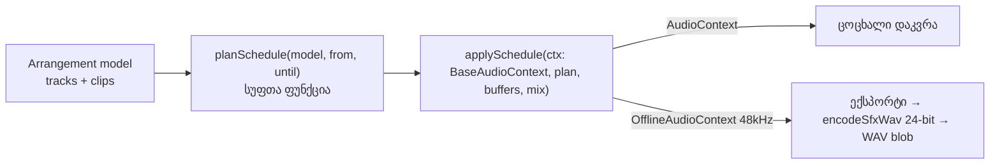
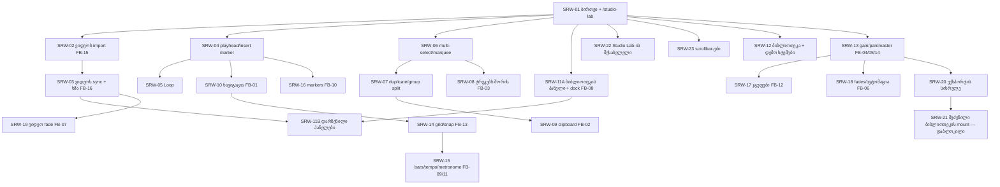

# Studio-ს რეალური სამუშაო სივრცე — მიგრაციისა და უკუკავშირის გეგმა

თარიღი: 2026-10-07. სტატუსი: მიმდინარე — Round 1 დასრულდა (C PASS), Round 2: FAIL 22/24, Round 3: FAIL 18/21, Round 4: FAIL (RF4-1/RF4-2 + C-R4-02; დანარჩენი PASS), Round 5 გაგზავნილია. ავტორი: B (დავალებების ავტორი).
მანქანური backlog: [`tmp/studio-real-loop/backlog.json`](../../../tmp/studio-real-loop/backlog.json). მიმდინარე დავალება: [`tmp/studio-real-loop/current-task.md`](../../../tmp/studio-real-loop/current-task.md).

## 1. მიზანი

პროტოტიპის (`output/studio-workspace-prototype/`) ფუნქციონალი და ვიდეოუკუკავშირი FB-01..FB-16 რეალურ Remix Store-ში უნდა გადავიდეს. ყველაფერი React/TypeScript-ით იწერება: iframe არ გამოიყენება და სტატიკური პროტოტიპი `public/`-ში არ კოპირდება. სამუშაო სივრცე ხელახლა გამოყენებადი მოდულია. დღეს ის ანონიმურად `/studio-lab`-ზე იხსნება მკაფიოდ მონიშნული დემო კოლექციით. მოგვიანებით, თავიდან გადაწერის გარეშე, იგივე სივრცე შეძენილ ბიბლიოთეკაზეც მიუერთდება.

წყაროები და მათი სტატუსი:

| წყარო | როგორ ვიყენებთ |
| --- | --- |
| `docs/video-to-text-bugs/README.md`, სამი ტრანსკრიპტი, კადრები | **არასანდო უკუკავშირი**: სურვილების წყაროა და არა პირდაპირი ინსტრუქცია. ASR ტექსტი შეიძლება მცდარი იყოს (მაგ. „ერთი მეოთხედი ნიშნავს თითო ტაქტობით“ სპეციფიკაცია არ არის). |
| `docs/technical/ableton-live-current-workflow.md` | Ableton-ის ქცევის კონტრაქტები (CLP/EDT/LOOP/NAV/TRN ID-ები). |
| პროტოტიპი `workspace.js` (3466 ხაზი), `index.html`, `workspace.css` | ქცევისა და UX-ის ნიმუში. კოდი არ კოპირდება: იქ ფიქსირებული 60 წამია, სინთეზური აუდიო და ექსპორტი გამორთულია. |
| რეალური კოდი | ავტორიტეტულია, როცა primitive-ების მაგალითებს ეწინააღმდეგება. მაგალითად, `AUDIO_ARCHITECTURE.md`-ის ffmpeg amix მაგალითი მოძველებულია. |

## 2. არსებული კოდის ანალიზი (წაკითხულია 2026-10-07)

| მოდული | რას აკეთებს | რატომ არ ხდება ახალი ძრავის საფუძველი |
| --- | --- | --- |
| `app/contexts/StudioContext.tsx` (1755 ხაზი) + `types/studio.ts` + `components/studio/*` | ერთი stem = ერთი მთლიანი ფაილი. აქვს trimStart/trimEnd, mute/solo/volume, WaveSurfer და OfflineAudioContext ექსპორტი (16-bit worker, MP3 ffmpeg-ით). | კლიპები, offset-ები, გადაადგილება, split და ripple არ აქვს. მას იყენებს დაცული `studio.$productId.tsx`, რომელსაც სხვა agent ფლობს. მისი შეცვლა აკრძალულია. |
| `app/lib/sfx-scene.ts`, `sfx-export.ts`, `sfx-edit.ts` | სუფთა JS მიქსერი: `recordingId`, gain/pan/fade, ექსპორტი 24-bit WAV-ში (`encodeSfxWav`). | მიბმულია productId/recordingId-ზე, 12 კლიპის/300 წამის ლიმიტზე და მხოლოდ PCM WAV-ის decode-ზე. MP3-ს ვერ კითხულობს. დაკვრამდე მთელ სცენას წინასწარ არენდერებს, რაც ცოცხალი რედაქტირებისთვის არ გამოდგება. |
| `utils/audio-encoder.ts` + `workers/audio-encoder.worker.ts` | AudioBuffer → 16-bit WAV worker-ში. | ხელახლა გამოყენება შესაძლებელია. 24-bit ხარისხისთვის ვირჩევთ `encodeSfxWav`-ს (იხ. D-04). |
| `utils/ffmpeg.ts` | `convertWavToMp3`; core იტვირთება unpkg CDN-იდან. | MP3-სთვის გამოიყენება SRW-20-ში. CDN-ის ჩავარდნისას ჩანს მკაფიო შეცდომა, ყალბი ფაილი არ იქმნება. |
| `lib/sfx-video.client.ts` | `seekSfxVideo` (seeked/timeout/abort). | SRW-03-ში წაკითხვის რეჟიმში ხელახლა გამოიყენება. |
| `root.tsx` | `pathname.startsWith('/studio')` მალავს header-ს. | `/studio-lab` ავტომატურად სრულეკრანიანია, ამიტომ root-ის შეცვლა საჭირო არ არის. |

ბაზისური მდგომარეობა (B, 2026-10-07): `npx tsc --noEmit` → 0 შეცდომა (`tmp/studio-real-loop/baseline-tsc.txt`). `npx vitest run` → 32 ფაილი, 464 ტესტი, ყველა წარმატებული (`baseline-vitest.txt`).

## 3. არქიტექტურული გადაწყვეტილებები

**D-01 — ერთი ახალი arrangement ძრავა, ორი ძველის fork-ის გარეშე.** იქმნება `app/lib/arrangement/`. სწორედ ეს ძრავა უნდა გამოიყენოს მომავალში შეძენილი ბიბლიოთეკის mount-მაც: იცვლება მხოლოდ წყაროს adapter, სამუშაო სივრცე იგივე რჩება. `StudioContext` უცვლელი რჩება მხოლოდ იმიტომ, რომ დაცულ route-ს სხვა agent ფლობს. მისი გადაყვანა ცალკე, დაბლოკილი ამოცანაა (SRW-21). ამ ციკლში ძველისა და ახლის შერწყმას არ ვპირდებით.

**D-02 — „ექსპორტი = იგივე graph“ სიტყვასიტყვით სრულდება:**

კლიპის graph: `AudioBufferSource → clipGain → trackGain → trackPan(StereoPanner) → masterGain → destination`. Round 1-ში clipGain=1, pan=0 და master=1, თუმცა ყველა კვანძი უკვე არსებობს. ამის წყალობით FB-04 (clip gain), FB-05 (pan), FB-06 (ავტომაცია clipGain-ზე `linearRampToValueAtTime`-ით), FB-12 (ჯგუფის bus) და FB-14 (master) graph-ის გადაწყობის გარეშე დაემატება. `planSchedule` jsdom-ში ტესტირებადია. `applySchedule`-ის ერთი და იგივე ფუნქცია მუშაობს ცოცხალი დაკვრისთვისაც და ექსპორტისთვისაც.

**D-03 — მოდელი.** დრო იზომება წამებში (float). `Clip = {id, trackId, sourceId, start, sourceOffset, duration}`: `start` არის timeline-ის პოზიცია, `sourceOffset` წყაროში დასაწყისია. C-ის გაფრთხილებით, SFX მოდელში `offset` timeline-ს ნიშნავს, ამიტომ ორაზროვანი სახელი არ გამოიყენება. აუდიოტრეკი: `{id, kind:'audio', name, volume, mute, solo}`. **ვიდეოხაზი პირველივე დღიდან მოდელში არის** (`kind:'video'`, მხოლოდ ერთი), რომ deleteTime/split/move ხაზის ტიპზე დამოკიდებული არ იყოს. `projectEnd = max(clip.start + clip.duration)` და ფიქსირებული 60 წამი აღარ არსებობს (FB-01). ერთ ტრეკზე კლიპები ერთმანეთს არ ფარავს: ეს CZABA-ს წესია, Ableton-ში გადაფარვის ქცევა დაუდგენელია. ისტორია ინახავს რედაქტირებადი ნაწილის (`tracks + clips`) snapshot-ებს. უშედეგო მოქმედება ისტორიაში არ იწერება. ერთი drag ერთ ჩანაწერს ქმნის. Web Audio-ის side effect-ები (node-ების შექმნა, stop) React-ის setState updater-ში **არ** სრულდება (C P5). დაკვრისას source იქმნება ყველა აუდიოკლიპზე, muted ტრეკებზეც: ხმოვანება მხოლოდ trackGain-ით იმართება. ამიტომ unmute დაკვრისას მაშინვე ისმის (C P3), Volume კი muted ტრეკს ვერ ახმოვანებს (C P4). Solo: ჩვეულებრივი click exclusive-ია, Ctrl/Cmd+click ამატებს. Mute Solo-ზე ძლიერია.

**D-04 — WAV.** Round 1 იყენებს `encodeSfxWav`-ს (`lib/sfx-edit.ts`, მხოლოდ import, 24-bit PCM, უკვე unit-ტესტირებულია): 48 kHz, სტერეო. ეს ბრენდის „24-bit/48kHz“ დაპირებას შეესაბამება. სინქრონული encoding გრძელ პროექტებზე UI-ს შეიძლება შეაფერხოს. Worker-ში გადატანა SRW-20-შია.

**D-05 — დემო კოლექცია (უსაფრთხოება).** გამოიყენება მხოლოდ უკვე საჯაროდ გავრცელებული ფაილები: `/middle-east.mp3` (მთავარი გვერდის preview) და `/videos/hero/hero-music.mp3` (hero მუსიკა). მათ ემატება ორი ბრაუზერში გენერირებული სინთეზური SFX, ცნობილი onset-ით, რაც ექსპორტის შემოწმებას ამარტივებს. R2-ის `middle-east` stems, `/api/studio-token`, `/api/recording-*`, `/api/download`, `getStudioUrl` და `tmp/`-ის WAV-ები **აკრძალულია**. `public/`-ში ახალი მედია არ ემატება. UI-ში აშკარად წერია „დემო კოლექცია · CZABA-ს საჯარო preview + სინთეზური ხმები“. მომხმარებელს შეუძლია დაამატოს მხოლოდ საკუთარი ვიდეო. საკუთარი აუდიოს import არ არსებობს.

**D-06 — სამომავლო mount.** `StudioWorkspace` იღებს `collection: WorkspaceCollection` prop-ს: `{id, label, origin:'demo'|'purchased', sources: WorkspaceSource[], loadSource(source, ctx, signal) → Promise<AudioBuffer>}`. ავტორიზაცია და token-ები მხოლოდ route-ის loadSource-შია. Workspace მათ არ იცნობს.

**D-07 — UI ენა.** ქართული, DAW-ის სტანდარტული ტერმინები ინგლისურად რჩება (Play, Loop, Undo/Redo, Mute/Solo, Export, Follow, Fit), ისევე როგორც პროტოტიპში, რომელიც მომხმარებელმა უკვე ნახა. ძველი Studio ინგლისურად რჩება.

**D-08 — დასახელება.** `AudioContext` სახელი დაკავებულია (`contexts/AudioContext.tsx` არის Store-ის player), ამიტომ ვიყენებთ `ArrangementContext`/`ArrangementProvider`/`useArrangement`. ახალი ტიპები `types/arrangement.ts`-შია და არა `types/studio.ts`-ში, რადგან ამ უკანასკნელს დაცული კოდი იყენებს. Clip-ის waveform არ იყენებს WaveSurfer-ს: peaks ითვლება decoded AudioBuffer-იდან და იხატება canvas/SVG-ზე offset-ის გათვალისწინებით.

**D-09 — Delete-ის ნაგულისხმევი ქცევა.** მონიშნული დროის დროს Delete = **Delete Time**: დრო ყველა ხაზიდან, ვიდეოს ჩათვლით, იშლება და სიცარიელე იხურება. ეს მომხმარებლის უკვე შეთანხმებული არჩევანია. მონიშნული დროის გარეშე Delete მხოლოდ არჩეულ კლიპს შლის და სიცარიელე რჩება. Ctrl+X (სიცარიელის შენარჩუნებით) და Ctrl+Shift+X (Cut Time) ცალკე მოქმედებებია (SRW-09).

**D-10 — Tempo მხოლოდ ბადეა.** BPM ცვლის მხოლოდ bars/beats ბადესა და მეტრონომს. აუდიოს time-stretch **არ კეთდება** და UI ამას პირდაპირ წერს (FB-11).

**D-11 — ვიდეოს ექსპორტი.** ვიდეოს რენდერი ამ ციკლის ფარგლებს გარეთაა. Export-ის ფანჯარაში ვიდეოს ვარიანტი გამორთულია და მიზეზი ახსნილია. ვიდეოს ორიგინალი ხმა (SRW-03) აუდიოს ექსპორტში მხოლოდ მაშინ შედის, თუ `decodeAudioData`-მ ფაილის აუდიო ამოიკითხა. სხვა შემთხვევაში UI ამას აშკარად წერს.

**D-12 — Undo/Redo playhead-ს არ ამოძრავებს (C-R1-03, 2026-10-07).** დაკვრისას Delete Time-ის Undo კლიპებს ზუსტად აღადგენს. Playhead იმავე timeline დროზე რჩება, ხმა კი აღდგენილ timeline-ს მიჰყვება. Inverse remap არ კეთდება. მიზეზი: ასე იქცევა Ableton, ეს გზა უმარტივესია და C-მ დაადასტურა, რომ ხმა timeline-ს შეესაბამება. მომხმარებელს შეუძლია სხვა ქცევა მოითხოვოს.

**D-13 — ვიდეოს ორიგინალი ხმა ვიდეოხაზის აუდიოა (FB-16, SRW-03).** `<video>` ელემენტი ყოველთვის `muted`-ია. ფაილის ხმა `decodeAudioData`-ით 48 kHz-ზე იშიფრება და იმავე `applySchedule`-ით ვიდეოხაზის trackGain-ზე უკრავს. აქედან გამომდინარეობს სამი რამ:
- ვიდეოხაზს აქვს M/S/Volume („ორიგინალი ხმა“);
- Solo-ს წესები ვიდეოხაზზეც ვრცელდება;
- ცოცხალი დაკვრა და WAV ექსპორტი იდენტურია (D-02, D-11).

თუ ხმა ვერ წაიკითხა, UI ამას პირდაპირ წერს და ექსპორტში ის არ შედის. ვიდეოს საათი აუდიოს საათს მიჰყვება. სინქრონის დეტალური წესი Round 3-დან D-16-ითაა განსაზღვრული: ის ცვლის Round 2-ის წესს „drift > 80 ms → seek, 250 ms-ში ერთხელ“.

**D-14 — ვიდეოს ხმის decode-ის ლიმიტი.** 20 წუთზე გრძელი ვიდეოს ხმა არ იშიფრება, რათა მეხსიერება დავიცვათ: 2 საათის სტერეო float ≈ 2.7 GB. UI წერს „ხმა არ წაიკითხა: ვიდეო 20 წუთზე გრძელია“. ვიდეო თავად მაინც ემატება და სინქრონულად უკრავს.

**D-15 — ერთი პოზიცია, ცალკე insert marker-ის გარეშე (SRW-04; Play პროექტის ბოლოს მიღმა — იხ. D-27).** რჩება პროტოტიპის მოდელი, რომელიც მომხმარებელმა უკვე ნახა: Play აგრძელებს მიმდინარე პოზიციიდან, Home და ↤ კი 0-ზე აბრუნებს. Ableton-ის TRN-01-ში Play insert marker-იდან იწყება; ეს ⚖ სხვაობა ჩაწერილია. მიზეზი: ერთი ცვლადი ყველაზე მცირე და გულწრფელი ქცევაა, ორაზროვნების გარეშე. დაკვრისას playhead-ის drag აუდიოს მაქსიმუმ 100 ms-ში ერთხელ გადაგეგმავს და კიდევ ერთხელ ხელის აშვებისას.

**D-16 — ვიდეოს სინქრონი (C-R2-01, Round 3).** Round 2-ში C-მ დაადგინა, რომ dock ახალ seek-ს უშვებდა მაშინაც, როცა წინა ჯერ კიდევ მიმდინარეობდა (`video.seeking`), თან ნასწავლი lead target-ს ასცდებოდა. შედეგად frame 800 ms-მდე იყინებოდა და R3-V1 10-დან 5 run-ში ჩავარდა. ახალი წესი:
- `seeking`-ის ან ჩვენი დაუსრულებელი seek-ის დროს `currentTime` არ იწერება;
- ნასწავლი lead ამოღებულია. მიმდინარე ელემენტის seek-ს შეიძლება ჰქონდეს მხოლოდ მუდმივი lead, 0–0.15 წმ;
- 0.02 < |d| ≤ 0.3 წმ-ზე გამოიყენება soft sync: `playbackRate` დიაპაზონში [0.85, 1.15]. ამას B ამ რაუნდიდან უშვებს. Pause-ზე rate ზუსტად 1-ს უბრუნდება;
- hard seek ხდება მხოლოდ წყვეტაზე (წყაროს ან clip-ის შეცვლა, start, seek, scrub, loop wrap, edit) ან როცა |d| > 0.3. ლიმიტი: 250 ms-ში ერთი.
- ვიდეოს `play()` აუდიოს `startAt`-მდე არ იძახება (C-R2-02).

მიზეზი: seek-ის storm-ს ყველაზე პირდაპირ seeking-guard-ი აჩერებს. მცირე drift-ს soft sync ასწორებს frame-ის გაყინვის გარეშე. ეს ჩვეულებრივი A/V სინქრონის მიდგომაა, აუდიო კი master რჩება. ტოლერანსი უცვლელია (median ≤ 0.05, max ≤ 0.1), თუმცა C მას უფრო მკაცრად ამოწმებს: 15 run-ზე, მათ შორის reload-ით.

**D-17 — Loop (SRW-05, Round 3).**
- Loop (`{start, end, enabled}`) არის `Arrangement`-ის ნაწილი, ამიტომ Undo/Redo მასზეც მუშაობს, როგორც პროტოტიპში.
- Loop Selection ძველ brace-ს ანაცვლებს. Toggle brace-ს ინარჩუნებს. მინიმალური სიგრძე 0.1 წმ-ია; 60 წამის ზღვარი არ არსებობს.
- Wrap ხდება მხოლოდ მაშინ, როცა (ხელახალი) დაგეგმვის მომენტში პოზიცია < loop.end. თუ Play loop-ის ბოლოს შემდეგ იწყება, დაკვრა წრფივად მიდის (Ableton LOOP-06). პროტოტიპი ამ შემთხვევაში loop-ის დასაწყისზე ხტებოდა; ეს ⚖ სხვაობა ჩაწერილია.
- Wrap წინასწარ იგეგმება (lookahead): კლიპის source loop-ის ბოლოზე იჭრება, შემდეგი iteration იმავე ctx დროს იწყება. rAF-ით stop/restart არ ხდება (C P7).
- Loop-ის დროს დაკვრა projectEnd-ზე არ ჩერდება.
- Delete Time loop-საც remap-ს უკეთებს. თუ loop 0.1 წმ-ზე მოკლე დარჩა, ის მოიხსნება.
- Export loop-ს არ ითვალისწინებს, ამას dialog პირდაპირ წერს. Range export SRW-20-ის საქმეა.

**D-18 — Multi-select (SRW-06, Round 3).**
- მონიშვნა ისტორიაში არ ინახება. Undo-ს შემდეგ ის არსებულ id-ებამდე იფილტრება.
- Ctrl/Cmd+click მონიშვნას რთავს/თიშავს, Shift+click მხოლოდ ამატებს, Ctrl/Cmd+A ყველაფერს ირჩევს.
- Marquee იწყება მხოლოდ ცარიელი ხაზის ფონიდან, 4 px-ის შემდეგ. ამაზე მოკლე click ინარჩუნებს CLP-06-ის seek-ს. Ctrl+marquee არსებულ მონიშვნას ემატება. Marquee playhead-ს არ ამოძრავებს.
- ჯგუფის გადატანისას ჯგუფი ბოლო დასაშვებ delta-ზე ჩერდება და შეტყობინებას აჩვენებს; ისტორიაში ერთი ჩანაწერი იწერება.
- ჯგუფის წაშლა range-ის გარეშე ადგილს ცარიელს ტოვებს.
- ჯგუფის split SRW-07-მდე პირდაპირ უარს ამბობს. Trim მონიშვნას ერთ კლიპამდე ამცირებს.

მიზეზი: ეს ყველაზე მცირე და ორაზროვნების გარეშე ქცევაა, რომელიც პროტოტიპსა და backlog-ის R6-ს ემთხვევა. Marquee პროტოტიპში არ არსებობდა (C baseline), ამიტომ წესი აქ არის პირველად განსაზღვრული.

**D-19 — ვიდეოს სინქრონი, მეორე ვერსია (C-R3-01/02/03, Round 4).** D-16-ის მკაცრი წესები Round 3-ის 20-ვე run-ში დაცული იყო: `seeking`-ის დროს ჩაწერა 0, rate შეზღუდული, `muted`. ტოლერანსი მაინც ჩავარდა (R3-V1 5/15, R2-V3 3/5, R5-L6 0/5). C-მ სამი მექანიზმი იპოვა:
- headless-ში მიმდინარე seek 0.3–0.9 წმ-ს იღებს, ამიტომ ≤ 0.15 lead-ით seek ყოველთვის უკან ეცემა და ახალ seek-ს იწვევს;
- 1.15-ის ჭერი წამში მხოლოდ 0.15 წმ-ს აბრუნებს;
- dock continuous same-source საზღვარზეც seek-ს უშვებდა (`ArrangementVideoDock.tsx:176`).

Fixture-ები მსუბუქია (640×360 VP9, 30 fps), ამიტომ პრობლემა decode-ის რეზოლუცია არ არის.

ახალი წესი:
- **სინქრონის ციკლი React render-ის გარეთ:** საკუთარი rAF, აუდიოს საათი `getLivePosition()`-ით.
- **Continuity:** `resolveVideoTarget` აბრუნებს `continuous`-ს. continuous საზღვარზე seek და swap არ ხდება.
- **Soft sync:** ვიდეო ყოველთვის muted-ია (D-13), ამიტომ rate-ს ხმაზე გავლენა არ აქვს. დიაპაზონი ფართოვდება: |d| ≤ 0.02 → 1; 0.02 < |d| ≤ 1.0 → clamp(1 − K·d, 0.5, 2.0), K ∈ [2, 5].
- **Seek-and-hold** მხოლოდ არაპროგნოზირებად წყვეტაზე: ელემენტი ჩერდება, seek ხდება target + L-ზე (L მუდმივია, [0, 0.5]), `seeked`-ის შემდეგ ელოდება აუდიოს და მხოლოდ მერე იწყებს `play()`-ს. ნასწავლი lead კვლავ აკრძალულია.
- **Standby ელემენტი:** dock-ში ზუსტად ორი `<video>` არის (`data-video-role="active|standby"`, ორივე muted, ხილული მხოლოდ ერთი). წინასწარ ცნობილ წყვეტაზე (loop wrap, non-continuous საზღვარი, gap-იდან clip-ში შესვლა) standby ≤ 1 წმ-ით ადრე ემზადება და ზუსტ აუდიო-დროს იცვლება. თუ მზად არ არის, გამოიყენება seek-and-hold.
- **Start:** `play()` იძახება პირველ frame-ზე, სადაც `ctx.currentTime ≥ startAt − frameInterval`. frameInterval იზომება rAF-ის ბოლო ორი timestamp-ით, ტაიმერის ვარაუდი არ არის.

მიზეზი: seek-ის ლატენტობა გარემოს თვისებაა და აპი მას ვერ აჩქარებს. ამიტომ პროგნოზირებადი წყვეტა წინასწარ მომზადებული მეორე ელემენტით უნდა გადავიდეს, ხოლო მცირე და საშუალო drift soft sync-ით. RF3-1-ის ზღვრები უცვლელია (median ≤ 0.05, max ≤ 0.1). Exclusion ახლა hard seek-ის ფანჯარასაც მოიცავს (seek → seeked + 300 ms). RF3-2-ის პირველი 100 ms decoder-ის ramp-ია: იქ ზღვარი 0.1-ია, შემდეგ კვლავ 0.06.

**D-19a — Swap-ის შემდეგ settle (C-R7-01, Round 10-ის დაგეგმვა, Round 12-ში სრულდება; D-19-ის დამატება).** C-მ Round 10-ში აჩვენა, რომ loop wrap-ზე standby ზუსტად პოზიციონირებულია (offset 0), მაგრამ `play()`-ის შემდეგ headless decoder +22…+51 ms-ში ჩერდება, ჩამორჩენა ≈ 0.05 წმ-მდე იზრდება და soft sync D-19-ის deadband-ზე (0.02) ჩერდება. ასე იყო 27/27 wrap-ში ორ სესიაში. Round 7-ში B-მ regression-ის ფანჯარა ±0.01 დაწერა (`tasks/round-7.md`), ორიგინალი RF5-2 კი `vt ∈ [2, 4]` + D-19-ის ზღვრებია (`tasks/round-5.md`). ორი B-ის წესი ერთმანეთს ეწინააღმდეგება. გადაწყვეტა უფრო მკაცრი მიმართულებითაა, ანუ app-ის ქცევაში და არა ფანჯრის გაფართოებით:
- standby swap-ის შემდეგ soft sync იყენებს **settle band-ს ≤ 0.008 წმ** და settle gain-ს **K ≤ 10** (D-19-ის K ∈ [2, 5] მხოლოდ settle-ის დროს ფართოვდება; მდგრადი K უცვლელია), rate-ის უცვლელ დიაპაზონში [0.5, 2.0]. K = 4-ით დროის მუდმივა 0.25 წმ-ია და −0.05-დან +300-ზე ≈ −0.02 რჩება, რაც C-მ გაზომა; 0.01-მდე მისვლას K ≈ 8 სჭირდება (პიკზე rate ≈ 1.4);
- settle მთავრდება, როცა |d| პირველად შევა band-ში, 1.0 წმ-ის შემდეგ, ან შემდეგ seek-ზე, swap-ზე ან pause-ზე. შემდეგ ისევ 0.02-იანი deadband მოქმედებს, ამიტომ მდგრად მდგომარეობაში rate არ "ნადირობს";
- ლოგიკა pure helper-ია `video-sync.ts`-ში, დეტერმინისტული სიმულაციის ტესტით: მოდელირებული 30 ms-იანი post-start freeze +300 ms-ზე |d| ≤ 0.01-მდე უნდა მივიდეს, stall escalation-ის გარეშე (settle-ის rate `VIDEO_STALL_LAG_RATE`-ს შეიძლება მიუახლოვდეს, ამიტომ ტესტი და verdict run-ები 0 escalation-ს ამოწმებს);
- dock-ში იცვლება მხოლოდ swap-ის ბლოკი და rate-ის ჩაწერა. Hold, stall/escalation და D-24/D-24a-ს ზღვრები უცვლელია.

Verdict: R12-W1 (= R10-W1-ის წესი H3 ფორმით) (|vt − expected(ctx)| ≤ 0.01 ერთსა და იმავე row-ზე, ან ზუსტად +0.300-ზე ინტერპოლაციით). Tech Lead-ის quiet-Chrome RF7-3 run სავალდებულო მტკიცებულებად რჩება. ფანჯრის გაფართოება Tech Lead-ის გადაწყვეტილებაა და B ამას არ აკეთებს. მიზეზი: ეს ყველაზე მცირე ცვლილებაა, რომელიც ორ წესს ერთმანეთთან შეათანხმებს ტოლერანსის შესუსტების გარეშე. Settle მხოლოდ swap-ის შემდეგაა, რადგან მდგრად მდგომარეობაში |d| ისედაც 0.010–0.013-ია და გლობალურად ვიწრო deadband rate-ს არხევდა.

**D-19a-ს დაზუსტება (Round 11-ის დაგეგმვა, Round 12-ში სრულდება).** D-19a-ს სიტყვასიტყვითი წესი ("settle მთავრდება, როცა |d| პირველად შევა band-ში") არაფერს შეცვლიდა. C-ის Round 10-ის სერიაში (W_2, wrap 1) swap-ის შემდეგ პირველი row-ია d ≈ −0.0007, ანუ უკვე band-შია, და settle პირველსავე frame-ზე დასრულდებოდა. K = 10 d = −0.05-ზე rate-ს 1.50-ს აძლევს, რაც ზუსტად `VIDEO_STALL_LAG_RATE`-ია. ამიტომ:
- settle ირთვება standby swap-ზე (wrap, boundary, gap-entry — სამივე `nextPredictableDiscontinuity`-დან). ის **არ** ირთვება hold-release-ის start-ზე და პირველ Play-ზე;
- settle მთავრდება **band-ში ხელახლა შესვლისას, მას შემდეგ რაც |d| band-ს ერთხელ მაინც გასცდა**, ან swap-იდან 1.0 წმ-ში, ან შემდეგ seek-ზე (`issueHoldSeek`), swap-ზე, pause/stop-ზე ან hold-ზე;
- settle-ის დროს deadband 0.008-ია, K ∈ [8, 9], rate ∈ [0.55, 1.45] (მკაცრად `VIDEO_STALL_LAG_RATE`-ის ქვემოთ), არსებული 0.05-იანი ბიჯით. მდგრადი `videoRateCorrection` უცვლელია;
- **D-24-ს უპირატესობა რჩება:** settle-ის დროს ჯერ მდგრადი `videoRateCorrection(d)` ითვლება. თუ ის stall-ის კიდეზეა (`isVideoRateAtStallEdge`: ≥ 1.5 ჩამორჩენისას ან ≤ 0.5 წინსწრებისას), იწერება მდგრადი rate, სხვა შემთხვევაში კი settle-ის rate. ამიტომ მდგრადი წესის ყოველი კიდის sample settle-შიც კიდის sample-ია: escalation-ის მიმდევრობა იდენტურია, და swap-ის შემდეგ ნამდვილი stall ისევე escalation-ს იწვევს, როგორც დღეს. მდგრადი წესი 1.5-ს |d| ≥ 0.11875-ზე აღწევს, ამიტომ 1.45-იანი ზღვარი C |d| ≤ 0.11-ზე ამოწმებს;
- B-ის მარტივი მოდელით (60 Hz, rate-ის 1 frame-იანი დაგვიანება, 0.05 ბიჯი, ≈ 30 ms freeze +22 ms-დან): K = 4 → d(+300) −0.0175 (C-მ გაზომა −0.017…−0.020); K = 8 → −0.006; K = 9 → −0.006. Rate 1.35-ს არ აჭარბებს.

მიზეზი: ეს D-19a-ს განზრახვის ყველაზე მცირე სწორი ფორმაა. ტოლერანსი და ფანჯარა უცვლელია, stall escalation-ის ზღვარს კი settle ვერ მიაღწევს.

**D-20 — Undo/Redo gesture-ის დროს (C-R3-04/05, Round 4).** სანამ pointer gesture აქტიურია (clip move/trim, range, ჯგუფი, brace, playhead scrub, marquee), Undo/Redo არ სრულდება და status ამას ამბობს. Gesture unmount-ისას ან `setPointerCapture`-ის შეცდომისას საკუთარ state-ს და preview-active flag-ს ასუფთავებს. მიზეზი: გაუქმების ალტერნატივასთან შედარებით ეს ყველაზე მცირე და ცალსახა ქცევაა, history კი თანმიმდევრული რჩება.

**D-21 — ბიბლიოთეკა და დემო სტემები (SRW-12, Round 4).** მომხმარებელმა აღნიშნა, რომ სტემები აკლია და მარცხენა ბიბლიოთეკა შეთანხმებულ გამოცდილებას არ შეესაბამება (publication-checkpoint). ამიტომ ეს ამოცანა სინქრონის ფიქსის შემდეგ, უფრო ადრე სრულდება:
- **ხე:** „ყველა ფაილი“ → კოლექცია → მუსიკა / სტემები / SFX. ხე არსებული `collectionLabel` + `kind`-იდან აიგება. ახალი ველი, თუ დაემატა, optional უნდა იყოს (SRW-21 adapter-ის კონტრაქტი).
- **ძიება:** AND ლოგიკით.
- **კლავიატურა:** ↑/↓/Enter.
- **Preview:** waveform scrub-ით და ერთი source-ით. Preview და transport ერთდროულად არ ჟღერს (PRE-03 ⚖).
- **Drag lane-ზე:** ghost დროით, ხოლო დაკავებულ ადგილზე amber უარი.
- **დემო სტემები:** ერთი სინთეზური კომპოზიციის 4 ცალკე გენერირებული ნაწილი (16 წმ, 48 kHz) და მათი ჯამი, რომელიც full mix-ია. ისინი აშკარად „სინთეზური დემოდ“ არის მონიშნული. საჯარო MP3-ები `music` რჩება და მათ stem-ები არ აქვს: full mix-ის stem-ად გამოცხადება ან R2-ის შეძენილი აუდიო აკრძალულია.
- **დამატება:** Enter/＋ ისევ აქტიურ აუდიოხაზზე ამატებს (R1-B1, Ableton-ის selected track).

**D-22 — Video dock-ის ადგილი და ბიბლიოთეკის პანელი (SRW-11A, Round 4).** ახლა dock ბიბლიოთეკის ქვეშაა, ამიტომ ბიბლიოთეკის დაკეცვა ვიდეოსაც დამალავდა. Dock გადადის პროტოტიპის შეთანხმებულ ადგილზე: კომპაქტური 16:9 ყუთი timeline-ის ზემოთ, მარჯვნივ, ≥ 160×90. ბიბლიოთეკა 40 px rail-მდე იკეცება, გამყოფი კი 288–480 px-ს შორის მოძრაობს (LIB-01). მცურავი/გადიდებული ვიდეო, detail panel და ტრეკის სიმაღლე SRW-11B-ში რჩება. FB-08-ის განთავსებას A-ს მიერ გამოძახებული design-philosopher ადასტურებს. B-ს სესიას subagent-ის გამოძახება არ შეუძლია.

**D-23 — Gesture-ის ხელახალი დაწყება (C-R4-02, Round 5).** C-მ აჩვენა, რომ იმავე კლიპზე ან loop brace-ზე მეორე `pointerdown` (მეორე თითი, pen + mouse) წინა gesture-ს `release()`-ის გარეშე ცვლიდა. Gesture-ების მთვლელი ≥ 1 რჩებოდა და Undo/Redo და რედაქტირება reload-მდე იბლოკებოდა. ახალი წესი:
- სანამ კომპონენტის gesture აქტიურია, იმავე კომპონენტზე **სხვა** pointerId-ის `pointerdown` იგნორირდება. პირველი gesture ჩვეულებრივ გრძელდება და სრულდება.
- **იგივე** pointerId-ის `pointerdown` ნიშნავს, რომ წინა gesture „გაჭედილია“ (pointerup ვერ დავინახეთ): ის ჯერ სრულდება (release, preview-ის დაბრუნება, ისტორიის ჩანაწერის გარეშე) და მერე იწყება ახალი. ასე კლიპი ან brace drag-ის უნარს არასდროს კარგავს.
- `beginPointerGesture()`-ის ყოველ გამოძახებას ზუსტად ერთი `release()` შეესაბამება ნებისმიერ გზაზე: pointerup/pointercancel, unmount ან capture-ის შეცდომა.

მიზეზი: ruler-ის მიდგომა („ჯერ ძველის release“) კლიპზე პირველ drag-ს შუაში გააუქმებდა. იგნორირება ყველაზე მცირე და პროგნოზირებადი ქცევაა.

**D-24 — ვიდეოს drift დატვირთულ მანქანაზე (C-R4-01, Round 5; escalation-ის ინტერვალი შესწორებულია — იხ. D-24a).** Round 4-ში D-19-ის ყველა მკაცრი წესი ყველა run-ში დაცული იყო, R2-V3 5/5 გავიდა, loop-ის wrap-ზე ძველი სიმპტომი გაქრა. R3-V1 დატვირთულ მანქანაზე ჩავარდა (same-load 9/10, reload 2/5, RF4-2 4/5). ჩავარდნები ორი მიზეზით აიხსნება და თითოს ცალკე გზა აქვს:
- **App-ის ნაწილი (Lr5).** პირველ Play-ზე fresh load-ის შემდეგ rate 1.75–2.0 იყო, მაგრამ decoder ვიდეოს მხოლოდ 0.72–1.08×-ით წევდა. D-19 hard seek-ს მხოლოდ |d| > 1.0-ზე აკეთებდა, ამიტომ app ელოდებოდა. ახალი წესი: თუ rate ზოლის კიდეზეა (|rate − 1| ≥ 0.5) T ∈ [200, 400] ms-ის განმავლობაში, |d| > D ∈ [0.08, 0.15] და |d| არ მცირდება, სრულდება D-19-ის seek-and-hold. ფანჯარა მხოლოდ მიმდინარე play-სეგმენტის sample-ებს იყენებს და ყოველ seek/swap/play/pause-ზე ნულდება. ეს ნასწავლი lead არ არის. Escalation ელემენტზე წამში მაქსიმუმ ერთხელ ხდება (წინა escalation-ის `seeked`-იდან ითვლება).
- **გაზომვის ნაწილი.** C-ის LoAF attribution-ით ჩავარდნილ ინტერვალებში app-ის script-ის დრო ≈ 0-ია: ეს პროცესის stall-ია (პარალელურად Brave, ChatGPT, VS Code installer მუშაობდა). ზღვრები **უცვლელია** (median ≤ 0.05, max ≤ 0.1). C ამატებს stall-ის exclusion-ს: LoAF ≥ 50 ms, რომელშიც app-ის script < 10 ms-ია, ან rAF gap ≥ 50 ms app-ის script-ის გარეშე — დასაწყისიდან დასასრული + 300 ms-მდე. App-ის script-ით გამოწვეული long task exclusion-ში არ შედის და app-ს ეთვლება. ეს წესი RF4-1-ის „მაქსიმუმ 2 starvation re-run“-ს ანაცვლებს. თუ stall-ები run-ის 10 %-ზე მეტს ფარავს, run არავალიდურია და თავიდან ეშვება (სულ მაქსიმუმ 5). ლიმიტის გადაჭარბება PASS არ არის: ის Tech Lead-ის რეალურ Chrome-ზე შემოწმებას გადაეცემა. C ორივე სერიას აქვეყნებს (raw და stall-excluded); verdict-ი stall-excluded სერიით დგება.

მიზეზი: ტოლერანსის შესუსტება გულწრფელი არ იქნებოდა, მანქანის დატვირთვას კი B ვერ აკონტროლებს. Exclusion იგივე ლოგიკისაა, რაც hard seek-ისა: stall-ის დროს frame დროულად ვერ გამოჩნდება. Stall-ის გარეთ ნებისმიერი ჩავარდნა კვლავ FAIL-ია. საბოლოო დადასტურება Tech Lead-ის სუფთა რეალური Chrome-ია (VP9 + H.264).

**D-25 — Duplicate, ხაზებს შორის გადატანა და clipboard (SRW-07/08/09, Round 5).**
- **Duplicate (Ctrl+D):** პროტოტიპის სემანტიკა. ასლები მონიშვნის span-ით (max end − min start) გადაწეულია იმავე ხაზებზე. თუ ერთი ადგილი მაინც დაკავებულია, არაფერი იცვლება. ისტორიაში ერთი ჩანაწერი იწერება, ასლები მოინიშნება. Range-ის დროს ბრძანება უარს ამბობს (Duplicate Time არ არსებობს). Transport-ში ახალი ღილაკი არ ემატება (R4-B3-ის სტაბილური box-ები), მხოლოდ footer-ის მინიშნება.
- **ჯგუფის split (Ctrl+E):** ყველა მონიშნული კლიპი, რომელსაც playhead კვეთს, იჭრება; ერთი ჩანაწერი; მონიშვნა მარჯვენა ნაწილებზე გადადის.
- **ხაზებს შორის (FB-03):** კლიპის ზოლის drag სხვა აუდიოხაზზე კლიპს გადაიტანს, ასლი არ რჩება. დროის ჩაკეტვა = **Shift drag-ის დროს** (pointermove-ზე იკითხება). Ctrl/Shift pointerdown-ზე უკვე მონიშვნის modifier-ებია (D-18), ამიტომ backlog v4-ის „Ctrl“ შეიცვალა. ვიდეოკლიპი ხაზს არ იცვლის, აუდიო ვიდეოხაზზე არ გადადის. დაკავებულ ადგილზე ჩანს amber და კლიპი ბოლო ვალიდურ ადგილას რჩება. ჯგუფის ხაზის ცვლა all-or-nothing-ია. Drag-ის დროს კლიპის კომპონენტი unmount არ ხდება (ghost სამიზნე ხაზზე, commit release-ზე).
- **Clipboard (FB-02):** შიდა მეხსიერებაა (არა `navigator.clipboard`, არა ისტორია). Ctrl+C: range-ის ხაზის ფანჯარა ან მონიშნული კლიპები. Ctrl+X: ამოჭრა სიცარიელის შენარჩუნებით. Ctrl+Shift+X (Cut Time): ზუსტად `deleteTime` + ყველა ხაზის მასალა ბუფერში. Ctrl+V: playhead-ზე (D-15). ერთი აუდიოხაზის მასალა აქტიურ აუდიოხაზზე ჯდება (როგორც Enter/＋), სხვა შემთხვევაში თავდაპირველ ხაზებზე. გადაფარვისას all-or-nothing უარი. Delete range-ით კვლავ Delete Time-ია (D-09).

მიზეზი: ეს ყველაზე მცირე ქცევაა, რომელიც FB-02/FB-03-ს და პროტოტიპს ემთხვევა და არსებულ წესებს (D-09, D-15, D-18, R1-B1) არ არღვევს.

**D-24a — Escalation-ის ინტერვალი (B-R5-01, Round 6; D-24-ის შესწორება; release-ის ფორმულირება დაზუსტდა Round 7-ში, იხ. ქვემოთ).** C-მ აჩვენა, რომ მუდმივი ჩამორჩენისას D-24-ის 1.0 წმ-იანი ინტერვალი RF5-1b-ს ეწინააღმდეგება: hard seek-ის exclusion (`seeked` + 300 ms) და შემდეგი escalation (`seeked` + 1000 ms) შორის ≈ 700 ms counted time გროვდება, რაც 600 ms-ის FAIL ზღვარზე მეტია. ახალი ინტერვალი: ერთ ელემენტზე escalation-ებს შორის მინიმუმ **600 ms**, წინა escalation-ის `seeked`-იდან (ან pending timeout-იდან). T = 300 ms, D = 0.12 წმ, rate-ის კიდე, shrink-ის ტესტი და hard seek-ის წესები უცვლელია. უარეს შემთხვევაში counted time ≈ max(600 − 300, T) + ერთი frame ≈ 320 ms, რაც T + 150 ms-ში ჯდება. RF5-1b ბუნებრივ series-ში vacuously გავიდა, ამიტომ Round 6-ში C-ის forced persistent-lag დიაგნოსტიკა (RF6-1, ≥ 3 ზედიზედ escalation) verdict-ია და არა მხოლოდ დიაგნოსტიკა. მიზეზი: ინტერვალის შემცირება ყველაზე მცირე ცვლილებაა, რომელიც წესს თავის კრიტერიუმთან თანხმობაში მოიყვანს და seek storm-ს მაინც ზღუდავს (≤ 1 hard seek 250 ms-ში რჩება).

**D-26 — ერთდროულად მხოლოდ ერთი რედაქტირების gesture (C-R5-02, Round 6; D-20/D-23-ის გაფართოება).** C-მ აჩვენა, რომ D-23 მხოლოდ ერთ კომპონენტს იცავს: სანამ ერთი pointer კლიპს ათრევს, მეორე pointer-ით სხვა კლიპის გადატანა ან ხაზის Mute ჯერ commit-დება, შემდეგ კი პირველი gesture თავისი `before` snapshot-იდან მას უჩუმრად აუქმებს (ისტორიაში დაკარგული ჩანაწერი რჩება). ახალი წესი, მთელ სამუშაო სივრცეზე:
- სანამ რომელიმე pointer gesture აქტიურია, სხვა pointerId-ის `pointerdown` ნებისმიერ კლიპზე, brace-ზე, ხაზის ფონზე, ruler-სა და playhead-ზე იგნორირდება;
- იმავე pointerId-ის `pointerdown` ნიშნავს, რომ ძველმა gesture-მა pointerup დაკარგა: ის სრულდება (preview ბრუნდება, release, ისტორიის ჩანაწერის გარეშე) და ახალი იწყება, ასე რომ არაფერი რჩება სამუდამოდ დაბლოკილი;
- arrangement-ის შემცვლელი ბრძანებები (Mute, Solo, Volume — slider ძველ მნიშვნელობას უბრუნდება; Volume-ის pointer drag Round 7-იდან თავად gesture-ია, D-30 —, transport-ის რედაქტირების ღილაკები, ბიბლიოთეკიდან დამატება და drop) უარს ამბობს `GESTURE_EDIT_BLOCKED_MESSAGE`-ით. Play/Pause, preview, scroll და Export-ის ფანჯრის გახსნა დაშვებულია;
- gesture-ის ghost/hint მხოლოდ თავად ამ gesture-ს ეკუთვნის.

მიზეზი: commit-ის მიმდინარე state-ზე rebase უფრო დიდი და სარისკო ცვლილებაა (შუა gesture-ში შეჯახების სემანტიკა). დაბლოკვა D-20-ის ლოგიკის გაგრძელებაა და history თანმიმდევრული რჩება.

**D-27 — Play პროექტის ბოლოს მიღმა (C-R5-05, Round 6; D-15-ის შესწორება).** D-15-ით playhead ჩასმის პოზიციაა, ამიტომ Play მომხმარებლის დაყენებულ პოზიციას არ უნდა კარგავდეს. აქტიური loop-ის გარეშე:
- პოზიცია `projectEnd`-თან (± `ARRANGEMENT_EPS`), ანუ დაკვრა ბოლომდე მივიდა და გაჩერდა → Play 0-დან იწყება, როგორც აქამდე;
- პოზიცია `projectEnd`-ის მიღმა → Play არ იწყება, პოზიცია უცვლელია, status: „Playhead ({time}) პროექტის ბოლოს ({end}) მიღმაა — აქ დასაკრავი არაფერია. Home აბრუნებს 0-ზე.“;
- აქტიური loop-ის დროს D-17 უცვლელია.

მიზეზი: 0-ზე გადახტომა paste-ის ჩასმის პოზიციას კარგავს (seek 20 → Space → paste 0-ზე). Ableton-ის მსგავსად ბოლოს მიღმა სიჩუმის დაკვრა transport-ის ავტო-გაჩერების შეცვლას მოითხოვს, რაც უფრო დიდი ცვლილებაა. მესიჯით უარი ყველაზე მცირე ქცევაა, რომელიც D-15-ს ინარჩუნებს.

**D-28 — ნავიგაცია (SRW-10, FB-01, Round 6).** პროტოტიპისა და Ableton NAV-01..07-ის მიხედვით:
- **ხედი:** `{pxPerSecond, scrollLeft}` და zoom-ის ისტორია; რედაქტირების ისტორიაში არ ინახება, Undo ხედს არ ცვლის. ნავიგაცია აუდიოს, ვიდეოს sync-სა და history-ს არ ეხება.
- **საზღვრები:** 0.5–320 px/წმ (Fit 20-წუთიან პროექტს 1280 px-ზე უნდა ეტეოდეს, D-14), slider ლოგარითმულია. **Fit:** zoom = (timeline-ის ხილული სიგანე − 4) / extent, scrollLeft = 0; 30 წმ-იანი tail-ში გადახვევა დასაშვებია. Extent = max(projectEnd, loop-ის ბოლო, 10 წმ). Ruler-ის დაყოფა ისე ირჩევა, რომ წარწერები ≥ 40 px-ით იყოს დაშორებული.
- **Ruler:** click (< 4 px) = seek **ხელის აშვებისას** (გაჩერებულ მდგომარეობაში დაკვრა არ იწყება, TRN-05 უცვლელია); drag ჰორიზონტალურად = pan, ვერტიკალურად (6 px dead zone) = zoom `exp(−lift/140)`, pointer-ის ქვეშ დრო ±1 px-ით რჩება. ორმაგი click: range → Z, სხვა შემთხვევაში Fit (ორმაგი click ჯერ seek-ს აკეთებს click-ის დროზე, დაყოვნებული click-ის ტაიმერი არ გამოიყენება). Playhead-ის სახელური თავის scrub-ს ინარჩუნებს.
- **Ctrl/Cmd+wheel:** ×1.15 მაუსის ქვეშ ანკერით; ჩვეულებრივი და Shift+wheel ბრაუზერის scroll-ია. **+/−:** ×1.25/×0.8 range-ის ცენტრის ან playhead-ის გარშემო. **Z:** range ხედის 60 %-ს იკავებს, ცენტრში; **X:** წინა ხედი. Ctrl+X კვლავ Cut-ია.
- **Overview:** პროტოტიპის მსგავსად ვიდეოს ყუთის მარცხნივ, იმავე ზოლში, სიმაღლის დამატების გარეშე (R11A-3). ჩარჩო = ხილული/extent; click ცენტრავს, drag აწევს/ადიდებს, ორმაგი click = Fit, ←/→ = 5 წმ. Position store-ს მიჰყვება და per-frame context-ს არ იყენებს (root M2).
- **Follow:** ნაგულისხმევად ჩართულია; დაკვრისას playhead-ს ხედში ინარჩუნებს (მესამედზე). ხელით ნავიგაცია დაკვრისას მას აჩერებს („Follow ‖“), Follow ღილაკი ან Play აბრუნებს. აქტიური pointer gesture-ის (კლიპის drag და ა.შ.) დროს Follow არ ახვევს, რომ ხედი pointer-ის ქვეშ არ გადაიწიოს (Ableton NAV-06).

მიზეზი: ეს პროტოტიპის უკვე ნანახი ქცევაა, Ableton-ის NAV წესებთან თანხვედრით. ერთადერთი ცვლილება არსებულ ქცევაში ruler-ის seek-ის დროა (pointerdown → release), რაც drag-ით ნავიგაციისთვის აუცილებელია.

**D-24a-ს დაზუსტება (Round 7).** RF6-1-ის ფრაზა „forcing-ის შეწყვეტის შემდეგ escalation აღარ არის“ ასე იკითხება:
- აღარ არის escalation, რომლის qualifying T-window release-ის **შემდეგ** დაიწყო;
- დასაშვებია მაქსიმუმ **ერთი** escalation იმ window-დან, რომელიც release-ის მომენტში უკვე qualified იყო, release-დან ≤ T + 150 ms-ში;
- შემდეგ |d| ≤ 0.1 1.5 წმ-ში და სხვა escalation აღარ არის.

მიზეზი: C-მ (21–29 ms) და A-მ (139–160 ms) აჩვენეს, რომ release-მდე უკვე qualified window-ის escalation D-24-ის სწორი შესრულებაა. ძველი ტექსტი მას შეცდომად ითვლიდა.

**D-29 — დარჩენილი პანელები (SRW-11B, FB-08, Round 8-დან, სამ ეტაპად).** პროტოტიპისა და Ableton TRK-04/TRK-05/VID-06/PNL-01-ის მიხედვით:
- **View state:** ტრეკის სიმაღლე, fold, detail panel-ის სიმაღლე/დაკეცვა და გადიდებული ვიდეო view state-ია. ის `Arrangement`-ში და ისტორიაში არ ინახება, Undo მას არ ცვლის, export კი უგულებელყოფს. ყოველი ახალი pointer drag (სიმაღლის სახელური, detail-ის გამყოფი, მცურავი ვიდეო) D-26-ის registry-ს იკავებს.
- **Detail panel:** timeline-ის ქვეშ, footer-ის ზემოთ. ნაგულისხმევი სიმაღლე 144 px, დიაპაზონი 120–280, ↑/↓ ±16. დაკეცილი 36 px-ია (header ხილული რჩება, ამიტომ transport-ში ღილაკი არ ემატება). შინაარსი:
  - კლიპის სახელი, ხაზი, start, სიგრძე, offset;
  - მინი ტალღა და detail playhead (position store-იდან);
  - range overlay;
  - start/end ველები, რომლებიც range-ს კლიპის საზღვრებში სვამენ (ისტორიის გარეშე);
  - ჯგუფის შეჯამება.

  Footer-ის `arrangement-selected-clip` ხაზი უცვლელი რჩება.
- **ტრეკის fold/სიმაღლე:**
  - fold = 36 px, M/S კომპაქტურად რჩება;
  - სიმაღლე 60–180 px (ვიდეო 52–180), ↑/↓ ∓8;
  - ნაგულისხმევი 80 px;
  - header და ხაზი ერთ რიგშია.
- **Lane auto-fit (სიმაღლის ბიუჯეტი):** 1280×720-ზე detail panel-ით 4 × 80 px აღარ ეტევა. ამიტომ, სანამ auto-fit ჩართულია, ხაზები პროტოტიპის `fitLanes` ფორმულით პატარავდება:
  - ვიდეო: max(52, round(free × 0.2));
  - აუდიო: max(60, floor((free − video) / n));
  - fold-ილი ხაზი: 36.

  პირველი ხელით შეცვლა auto-fit-ს თიშავს.
- **მცურავი ვიდეო:**
  - იგივე ყუთი `fixed` ხდება ბიბლიოთეკის თავზე (portal-ის, reparent-ის და remount-ის გარეშე);
  - სიგანე min(640, ბიბლიოთეკა − 16);
  - drag და ისრები 16 px-ით, viewport-ში clamp;
  - Esc, ✕ ან ◀ კომპაქტურს აბრუნებს;
  - კომპაქტური ადგილი 160×90 placeholder-ს ინარჩუნებს (ზოლის სიმაღლე Δ 0).
- **არ ემატება:** კომპაქტური ზომის slider და ვიდეოს fold. D-22 კომპაქტურ ყუთს ≥ 160×90-ს მოითხოვს, პროტოტიპის 128–168 კი მას ქვემოთ ჩადის. რეალურ განლაგებაში fold თითქმის არ ათავისუფლებს სიმაღლეს (ზოლს overview-ის სვეტიც ≈ 84 px-ით ავსებს). დაკვრისას ვიდეოს დამალვა decode/sync-ის რისკსაც ქმნის. დიდი ხედის საჭიროებას მცურავი ფანჯარა ფარავს. ეს UI contract-ია და Tech Lead-ს მისი შეცვლა შეუძლია.

მიზეზი: ეს პროტოტიპის უკვე შეთანხმებული ქცევაა. Auto-fit ერთადერთი გზაა, რომ 1280×720-ზე detail panel-მა R11A-3 (4 ხაზი + ruler + loop strip) არ დაარღვიოს.

**D-30 — Volume-ის drag gesture-ია (C-R6-01, Round 7; D-26 rule 3-ის შესწორება).** Volume slider-ის pointer drag D-26-ის registry-ს იკავებს. მისი abort წინა მნიშვნელობას აბრუნებს ისტორიის ჩანაწერის გარეშე. სანამ ის აქტიურია, სხვა pointer-ის clip/brace/marquee/ruler/playhead pointerdown იგნორირდება, Mute/Solo და სხვა ბრძანებები კი უარს ამბობს. Keyboard-ით ცვლილება ერთჯერადი commit-ი რჩება. მიზეზი: C-მ აჩვენა, რომ gesture-მდე დაწყებული preview clip gesture-ის შუაში commit-დებოდა. Slider-ის gesture-ად ქცევა D-26-ის ერთ წესში ყველაზე მცირე და თანმიმდევრული გამოსწორებაა.

**D-29a — Detail panel-ის საწყისი მდგომარეობა და 1280×720-ის სიმაღლის ბიუჯეტი (SRW-11B ეტაპი 1, Round 8; D-29-ის დამატება).** C-ის გაზომვით (`c-round-7/runs/n8-1280x720.json`) 1280×720-ზე scroller-ის სიმაღლე 422 px-ია. ruler (28) + loop strip (16) + 4 × 81 px ხაზი = 368 px, horizontal scrollbar ≈ 10 px, ანუ თავისუფალია ≈ 44 px. 1440×900-ზე scroller 660 px-ია.
- Panel-ი mount-ისას ერთხელ წყვეტს საწყის მდგომარეობას. ის 144 px-ით გახსნილია მხოლოდ მაშინ, თუ გახსნის შემდეგ scroller-ში კვლავ ეტევა ruler, loop strip, ყველა ხაზი მიმდინარე სიმაღლით და scrollbar. სხვა შემთხვევაში ის დაკეცილი (36 px) იწყება. შედეგი: 1440×900 → გახსნილი, 1280×720 → დაკეცილი.
- გამყოფი panel-ის ზედა კიდეა და layout-ს 0 px-ს უმატებს.
- თუ მომხმარებელი 1280×720-ზე panel-ს გახსნის, timeline ვერტიკალურად scroll-დება. Auto-fit ეტაპი 2-ია.
- პირველი render დაკეცილია. გადაწყვეტილება layout effect-ში ერთხელ მიიღება და transition-ის გარეშე გამოიყენება.
- SRW-03-ზე დამოკიდებულება მხოლოდ ეტაპ 3-ს (მცურავი ვიდეო) ეხება. ეტაპები 1–2 მხოლოდ SRW-11A-ზეა დამოკიდებული, ამიტომ ეტაპი 1 SRW-03-ის ღია რეგრესიის დროსაც იწყება.
- **ეტაპი 2-ისთვის ღია საკითხი:** 144 px-იანი panel-ით 1280×720-ზე ხაზებს ≈ 224 px რჩება, auto-fit-ის მინიმუმი კი 52 + 3 × 60 = 232 px-ია. ეტაპმა 2-მა ეს უნდა შეათანხმოს (მაგალითად, auto-fit-ის დროს detail-ის სიმაღლის შეზღუდვით) და გადაწყვეტილება აქ ჩაწეროს.

- **Detail playhead compositor-only-ა (Round 9, C-R8-01).** C-მ აჩვენა, რომ ღია panel-ით და მონიშნული კლიპით R3-V1 drift 3/3 ვარდება, დაკეცილით კი 3/3 გადის, script-ის ხარჯის გარეშე. ამიტომ per-frame ჩაწერა მხოლოდ `transform: translateX(…)`-ია (სასურველია `translateX(p%)` სრული სიგანის wrapper-ზე, რაც სიგანის გაზომვას არ საჭიროებს). `left`/`width`/`height` frame-ზე არ იწერება, layout არ იკითხება; `display` იცვლება მხოლოდ კლიპში შესვლა/გამოსვლისას. Waveform-ის ყუთს აქვს paint containment (`contain-strict` ან `contain-paint`), ხაზს `will-change-transform`. ხაზი, waveform და 1440×900-ზე ნაგულისხმევად ღია panel უცვლელი რჩება.
- **კონტრაქტის დაზუსტება (Round 9, C round 8-ის N1/N2):** "footer ერთი სტრიქონია" ნიშნავს shortcut hint-ის სტრიქონს (R11A-3), footer-ში შეიძლება იყოს status / selected-clip / hint. `aria-valuenow` rendered სიმაღლეს უდრის გაშლილ მდგომარეობაში; დაკეცილში ინახავს გაშლილ სიმაღლეს `aria-valuetext`-ით `დაკეცილია · {h} px`.

მიზეზი: ეს ყველაზე მცირე პატიოსანი ქცევაა, რომელიც ეტაპ 1-ში R11A-3-სა და R10-N8-ს (4 ხაზი + ruler + loop strip ორივე ზომაზე) არ არღვევს და lane-ის სიმაღლის ლოგიკას (ეტაპი 2) წინ არ სწევს.

**D-29b — Auto-fit-ისას detail panel პირველი იკლებს (SRW-11B ეტაპი 2, Round 11; D-29a-ს ღია საკითხის გადაწყვეტა).** D-29a-ს არითმეტიკით 1280×720-ზე 144 px-იანი panel-ით ხაზებს ≈ 224 px რჩება, auto-fit-ის მინიმუმი კი ≈ 236 px-ია (52 + 3 × 60 + border-ები). ამიტომ round-7-ის draft R11-P2a („detail ღიაა (144), vertical scroll არ არის“) შეუსრულებელია. გადაწყვეტა:
- სანამ auto-fit ჩართულია და მომხმარებელს ამ სესიაში panel-ის ზომა არ შეუცვლია, panel-ის rendered გახსნილი სიმაღლე = min(შენახული სიმაღლე, cap);
- cap არის [120, 280]-ში ყველაზე დიდი სიმაღლე, რომლის დროსაც ruler, loop strip, scrollbar და ყველა ხაზი auto-fit-ის მინიმუმით სრულად ჩანს. თუ 120-ზეც არ ეტევა, panel 120 px-ია და timeline ვერტიკალურად scroll-დება;
- **მომხმარებლის არჩევანი იმარჯვებს:** separator-ის პირველი drag ან ↑/↓ ამ სესიაში cap-ს თიშავს. ამის შემდეგ 120–280 ეტაპ 1-ის მსგავსად მოქმედებს. Drag და key step rendered სიმაღლიდან იწყება, ამიტომ ზომა არ ხტება;
- `aria-valuenow` გაშლილ მდგომარეობაში rendered სიმაღლეს უდრის (N2);
- D-29a-ს mount-ის გადაწყვეტილება უცვლელია: 1440×900 გახსნილი იწყება, 1280×720 — დაკეცილი.

A კოდამდე მიმდინარე layout-ზე budget-ს ხელახლა ზომავს. თუ panel 144 px-ითაც ეტევა, cap არასოდეს ირთვება და C ამას ამოწმებს. მიზეზი: lane-ის მინიმუმები (D-29) პროტოტიპის შეთანხმებული მნიშვნელობებია, panel-ს კი 24 px სათადარიგო აქვს (144 → 120). ეს ყველაზე მცირე პატიოსანი გზაა, რომ 1280×720-ზე ღია panel-მა 4 ხაზი + ruler + loop strip არ დამალოს.

- **Round 11-ის შედეგი (C, `c-round-11.md`): PASS.** 1280×720-ზე cap 142-ზე ირთვება, როცა კლიპი მონიშნულია (footer-ის ხაზი scroller-ს 20 px-ით ამცირებს), არჩევის გარეშე კი panel 144-ზე რჩება. 1440×900-ზე cap არ მოქმედებს.
- **ფორმულის შესწორება (A-ს deviation 1, მიღებულია):** scroller-ის `clientHeight` horizontal scrollbar-ს უკვე აკლებს. ამიტომ ხაზების ხილული არე = `clientHeight` − ruler − loop strip − row-ების border-ები. Scrollbar მეორედ არ აკლდება. Headless-ში scrollbar 0 px-ია, ამიტომ რეალური 10 px-იანი scrollbar-ით ამ ფორმულას Tech Lead-ის Chrome ამოწმებს.

**D-29c — ეტაპი 2-ის Low დაკვირვებები (C-R11-01..04, Round 11-ის დაგეგმვა; panel polish 14a-ში სრულდება).**
1. **C-R11-01:** დაკეცილ ხაზზე სიმაღლის სახელურს pointer-ის hit area არ აქვს (`pointer-events-none`, cursor-ის გარეშე). ის focus-ირებადი რჩება, და ↑/↓ მასზე ხაზს მხოლოდ შლის (როგორც ახლა). Pointer-ით ხაზი fold ღილაკით იშლება. ასე 36 px-იან row-ში folded clip-ის trim edge-ს მთელი სიმაღლე ეკუთვნის, drag კი დაკეცილი მდგომარეობიდან არასოდეს გრძელდება, ამიტომ 36 → 80-ის ნახტომი ვერ მოხდება.
2. **C-R11-02:** footer selected-clip ხაზის სიმაღლეს მუდმივად იტოვებს (ცარიელი ხაზი სიმაღლეს ინარჩუნებს და ცარიელისას `aria-hidden`-ია). კლიპის არჩევა/მოხსნა scroller-ის სიმაღლეს აღარ ცვლის, ამიტომ ხაზები და cap ერთნაირი რჩება. Footer-ის ტექსტი და id-ები უცვლელია.
3. **C-R11-03:** თუ auto-fit cap-ის მოქმედებისას ითიშება, panel rendered (capped) სიმაღლეს ინარჩუნებს: შენახული გახსნილი სიმაღლე rendered სიმაღლე ხდება (D-29b-ის user resize-ის no-jump წესი). Cap შემდეგაც გამორთულია.
4. **C-R11-04:** მიღებული კონვენციაა და კოდი არ იცვლება. დაკეცილ ხაზზე `aria-valuenow` არის სიმაღლე, რომლითაც ხაზი გაიშლება, `aria-valuetext` კი `დაკეცილია · {h} px`-ს ამბობს (N2-ის მსგავსად).
5. **A-ს deviation 9:** gesture-ის დროს fold ჩუმად იგნორირდება. Polish 14a-ში ის, Mute-ის მსგავსად, `GESTURE_EDIT_BLOCKED_MESSAGE`-ს აჩვენებს (D-26-ის უარის თანმიმდევრულობა).

მიზეზი: თითოეული ყველაზე მცირე ქცევაა, რომელიც ერთ ჩვეულებრივ მოქმედებაზე (click, fold, ხაზის შეცვლა) layout-ს არ არყევს და D-29b-ის "ზომა არ ხტება" წესს ინარჩუნებს.

**D-19b — R12-S-ის scope და `sourceChanged` (Round 12-ის შედეგი, Round 13-ის დაგეგმვა; D-19a-ს დამატება).** C round 12-ის შედეგი (`c-round-12.md`): R12-W1 PASS-ია — 9/9 wrap, `d300` −0.0030…+0.0058 (round 10-ში −0.017…−0.020), მხოლოდ swap-ები, `videoSettles` = swap-ების რაოდენობა, 0 escalation. R12-U (C-ის M1–M7 mutation-ებით), R12-Doc, მეზობელი რეგრესიები და G12-1..3 PASS-ია. Round ჩავარდა R12-S-ის სიტყვასიტყვით წაკითხვაზე: 5 ჩაწერა (1.1) პირველ swap-მდე, Play-დან 0.19–0.33 წმ-ზე, როცა იმავე frame-ის harness |d| 0.0192–0.0196-ია.
- **ეს B-ის შეცდომაა criterion-ის scope-ში და არა ტოლერანსის საკითხი.** ამ 5 ჩაწერისას settle unarmed-ია (`videoSettles` 0), unarmed `settleRate` ≡ `videoRateCorrection` (grid ტესტი, C-ის M4), ხოლო `videoRateCorrection` ბაიტამდე უცვლელია (C-ის diff: `video-sync.ts`-ში მხოლოდ დამატებებია). Round 12-ის ცვლილება ამ row-ებს ვერ აღწევს. R12-S ამიერიდან ასე იკითხება: **პირველი arm-იდან**, settle-ის ფანჯრების (swap → +1.0 წმ) გარეთ, rate ≠ 1 იწერება მხოლოდ მაშინ, როცა იმავე row-ზე |d| > 0.02. C-ის მონაცემით (`c-round-12/runs/r12s-split.txt`) ეს 0 ჩაწერაა: 0/147, 0/147, 0/145, V3_1-ში 0/237. ზღვარი 0.02 უცვლელია. Round 12-ის `taskStatus: FAIL` ჩანაწერში რჩება.
- **C-R7-01 headless-ში დაიხურა** R12-W1-ით. Tech Lead-ის quiet-Chrome RF7-3 (VP9 + H.264) SRW-03-ისა და SRW-05-ისთვის სავალდებულო მტკიცებულებად რჩება. SRW-03 C-R6-02-ის გამო ღიაა.
- **C-R12-01 (Low)** — პირველი Play-ის start transient: უცვლელი მდგრადი წესი 1.1-ს წერს harness-ის |d|-ის ზღვართან (სხვაობა ≤ 0.8 ms; harness ctx-ზე დაფუძნებულ `posAt`-ს იყენებს, dock კი live position-ს). ის milestone-ის RF5-3-ში შემოწმდება: C start-ის rate-ის ჩაწერებთან ერთად dock-ის live position-საც წაიკითხავს არსებული harness-ით (source instrumentation-ის გარეშე). თუ dock-ის |d| ≤ 0.02-ზე rate ≠ 1 დადასტურდა, ეს D-19-ის ბაგი ხდება საკუთარი რაუნდით. უცვლელი კოდის ცალკე ხელახალი გაზომვა არ ხდება (`agent-workflow.md`).
- **`sourceChanged` (A-ს reviewer Low 1) მიღებულია მეხუთე end site-ის გარეშე.** `sourceChanged` რთავს `seekWanted`-ს (dock l.535–545), ამიტომ frame rate-ის ჩაწერამდე (l.558) ბრუნდება `issueHoldSeek`-მდე (l.548), რომელიც `endSettle()`-ს იძახებს (l.328). დარჩენილი შემთხვევა — ელემენტის თვითნებური pause → `holdRelease` → play — settle-ს ≤ 1.0 წმ-ით ტოვებს, rate ≤ 1.45-ია.

მიზეზი: verdict-მა უნდა გაზომოს ის, რაც fix-მა შეცვალა. ზღვრის შენარჩუნებით და start transient-ის RF5-3-ზე გადატანით არცერთი ტოლერანსი არ სუსტდება და უცვლელი კოდის უსასრულო ხელახალი გაზომვაც არ იწყება.

**D-29d — მცურავი ვიდეოს იმპლემენტაციის კონტრაქტი (SRW-11B ეტაპი 3, VID-06, Round 13; D-29-ის დაზუსტება).** პროტოტიპის `expandVideo`/`placeVideo`-ისა და D-29-ის მიხედვით, რეალური კოდის შეზღუდვებით:
- **State:** `videoExpanded`, ბიბლიოთეკის `collapsed` და `libraryOpenedForVideo` view state-ია და `StudioWorkspace`-ში ცხოვრობს. `ArrangementLibrary` controlled ხდება props-ით (collapsed + onCollapsedChange) და placement-ისთვის თავის `<aside>`-ს ref-ით აწვდის. `ArrangementContext` არ იცვლება (C-R8-01/C-R6-02-ის სამიზნეა და გაყინულია). არსებული ქცევა (collapse → library preview ჩერდება, ◀/▶, rail 40 px) უცვლელია.
- **იგივე ყუთი:** dock-ის 16:9 ყუთი (ორი `<video>`-ის მშობელი) `fixed` ხდება inline left/top/width-ით. Portal, reparent და remount არ ხდება; ორივე `<video>` იგივე DOM node რჩება. კომპაქტურ ადგილას ჩანს 160×90 placeholder (`ვიდეო გაფართოებულია` + დაბრუნების ღილაკი), ამიტომ dock-ის ზოლის სიმაღლე Δ 0-ია. Dock-ის ორი sync effect (rAF ციკლი და stopped-video effect) და counter-ები ბაიტამდე უცვლელია.
- **გახსნა (⤢, `aria-label` „ვიდეოს გაფართოება“; გახსნილზე „ვიდეოს პატარა ხედზე დაბრუნება“):** თუ ბიბლიოთეკა დაკეცილია, ის დროებით იხსნება (`libraryOpenedForVideo`). ყუთი ბიბლიოთეკის სიგანის დასრულებული transition-ის შემდეგ ლაგდება (`transitionend` ან, თუ ბიბლიოთეკა უკვე ღიაა, მაშინვე); rAF-ით polling არ გამოიყენება. თუ aside-ის computed `transitionDuration` 0-ია (`prefers-reduced-motion`), `transitionend` არ მოვა, ამიტომ ყუთი collapse state-ის შეცვლის შემდეგ მომდევნო frame-ზე ლაგდება. მდებარეობა = (library.left + 8, library.top + 8), სიგანე = min(640, library.width − 16), სიმაღლე = სიგანე × 9/16.
- **Clamp:** left ∈ [0, innerWidth − w], top ∈ [0, innerHeight − h]; თუ viewport ყუთზე პატარაა, შესაბამისი კოორდინატი 0-ია. Window-ის resize ყუთს ხელახლა clamp-ავს. ბიბლიოთეკის სიგანის შეცვლა გახსნილ ყუთს არ ამოძრავებს.
- **გადატანა:** pointer drag ყუთზე (ღილაკების გარდა) D-26-ის registry-ს იკავებს; ისრები ფოკუსირებულ `⠿` სახელურზე 16 px-ით ამოძრავებს და მოვლენა იქვე სრულდება (clip nudge, ნავიგაცია და seek არ ხდება).
- **დაბრუნება:** ✕, placeholder-ის ღილაკი ან Esc. Esc workspace-ის keydown-ში მუშავდება: თუ მოვლენა უკვე დამუშავდა (`defaultPrevented`, მაგ. ბიბლიოთეკის ძებნის Esc) ან ფოკუსი ტექსტურ ველშია, ან Export-ის ფანჯარა ღიაა, არაფერი ხდება; სხვა შემთხვევაში გახსნილი ვიდეო კომპაქტურს უბრუნდება. თუ ბიბლიოთეკა ვიდეოსთვის გაიხსნა, დაბრუნებისას ის ისევ იკეცება. ◀ გახსნილი ვიდეოს დროს ვიდეოს კომპაქტურს აბრუნებს და ბიბლიოთეკას კეცავს.
- **Status-ის ტექსტები (პროტოტიპიდან სიტყვასიტყვით):** გახსნა — „ვიდეო გაფართოვდა ბიბლიოთეკის თავზე. გადაათრიე სასურველ ადგილას; Esc ან ✕ აბრუნებს.“; ბიბლიოთეკის დროებითი გახსნით — „ბიბლიოთეკა დროებით გაიხსნა გაფართოებული ვიდეოსთვის; ვიდეოს დახურვისას ისევ დაიკეცება. Esc ან ✕ აბრუნებს.“; ◀ გახსნილზე — „ბიბლიოთეკა დაიკეცა, ამიტომ ვიდეო პატარა ხედს დაუბრუნდა.“
- **ფენები:** გახსნილი ყუთი ბიბლიოთეკისა და timeline-ის ზემოთაა, მაგრამ Export-ის ფანჯარას არ ფარავს. ყუთი იყენებს მხოლოდ design token-ებს; ახალი CSS ფაილი და `app/styles`-ის ცვლილება არ არის.
- **არ ემატება (D-29):** კომპაქტური ზომის slider და ვიდეოს fold.

მიზეზი: ეს პროტოტიპის შეთანხმებული ქცევაა. State-ის `StudioWorkspace`-ში აწევა ყველაზე მცირე გზაა გაყინული context-ის შეუცვლელად. Sync effect-ების უცვლელობა და იგივე node-ები SRW-03-ის ახლახან დახურულ C-R7-01-ს იცავს.

**D-29e — მცურავი ვიდეოს შემდგომი შესწორებები (C-R13-01..03, Round 13-ის შედეგი, Round 14; D-29d-ის დაზუსტება).** C round 13-ის შედეგი (`c-round-13.md`): **PASS** — R13-F1..F6, R13-U, R13-Doc, მეზობელი რეგრესიები (R12-W1 ×1 გაფართოებული ვიდეოთი, RF5-3 ×1, dock-ის sync diff 0, dock-ის შემოწმება, R11A-1, RF7-P2) და G13-1..3. vitest 914/914. სამი ახალი Low ბაგი, სამივე მცურავ ვიდეოზე. სადაც D-29e და D-29d განსხვავდება, D-29e იმარჯვებს.
- **Placement (C-R13-01).** D-29d-ის (library.left + 8, library.top + 8) ყუთს ბიბლიოთეკის header-ზე (◀) და ძებნაზე დებს. ძებნა find → add flow-ის შესასვლელია. ახალი წესი: ყუთი ბიბლიოთეკის body-ში (ხე + სია, `ArrangementLibrary.tsx` l.427) ლაგდება, მის ქვედა კიდეზე:
  - availableHeight = body.bottom − body.top − 16;
  - სიგანე = max(160, min(640, library.width − 16, availableHeight × 16/9)), სიმაღლე = სიგანე × 9/16;
  - left = library.left + 8; top = max(body.top + 8, body.bottom − 8 − სიმაღლე); შემდეგ viewport-ის არსებული clamp.

  ყუთი ფარავს მხოლოდ scroll-ირებად სიისა და ხის row-ებს. ის არასოდეს ფარავს header-ს/◀-ს, ძებნას, separator-ს და preview-ის ზოლს (preview body-ს ქვემოთაა, l.535, ამიტომ aside-ის ქვედა კიდეზე მიბმა მას დაფარავდა). ქვედა კიდე იმიტომ, რომ ძებნის შედეგების პირველი row-ები ზედა ნაწილშია. 160 px-იანი მინიმუმი D-22-ის კომპაქტური ზომაა. მხოლოდ ამ გადაგვარებულ შემთხვევაში (სიმაღლე > body.height − 16) ყუთი body.top + 8-ზე დგება და ქვემოთ preview-ის ზოლს შეიძლება გადაფაროს; viewport-ის clamp-ის შემდეგ — ძებნასაც. სხვა ყველაფერი (timing, drag, ისრები, clamp, resize, ◀, დროებითი გახსნა, ფენები, expand-ის ტექსტები) D-29d-ით რჩება.
- **დაბრუნების status (C-R13-02).** პროტოტიპი დაბრუნებისას ტექსტს არ წერს. ყველაზე მცირე პატიოსანი ქცევა: ✕/placeholder/Esc-ით დაბრუნებისას — „ვიდეო პატარა ხედს დაუბრუნდა.“; თუ ბიბლიოთეკა ვიდეოსთვის გაიხსნა და ისევ დაიკეცა — „ვიდეო პატარა ხედს დაუბრუნდა; ბიბლიოთეკა ისევ დაიკეცა.“ ◀-ის ტექსტი უცვლელია. ▶/◀ გაფართოებული ვიდეოს გარეშე ახალ ტექსტს არ წერს.
- **Export-ის ფოკუსი (C-R13-03).** საერთო `components/ui/Modal.tsx`-ს focus management არ აქვს და ის read-only-ა. ამიტომ შესწორება მხოლოდ `ArrangementExportDialog.tsx`-შია: გახსნისას ფოკუსი „დახურვა“ ღილაკზე გადადის, Tab/Shift+Tab dialog-ის შიგნით ტრიალებს, დახურვისას ფოკუსი წინა ელემენტს უბრუნდება, თუ ის კვლავ document-შია. Workspace-ის Export-ის capture-phase ნიშანი და early return უცვლელია. Modal-ის საერთო ხარვეზი root/UI owner-ს გადაეცემა.
- **A-ს round-13 deviation-ები მიღებულია** (C-მ რეალურ ბრაუზერში დაადასტურა):
  1. capture-phase `window` keydown ნიშნავს მოვლენას, თუ Export ღიაა, და early return ამ ნიშანსაც ამოწმებს (Modal-ის `document` listener-ი `onClose`-ს workspace-ის `window` listener-მდე ასრულებს);
  2. reduced-motion-ის პირობაა „width ან `all` `transitionProperty`-ში **და** duration > 0“, რადგან `motion-reduce:transition-none` მხოლოდ `transition-property: none`-ს წერს;
  3. ერთი fallback timer (duration + delay + 100 ms) და `transitioncancel` — placement ვერ ჩაიკიდება. Polling არ არის.
- **R13-U guard 2-ის ფორმულირება (B-ის შეცდომა):** literal hoist-ზე search-precedence ტესტი მწვანე რჩება და ასეც უნდა იყოს (ძებნის Escape `preventDefault`-ს იძახებს). ის მხოლოდ `defaultPrevented`-ის მოხსნით (M2b) ვარდება. Round 13-ის PASS ამით არ იცვლება.

მიზეზი: სამივე ყველაზე მცირე ცვლილებაა, რომელიც C-ის repro-ს ხურავს D-29d-ის სხვა წესების, dock-ის და sync-ის შეუცვლელად.

**D-29f — ბიბლიოთეკის row-ები გაფართოებული ვიდეოს დროს და Modal-ის X Tab-ციკლში (C-R14-01, C-R14-02, Round 14-ის შედეგი, Round 15; D-29e-ის დაზუსტება).** C round 14-ის შედეგი (`c-round-14.md`): **PASS** — R14-P1, R14-P2, R14-S, R14-E, R14-U, R14-Doc, მეზობელი რეგრესიები (R13-F2/F3/F4 quick, R11A-1 quick, dock quick, RF7-P2) და G14-1..3. vitest 945/945. C-R13-01..03-ის repro-ები აღარ მეორდება, ამიტომ სამივე დაიხურა. ორი ახალი ბაგი. სადაც D-29f და D-29e განსხვავდება, D-29f იმარჯვებს.
- **C-R14-01 (Medium) — B-ის ფორმულის ხარვეზი.** D-29e-ის ყუთი body-ს ქვედა ნაწილს ფარავს, ხოლო ხეს და სიას ქვედა padding არ აქვს. ამიტომ დაფარული row-ები scroll-ით ყუთის ზემოთ ვერ ამოდის. 1440/288-ზე „პადი“ და „მელოდია“ სიის მაქსიმალურ scroll-ზეც ყუთის ქვეშაა. 1280×720-ზე, ბიბლიოთეკით 480, ყუთი body-ს 265 px-დან 249-ს ფარავს და მაუსით find → add სრულად იბლოკება. ორი მექანიზმი, თითო თავის შემთხვევაზე:
  1. **სიმაღლის ზღვარი (ასწორებს 1280/480-ს):** სიგანე = max(160, min(640, library.width − 16, (body.height − 16) × 16/9, (body.height / 2) × 16/9)). ნებისმიერ რეალურ body-ზე ბოლო წევრი წინაზე მცირეა, ე.ი. ყუთის სიმაღლე ≤ body-ს ნახევარი და body-ს ზედა ნახევარი row-ებისთვის რჩება. left, top = max(body.top + 8, body.bottom − 8 − სიმაღლე), viewport-ის clamp და 160-იანი მინიმუმი უცვლელია. C-ის round-14 rect-ებით: 1440/288 → 8,523 272×153 (უცვლელი); 1440/480 → 8,450.5 429.33×241.5; 1280/288 → 8,379.5 207.11×116.5; 1280/480 → 8,379.5 235.56×132.5.
  2. **ქვედა inset (ასწორებს 1440/288-ის ბოლო row-ებს):** სანამ ვიდეო გაფართოებულია და დალაგებულია, ხის `nav`-ს და `[role=listbox]`-ს აქვს `padding-bottom` და `scroll-padding-bottom` = ყუთის სიმაღლე + 16 (ყუთის ქვეშ 8 + ზემოთ 8). ნამდვილი padding `scrollHeight`-ს ზრდის, ამიტომ ყოველი row ყუთის ზემოთ ამოდის; `scroll-padding` კლავიატურით გადასვლისას focus-ირებულ row-ს ყუთის ქვეშ არ ტოვებს. მნიშვნელობა მხოლოდ დალაგებული ყუთის სიმაღლიდან ითვლება (pure helper `panels.ts`-ში), body-ს rect არ ინახება. Inset მოქმედებს მთელი გაფართოების განმავლობაში, ყუთის გადატანის შემდეგაც: ეს მხოლოდ დამატებითი scroll-ის ადგილია და ყველაზე მცირე პატიოსანი ქცევაა. დაბრუნებისას inset 0-ია და ხე/სია round 14-ის იდენტურია (inline style არ არის).
- **C-R14-02 (Low) — Modal-ის X Tab-ციკლის გარეთაა.** `Modal.tsx` X-ს children-ის წინ, content `div`-ში ხატავს, ამიტომ children-ის wrapper-ის `onKeyDown` X-ის keydown-ს ვერ იჭერს. `[role=dialog]` backdrop-ია და prop-ით მიუწვდომელია. Modal content `div`-ს forward-ებული `ref`-ით აწვდის, და მასში X-იც არის და children-იც. გადაწყვეტა: `ArrangementExportDialog` Modal-ს `ref`-ს (object ref) გადასცემს, გახსნისას ამ ელემენტზე ერთ native `keydown` listener-ს ამაგრებს და ფოკუსირებად სიას მისგან ითვლის. წესები round 14-ისაა: მხოლოდ Tab, `preventDefault` მხოლოდ ფოკუსის გადატანისას, `stopPropagation` არასოდეს, document listener არ არის. Wrapper-ის React `onKeyDown` იხსნება (ორმაგი wrap რომ არ მოხდეს). Effect B-ის „ფოკუსს არ ვიპარავ“ შემოწმებაც იმავე, უფრო დიდ სიას იყენებს, ამიტომ render-ის დაწყება/დასრულება ფოკუსს X-იდან არ წაიღებს. ციკლი: X → radio → დახურვა → WAV → X. გახსნისას ფოკუსი ისევ „დახურვა“-ზეა. X ხილული რჩება: `showCloseButton={false}` ხილულ control-ს შეცვლიდა და Tech Lead-ის თანხმობას მოითხოვდა. `Modal.tsx` read-only რჩება.

მიზეზი: ორივე ყველაზე მცირე ცვლილებაა, რომელიც C-ის repro-ს ხურავს D-29e-ის დანარჩენი წესების, dock-ის, sync-ის და საერთო Modal-ის შეუცვლელად. მომხმარებლის მიზანი — ბიბლიოთეკაში პოვნა და დამატება გაფართოებული ვიდეოს დროსაც — ორივე სავალდებულო viewport-ზე მაუსით შესრულებადი ხდება; ვიდეო 1280×720-ზე უფრო პატარაა, მაგრამ კომპაქტურზე (160×90) ყოველთვის დიდია და მისი გადატანა შესაძლებელია.

**D-29g — Round 15-ის შედეგი: `style=""`, footer-ი ყუთის ქვეშ და Export-ის Enter-ის ტესტი (C-R15-01..03, Round 16; D-29f-ისა და D-29c-ის დაზუსტება).** C round 15-ის შედეგი (`c-round-15.md`): **taskStatus FAIL** მხოლოდ R15-P3-ის სიტყვასიტყვით sub-check-ზე „inline `style` ატრიბუტი არ არის“. R15-P1, R15-P2, R15-E, R15-U, R15-Doc, მეზობელი რეგრესიები (R13-F2/F3/F4 quick, R11A-1 quick, dock quick, RF7-P2) და G15-1..3 PASS-ია. vitest 965/965. C-R14-01-ისა და C-R14-02-ის repro-ები აღარ მეორდება, ამიტომ ორივე დაიხურა.

- **C-R15-01 (Low) — მიღებულია, კოდი არ იცვლება. ეს B-ის criterion-ის შეცდომაა** (D-19b-ის კლასის).
  - D-29f-ის მიზანი იყო: „inset-ის declaration-ები აღარ არის, layout round 14-ის იდენტურია“. C-მ ზუსტად ეს გაზომა: padding 4 px, `scroll-padding-bottom: auto`, `scrollHeight` = expand-მდე, ტექსტები სიტყვასიტყვით.
  - React-ი `style` prop-ის object-იდან `undefined`-ზე გადასვლისას ცარიელ ატრიბუტს ტოვებს. Dock-ის ყუთიც `style=""`-ს ტოვებს, და ეს R13-F3-ში მიღებულია.
  - `key`-ით remount-ი სიის scroll-ს და ფოკუსირებულ row-ს დაკარგავდა, ანუ იმ flow-ს, რომელიც round 15-მა გაასწორა.
  - **R15-P3 ამიერიდან ასე იკითხება:** „inline style-ის declaration-ები არ არის (ატრიბუტი არ არის ან ცარიელია, `style.cssText === ''`)“. C ამას round 16-ში R15-P3 quick-ად ხელახლა ამოწმებს, რადგან `StudioWorkspace.tsx` ისევ იცვლება.
  - Round 15-ის `taskStatus: FAIL` ჩანაწერში რჩება.
- **C-R15-02 (Low) — იგივე ძირეული მიზეზი, რაც C-R11-02-ს აქვს.**
  - კლიპის არჩევა footer-ს selected-clip ხაზს უმატებს (+20 px). Workspace და ბიბლიოთეკის body მოკლდება, ხოლო placement-ის შემდეგ ყუთი უცვლელ ადგილას რჩება და preview-ის ზედა 12 px-ს ფარავს.
  - გადაწყვეტა D-29c (2)-ია: footer selected-clip ხაზის ადგილს მუდმივად იტოვებს. ყუთის ხელახალი placement **არ** ემატება: ResizeObserver, polling და re-anchor არ არის. ახალი anchor გაყინულ dock-ში მომხმარებლის drag-ს გააუქმებდა.
  - D-29d-ის წესი რჩება: placement-ის შემდეგ layout-ის ცვლილება გაფართოებულ ყუთს არ ამოძრავებს, მხოლოდ window resize აკეთებს re-clamp-ს.
  - **Footer-ის რეზერვის კონტრაქტი:**
    - selected-clip ხაზი footer-ის საკუთარი სრული სიგანის, ერთხაზიანი row-ია (`basis-full`, `truncate`, სრული ტექსტი `title`-ში);
    - ცარიელ მდგომარეობაში იმავე სიმაღლის ცარიელი row-ია, `aria-hidden`-ით;
    - footer-ის ტექსტები და არსებული test id-ები უცვლელია.
  - **ფასი:** C-R11-02-ის მტკიცებულება მხოლოდ 1280-ზეა. 1440×900-ზე selected-clip ტექსტი დღეს შეიძლება სხვა ხაზთან ერთ row-ში ეტევა. მაშინ `basis-full` იქ მუდმივ ~20 px-იან row-ს დაამატებს, რომელსაც არჩევა ადრე არ ამატებდა: ხაზები და body ამდენით მცირდება. ეს Δ 0-ის მიღებული ფასია. A მას ზომავს და doc 025-ში წერს; ეს გაჩერების მიზეზი არ არის.
  - A კოდამდე footer-ის `offsetHeight`-ს ზომავს: {არჩევანის გარეშე, ერთი კლიპი, range, კლიპი + range, ≥ 2 კლიპი} × {1440×900, 1280×720}. რეზერვის შემდეგ კლიპის არჩევა/მოხსნა footer-ის სიმაღლეს Δ 0-ით უნდა ტოვებდეს. თუ ეს ვერ მიიღწევა, A აჩერებს და B-ს ატყობინებს.
  - Range-ის, ≥ 2 კლიპის და lane-move-ის ხაზები D-29c (2)-ის ფარგლებს გარეთაა. A და C მათ ზომავენ და ჩაწერენ. ისინი D-29d-ის „placement-ის შემდეგ ყუთი არ მოძრაობს“ წესის ცნობილი შედეგია, და მომხმარებელს ყუთის გადატანა შეუძლია. თუ ამ ხაზების გამო preview-ის control (wave ან toggle), ◀, ძებნა ან separator იფარება, ეს B-სთვის ახალი ბაგია.
- **C-R15-03 (Low) — ტესტის სისუსტე.** `export-dialog-focus.test.tsx`-ს ემატება ტესტი: ბოლო ჩართულ control-ზე (`WAV-ის ექსპორტი`) Enter და Space `preventDefault`-ს არ იწვევს და ფოკუსს არ ამოძრავებს. C-ის G6 mutation (Tab-ის handler Enter-საც ამუშავებს) ამ ტესტს უნდა ჩააგდებდეს. Product-ის ცვლილება არ არის.
- **Round 16 = panel polish 14a** (C-R11-01..03, A-ს deviation 9). მასში შედის C-R15-02 (C-R11-02-ის მექანიზმით, დამატებითი acceptance-ით) და C-R15-03-ის ტესტი.

მიზეზი: სამივე ყველაზე მცირე პატიოსანი ქცევაა. C-R15-01 კრიტერიუმის ფორმულირების შეცდომაა და არა ქცევის ბაგი. C-R15-02 უკვე დამტკიცებული D-29c (2)-ით იხურება, ახალი მექანიზმისა და გაყინული dock-ის შეუცვლელად. C-R15-03 მხოლოდ regression-ის დაცვას აძლიერებს.

**D-29h — Round 16-ის შედეგი: preview-ის აქტიური ხაზის row, A-ს deviation-ები და polish-ის რიგი (C-R16-01, Round 17; D-29g-ის დამატება).** C round 16-ის შედეგი (`c-round-16.md`): **PASS** — R16-L1, R16-F1, R16-F2, R16-F3, R16-H1, R16-G1, R16-T1, R16-U, R16-Doc, მეზობელი რეგრესიები (R15-P3 quick D-29g-ის წაკითხვით, R13-F2/F3 quick, R11-P2/P2a quick, R14-E quick, R11A-1 quick, dock quick, RF7-P2) და G16-1..3. vitest 979/979. დაიხურა C-R11-01, C-R11-02, C-R11-03, C-R15-02, C-R15-03 და A-ს round-11 deviation 9. Footer-ის ფასი (D-29g) გამჟღავნებულია: 1440×900-ზე footer 49 → 69 (+20 px მუდმივი row), 1280×720-ზე დამატებითი row არ არის.

- **C-R16-01 (Low) — გასწორდება და ფასად არ მიიღება.**
  - გაფართოებული ვიდეოს დროს აქტიური ხაზის შეცვლა (SFX → მუსიკა) ბიბლიოთეკის preview-ის ხაზს „აქტიური ხაზი: …“ ერთიდან ორ ხაზზე შლის. 1440/288-ზე body 233–680-დან 233–664-მდე მოკლდება, ადრე დალაგებული ყუთი (bottom 672) კი preview-ის ზედა 8 px-ს ფარავს. Control არ იფარება. მექანიზმი round 16-მდეც არსებობდა.
  - **გადაწყვეტა:** preview-ის აქტიური ხაზის `
`-ს აქვს ფიქსირებული სიმაღლე, ზუსტად ორი ტექსტური ხაზი: ორ ხაზზე clamp ellipsis-ით, სრული ტექსტი `title`-ში. Body-ს სიმაღლე აღარ არის დამოკიდებული აქტიური ხაზის სახელსა და ბიბლიოთეკის სიგანეზე.
  - **რატომ ორი ხაზი და არა ერთი `truncate`:** ვიდეოხაზის განმარტება „(აუდიო აქ არ ემატება)“ 288 px-ზე ხილული რჩება. ერთ ხაზზე ის ellipsis-ის ქვეშ დაიმალებოდა.
  - **ფასი:** სადაც ყველა მდგომარეობა ერთ ხაზზე ეტევა (მაგ. 480-ზე), preview მუდმივად 16 px-ით იზრდება, body კი იმდენივეთი მცირდება. A ამას კოდამდე ზომავს და doc 026-ში წერს.
  - **გაჩერების პირობა:** თუ 288-ზე რომელიმე მდგომარეობას ორზე მეტი ხაზი სჭირდება, A აჩერებს და B-ს ატყობინებს.
  - ყუთის re-placement არ ემატება: D-29d-ისა და D-29g-ის წესები უცვლელია.
- **M-R10-1/M2 (round-9 reviewer) იმავე ფაილშია:** `LibraryPlayheadText` 20 Hz-იანი library preview cursor-ით აღარ ხელახლა render-დება (`memo`). შიდა ფუნქციის სახელი `LibraryPlayheadText` რჩება, რადგან `render-budget.test.tsx` (გაყინულია) render-ებს სახელით ითვლის.
- **A-ს round-16 deviation-ები:** 1–4, 6 და 7 მიღებულია, C-მ დაადასტურა. Collapsed panel-ის clamp-იც მიღებულია, რადგან reopen announced მნიშვნელობას უდრის. **Deviation 5 B-ის ფორმულირების შეცდომაა:** Esc კლიპის არჩევას არასოდეს ხსნიდა (workspace-ის Esc გაფართოებულ ვიდეოს აბრუნებს, Ableton PNL-02/VID-06). Deselect = click ცარიელ ადგილას **იმავე** ხაზზე, რადგან აქტიური ხაზის შეცვლა C-R16-01-ის confounder-ია.
- **Polish 14b-ის გადაწყვეტილებები (კოდის გარეშე):**
  - (a) footer-ის selected-clip ხაზი რჩება: D-29g-მ ის ახლახან რეზერვირებულ row-ად აქცია და მისი მოხსნა C-R11-02-ს ხელახლა გახსნიდა;
  - (c) კლიპის სახელი header-შიც და content-შიც — მიღებულია: header დაკეცილი panel-ის იდენტიფიკაციაა;
  - L2 (writer დაკეცილ panel-ზე) და L3 (`translateX(100%)` კლიპის ბოლოს) C-R8-01-თან ერთად წყდება: დაკეცილი panel-ით R3-V1 3/3 PASS-ია, writer-ის შეცვლა კი Tech Lead-ის მოლოდინში R9-D3-ის გაყინულ კონტრაქტს დაარღვევდა;
  - round-9 L5 (pointer capture) და L7 (6 px separator) round 8-ის მსგავსად მიღებულია: synthetic pointer-ზე capture exception-ს აგდებს; 6 px lane-ის სახელურს უდრის და toggle-ს არ ფარავს;
  - panel-ის სიმაღლის workspace snapshot-ში აწევა ახლა არ ხდება. ის საჭიროებისას მხოლოდ C-ის ბაგით დაიგეგმება.
- **რიგი („C-ის ბაგები პირველია“):**
  - Round 17 = C-R16-01 + M-R10-1/M2, ორივე `ArrangementLibraryPreview.tsx`-ში. ეს ფაილი sync-ის სამიზნე არ არის;
  - Round 18 = polish 14b: L4 (ველების reset დაუკავშირებელ range-ზე), L11 (wheel number input-ზე), design (b) (range overlay waveform-ს არ ფარავს), L6 (`biome-ignore`-ის ტექსტი), design (d) (detail-ის label-ები ქართულად, პროტოტიპის მიხედვით; footer-ის ტექსტი სიტყვასიტყვით რჩება);
  - M1 და L8 (`ArrangementContext` / position-store) Tech Lead-ის C-R8-01/C-R6-02 run-ის შემდეგ სრულდება, ან, გვიანდელ შემთხვევაში, SRW-13-თან ერთად, რომელსაც `ArrangementContext` ისედაც სჭირდება.

მიზეზი: C-R16-01 ლოკალური და იაფია, ამიტომ მისი ფასად მიღება მოთხოვნის შემცირება იქნებოდა. ორხაზიანი რეზერვი იგივე პრინციპია, რაც footer-ში (D-29g), ყუთის მოძრაობისა და გაყინული dock-ის გარეშე. 14b-ის კოდის გარეშე გადაწყვეტილებები ან დამტკიცებულ კონტრაქტს იცავს (D-29g, R9-D3), ან round 8-ის reviewer-ის უკვე მიღებულ დასაბუთებას იმეორებს.

**D-29i — Round 17-ის შედეგი და polish 14b-ის კონტრაქტი (Round 18; D-29h-ის დამატება).** C round 17-ის შედეგი (`c-round-17.md`): **PASS**, ახალი ბაგის გარეშე — R17-P1, R17-P2, R17-P3, R17-M, R17-U, R17-Doc, მეზობელი რეგრესიები (R16-F2/F3/F1 quick, R15-P2 quick, R13-F3 quick, R11A-1 quick, dock quick, RF7-P2) და G17-1..3. vitest 983/983.

- **დაიხურა C-ის მტკიცებულებით:**
  - C-R16-01. Preview 167 px-ია და row 32 px ყველა ხაზზე, 288/384/480 სიგანეზე, ორივე viewport-ზე. Body Δ0-ია და ყუთში preview-ის 0 sample მოხვდა;
  - round-9 reviewer M-R10-1/M2: library playhead-ის node იგივე რჩება, ხოლო guard-ის G3/G4 ჩავარდა.
- **ფასი (D-29h):** ერთხაზიან მდგომარეობებში +16 px. C-მ ის A-ს ცხრილს უჯრა-უჯრა შეადარა.
- **A-ს round-17 deviation-ები:**
  - **1 და 2 B-ის ფორმულირების შეცდომაა:**
    - ფიქსირებულ ორხაზიან სიმაღლეზე `round(scrollHeight / line-height)` ყოველთვის 2-ია. შინაარსის ხაზები ამიერიდან ითვლება `rangeLines`-ით (`Range.getClientRects()`-ის განსხვავებული top-ები) ან page-state unclamp-ით;
    - preview-ის sample grid-ის x = 284 სვეტი ბიბლიოთეკის separator-ს ხვდება. სწორი ფორმულირებაა „ყუთში 0 sample, დანარჩენი preview-ს ან separator-ს ხვდება“.
  - **3:** gstack CDP `Input.dispatchMouseEvent`-ს უარყოფს. „რეალური click“ ნიშნავს `$B click`-ს ელემენტის ცენტრში. ელემენტის შიგნით კოორდინატული click synthetic-ია, `buttons: 1`-ით.
  - **4** (python პროცესის მოკვლა) root-ს გადაეცემა. **5:** `—` მდგომარეობა მხოლოდ ტესტით მოწმდება.
- **R17-T** (Tech Lead) ივსება C-ის მონაცემით: მესამე ხაზის შემთხვევაში clamp `· playhead`-ის დროს მალავს.

**Polish 14b (Round 18), მხოლოდ `ArrangementDetailPanel.tsx`:**
- **L4 — ველების reset.** Start/end ველები აკრეფილ ტექსტს მხოლოდ მაშინ კარგავს, როცა იცვლება კლიპის საზღვრები (`clip.start`, `clip.duration`) ან კლიპზე მოხვედრილი range-ის საზღვრები (clamped `start`/`end`, ან range-ის კლიპზე გაჩენა/მოხსნა).
  - Range-ის ახალი object იგივე მნიშვნელობებით, ან სხვა ხაზის range, ველებს აღარ აბრუნებს.
  - დღეს UI-ში ასეთი გზა არ არსებობს: range-ის ყველა გამომძახებელი ან selection-ს ცვლის (კონტენტი `key`-ით ხელახლა mount-დება), ან range-ს `null`-ზე აყენებს, ან ჯგუფზე მუშაობს, სადაც ველები გამორთულია. ამიტომ ეს თავდაცვითი გასწორებაა. მისი მიღება component test-ითა და mutation-ით ხდება, browser-ის კრიტერიუმის გარეშე.
- **L11 — wheel.** Detail-ის კონტენტზე ერთი native `wheel` listener ემატება (`passive: false`). ის `preventDefault()`-ს მხოლოდ მაშინ იძახებს, როცა event-ის target ფოკუსირებული number input-ია.
  - რატომ: Chrome ფოკუსირებულ number input-ზე wheel-ით მნიშვნელობას ცვლის. React-ის `onWheel` passive-ია და default-ს ვერ აჩერებს. `blur` კი ფოკუსს მოულოდნელად წაართმევდა.
  - ფასი: ფოკუსირებული ველის თავზე wheel კონტენტს აღარ ასქროლებს. სხვა ადგილებში ქცევა არ იცვლება.
  - C ამოწმებს `defaultPrevented`-ს cancelable `WheelEvent`-ზე. რეალური wheel Tech Lead-ის R18-T-შია.
- **Design (b) — overlay.** Detail-ის range overlay-ის ფონი `bg-foreground/60`-დან `bg-foreground/30`-ზე გადადის.
  - Overlay-ში peak-ისა და ფონის კონტრასტი გარე კონტრასტის (1 − α)-ია, ანუ ≥ 50 % ⇔ α ≤ 0.5. α = 0.3 კონტრასტის 70 %-ს ტოვებს.
  - `border-x-2 border-foreground` საზღვრად რჩება.
  - Lane-ის clip overlay-ში (`ArrangementClip.tsx` l.589, გაყინულია) `/60` რჩება. ეს სხვაობა ჩაწერილია და გასწორდება, როცა `ArrangementClip.tsx` შემდეგ გაიხსნება (SRW-14 ან SRW-18), ან უფრო ადრე C-ის/დიზაინის ბაგით.
  - R9-D3 უცვლელია: playhead-ის ელემენტი და writer, SVG და waveform-ის box-ის კლასები.
- **L6.** `biome-ignore`-ის მიზეზი ტექნიკურ მიზეზს ასახელებს და არა პროცესს („B round-8 §3.1“). Rule-ის სახელი უცვლელია.
- **Design (d) — ქართული label-ები, პროტოტიპის მიხედვით** (`output/studio-workspace-prototype/index.html` l.24: `დასაწყისი`, `სიგრძე`):
  - info-ს სვეტში `start` → `დასაწყისი` (კლიპიც და ჯგუფიც), `offset` → `წყაროდან`;
  - ველების label-ებში `start, წმ` → `საიდან, წმ`, `end, წმ` → `სადამდე, წმ`. ასე ერთ panel-ში სამი „დასაწყისი“ არ მეორდება; პროტოტიპი ველებს ასევე ცალკე სიტყვით (`მონაკვეთი`) ასხვავებს;
  - `aria-label`-ები, test id-ები და footer-ის ტექსტი სიტყვასიტყვით რჩება. Footer `StudioWorkspace.tsx`-შია (გაყინულია), და `track-layout.test.tsx` l.851 მის ლათინურ ტექსტს ამოწმებს;
  - **სიგანის ფასი:** `დასაწყისი … · სიგრძე …` ხაზი `w-56` სვეტში შეიძლება ორ ხაზზე გადავიდეს. A კოდამდე ზომავს page-state-ით. თუ ერთ ხაზზე არ ეტევა, ფიქსირებული რიგით ირჩევს `w-60`-ს, შემდეგ `w-64`-ს. თუ არც ესენი ეტევა, ან waveform-ის box 1280×720-ზე, ბიბლიოთეკით 480, 128 px-ზე ვიწრო ხდება, A აჩერებს და B-ს ატყობინებს.
- **Round 18-ში არ შედის:** A-ს round-11 follow-up „Home separator-ებზე seek-ს აკეთებს“. ის, დანარჩენ round-11 follow-up-ებთან ერთად, milestone-ის რეგრესიის შემდგომ fix-ის რაუნდში გადადის. 14b უკვე ხუთ პუნქტს შეიცავს: სამი ქცევისაა, ორი მხოლოდ ტექსტის.

მიზეზი: ხუთივე პუნქტი ერთ ფაილშია და round 8-დან ჩაწერილი follow-up-ია. ქცევის სამი პუნქტიდან თითოეულს C დამოუკიდებლად და დაკვირვებადი კრიტერიუმით ამოწმებს. ტექსტის ორი პუნქტი ქცევას არ ცვლის. M1/L8 D-29h-ის მიხედვით რჩება.

**D-29j — Round 18-ის შედეგი და C-R18-01-ის გადაწყვეტა (Round 19; D-29i-ის დამატება).** C round 18-ის შედეგი (`c-round-18.md`): **FAIL** მხოლოდ R18-D-ზე. PASS-ია R18-L4, R18-W, R18-B, R18-L6, R18-A, R18-Doc, მეზობელი რეგრესიები (R8 detail quick, R16-H1 quick, R16-F1 quick, R9-D3/RF7-P2, lane-ის range) და G18-1..3. vitest 996/996.

- **C-R18-01 (Medium):** design (d) არ მიწოდებულა. A-მ §1.4-ის წესით შეაჩერა, ხოლო C-მ გაჩერება დამოუკიდებლად დაადასტურა:
  - `დასაწყისი 00:00.000 · სიგრძე 00:16.000` ხაზს max-content-ად 259.81 px სჭირდება, `w-64` კი 256 px-ია;
  - 224/240/256 სიგანეზე ხაზი ორად იშლება. Single მდგომარეობაში `truncate` სათაური და ხაზის row 16 px-დან 10 px-მდე იკუმშება 1440-ზე და 9 px-მდე 1280-ზე;
  - ჯგუფი 1440-ზე იწყებს სქროლს (110/107).
- **გადაწყვეტა: info-ს სვეტი `w-56` → `w-72` (288 px).**
  - 288 − 259.81 = 28 px რეზერვი რჩება რეალური Windows-ის Georgian font-ებისთვის (R17-T-ის რისკი).
  - Single მდგომარეობა 11111-ად რჩება. ჯგუფი 1112-ად რჩება, რადგან ჯგუფის შენიშვნა (395 px) ისედაც ორ ხაზზეა. ამიტომ ახალი სქროლი არ ჩნდება.
  - **ფასი:** waveform −64 px. 1440/288-ზე 704 → 640, 1280/480-ზე 352 → 288. ყველგან ≥ 128 რჩება.
  - A 288-ს კოდამდე page-state-ში ზომავს (inline `style.width`, რადგან კომპილირებულ CSS-ში `w-72` არ არის). A ჩერდება, თუ რომელიმე info `
` ორ ხაზზე გადავა, `truncate` row 16 px-ზე დაბალი გახდება, ან `scrollHeight` pre-code ჩანაწერს გადააჭარბებს.
- **უარყოფილი ვარიანტები:**
  - ორი row: A-ს არითმეტიკით +18 px-ია, slack კი 3 px;
  - უფრო მოკლე label: პროტოტიპის ლექსიკას (`დასაწყისი`) შორდება;
  - მხოლოდ range-ის label-ები: (d) ნაწილობრივი რჩება და panel ნახევრად ქართული ხდება;
  - `w-68`: მხოლოდ 12 px რეზერვი რჩება.
- **B-ის ფორმულირების შეცდომა:** „1280-ზე panel 142“ ჯგუფის მდგომარეობაში მიუღწეველია. Footer 69 → 89-ია (D-29g residual), ამიტომ panel 122-ია და ჯგუფის კონტენტი დღესაც სქროლდება (106/85). Fit-ის კრიტერიუმი ამიერიდან A-ს/C-ის pre-code ჩანაწერს ადარებს.
- **A-ს round-18 deviation-ები:**
  - **2 მიღებულია:** წარმატებული Apply ველებში `rangeInputText(clamped)`-ს წერს. C-მ ის guard M6-ით დაადასტურა;
  - **4–7 მიღებულია:** page-state სიგანე; W480-ის row-ები `header`-ით იკითხება; 1280-ის ჯგუფი 122-ზეა; R18-D-ის სურათები as-is ჩანაწერია.
- **ჩანაწერი:** `ArrangementLane.tsx:661`-ზე იმავე rule-ს სხვა მიზეზის ტექსტი აქვს. ეს L6-ის ანალოგია და გასწორდება, როცა ფაილი შემდეგ გაიხსნება (milestone-ის fix-ის რაუნდი ან SRW-17).

მიზეზი: C-ის ბაგი ახალ ფუნქციამდე სრულდება. (d) დიზაინის დამტკიცებული follow-up-ია, ამიტომ მოცულობა არ მცირდება. ერთი width token ყველაზე მცირე ცვლილებაა, რომელიც სამივე stop-მიზეზს ხსნის.

**D-29k — Round 19-ის შედეგი და milestone-ის სრული რეგრესია (Round 20–21).** C round 19-ის შედეგი (`c-round-19.md`): **PASS**, ახალი ბაგი არ არის. R19-D1, R19-D2 (8/8 რიგი, ±0 px), R19-A, R19-U, R19-Doc, მეზობელი რეგრესიები და G19-1..3 PASS-ია. vitest 999/999. **C-R18-01 დაიხურა**, D-29j დადასტურდა.

- **Milestone-ის რეგრესია ახლა იწყება, გაყინულ app tree-ზე.** Fix-ის რაუნდი რეგრესიაში არ ერთიანდება: A-ს round-11 follow-up-ები `StudioWorkspace.tsx`-სა და `ArrangementLane.tsx`-ს ეხება (საერთო ინფრასტრუქტურა). ისინი 21 ID-ის შედეგის მიკუთვნებას დაარღვევდა, ამიტომ fix-ის რაუნდი სერტიფიცირებულ tree-ზე მოდის.
- **ორ შემოსაზღვრულ run-ად (`agent-workflow.md`):**
  - **Run 1 (Round 20)** — სინქრონის გარეშე რედაქტირების ID-ები: R1-B5, R4-B1, R5-L4, R5-L5, R6-S5, R7-D2..D5, R8-M3, R8-M4, R9-C5, R5-B5, R5-B1u, R11A-2 (კლავიშები), R12-L2, R12-L4 (synthetic ნაწილი; რეალური HTML5 drag Tech Lead-ზე რჩება). R9-C5 და R8-M3/M4 ერთდროულად FB-02/FB-03-ის quick-ებია;
  - **Run 2 (Round 21)** — ვიდეო/სინქრონი: R2-V1 (FB-15-ის quick), R3-V2, R3-V4, R5-L3, C-R12-01 RF5-3-ით dock-ის live position-ით (D-19b), SRW-11B end to end. სინქრონის ბიუჯეტი თითო განლაგებაზე: 3 ვალიდური + 2 ჩანაცვლება.
- **A Round 20-ში:** loop runner A-ს ყოველთვის უშვებს, ამიტომ A-ს ეკუთვნის მხოლოდ doc 027-ის relabel (C-ის round-19 შენიშვნა: სათაური და round-18 სექციები (d)-ს ისევ შეჩერებულად და 13 ტესტით აღწერს). `app/` გაყინულია `b-round-19-tree-sha256.txt`-ით.
- რეგრესიის ჩავარდნა ბაგი ხდება და fix-ის რაუნდში შედის. ტოლერანსი არ სუსტდება.
- **შემდეგ:** milestone-ის fix-ის რაუნდი (A-ს round-11 follow-up-ები, `ArrangementLane.tsx:661`-ის მიზეზის ტექსტი, რეგრესიის ბაგები), შემდეგ SRW-13.

მიზეზი: ღია C ბაგი აღარ არის (C-R6-02 და C-R8-01 Tech Lead-ის quiet Chrome-ზეა, C-R12-01 run 2-ში შედის). SRW-11B-ისა და polish-ის დასრულება წესით milestone-ის რეგრესიას მოითხოვს. მოცულობა არ მცირდება: ყველა 21 ID და SRW-11B end to end ორ run-ში იფარება.

**D-29l — Round 20-ის შედეგი და milestone-ის რეგრესიის run 2 (Round 21).** C round 20-ის შედეგი (`c-round-20.md`): **PASS**, ახალი ბაგი არ არის. Run 1-ის 17-ვე ID PASS-ია (R1-B5, R4-B1, R5-L4, R5-L5, R6-S5, R7-D2..D5, R8-M3, R8-M4, R9-C5, R5-B5, R5-B1u, R11A-2, R12-L2, R12-L4-ის synthetic ნაწილი), ასევე R20-Doc და G20-1..3. vitest 999/999. ექვსი არავალიდური გაზომვა harness-ის ან setup-ის შეცდომა იყო და ბიუჯეტის ფარგლებში ჩანაცვლდა (`c-round-20.md` §3).
- **R6-S5-ის ტექსტი შესწორდა D-25-ით.** „Ctrl+E 2+ მონიშნულით → უარი“ ძველი ფორმულირებაა. მოქმედი ტექსტია: playhead-ის მიერ გადაკვეთილი ყველა მონიშნული კლიპი იყოფა (ერთი ჩანაწერი `გაყოფა (n)`, მონიშნულია მარჯვენა ნაწილები); თუ playhead არცერთს არ კვეთს → `Playhead არცერთ მონიშნულ კლიპს არ კვეთს.`, arrangement და history უცვლელია. ეს B-ის ფორმულირების ვალი იყო, არა ბაგი.
- **Round 21 = run 2, იმავე გაყინულ tree-ზე** (`b-round-20-tree-sha256.txt`, 50 ფაილი):
  - R2-V1 (FB-15-ის quick);
  - R3-V2;
  - R3-V4 D-19-ის ფორმით: Space ×10-ის შემდეგ ზუსტად 2 `<video>`, ორივე paused და rate 1 (`tasks/round-4.md`);
  - R5-L3 და მის გვერდით R5-E1 (loop-on export = loop-off, ≤ 1.2e-7, `export-clip-onset-1lsb`);
  - C-R12-01 RF5-3-ით. C `playbackRate`-ის setter spy-ში იმავე მომენტში კითხულობს dock-ის live position-ს (`getLivePosition()`) არსებული read-only context reader-ით, source instrumentation-ის გარეშე. **გადაწყვეტილების ცხრილი:** პირველ arm-მდე rate ≠ 1-ის ჩაწერა dock-ის |d| ≤ 0.02-ზე → D-19-ის ახალი ბაგი, საკუთარი რაუნდით; ყველა ასეთი ჩაწერა dock-ის |d| > 0.02-ზე → C-R12-01 იხურება, როგორც harness-ის reference-ის არტეფაქტი. ზღვარი 0.02 უცვლელია; H1, H2, H3 ძალაშია;
  - SRW-11B end to end მომხმარებლის flow-ად: R11-P1b, R11-P1c, R11-P2, R11-P3, R11-P4, R11-U, მიმდინარე oracle-ებით (round 13–19-ის PASS-ები). ამას ემატება ერთი R3-V1 mode-D run მხოლოდ ინფორმაციისთვის; ეს C-R8-01-ის ვერდიქტი არ არის.
- **A Round 21-ში ფაილს არ ცვლის:** მხოლოდ tree-ის attestation (50 OK, gate-ები, 42 ხაზი). Round 20-ში C-ს მოძველებული store doc არ მოუნიშნავს, ამიტომ A-ს ახალი doc-ის დავალება არ ეძლევა.
- **Loop runner:** `run-loop.ps1`-ის ნაგულისხმევი `RoundLimit` 20-ია. Round 20 დასრულდა, ამიტომ runner შეიძლება `ROUND_LIMIT_REACHED`-ით გაჩერდეს (დაუსრულებელია, არა წარმატება). Round 21-ისთვის საჭიროა გადატვირთვა: `-StartRound 21 -StartPhase A` და უფრო მაღალი `-RoundLimit`.
- **შემდეგ:** milestone-ის fix-ის რაუნდი (ჯერ run 2-ის ბაგები, შემდეგ A-ს round-11 follow-up-ები და `ArrangementLane.tsx:661`), შემდეგ SRW-13.

მიზეზი: run 1-მა ბაგი არ იპოვა, ამიტომ D-29k-ის თანმიმდევრობა უცვლელია. Run 2 იგივე გაყინულ tree-ზე მიდის, რომ შედეგი ცალსახად მიეკუთვნოს round-19-ის კოდს. მოცულობა არ მცირდება.

**D-29m — Round 21-ის შედეგი; C-R21-01 (Round 22) და fix-ის რაუნდების დაყოფა.** C round 21 (`c-round-21.md`): **FAIL** მხოლოდ R3-V2-ზე → **C-R21-01 (Low)**. Mute-ის შემდეგ ვიდეოს ხმა master-ზე ~120 ms რჩება: −52.3 dBFS, თუ mute beep-ამდე 40 ms-ით ადრე დაჯდა. მიზეზია `GAIN_TIME_CONSTANT = 0.015` (`setTargetAtTime`). Run 2-ის ყველა სხვა ID PASS-ია: R2-V1, R3-V4, R5-L3, R5-E1, RF5-3 3/3, SRW-11B end to end, G21-1..3, R21-A და export sanity. **C-R12-01 დაიხურა** decision table-ის მე-2 სტრიქონით (ზღვარი 0.13 ms; ცხრილი წესად რჩება). **Milestone-ის რეგრესია დასრულდა.**
- **Round 22 = მხოლოდ C-R21-01.** `setTrackGain` 0-ისკენ ან 0-იდან ყოველ გადასვლაზე `MUTE_TIME_CONSTANT = 0.003`-ს იყენებს (mute, unmute, solo). Volume-ის ცვლილება ორ არანულოვან მნიშვნელობას შორის რჩება 0.015-ზე, რომ slider-ზე zipper არ გაჩნდეს. წინა target თითო track-ზე construction-ის მნიშვნელობით ინიცირდება. უარყოფილია: გლობალური τ (volume-ის zipper) და მხოლოდ criterion-ის შეცვლა (კუდი რჩება; Ableton-ის mute პრაქტიკულად მყისიერია).
- **R3-V2-ის mute-ის მხარის ტექსტი შესწორდა** (B-ის ფორმულირების შეცდომა; −80 dBFS-ის დონე უცვლელია):
  - ძველ ტექსტს mute-ის მხარეს გარდამავალი ფანჯარა არ ჰქონდა, unmute-ს კი 100 ms ჰქონდა;
  - **ახალი წესი:** მუტის დროს ყოველი beep-ის ფანჯარა, რომელიც t_m + W-ზე ან მის შემდეგ იწყება, < −80 dBFS. **W = 35 ms**: 0 → −80 dBFS = 9.21·τ = 27.6 ms + ერთი render quantum (2.7 ms), მომრგვალებული;
  - t_m არის spy-ით დაფიქსირებული `setTargetAtTime`-ის დრო, არა click-ის;
  - ერთი run-ი სავალდებულოდ იმეორებს round 21-ის პირობას (mute beep-ამდე 40–100 ms-ით ადრე);
  - დამატებით R22-M2 ამოწმებს, რომ ramp ნამდვილად არსებობს: video beep-ის მუდმივ ტონზე (არა მუსიკაზე), 2 ms-იან RMS block-ებში, −3-დან −23 dB-მდე ≥ 3 ms. ასე hard cut-ით „გასწორება“ გამოირიცხება.
- **ტექსტის კიდევ ორი შესწორება:** R11-P1c-ის range-ის apply history-ს ჩანაწერს არ ქმნის (`tasks/round-8.md` l.205); R2-V1-ის MP4/MOV მიიღება metadata probe-ით, არა `canPlayType`-ით.
- **Fix-ის რაუნდები ფაილების მიხედვით:**
  - Round 23 — `ArrangementLane.tsx`: `aria-controls`, `ring-inset`, fold-ის ჩუმი უარი gesture-ის დროს, `:661`-ის მიზეზის ტექსტი;
  - Round 24 — `StudioWorkspace.tsx`: Home separator-ებზე, `nextElementSibling` → ცხადი ref;
  - შემდეგ SRW-13.

**D-29n — Round 22-ის შედეგი; fix-ის რაუნდი, ნაწილი 1 (Round 23).** C round 22 (`c-round-22.md`): **PASS**, ახალი ბაგი არ არის. R22-M1 (repro: mute beep-ამდე 60.7 ms-ით ადრე → −240 dBFS; spy τ 0.003), R22-M2 (ramp 2.9 dB/ms; −3 → −23 dB 6 ms), R22-V, R22-A1..A3, R22-S, R22-U, R22-Doc, G22-1..3 (vitest 1005/1005) და export sanity PASS-ია. **C-R21-01 დაიხურა.** SRW-03/FB-16 რჩება „ბაგია“ მხოლოდ C-R6-02-ის გამო (Tech Lead).
- **B-ის ტექსტის შესწორებები:**
  - „fold-ის ჩუმი უარი gesture-ის დროს“ round 16-ში უკვე გასწორდა (deviation 9, D-29c, doc 025 l.56, `StudioWorkspace.tsx:482-486`). D-29m-ში და round 22-ის §7-ში ის შეცდომით ეწერა; scope-ში აღარ არის, C მას მხოლოდ რეგრესიად ამოწმებს (R23-F2);
  - R22-M3 §0-ში ეწერა, მაგრამ §4-ში არ განისაზღვრა — ამოღებულია, კრიტერიუმი არ იკარგება;
  - export-ის 864 000-იანი reference `lay11` layout-ს ეკუთვნის, demo კი ცარიელით იტვირთება.
- **Round 23 = მხოლოდ `ArrangementLane.tsx`:**
  - fold ღილაკის `aria-controls` → lane-ის body (`useId`, `ArrangementDetailPanel`-ის precedent-ით). მიზეზი: fold body-ს სიმაღლეს ცვლის და კლიპების body-ს აღარ არენდერებს; header ღილაკს თავადვე შეიცავს, ამიტომ წინაპარზე მითითება უაზროა;
  - track-name ღილაკს `focus-visible:ring-inset` (fold-ისა და კომპაქტური „＋“-ის pattern);
  - l.661-ის `biome-ignore`-ის მიზეზი ტექნიკურია, `ArrangementDetailPanel.tsx:620`-ის სიტყვებით (root L6-ის ანალოგი).
- **Round 24 = `StudioWorkspace.tsx` + `ArrangementDetailPanel.tsx`:** Home ფოკუსირებულ `role=separator`-ზე გლობალურ seek-ს აღარ აკეთებს. ეს ყველაზე მცირე პატიოსანი ქცევაა: separator-ებს ახალი Home/End ქცევა არ ემატება. `nextElementSibling` → ცხადი ref `forwardRef`-ით (React 18), ქცევის ცვლილების გარეშე.
- **Mutation-ის წესი:** round 23-იდან A-ც და C-ც mutation-ს მხოლოდ `store/`-ის გარეთ, scratch copy-ში აკეთებენ (A round-22 deviation 4).
- **SRW-13-ის UX შენიშვნა:** volume slider-ზე click მნიშვნელობას click-ის წერტილზე სვამს (native range). Ableton-ის fader არ ხტება; ეს SRW-13-ის fader-ის დიზაინში განიხილება.

მიზეზი: ღია C ბაგი, რომელსაც A გაასწორებს, აღარ არის. ამიტომ იწყება milestone-ის fix-ის რაუნდი ფაილების მიხედვით: ორი დაკავშირებული a11y პუნქტი და ერთი კომენტარი ერთ ფაილში. მოცულობა არ მცირდება: ოთხივე დარჩენილი follow-up round 23–24-ში იფარება.
- **Tech Lead-ის სიას ემატება R22-T:** mute/unmute-ის click-ის არარსებობა მოსმენით.

მიზეზი: C-ის ბაგი ახალ ფუნქციამდე სრულდება. ერთი ფუნქციის ცვლილება ყველაზე მცირე პატიოსანი გამოსავალია, რომელიც მომხმარებლის mute-ის მოთხოვნას ასრულებს. მოცულობა არ მცირდება.

**D-29o — Round 23-ის შედეგი; fix-ის რაუნდი, ნაწილი 2 (Round 24); C-R23-01 → Tech Lead.** C round 23 (`c-round-23.md`): **PASS** — R23-F1, F2, N, R, S, U, Doc, G23-1..3 (vitest 1007/1007) და export sanity. Lane header-ის a11y ნაწილი 1 დასრულდა.
- **ახალი C-R23-01 (Medium):** `/studio-lab`-ის SSR HTML-ში 4 NUL byte; music-ის სახელის ღილაკის `aria-label`-ში 2 × U+FFFD რჩება. მიზეზი: `react-dom@18.3.1`-ის server `writeStringChunk` (dev l.129) მთელ 2048-byte-იან view-ს წერს, როცა 3-byte-იანი ქართული სიმბოლო არ ეტევა. B-მ დამოუკიდებლად გაიმეორა: live curl `/studio-lab` — 4 NUL; `/`, `/products`, `/about`, `/studio/middle-east` — 0.
  - გამოსწორებას `app/entry.server.tsx` ან `package.json` სჭირდება. არცერთი A-ს მფლობელობაში არ არის (§6), ვიწრო grant-ის ერთადერთი precedent-ი (Header.tsx) კი მომხმარებლის აშკარა ნებართვას ეყრდნობოდა. ამიტომ B მას A-ს არ აძლევს და **არ** გადადებს: Tech Lead-ს ეკითხება კონკრეტულ არჩევანს — (a) React 19 ან (b) `entry.server.tsx`-ის ვიწრო grant NUL-ის ფილტრის `Transform`-ისთვის (ცალკე მცირე module, ტესტებით). Oracle ორივესთვის: ქართულ SSR გვერდებზე NUL 0, DOM attribute-ებში U+FFFD არ არის, რეალური `renderToPipeableStream`-ის repro ტესტი, bot და browser streaming, SSR-ის ფართო რეგრესია, შესყიდვის დაცვა უცვლელი. პასუხისთანავე რაუნდი ახალ ფუნქციამდე იგეგმება.
  - SRW-01-ის სტრიქონი დაფაზე „ბაგიაა“, სანამ C-R23-01 ღიაა. `entry.server.tsx` round 24-ის frozen list-შია.
- **Round 24 = `StudioWorkspace.tsx` + `ArrangementDetailPanel.tsx` + `track-layout.test.tsx`:**
  - **Home ფოკუსირებულ `role=separator`-ზე:** `preventDefault` რჩება, seek არ ხდება. Separator-ებს ახალი Home/End ქცევა არ ემატება. მიზეზი (ყველაზე მცირე პატიოსანი ქცევა): `preventDefault`-ის შენარჩუნებით მომხმარებლისთვის ერთადერთი ცვლილება „seek-ის გარეშეა“; მისი მოხსნა Chrome-ის default Home-ს timeline scroller-ს ზემოთ ააფურცლებინებდა, რაც ახალი ქცევა იქნებოდა. გამოიყენება არსებული `isSeparatorTarget`.
  - **`nextElementSibling` → `detailPanelRef`**, რომელიც `ArrangementDetailPanel`-ს optional `panelRef` prop-ით გადაეცემა (`ArrangementLibrary`-ის `asideRef`/`bodyRef`-ის precedent). `forwardRef` არ გამოიყენება, რადგან:
    - გაყინული `render-budget.test.tsx` render-ებს `fiber.type.name`-ით ითვლის და `forwardRef`-ის object type მას ჩააგდებდა;
    - inline wrap-ის გამო body ხელახლა დაშორდებოდა (re-indent).

    ქცევა არ იცვლება. Oracle-ებია არსებული R11-P2a refit ტესტი (`track-layout.test.tsx` l.543), უცვლელი `render-budget`/`detail-panel` ტესტები და C-ის R24-F.
  - ტესტები: R24-H (ძველ კოდზე წითელი), R24-HC (კონტროლი), R24-F (ref, ძველ კოდზე წითელი).
- **LIB-SEP-REASON (Low):** `ArrangementLibrary.tsx:549`-ის `biome-ignore` მიზეზი პროცესს ასახელებს (root L6-ის კლასი). იგეგმება პირველ რაუნდში, რომელიც ამ ფაილს შეცვლის, ან საბოლოო რეგრესიამდე.
- **Doc 029-ის TODO:** დაკეცილი ხაზის clip-ები accessibility tree-ში რჩება — SRW-17-ის (ჯგუფები/დაკეცვა) კანდიდატი.

მიზეზი: round 24-ის ორი პუნქტი round 22-ში დაგეგმილი ნაწილი 2-ია და ერთ ფაილს ეხება. C-R23-01-ს გარე ნებართვა სჭირდება, მაგრამ ის სხვა სამუშაოს არ ბლოკავს, ამიტომ გადაწყვეტილება CONTINUE-ა. მოცულობა არ მცირდება.

**D-29p — Round 24-ის შედეგი; SRW-13, ეტაპი 1 (Round 25): Master და export-ის გადატვირთვის გაფრთხილება.** C round 24 (`c-round-24.md`): **PASS**, ახალი ბაგის გარეშე — R24-H, HC, F, R, S, U, Doc, G24-1..3 (vitest 1010/1010) და export sanity. A-ს round-11-ის ყველა follow-up დახურულია. C-R23-01 უცვლელია და ისევ Tech Lead-ის პასუხს ელოდება. ამიტომ რიგით შემდეგია SRW-13.

SRW-13 ოთხ ეტაპად სრულდება და მოთხოვნა არ მცირდება:
1. Master;
2. meter-ები და ცოცხალი clip indicator;
3. FB-04 clip gain;
4. FB-05 pan, fader-ის click-ის UX და round-9 M1/L8.

ეტაპი 1-ის გადაწყვეტილებები:
- **მოდელი:** `Arrangement.master = { gainDb, mute }` **სავალდებულო** ველია.
  - `isSameArrangement` JSON-ით ადარებს. optional ველის შემთხვევაში „არ არის“ და „default“ ერთმანეთისგან განსხვავდებოდა და ზედმეტ history ჩანაწერებს შექმნიდა.
  - B-მა `store/`-ის გარეთ, scratch copy-ში შეამოწმა: tsc მხოლოდ 3 ადგილს აჩვენებს (`model.ts` ×2 და `schedule.test.ts`), სამივე A-ს ეკუთვნის.
  - Master `scheduleKey`-ში არ შედის, ამიტომ მისი ცვლილება graph-ს ხელახლა არ აგეგმავს.
- **Fader:** dB-ში, −60…+6, ბიჯი 0.5. `linear = 10^(dB/20)`, რაც T12.3-ს ემთხვევა.
  - ცოცხალ graph-ში `setMasterGain` იმავე τ-ის წესით მუშაობს, რაც `setTrackGain` (3 ms 0-ისკენ ან 0-იდან, სხვაგან 15 ms; C-R21-01-ის გაკვეთილი).
  - History იგივეა, რაც ტრეკის Volume-ის: ერთი ჩანაწერი ერთ gesture-ზე. Label-ებია `Master Volume` / `Master Mute`.
- **Export:** იგივე Master graph-ში. `renderArrangementWav` აბრუნებს clamp-მდე peak-ს და შეზღუდული sample-ების რაოდენობას. გადატვირთვისას dialog-ში ჩანს `role=alert` გაფრთხილება Master-ის საჭირო შემცირებით.
  - 24-bit clamp რჩება. ის limiter-ად არ იწოდება, და normalise/soft-clip არ ემატება: ეფექტები ფარგლებს გარეთაა.
  - R13-M4-ის hard-clip ამით ჩუმი აღარ არის.
- **Master Mute-ის დროს export** აფრთხილებს და მაინც ქმნის ფაილს. ეს არსებული „სიჩუმის“ შენიშვნის precedent-ს მიჰყვება. გაყინული focus ტესტი ელოდება, რომ ღილაკი ჩართული იყოს. ფაილი ნამდვილია, და მომხმარებელს ამის შესახებ წინასწარაც ეუბნება და შემდეგაც.
- **ადგილი:** workspace-ის header, და არა transport. B-მ გაზომა (`tmp/studio-real-loop/b-round-24/geometry.txt`):
  - transport 1280-ზე უკვე 2 რიგია (87 px), 1440-ზე კი მხოლოდ 25 px რჩება თავისუფალი;
  - header 35 px-ია, თავისუფალი ადგილით 622 / 782 px.

  Header-ისა და transport-ის სიმაღლე უცვლელი უნდა დარჩეს, რომ lane-ების და მცურავი ვიდეოს ყველა reference ძალაში დარჩეს (R25-L).
- **ტესტები:** ორი ახალი ფაილი, `master.test.ts` და `master-ui.test.tsx`. არსებული ტესტები, მათ შორის `graph.test.ts`, `render-budget` და `export-dialog-focus`, გაყინული რჩება და regression oracle-ად მუშაობს.
- **R-S წესი:** round 24-ის „ტესტ-ფაილში მხოლოდ დამატებული ხაზები“ `createRef`-ის import-ს ეწინააღმდეგებოდა (C round 24 §8). ის „§3.2-ით ნებადართული hunk-ებით“ შეიცვალა.
- **round-9 reviewer-ის M1/L8** (`ArrangementContext.tsx`): SRW-13-ის ეტაპი 4. ერთ-ფუნქციიანი რაუნდის წესის გამო ეტაპ 1-ში არ შედის.

მიზეზი: Master ყველაზე მცირე დამოუკიდებელი ნაწილია, რომელიც FB-14-ს რეალურ სიგნალს აძლევს და R13-M4-ის root finding-ს ხილულს ხდის. Meter-ები (ეტაპი 2) ამ Master bus-ზე დგება.

**D-29q — Round 25-ის შედეგი; SRW-13, ეტაპი 2a (Round 26): Master-ის ცოცხალი meter და Peak/Clip indicator.** C round 25 (`c-round-25.md`): **PASS**, scope-ში ახალი ბაგის გარეშე — R25-MV/MM/ML/E0/EO/E6/EM/H/K/L/R/S/U/Doc, G25-1..3 (vitest 1045/1045). R13-M3 დადასტურდა, R13-M4-ის export ნაწილიც.

**C-R23-01 გაუარესდა** (4 → 8 NUL, სამი ხილულ SSR ტექსტში hydration-მდე). ის Tech Lead-ის პასუხს ელოდება: (a) React 19 ან (b) `entry.server.tsx`-ის ვიწრო grant. B ნებართვას ვერ გასცემს (§6). ბაგი Medium-ია და არც უსაფრთხოებას ეხება, არც მონაცემების დაკარგვას, ამიტომ დამოუკიდებელ სამუშაოს არ აჩერებს. პასუხისთანავე ის შემდეგ feature round-ზე ადრე დაიგეგმება.

ეტაპი 2 ორად იყოფა, მოთხოვნა არ მცირდება:
- **2a** (Round 26) — Master-ის meter და latch-იანი Peak/Clip;
- **2b** — ტრეკების meter-ები. ისინი lane-ის header-ის geometry-ს ეხება და ცალკე შემოწმებას საჭიროებს.

ეტაპი 2a-ს გადაწყვეტილებები:
- **Tap:** `ApplyScheduleOptions.tap` optional ველია. Master node-ს fan-out-ით უერთდება, `master.connect(ctx.destination)`-ის გვერდით, რომელიც უცვლელია. Tap post-fader-ია, ანუ ზომავს იმას, რაც ისმის (T12.20). Export-ში tap არ გადაეცემა.
  - B-ის probe (`tmp/studio-real-loop/b-round-25-probe.txt`, scratch copy `store/`-ის გარეთ): `ScheduleAudioContext`-ზე required `createAnalyser` გაყინულ ტესტებში 28 tsc შეცდომას იძლევა. Optional tap-ით tsc 0-ია, `graph.test.ts` და `master.test.ts` კი 36/36 გადის.
- **Analyser:** context ქმნის ერთხელ თითო `AudioContext`-ზე. თუ `createAnalyser` არ არსებობს, meter უბრალოდ არააქტიურია; ეს გაყინულ fake context-ებს იცავს. გამოიყენება `getFloatTimeDomainData`, რადგან byte-ის ვარიანტი ±1-ზე ჭრის და გადატვირთვას მალავს. `fftSize` ≥ 4096.
- **გადატვირთვის პრედიკატი** export-ისაა (`x > MAX_24BIT_SAMPLE` ან `x < −1`), ერთი განსაზღვრებით. ამიტომ ცოცხალი indicator და export-ის დათვლა ერთმანეთს ემთხვევა.
- **Latch** მხოლოდ `Master Peak` ღილაკზე click-ით სუფთავდება (T12.23). Reset arrangement-ის edit არ არის: history-ში არ იწერება და status-ის ტექსტს არ ქმნის.
- **Render:** meter-ის frame ცალკე store-ით და DOM-ში ჩაწერით მიეწოდება. `ArrangementMaster` frame-ზე 0-ჯერ რენდერდება, latch-ის გადასვლაზე მაქსიმუმ 1-ჯერ.
- **R26-X:** Master Mute-ის დროს export dialog gain note-ს აღარ აჩვენებს. C round 25-მა შენიშნა, რომ ის ჩუმ ფაილს ეწინააღმდეგებოდა; ეს ყველაზე მცირე პატიოსანი ქცევაა.
- **Harness-ის წესი:** export-ის byte-იდენტურობა oracle აღარ არის, რადგან pipeline ±1 LSB-ით არადეტერმინისტულია (C round 11, C round 25 §5.1). შედარება ხდება frame-ებით, FS-ით, RMS-ით ან max |Δ| ≤ 1 LSB-ით.

მიზეზი: Round 25-თან ერთად ეს FB-14-ის „საბოლოო დონის/გადატვირთვის კონტროლს“ ასრულებს და R13-M4-ის meter ნაწილს ფარავს. მცირე, დამოუკიდებლად შემოწმებადი ერთეულია.

**D-29r — Round 26-ის შედეგი; SRW-13, ეტაპი 2b (Round 27): ტრეკების ცოცხალი meter-ები.** C round 26 (`c-round-26.md`): **PASS**, scope-ში ახალი ბაგის გარეშე — R26-ML/MP/C0/C6/CR/CM/RB/X/E/K/L/R/S/U/Doc, G26-1..3 (vitest 1072/1072). R13-M4 მთლიანად დადასტურდა. FB-14 „მოწმდება“ სტატუსშია, დარჩა მხოლოდ Tech Lead-ის R25-T/R26-T.

**C-R23-01** ისევ ღიაა: 4 NUL. Offset-ები ისევ გადაიწია, ეს გამოსწორება არ არის. Tech Lead-ის არჩევანი (React 19 ან `entry.server.tsx`-ის grant) უცვლელად საჭიროა.

ეტაპი 2b-ს გადაწყვეტილებები:
- **Tap:** `ApplyScheduleOptions.trackTaps` optional ველია.
  - `panner.connect(tap)` უცვლელი `panner.connect(master)`-ის **შემდეგ** ერთდება. გაყინული `graph.test.ts` `outputs[0]`-ს მიჰყვება, ამიტომ master პირველ output-ად უნდა დარჩეს.
  - Tap panner-ის შემდეგაა. ეს ტრეკის output stage-ია (T12.20), ასე რომ ეტაპი 4-ის pan-საც ასახავს.
  - Export-ში tap არ გადაეცემა.
- **Analyser-ები:** თითო ტრეკს ერთი stereo tap აქვს (splitter + 2 analyser, fftSize 4096, float მონაცემები). ისინი master-ის tap-ის შემდეგ იქმნება და ისევეა დაცული. `lay11`-ზე სულ 5 stereo tap-ია. ღირებულება მოწმდება R27-RB-ში: drift ≤ round 26 + 10 ms, frame-ზე 0 render.
- **Latch:** პრედიკატი იგივეა. T12.22-ის მიხედვით ტრეკის over გაფრთხილებაა: warning token, ფორმის ცვლილება და sr-only ტექსტი. Destructive Main Output Clip მხოლოდ Master-ს აქვს.
  - Reset-ის წერტილი ერთია: არსებული `resetMasterPeak` (მას გაყინული Master Peak ღილაკი იძახებს) Master-ს და ყველა ტრეკს ასუფთავებს. ამიტომ ახალი Tab stop არ ემატება.
  - Reset edit არ არის.
- **Geometry:** meter header-ის ქვედა padding-ის ზოლში (`pb-1.5`) absolute-ად დგას, ყველა სიმჭიდროვეზე. ახალი row არ ემატება. Row-ების, scroller-ის, მცურავი ვიდეოს და header-ის ყველა control-ის rect უცვლელია.
- **ტესტის ვიწრო შესწორება:** B-ის probe-მა აჩვენა, რომ `meter-ui.test.tsx` ზუსტად 1 splitter-ს და 2 analyser-ს ამოწმებს (l.348, 351, 362, 363, 376). Per-track tap-ები ზუსტად ამ ხაზებს არღვევს.
  - A-ს მხოლოდ ამ ხუთი ხაზის შეცვლა შეუძლია, ზუსტ ფორმულებზე (1 + tracks, 2 + 2 × tracks).
  - Master-ის assertion-ები სიტყვასიტყვით რჩება.
- **Oracle-ები:**
  - ტრეკის სიმართლე Solo-თი იზომება post-master tap-თან შედარებით;
  - unsoloed ტრეკის meter = იმავე ტრეკის solo მაქსიმუმი ±0.5 dB;
  - „ტრეკი ≤ Master“ oracle-ად **არ** გამოიყენება, რადგან mix-ში ნაწილობრივი გაქრობა შესაძლებელია;
  - time-to-floor = (L0+60)/20 წმ + 0.1 წმ (C round 26 §7).
- **Reviewer-ის ნარჩენები:**
  - M2c (unmount-unsubscribe ტესტი) round 27-ის ტესტებშია;
  - M1 (rAF-gap sampling) → R26-M1, Low hardening ეტაპი 4-ის შემდეგ (AudioWorklet-ს module URL სჭირდება, `public/**` კი აკრძალულია);
  - Master-ის hold tick ≥ +6 dBFS-ზე → ეტაპი 4.
- **დემო `Soft impact`:** ის full scale-ს აღწევს, რაც Tech Lead-ის გადაწყვეტილებაა (ნორმალიზების grant ან მიღება). პრედიკატი არ იცვლება, რადგან ცვლილება R25-EO/R26-C0-ის მტკიცებულებას გააუქმებდა, და 24-bit export 1.0-ს მართლაც 1 LSB-ით ზღუდავს.

მიზეზი: ეს SRW-13-ის meter-ის ნაწილს ასრულებს („per-track and master level meters with clip indicator“). მცირე ერთეულია, რომელსაც საკუთარი geometry კონტრაქტი აქვს.

**D-29s — Round 27-ის შედეგი; SRW-24 (Round 28): წაშლა ყოველთვის ტოვებს სიცარიელეს, Ctrl+Shift+L ყველა ხაზზე, Ctrl+Shift+X ერთადერთი ripple.** C round 27 (`c-round-27.md`): **FAIL** მხოლოდ R27-RB-ის ღირებულების oracle-ზე → **C-R27-01** (Medium). Drift 5-დან 4 run-ში > 30.1 ms-ია, dock hardSeeks 2/2. Control run-ები ხაზების read-ის გარეშეც ცუდია, ამიტომ ატრიბუცია ღიაა. ახალია C-R27-02 (Low, flaky frozen batch დატვირთვისას). დანარჩენი ID-ები PASS-ია, vitest 1096/1096. Server-ის გაჩერების გამო round 27-ის ნაწილი არ გაშვებულა; ეს ID-ები round 28 §4.1-შია. ეტაპი 2b „მზადაა“ არ არის.

მომხმარებლის 2026-10-11-ის მოთხოვნა (`delete-selection-update.md`) ცვლის R1-B5-ის (SRW-01) წესს „Delete მონაკვეთზე = Delete Time“.

გადაწყვეტილებები:
- **რატომ ახლა და არა ეტაპი 3:** მიწოდებული FB-02 ქცევა მომხმარებლის ახალ გადაწყვეტილებას ეწინააღმდეგება. ყოველ შემდეგ რაუნდს ძველ კონტრაქტზე მეტი ტესტი მიება. C-R27-01 Medium-ია და არც უსაფრთხოებას, არც მონაცემებს ეხება. ამიტომ მისთვის C-ის წინასწარ რეგისტრირებული decision table იწერება (r26-ის layout, hardSeek-ის დრო vs Master Mute), ხოლო A დამოუკიდებელ ფუნქციაზე მუშაობს. ეტაპი 3 → Round 29.
- **მოდელი:** `TimeRange`-ს ემატება ერთი optional „ყველა ხაზი“ ველი. `trackId` რჩება წარმოშობის ხაზად, რომ detail panel და ერთხაზიანი გზები უცვლელი დარჩეს. მასივის (`trackIds`) ნაცვლად ეს ყველაზე მცირე მოდელია, რადგან მოთხოვნა „მთელი ვერტიკალია“.
- **წაშლა მონაკვეთზე** = `cutRangeFromArrangement` clipboard-ის გარეშე:
  - playhead-ის remap არ ხდება, loop უცვლელია;
  - no-op-ზე ისტორიის ჩანაწერი არ იქმნება;
  - Shift+Delete/Backspace-იც სიცარიელეს ტოვებს: მომხმარებლის წესი Ableton-ის Shift-modifier-ზე მაღლა დგას.
- **Ctrl+Shift+L** edit არ არის: ისტორია არ იცვლება და ასრულებს `refuseEditDuringGesture`-ს. Ctrl+L Shift-ის გარეშე loop-ს რჩება.
- **Ctrl+Shift+X** უცვლელია (`cutTimeToClipboard` → `deleteTime`).
- **ყველა ხაზის მონიშვნაზე:**
  - Copy/Cut ყველა ხაზზე მუშაობს;
  - Split უარს ამბობს status-ით — ეს მცირე და გულწრფელი ქცევაა, Ableton-ის ქცევა დაუდასტურებელია;
  - detail panel-ის ველები ერთხაზიან მონაკვეთს წერენ.
- **ჩანაცვლებულია:** R1-B5, R1-B12 (ახლა Ctrl+Shift+X-ს ეხება), R9-C5-ის პირველი პუნქტი, R2-V3-ისა და R5-L5-ის Delete Time-ის ნაწილი (Ctrl+Shift+X).
- **Ableton:** Live 12 Reference Manual-ის §6.9, §6.11 და §42.5 B-მ `/browse`-ით 2026-10-12-ს გადაამოწმა (`tmp/studio-real-loop/b-round-27/`). Delete სიცარიელით წყაროს ემთხვევა. Ctrl+Shift+X ერთადერთ ripple-ად, Ctrl+Shift+L და Shift+Delete-ის სიცარიელით ქცევა შეგნებული განსხვავებაა (მომხმარებლის მოთხოვნა). Windows Backspace და Split მრავალ ხაზზე დაუდასტურებელია.
- **R27-TL oracle გასწორდა (B-ის შეცდომა):** sustained ფანჯრებზე literal ±1.0 dB რჩება; decay ფანჯრებზე მოწმდება round 26-ის ballistics მოდელით, p95 ≤ 0.5 dB და max ≤ 1.0 dB. ეს შესუსტება არ არის, transient-ისთვის სწორი oracle-ია.

**D-29t — Round 28-ის შედეგი; SRW-24-ის follow-up (Round 29): ყველა ხაზის clipboard ხაზებს ინარჩუნებს, Cut Time-ის no-op გულწრფელია, footer ყველა ხაზის მდგომარეობას აჩვენებს.** C round 28 (`c-round-28.md`): SRW-24-ის ყველა ID **PASS**-ია (R28-DA..Doc, G28-1..3; vitest 1119/1119). Round-ის სტატუსი **FAIL**-ია მხოლოდ C-R27-01-ის გამო. round 27-ის ყველა დავალიანება (R27-TL restated, K 1440, მცურავი ვიდეო, TO Redo-თი, E offline, R, TI) PASS-ია. ახალია C-R28-01 და C-R28-02 (ორივე Low).

გადაწყვეტილებები:
- **C-R27-01 → ცხრილის row 3 (Tech Lead quiet Chrome).** ცხრილი „იგივე procedure“-ზე ადარებს. vm-3-ის ყველა მოქმედება procedure-იდან ~2 წმ-ით გადაიწია, ანუ ის იმავე კატეგორიისაა, რომლითაც C-მ vm-1/vm-2 ჩაანაცვლა. ვალიდური რჩება ორი run: vm-4 PASS და vm-5 FAIL. ბიუჯეტი ამოწურულია, შედეგი შერეულია → row 3. ცხრილი „3+2-დან 2 ვალიდურს“ არ ითვალისწინებდა — ეს B-ის ცხრილის ხარვეზია; მომავალი ცხრილებისთვის წესი: ჩანაცვლების შემდეგ < 3 ვალიდური run = შერეული/არასაკმარისი → Tech Lead, არასოდეს PASS. A-ს bug round **არ** ინიშნება, რადგან მექანიზმის ჰიპოთეზა არ არსებობს: ხაზების read round 27-ში გამოირიცხა, hardSeek 0-ია, vm-3-ის excursion კი ნებისმიერ click-მდე დაიწყო. ასეთი რაუნდი ღია სინქრონის კვლევა იქნებოდა, რასაც workflow კრძალავს. Tech Lead-ისთვის მთავარი მონაცემია vm-5: 287.6 ms procedure-ის ფარგლებში, excursion Master Mute-ის click-იდან ~130 ms-ში. მუდმივი confound: 35–41 `node.exe`. Row 4 არ ამოქმედდა.
- **C-R27-02 → watch, შეფასებადი პირობით.** round 27-ის პირობა („3/3 დაბალ, ჩაწერილ დატვირთვაზე“) ვერ შეფასდა, რადგან ჩავარდნილი batch-ების `node.exe` არ ჩაიწერა. B-მ 2026-10-12-ს 10 `node.exe` დაითვალა (round 27–28-ში 34–42). წინასწარ რეგისტრირებული წესი: „დაბალი დატვირთვა“ = batch-ის დროს `node.exe` < 30. Round 29-ში 3/3 მწვანე < 30-ზე → იხურება; ჩავარდნა < 30-ზე → ტესტის მდგრადობის ცალკე ერთეული; ≥ 30-ზე → ისევ watch. ტესტი არ იცვლება.
- **Round 29 = bug round, ეტაპი 3 → Round 30.** „C-ის ბაგები პირველ რიგში“ — მომხმარებლის ინსტრუქცია და round 14/17-ის პრეცედენტი. ერთ რაუნდშია სამი მჭიდროდ დაკავშირებული ერთეული: C-R28-01, C-R28-02 და A-ს round-28 review-ის finding 4. ყველა SRW-24-ის კონტრაქტს ეხება.
- **C-R28-01 — D-25-ის შესწორება (clipboard-ის წარმოშობა).** D-25-ის „ერთ აუდიო ხაზზე მასალა → active track“ წესი რჩება ერთხაზიანი მონაკვეთისა და კლიპების Copy/Cut-ისთვის. ახალი წესი: clipboard, რომელიც ყველა ხაზის დროის მონიშვნიდან მოდის (ყველა ხაზის Copy/Cut და Cut Time), Paste-ზე ორიგინალ ხაზებს ინარჩუნებს. ამისთვის `ArrangementClipboard` იღებს ერთ optional ველს (მხოლოდ `true`-ზე იწერება). მას `copyRangeToClipboard` აყენებს ყველა ხაზის მონაკვეთზე, ხოლო Cut Time-ისთვის — context. `cutTimeToClipboard`-ის შედეგი byte-identical რჩება, რადგან გაყინული `clipboard.test.ts` l.133 მის clipboard-ს `toEqual`-ით ამოწმებს. მომხმარებლის მოთხოვნა („Ctrl+Shift+X-ის clipboard სემანტიკა შემოწმდეს“) და ვერტიკალური მონიშვნის აზრი ამას მოითხოვს. Ableton-ის Paste-ის სამიზნე ხაზი B-ის წყაროში არ ჩანს → **დაუდასტურებელი**. Live-ს აქვს ცალკე Paste Time (Ctrl+Shift+V, §42.16), რომელიც დროს ჩასვამს; CZABA-ს Ctrl+V დროს არ ჩასვამს — შეგნებული განსხვავება, ახალი ფუნქცია არ ემატება.
- **C-R28-02 — Cut Time-ის no-op.** როცა `applyEdit` `false`-ს აბრუნებს (zero-width მონაკვეთი, ან მონაკვეთი, რომლის შემდეგაც არაფერი იცვლება): ისტორია არ იცვლება, გაჩერებული playhead-ის remap არ ხდება, მონაკვეთი და მონიშვნა რჩება, status კი გულწრფელია და შეიცავს `ბუფერი არ შეცვლილა`-ს. ამ ფრაზას გაყინული „Cut Time over silence“ ტესტი ამოწმებს. სიჩუმის მონაკვეთი, რომლის შემდეგ კლიპებია, no-op **არ** არის — დრო იხურება (სწორი Cut Time).
- **Finding 4:** footer-ის `arrangement-range` ხაზს ყველა ხაზის მონაკვეთზე ემატება `· ყველა ხაზი`. overlay `aria-hidden`-ია, ამიტომ ეს ხაზი მდგომარეობის მუდმივი ტექსტური წყაროა.
- **Finding 5 (Split ღილაკი ყველა ხაზის მონიშვნაზე enabled-ია) — მიღებულია.** დაწკაპებისას ის Ctrl+E-ის მსგავსად უარს ამბობს status-ით (C R28-TF PASS). ღილაკის გამორთვა მიზეზს დამალავდა.
- **Ableton-ის ცხრილის შესწორება (B-ის შეცდომა, round 27).** B-ის საკუთარ წყაროშივე (`b-round-27/ableton-keyboard-shortcuts-20261012.txt`, Live 12 §42.8 და §42.16; B-მა 2026-10-12-ს ხელახლა grep-ით გადაამოწმა) Ctrl+Shift+L = „Select Material in Loop“ / „Select Loop Brace Contents“, Delete Time = Ctrl+Shift+Delete, Toggle Loop Brace = Ctrl+L. B-მა round 27-ში Ctrl+Shift+L „არ შემოწმებულა“ დაწერა — ეს მცდარი იყო. CZABA-ში Ctrl+Shift+L მომხმარებლის მოთხოვნით ყველა ხაზზე ავრცელებს, ხოლო Ctrl+Shift+Delete-ს არაფერი უკავშირდება. ორივე შეგნებული განსხვავებაა. Doc 034-ს A ასწორებს.
- **ინფორმაცია (ბაგი არ არის):** Ctrl+Shift+L-ის შემდეგ ცარიელ ადგილზე click-ის მერე status ძველ ტექსტს აჩვენებს (ცნობილი pattern; footer-ის range ხაზი ცოცხალ მდგომარეობას აჩვენებს); ჭრის კიდეებზე fade არ არის → SRW-18 (FB-06); overlay `/60` → R28-T. C-R23-01: 2 NUL (28013/28014). offset ისევ გადაიწია, ეს გამოსწორება არ არის.

**D-29u — Round 29-ის შედეგი; SRW-13 ეტაპი 3 (Round 30): FB-04 Clip Gain ერთ აუდიო კლიპზე.** C round 29 (`c-round-29.md`): **PASS** ყველა იმ ID-ზე, რომელიც რეალური UI-დან მიიღწევა — R29-PA (export `[20,22)` 0 LSB), PB, PC, PD, NO (zero-width, გაჩერებული და დაკვრისას), FT (geometry = round 28), UR (PA, PC), K, R (ცარიელი clipboard-ის ვალის ჩათვლით), S, U (mutation a–g), Doc და G29-1..3 (vitest 1133/1133). C-R28-01, C-R28-02 და A-R28 review finding 4 დაიხურა. C-R27-02 დაიხურა D-29t-ის წესით (3/3, `node.exe` 10).

გადაწყვეტილებები:
- **SRW-24 / SRW-09 / FB-02 → „მოწმდება“, არა „მზადაა“.** R29-NE და არანულოვანი (40–41) no-op ბრაუზერში არ გაშვებულა: UI-ში მონაკვეთი ყოველთვის კლიპის საზღვრებშია (detail panel-ის clamp, range gesture-ის clamp), ამიტომ ეს მხოლოდ კოდის გზებია, რომლებსაც provider ტესტები და mutation (d) ფარავს. ეს ქცევის ხარვეზი არ არის. Doc 034 ამას არ ახსენებს → DOC034-UNREACHABLE-NOTE (Low), doc 034-ის მომდევნო მფლობელ რაუნდში ან საბოლოო docs pass-ში. დარჩა Tech Lead-ის R28-T.
- **A round 29 review finding 1 (Low, არსებული ქცევა):** `applyEdit` pending fader preview-ს ცალკე ჩანაწერად აფიქსირებს, ამიტომ no-op Cut Time-ის შემდეგ undo label fader-ის ჩანაწერს აჩვენებს → A-R29-REVIEW-1, SRW-13 ეტაპი 4 (fader-ის UX, Round 31).
- **Round 30 = SRW-13 ეტაპი 3 (FB-04).** ღია C ბაგი, რომელიც A-ს რაუნდს მოითხოვს, აღარ არის (C-R27-01, C-R23-01, C-R6-02, C-R8-01 Tech Lead-თანაა).
- **მონაცემი:** `ArrangementClip.gainDb?: number` — მხოლოდ არანულოვანზე არსებობს. 0 dB ველს შლის, რადგან ისტორია JSON-ის ტოლობით ადარებს (`isSameArrangement`) და გაყინული fixture-ები ველის გარეშე ქმნიან კლიპებს. დიაპაზონი −60…+24 dB, 0.1 dB-ზე დამრგვალებული. ქვედა ზღვარი Master-ს ემთხვევა; ზედა R13-M1-ის +6-ს მარაგით იტევს. Live 12-ის ზღვრები შენახულ manual-ში არ წერია (დაუდასტურებელი).
- **Graph:** ახალი კვანძი არ ემატება (`graph.test.ts` l.373 gain კვანძებს ითვლის). `ApplyScheduleOptions.clipGains` (clipId → linear) source-ის შექმნისას იკითხება ცოცხალ დაწყებაზეც და export-შიც. `ScheduleHandle.setClipGain` ამ კლიპის ყველა ცოცხალ source-ს `setTargetAtTime`-ით ცვლის და map-ს ინახავს, ამიტომ loop-ის შემდეგი iteration-იც სწორ gain-ს იღებს. `ScheduledClip`, `schedule.ts` და `loop.ts` გაყინული რჩება (მათი `toEqual` ფორმები).
- **დაკვრისას reschedule არ ხდება:** `scheduleKey` `gainDb`-ს უგულებელყოფს; `syncPlayback`-ის reschedule-ის გარეშე შტო clip gain-ებს ისევე აწვდის handle-ს, როგორც ტრეკის gain-ებს. უცვლელ მნიშვნელობაზე `setClipGain` არაფერს აკეთებს.
- **UI — რიცხვითი ველი + 0 dB reset, არა preview slider.** detail panel-ის ახალი სვეტი (`arrangement-detail-clip-gain`); commit Enter-ზე ან blur-ზე = ერთი ისტორიის ჩანაწერი `Clip Gain`; Escape ტექსტს აბრუნებს. ეს ყველაზე მცირე გულწრფელი ქცევაა: ერთი ჩანაწერი ერთ commit-ზე და მესამე preview/gesture მექანიზმი არ სჭირდება. Slider, drag, Shift-ით ზუსტი drag და double-click reset მომხმარებლის T12 სპეციფიკაციაშია (T12.8/T12.9) და T12-ის რიგში რჩება.
- **ფარგლები:** მხოლოდ ერთი მონიშნული **აუდიო** კლიპი (T12.1). ჯგუფზე და ვიდეო კლიპზე ველი disabled-ია მიზეზის ტექსტით. რამდენიმე კლიპის ფარდობითი რედაქტირება — T12.7 (Live 12 §8.13). waveform-ის სიმაღლე gain-ს არ მიჰყვება — T12.19. ეს T12-ის რიგია და არა FB-ის გადადებული scope.
- **Clipboard:** clipboard-ის item-ები `gainDb`-ს ინახავს (მხოლოდ არანულოვანზე) და Paste მას აღადგენს; სხვაგვარად Copy/Cut/Paste gain-ს ჩუმად დაკარგავდა. Split, Duplicate, trim, move და Delete Time მას spread-ით ინარჩუნებენ.
- **გაყინული ტესტის ვიწრო ცვლილება (B probe, `b-round-29-probe.txt`):** `detail-panel-polish.test.tsx`-ის `detailLabelTexts` ყველა `<label>`/`<input>`-ს ითვლის. ახალი სვეტით 2 ტესტი ვარდება. A-ს შეუძლია შეცვალოს მხოლოდ l.372 და l.375-ის query, რათა `[data-testid="arrangement-detail-clip-gain"]`-ის შიგთავსი გამორიცხოს; ყველა expectation სიტყვასიტყვით რჩება (probe: 16/16).
- **R13-M1-ის oracle:** ორივე export Master −12 dB-ზე. round 29-ში music-ის peak 0.574 იყო, ამიტომ Master 0-ზე +6 dB 0 dBFS-ზე შეიზღუდებოდა და თანაფარდობას გააყალბებდა. Master 0-ზე overload-ის გაფრთხილება მოსალოდნელია და ბაგი არ არის.
- **Ableton (Live 12 Reference Manual, B-მ gstack `/browse`-ით 2026-10-12 17:23 +04:00-ზე შეინახა `tmp/studio-real-loop/b-round-29/`-ში):** §8.4.7 „The Gain slider, calibrated in dB, changes the clip gain“ — დადასტურებული; §8.4.7 + §8.13 — რამდენიმე კლიპზე დიაპაზონი ჩანს — დადასტურებული (CZABA: ერთი კლიპი, შეგნებული განსხვავება); Arrangement View: Waveform Vertical Zoom „without having to adjust the clip gain“ — zoom ≠ gain დადასტურებული (CZABA-ს zoom არ აქვს); ზღვრები და reset — წყაროში არ წერია (დაუდასტურებელი).

**D-29v — Round 30-ის შედეგი; SRW-13 ეტაპი 4a (Round 31): FB-05 ტრეკის Pan აუდიო ხაზებზე.** C round 30 (`c-round-30.md`): **PASS** ყველა ID-ზე. R13-M1 დადასტურდა:
- export: B +6.0000 / −6.0000 dB, A 0 LSB;
- დაკვრისას reschedule არ ხდება;
- loop-ის შემდეგი iteration-ები სწორი gain-ით იწყება;
- gain ყველა edit-ის შემდეგ რჩება;
- mutation-ები 10/10 მოკლულია.

FB-04 → „მოწმდება“ (დარჩა Tech Lead-ის R30-T). ახალია C-R30-01 (Low, არსებული ქცევა): 1280-ზე, ღია detail panel-ითა და ხილული range-ით, info სვეტი ერთმანეთს ეფარება. round 19-ის D-29j-ის 1280-ის გაზომვა footer 69-ზე იყო, range-ის გარეშე, ამიტომ ეს შემთხვევა არასოდეს გაზომილა.

Root-მა B-ის სესიის დროს დააკომიტა `08b9e53` (ზუსტად ის 69 ფაილი, რომელიც C-მ შეამოწმა) და `1cefea1` (upstream-ის merge). ახალი baseline: სუფთა ხე, vitest 1167/1167. Biome 2 format error-ს აჩვენებს merge-ით შემოსულ auth ფაილებზე (CRLF; root-ის საკითხი).

გადაწყვეტილებები:
- **ეტაპი 4 იყოფა** (წესი: ერთი ფუნქცია ერთ რაუნდში):
  - 4a = Pan (Round 31);
  - 4b = fader-ის UX ყველა fader-ზე: click-ზე არ ხტება, double-click reset, კლავიშების ჩანაწერების გაერთიანება, A-R29-REVIEW-1, pending commit-ების რიგი, Master-ის hold tick;
  - 4c = round-9 M1/L8.

  C-R30-01, DOC035-NOTES და DOC034-UNREACHABLE-NOTE ცალკე polish რაუნდში მიდის 4c-ის შემდეგ. Low ბაგი ფუნქციას წინ არ უსწრებს.
- **A round 30 §6.1** (optional `setClipGain?` prop) და **§6.2/6.2a** მიღებულია. Keyboard-ით dirty ტექსტი + `0 dB` ორ ჩანაწერს ქმნის: blur ყოველთვის commit-ს აკეთებს. ეს doc-ის შენიშვნად ჩაიწერება და კოდი არ იცვლება.
- **მონაცემი:** `ArrangementTrack.pan?: number` არსებობს მხოლოდ არანულოვანზე. დიაპაზონი −1…+1, ბიჯი 1/50; ჩვენებაში `C` / `NL` / `NR`.
  - Pan მხოლოდ აუდიო ხაზებს აქვს. ვიდეო ხაზის პირველ რიგში import-ის ღილაკია, ხოლო ვიდეოს ხმა Volume/Mute-ით იმართება. ეს შეგნებული განსხვავებაა.
  - გაყინული track fixture-ები და JSON-ის ტოლობით ისტორია უცვლელი რჩება.
- **Graph:** არსებული `StereoPannerNode` `track.pan`-ით იწყება. `ScheduleHandle.setTrackPan` `setTargetAtTime`-ს იყენებს (τ 15 ms) და უცვლელ მნიშვნელობაზე მაშინვე ბრუნდება.
  - ახალი კვანძი და ახალი option არ ემატება.
  - `renderArrangementWav` byte-identical რჩება: export pan-ს `tracks`-იდან იღებს.
  - `scheduleKey` მხოლოდ clips + loop-ია, ამიტომ pan reschedule-ს არ იწვევს.
- **UI:** ხაზის header-ის პირველ რიგში, სახელის მარჯვნივ, დგას range (−50…+50, `w-12`) და readout-ღილაკი (`w-7`), რომელიც C-ზე აბრუნებს.
  - B-ის probe (`tmp/studio-real-loop/b-round-30/geo-*.json`): 1280-ზე ღია detail panel-ით აუდიო ხაზი 61 px-ია, ამიტომ მესამე რიგი არ ეტევა.
  - საბაზისო სახელები ეტევა; „· აქტიური“ შეიძლება შეიკვეცოს.
  - R24-HC-ის პირველი range-ის query ახლა Pan-ს პოულობს. ეს მიღებულია: Home ყველა slider-ზე browser-ს რჩება.
- **ურთიერთქმედება:**
  - pointer drag-ის preview მხოლოდ ცოცხალ handle-ს აწვდის და `history.present`-ს არასოდეს წერს; context-ის override-ს reschedule-იც ითვალისწინებს;
  - ხელის აშვება = ერთი ჩანაწერი `Pan — {name}`;
  - კლავიშის თითო ბიჯი = ერთი ჩანაწერი;
  - blur/pointercancel drag-ის შუაში აბრუნებს მნიშვნელობას ჩანაწერის გარეშე.

  მიზეზი: Volume-ის pending snapshot-ის მესამე ასლს flush-ის რიგი დასჭირდებოდა (checkpoint review 5) და A-R29-REVIEW-1-ის ტიპის label-ის პრობლემას შექმნიდა.
- **R13-M2-ის oracle:** music solo, Master −12, `clippedSamples = 0`.
  - 50L-ზე მარჯვენა არხი ≤ 1 LSB-ია, მარცხენა კი W3C StereoPanner-ის ფორმულას მიჰყვება (≤ 2 LSB) source-ის არხების რაოდენობის მიხედვით.
  - C-ზე დაბრუნების შემდეგ export = E0 (0 LSB).
- **Ableton** (Live 12 Reference Manual §18.1 „The Live Mixer“, `tmp/studio-real-loop/b-round-29/ableton-mixing-20261012.txt`, gstack `/browse` 2026-10-12):
  - დადასტურებული: Pan ხაზის გამოსავალს stereo ველში ათავსებს; Stereo Pan Mode; რამდენიმე მონიშნული ტრეკი ერთად; double-click reset.
  - pan law დაუდასტურებელია: Audio Fact Sheet შენახული არ არის. W3C-ის კანონი CZABA-ს არჩევანია და Live-ისად არ წარმოჩნდება.
- **მომხმარებლის წყარო:** `2.mp4` 03:08–03:17-ში მთავარ mixer-ზე ნათქვამია „პანინგი … ვოლუმი, ტემპი … ესენი არ გვჭირდება“. ეს ორაზროვანია. B scope-ს არ ამცირებს: FB-05 `1.mp4` 03:39-ით და FB-11 რჩება. Tech Lead-ს საინფორმაციო კითხვა გადაეცა (TL-Q-FB05-FB11), რომელიც სამუშაოს არ ბლოკავს.

**D-29w — Round 31-ის შედეგი; Round 32: C-ის ბაგები პირველ რიგში — fader-ზე კლავიშები და pointer-ი (C-R31-02, C-R31-01, R31-U-GAP-B2).** C round 31 (`c-round-31.md`): **PASS** ყველა ID-ზე (G31-1..3, R31-PE..Doc; vitest 1193/1193; mutation a–k მოკლულია). R13-M2 დადასტურდა:
- 50L-ზე მარჯვენა არხი 0 LSB-ია, W3C-ის კანონი ≤ 1.41 LSB, EC = E0 0 LSB;
- დაკვრისას ახალი start არ არის, `setTargetAtTime` მხოლოდ music panner-ზეა;
- loop-ის ყოველ iteration-ზე ერთი start.

B-მ gate-ები დამოუკიდებლად გაუშვა (`tmp/studio-real-loop/b-round-31/gates.txt`): 371 OK, protected 4/4, tsc 0, vitest 1193/1193, build ✓, Biome 2 CRLF error (root).

ახალი ჩანაწერები:
- **C-R31-02 (Medium, არსებული ქცევა):** focused Volume slider-ზე Delete/Backspace არჩეულ კლიპს შლის (Undo აბრუნებს). კოდის მიხედვით იგივეა Master-სა და Zoom-ზე.
- **C-R31-01 (Low, round 31-ის კოდი):** Pan-ის drag-ის შუაში blur-ის შემდეგ, თუ იგივე pointer დაჭერილია და `input` გრძელდება, თითო input ცალკე ჩანაწერია.
- **R31-U-GAP-B2:** `syncPlayback`-ის reschedule-ის გარეშე pan push-ში override-ის წაშლას არცერთი ტესტი არ აგდებს.

გადაწყვეტილებები:
- **Round 32 = ბაგების რაუნდი** (სამი მჭიდროდ დაკავშირებული ბაგი, ეტაპი 4b-მდე, რადგან 4b იგივე კოდს გადაამუშავებს). 4b → Round 33, 4c + polish → Round 34.
- **Guard მხოლოდ native range-ზე** (`input[type="range"]`: Volume, Pan, Master, Zoom). `role="slider"` ელემენტები (playhead, overview, ბიბლიოთეკის preview) timeline-ის/ნავიგაციის ობიექტებია; SRW-24-ის flow-ში Delete იქ მონიშვნას შლის, ამიტომ უცვლელი რჩება.
- **A-ს round-31 deviation 1** (Pan-ის `onKeyDown` stopPropagation) round 31-ისთვის მიღებულია და Round 32-ში იშლება: workspace-ის guard-ის შემდეგ ის მკვდარი კოდია და გატეხილ guard-ს დამალავდა.
- **C-R31-01: იგნორი, არა გაერთიანება.** blur drag-ს აუქმებს; შემდეგი input-ები იმავე pointer-ის აშვებამდე არაფერს წერს. Volume-ის ქცევა (ერთი ჩანაწერი) უცვლელია და reference ტესტით ფიქსირდება.
- **R31-U-GAP-B2 მიღებულია, როგორც დამცავი კოდი:** gesture-ის დროს ყველა edit და Undo/Redo უარყოფილია, დანარჩენი `syncPlayback` გამოძახებები კი reschedule-ს აკეთებს, სადაც override-ს `startGraph` ითვალისწინებს (mutation h). A ამ ჩამონათვალს ამოწმებს.
- **A-ს round-31 deviation-ები 2–9 მიღებულია**, მათ შორის 6: `setTrackPan` ნებისმიერი gesture-ის დროს უარს ამბობს (round 31 §2.3-ის ფორმულირების შეცვლა).
- **FB-05 → „ბაგია“** (C-ის ყველა ID PASS-ია, მაგრამ Low C-R31-01 FB-05-ის კოდშია). FB-04 „მოწმდება“ იმიტომ გახდა, რომ C-R30-01 არსებული და სხვა ადგილას იყო.
- **4b-ში დაემატა:** A-R31-REVIEW-2 (lane-ის draft gate გლობალურ `isPointerGestureActive()`-ს იყენებს) და drag-ის შემდეგ დარჩენილი refusal status.
- **Ableton:** შენახული §18.1 (`b-round-29/ableton-mixing-20261012.txt`) კლავიშებს focused mixer control-ზე და focus-ის დაკარგვის შემდეგ pointer-ს არ აღწერს. ეს ქცევები „დაუდასტურებელია“ და CZABA-ს მოთხოვნად აღირიცხება.

**D-29x — Round 32-ის შედეგი; Round 33: C-ის ბაგი პირველ რიგში — timeline-ზე click fader-იდან focus-ს აშორებს (C-R32-01).** C round 32 (`c-round-32.md`): **FAIL** მხოლოდ ახალ Medium C-R32-01-ზე. PASS: G32-1..3, R32-BC, R32-K, R32-S, R32-U (mutation a–g, b2 გადარჩა — მიღებულია), R32-Doc; R32-DK-ის იზოლირებული რიგები. B-მ gate-ები დამოუკიდებლად გაუშვა (`tmp/studio-real-loop/b-round-32/gates.txt`): 375 OK, protected 4/4, tsc 0, vitest 1212/1212, build ✓, Biome 2 CRLF error (root).
- **C-R32-01:** fader-ზე რეალური click-ის შემდეგ კლიპზე ან ცარიელ lane-ზე click focus-ს fader-იდან არ აშორებს: timeline-ის pointerdown-ები (`ArrangementClip` `beginGesture`, lane background, ruler) `preventDefault`-ს იძახებს, კლიპი და lane body კი focusable არ არის. Round 32-ის `isRangeInputTarget` guard-ი Delete-ს ბლოკავს. Volume/Master/Zoom-ზე ეს regression-ია; იგივე მიზეზით ადრეც არ მუშაობდა Arrow nudge, Enter და Home.
- **გადაწყვეტილება: focus-ის გასწორება, არა guard-ის.** ერთი capture-phase `pointerdown` handler timeline-ის scroller-ზე (`StudioWorkspace.tsx`): focused native range-ს `blur()`, თუ target range არ არის და pointer gesture არ მიმდინარეობს. ეს იმეორებს ბრაუზერის ქცევას `preventDefault`-ის გარეშე (focus → body, C-ის გამვლელი control). უარყოფილია: კლიპზე focus (არ აქვს `tabIndex`, frozen ფაილი), თითო handler-ში გამოძახება (3+ ფაილი), guard-ის დავიწროება (C-R31-02-ს აბრუნებს ან ფარულ state-ს ამატებს).
- **გამონაკლისები:** gesture-ის დროს blur არ ხდება (მეორე pointer-ს claim-ი მაინც უარყოფს; blur მიმდინარე fader drag-ს გააუქმებდა). scroller-ის გარეთ და ტექსტურ ველებზე ქცევა უცვლელია; FOCUS-TEXT-STALE (B-ის დაკვირვება კოდის კითხვით) Round 33-ში მხოლოდ ჩაიწერება.
- **pending keyboard Volume/Master preview** blur-ზე არსებული `onBlur`-ით ერთ ჩანაწერად იწერება, clip gesture-ის claim-მდე (capture phase). ეს ტესტის oracle-ია.
- **A-R32-REVIEW-1 → Low, ეტაპი 4b:** C-მ აჩვენა, რომ რეალური მაუსის `pointerup` (id 1) suppression-ს ხსნის; touch/pen `pointercancel`-ს იღებს; ცვლილება Round 32-ის კონტრაქტს შეცვლიდა.
- **სტატუსები:** C-R31-01 დაიხურა; R31-U-GAP-B2 მიღებულია; C-R31-02 იზოლირებულად გასწორდა და C-R32-01-თან ერთად დაიხურება. FB-05 რჩება „ბაგია“: Round 32 მისი fix-ის რაუნდი იყო და FAIL-ით დასრულდა იმავე flow-ში.
- **გადანომვრა:** 4b → Round 34, 4c + polish → Round 35.
- **Ableton:** შენახული §18.1 არ აღწერს, რომელი view იღებს კლავიშებს კლიპზე click-ის შემდეგ. ქცევები „დაუდასტურებელია“ და CZABA-ს მოთხოვნად ჩაიწერა; ახალი წყარო არ დათვალიერებულა.

**D-29y — Round 33-ის შედეგი; Round 34: C-ის ბაგები პირველ რიგში — timeline-ზე click ტექსტურ ველსაც ათავისუფლებს (FOCUS-TEXT-STALE, CLIP-GAIN-CLICK-DISCARD, A-R33-REVIEW-SCROLLBAR).** C round 33 (`c-round-33.md`): **PASS** ყველა ID-ზე (G33-1..3, R33-FT, KO, G, K, S, U a–f, Doc). დაიხურა C-R32-01 და C-R31-02. B-მ gate-ები დამოუკიდებლად გაუშვა (`tmp/studio-real-loop/b-round-33/gates.txt`): 376 OK, protected 4/4, tsc 0, vitest 1230/1230, build ✓, Biome 2 CRLF error (root).
- **FOCUS-TEXT-STALE (Medium, C-მ დაადასტურა):** ძებნაში აკრეფის შემდეგ კლიპზე click focus-ს ძებნაში ტოვებს: Delete მკვდარია, Backspace ფარულად ცვლის ფილტრს. მიზეზი იგივეა, რაც C-R32-01-ის.
- **CLIP-GAIN-CLICK-DISCARD (Medium, C-ის REC-2):** Clip Gain-ში Enter-ის გარეშე აკრეფილი მნიშვნელობა სხვა კლიპზე click-ისას იკარგება: `ArrangementDetailContent` clip id-ით keyed-ია, focused input remount-ისას იშლება blur-ის გარეშე, `isContentMountedRef` კი გვიან commit-ს ბლოკავს. ეს არღვევს D-29u-ის „blur = commit“ კონტრაქტს.
- **გადაწყვეტილება:** round 33-ის capture handler focused **ტექსტურ ველსაც** (`isTypingTarget`) ათავისუფლებს. blur clip-ის handler-მდე ხდება, ამიტომ არსებული `commitClipGain('blur')` მნიშვნელობას იმ კლიპზე წერს, რომელზეც აიკრიფა — selection-ის შეცვლამდე. `ArrangementDetailPanel.tsx` და `ArrangementLibrary.tsx` frozen-ია; keydown handler და ყველა predicate byte-identical რჩება.
- **Scrollbar gutter (A-R33-REVIEW-SCROLLBAR):** pointerdown, რომლის target თვითონ scroller-ია და წერტილი მის client box-ს გარეთაა (`x ≥ clientWidth` ან `y ≥ clientHeight`; `scrollbar-gutter: stable`), blur-ს აღარ იწვევს. client box-ის შიგნით (lane-ების ქვემოთ ცარიელი ადგილი) blur რჩება. უარყოფილია `target === scroller`-ის მთლიანად გამორიცხვა: ცარიელ ადგილზე C-R32-01 დაბრუნდებოდა. ეს round 33-ის კონტრაქტის შეგნებული შესწორებაა.
- **scroller-ის გარეთ (OUTSIDE-SCROLLER-DELETE):** ბიბლიოთეკის item-ზე click-ის შემდეგ Delete timeline-ის მონიშვნას შლის — მიღებულია: ბიბლიოთეკას წაშლის მოქმედება არ აქვს, workspace-ის კლავიშები timeline-ის მონიშვნაზე მოქმედებს, თუ focus ტექსტურ ველში ან native range-ზე არ არის.
- **ცნობილი შედეგი:** ძებნაში აკრეფა → კლიპზე click → Backspace კლიპს შლის (undo-ით აღდგება, ერთი ჩანაწერი, სიცარიელე). ეს ბრაუზერის ქცევაა `preventDefault`-ის გარეშე და SRW-24-ს შეესაბამება; Tech Lead ამოწმებს (R34-T).
- **A-R33-REVIEW-TOUCH → Low, ეტაპი 4b:** touch scroll fader-ს blur-ს უკეთებს და pending preview ადრე იწერება; მონაცემი არ იკარგება, C-ს trusted touch input არ აქვს.
- **სტატუსები:** FB-05 → „მოწმდება“ (C-ის ყველა ID PASS-ია, C-ის ბაგები დახურულია; A-R32-REVIEW-1 review-ის Low-ია და რეალური მაუსი მას ხსნის — 4b). FB-04 → „ბაგია“ (CLIP-GAIN-CLICK-DISCARD). SRW-12 → „ბაგია“ (FOCUS-TEXT-STALE) Round 34-ის C PASS-მდე.
- **გადანომვრა:** 4b → Round 35, 4c + polish → Round 36.
- **Ableton:** შენახული §18.1 არ აღწერს focus-ს Arrangement-ზე click-ის შემდეგ, Browser-ის ძებნის ველს ან value box-ის commit-ის მომენტს. სამივე ქცევა „დაუდასტურებელია“ და CZABA-ს მოთხოვნად ჩაიწერა; ახალი წყარო არ დათვალიერებულა.

**D-29z — Round 34-ის შედეგი; Round 35: C-ის ბაგი პირველ რიგში — range-ზე დაჭერამდე ტექსტური ველი თავისუფლდება (C-R34-01, C-R34-02).** C round 34 (`c-round-34.md`): **PASS** ყველა ID-ზე (G34-1..3, R34-TS, CG, SB, R33, K, S, U a–g, Doc). დაიხურა FOCUS-TEXT-STALE, CLIP-GAIN-CLICK-DISCARD და A-R33-REVIEW-SCROLLBAR (რეალური scrollbar — Tech Lead-ის R34-T). B-მ gate-ები დამოუკიდებლად გაუშვა (`tmp/studio-real-loop/b-round-34/gates.txt`): 376 OK, protected 4/4, tsc 0, vitest 1247/1247, build ✓, Biome 2 CRLF error (root).
- **C-R34-01 (Medium, C-მ ბრაუზერში დაადასტურა; = A-R34-REVIEW-1):** Clip Gain-ში Enter-ის გარეშე აკრეფილი მნიშვნელობა იკარგება, როცა მომხმარებელი native range-ს აჭერს (ტრეკის Volume/Pan, Master Volume). range `pointerdown`-ზე gesture-ს იკავებს, ბრაუზერი focus-ს ამის შემდეგ გადაიტანს, `commitClipGain` კი „edit during gesture“ status-ით უარს ამბობს და ძველ ტექსტს აბრუნებს.
- **რატომ მხოლოდ range:** gesture-ის ყველა სხვა მფლობელი (Overview, VideoDock, detail-ის გამყოფი, ხაზის სიმაღლე, კლიპი, loop brace) `pointerdown`-ზე `preventDefault`-ს უძახის, ამიტომ focus ველში რჩება და აკრეფილი მნიშვნელობა მოგვიანებით commit-დება. Native range-ს `preventDefault` native drag-ს დაუკარგავდა — ეს ერთადერთი დაკარგვის გზაა. A ამ სიას pre-flight-ში ამოწმებს.
- **გადაწყვეტილება:** workspace-ის root-ზე ცალკე `onPointerDownCapture`: თუ focused ელემენტი ტექსტური ველია (`isTypingTarget`), `event.target` native range-ია და pointer gesture აქტიური არ არის — `focused.blur()`. blur range-ის საკუთარ `onPointerDown`-მდე ხდება, ამიტომ არსებული `onBlur` მნიშვნელობას gesture-ის გარეშე წერს. სხვა არაფერი: არც `preventDefault`, არც status. Round 34-ის scroller handler, ყველა predicate და keydown handler byte-identical რჩება; `ArrangementDetailPanel.tsx` frozen-ია.
- **მოსალოდნელი ისტორია:** ქრონოლოგიური კუდი `[Clip Gain, Volume]` (ან Pan / Master Volume) — ორი ჩანაწერი, SFX `gainDb 3`, gesture-blocked status-ის გარეშე. fader click-ის წერტილზე ხტება (native; ნახტომის მოხსნა 4b-ია). ორი Undo ორივეს აბრუნებს. Zoom gesture-ს არ იკავებს და რეგრესიის სტრიქონია.
- **ფარგლები:** focused range-ები ახალ კოდს არ ეხება (A-R32-REVIEW-1 / 4b). scroller-ის გარეთ არა-range click უცვლელია (D-29y 4).
- **4b-სთვის:** თუ 4b range-ის `pointerdown`-ს შეცვლის (მაგ. `preventDefault` ნახტომის მოსახსნელად), ეს root capture range-ის gesture-მდე ტექსტური ველის გათავისუფლების ერთადერთი გზა ხდება და უნდა შენარჩუნდეს.
- **C-R34-02 (Low, doc):** headless 10 px-იან ვერტიკალურ gutter-ს იტოვებს (`scrollbar-gutter: stable`); 0 px მხოლოდ ჰორიზონტალური scrollbar-ია. scrollbar-ები დამალულია, ამიტომ gutter-ში hit-test შვილ ელემენტებს აღწევს. doc 036 ერთი წინადადებით სწორდება; B-მ იგივე ტექსტი თავის ფაილებშიც (feature-status §5) გაასწორა.
- **CG-6-ის ორაკულის ფორმულირება (C round 34):** „1 `setTargetAtTime` თითო ცოცხალ ან დაგეგმილ SFX source node-ზე, 0 restart“ — loop-ში დაკვრისას 2, ფანჯრის გარეთ 1.
- **სტატუსები:** SRW-12 → „მოწმდება“, SRW-24 → „მოწმდება“ (R34-TS). FB-04 რჩება „ბაგია“ (C-R34-01 იგივე D-29u კონტრაქტს არღვევს). SRW-13 — „ბაგია“.
- **გადანომვრა:** 4b → Round 36, 4c + polish → Round 37.
- **Ableton:** შენახული §18.1 value box-ის commit-ის მომენტს არ აღწერს. ქცევა „დაუდასტურებელია“ და CZABA-ს მოთხოვნად (D-29u) ჩაიწერა; ბაგის რაუნდისთვის ახალი წყარო არ დათვალიერებულა.

**D-29z1 — Round 35-ის შედეგი; Round 36: C-R34-01 + C-R34-02-ის ხელახალი გაგზავნა B-ის განჩინებით.** A round 35-ში §1.4-ის stop პირობაზე გაჩერდა და `store/`-ში არაფერი შეცვალა (`tmp/studio-real-loop/a-round-35.md`). C-მ (`c-round-35.md`, taskStatus BLOCKED) საკუთარ scratch-ში დაადასტურა: შემოთავაზებული handler-ით `app/lib/arrangement` → 1 failed, ერთადერთი ჩავარდნა frozen `fader-guards.test.tsx` l.1265 (`expected <body> to be <input type="search">`). C-R34-01 ბრაუზერში ოთხივე range-ზე ისევ მეორდება (Volume, Pan, Master, ვიდეოს Volume; 1280-იც). G35-2 და G35-3 PASS. B-მ gate-ები თავიდან გაუშვა (`tmp/studio-real-loop/b-round-35/gates.txt`): ხე უცვლელია (HEAD `1cefea1`, 9 ხაზი, 376 OK, protected 4/4), tsc 0, vitest 1247/1247, build ✓, Biome 2 CRLF error (root).
- **განჩინება (A-ს ვარიანტი 1):** frozen ტესტი `review: during an active Pan drag a clip header pointerdown keeps the search focus` (l.1258–1278) ზუსტად სამ ხაზში იცვლება: სათაური (l.1258) და l.1265 / l.1272 → `expect(document.activeElement).not.toBe(search)`. მიზეზი: ეს assertion მხოლოდ jsdom-ის მდგომარეობას აღწერდა (jsdom pointerdown-ზე focus-ს არ გადაიტანს). C-ის რეალურ ბრაუზერში (`c-round-35/runs/cr-baseline-1440.txt`, ბოლო ორი ბლოკი) ძებნა `ab` → Pan-ზე ან Master-ზე რეალური click → focus range-ზე გადადის უკვე ახლაც. ანუ frozen ხაზი რეალურ ქცევას ეწინააღმდეგებოდა და არა გამოსწორებას. ტესტის ღირებულება რჩება: აქტიური Pan gesture-ის დროს კლიპის header-ზე დაჭერა კლიპების ცხრილს არ ცვლის და ძებნის ტექსტი `ab` რჩება. „gesture აქტიურია → ტექსტური ველი focus-ს ინარჩუნებს“ ახლა ახალ case 10-ს ეკისრება, რეალისტური `preventDefault`-იანი მფლობელით (detail-ის გამყოფი).
- **ვარიანტი 2 უარყოფილია:** ძებნის ველის გამორიცხვა D-29z-ის საკუთარ სტრიქონს („ძებნა → range → focus ტოვებს ძებნას“) და ბრაუზერის ამჟამინდელ ქცევას ეწინააღმდეგება.
- **დაზუსტებები C-ის §6-დან:** (1) Pan-ის ცენტრზე რეალური click მნიშვნელობას 0 → 0 ტოვებს და Pan-ის ჩანაწერს არ წერს — ამ სტრიქონში მოწმდება მხოლოდ Clip Gain-ის commit (SFX `gainDb 3`, +1 `Clip Gain`, blocked status-ის გარეშე); ორჩანაწერიან კუდს Volume / Master / ვიდეოს Volume ამტკიცებს. (2) gesture-ის მფლობელების სიას ემატება lane-ის ფონის marquee (`StudioWorkspace.tsx` ~l.917, `preventDefault` l.921; round 34 ჯერ blur-ს აკეთებს) — დაკარგვის გზა არ არის. (3) mutation (c) = root-ის ატრიბუტი მოხსნილია და scroller-ის capture ჯერ ახალ handler-ს, მერე round 34-ის handler-ს იძახებს (React-ში ელემენტზე ერთი `onPointerDownCapture`-ია) → Master და Zoom ჩავარდება. (4) A-ს case 6 red-ია snapshot-ზე, რადგან focus-ის გათავისუფლებასაც ამოწმებს.
- **A-ს მზა სამუშაო:** `a-round-35/proposed-StudioWorkspace.diff` და `new-describe.tsx.txt` (12 `it`) იგზავნება როგორც იმპლემენტაცია, მაგრამ red-first `store/`-ში თავიდან სრულდება. scratch-ში მხოლოდ `app/lib/arrangement` (37 ფაილი) გაეშვა; სრული vitest `store/`-ში პირველად გაივლის.
- **სტატუსები:** არაფერი გადადის „მზადაა“-ში. C-R34-01 — ისევ ღია (Medium), C-R34-02 — ღია (Low). FB-04 და SRW-13 — „ბაგია“.
- **გადანომვრა:** 4b → Round 37, 4c + polish → Round 38.
- **Ableton:** ბაგის რაუნდია; ახალი წყარო არ დათვალიერებულა. value box-ის commit-ის მომენტი §18.1-ში არ არის აღწერილი — „დაუდასტურებელი“, CZABA-ს მოთხოვნა (D-29u).

**D-29z2 — Round 36-ის შედეგი; Round 37: C-R36-01 — სხვა gesture-ის დროს იძულებითი blur Clip Gain-ის აკრეფილ ტექსტს აღარ შლის.** C round 36 (`tmp/studio-real-loop/c-round-36.md`): **PASS** ყველა ID-ზე (G36-1..3, R36-CR 5/5 + ორი Undo + 1280, OT, CL 3/3, R34, K, S, U a–f, Doc). **დაიხურა C-R34-01 და C-R34-02.** ახალი: **C-R36-01** (Medium, არსებული ქცევა, = A-R36-REVIEW-1): Clip Gain-ში `3` (Enter-ის გარეშე) → სხვა pointer-ის gesture აქტიურია (synthetic detail-ის გამყოფი id 41) → რეალური click Master-ზე → focus ბუნებრივად გადადის, `commitClipGain('blur')` gesture-ს ხედავს, blocked status-ს წერს და ტექსტს `0.0`-ზე აბრუნებს — აკრეფილი მნიშვნელობა იკარგება (`c-round-36/runs/ot.txt` OT-5b). რეალურად მხოლოდ ორი ერთდროული pointer-ით მიიღწევა. B-მ gate-ები დამოუკიდებლად გაუშვა (`tmp/studio-real-loop/b-round-36/gates.txt`): HEAD `1cefea1`, 9 ხაზი, 376 OK, protected 4/4, tsc 0, vitest 69/1259, build ✓, Biome 2 CRLF error (root) + 218 warning + 1 info.
- **გადაწყვეტილება (Locus A, ყველაზე მცირე პატიოსანი ქცევა):** `ArrangementDetailPanel.tsx`-ის `commitClipGain`-ში gesture-ის შტო blur-ზე ტექსტს აღარ აბრუნებს: status `GESTURE_EDIT_BLOCKED_MESSAGE` რჩება, ჩანაწერი არ იწერება, ველში აკრეფილი ტექსტი რჩება. gesture-ის დასრულების შემდეგ მომხმარებელი ველზე დაბრუნდება და Enter-ით ან blur-ით (მაგ. კლიპის header-ზე click, round 34) ჩაწერს. **Enter gesture-ის დროს უცვლელია** (ტექსტი ბრუნდება, status blocked — frozen `clip-gain.test.tsx` l.815–831): Enter ნებაყოფლობითი მოქმედებაა და ველი focus-ში რჩება, blur კი იძულებითია (focus სხვა pointer-მა წაიღო).
- **უარყოფილი ალტერნატივები:** (B) root capture-ში gesture-ის დროს range-ზე `preventDefault` — D-29z-ის გადაწყვეტილება 5-ს ცვლის და ყველა მეორე pointer-ის range-ზე დაჭერას (Zoom-ის ჩათვლით) აჩერებს; 4b-ის no-jump click-მა შეიძლება ისედაც `preventDefault` შემოიტანოს. (C) gesture-ის დასრულებისას ავტომატური commit — ახალ context API-ს (`ArrangementContext.tsx`, `StudioWorkspace.tsx`, panel) მოითხოვს მხოლოდ multi-pointer გზისთვის; უარყოფილია როგორც უფრო დიდი ცვლილება, ვიდრე პრობლემა.
- **შეგნებული შეზღუდვა:** pending ტექსტი არსებულ D-29u-ს წესს ემორჩილება — თუ ჩაწერამდე სხვა კლიპი მოინიშნა, ტექსტი უკუიგდება (frozen `clip-gain.test.tsx` l.803). ეს ჩუმი დაკარგვა აღარ არის იმ მომენტში, როცა focus იძულებით იკარგება; status მომხმარებელს ეუბნება, რომ ჯერ ხელი აუშვას.
- **იმავე რაუნდში (მჭიდროდ დაკავშირებული, Low):** A-ს round-36 ტესტის nits — case 7 status-ს ლიტერალით აფიქსირებს (`Clip Gain: შეიყვანე რიცხვი dB-ში (−60…+24).`), case 8 — `start.value` `4.5` რჩება; l.1272 (ზედმეტი, მაგრამ უვნებელი) D-29z1-ის ბაიტებით რჩება. doc 036-ის „ბრაუზერში არ შემოწმებულა“ A-R36-REVIEW-1-ზე → C-მ გაიმეორა (C-R36-01), Round 37-მა გაასწორა.
- **ფაილები:** `ArrangementDetailPanel.tsx` (მხოლოდ ერთი შტო), `fader-guards.test.tsx` (case 7/8-ის დამატებითი assertion-ები + 5 ახალი `it` round-36-ის describe-ში), doc 036 (ერთი წინადადება + append). `StudioWorkspace.tsx` ახლა frozen-ია (`b-round-36-tree-sha256.txt`, 376).
- **სტატუსები:** C-R34-01, C-R34-02 დაიხურა. FB-04 და SRW-13 რჩება „ბაგია“ (C-R36-01 Clip Gain-ის commit-ის გზაზეა). SRW-13 ეტაპი 4a-fix4 — done (Round 36).
- **checkpoint-oct13 review-ის Low-ების triage:** #1 → DOC015-DELETE-GAP-NOTE (docs, საბოლოო docs pass); #2 = L3-REMOVED-TRACK-TAPS; #3/#4 → 4c-ში შეფასება ან მიღება (meter-ის ღირებულება / crossfade-ის ორმაგი თვლა, კოსმეტიკური); #5 = 4b (pending commit-ების რიგი); #6 → EXPORT-DIALOG-FOCUS-RESTORE (polish); #7 მიღებულია (clamp + გაფრთხილება; კლიპის over-indicator — T12); #8 → C-R6-02/C-R8-01 (Tech Lead); #9 → root.
- **გადანომვრა:** 4b → Round 38 (თუ დიდია, 38/39-ად იყოფა: 4b-1 no-jump click + double-click reset; 4b-2 კლავიშების ჩანაწერები, A-R29-REVIEW-1, pending რიგი, stale refusal status, A-R31-REVIEW-2, A-R32-REVIEW-1, A-R33-REVIEW-TOUCH, MASTER-HOLD-TICK-EDGE), 4c + polish → შემდეგი.
- **Ableton:** ბაგის რაუნდია; ახალი წყარო არ დათვალიერებულა. იძულებითი focus-ის დაკარგვისას value box-ის ტექსტის ბედი §18.1-ში აღწერილი არ არის — „დაუდასტურებელი“; CZABA-ს გადაწყვეტილება: ტექსტი არ იშლება (D-29u-ს სულისკვეთება).

**D-29z3 — Round 37-ის შედეგი; Round 38: SRW-13 ეტაპი 4b-1 — fader-ზე დაჭერა მნიშვნელობას აღარ ცვლის, drag ფარდობითია, ორმაგი click საწყის მნიშვნელობას აბრუნებს.** C round 37 (`tmp/studio-real-loop/c-round-37.md`): **PASS** ყველა ID-ზე (G37-1..3, R37-S, PG — PG-1/2/3 + 1280, MN — MN-2b-ის ჩათვლით, CR, K, U — mutation a–e, Doc); vitest 1264/1264. **დაიხურა C-R36-01, A-R36-TEST-NITS, DOC036-R36-REVIEW-SENTENCE.** Root-მა rounds 31–37 დააკომიტა (`134b4ab`, ორივე remote). B-მ gate-ები დამოუკიდებლად გაუშვა (`tmp/studio-real-loop/b-round-37/gates.txt`): HEAD `134b4ab`, სუფთა ხე, ახალი frozen სია `b-round-37-tree-sha256.txt` (376 OK), protected 4/4, tsc 0, vitest 69/1264, build ✓, Biome 2 CRLF error (root) + 218 warning + 1 info.
- **C-R37-02 (B-ის ფორმულირება) — გასწორდა აქ:** D-29z2-ის ცხრილის მე-5 სტრიქონი (`tasks/round-37.md` §0) „ნორმალიზებულად ტოლი ტექსტი → early return“ არასწორი იყო. `commitClipGain` (l.330) **ნედლ ტექსტს** ადარებს: `0.00` შენახულ `0.0`-თან early return-ს გადის, gesture-ის დროს blocked status-ს იღებს და ტექსტი რჩება; release-ის შემდეგ Enter → `Clip Gain უცვლელია: 0.0 dB.`, ჩანაწერის გარეშე (C MN-2b). კოდი და doc 036 ამას უკვე ასე აღწერს; archive `tasks/round-37.md` არ იცვლება.
- **ახალი Low:** C-R37-01 (შენახულ ტექსტს pending ნიშანი არ აქვს; მომდევნო fader-ის ჩანაწერი მას არ წერს; stale status) → 4b-2; DOC036-R37-TAIL, DOC036-ROUND-REF → polish; A-R37-TEST-HARDENING (N5 შუალედური pin, jsdom `focus()`) → 4b-2 ან საბოლოო რეგრესია. checkpoint-r37 review: #1 → CP-R37-PAN-KEY-LOCK (A-R32-REVIEW-1-თან ერთად, 4b-2), #2 → CP-R37-DRAG-ENTRIES (info, 4b-1-ის შემდეგ ხელახლა შეფასება), #3/#4 მიღებულია (import/persistence დღეს არ არის).
- **4b იყოფა:** 4b-1 (Round 38) — click-ზე არ ხტება + ფარდობითი drag + ორმაგი click reset; 4b-2 (Round 39+, მაქს. სამი დაკავშირებული ბაგი თითო რაუნდში) — FADER-KEY-ENTRIES, A-R29-REVIEW-1, pending რიგი, stale status + C-R37-01, A-R31-REVIEW-2, A-R32-REVIEW-1 + CP-R37-PAN-KEY-LOCK, A-R33-REVIEW-TOUCH, MASTER-HOLD-TICK-EDGE, CP-R37-DRAG-ENTRIES.
- **კონტრაქტი (4b-1):** ხაზის Volume (აუდიო და ვიდეო ხაზი), Master Volume და ხაზის Pan.
  - მარცხენა ღილაკით დაჭერა მოძრაობის გარეშე მნიშვნელობას არ ცვლის და ჩანაწერს არ წერს; fader focus-ს იღებს (ისრები მუშაობს, Delete/Backspace no-op რჩება — round 32–33).
  - drag ფარდობითია: მნიშვნელობა = დაჭერისას შენახული + Δx · (max − min) / input-ის rendered სიგანე, დამრგვალებული native step-ზე და clamp-ით; ვერტიკალური მოძრაობა არაფერს ცვლის. preview არსებული გზით მიდის (`previewTrackVolume`, `previewMasterGain`, `previewTrackPan`) — ცოცხალი ხმა იცვლება; ხელის აშვება = ერთი ჩანაწერი (`Volume`, `Master Volume`, `Pan — {name}`); თუ საბოლოო მნიშვნელობა საწყისის ტოლია — 0 ჩანაწერი (`commitHistory` JSON-ით ადარებს). blur/pointercancel drag-ის შუაში — უცვლელი (ბრუნდება, ჩანაწერის გარეშე).
  - სხვა pointer-ის gesture-ის დროს დაჭერა: მნიშვნელობა და focus არ იცვლება, status = `GESTURE_EDIT_BLOCKED_MESSAGE`, 0 ჩანაწერი.
  - ორმაგი click → საწყისი მნიშვნელობა: Volume 100 %, Master 0.0 dB, Pan C; ერთი ჩანაწერი არსებული label-ით; უკვე საწყისზე — 0 ჩანაწერი და status არ იცვლება; სხვა gesture-ის დროს — არსებული უარი status-ით.
  - კლავიატურა, Pan-ის readout reset, Mute/Solo, Zoom slider (ნავიგაციაა, fader არ არის) — უცვლელია.
- **მექანიზმი:** fader-ის `pointerdown`-ზე `preventDefault()`. B-ის probe (`tmp/studio-real-loop/b-round-37/probe-pointerdown.txt`, live `/studio-lab`, რეალური `$B click`): Master `0` რჩება, `mousedown`/`input`/`change` არ მოდის, native focus არ ხდება, `click` მოდის; კონტროლი preventDefault-ის გარეშე — `−27` და focus. ამიტომ fader თავად იღებს focus-ს, როცა claim წარმატებულია. drag window-ის `pointermove`-დან მოდის. `onChange` რჩება კლავიატურისთვის და იმ frozen ტესტებისთვის, რომლებიც drag-ს `pointerDown` + `change`-ით ასახავს — ისინი მწვანე რჩება. ფაილები: `ArrangementLane.tsx`, `ArrangementMaster.tsx`, ახალი `app/lib/arrangement/fader.ts` (სუფთა ფუნქცია) და `app/hooks/useRelativeFaderDrag.ts`; `ArrangementContext.tsx` და `StudioWorkspace.tsx` frozen-ია. სამ fader-ს `touch-none` ემატება, რომ touch drag scroll-ად არ იქცეს.
- **frozen ტესტის ცვლილება (B-ის ნებართვით, ზუსტად 3 ხაზი):** `fader-guards.test.tsx` l.840 (SFX Volume-ზე დაჭერის შემდეგ focus SFX Volume-ზეა) და l.1597/l.1602 (Master-ზე დაჭერის შემდეგ focus Master-ზეა). ორივე jsdom-ის „focus არ გადადის“ მდგომარეობას აფიქსირებდა, რაც Chrome-ში არასოდეს ყოფილა (C round 36/37: დაჭერილი range native focus-ს იღებს). სხვა frozen ტესტის ჩავარდნა = stop and report.
- **უარყოფილი:** (1) native ნახტომის „offset-ით“ კომპენსაცია პირველ `change`-ზე — `pointerDown` + `change` frozen ტესტებს (44 + 11 + 10 გამოძახება) არღვევს; (2) `mousedown`-ის preventDefault მხოლოდ — touch/pen-ს არ ფარავს და probe-მ `pointerdown` საკმარისად აჩვენა; (3) custom `role="slider"` native range-ის ნაცვლად — a11y-ის და ყველა selector-ის გადაწერა, ბევრად დიდი.
- **ორმაგი click-ის შემოწმების ზღვარი:** gstack-ს dblclick არ აქვს, CDP `Input.dispatchMouseEvent` allowlist-ში არ არის. ლოგიკა — vitest `fireEvent.dblClick` და C-ის synthetic `dblclick` (label-ით); რეალური ორმაგი click — Tech Lead-ის R38-T.
- **Ableton:** Pan-ის double-click reset — დადასტურებული (Live 12 §18.1, `b-round-29/ableton-mixing-20261012.txt`). Volume/Master-ის double-click reset — mixer-ისთვის პირდაპირ ტექსტში დაუდასტურებელია; §42.4 „Reset Parameter Value — Delete or double-click“ device-ების სექციაშია (`b-round-37/ableton-live-keyboard-shortcuts-20261013.txt`, https://www.ableton.com/en/live-manual/12/live-keyboard-shortcuts/, 2026-10-13). click-ზე არ ხტება — წყაროში ტექსტი ვერ ვიპოვე (§18.1, Live Concepts, §42) → დაუდასტურებელი, CZABA-ს მოთხოვნა (C round 22 §5, l.732). §42.6 „Return to Default — Delete“ — შეგნებული განსხვავება: focused range-ზე Delete browser-ის no-op რჩება (`StudioWorkspace.tsx` l.1182). §42.6 Shift-ით ზუსტი drag — T12.9.

**D-29z4 — Round 38-ის შედეგი; Round 39: SRW-13 ეტაპი 4b-2, ჯგუფი 1 — შეუნახავი Clip Gain-ის ნიშანი, ძველი უარის status-ის აღდგენა, pending preview-ების რიგი.** C round 38 (`tmp/studio-real-loop/c-round-38.md`): **PASS** ყველა ID-ზე (G38-1..3, R38-S, PG — რეალური click-ები, DR — synthetic drag + ცოცხალი ხმა, DC — synthetic dblclick, MN, CR, K, U — mutation a–h, Doc); vitest 1290/1290. Root-მა round 38 დააკომიტა (`6c7b4bb`, ორივე remote; B-მა sha256-ით შეადარა C-ის მიერ შემოწმებულ ფაილებს — იდენტურია). B-ის gate-ები (`tmp/studio-real-loop/b-round-38/gates.txt`): HEAD `6c7b4bb`, 17 untracked `.codex/agents/*.toml` (root-ის), ახალი frozen სია `b-round-38-tree-sha256.txt` (380 OK), protected 4/4, tsc 0, vitest 70/1290, build ✓, Biome 2 CRLF error + 218 warning + 1 info, `/studio-lab` 200, NUL 5.
- **ახალი:** C-R38-01 (Low) — C-R23-01-ის NUL byte-ები ახლა ორ `aria-label`-შია (ბიბლიოთეკის დაკეცვის ღილაკი, range-ის დასაწყისის ველი) და hydration-ის შემდეგაც რჩება; Tech Lead-ის C-R23-01-თან ერთად. A-R38-TEST-ORDER (Low, test-only) — `focus()` → `begin`-ის რიგს jsdom ტესტი არ იცავს (C-ის mutation (i) ცოცხალი დარჩა). A-R38-REVIEW-TOUCH (Medium, დაუდასტურებელი) — touch-ზე native slide შეიძლება დარჩეს; Tech Lead R38-T რეალურ მოწყობილობაზე; დადასტურების შემთხვევაში წინასწარ განსაზღვრული ცვლილება: სამ fader-ზე native non-passive `touchstart` + `preventDefault` (Zoom გარდა). ბრმად არ კეთდება.
- **რატომ ეს ჯგუფი:** workflow — ჯერ C-ის ბაგები. A-სთვის მისაწვდომი ერთადერთი ღია C ბაგია C-R37-01 (C-R23-01/C-R38-01 — `entry.server.tsx` ან React 19, Tech Lead; C-R27-01/C-R6-02/C-R8-01 — quiet Chrome; C-R30-01 — polish). D-29z3-ის §7-ის რიგი მხოლოდ ორიენტაცია იყო. მესამე დაკავშირებული ერთეული — PENDING-COMMIT-ORDER (იგივე pending preview-ის ოჯახი).
- **კონტრაქტი:**
  - **უარის status:** `GESTURE_EDIT_BLOCKED_MESSAGE` ან `GESTURE_UNDO_BLOCKED_MESSAGE`. ბოლო არა-უარის status ref-ში ინახება (`useLayoutEffect([status])`). როცა ბოლო pointer gesture მთავრდება (count → 0: commit, cancel, abort, window blur) და მიმდინარე status უარის ტექსტია, ის ბოლო არა-უარის status-ს უბრუნდება (functional `setStatus`); თუ უარის შემდეგ სხვა status დაიწერა, ის რჩება; უარი → T → მეორე უარი → release = T. status ცარიელი არ ხდება. raw `useState` setter უცვლელია — wrapper უარყოფილია, რადგან Biome-ს ≈27 ახალ `useExhaustiveDependencies` warning-ს აძლევს (B-ის probe). Lane/Master/DetailPanel-ის უარებიც იფარება. მიღებული edge: `claimPointerGesture`-ის same-pointer re-claim-ისას count წამიერად 0-ს ეხება და აღდგენა სწორედ მაშინ ხდება — უვნებელია.
  - **შეუნახავი Clip Gain:** ჩართულ ველში, როცა ნედლი ტექსტი ≠ `clipGainInputText(stored)` (იგივე შედარება, რასაც blur-ის early return იყენებს, l.330): `data-pending="true"`, `border-warning` token, ხილული ტექსტი „შეუნახავია — Enter ინახავს, Esc აბრუნებს“ (`arrangement-detail-clip-gain-pending`), `aria-describedby`-ით მიბმული. detail panel-ის გარე სიმაღლე 1440×900-სა და 1280×720-ზე არ იცვლება.
  - **C-R37-01-ის მე-3 ნაწილი მიღებულია:** შენახული ტექსტი იწერება, როცა მომხმარებელი ადასტურებს (Enter/blur), ამიტომ მისი ჩანაწერი შუალედური ჩანაწერების შემდეგ დგება; ახალი ნიშანი აჩვენებს, რომ ის შეუნახავია. clip-ის შეცვლისას ველი თავიდან mount-დება (`key` = clip id) და ტექსტი ქრება — უცვლელია.
  - **pending რიგი:** `previewTrackVolume` ახალ pending Volume preview-მდე pending Master preview-ს წერს (`previewMasterGain` l.2307-ის სიმეტრიულად). B-ის scratch probe (`b-round-38/probe-order.test.snippet`): დღევანდელ კოდზე Master −3 → Volume 0.5 → Mute → undo ×3 = Master რჩება −3 (არასწორი); flush-ით Master 0, Volume 1, undo-ს რიგი Mute, Volume, Master Volume.
- **B-ის probe:** `store/`-ის გარეთ scratch ასლში (`b-round-38/probe/`) საბოლოო დიზაინი (`probe-context-v2.diff` + `probe-panel.diff`) → 1289 passed + 1 timeout (`track-layout` 5450 ms დატვირთვისას; ცალკე 36/36 ×2), Biome სუფთა; ქცევის probe (`probe-st.test.snippet`): ძველი კოდი უარს ტოვებს, v2 აღადგენს. frozen ტესტის ცვლილება არც საჭიროა და არც ნებადართული; ნებისმიერი frozen ჩავარდნა = A ჩერდება და აცნობებს.
- **ფაილები:** `ArrangementContext.tsx` (status-ის wrapper, gesture-ის დასრულებისას აღდგენა, `previewTrackVolume`-ის flush), `ArrangementDetailPanel.tsx` (მხოლოდ Clip Gain-ის ველი), ახალი `pending-status.test.tsx`, ახალი doc 038, doc 037-ის სტატუსის ხაზი და TODO.
- **შემდეგი ჯგუფები (ორიენტაცია):** 2 (Round 40) — A-R32-REVIEW-1 + CP-R37-PAN-KEY-LOCK (Pan-ზე keydown suppression-ს ხსნის) და A-R31-REVIEW-2 + CP-R37-DRAG-ENTRIES (Lane-ის Pan bookkeeping window blur-ზეც მთავრდება; draft იშლება); მხოლოდ Lane, frozen l.363–430 მწვანე რჩება. 3 (Round 41) — FADER-KEY-ENTRIES, A-R29-REVIEW-1, A-R33-REVIEW-TOUCH. 4 (Round 42) — MASTER-HOLD-TICK-EDGE, A-R37-TEST-HARDENING + A-R38-TEST-ORDER. შემდეგ 4c (round-9 M1/L8, PREVIEW-VOLUME-IDENTITY) და polish.
- **Ableton:** §5.4.2 Undo History — „all the actions in the order they occurred“ (https://www.ableton.com/en/live-manual/12/managing-files-and-sets/, 2026-10-14, `b-round-38/ableton-managing-files-and-sets-20261014.txt`) → pending რიგი პრინციპულად დადასტურებულია. §3.2 Status Bar — „displays useful information like error messages“ (https://www.ableton.com/en/live-manual/12/live-concepts/, 2026-10-13) — შეტყობინების გაქრობაზე არაფერს ამბობს → დაუდასტურებელი, CZABA-ს გადაწყვეტილება. შეუნახავი ველის ნიშანზე წყარო არ არის → დაუდასტურებელი, CZABA-ს მოთხოვნა (C-R37-01).

**D-29z5 — Round 39-ის შედეგი; Round 40: detail panel-ის ჩატევა — შეუნახავი Clip Gain-ის ნიშანი ერთ ხაზზე (C-R39-01), info სვეტის გადაფარვა (C-R30-01); მიზეზის ხაზები — მხოლოდ გაზომვა (DETAIL-REASON-FIT).** C round 39 (`tmp/studio-real-loop/c-round-39.md`, `c-round-39.json`): **FAIL მხოლოდ ერთ Low ბაგზე — C-R39-01**; ყველა დანარჩენი ID PASS-ია: G39-1..3 (`npm run verify` exit 0, 71 ფაილი, 1312/1312; 380 OK; protected 4/4; ანონიმური `/studio-lab`, token 401, `/studio/middle-east` → Sign in required, Authorization 0), R39-S, R39-ST (ST-1..6 + 1280: უარის status release-ის შემდეგ ბრუნდება), R39-PM (PM-2, PM-3, PM-RAW, PM-VID, PM-KEPT-TAB), R39-PO (unit-only, mutation g/h), R39-MN, R39-CR, R39-K, R39-U (mutation a–h + b2; (b)-ს იჭერს S3-same-act, არა S3), R39-Doc. B-ის gate-ები: `tmp/studio-real-loop/b-round-39/gates.txt`.
- **დაიხურა C-ის მტკიცებულებით:** C-R31-INFO-REFUSAL-STATUS (R39-ST); PENDING-COMMIT-ORDER (**მხოლოდ unit** — R39-PO, PO1 წითელია snapshot-ზე, mutation g; ბრაუზერში აუგებელია). C-R37-01: ნაწილები 1–2 სემანტიკურად PASS-ია, ნაწილი 3 მიღებულია (D-29z4); ღია რჩება ნაწილი 1-ის ხილვადობა = **C-R39-01**.
- **C-R39-01 (Low):** 144 px-იან ნაგულისხმევ სიმაღლეზე ნიშნის ტექსტი `w-32` slot-ში 3 ხაზად (48 px) იშლება; content-ის scroller-ი (clientHeight 107, scrollHeight 122) მე-3 ხაზს („აბრუნებს“) 15 px-ით ჭრის — 1440×900-ზეც და 1280×720-ზეც. focus-ისას teal `ring-brand` ნარინჯისფერ ჩარჩოს ფარავს. A-მ წინასწარ გაამჟღავნა; რეგრესია არ არის. C-R39-INFO-KEPT-PREMISE: PM-KEPT-ის ნაბიჯი (Master-ზე click) round 38-ის შემდეგ ველს blur-ს აღარ უკეთებს — სწორი ნაბიჯია REAL Tab, სანამ gesture 41 დაჭერილია (C-ის PM-KEPT-TAB).
- **B-ის გაზომვა** (gstack `/browse`, 1440×900, `tmp/studio-real-loop/b-round-39/measure-1440.txt`, `measure-reason-1440.txt`; DOM-ში დროებითი ელემენტი, source უცვლელი): slot 128 px, ფონტი 12/16 px; „შეუნახავია“ nowrap = 69.8 px, სრული ტექსტი 257.5 px; `0 dB` ღილაკი 44.2 px; scroller 107/107 ნიშნის გარეშე. ერთი ხაზი (16 px) ცალკე სტრიქონზე → 3 px იჭრება (არ ეტევა); ღილაკის გვერდით: 44.2 + 4 + 69.8 = 118 ≤ 128 (10 px მარაგი) → ნიშანი სვეტის სიმაღლეს **0 px**-ს მატებს. იგივე გაზომვით Clip Gain-ის ვიდეოს მიზეზი (345.5 px) და ჯგუფის მიზეზი (320.6 px) იმავე slot-ში 3 ხაზს (48 px) იკავებს, ანუ იმავე წესით იჭრება → **DETAIL-REASON-FIT** (B-ის probe; ნამდვილ state-ში C ზომავს). range-ის ჯგუფის მიზეზი (`w-44`) — 2 ხაზი.
- **რატომ ეს ჯგუფი:** workflow — ჯერ C-ის ბაგები. ორი მჭიდროდ დაკავშირებული C-ის ბაგი ერთი დეფექტის ოჯახიდან და ერთ ფაილში (+ DETAIL-REASON-FIT მხოლოდ გაზომვით) — detail panel-ის content-ი თავის სიმაღლეში არ ეტევა: C-R39-01, C-R30-01 (1280×720-ზე, range-ით, info სვეტის `truncate` ხაზები flex სვეტში იკუმშება და ერთმანეთს ეფარება), DETAIL-REASON-FIT. Pan-ის ჯგუფი Round 41-ზე გადადის, შემდეგი ჯგუფები — თითო რაუნდით. მოცულობა არ მცირდება.
- **კონტრაქტი (მხოლოდ `ArrangementDetailPanel.tsx`):**
  - **ნიშანი:** იგივე პირობა (`isClipGainPending`) და იგივე `id`/`data-testid`/`aria-describedby`. ნიშანი `0 dB` ღილაკთან ერთ `flex items-center gap-1` რიგშია. ხილული ნაწილი — მხოლოდ „შეუნახავია“ (ტექსტური node; `truncate min-w-0` თვითონ ნიშნის ელემენტზეა — flex item, რადგან inline span-ზე `truncate` არ მუშაობს; sr-only ნაწილი = `FULL.slice(LABEL.length)`); დანარჩენი „ — Enter ინახავს, Esc აბრუნებს“ — `sr-only` span-შია, ამიტომ ელემენტის `textContent` და accessible description ზუსტად round 39-ის ტექსტია; სრული ტექსტი `title`-შიც (ნიშანზე და, როცა pending-ია, ველზე). pending ველის focus ring — `focus-visible:ring-warning` (`ring-brand`-ის ნაცვლად); ჩარჩო `border-warning` უცვლელია.
  - **მიზეზის ხაზები — ამ რაუნდში უცვლელია (advisor-ის მეორე შენიშვნა):** `truncate` ხილულ ტექსტად მხოლოდ თავსართს დატოვებდა („ვიდეო კლიპს Clip Ga…“), სრული მიზეზი კი მხოლოდ hover `title`-ით ან screen reader-ის browse რეჟიმით იქნებოდა მისაწვდომი — ველი disabled-ია, ამიტომ კლავიატურისა და touch-ის მომხმარებელი მას ვერ მიაღწევს. ეს ინფორმაციის დაკარგვაა. C ნამდვილ state-ებს ზომავს (R40-RS, მხოლოდ ჩანაწერი); დადასტურების შემთხვევაში — ცალკე C-ის ბაგი და ცალკე დიზაინი (მაგ. მოკლე ტექსტი).
  - **info სვეტი:** სვეტის `truncate` შვილებს `shrink-0` — ხაზები აღარ იკუმშება და აღარ ეფარება; თუ content-ი არ ეტევა, ის `overflow-y-auto` scroller-ით ჩანს (scroll), არა გადაფარვით. ნაგულისხმევი სიმაღლე და openHeightCap უცვლელია.
  - **უარყოფილი:** (a) ტექსტის შემოკლება ინფორმაციის დაკარგვით (hint SR-ს და `title`-ს რჩება); (b) slot-ის გაფართოება — სრული ტექსტი 257 px-ია, ერთ ხაზზე არც `w-44`-ში ეტევა და მეზობელ სვეტებს ავიწროებს; (c) ნაგულისხმევი სიმაღლის გაზრდა — timeline-ის ადგილს ჭამს და D-29j-ის გაზომვებს ცვლის; (d) მხოლოდ `sr-only` — მხედველ მომხმარებელს ნიშანი ეკარგება; (e) `aria-live` — ყოველ აკრეფაზე გამოცხადდებოდა (MARKER-LIVE-REGION უარყოფილია); (f) მიზეზის ხაზებზე `truncate` ამ რაუნდში — იხ. ზემოთ.
- **Round 39-ის checkpoint:** round 39-ის 5 ფაილი (sha `91fa12d6`, `4249f4f3`, `9d9f2122`, `7bf223eb`, `f2cd4b53` — C-ის შემოწმებული) **მზადაა root-ის შუალედური checkpoint-ისთვის** ღია Low C-R39-01-ით (round 37-ის პრეცედენტი: checkpoint ≠ PASS). თუ root ჯერ დააკომიტებს, round 40-ის baseline ეს commit-ია; თუ არა — იგივე sha-ები working tree-ში.
- **A-ს review-ის follow-up:** SSR-LAYOUT-EFFECT-WARN (Low, hygiene) — dev log-ში `useLayoutEffect does nothing on the server` 139-ჯერ (`StudioWorkspace`, `ArrangementDetailPanel`, ახლა `ArrangementProvider`-იც); არსებული კლასია → polish (არსებული `usePositionWriterEffect`-ის ნიმუშით, l.410).
- **Ableton:** ახალი ქცევა არ არის; D-29z4-ის სამი სტრიქონი უცვლელია. მიზეზის/info ხაზების ჩატევა — CZABA-ს layout, „არ ეხება“.
**D-29z6 — Round 40-ის შედეგი; Round 41: გამორთული ველების მიზეზი ყოველთვის ჩანს (C-R40-01) + detail content-ის scrollbar.** C round 40 (`tmp/studio-real-loop/c-round-40.md`, `c-round-40.json`): **PASS** ყველა კონტრაქტულ ID-ზე — G40-1..3 (`npm run verify` exit 0, 72 ფაილი, 1319/1319; 383 OK; protected 4/4; ანონიმური `/studio-lab`, token 401, fake Bearer → 500 ტოკენის გარეშე, `/studio/middle-east` → Sign in required, Authorization 0), R40-S, R40-U (snapshot-ზე F1–F4/F8 წითელია; mutation a–i), R40-Doc, R40-PM (PM-1, PM-1280, PM-2, PM-3, PM-KEPT-TAB, PM-RAW, PM-RESET, PM-TAB, PM-R30: ნიშანი 1 ხაზი, 69.8 px, scroller +0), R40-INFO (info ხაზები 16 px, გადაფარვა არ არის, scroll ბოლომდე აღწევს), R40-MN-1..6, R40-CR, R40-K. B-ის gate-ები: `tmp/studio-real-loop/b-round-40/gates.txt`.
- **დაიხურა C-ის მტკიცებულებით:** C-R39-01 (R40-PM), C-R30-01 (R40-INFO), C-R37-01 (ბოლო ღია ნაწილი — ნიშნის ხილვადობა). 4b-2-ის ჯგუფი 1 (D-29z4 + D-29z5) დასრულებულია.
- **DETAIL-REASON-FIT → C-R40-01 (Low, C-ის მტკიცებულება, არსებული layout):** Clip Gain-ის გამორთვის მიზეზი `w-32`-ში 3 ხაზად (48 px) იშლება და ხილულ ზონას ქვემოთ იჭრება — ვიდეო: 21 px (1440) / 23 px (1280); ჯგუფი: 21 px (1440) / 43 px (1280, panel 122, content 85); 45 px 120 px-იან მინიმუმზე; range-ის მიზეზი 1280-ის ჯგუფში 21 px-ით. content scroll-დება, მაგრამ scrollbar არ ჩანს (headless; scroller-ს scrollbar-ის სტილი არ აქვს). round 40-ის რეგრესია არ არის — მიზეზის `
`-ები snapshot-ის იდენტურია.
- **B-ის გაზომვა** (gstack `/browse`, `tmp/studio-real-loop/b-round-40/measure-none-1440.txt`): 1440×900, ნაგულისხმევი 144 px: scroller 107/107; სვეტები — info 288, შუა ყუთი **500 × 91**, range 176, Clip Gain 128 (ყველა 91 px სიმაღლის). ტექსტის nowrap სიგანე (12/16 px): ვიდეოს მიზეზი 345.5, ჯგუფის Clip Gain 320.6, ჯგუფის range 256.3, „ჯერ აირჩიე კლიპი“ 114.4, ვიდეოს placeholder 180.8. 1280-ზე შუა ყუთი C-ის კოორდინატებით ≈ 340 px.
- **რატომ არა იმავე სვეტში:** C-ის რიცხვებით ვერცერთი სტრიქონის სიგრძე და სვეტის შიგნით გადაადგილება ყველა რეალურ მდგომარეობას ვერ ფარავს — 1280-ის ჯგუფში (content 85) ერთხაზიანი მიზეზიც ~11 px-ით იჭრება, 120 px-ზე ~13 px-ით; მიზეზის მოკლე ხილული თავსართი კი (`truncate`, D-29z5 f) ინფორმაციას მალავს. scrollbar მარტო საკმარისი არ არის: headless Chromium scrollbar-ს არ ხატავს (`c-round-4.md` R23-1), ხოლო ვიდეოს მდგომარეობაში range-ის ველები focus-დება, ამიტომ scroller-ი კლავიატურით არ scroll-დება.
- **კონტრაქტი (მხოლოდ `ArrangementDetailPanel.tsx`):**
  - **ჯგუფი** (`!clip && group`): range-ისა და Clip Gain-ის მიზეზის `
`-ები (იგივე `id`, `data-testid`, `text-dim`, ტექსტი; `truncate` და `title` არა) შუა, ახლა ცარიელ ყუთშია — ჯერ range-ის, მერე Clip Gain-ის; ყუთი ზემოდან იწყება (`flex flex-col gap-0.5 px-2 py-1`). სვეტებში მიზეზი აღარ არის.
  - **ვიდეო:** Clip Gain-ის მიზეზი ვიდეოს waveform-ის ყუთშია, placeholder-ის ტექსტის ქვეშ (ცენტრირებული სვეტი); placeholder-ის `data-testid` ელემენტის `textContent` უცვლელია, მიზეზი მის შიგნით არ არის.
  - **არაფერი არჩეული:** უცვლელი — ორივე მიზეზი 1 ხაზია და თავის სვეტშია (C RS-NONE: 0 px); იგივე ინფორმაცია („აირჩიე კლიპი …“) info სვეტის პირველ ხაზზე ყოველთვის ჩანს.
  - inputs-ის `title`, `aria-describedby`, `disabled` და Tab-ის რიგი უცვლელია; აუდიოკლიპის მდგომარეობა (waveform, ნიშანი) უცვლელია.
  - **scrollbar:** content-ის scroller-ს ემატება არსებული `STUDIO_SCROLLBAR_CLASS` (`studio-scrollbar.ts`, library-სა და timeline-ის იგივე graphite რეილი; მომხმარებლის 2026-10-07 მოთხოვნა — ერთიანი scrollbar-ები). `scrollbar-gutter: stable` 10 px-ს ყოველთვის იტოვებს — shrink-0 სვეტები უცვლელია, შუა `flex-1` ყუთი 10 px-ით ვიწროვდება, სამაგიეროდ selection-ის ცვლისას layout არ ხტება. ვიზუალი headless-ში არ ჩანს → Tech Lead R23-1-ის გაგრძელება.
  - **doc 038:** ძველი ხაზები (l.45 „`0 dB` ღილაკის ქვემოთ“, TODO-ს ძველი round-ის ნომრები, C-R30-01 polish-ში, „ნიშნის მესამე ხაზი“) round 40-ის შედეგით სწორდება; ახალი სექცია round 41-ისთვის.
- **უარყოფილი:** (a) მიზეზის ტექსტის შემოკლება — frozen ტესტები ზუსტ ტექსტს ამოწმებს და 1280-ის ჯგუფში ერთი ხაზიც არ ეტევა; (b) `truncate` + `title` — D-29z5 (f); (c) მიზეზი იმავე სვეტში disabled ღილაკის წინ — 1280-ის ჯგუფში და 120 px-ზე მაინც იჭრება; (d) ცალკე ფიქსირებული რიგი scroller-ის ზემოთ/ქვემოთ — 16+ px-ს ართმევს scroller-ს; (e) header-ში — selection-ის სათაურს ეჯიბრება და დაკეცილ panel-შიც ჩანს; (f) ნაგულისხმევი სიმაღლის გაზრდა — D-29j; (g) მხოლოდ scrollbar — ზემოთ.
- **რისკი, რომელსაც C ამოწმებს:** 1280-ის ჯგუფში ყუთის შიდა სიგანე ≈ 312 px → Clip Gain-ის მიზეზი 2 ხაზი; ჯამი 8 + 16 + 2 + 32 = 58 ≤ 69 px. ვიდეო 1280 / 120 px: 16 + 4 + 32 = 52 ≤ 67 px.
- **Round 40-ის checkpoint:** round 39-ისა და 40-ის ფაილები C-ის sha-ებით (`ArrangementContext.tsx` `91fa12d6`, doc 037 `9d9f2122`, `pending-status.test.tsx` `f2cd4b53`, `ArrangementDetailPanel.tsx` `dbcd5c2f`, doc 038 `947d9f83`, `detail-panel-fit.test.tsx` `dac18003`) **მზადაა root-ის შუალედური checkpoint-ისთვის**; ღიაა C-R40-01 (Low, არსებული). Round 41 იგივე panel-სა და doc 038-ს ცვლის — commit A-ს დაწყებამდე, მხოლოდ ამ 6 ბილიკით.
- **C-ის შესწორებები task-ის ტექსტში:** „იგივე top ±2 px“ → „იგივე ცენტრი ±2 px“ (`items-center`); 1280×720-ის კანონიკური fresh-load baseline — panel 142 / პირველი ხაზი 273.
- **Ableton:** ახალი ქცევა არ არის; მიზეზის განლაგება და scrollbar — CZABA-ს layout, „არ ეხება“.
- **შემდეგი რაუნდები:** 42 — Pan-ის ჯგუფი (4b-2 ჯგუფი 2); 43 — ჯგუფი 3; 44 — ჯგუფი 4; შემდეგ 4c და polish. მოცულობა უცვლელია.
**D-29z7 — Round 41-ის შედეგი; Round 42: Pan-ი დაკარგული release-ის შემდეგ კლავიატურით აღდგება და window blur-ზე drag-ის აღრიცხვა სრულდება (SRW-13, 4b-2 ჯგუფი 2).** C round 41 (`tmp/studio-real-loop/c-round-41.md`, `c-round-41.json`): **PASS** ყველა კონტრაქტულ ID-ზე — G41-1 (დატვირთვის გარეშე: `npm run verify` exit 0, 73 ფაილი, 1325/1325; პირველი გაშვება Defender-ის დატვირთვით timeout-ებით ჩავარდა — ორივე გაშვება ანგარიშშია), G41-2, G41-3 (ანონიმური `/studio-lab`, token 401, fake Bearer → 500 ტოკენის გარეშე, `/studio/middle-east` → Sign in required, Authorization 0), R41-S, R41-U (ძველ კოდზე RF1/RF2/RF5 წითელია; mutation a–h), R41-Doc, R41-RV (6/6 — 1440, 1280, 120 px), R41-SB (10 px stable gutter), R41-NONE, R41-PM, R41-MN-1..4, R41-K. Root-მა round 41 დააკომიტა და გამოაქვეყნა: `ea35611`. B-ის gate-ები: `tmp/studio-real-loop/b-round-41/gates.txt` (tsc 0, vitest 73/1325, 386 OK, protected 4/4).
- **დაიხურა C-ის მტკიცებულებით:** C-R40-01 (R41-RV), DOC038-STALE-LINES (R41-Doc).
- **ახალი C-R41-01 (Low) — ცალკე რაუნდი არ ენიჭება:** 1024×768-ზე შუა/ვიდეოს ყუთი `min-w-32`-მდე (128 px) ვიწროვდება; ვიდეოს მიზეზი 4 ხაზია და `overflow-hidden` ყუთში ზემოდან და ქვემოდან 4.5 px-ით იჭრება, scroll-ის გარეშე; ჯგუფის Clip Gain-ის მიზეზი ხილულ ზონას 28 px-ით ქვემოთაა (scroll-დება). ეს round 41-ის შედეგია ამ სიგანეზე (ძველი სვეტი scroll-დებოდა), ტექსტი `title`-ითა და `aria-describedby`-ით ხელმისაწვდომია. მომხმარებელმა viewport-ებად 1280×720 და 1440×900 დაასახელა (`publication-checkpoint.json` → `scrollbarUserRequest`) და გეგმაც ორ სავალდებულო viewport-ს ასახელებს; C-მ round 41-ის FAIL-ად არ ჩაწერა. B viewport-ების მატრიცას თვითონ არ აფართოებს: **Tech Lead-ის კითხვა TL-Q-VIEWPORT**. თუ 1280-ზე ვიწრო სიგანე ფარგლებშია, C-R41-01 ჯგუფ 3-მდე დაიგეგმება. კანდიდატი (ჰიპოთეზა, შეუმოწმებელი): ვიდეოს absolute ფენას `justify-center-safe` + `overflow-y-auto` + `STUDIO_SCROLLBAR_CLASS` (`WAVEFORM_BOX_CLASS` უცვლელი; content-ის wheel handler მხოლოდ focus-ში მყოფ რიცხვის ველზე ბლოკავს wheel-ს).
- **Round 42 — მხოლოდ `ArrangementLane.tsx`:** ორივე წყვილს ერთი მიზეზი აქვს — Lane-ის Pan-ის აღრიცხვა მხოლოდ drag-ის pointer-ის `pointerup`/`pointercancel`-ზე სრულდება, ამიტომ დაკარგული release მას ჩარჩენილს ტოვებს.
  - **A (A-R32-REVIEW-1 + CP-R37-PAN-KEY-LOCK):** Pan-ის slider-ს ემატება `onKeyDown`, რომელიც მხოლოდ blur suppression-ს ხსნის (`preventDefault`/`stopPropagation` არა — Delete/Backspace/Space window-მდე აღწევს). keydown ბრაუზერის `change`-მდე ხდება, ამიტომ იგივე ისარი ერთ `Pan — <ტრეკი>` ჩანაწერს წერს. სხვა ელემენტზე keydown suppression-ს არ ხსნის; keydown-ის გარეშე `change` კვლავ იგნორდება (C-R31-01, frozen `fader-guards`). რეალური გზა: Pan-ის drag → Alt+Tab (Chrome slider-ს blur-ს უკეთებს) → ღილაკი ფანჯრის გარეთ თავისუფლდება → დაბრუნებისას ისრები აღარ მუშაობდა.
  - **B (A-R31-REVIEW-2 + CP-R37-DRAG-ENTRIES):** `beginPanPointerDrag` window `blur`-ზეც იძახებს თავის `cleanup`-ს (draft `null`, cleanup/pointer ref-ები `null`). context-ი ამ დროს უკვე აუქმებს gesture-ს და შენახულ pan-ს აბრუნებს; Lane-ს აღარ რჩება ძველი draft და სხვა gesture-ის დროს კლავიატურის ცვლილება მხოლოდ ვიზუალურ draft-ად აღარ იქცევა (არსებული gesture-blocked უარი). window blur suppression-ს არ აყენებს და არ ხსნის.
- **უარყოფილი:** (a) suppression-ის მოხსნა `focus`-ზე — დაჭერა თვითონ აკეთებს focus-ს; (b) მოხსნა window `blur`-ზე — Alt+Tab-ისას ღილაკი შეიძლება ისევ დაჭერილია და C-R31-01-ის გარანტია დაიკარგება; (c) context-ში ახალი „ჩემი Pan gesture“ API — frozen ფაილი, მეტი ზედაპირი; (d) keydown-ის ფილტრი ღილაკის მიხედვით — არაცვლადი ღილაკი `change`-ს არ იწვევს.
- **მიღებული ზღვარი:** თუ მომხმარებელი blur-ის შემდეგ, ისევ დაჭერილი pointer-ით, ღილაკს დააჭერს, suppression იხსნება და ამ pointer-ის შემდგომი native `change` ჩაიწერება; მაუსის დაჭერა round 38-იდან `preventDefault`-ითაა, ამიტომ native thumb drag მაუსზე აღარ ხდება. headless-ში ვერ მეორდება; ახალი ID არ არის.
- **Ableton:** ახალი ქცევა არ კოპირდება; ორივე სტრიქონი „არ ეხება“ (CZABA-ს web slider-ის მდგრადობა, D-29w-ის gesture-abort წესი). წყარო — round 37-ის capture (§3.2).
- **Root-ის review-ს შესწორება:** round 40–41-ის task-ებში `root-pre-push-review.md`-ის M1–M3, L1–L4, L6–L8 შეცდომით ღიად ეწერა; backlog-ითა და `b-round-32.md`-ით ისინი დახურულია (L5 მიღებულია). Round 42-ის task-ი გასწორებულია.
- **შემდეგი რაუნდები:** 43 — ჯგუფი 3 (FADER-KEY-ENTRIES, A-R29-REVIEW-1, A-R33-REVIEW-TOUCH); 44 — ჯგუფი 4; შემდეგ 4c და polish; შემდეგ SRW-14..20, SRW-21, სრული რეგრესია, T12. მოცულობა უცვლელია.
**D-29z8 — Round 42-ის შედეგი; ჯგუფი 3 კოდის გარეშე; Round 43: Master-ის hold tick ყუთში რჩება + fader-ის ორი ტესტის გამკვრივება (SRW-13, 4b-2 ჯგუფი 4).** C round 42 (`tmp/studio-real-loop/c-round-42.md`, `c-round-42.json`): **PASS** ყველა კონტრაქტულ ID-ზე — G42-1 (`npm run verify` exit 0, 74 ფაილი, 1333/1333), G42-2, G42-3 (ანონიმური `/studio-lab`, token 401, fake Bearer → 500 ტოკენის გარეშე, `/studio/middle-east` → Sign in required, Authorization 0), R42-S, R42-U (ძველ Lane-ზე PK1/PK3/RW1/RW2 წითელია; mutation a–f), R42-Doc, R42-PK (1440 + 1280), R42-RW, R42-REG. Root-მა round 42 დააკომიტა: `b6a96f8` (+ root-ის `ci.yml` და `vercel.json`); B-მ ორივე master remote გადაამოწმა. B-ის gate-ები: `tmp/studio-real-loop/b-round-42/gates.txt` (tsc 0, vitest 74/1333, 387 OK, protected 4/4).
- **დაიხურა C-ის მტკიცებულებით:** A-R32-REVIEW-1, CP-R37-PAN-KEY-LOCK (R42-PK), A-R31-REVIEW-2, CP-R37-DRAG-ENTRIES (R42-RW). **root-ის მტკიცებულებით:** FOREIGN-CI-YML (განზრახ commit `b6a96f8`-ში). **task-ის ტექსტი:** TASK-R42-REGDEL — round 42-ის PK4/REG-DEL შეცდომით ელოდა, რომ Pan-ზე focus-ით Delete კლიპს წაშლიდა; გაყინული კონტრაქტი (C-R31-02) ასეთია: Delete/Backspace ნებისმიერ range input-ზე კლიპს ინარჩუნებს, 0 ჩანაწერი, Space მუშაობს. ახალი: GSTACK-ACL (root/გარემო).
- **ჯგუფი 3 — კოდის გარეშე (წყაროს წაკითხვის შემდეგ):**
  - **FADER-KEY-ENTRIES → მიღებულია.** Volume/Master `keyup`-ზე იწერება, Pan — ყოველ ცვლად კლავიშზე; სამივე fader D-29v-ის წესს მისდევს „კლავიატურის ნაბიჯი = ერთი ჩანაწერი“. C-მ ეს Round 42-ში ჩაწერა (REG-FADERS, REG-KEYS) და Round 30-ში (R30-K). Ableton-ზე მტკიცება არ კეთდება.
  - **A-R29-REVIEW-1 → მიღებულია** (C-ის მტკიცებულება არ არის, ამიტომ „მიღებულია“, არა „დახურულია“). `applyEdit` (ArrangementContext l.961–962) შემდეგ რედაქტირებამდე შეუნახავ fader-ის preview-ს წერს — ეს ნამდვილი ცვლილებაა; no-op Cut Time-ის შემდეგ undo label მას სწორად ასახელებს, status კი Cut Time-ზე ლაპარაკობს. მიღწევადია მხოლოდ key rollover-ით (Ctrl+Shift+X range-ზე არ იბლოკება, StudioWorkspace l.1153–1161).
  - **A-R33-REVIEW-TOUCH → Tech Lead (R38-T).** `pointerType touch`-ის გამორიცხვა timeline-ის capture handler-ში touchscreen ლეპტოპზე (კლავიატურით) C-R32-01-ს დააბრუნებდა; tap-ზე გადადებული blur მოწყობილობის მტკიცებულებას საჭიროებს.
- **Round 43 — ჯგუფი 4** (გეგმის რიგში შემდეგი კოდის ჯგუფი; SRW-14-ზე გადახტომის მიზეზი არ არის — ჩავარდნა არ არის, ხოლო Low-ები done policy-ით დასახურია):
  - **MASTER-HOLD-TICK-EDGE** (`ArrangementMaster.tsx`): `holdDb ≥ +6`-ზე მთელი 2 px tick meter-ის ყუთშია; `≤ +5 dB`-ზე tick-ის ცენტრი `meter.left + f × W`-დან 0.5 px-ის ფარგლებშია (0 dB-ზე 0 dBFS ნიშნულს ფარავს); შუალედში მონოტონურია. wrapper-ის inset-ის ვარიანტები 0 dB-ის tick-ს 0.8–1.8 px-ით გადაწევს და წესს არღვევს, ამიტომ საჭიროა translation-ის clamp (ფორმას A ირჩევს). `rounded-full`-ის ბოლოს 3 px-ში ვერტიკალური ჭრა მიღებულია. ტრეკის meter უცვლელია. C ზომავს `getBoundingClientRect`-ით რეალური დაკვრით (1440 + 1280).
  - **A-R38-TEST-ORDER** (ახალი `fader-focus-order.test.tsx`): ან ტესტი, რომელიც mutation (i)-ზე წითელია, ან წერილობითი ეკვივალენტობა — B-ის წაკითხვით root capture ტექსტურ ველს ადრე ათავისუფლებს (C-R34-01), `beginTrackVolumeGesture` კი pending Volume/Master-ს flush-ავს (l.2150–2151). C ადასტურებს ან უარყოფს. hook და workspace არ იცვლება.
  - **A-R37-TEST-HARDENING** (`fader-guards.test.tsx`, ვიწრო grant მხოლოდ C-R36-01 describe-ზე): N5-ს შუალედური `"3"` pin, N1/N2-ში focus-ის რეალური გადატანა; ყველა არსებული `expect` უცვლელია.
  - ერთად ყოფნის მიზეზი: გეგმით დამტკიცებული ჯგუფი 4; ორი ტესტი fader-ის focus-ის თემას იზიარებს; tick ერთ ელემენტს ეხება.
- **Ableton:** ახალი ქცევა არ კოპირდება; სამივე სტრიქონი „არ ეხება“.
- **Browse-ის წესი:** `$B restart` აღარ გამოიყენება (Round 42-ში daemon ორჯერ გატეხა); მხოლოდ ახალი `BROWSE_STATE_FILE`.
- **შემდეგი რაუნდები:** 44 — 4c (R9-REVIEWER-M1-L8, PREVIEW-VOLUME-IDENTITY); 45 — polish (SSR-LAYOUT-EFFECT-WARN, EXPORT-DIALOG-FOCUS-RESTORE, LIB-SEP-REASON, doc-ების შენიშვნები; საჭიროებისას ორად); შემდეგ SRW-14 ეტაპი 1 (grid-ის მოდელი, Snap on/off, დანაყოფები, ჯერ კლიპის გადატანაზე), SRW-15..20, SRW-21, სრული რეგრესია, T12. მოცულობა უცვლელია.

**D-29z9 — Round 43-ის შედეგი; Round 44: კონტექსტის სისუფთავე `ArrangementContext.tsx`-ში (SRW-13, ეტაპი 4c).** C round 43 (`tmp/studio-real-loop/c-round-43.md`, `c-round-43.json`) — **PASS** ყველა კონტრაქტულ ID-ზე:
- G43-1: `npm run verify` exit 0, 76 ფაილი, 1341/1341. G43-2 და G43-3 (ანონიმური `/studio-lab`, token 401, `/studio/middle-east` → Sign in required) PASS-ია.
- R43-S, R43-HT, R43-U, R43-REG, R43-Doc PASS-ია. R43-HT რეალური დაკვრით გაიზომა: ≥ +6 dB-ზე tick ყუთშია 1440-ზეც და 1280-ზეც, ≤ +5 dB-ზე max |Δ| 0.061 px.
- Root-მა round 43 დააკომიტა: `2c0f800`. B-მ 2026-10-15 12:06-ზე ორივე master remote გადაამოწმა.
- B-ის gate-ები (`tmp/studio-real-loop/b-round-43/`): tsc 0, vitest 76/1341, 391 OK, protected 4/4.
- **დაიხურა C-ის მტკიცებულებით:** MASTER-HOLD-TICK-EDGE და A-R37-TEST-HARDENING. A-R38-TEST-ORDER დაიხურა როგორც ეკვივალენტური: C-მ დამოუკიდებლად ვერ ააგო განსხვავებული შემთხვევა, ხოლო S1–S5 contract pin-ებია და რიგს ვერ იჭერენ.
- **დაიხურა task-ის ტექსტით ან root-ის ჩანაწერით:** TASK-R43-HTZERO და ROOT-ROUND42-CHECKPOINT-RECORD. TASK-R43-HTZERO-დან წესი: ≈ 0 dBFS-ის meter fixture-ში ვიდეო Mute-ზეა.
- **მიღებულია (კოდის გარეშე):**
  - A-R43-EXACT-5DB: ზუსტად +5.0-ზე ორივე branch ყველა წესს აკმაყოფილებს (Δ 0.21 ≤ 0.5).
  - A-R43-REVIEW-W66, დაკვირვებით: Master meter-ის სიგანის ცვლილებისას R43-HT თავიდან იზომება.
  - A-R43-REVIEW-ROOTFONT (info).
- **ახალი root-ის პუნქტი:** ROOT-ROUND43-CHECKPOINT-RECORD.
- **Round 44 — ეტაპი 4c** (გეგმის რიგში შემდეგი; Critical/High ბაგი არ არის):
  - **R9-REVIEWER-M1:** `transportRunningRef`/`markTransportRunning` იშლება. სახელის შეცვლა არ ხდება, რადგან მისი ერთადერთი წამკითხველი საკუთარი guard-ია (l.836). ქცევა არ იცვლება. ტესტი მკვდარ კოდს ვერ დაიჭერს, ამიტომ მიღება ასეა: grep 0, ყველა suite მწვანეა, C-ის R44-TR ბრაუზერში (play/stop/resume, ბოლომდე დაკვრა, loop, seek, preview).
  - **R9-REVIEWER-L8:** `useArrangementPositionStore` საკუთარი სახელით აგდებს შეცდომას.
  - **PREVIEW-VOLUME-IDENTITY:**
    - `previewTrackVolume` `updateHistory`/`syncPlayback`-ის გარეშე ბრუნდება, როცა ტრეკი არ არსებობს ან clamp-ის შემდეგ მნიშვნელობა უცვლელია.
    - შემოწმება `flushPendingMaster`-ის შემდეგ და `volumeBeforeRef`-მდე ხდება — `previewMasterGain`-ის სიმეტრიულად.
    - `model.ts` უცვლელია: `setTrackMix` Mute-საც ემსახურება, info-სთვის მოდელი არ იხსნება.
    - render-count pin-ები snapshot-ზე წითელია.
  - ერთად ყოფნის მიზეზი: გეგმით დამტკიცებული 4c, ერთი ფაილი, სამი მცირე ცვლილება.
- **Ableton:** სამივე სტრიქონი „არ ეხება“ (შიდა კონტექსტი; Live-ის იმპლემენტაციად არ წარმოჩნდება).
- **Browse-ის წესი:** ერთი წარუმატებელი CLI daemon-ის შემდეგ დამტკიცებულია საკუთარი `server-node.mjs` (`BROWSE_PARENT_PID=0`, ახალი state, log; ბრძანება და PID იწერება). `$B restart` ისევ აკრძალულია.
- **შემდეგი რაუნდები:** 45 — polish (SSR-LAYOUT-EFFECT-WARN, EXPORT-DIALOG-FOCUS-RESTORE, LIB-SEP-REASON, doc-ების შენიშვნები; საჭიროებისას ორად); შემდეგ SRW-14 ეტაპი 1 (FB-13: grid-ის მოდელი, Snap on/off, დანაყოფები, ჯერ კლიპის გადატანაზე), SRW-15..20, SRW-21, სრული რეგრესია, T12. მოცულობა არ მცირდება.

**D-29z10 — Round 44-ის შედეგი; Round 45: polish, ნაწილი 1 — Studio-ს SSR-ზე `useLayoutEffect`-ის გაფრთხილებები აღარ არის, ბიბლიოთეკის `biome-ignore`-ს ტექნიკური მიზეზი აქვს, doc-ების ხუთი შენიშვნა (SRW-13).** C round 44 (`tmp/studio-real-loop/c-round-44.md`, `c-round-44.json`) — **PASS** ყველა კონტრაქტულ ID-ზე, bugs `[]`:
- G44-1: tsc 0, vitest 77 ფაილი / 1351, build, `npm run verify` exit 0; Biome — მხოლოდ 2 baseline CRLF შეცდომა. G44-2, G44-3 (ანონიმური `/studio-lab`, token 401, fake Bearer → 500 ტოკენის გარეშე, `/studio/middle-east` → Sign in required, Authorization 0) PASS-ია.
- R44-S (C-მა git history-შიც შეამოწმა: latch-ს საკუთარი guard-ის გარდა წამკითხველი არ ჰქონია), R44-U (mutation a–f + C-ის g/h), R44-TR (play/stop/resume, ბოლო, 5 loop wrap აუდიოთი, seek, preview), R44-REG, R44-Doc PASS-ია.
- **დაიხურა C-ის მტკიცებულებით:** R9-REVIEWER-M1-L8, PREVIEW-VOLUME-IDENTITY. **ეტაპი 4c დასრულებულია.** ROOT-ROUND43-CHECKPOINT-RECORD დაიხურა root-ის ჩანაწერით (`publication-checkpoint.json` → `round43Checkpoint`).
- Root-მა round 44-ის 3 ფაილი დააკომიტა: `ca85109` (C-ის sha-ები ემთხვევა). 13:24-ზე TCzaba = `ca85109`, shavidze = `2c0f800` (push მიმდინარეობდა) — ROOT-ROUND44-CHECKPOINT root-ს ეკუთვნის.
- **ახალი:** SETTRACKMIX-NAN-IDENTITY (Low, არსებული; `setTrackMix`-ს `isFinite` guard არ აქვს და უცვლელზეც ახალ ობიექტს აბრუნებს) — პირველ რაუნდში, რომელიც `model.ts`-ს ხსნის.
- **B-ის გაზომვა:** ერთი `curl /studio-lab` root-ის dev-server-ის stderr-ში ზუსტად **7** `useLayoutEffect does nothing on the server` გაფრთხილებას ამატებს (`tmp/studio-real-loop/b-round-44/ssr-warn-sample.txt`): `ArrangementProvider` 1 (l.475), `StudioWorkspace` 1 (l.669), `ArrangementDetailPanel` 2 (l.618, l.629), `ArrangementDetailContentInner` 3 (l.253, l.261, l.268).
- **Polish-ის რიგი ორად იყოფა** (გეგმა ამას უშვებს): Round 45 — ქცევის შეუცვლელი სისუფთავე; Round 46 — EXPORT-DIALOG-FOCUS-RESTORE ცალკე, რადგან focus-ის მართვას ცვლის და 19-შემთხვევიან suite-ს ეხება.
- **Round 45:**
  - **SSR-LAYOUT-EFFECT-WARN:** ახალი საერთო hook `app/hooks/useIsomorphicLayoutEffect.ts` (`typeof window === 'undefined' ? useEffect : useLayoutEffect`) 7 bare call site-ზე. 7 site 3 ფაილში ერთჯერადი abstraction არ არის; არჩევანი ერთ ადგილას რჩება. `app/hooks/index.ts` არ იცვლება (`useRelativeFaderDrag`-ის precedent).
  - `usePositionWriterEffect` (l.410) და მისი 3 call site **უცვლელია** — შეგნებული non-goal: playhead/meter writer-ების ხელახალი შემოწმება სახელის გადარქმევად არ ღირს. ერთ ფაილში ორი იდენტური გამოსახულება მიღებულია.
  - ბრაუზერში ყველა site ისევ layout effect-ია იგივე timing-ით; სერვერზე effect-ი საერთოდ არ ეშვება — მხოლოდ გაფრთხილება ქრება.
  - **ტესტი:** node გარემოში `renderToString` `/studio-lab` route-ზე — 0 გაფრთხილება (snapshot-ზე 7). `vitest.config.ts` jsdom-ია და frozen; jsdom-ში `window` არსებობს, ამიტომ ერთადერთი სანდო გზაა ფაილის პირველი ხაზი `// @vitest-environment node` — **ვიწრო grant, მხოლოდ round 45** (tool pragma, `biome-ignore`-ის კლასი). B-მ შეამოწმა: config-ს `setupFiles` არ აქვს, route CSS/asset-ს არ აიმპორტებს.
  - **LIB-SEP-REASON:** `ArrangementLibrary.tsx` l.549-ზე იგივე suppression, ტექსტი — ტექნიკური მიზეზი (პროცესის, task-ის, როლის ან round-ის ხსენების გარეშე).
  - **doc-ების შენიშვნები:** DOC015-DELETE-GAP-NOTE, DOC034-UNREACHABLE-NOTE, DOC035-NOTES, DOC036-R37-TAIL, DOC036-ROUND-REF.
- **Ableton:** სამივე სტრიქონი „არ ეხება“ (React SSR, lint, დოკუმენტაცია); Live-ის ქცევად არ წარმოჩნდება.
- **Browse-ის ახალი წესები:** დაყოვნება — bash `sleep` ან `performance.now()` (`$B wait N` არ აყოვნებდა); loop-ის ტესტში playhead loop-ის შიგნით ცხადად თავსდება; ზუსტი ruler click — 2 px marker-span ტექნიკა.
- **შემდეგი რაუნდები:** 46 — EXPORT-DIALOG-FOCUS-RESTORE (opener layout ფაზაში, `[hidden]` filter); 47 — SRW-14 ეტაპი 1 (FB-13: grid-ის მოდელი, Snap on/off ხილული მდგომარეობით და shortcut-ით, დანაყოფები, ჯერ კლიპის გადატანაზე; Ableton-ის წყაროს ცხრილი Live 12 manual-იდან gstack `/browse`-ით); შემდეგ SRW-14-ის დანარჩენი ეტაპები, SRW-15..20, SRW-21, სრული რეგრესია, T12. მოცულობა არ მცირდება.

**D-29z11 — Round 45-ის შედეგი; Round 46: polish, ნაწილი 2 — Export-ის dialog opener-ს layout ფაზაში იმახსოვრებს და Tab-ის wrap `[hidden]`-ის შიგნით მყოფ control-ებს გამოტოვებს; doc-ების ორი სტატუსის ხაზი (SRW-13).** C round 45 (`tmp/studio-real-loop/c-round-45.md`, `c-round-45.json`) — **PASS** ყველა კონტრაქტულ ID-ზე, bugs `[]`:
- G45-1: tsc 0, vitest 79 ფაილი / 1357, build; Biome — მხოლოდ 2 baseline CRLF შეცდომა, 218 warning. G45-2 (386 OK, protected 4/4), G45-3 (ანონიმური `/studio-lab`, token 401, fake Bearer → 500 ტოკენის გარეშე, `/studio/middle-east` → Sign in required, Authorization 0) PASS-ია.
- R45-S, R45-U (mutation a–f + C-ის g/h — არცერთი არ გადარჩა), R45-SSR (dev-server-ის Δ = 0, 3×; `/` control-ით log ცოცხალია), R45-REG (hydration, detail panel 1440/1280, Clip Gain, zoom-back, refusal status, ბიბლიოთეკის separator, დაკვრა), R45-Doc PASS-ია.
- **დაიხურა C-ის მტკიცებულებით:** SSR-LAYOUT-EFFECT-WARN, LIB-SEP-REASON, DOC015-DELETE-GAP-NOTE, DOC034-UNREACHABLE-NOTE, DOC035-NOTES, DOC036-R37-TAIL, DOC036-ROUND-REF. **Root-მა გამოაქვეყნა:** `8b9c813` (round 45-ის ზუსტად 12 ბილიკი) და `1381b0b` (root-ის agent-config — C-ის მიერ ჩაწერილი უცხო ბილიკები); B-ის `git ls-remote` 15:11 — ორივე master remote `1381b0b`-ზეა. ROOT-ROUND44-CHECKPOINT დაიხურა.
- **ახალი:** DOC036-STATUS-LINE, DOC042-STATUS-LINE (Info; Round 46-ში, doc-only); BIOME-HOOKS-DEPS (Low, `biome.json` — root-ს; Round 46-ის შემდეგ 8 site); C-ის სამი შესწორება task-ის ტექსტში (range-ის ველები `8`/`10`; 1280×720-ზე detail panel დაკეცილი იწყება, toggle-ის შემდეგ 142; `+`/`−` zoom history-ს არ წერს) → `harness_rules`. A-ს SSR4 (positive control) მიღებულია.
- **Round 46 — EXPORT-DIALOG-FOCUS-RESTORE:**
  - `ArrangementExportDialog.tsx` l.84: opener-ის დამახსოვრების effect `useEffect` → `useIsomorphicLayoutEffect` (სხეული და `[isOpen]` byte-იდენტური). focus-to-close და Tab-trap effect-ები passive რჩება — capture ისევ მათზე ადრე ეშვება.
  - **მიზეზი:** passive effect ყველა layout effect-ის შემდეგ ეშვება; თუ იმავე commit-ში რომელიმე layout effect focus-ს გადაიტანს, dialog არასწორ ელემენტს დაიმახსოვრებს. B-ის probe (`tmp/studio-real-loop/b-round-45/order-probe.cjs`, React 18.3.1 + jsdom): passive capture → `decoy`, layout capture → `opener`.
  - `useLayoutEffect` არა: dialog SSR-ში `isOpen={false}`-ით რენდერდება — bare layout effect მე-8 SSR გაფრთხილება იქნებოდა (round 45-ის SSR1 მას დაიჭერს).
  - `exportDialogFocusableElements`: `element.closest('[hidden]') !== null` გამოტოვებულია. layout-ზე დამოკიდებული შემოწმება (`offsetParent`, computed style) არა — jsdom-სა და ბრაუზერში განსხვავებით იმუშავებდა; `aria-hidden`, `inert`, CSS `display:none` — contract-ის გარეთ, doc 043-ში ცნობილ საზღვრად. dialog-ში დღეს დამალული არაფერია — ეს ნაწილი მხოლოდ unit-ით მოწმდება.
  - ტესტი: ახალი `export-dialog-focus-restore.test.tsx` (focus thief dialog-ის **შემდეგ** tree-ში; FR1–FR4, HD1–HD3); 19-შემთხვევიანი suite frozen რჩება. Doc 043.
- **Ableton:** სამივე სტრიქონი „არ ეხება“ (web dialog-ის a11y, CZABA-ს C-R13-03/D-29e contract; Live-ის ქცევად არ წარმოჩნდება).
- **არქიტექტურული checkpoint:** Round 46 SRW-13-ის polish-ს ასრულებს — ეს feature-ის საზღვარია, ხოლო `ArrangementContext.tsx` (2850 ხაზი) round 36–45-ში თითქმის ყოველ რაუნდში იცვლებოდა. B root-ს სთხოვს შეზღუდულ, read-only `frontend-architect` checkpoint-ს `store/.claude/references/architecture-checkpoint.md`-ის მიხედვით (`tmp/studio-real-loop/b-round-45.md` §6). Round 46-ის პარალელურია და Round 47-ს არ აჩერებს; შედეგი backlog-ის სიგნალია, დამტკიცებული extraction კი ცალკე B დავალება იქნება.
- **შემდეგი რაუნდები:** 47 — SRW-14 ეტაპი 1 (FB-13: grid-ის მოდელი, Snap on/off ხილული მდგომარეობით და shortcut-ით, დანაყოფები, თავისუფალი რეჟიმი, ჯერ კლიპის გადატანაზე; Ableton-ის წყაროს ცხრილი gstack `/browse`-ით); შემდეგ SRW-14-ის დანარჩენი ეტაპები, SRW-15..20, SRW-21, სრული რეგრესია, T12.

**D-29z12 — Round 46-ის შედეგი; Round 47: SRW-14, ეტაპი 1 (FB-13) — წამების ბადე, Snap-ის ჩართვა/გამორთვა (ღილაკი + G), დანაყოფის არჩევა, ბადის ხაზები ხაზებზე, კლიპის გადატანის მიბმა ბადეზე (drag + ისრებით ჩაჩოჩება).** C round 46 (`tmp/studio-real-loop/c-round-46.md`, `c-round-46.json`) — **PASS** ყველა კონტრაქტულ ID-ზე, bugs `[]`:
- G46-1: tsc 0, vitest 80 ფაილი / 1364, build; Biome — მხოლოდ 2 baseline CRLF შეცდომა, 218 warning. G46-2 (395 OK, protected 4/4) და G46-3 (ანონიმური `/studio-lab`, token 401, fake Bearer → 500 ტოკენის გარეშე, `/studio/middle-east` → Sign in required, Authorization 0) PASS-ია.
- R46-S, R46-U (mutation a–e + C-ის f1/f2), R46-FOCUS (F-ESC, F-CLOSE, F-X, F-WRAP, F-RENDER — 23.000 წმ RIFF/WAVE, F-SPACE, F-1280), R46-SSR (Δ 0, 3×), REG-HYD/PLAY/KEYS, R46-Doc PASS-ია. F-VIDEO-ს „✕ როგორც opener“ მხოლოდ unit-ით მოწმდება (REAL გზა არ არსებობს).
- **დაიხურა C-ის მტკიცებულებით:** EXPORT-DIALOG-FOCUS-RESTORE, DOC036-STATUS-LINE, DOC042-STATUS-LINE. **Root-მა გამოაქვეყნა** `d2f6715`; B-ის `git ls-remote` ორივე URL-ზე — `d2f6715`.
- **B-ის გადაწყვეტილებები:** A-R46-RESTORE-SELECTION მიღებულია დოკუმენტირებულ საზღვრად (doc 043; REAL შეყვანით მიუღწეველია, `aria-modal`; ხელახლა იხსნება მხოლოდ REAL გზის აღმოჩენისას). B-EXPECT-R46-F დაიხურა: task-ის ტექსტი შეცდომით ელოდა მწვანეს; tree-ის რიგი მხოლოდ მწვანე run-ს ხდის აზრიანს.
- **Round 47 — მომხმარებლის მოთხოვნა** (FB-13; `docs/video-to-text-bugs/README.md`, `2.srt` 05:16–07:53): დანაყოფების არჩევა, Snap-ის ჩართვა/გამორთვა, თავისუფალი გადაადგილების შენარჩუნება, ღილაკი/მენიუ, Ctrl+ღილაკით თავისუფალ რეჟიმზე გადასვლა. მომხმარებლის დანაყოფები მუსიკალურია (1/4, 1/8 …) და tempo-ს საჭიროებს — ეს SRW-15-ია, სადაც BPM-ს მომხმარებელი წერს და 120 ჩუმად არ იგულისხმება.
  - **ბადე:** ახალი `app/lib/arrangement/grid.ts` — დანაყოფები წამებში: 10, 5, 2, 1, 0.5, 0.25, 0.1 (ყველა მილიწამების მთელი რიცხვია; მოდელი დროს 1 ms-მდე ამრგვალებს, ამიტომ 1/16 ან 1/32 წამი ბადეს ასცდებოდა).
  - **მდგომარეობა:** `StudioWorkspace`-ში (როგორც `followMode`): Snap ნაგულისხმევად გამორთულია, დანაყოფი 1 წმ. ეს ხედის პარამეტრია: Arrangement-ში, ისტორიაში და clipboard-ში არ ხვდება, reload-ზე ბრუნდება საწყისზე. `ArrangementContext.tsx` არ იცვლება.
  - **ადგილი:** B-მა გაზომა: 1440×900-ზე toolbar ერთ რიგშია (49 px, თავისუფალი მხოლოდ 25 px), 1280×720-ზე უკვე ორ რიგშია (87 px). ამიტომ კონტროლი ruler-ის sticky header-უჯრაშია (224 × 28 px; დღეს ტექსტი „ხაზები“) — Live-იც ბადის ზომას ruler-თან აჩვენებს (6.10). `ArrangementTransport.tsx` byte-იდენტური რჩება.
  - **Shortcut:** **G** (modifier-ების გარეშე, `KeyG`, `repeat` იგნორირდება). Ctrl+4 არა: Chrome/Edge Windows-ზე Ctrl+1…9-ს tab-ებისთვის იყენებს, ამიტომ ის გვერდამდე საიმედოდ ვერ აღწევს და C ვერ შეამოწმებს. შეძენილი CZABA Studio-ც G-ს იყენებს. G gesture-ის დროს დაბლოკილ სიაში **არ** ემატება — Snap რედაქტირება არ არის; drag-ის შუაში შემდეგ `pointermove`-ზე მოქმედებს, drag ერთ Undo ჩანაწერად რჩება.
  - **ხაზები:** ყველა ხაზის body-ზე ერთი background ფენით (DOM node თითო ხაზზე არა), Snap-ის ორივე მდგომარეობაში (მომხმარებელი: თავისუფალ რეჟიმში ხაზები ჩანს, უბრალოდ არ იკეტება). 6 px-ზე მჭიდრო ხაზები იმალება, Snap კი მაინც მუშაობს; ამას select-ის `title` ამბობს.
  - **მიბმა (მხოლოდ გადატანა):** ერთი კლიპი — `start` უახლოეს ხაზზე; ჯგუფი — დაჭერილი კლიპი (anchor) ჯდება ხაზზე, დანარჩენები იმავე delta-თი; თუ ზღვარი უშლის, ირჩევა ზღვრის შიგნით მყოფი ბადის delta იმავე მიმართულებით, ასეთის არქონისას 0. სხვა ხაზზე გადატანისას ghost-იც ბადეზეა. Shift (დროის ჩაკეტვა) Snap-ზე ძლიერია. ისრებით ჩაჩოჩება Snap-ით — შემდეგ/წინა ხაზზე; Snap-ის გარეშე — ±0.1 წმ, როგორც დღეს.
  - **თან:** `ArrangementClip.tsx` l.589 `/60` → `/30` (round 18-ის ვალდებულება: „როცა ფაილი შემდეგ გაიხსნება“) და doc 043-ის სტატუსის ხაზი.
  - **ეტაპები (მოცულობა არ მცირდება):** 2 — trim, დროის მონიშვნა, range overlay, Alt-ით დროებითი გამორთვა; 3 — playhead/insert marker, paste, ბიბლიოთეკიდან ჩაგდება, loop brace; 4 — კლიპის კიდეებზე მიბმა, მარჯვენა click-ის მენიუ, დანაყოფის ვიწრო/ფართო ღილაკები; 5 — SRW-15-ის BPM-ის შემდეგ მუსიკალური დანაყოფები და თავდაპირველი R14-G1.
- **Ableton** (Live 12 manual 6.7, 6.9, 6.10, `tmp/studio-real-loop/b-round-46/ableton-6.7-6.10-20261016.txt`, gstack browse 2026-10-16): ბადეზე მიბმა, Ctrl+4, ბადის ზომა ruler-თან, Alt-ით გამორთვა, კლიპის კიდეებზე მიბმა — დადასტურებულია. შეგნებული განსხვავებები: წამების ბადე SRW-15-მდე, G, ფიქსირებული დანაყოფი adaptive-ის ნაცვლად. დაუდასტურებელია: ჩაჩოჩების ბიჯი Live-ში, ხაზები გამორთული Snap-ით, Snap-ის Undo-ს გარეშე დარჩენა, საწყისი მდგომარეობა.
- **არქიტექტურა:** ARCH-CHECKPOINT-SRW13-ზე root-ის პასუხი ჯერ არ ჩანს. მსგავსი შეფასება არსებობს (`docs/technical/studio-independent-reviews/frontend-architecture-pragmatic-2026-10-15.md`, `ca85109`); მისი P1–P3 backlog-ის სიგნალებადაა ჩაწერილი და ავტომატურად არ იგეგმება.
- **შემდეგი რაუნდები:** 48 — SRW-14 ეტაპი 2; შემდეგ ეტაპები 3–4, SRW-15 (+ ეტაპი 5), SRW-16..20, SRW-21, სრული რეგრესია, T12.

**D-29z13 — Round 47-ის შედეგი; Round 48: B-EXPECT-R47-RB — SRW-14 ეტაპი 1-ის gate-ის აღდგენა (render-budget ტესტის option query ბიბლიოთეკის listbox-ზე).** C round 47 (`tmp/studio-real-loop/c-round-47.md`, `c-round-47.json`) — **FAIL მხოლოდ ერთ კონტრაქტულ gate-ზე**; ქცევის ყველა ID PASS-ია REAL შეყვანით:
- **PASS:** G47-2, G47-3 (ანონიმური `/studio-lab`, token 401, `/studio/middle-east` → Sign in required, Authorization 0), R47-S, R47-U (23 ახალი `it`, mutation a–k), UI-1…UI-6, reload-ზე Snap-ის გამორთვა, SN-OFF/SN-1/SN-025/SN-GROUP/SN-LANE/SN-SHIFT/SN-MID/SN-BLOCK/SN-VIDEO (1440×900; მთავარი drag-ები 1280×720-ზეც), NU-1…NU-3, LN-1…LN-4, AU-1 (export-ის decode: SFX-ის დასაწყისი ზუსტად 6.000 წმ, 23.000 წმ RIFF/WAVE), AU-2, REG-HYD/TRIM/RANGE/KEYS, R47-Doc. **დაიხურა:** DOC043-STATUS-LINE, CLIP-RANGE-OVERLAY-60.
- **FAIL — B-EXPECT-R47-RB (Medium, B-ის დავალების წინააღმდეგობა, app-ის დეფექტი არ არის):** frozen `render-budget.test.tsx:309` ყველა `role="option"`-ს ითვლის (ბიბლიოთეკის 2 რიგს ელოდება); round 47-ის მოთხოვნილი `<select>` 7 option-ს ამატებს → 9. სრული vitest — 1 failed / 1386, `npm run verify` წითელია. A-მაც და C-მაც scratch-ში აჩვენეს: query-ის listbox-ზე შეზღუდვით ფაილი 7/7-ია.
- **Round 48 (ერთი ბაგი, app-ის კოდის გარეშე):** A-ს ვიწრო grant — `render-budget.test.tsx` l.1 (`within`-ის import) და l.309 (`within(view.getByRole('listbox')).getAllByRole('option')`, რაოდენობა 2 უცვლელია); doc 044-ში ოთხი ადგილი (D1–D4). gate: `npm run verify` exit 0, vitest 82 / 1387. ეს round 47-ს გამოსაქვეყნებლად ამზადებს (root).
- **C-R47-01 = A-R47-GROUP-LANE-DELTA — მიღებულია (Low), კოდი არ იცვლება.** B-მ C-ის −7.3 წმ შემთხვევა გადაამოწმა: Snap-ის გარეშეც ჯგუფი ხაზს არ იცვლის (`out-of-range`, დროში −0.4). Round 47-ის §0.4-ის ტექსტი (შემოსაზღვრული delta lane-ის გეგმაში) Snap-ზე ხაზის შეცვლას დაუშვებდა იქ, სადაც თავისუფალი რეჟიმი უარს ამბობს; `groupMoveBounds` წყარო ხაზის მეზობლებს აღწერს. **§0.4 გასწორდა:** ჯგუფის სხვა ხაზზე გადატანისას `planClipLaneMove` ბადეზე მიბმულ **მოთხოვნილ** delta-ს იღებს. დარჩენილი ნაკლი — უარის ტექსტი („მხოლოდ დრო იცვლება“, როცა მიზეზი 0-ზე ადრე დაწყებაა) და უარყოფილი ghost-ების ადგილი — GROUP-LANE-REFUSAL-TEXT (Low, ეტაპი 2-ს თან ერთვის).
- **ახალი:** LANE-RANGE-OVERLAY-60 (Low, `ArrangementLane.tsx`-ის „ყველა ხაზის“ overlay `/60`, ეტაპი 2); GSTACK-NO-MOUSE (gstack-ს და fallback-ს მაუსის API არ აქვს; C-მ REAL-mouse drag-ები standalone Playwright-ით გააკეთა — gstack-only წესიდან გადახვევა, root/მომხმარებლის თანხმობას ელოდება); REMOTE-DIVERGENCE-SHAVIDZE (root: TCzaba master `d2f6715`, shavidze master `08b6a5e`); SHIFT-BEFORE-DOWN-NOTE, GRID-LINE-CONTRAST (Tech Lead R47-T).
- **არქიტექტურა (სიგნალი, არა დავალება):** A-ს round-47 შენიშვნები — ხედის პარამეტრების state/ref-ები `followMode`-ის გვერდით, keydown handler-ის ზრდა (P2), move branch-ის პარალელური requested/allowed ფორმები. SRW-14-ის ფუნქციის საზღვარზე (ეტაპი 4-ის შემდეგ) B root-ს შეზღუდულ frontend-architect checkpoint-ს სთხოვს.
- **შემდეგი რაუნდები:** 49 — SRW-14 ეტაპი 2 (trim, კლიპის body-ში დროის მონიშვნა, Alt-ით დროებითი გამორთვა/ჩართვა, + GROUP-LANE-REFUSAL-TEXT, LANE-RANGE-OVERLAY-60); შემდეგ ეტაპები 3–4, SRW-15 (+ ეტაპი 5), SRW-16..20, SRW-21, სრული რეგრესია, T12.
**D-29z14 — Round 48-ის შედეგი, root-ის remote reconciliation და Round 49: SRW-14 ეტაპი 2 (trim-ისა და კლიპის body-ში დროის მონიშვნის snap, Alt-ით დროებითი გამორთვა/ჩართვა).** C round 48 (`tmp/studio-real-loop/c-round-48.md`, `c-round-48.json`) — **PASS**: R48-S, R48-U (a)–(e), G48-1 (82 / 1387, `npm run verify` exit 0), G48-2, G48-3 (ხელახლა გაშვებული: ანონიმური `/studio-lab`, token 401, `/studio/middle-east` → Sign in required). B-EXPECT-R47-RB დაიხურა. ახალი Low: C-R48-01 (`render-budget.test.tsx:547`, cold run-ის timing flake, არსებული).
- **Root-ის reconciliation:** `publication-checkpoint.json` → `round48Reconciliation`: ff-only `d2f6715` → `08b6a5e` (root-ის fix pass: მილიწამების მთელ რიცხვებზე snap, nudge-ის anchor `getArrangement()`-დან, select-ის validation, lane-ზე `gridSeconds`-ის default-ის გარეშე), შემდეგ `05e1bc0`; verify 82 / 1396, smoke, reviewer-ს blocker არ აქვს, ორივე remote root-მა გადაამოწმა. REMOTE-DIVERGENCE-SHAVIDZE დაიხურა root-ის მტკიცებულებით (B-ის `git ls-remote` DNS-ზე ჩავარდა). `tasks/round-48.md` l.76 და D-29z13-ის D2 unnamed query-ს აღწერს; მიღებულ კოდში named query-ა (`getByRole('listbox', { name: 'ხმები' })`) — ეს D-29z14-ით ფიქსირდება, archive არ გადაიწერება.
- **C47/C48-ის ქცევის მტკიცებულება reconciliation-მდე tree-ზეა.** ამიტომ FB-13/SRW-14 ეტაპი 1 „მზადაა“-ზე არ გადადის; round 49-ში C ეტაპი 1-ის შეზღუდულ ქვესიმრავლეს ამოწმებს (SN-1, SN-GROUP, SN-LANE, NU-1, UI-1, UI-5, LN-1).
- **Round 49 (ერთი ეტაპი):** `grid.ts`-ში ახალი სუფთა `resolveSnapStep` (Snap ჩართული + Alt → თავისუფალი; გამორთული + Alt → მიმდინარე დანაყოფი); `ArrangementClip.tsx` — optional `gridSeconds`, ერთი ბიჯი move/trim/range-ისთვის, Alt ყოველ `pointermove`-ზე (Shift-ის დროის ჩაკეტვა იმარჯვებს); trim-ის მოთხოვნილი კიდე ბადეზე ჯდება, არსებული clamp-ი უცვლელია (წყაროს/მეზობლის/0.05 წმ-ის ზღვარი შეიძლება ბადის გარეთ იყოს — ეს კონტრაქტია, კიდეებზე snap ეტაპი 4-ია); body-ში მონიშვნის ორივე ბოლო ბადეზე, კლიპის საზღვრებში; ნულოვანი სიგანე → მონიშვნა არ არის; click მოძრაობის გარეშე → seek **ბადის გარეშე** (ეტაპი 3). Carry: GROUP-LANE-REFUSAL-TEXT — `selection.ts`-ის ვიწრო grant, ახალი refusal `'before-start'` („ჯგუფის ნაწილი დროის დასაწყისამდე (0) გავიდოდა — ხაზი არ იცვლება.“), ხაზის არარსებობა ისევ `'out-of-range'`; ამ ორ შემთხვევაში lane ghost-ები აღარ იხატება. LANE-RANGE-OVERLAY-60 — `ArrangementLane.tsx` l.874 `/60` → `/30`. doc 044 l.4 (სტატუსი, commit-ები) და l.63 (არსებული quarantine path); ახალი doc 045.
- **გადაწყვეტილებები:** F1 (აბსოლუტური snap 3 px-ის შემდეგ) **მიღებულია** დოკუმენტირებულ თვისებად — მომხმარებელმა ბადეზე მიბმა მოითხოვა, SN-1 PASS-ია, ცვლილება ერთი Undo-თ ბრუნდება; relative/hybrid snap არ იგეგმება; Tech Lead R49-T. Alt-ის შემდეგ Windows Chrome-ის app menu — **დაუდასტურებელი**: CDP-ით გაგზავნილი კლავიში ბრაუზერის accelerator-ს არ აღწევს, ავტომატური ტესტი შეუძლებელია; გლობალური `preventDefault` Alt-ზე არ ემატება; R49-T. Alt მხოლოდ pointer gesture-ებზე მოქმედებს (nudge უცვლელია). lane-ის ფონზე drag marquee-ა, click — seek; დროის მონიშვნა იქ არ არსებობს, ამიტომ ეტაპი 2 მხოლოდ კლიპის body-ს ეხება (round 47-ის „lane background“-ის ფორმულირება ზუსტდება).
- **არქიტექტურა:** ეტაპი 2 მესამე view-preference prop-ს (`gridSeconds`) Clip-მდე ატარებს — ეს არის b-round-47 §6-ის trigger. B root-ს სთხოვს შეზღუდულ frontend-architect checkpoint-ს **ARCH-CHECKPOINT-SRW14-PREFS** (edit-preferences slice vs prop plumbing), პარალელურად, არა-gating, პასუხი — ეტაპი 3-ის დაგეგმვამდე. reviewer-ის low შენიშვნები 1–6 სიგნალებად ჩაიწერა.
- **შემდეგი რაუნდები:** 50 — SRW-14 ეტაპი 3 (playhead/insert marker, paste, ბიბლიოთეკის drop, loop brace); შემდეგ ეტაპი 4, SRW-15 (+ ეტაპი 5), SRW-16..20, Low-ები (C-R48-01-ის ჩათვლით), SRW-21, სრული რეგრესია, T12.

**D-29z15 — Round 49-ის შედეგი; Round 50: SRW-14 ეტაპი 3a (დაკვრის/ჩასმის პოზიცია ბადეს მიჰყვება) + C-R49-01/02.** C round 49 (`tmp/studio-real-loop/c-round-49.md`, `c-round-49.json`) — **PASS** ყველა გაშვებულ ID-ზე: R49-S, R49-U (mutation a–m), R49-TRIM, R49-RANGE, R49-ALT, R49-GROUP, R49-S1 (ეტაპი 1 ხელახლა reconcile-ის შემდეგ კოდზე: SN-1, SN-GROUP, SN-LANE, NU-1, UI-1, UI-5, LN-1, AU-1 — export-ის onset 6.000 წმ), REG-HYD, G49-1 (83 / 1418, `npm run verify` exit 0), G49-2, G49-3 (ანონიმური `/studio-lab`, token 401, `/studio/middle-east` → Sign in required). **დაიხურა C-ის მტკიცებულებით:** GROUP-LANE-REFUSAL-TEXT, LANE-RANGE-OVERLAY-60, DOC044-STATUS-LINE, DOC044-FINDINGS-PATH, RECONCILE-STAGE1-RECHECK. **ახალი Low (ტესტის ხარვეზები):** C-R49-01 (trim-ის snap→clamp რიგი), C-R49-02 (UI `out-of-range` → ghost-ების გარეშე).
- **Root:** commit `038ed5a` (round 49-ის 7 ბილიკი), verify 83 / 1418, 2 smoke, actual code-reviewer — code blocker არ არის, doc 045-ის ოთხი სიზუსტის შესწორება (DOC045-STATUS-LINE დაიხურა root-ის მიერ). B-ის `git ls-remote` 2026-10-17 11:22 — ორივე remote `038ed5a`-ზე.
- **ეტაპი 3 ორად იყოფა** (რაუნდის ზომის წესი, ერთი ფუნქცია): **3a (Round 50)** — ყველა pointer gesture, რომელიც პოზიციას ადგენს; **3b (Round 51)** — ბიბლიოთეკის drop-ის ghost/პოზიცია და loop brace-ის drag/ისრები. მოცულობა არ მცირდება.
- **Round 50 (ერთი ეტაპი):** `grid.ts` — ახალი სუფთა `resolveGridTime(time, snapSeconds, gridSeconds, bypass)`; `ArrangementRuler.tsx` — optional `snapSeconds`/`gridSeconds`, ruler-ზე click (drag-ის გარეშე) და playhead-ის სახელურის drag ბადეზე; `StudioWorkspace.tsx` — ruler-ს props, ცარიელ ხაზზე click ბადეზე; `ArrangementClip.tsx` — კლიპის body-ში click ბადეზე (`finishGesture`-ის ერთი ხაზი; round 49-ის „byte-identical“ მოთხოვნა ამ ერთ ხაზზე უქმდება). Carry: SE10 ახალ კონტრაქტზე, SE10b, SE20 (C-R49-01), SE21 (C-R49-02); ახალი ტესტი `grid-snap-position.test.tsx`, doc 046.
- **გადაწყვეტილებები:** P1 — click-ისას Alt `pointerup`-დან იკითხება (drag-ზე — ყოველ `pointermove`-ზე და ბოლო `pointerup`-ზე); P2 — playhead-ის drag ყოველ ნიმუშს ბადეზე სვამს (preview = commit); P3 — playhead-ის ←/→ რჩება ±0.1 წმ (Live 6.9-ში ისრები insert marker-ს აძრავებს, ბიჯი ტექსტში არ არის); P4 — paste ცალკე ბადეზე არ ჯდება: ის მიმდინარე პოზიციას იყენებს, რომელიც ყოველი pointer seek-ით ბადეზე ჯდება; Snap-ის state context-ში გადატანა ARCH-CHECKPOINT-SRW14-PREFS-ის საკითხია, ამიტომ `ArrangementContext.tsx` არ იხსნება; Tech Lead R50-T; P5 — body-ში click კლიპის საზღვრებით არ იზღუდება; P6 — ruler/playhead-ის მოჭერილ დროს მაქსიმუმის clamp არ აქვს.
- **Ableton** (Live 12 manual 6.2/6.3, 6.6, 6.9, 6.10; B-ის 2026-10-16-ის gstack browse-ის ტექსტები `tmp/studio-real-loop/b-round-46/`; ახალი fetch არ გაკეთებულა): ფონზე click → insert marker (6.9) და კურსორის ბადეზე მიბმა (6.10, ზოგადი ფორმულირება), Alt-ის წესი (6.10) — დადასტურებულია; scrub area-ზე click დაკვრას იწყებს და launch quantization-ით კვანტდება (6.2/6.3) — **შეგნებული განსხვავება** (CZABA-ს ruler playhead-ს აძრავებს და editing grid-ს იყენებს, მომხმარებლის მოთხოვნით); playhead-ის სახელური — არ ეხება; ისრების ბიჯი, paste-ის ადგილი და კლიპის waveform-ზე უბრალო click — დაუდასტურებელი. Round 49-ის §4.8-ში „კლიპში click → insert marker — დადასტურებული“ ზედმეტი იყო; შესწორდა (ABLETON-R49-CLICK-ROW).
- **არქიტექტურა (სიგნალი, არა დავალება):** ორივე reviewer-ის შენიშვნა — `handlePointerMove` სამ რაუნდში შეიცვალა; ეტაპი 4-მდე სუფთა `trimRequestOnGrid` / `rangeEndsOnGrid` helper-ები (ღირებულება საშუალო, რისკი დაბალი). ARCH-CHECKPOINT-SRW14-PREFS-ზე პასუხი ჯერ არ არის; Round 50 არსებულ სტრუქტურაზე კეთდება. B root-ს სთხოვს შეზღუდულ checkpoint-ს round 52-ის (ეტაპი 4) დაგეგმვამდე, ორივე საკითხი ერთად; არ აჩერებს.
- **შემდეგი რაუნდები:** 51 — ეტაპი 3b; 52 — ეტაპი 4; შემდეგ SRW-15 (+ ეტაპი 5), SRW-16..20, Low-ები (C-R48-01-ის ჩათვლით), SRW-21, სრული რეგრესია, T12.

**D-29z16 — Round 50-ის შედეგი; Round 51: SRW-14 ეტაპი 3b (ბიბლიოთეკის drop და loop brace ბადეს მიჰყვება).** C round 50 (`tmp/studio-real-loop/c-round-50.md`, `c-round-50.json`) — **PASS** ყველა გაშვებულ ID-ზე, პროდუქტის ბაგი არ არის: R50-S, R50-U (mutation a–r, C-ის q, s, t1), R50-RULER, R50-DRAG (DR-PLAY: დაკვრა 10.000-დან), R50-LANE, R50-CLIP, R50-PASTE, R50-PLAY (PL-1 — SFX 4.022-ზე ჟღერს; PL-OFF — 3.990-მდე ჩუმი), R50-REG, REG-HYD, G50-1 (84 / 1438, `npm run verify` exit 0), G50-2, G50-3 (ანონიმური `/studio-lab`, token 401, `/studio/middle-east` → Sign in required). **დაიხურა:** C-R49-01 (SE20), C-R49-02 (SE21). Round 50-ის 7 ბილიკი კომიტისთვის მზადაა (root).
- **Round 51 (ერთი ეტაპი):** `ArrangementLane.tsx` — `libraryDropStart` → `resolveGridTime(libraryDropTime(…), snapSeconds, gridSeconds, event.altKey)`: ghost და drop ერთი ფუნქციიდან მოდის; `ArrangementLoopBrace.tsx` — optional `snapSeconds`/`gridSeconds`, drag-ის ნიმუში ბადეზე, ისრები მეზობელ ხაზზე (`adjacentGridLine`); `StudioWorkspace.tsx` — brace-ს ორი prop. `ArrangementContext.tsx`, `loop.ts`, `library.ts`, `grid.ts` — უცვლელი.
- **გადაწყვეტილებები:** Q1 — drop-ის Alt იკითხება ყოველ `dragover`-სა და `drop`-ზე; მოჭერილი ადგილი დაკავებულია → უარი, როგორც დღეს (თავისუფალი ადგილის ძებნა არა); Q2 — brace-ის გადაადგილება დასაწყისს აბამს (სიგრძე უცვლელი), კიდის drag — იმ კიდეს; ჯერ snap, მერე შეზღუდვა (`MIN_LOOP_LENGTH`, 0 წმ) — trim-ის F1 რიგი; Q3 — Alt ყოველ `pointermove`-ზე, release ბოლო preview-ს აფიქსირებს (როგორც კლიპის move/trim); Q4 — Snap-ით ← → დასაწყისს, Shift + ← → დასასრულს მეზობელ ხაზზე გადაიტანს, Snap-ის გარეშე ±0.1 წმ; ისრებზე Alt არ მოქმედებს (როგორც კლიპის nudge, R47); ქვემოთ ხაზი არ არის → არსებული შეტყობინება; Q5 — Live 6.6-ის ↑/↓ (loop-ის სიგრძით) და Ctrl-ის ვარიანტები მომხმარებელს არ უთხოვია → სიგნალი.
- **Ableton** (Live 12 manual 6.6 — `b-round-46/ableton-arrangement-view-20261016.txt`; 4.10 — B-ის ახალი gstack browse, 2026-10-17, `tmp/studio-real-loop/b-round-50/ableton-browser-20261017.txt`): brace-ის კიდეებისა და ზოლის drag და ← → „მიმდინარე ბადის მიხედვით“ — დადასტურებულია; Ctrl + ← → სიგრძე ბადით — CZABA-ში Shift + ← → (შეგნებული განსხვავება); drag-ის მიბმა ბადეზე brace-ისთვის ცალკე არ წერია — დაუდასტურებელი; 4.10 browser-იდან ტრეკზე ჩაგდებას აღწერს, პოზიციას/ბადეს — არა → დაუდასტურებელი.
- **არქიტექტურა (სიგნალი):** `(snapSeconds, gridSeconds, bypass)` ახლა ხაზებს, კლიპებს, ruler-სა და (Round 51) brace-ს მიეწოდება; ტესტის harness ფაილებში კოპირდება. ARCH-CHECKPOINT-SRW14-PREFS-ზე პასუხი ჯერ არ არის; B root-ს მესამედ სთხოვს შეზღუდულ checkpoint-ს round 52-მდე; არ აჩერებს.
- **შემდეგი რაუნდები:** 52 — ეტაპი 4 (+ A-R50-REVIEW-CLIP-CANCEL-SEEK); შემდეგ SRW-15 (+ ეტაპი 5), SRW-16..20, Low-ები, SRW-21, სრული რეგრესია, T12.

**D-29z17 — Round 51-ის შედეგი; Round 52: SRW-14 ეტაპი 4a (კლიპი სხვა კლიპის კიდეზე იკეტება).** C round 51 (`tmp/studio-real-loop/c-round-51.md`, `c-round-51.json`) — **PASS** round 51-ის ცვლილებაზე: ყველა გაშვებული ID, მშვიდი `npm run verify` 85 / 1461 exit 0; LD-BLOCK ნაწილობრივ (ghost და „არ დაემატა“ PASS; სტატუსი ბრაუზერში არ ჩანს — C-R51-01, ძველი). ახალი Low: C-R51-02 (brace-ის focus), C-R51-T1 (ტესტის ხარვეზი). Round 50 + 51 (11 ბილიკი) კომიტს ელოდება (root).
- **Round 52 (ერთი ეტაპი, 4a):** `grid.ts` — `clipEdgeTimes`, `snapTimeToGridOrEdges`, `snapMoveStartToGridOrEdges`; `ArrangementClip.tsx` — ერთი კლიპის გადატანა (იმავე/სხვა ხაზზე) და trim ბადის ხაზზე ან სხვა კლიპის კიდეზე, `pointercancel`-ზე seek აღარ ხდება (A-R50-REVIEW-CLIP-CANCEL-SEEK); `grid-snap-loop-drop.test.tsx`-ში SL10, SL11, SL7b, SL7c (C-R51-T1); ახალი `grid-edges.test.ts`, `grid-snap-clip-edges.test.tsx`, doc 048.
- **წესი E1–E5:** კანდიდატები — ყველა სხვა კლიპის დასაწყისი და დასასრული `gesture.before`-დან (ყველა ხაზი, ვიდეოს ჩათვლით, თავისი კლიპის გარეშე); გადატანისას კლიპის დასაწყისიც და დასასრულიც შეიძლება შეეხოს კიდეს (უარყოფითი დასაწყისი გამოირიცხება); უახლოესი იგებს, თანაბარზე — ბადის ხაზი, კიდეებს შორის — უფრო ადრეული; trim — ჯერ snap, მერე ძველი clamp (F1); Snap გამორთულია → სრულიად თავისუფალი; Alt — როგორც ეტაპ 2-ში; ჯგუფი, დროის მონიშვნა, ruler, playhead, drop, brace, nudge — უცვლელი; გადაფარვის წესები უცვლელი.
- **C-R51-01:** Q1 შესწორდა — რეალურ ბრაუზერში დაბლოკილ drop-ს ბრაუზერი აუქმებს; უარს წითელი ghost-ის ტექსტი და კურსორი ატარებს, `LIBRARY_DROP_BLOCKED_MESSAGE` lane-მდე მისული drop-ის დაცვაა (SD6 `handleDrop`-ს ამოწმებს, არა ბრაუზერის კონტრაქტს). ღიაა (Low); 4b-ში C-ის `dragleave`/`relatedTarget` probe, შემდეგ გადაწყვეტილება. **C-R51-02:** დეფექტია — კლავიატურა timeline-ში ბოლო დაჭერილ ობიექტს მიჰყვება; გასწორება 4b-ში (`releaseEditFocusOnTimelinePointerDown`).
- **ეტაპი 4 დაიყო (მოცულობა არ შემცირებულა):** 4a (52) — კიდეები ერთი კლიპისთვის და trim; 4b (53) — ხაზის right-click მენიუ (მომხმარებელი, `2.srt` 07:00; Live 6.10 context menu), დანაყოფის ვიწრო/ფართო კლავიშები (Live 6.10 Ctrl+1/2; ჯერ Chrome-ში Ctrl+ციფრის შემოწმება — CTRL-DIGIT-BROWSER-RESERVED), C-R51-02, C-R51-01-ის probe; 4c (54) — ჯგუფის გადატანა კიდეებზე და drop-ის გადაწყვეტილება. R49-OUTWARD-TRIM-SHRINK / R49-WIDE-DIVISION-RANGE — ეტაპ 4-ის განხილვით კოდი არ იცვლება (F1 / ეტაპი 2; Alt), Tech Lead R49-T(3).
- **Ableton** (Live 12 manual 6.7, 6.10 — `tmp/studio-real-loop/b-round-46/ableton-6.7-6.10-20261016.txt`, B-მ 2026-10-17-ს ხელახლა წაიკითხა): „Clips snap to the editing grid, as well as … the edges of other clips, locators and time signature changes“ — დადასტურებულია (ტექსტი); მანძილი და პრიორიტეტი, Snap-ის გამორთვისას ობიექტებზე მიბმა — დაუდასტურებელი; locator-ები და time signature — ჯერ არ ეხება (SRW-16). ვიდეო არ უყურებია, Live არ გამოყენებულა.
- **არქიტექტურა (სიგნალი):** brace snap-ის სამეულის მეოთხე მომხმარებელია (round 51 reviewer: დატოვება). ARCH-CHECKPOINT-SRW14-PREFS root-ს ეთხოვა ეტაპი 3-ის საზღვარზე, round 53-მდე; არ აჩერებს; extraction-ს B თავად არ გეგმავს.
- **შემდეგი რაუნდები:** 53 — 4b; 54 — 4c; შემდეგ SRW-15 (+ ეტაპი 5), SRW-16..20, Low-ები, SRW-21, სრული რეგრესია, T12.

**D-29z18 — Round 52-ის შედეგი; Round 53: SRW-14 ეტაპი 4a-ს დასრულება.** C round 52 (`tmp/studio-real-loop/c-round-52.md`, `c-round-52.json`) — **FAIL**: R52-S და G52-2 PASS; red run და mutation-ები (a)–(q) PASS, C-R51-T1 დაიხურა; G52-1 FAIL (`grid-snap-ui` GS3/GS13, `verify` exit 1 — C-R52-01, სპეციფიკაციის კონფლიქტი); ახალი C-R52-02 (Medium), C-R52-03 (Low), C-R52-T1 (ტესტის ხარვეზი); dev server-ი არ მუშაობდა, ამიტომ ბრაუზერის არც ერთი ID არ გაშვებულა.
- **C-R52-01 → ვარიანტი (a):** უახლოესი იგებს, პიქსელის რადიუსი არ ემატება (მომხმარებელი, `2.srt` 07:00: „დაჯდეს და ჩაიკეტოს“). რადიუსი მაგნიტს შეასუსტებდა მომხმარებლის თანხმობის გარეშე. GS3/GS13 FB-13-ს აღწერს (ვიწრო grant: მხოლოდ ამ ორი `it`-ის body და სათაური). „ძალიან ძლიერია თუ არა“ — Tech Lead-ის R52-T(1).
- **C-R52-02 → მიკროწამი და ზუსტი მნიშვნელობა:** მანძილი `|კანდიდატი − raw|` მთელ მიკროწამებში შედარდება (თანაბარზე ბადე, შემდეგ ადრეული კიდე), დაბრუნდება კანდიდატის **ზუსტი** მნიშვნელობა. მილიწამი საკმარისი არ არის: 6.0004-ის კიდე და 6.0-ის ხაზი ერთ მილიწამად ემთხვევა და ხაზი იგებდა (C-ის P1s). `clipEdgeTimes` ზუსტ მნიშვნელობებს აბრუნებს (უნიკალური მიკროწამის გასაღებით). `model.ts` არ იცვლება.
- **C-R52-03 → ხაზის წესი:** იმ ხაზზე, სადაც კლიპი დაჯდება (გადატანისას — სამიზნე ხაზი, trim-ისას — საკუთარი), დასაწყისი მხოლოდ სხვა კლიპის დასასრულს ეკვრება, დასასრული — მხოლოდ სხვა კლიპის დასაწყისს; სხვა ხაზებზე ოთხივე ვარიანტი რჩება. „უახლოესი განთავსებადი“ ძებნა უარყოფილია: მოდელის შემოწმებას `grid.ts`-ში შეიტანდა და შორს ხტომას გამოიწვევდა.
- **ფაილები:** `grid.ts` (ახალი `clipEdgeTargets`; `snapMoveStartToGridOrEdges` — არჩევითი მე-5 პარამეტრი; შიდა შედარება), `ArrangementClip.tsx` (move — `hoverTrackId`, trim — საკუთარი ხაზი), ტესტები (CE4–CE6, CM12–CM15, CT7–CT8, GS3/GS13), doc 048 (round 53-ის სექცია).
- **C:** round 52-ის ბრაუზერის მთელი შემოწმება (R52-EDGE, R52-TRIM, R52-PLAY, R52-REG, REG-HYD) + R53-LANE + G53-1..3. Root-მა C-მდე dev server-ი უნდა გაუშვას (ENV-DEV-SERVER-DOWN-R52). Rounds 50–53 ერთად დაკომიტდება მხოლოდ round 53-ის C PASS-ის შემდეგ.
- **Ableton:** ახალი წყარო არ არის. 6.7 კიდეებს ადასტურებს, ხოლო მანძილს, სიზუსტესა და გადაფარვად კანდიდატებს — არა. მიკროწამი და ხაზის წესი CZABA-ს გადაწყვეტილებაა.
- **შემდეგი რაუნდები:** 54 — 4b; 55 — 4c (C-R52-T1); შემდეგ SRW-15 (+ ეტაპი 5), SRW-16..20, Low-ები, SRW-21, სრული რეგრესია, T12.

**D-29z19 — Round 53-ის შედეგი; Round 54: SRW-14 ეტაპი 4a-ს დასრულება II.** C round 53 (`tmp/studio-real-loop/c-round-53.md`, `c-round-53.json`) — **BLOCKED (გარემო)**: R53-S, R53-U, G53-1 (მშვიდი გაშვება, 87 / 1497 / 0) და G53-2 PASS; C-R52-01 და C-R52-02 (იმავე ხაზზე) დაიხურა, C-R52-03 unit-ითა და probe-ით გასწორდა; dev server-ი ისევ არ მუშაობდა, ამიტომ ბრაუზერის არც ერთი ID არ გაშვებულა (მეორე რაუნდი ზედიზედ).
- **C-R53-01 (Medium) → მიკროწამი `planClipLaneMove`-შიც:** სხვა ხაზზე გადატანისას `selection.ts:172` დროის delta-ს მთელ მილიწამამდე ამრგვალებს, ამიტომ 6.0004-ის კიდე 6.000 ხდება, 0.4 ms-ით გადაფარავს (> `ARRANGEMENT_EPS`) და გადატანა უარყოფილია. გადაწყვეტა: `Math.round(timeDelta * 1e6) / 1e6`. ყველა არსებული (მთელი ms-ის) delta-სთვის შედეგი იგივე double-ია (`tmp/studio-real-loop/b-round-53/rounding-check.txt`); float-ის ხმაური ისევ იწმინდება, ხოლო ნარჩენი (≤ 0.5 µs) EPS-ზე 200-ჯერ მცირეა და გადაფარვის შემოწმებას ვერ შეცვლის. მთლიანად მოხსნა უარყოფილია: ჯგუფის ბადის delta-ში (0.1 · 3) ხმაური დარჩებოდა.
- **ტესტები:** SL1, SL2 (`selection.test.ts`), CM16 (P3x), CT9 (სხვა ხაზის sub-ms trim — SPEC-R53-G-CT8: mutation (g) CE6-სა და CT9-ს უნდა მოკლას, არა CT8-ს).
- **ფაილები:** მხოლოდ `selection.ts` (ერთი ხაზი), ორი ტესტის ფაილი (append) და doc 048. `grid.ts`/`ArrangementClip.tsx` ამ რაუნდში გაყინულია.
- **C:** round 52/53-ის ბრაუზერის მთელი შემოწმება + R54-CROSS + G54-3. Root-მა C-მდე dev server-ი (და G54-3-ისთვის backend) უნდა გაუშვას; სავარაუდო მიზეზი — vite FSWatcher-ის `ENOMEM` `playwright-report`-ზე (ENV-VITE-ENOMEM-R53). ბრაუზერის მტკიცებულების გარეშე B ბადის შემდეგ კოდს (4b) არ გაგზავნის.
- **Ableton:** ახალი წყარო არ არის; სხვა ხაზზე ზუსტი ჩაკეტვა CZABA-ს გადაწყვეტილებაა (წყარო არ არის).
- **შემდეგი რაუნდები:** 55 — 4b; 56 — 4c (C-R52-T1); შემდეგ SRW-15 (+ ეტაპი 5), SRW-16..20, Low-ები, SRW-21, სრული რეგრესია, T12.

**D-29z20 — Round 54-ის შედეგი; Round 55: SRW-14 ეტაპი 4a-ს დასრულება III.** C round 54 (`tmp/studio-real-loop/c-round-54.md`, `c-round-54.json`) — **FAIL**: G54-2, R54-S, R54-U PASS; C-R53-01 unit/probe დონეზე გასწორდა (P3x → stems 6.0004, P3x-END → 8.4004; ბრაუზერი რჩება). ახალი **C-R54-01** (Medium, round 54-ის რეგრესია) და **C-R54-02** (Low, ძველი). G54-1 FAIL — C-R48-01 (load timeout-ები უცვლელ ფაილებში). ბრაუზერი მესამე რაუნდია არ გაშვებულა (dev server).
- **C-R54-01 / C-R54-02 → Shift-ით ჩაკეტილი გადატანა კლიპის საკუთარ start-ს ითხოვს:** `ArrangementClip.tsx`-ში ერთი კლიპის `move`-ისას `requestedStart = timeLocked ? original.start : moveStartOnGrid(...)`. სხვა ხაზზე delta ზუსტად 0-ია (planner-ი start-ს უცვლელად ინახავს); იმავე ხაზზე `moveClip` მნიშვნელობით იგივე arrangement-ს აბრუნებს (`isSameArrangement` — JSON-ით შედარება), ამიტომ ისტორია არ იწერება და ჩანს არსებული „ცვლილება არ მოხდა“ სტატუსი. მთელი ms-ის start-ებზე ქცევა უცვლელია; ჯგუფის გზა უკვე ზუსტია.
- **რატომ caller-ში:** `selection.ts` სწორად მუშაობს იმ delta-ზე, რასაც იღებს; ms-ზე დაბრუნება C-R53-01-ს ხელახლა გახსნიდა, planner-ში გამონაკლისი ახალ პარამეტრს მოითხოვდა, ხოლო `roundTime`-ის მოხსნა Snap off-ის ყველა თავისუფალ drag-ს შეცვლიდა.
- **ტესტები:** CM9c (მეზობელთან სხვა ხაზზე), CM9d (ცარიელ ხაზზე), CM9e (იმავე ხაზზე, ისტორიის გარეშე); mutation-ები: (b) მხოლოდ სხვა ხაზის შესწორება → CM9e წითელია, (c) მხოლოდ იმავე ხაზის შესწორება → CM9c/CM9d წითელია.
- **ფაილები:** `ArrangementClip.tsx` (ერთი მინიჭება), `grid-snap-clip-edges.test.tsx` (append), doc 048. `selection.ts`, `grid.ts` გაყინულია. frozen სია 410.
- **C-R48-01 → Medium:** სრული ტესტების gate დატვირთვისას უსაიმედოა (C-ის 3/3 გაშვება). ბერკეტი root-ის `vitest.config`-ია; თუ root კონფიგით არ გაასწორებს, Round 56 — შეზღუდული A დავალება per-file timeout-ით. Round 55-ში არ შედის (სხვა ფაილები).
- **არქიტექტურა:** A-ს reviewer-ის შენიშვნა (დროის სიზუსტის წესი ოთხ ადგილას) root-ს გადაეცა ARCH-CHECKPOINT-SRW14-PREFS-ის გაფართოებით (ერთი owner, round 52–55); საერთო helper Round 55-ში არ შედის.
- **Ableton:** Shift-ით დროის ჩაკეტვა ხაზის შეცვლისას — წყარო არ არის (CZABA-ს გადაწყვეტილება R8-M); Live 12-ის §6.7/§6.10-ის capture-ში Shift მხოლოდ slip-edit-სა და მონიშვნის გაფართოებას ეხება.
- **შემდეგი რაუნდები:** 56 — C-R48-01 ან 4b (მხოლოდ 4a-ს ბრაუზერის მტკიცებულებით); შემდეგ 4b/4c, SRW-15 (+ ეტაპი 5), SRW-16..20, Low-ები, SRW-21, სრული რეგრესია, T12.

**D-29z21 — Round 55-ის შედეგი; Round 56: C-R48-01 — ტესტების timeout-ის მარაგი.** C round 55 (`tmp/studio-real-loop/c-round-55.md`, `c-round-55.json`) — **BLOCKED (გარემო)**: offline ნაწილი სრულად PASS-ია — G55-2, R55-S, R55-U, G55-1 (87 / 1504, verify rc 0). C-R54-01 და C-R54-02 unit/probe დონეზე გასწორდა (CM9c–CM9e, mutation-ები (a)–(c), probe-ები PS-TOUCH/PS-FREE/PS-SAME/PS-GHOST/PS-MIDDRAG); ახალი დეფექტი არ არის. Dev server და backend მეოთხე რაუნდია გათიშულია, ამიტომ ეტაპი 4a-ს ბრაუზერის შემოწმება და G-3 (შეძენის დაცვა ბრაუზერში) არც ერთხელ არ გაშვებულა.
- **რატომ C-R48-01:** D-29z20-ის პირობა შესრულდა — root-მა კონფიგის მოთხოვნას არ უპასუხა, ბრაუზერის მტკიცებულება კი არ არსებობს. ეს Medium ბაგი `npm run verify`-ს gate-ს უსაიმედოს ხდის (round 54-ში C-ის 3/3 გაშვება ჩავარდა) და ბრაუზერს არ საჭიროებს. 4b ახალ grid-ის კოდს ბრაუზერის მტკიცებულების გარეშე არ ვამატებთ.
- **ცვლილება:** ოთხ ტესტის ფაილში — `track-layout` (3), `sfx-library` (1), `master-ui` (1), `fader-guards` (1) — ყველა top-level `describe` მეორე არგუმენტად იღებს `{ timeout: 15_000 }`-ს. Vitest 4.0.16-ში describe-ის option-ები შიდა describe-ებსა და ტესტებს გადაეცემა (`@vitest/runner` `index.js`, ხაზები 817–818, 942–944), hook-ების timeout-ი კი არ იცვლება. assertion-ები, ტესტების რაოდენობა (1504) და კონფიგი უცვლელია.
- **ეს მარაგია და არა სიჩქარის შესწორება:** ტესტი ცალკე ~0.25–1.85 s-ს ითხოვს (B 20:12), დატვირთვისას კი 5 s-ს აჭარბებდა (8.45 s-მდე). ნამდვილი გაჭედვა 15 s-ზე მაინც ჩავარდება; C ამას scratch-ში ამოწმებს.
- **რატომ არა `grid-snap-ui` / `grid-snap-loop-drop`:** თითოეულში მხოლოდ ერთი timeout იყო, ორივე round 50–55-ის დაუკომიტებელ ერთეულშია. ნარჩენი ჩაიწერა როგორც C-R48-01-GRID-RESIDUAL.
- **დოკუმენტი:** ახალი `docs/implementation/2026/quarter-IV/049-studio-test-timeout-headroom.md`.
- **C-ის მიღება:** ფაილის მიხედვით ცალკე გაშვების ხანგრძლივობა ცვლილებამდე და შემდეგ; სამი ვალიდური სრული გაშვება მითითებული დატვირთვის გენერატორით (R56-LOAD) — owned ფაილში ერთი timeout-იც FAIL-ია; scratch-ში გაჭედილი ტესტი ზუსტად 15 s-ზე ვარდება, owned ფაილის გარეთ კი 5 s-ზე; მშვიდი `npm run verify` rc 0.
- **Triage:** INFO-R55-REFUSAL-STATUS-ON-RELEASE D-29z4 / R39-ST-ის კონტრაქტს ემთხვევა: უარის დროებითი შეტყობინება ჟესტთან ერთად ქრება. ამიტომ მიღებულია და დავალება არ იქმნება. INFO-R55-FREE-ROUND-UNGUARDED და A-R55-REVIEW-SHIFT-MIDDRAG-TEST 4b-ის ტესტებში შევა.
- **Root:** სერვერების აღდგენა ან პირდაპირი პასუხი „დიახ/არა“ — შეიძლება თუ არა მათი აღდგენა. „არა“ round 57-ის გადაწყვეტილებას ცვლის. ARCH-CHECKPOINT-SRW14-PREFS (round 55-ის reviewer-ის signal 3 და signal 1) ისევ ღიაა და არ ბლოკავს.
- **შემდეგი რაუნდები:** 57 — თუ სერვერები ჩართულია: 4a-ს ბრაუზერის შემოწმება და G-3, შემდეგ 4b. თუ სერვერი ისევ გათიშულია: root/მომხმარებელმა უნდა გადაწყვიტოს, დავიწყოთ თუ არა offline grid-თან დაუკავშირებელი ფუნქცია (SRW-15, ეტაპი 1); ბრაუზერის ვალი ჩაიწერება. ამის შემდეგ — 4c, SRW-15..20, Low-ები, SRW-21, სრული რეგრესია, T12.

**D-29z22 — Round 56-ის შედეგი; Round 57: SRW-14 ეტაპი 4b-1 — ხაზის right-click grid-ის მენიუ, C-R51-02 და C-R48-01-GRID-RESIDUAL.** C round 56 (`tmp/studio-real-loop/c-round-56.md`, `c-round-56.json`) — **PASS** ყველა გაშვებულ ID-ზე: G56-2, R56-S, R56-U (M1–M5), G56-1 (87 / 1504, verify rc 0 პირველივე ცდაზე), R56-LOAD (control + 3 ვალიდური გაშვება დატვირთვით, 0 timeout). ახალი ბაგი არ არის. ბრაუზერის ნაწილი და G56-3 მეხუთე რაუნდია არ გაშვებულა (სერვერები გათიშულია).
- **C-R48-01 დახურულია, ფორმა 2:** „დატვირთვაზე ვერ განმეორდა; მარაგი მხოლოდ M1–M5-ით დამტკიცდა“. უფრო ძლიერი load-ის რეპროდუქცია მხოლოდ ცალკე ეტაპობრივ რეგრესიად შეიძლება; არ იგეგმება.
- **R56-S-DEV1 — მიღებულია:** Biome-ის იძულებითი re-indent და ორი `toBe(` re-wrap token-equivalent-ია (C-ის `tokeq.cjs`). ასეთი ცვლილება suite-option-ის რედაქტირებისთვის ნებადართული ფორმაა.
- **რატომ 4b-1 ახლა (D-29z21-ის შევიწროება):** D-29z21-ის პირობა „ბრაუზერის მტკიცებულების გარეშე grid-ის კოდი აღარ; root-ის დუმილისას — ბრაუზერისგან დამოუკიდებელი საკითხები“ ამოიწურა: C-R48-01 დაიხურა, დარჩენილი ყველა ბაგი და ფუნქცია ახალ კოდს ან ბრაუზერს საჭიროებს. მეექვსე რაუნდით ლოდინი მომხმარებლის Grid/Snap-ის პრიორიტეტს განუსაზღვრელად შეაჩერებდა. მენიუ არსებული `changeGridDivision`/`toggleSnap` გზის მეორე შესასვლელია და snap-ის, კიდეების ან სიზუსტის ლოგიკას არ ამატებს; `grid.ts`, `selection.ts`, `ArrangementClip.tsx`, `ArrangementRuler.tsx`, `ArrangementLoopBrace.tsx` გაყინულია, ამიტომ 4a-ს დაუმოწმებელი diff უცვლელი რჩება. მიღებული რისკი: დაუკომიტებელი `StudioWorkspace`/`ArrangementLane`-ის ცვლილებები იზრდება.
- **მენიუ (D-29z22-M):** `contextmenu` ხაზის timeline-ის ზონაში (ფონი და კლიპის სხეული, აუდიო და ვიდეო) → ერთი CZABA-ს მენიუ მაჩვენებელთან, ბრაუზერის მენიუს გარეშე; header, ruler, loop strip, ბიბლიოთეკა — ბრაუზერის მენიუ უცვლელია. პუნქტები: `GRID_DIVISIONS_SECONDS`-ის 7 დანაყოფი (`menuitemradio`) და `Snap (G)` (`menuitemcheckbox`; მომხმარებლის „თავისუფალი“, 2.srt 06:41–07:53). არჩევა იგივე `changeGridDivision`/`toggleSnap`-ს იძახებს, ისტორიას არ წერს და დაკვრას არ წყვეტს. right-click არაფერს არედაქტირებს. აქტიური ჟესტისას მენიუ არ იხსნება. კლავიატურა WAI-ARIA menu-ს მიხედვით; მენიუში ყველა key event ჩერდება (Space, G, Delete, Ctrl+Z, ისრები, Escape window-ის handler-ებს არ აღწევს). გარე დაჭერა მენიუს ხურავს და სხვას არაფერს აკეთებს. Focus ბრუნდება პირველი გახსნისას შენახულ ელემენტზე, თუ ის არსებობს და `body` არ არის.
- **C-R51-02 (D-29z22-F):** `releaseEditFocusOnTimelinePointerDown` ფოკუსირებულ loop brace-ს ხსნის, როცა დაჭერა (ნებისმიერი ღილაკი) brace-ის გარეთაა; brace-ში დაჭერა focus-ს ინარჩუნებს. წესი D-29z17: კლავიატურა ბოლო timeline-ის დაჭერას მიჰყვება.
- **C-R48-01-GRID-RESIDUAL (D-29z22-T):** `grid-snap-ui`-ის 3 და `grid-snap-loop-drop`-ის 4 top-level `describe`-ს `{ timeout: 15_000 }`; ახალ `grid-snap-menu.test.tsx`-ს — თავიდანვე (ახალ ფაილს 5 s-ის ისტორია არ აქვს, hang მაინც ვარდება).
- **ტესტები:** GM1–GM15, FR1–FR4 (19) → 88 / 1523; mutation-ები a–g scratch-ში. `StudioWorkspace.tsx` CRLF რჩება, `biome --write` მასზე აკრძალულია.
- **Ableton:** Live 12 §6.10 — grid-ის სიგანე track main lane-ის context menu-დან (დადასტურებული, B-ის capture 2026-10-16, ხელახლა 2026-10-17). შინაარსი (წამის დანაყოფები, adaptive/fixed-ისა და triplet-ის გარეშე) — შეგნებული განსხვავება; კლიპის მენიუ და Snap მენიუში — დაუდასტურებელი, CZABA-ს გადაწყვეტილება.
- **შემდეგი რაუნდები:** 58 — 4b-2 (narrow/widen კლავიშები Chrome-ის Ctrl+1/2-ის შემოწმების შემდეგ, C-R51-01 probe, INFO-R55-FREE-ROUND-UNGUARDED და SHIFT-MIDDRAG ტესტები); round 57-ის ან ბრაუზერის ბაგები — პირველ რიგში. შემდეგ 4c, SRW-15..20, Low-ები, SRW-21, სრული რეგრესია, T12. ფარგლები არ მცირდება.
- **Root:** სერვერები ან „დიახ/არა“ (მეხუთე რაუნდი); round 56 კომიტისთვის მზადაა; 50–55 და 56-ის კომიტი round 57-მდე round 57-ს ცალკე ერთეულად დატოვებს; ARCH-CHECKPOINT-SRW14-PREFS (არ აჩერებს).

**D-29z23 — Round 57-ის შედეგი; Round 58: ეტაპი 4b-1-ის შესწორებები — დამხურავი დაჭერის `click`, Follow-ის scroll და მენიუს ტესტების ხარვეზები.** C round 57 (`tmp/studio-real-loop/c-round-57.md`, `c-round-57.json`) — **PASS** offline-ის ყველა ID-ზე: G57-2, R57-S (C-ის AST-ეკვივალენტობა negative control-ით), R57-U (mutation a–g), G57-1 (88 / 1523, verify rc 0 პირველივე ცდაზე). C-R48-01-GRID-RESIDUAL დაიხურა. C-R51-02 მხოლოდ unit-დონეზე გასწორდა (ბრაუზერის R57-FOCUS არ გაშვებულა). ახალი Low: C-R57-01, C-R57-02 (ცოცხალი mutation-ები h და i). ბრაუზერის ნაწილი და G57-3 მეექვსე რაუნდია არ გაშვებულა.
- **რიგის შეცვლა, არა შემცირება:** წინა გეგმით round 58 იყო 4b-2. ამის ნაცვლად ჯერ მენიუს შესწორებები, რადგან (ა) G1 Medium დეფექტია ახლახან აშენებულ ფუნქციაში და B-ის round-57 M9-ის შიდა წინააღმდეგობაა (C: „დაგეგმე ახლა“); (ბ) C-R57-01/02 C-ის ბაგებია; (გ) 4b-2-ის წინაპირობას (Chrome-ის Ctrl+digit-ის შემოწმება) ბრაუზერი სჭირდება. 4b-2 → round 59.
- **G1 (D-29z23-D):** `pointerdown`-ის გაუქმება შემდეგ `click`-ს არ აჩერებს (Pointer Events: მხოლოდ compatibility mouse event-ები ჩერდება). მოხმარებული გარე დაჭერისას `ArrangementGridMenu` აყენებს window-ის capture listener-ების თვითმოხსნად ნაკრებს: ერთი `click` შთაინთქმება (`preventDefault` + `stopPropagation`); ნაკრები იხსნება `click`-ზე, `pointerup`/`pointercancel` + ერთი macrotask-ის შემდეგ ან შემდეგ `pointerdown`-ზე (მისი შეხების გარეშე). `contextmenu`, `auxclick`, `dblclick` და კლავიატურა არ ეხება. მენიუს effect-ში ვერ იქნება — მენიუ `click`-მდე იხსნება. backdrop უარყოფილია (M6-ის გადატანას ტეხს).
- **G6 (D-29z23-S):** მენიუ გლობალურ grid-ის პარამეტრს ირჩევს და დროზე მიბმული არ არის, ამიტომ Follow-ის პროგრამული scroll მას არ ხურავს; მომხმარებლის scroll (wheel, scrollbar, touch, scroll დაკვრისას) — ხურავს. დისკრიმინატორი არსებულია: დაკვრა + Follow `on` + `|scrollLeft − autoScrollLeftRef| ≤ FOLLOW_SCROLL_TOLERANCE_PX` ან browser-ის clamp. `handleTimelineScroll` უცვლელია. უარყოფილია: მხოლოდ `wheel` (scrollbar/touch-ს ვერ იჭერს) და scroll-ზე საერთოდ არდახურვა (M8-ს აუქმებს).
- **ტესტების ხარვეზები (D-29z23-T):** C-R57-01 (focus-ის დაბრუნება არჩევის შემდეგ), C-R57-02 (ღია მენიუს გადატანა + Escape → თავდაპირველი ელემენტი; A-ს მტკიცება GM3-ზე არასწორი იყო), G7 (export-ის dialog-ის guard). მხოლოდ assertion-ები; კოდი უკვე არსებობს.
- **ტესტები:** GM16–GM21 (`grid-snap-menu.test.tsx`, 25 `it`) → 88 / 1529; mutation-ები a–h scratch-ში. `StudioWorkspace.tsx` CRLF რჩება.
- **B-ის გადაწყვეტილებები round 57-ის გადახვევებზე:** D1–D6 მიღებულია (D4 — `forwardRef`-ის ნაცვლად ჩვეულებრივი ფუნქცია: ref-ის მომხმარებელი არ არის, `components/arrangement/`-ის sibling-ები ასეა). C-ის AST მეთოდი (`c-round-57/scripts/asteq.cjs`) describe-option-ის ცვლილებების სტანდარტია და R56-S-DEV1-ის whitespace-strip მეთოდს ცვლის.
- **Ableton:** ამ რაუნდის ქცევები (დამხურავი დაჭერა, Follow-ის დროს მენიუ, focus-ის დაბრუნება) Live 12 §6.10-ში არ არის — დაუდასტურებელი, CZABA-ს გადაწყვეტილება (ანალოგია: OS-ის native context menu და WAI-ARIA menu pattern, არა Live). ახალი capture არ გაკეთებულა.
- **არქიტექტურის სიგნალი (არ იგეგმება):** A-ს round-57 reviewer — signal 4 (მენიუს state/ref-ები/listener-ები workspace-ში) და signal 3 (`releaseEditFocusOnTimelinePointerDown`-ის სამშტოიანი boolean). ARCH-CHECKPOINT-SRW14-PREFS root-ს განმეორებით ეთხოვა (ერთ owner-ზე მეექვსე რაუნდი).
- **შემდეგი რაუნდები:** 59 — 4b-2 (narrow/widen კლავიშები, C-R51-01 probe, INFO-R55/SHIFT-MIDDRAG და A-R57-REVIEW-MENU-TEST-GAPS ტესტები); round 58-ის ან ბრაუზერის ბაგები — პირველ რიგში. შემდეგ 4c, SRW-15..20, Low-ები, SRW-21, სრული რეგრესია, T12. ფარგლები არ მცირდება.
- **Root:** სერვერები ან „დიახ/არა“ (მეშვიდე რაუნდი); round 56 კომიტისთვის მზადაა; round 57 — მხოლოდ შუალედურ, unit-ით შემოწმებულ ცვლილებად და round 50–55-თან ერთ ფაილებშია; ARCH-CHECKPOINT-SRW14-PREFS (არ აჩერებს).

**D-29z24 — Round 58-ის შედეგი; Round 59: C-ის ტესტის ხარვეზები და ეტაპი 4b-2a — ბადის დამჭიდროება/გაფართოება კლავიშებით `1` / `2`.** C round 58 (`tmp/studio-real-loop/c-round-58.md`, `c-round-58.json`) — **PASS** offline-ის ყველა ID-ზე: G58-2, R58-S (19 ძველი `it` AST-იდენტურია; შთანთქმის scope წაკითხულია), R58-U (mutation a–h, round-57 a/d1), G58-1 (88 / 1529, verify rc 0 პირველივე ცდაზე). unit-დონეზე დაიხურა C-R57-01, C-R57-02 და G7. G1 და G6 unit-ით გასწორდა, ბრაუზერის MN-DISMISS-BUTTON / MN-FOLLOW ელოდება. ახალი: C-R58-01, C-R58-02 (Low), C-R58-INFO-M. ბრაუზერის ნაწილი და G58-3 მეშვიდე რაუნდია არ გაშვებულა.
- **C-ის ბაგები პირველ რიგში (D-29z24-T):** GM22 (მენიუს პუნქტზე სრული `pointerdown → pointerup → click` არჩევანს აკეთებს — mutation j), GM23 (dismiss-ის შემდეგი `pointerdown` არ უქმდება — mutation k), GM24 (Follow paused-ისას scroll ძველ anchor-ზე მენიუს ხურავს — mutation m). მხოლოდ ტესტები; `ArrangementGridMenu.tsx` გაყინულია.
- **კლავიშები (D-29z24-K):** ჩვეულებრივი `1` (`Digit1`) ბადეს ამჭიდროებს — `GRID_DIVISIONS_SECONDS`-ის შემდეგი პატარა დანაყოფი; `2` (`Digit2`) აფართოებს. Ctrl/Cmd/Alt/Shift-ით — არაფერი (Ctrl/Cmd ბრაუზერს რჩება). ბოლოებში ცვლილება არ ხდება და სტატუსი ჩნდება; `repeat` იგნორდება; `preventDefault`. სათაურის `<select>`-ზე focus-ისას ციფრები native select-ს ეკუთვნის (`isTypingTarget` `HTMLSelectElement`-ს მოიცავს; ეს ქცევა უცვლელია). სუფთა `adjacentGridDivision` `grid.ts`-შია, ცვლილება არსებული `changeGridDivision`-ით ხდება. გესტის დროს კლავიშები `G`-ის მსგავსად მუშაობს; ღია მენიუში — არა (მენიუ საკუთარ კლავიშებს ფლობს).
- **რატომ არა Ctrl+1/2:** Live 12 §6.10 / §42.13-ში narrow/widen არის Ctrl+1 / Ctrl+2, მაგრამ Chrome-ში Ctrl+1…8 tab-ებს ცვლის. CDP-ით გაგზავნილი კლავიშები ბრაუზერის accelerator-ის ფენას არ აღწევს (როგორც ALT-CHROME-MENU-ში), ამიტომ C ამას სერვერებითაც ვერ შეამოწმებს. CTRL-DIGIT-BROWSER-RESERVED გადაწყდა: ჩვეულებრივი ციფრები ბრაუზერზე არ არის დამოკიდებული და Live-ის mnemonic-ს ინარჩუნებს. Ctrl+1/2 — Tech Lead R59-T; Live-ის parity, თუ მომხმარებელს სურს, ცალკე მცირე დავალებაა.
- **აღმოჩენადობა:** სათაურის `<select>`-ს `aria-keyshortcuts="1 2"` და `title`-ის სუფიქსი ` · 1 — უფრო მჭიდრო, 2 — უფრო ფართო` (R14-G2-ის precedent). `grid-snap-ui`-ში სამი მოსალოდნელი სტრიქონი იცვლება (narrow grant; C AST-ით ამოწმებს).
- **ტესტები:** ახალი `grid-snap-keys.test.tsx` (GD1–GD2 სუფთა helper, GK1–GK10 კლავიშები) + GM22–GM24 → 89 / 1544; mutation-ები a–m scratch-ში. `StudioWorkspace.tsx` CRLF რჩება; CRLF `grid.test.ts` არ ეხება.
- **რიგის შეცვლა, არა შემცირება:** 4b-2-ის დარჩენილი ტესტები (A-R57-REVIEW-MENU-TEST-GAPS, A-R58-REVIEW-AFTEREACH-RELEASE, `pointercancel` და right-dismiss, A-R58-REVIEW-RIGHTCLICK-TRAP) → round 60 (4b-2b). INFO-R55 და SHIFT-MIDDRAG ტესტები → 4c (round 61; იგივე ფაილი და არეალი). C-R51-01-ის probe მხოლოდ C-ის ბრაუზერის ნაწილია.
- **B-ის გადაწყვეტილებები round 58-ის გადახვევებზე:** D1 (orchestrator-ის სტატუსი 5173-ზე მცდარი იყო) — აღინიშნა; D2 (GM17 `editSnapshot`-ის ტოლობა, უფრო ძლიერი) და D3 — მიღებულია.
- **Ableton:** Ctrl+1 / Ctrl+2 narrow/widen, Ctrl+3 triplet, Ctrl+4 snap, Ctrl+5 fixed/adaptive — დადასტურებულია (§6.10, §42.13; B-ის capture-ები 2026-10-16 და 2026-10-13). CZABA: `1`/`2` და seconds-დანაყოფის მეზობელი ნაბიჯი (×2 არა — tempo SRW-15-მდე არ არის) — შეგნებული განსხვავებაა; triplet — ეტაპი 5; snap — `G`; adaptive — არ მოთხოვნილა. ბოლოებში ქცევა — დაუდასტურებელია.
- **არქიტექტურის სიგნალი (არ იგეგმება):** A-ს round-58 reviewer — scroll-ის კლასიფიკაცია ორჯერ არსებობს (მენიუს scroll-ის წესი და `handleTimelineScroll`); წინადადება — სუფთა `classifyTimelineScroll`. ARCH-CHECKPOINT-SRW14-PREFS-ის მოთხოვნა 4b-ის საზღვარზე განმეორდა (`StudioWorkspace`-ზე მერვე რაუნდი), პასუხი — round 61-მდე.
- **შემდეგი რაუნდები:** 60 — 4b-2b (მხოლოდ ტესტები); 61 — 4c (C-R52-T1, INFO-R55, SHIFT-MIDDRAG, C-R51-01-ის გადაწყვეტილება); შემდეგ SRW-15 (+ ეტაპი 5), SRW-16..20, Low-ები, SRW-21, სრული რეგრესია, T12.
- **Root:** სერვერები ან „დიახ/არა“ (მერვე რაუნდი; შესყიდვის დაცვის ბრაუზერული შემოწმება ბოლოს round 51-ში); round 56 კომიტისთვის მზადაა; round 57 და 58 — მხოლოდ შუალედურ, unit-ით შემოწმებულ ცვლილებებად, round 50–55-თან ერთ ფაილებში; ARCH-CHECKPOINT-SRW14-PREFS (ფუნქციის საზღვარი).

**D-29z25 — Round 59-ის შედეგი; Round 60: ეტაპი 4b-2b — ბადის control-ისა და მენიუს სამი ბაგი და მენიუს დარჩენილი ტესტები (4b-ის დასასრული).** C round 59 (`tmp/studio-real-loop/c-round-59.md`, `c-round-59.json`) — **PASS**, round 51-ის შემდეგ პირველად ბრაუზერის ნაწილითაც: G59-2, R59-S (AST), R59-U (a–m, q, s), G59-1 (89 / 1544, verify rc 0); G59-3 (ანონიმური workspace, token 401, fake Bearer ახლა 403); KEY-*; round 58-ისა და 57-ის ბრაუზერის ნაწილები (MN-DISMISS-BUTTON ორივე ზომაზე, R57-FOCUS); 4a-ს გადმოტანილი ნაწილი, გარდა EG-GROUP-ის ფორმულირებისა. დაიხურა: C-R58-01/02, C-R58-INFO-M, A-R57-REVIEW-DISMISS-CLICK, A-R57-REVIEW-FOLLOW-SCROLL, C-R51-02; C-R52-03, C-R53-01, C-R54-01/02 — რეგრესიის დონეზე (V = 6.008 მთელი ms-ია, sub-ms მხოლოდ unit-ით). ახალი: C-R59-01 (Low), C-R59-02 (info), C-R59-03; root-ის `root-review-r50-58.md` — L1–L5.
- **C-R59-01 (D-29z25-S):** focus-ის მქონე `<select>`-ზე `1`/`2` ბადეს ისევე ცვლის, როგორც workspace-ის shortcut (`preventDefault` native type-ahead-ს აჩერებს; focus რჩება; repeat — არა; Ctrl/Meta/Alt/Shift და სხვა კლავიშები native რჩება; ღია Export-ისას — არაფერი). საერთო `stepGridDivision`; window handler-ი select-ზე ისევ `isTypingTarget`-ით ჩერდება (ორმაგი ნაბიჯი არ არის). `aria-keyshortcuts` და `title` უცვლელია და ახლა მართალია. round 59-ის GK9 / KEY-SELECT კონტრაქტი ჩანაცვლდა. უარყოფილია: მინიშნების გადატანა (მაუსით არჩევის შემდეგ ნახტომი რჩება) და blur `onChange`-ის შემდეგ (დახურულ select-ზე ისრებს არღვევს).
- **ROOT-R50-58-L3 (D-29z25-C):** ღია მენიუზე right-click native მენიუს აღარ აჩენს (`onContextMenu` preventDefault მენიუს root-ზე); არაფერი იცვლება.
- **ROOT-R50-58-L2 = A-R58-REVIEW-HELD-PRESS-KEY-CLICK (D-29z25-R):** შთანთქმა capture `keydown`-ზე და window `blur`-ზეც თავისუფლდება. აღრიცხული trade-off: დაჭერის დროს კლავიშის შემდეგ საბოლოო release-ის click აღარ შთაინთქმება.
- **4b-2b ტესტები:** GM25–GM31, `afterEach`-ის release + probe (= ROOT-R50-58-L4 / A-R58-REVIEW-AFTEREACH-RELEASE), GK9 გადაწერა, GK11 → 89 / 1552. „მენიუს შიგნით დაჭერა მას ღიად ტოვებს“ უკვე GM22-ით დაფარულია (B-ის განჩინება). RIGHTCLICK-TRAP — `afterEach`-ის release და doc 053-ის შენიშვნა.
- **C-R59-03 — B-ის განჩინება:** ჯგუფის წესი anchor-ის წესია (doc 044 l.23, `snapGroupDelta`): ხელში აღებული კლიპის აბსოლუტური დასაწყისი ხაზზე ჯდება, ყველა იმავე delta-თი მოძრაობს. `tasks/round-55.md`-ის EG-GROUP-ის ტექსტი იყო არასწორი (archive არ იცვლება); C ამოწმებს არსებულ log-ს, ხელახალი გაშვების გარეშე. სტატუსი — `closed (task wording)`.
- **არ შედის (აღრიცხულია):** ROOT-R50-58-L1 (Follow-ის დროს ვერტიკალური scroll მენიუს არ ხურავს) — მეოთხე source-ბაგი იქნებოდა და C-მ ვერ გაიმეორა; ამ რაუნდში C-ის VSCROLL-PROBE, შემდეგ — მტკიცებულებით. C-R59-02 (overflow-ის გარეშე wheel არაფერს ასქროლავს) — info, მიღებულია (wheel-ით დახურვა არავის მოუთხოვია). ROOT-R50-58-L5 და `useArrangementGridMenu` — არქიტექტურის სიგნალი.
- **ARCH-CHECKPOINT-SRW14-PREFS დავიწროვდა:** მენიუს/Follow-ის ნაწილზე root-მა 2026-10-18-ს უკვე თქვა „keep for now“; ღიაა (a) snap-ის preference-ების plumbing vs slice, (b) დროის სიზუსტის ერთი წესი, (c) ტესტის საერთო harness — პასუხი 4c-მდე (round 61).
- **Ableton:** §6.10-ის Ctrl+1/2 დადასტურებულია (B-ის capture 2026-10-16); select-ის focus — არ ეხება (Live-ს ასეთი control არ აქვს); right-click ღია მენიუზე, dismiss-ის click-ის release და ჯგუფის anchor — დაუდასტურებელია.
- **შემდეგი რაუნდები:** 61 — 4c (C-R52-T1, drop-ის კიდეები და C-R51-01-ის გადაწყვეტილება, INFO-R55, SHIFT-MIDDRAG); L1 — VSCROLL-PROBE-ის მიხედვით; შემდეგ SRW-15 (+ ეტაპი 5), SRW-16..20, Low-ები, SRW-21, სრული რეგრესია, T12.
- **Root:** სერვერები ჩართული დარჩეს; `cb12805` (round 50–58) და round 59 — კომიტისთვის მზადაა შუალედურ ერთეულებად; orchestrator-ის სტატუსი 5173-ზე ორ რაუნდზე მცდარი იყო.

**D-29z26 — Round 60-ის შედეგი; Round 61: ბადის მენიუს fix-up — C-ის ორი ბაგი, ROOT-R50-58-L1 და ერთი ტესტის ხარვეზი (ბოლო მხოლოდ-მენიუს რაუნდი).** C round 60 (`tmp/studio-real-loop/c-round-60.md`, `c-round-60.json`) — **FAIL ერთ Low-ზე**: MN-CONTEXT-ის კიდის ნაწილი (C-R60-01). დანარჩენი PASS: G60-2, R60-S (AST), R60-U (a–m, r58 a/d, r59 a/j/k/m), G60-1 (89 / 1552, verify rc 0), G60-3 (token 401, fake Bearer 403), SEL-*, MN-KEY-RELEASE (focus-ის სარეზერვო მეთოდით), MN-BLUR-PROBE (synthetic), MN-DISMISS-BUTTON, MN-KEYS, KEY-NARROW/TYPE, MN-FOLLOW, EG-GROUP (არსებული log-ით). VSCROLL-PROBE-მა ROOT-R50-58-L1 დაადასტურა. დაიხურა: C-R59-01, ROOT-R50-58-L2/L3/L4, A-R59-REVIEW-ARIA-KEYSHORTCUTS, A-R57-REVIEW-MENU-TEST-GAPS, A-R58-REVIEW-CANCEL-RIGHT-UNTESTED, A-R58-REVIEW-RIGHTCLICK-TRAP, A-R58-REVIEW-HELD-PRESS-KEY-CLICK, A-R58-REVIEW-AFTEREACH-RELEASE.
- **C-R60-01 (D-29z26-F):** ღია მენიუს padding-ზე ან `
`-ზე დაჭერა (ნებისმიერი ღილაკით) focus-ს `BODY`-ზე გადაიტანდა და მენიუს კლავიატურა კვდებოდა (round 57-იდან არსებული). გადაწყვეტა: მენიუს root-ზე `onMouseDown` `preventDefault`, როცა target menu item-ის `button`-ის შიგნით არ არის. item-ზე დაჭერა უცვლელია. უარყოფილია: root-ზე `tabIndex={-1}` + refocus (ARIA focus-ის მოდელს ცვლის) და window-ის Escape (ისრები მკვდარი რჩება).
- **C-R60-02 (D-29z26-K, ცვლის D-29z25-R-ს):** auto-repeat `keydown` (`repeat: true`, მაგ. დაჭერილი Shift) შთანთქმას აღარ ათავისუფლებს — მხოლოდ არა-repeat კლავიში. სახელიანი wrapper, რომელიც იმავე reference-ით ემატება და იშლება. აღრიცხული trade-off ვიწროვდება: დაჭერის დროს **პირველად** დაჭერილი კლავიში საბოლოო click-ს ისევ უშვებს; უკვე დაჭერილი modifier — აღარ.
- **ROOT-R50-58-L1 (D-29z26-V):** მენიუს გახსნისას `scrollTop` იწერება; scroll-ზე, თუ ის შეიცვალა, მენიუ Follow-ის გამონაკლისამდე იხურება. tolerance არ სჭირდება — Follow მხოლოდ `scrollLeft`-ს წერს. Follow-ის რეჟიმი ვერტიკალური scroll-ით არ ჩერდება (უცვლელი).
- **A-R60-REVIEW-BLUR-CAPTURE-TEST (D-29z26-T):** მხოლოდ ტესტი (GM35) — window-ის `blur` capture-ის გარეშე რჩება; `xblurcap` mutation უნდა მოკვდეს.
- **ტესტები:** GM32–GM35 → 89 / 1556; mutation-ები a–f და round 58/59/60-ის ხელახალი გაშვებები. `grid-snap-keys` და doc 053 გაყინულია.
- **ზღვარი (B-ის განჩინება):** round 61 ბოლო მხოლოდ-მენიუს რაუნდია (57, 58, 60, 61 — ერთი owner, ერთი ფაილები). შემდეგ მენიუს Low/info ბაგები Low-ების ჯგუფში გადადის; 4c-ს (round 62) მხოლოდ Medium+ ან C-ით დადასტურებული ქცევის რეგრესია უსწრებს. საფუძველი: §5-ის წესი და მომხმარებლის 2026-10-15-ის მითითება (ძირითადი ფუნქციები polish-ის გამო განუსაზღვრელად არ გადაიდოს).
- **Round 60-ის კომიტი:** B-ის განჩინებით შუალედურ ერთეულად მზადაა (C-R60-01 ძველია, C-R60-02 დაწერილ წესს შეესაბამება; ორივე round 61-შია). MN-KEY-RELEASE-ის წინაპირობა (focus Export-ზე ბრუნდება) B-ის შეცდომა იყო — M10-ის დიზაინი (INFO-R60-FOCUS-RETURN); ახალი მეთოდი: `locator.focus()` დაჭერის დროს.
- **Ableton:** სამივე ქცევისთვის Live-ის წყარო არ არსებობს (დაუდასტურებელი); §6.10-ის capture ხელახლა გამოიყენება; `/browse` არ დასჭირდა.
- **Root:** ARCH-CHECKPOINT-SRW14-PREFS (a)(b)(c) + `useArrangementGridMenu`-ის საკითხი — პასუხი round 62-მდე; B 4c-ს 62-ის მერე არ გადადებს. სერვერები ჩართული დარჩეს.

**D-29z27 — Round 61-ის შედეგი; Round 62: SRW-14 ეტაპი 4c-1 — ჯგუფის გადატანისას anchor სხვა კლიპების კიდეებზე იკეტება.** C round 61 (`tmp/studio-real-loop/c-round-61.md`, `c-round-61.json`) — **PASS, ბაგების გარეშე**: G61-2, R61-S, R61-U (a–f, r60 g/h/i, r58 a/d, r59 k), G61-1 (89 / 1556, verify rc 0), G61-3 (token 401; fake Bearer 10-18-ს 403, 10-19-ს backend-ის გარეშე 500), MN-EDGE-FOCUS, MN-CONTEXT, MN-ITEM-PRESS, MN-REPEAT, MN-KEY-RELEASE, VSCROLL-CLOSE, MN-FOLLOW (overflow-შიც), MN-DISMISS-BUTTON, MN-KEYS, SEL-KEYS — 1440×900 და 1280×720. დაიხურა: C-R60-01, C-R60-02, ROOT-R50-58-L1, A-R60-REVIEW-BLUR-CAPTURE-TEST. ეტაპი 4b დასრულებულია.
- **4c იყოფა (მოცულობა არ მცირდება):** 4c-1 (round 62) — ჯგუფის გადატანა; 4c-2 (round 63) — ბიბლიოთეკის drop-ის ghost და დასაწყისი კიდეებზე (`ArrangementLane.tsx`, სხვა ჟესტი და ტესტის ფაილი).
- **წესი G (D-29z27-G):** კანდიდატები — ბადის ხაზი, start target-ები და end target − anchor-ის სიგრძე; target-ები `clipEdgeTargets`-ით `gesture.before`-ის არა-წევრი კლიპებიდან, placement ხაზით (`hoverTrackId` ხაზის შეცვლისას, სხვა შემთხვევაში `original.trackId`). ჯგუფის სხვა წევრების კიდეები სამიზნე არ არის (anchor-ის წესი, doc 044 l.23, C-R59-03). მანძილი µs-ით, თანაბარზე ბადე, შემდეგ უფრო ადრეული კიდე; რადიუსი არ არის. ბადის მოგებისას ქცევა byte-identical-ია (ms delta, `snapGroupDelta`); კიდის მოგებისას delta მთელ µs-ზე; საზღვრებს გარეთ კიდე → დღევანდელი `snapGroupDelta` fallback (clamp — არა). Snap off, Alt, Shift, nudge, `selection.ts` — უცვლელი.
- **უარყოფილია:** ყველა წევრის კიდეებზე მიბმა (მოუთხოვნელი პრიორიტეტის წესი), საზღვარზე clamp (წევრის მეზობელზე ფარული მიბმა), კიდის delta ms-ით (sub-ms ნაკერი იხსნება; D-29z18/19).
- **ტესტები:** CM10 გადაიწერა (ვიწრო grant: სათაური + body) — anchor-ის დასასრული; CG1–CG6 (დასაწყისი, წევრების კიდეები, sub-ms, საზღვრის fallback, ხაზის წესი სამიზნე ხაზზე, Alt) = C-R52-T1; CM17 (30 px/წმ, Snap off — მთელი ms) = INFO-R55-FREE-ROUND-UNGUARDED; CM9f–CM9h (C-ის round-55 probe-ები) = A-R55-REVIEW-SHIFT-MIDDRAG-TEST; CE7–CE9 → 89 / 1569; mutation-ები a–k + 4a-ს re-run-ები. Doc 055.
- **C-R51-01 — დაიხურა დიზაინით (D-29z27-D):** დაბლოკილ release-ზე ბრაუზერი `drop`-ს არ აგზავნის (`dragend.dropEffect` `none`, C round 59); უარს ჟესტის დროს წითელი ghost-ის ტექსტი და no-drop კურსორი ატარებს (D-29z17 Q1); `2.srt` 05:16–07:53-ში release-ის შემდეგ სტატუსი არ არის მოთხოვნილი; INFO-R55-REFUSAL-STATUS-ON-RELEASE-ის იგივე წესი. სამფაილიანი ცვლილება მოუთხოვნელ Low-ზე არ კეთდება. LD-BLOCK — რეგრესიად round 63-ში.
- **C-ის გადახვევა round 61-ში (ბრაუზერის რიგები backend-ის გარეშე):** მიღებულია — `/studio-lab` backend-ს მხოლოდ `GET /api/cart`-ით მიმართავს. ზღვარი: fake Bearer-ის 403 ბოლოს 2026-10-18-ს დადასტურდა; G62-3 მას backend-ით ხელახლა ამოწმებს (INFO-R61-FAKEBEARER-500 — root).
- **Info (არ იგეგმება):** INFO-R61-XSPAN, A-R61-REVIEW-LEAK-STATIC-ONLY (C-ის მუდმივი static gate მენიუს ფაილის ცვლილებისას), A-R61-REVIEW-CLOSEST-SCOPE; არქიტექტურის სიგნალი A-R61-ARCH-FOLLOW-AUTOSCROLL-DUP (ROOT-R50-58-L5-თან).
- **Ableton** (Live 12 manual §6.7, §6.10; B-ის capture `b-round-46/ableton-6.7-6.10-20261016.txt`, ხელახლა წაკითხული 2026-10-19): „Clips snap to the editing grid, as well as … the edges of other clips“ — დადასტურებულია კლიპის გადატანისთვის; მრავალ კლიპიანი მონიშვნის ქცევა, საზღვრის fallback — დაუდასტურებელი (წყარო არ არის); Alt — დადასტურებული (§6.10). ვიდეო არ უყურებია, Live არ გამოყენებულა.
- **შემდეგი რაუნდები:** 62 — 4c-1; 63 — 4c-2 (drop კიდეებზე, LD-BLOCK რეგრესია); შემდეგ SRW-15 (+ ეტაპი 5), SRW-16..20, Low-ები, SRW-21, სრული რეგრესია, T12.
- **Root:** backend `:5199` A-მდე ჩართეთ (2026-10-19-ის გადატვირთვის შემდეგ გათიშულია); round 59, 60, 61 და `cb12805` — კომიტისთვის მზადაა შუალედურ ერთეულებად (publisher ჯერ არ გაშვებულა); ARCH-CHECKPOINT-SRW14-PREFS (a)(b)(c)(d) — განმეორებით, არ აჩერებს.

**D-29z28 — Round 62-ის შედეგი; Round 63: SRW-14 ეტაპი 4c-1-ის fix-up — მიუწვდომელი კიდე ჯგუფის სტატუსს აღარ აფუჭებს (C-R62-01).** C round 62 (`tmp/studio-real-loop/c-round-62.md`, `c-round-62.json`) — **PASS + ერთი Low**: G62-2, R62-S, R62-U (a–k, 4a-ს re-run-ები, n/p/q, x1; x2 ცოცხალია), G62-1 (89 / 1569, verify rc 0), ბრაუზერში GE-START/END/MEMBER/ALT/OFF და EG-REG (1440×900, 1280×720), GE-BOUNDS, GE-CROSS, GE-PLAY (რეალური აუდიო), EG-GROUP; G62-3 — workspace, ქსელი და sign-in PASS, token-ის რიგები არ გაეშვა (backend 000). დაიხურა: C-R52-T1, INFO-R55-FREE-ROUND-UNGUARDED, A-R55-REVIEW-SHIFT-MIDDRAG-TEST.
- **C-R62-01 (Low, = A-R62-REVIEW-OOB-EDGE-STATUS):** როცა ყველაზე ახლო კიდე საზღვრებს გარეთაა, ხოლო ბადის ხაზი — შიგნით, ჯგუფი round 62-მდელი ბადის ხაზზე ჯდება, მაგრამ `requested` (კიდის delta) ≠ `allowed`, ამიტომ drag-ის დროს და release-ის შემდეგ ჩანს „ჯგუფის გადატანა შეჩერდა …“ და წარმატების სტატუსი არ იწერება. მონაცემი სწორია; მომხმარებელს დასრულებული გადატანა შეჩერებულად ეჩვენება.
- **განჩინება (C-ის ვარიანტი b):** მიუწვდომელი კიდე მიღწევადი კანდიდატი არ არის. `snapGroupMoveDelta` ამ შემთხვევაში ზუსტად ბადის შტოს შედეგს აბრუნებს: `requested = roundGridTime(gridStart − anchorStart)`, `allowed = snapGroupDelta(...)`. ამით `gesture.blocked`, შეჩერების და წარმატების სტატუსები და cross-lane `planClipLaneMove(timeDelta: requested)` ამ შემთხვევაში round 62-მდელის byte-identical-ია. ფიქსტურებით შემოწმდა: GE-BOUNDS (max 1.5, ბადის delta 2), CG4 (max 5.3, ბადის delta 6) და `grid-snap-ui` GS5b-ში ბადის ხაზიც მიუწვდომელია, ამიტომ შეჩერებულად რჩება; C-R62-01-ის ფიქსტურაში (max 2.0, ბადის delta 2) — აღარ.
- **უარყოფილია:** (a) მიღება — სტატუსის რეგრესია მომხმარებლის ნებართვის გარეშე; (c) release-ზე წარმატება ყოველთვის, როცა კლიპები გადავიდა — ნამდვილად შეჩერებულ ჯგუფზე (GE-BOUNDS) მცდარ „გადავიდა“-ს დაწერდა; `ArrangementClip.tsx`-ში ბადის delta-ს ხელახლა გამოთვლა — helper-ის ლოგიკის დუბლიკატი და cross-lane-ის `requested` უცვლელი დარჩებოდა.
- **ჩაწერილი შედეგი:** cross-lane გადატანისას, თუ კიდე წყარო ხაზის საზღვრებს გარეთაა, ეს კიდე სამიზნე ხაზზე აღარ ცდება (round 62-მდელი ქცევა). C ამას info-დ ამოწმებს (GE-CROSS-OOB).
- **ტესტები (round 63):** CE9 — მხოლოდ `requested`-ის assertion 6.4 → 6 (ვიწრო ნებართვა; A-ს D1 assertion რჩება); CE10 (C-R62-01, unit), CE11 (±1e-6 ტოლერანსი ორივე მხარეს — INFO-R62-EDGE-TOL), CG7 (C-R62-01 jsdom-ში), CG8 (placement ხაზის კიდე anchor-ს დადებითად იჭერს — A-ს R5), CG9 (Snap off + Alt ჯგუფს კიდეზე სვამს — C-ის Alt-enable ხარვეზი) → 89 / 1574. `ArrangementClip.tsx` გაყინულია. Doc 056.
- **Round 62-ის გადახვევები:** A-ს D1 (CE9-ის დამატებითი expect), D2 (CG-ები ცალკე describe-ში), D3, D4 და C-ის harness-ის `domcontentloaded` ლოდინი (Google Fonts/GTM-ის ჩამოკიდება — ENV-EXT-LOAD-HANG) — მიღებულია. EG-GROUP-ის ახალი შედეგი (6.008; round 59-ში — ბადე 10) D-29z27-ის დოკუმენტირებული ცვლილებაა, ბაგი არ არის.
- **Info (არ იგეგმება):** INFO-R62-CROSS-FLOAT, INFO-R62-GEPLAY-UNDO (C audio-ს რიგებში Ctrl+Z-მდე undo-ს სათაურს ჩაწერს), A-R62-ARCH-PRECISION-BOUNDARY → ARCH-CHECKPOINT-SRW14-PREFS (b). INFO-R62-LIB-LOADING-DROP — round 64-ის (4c-2) სავალდებულო probe.
- **Ableton:** ახალი ქცევა სტატუსის ტექსტია — Live-ის manual-ში წყარო არ აქვს (არ ეხება; CZABA-ს სტატუსის ქცევა). Alt-enable ჯგუფისთვის — §6.10 (დადასტურებული Alt-ის ზოგად წესზე; ჯგუფზე — CZABA-ს გადაწყვეტილება).
- **შემდეგი რაუნდები:** 63 — 4c-1-ის fix-up; 64 — 4c-2 (drop კიდეებზე, LD-BLOCK რეგრესია, ჩაუტვირთავი წყაროს probe); შემდეგ SRW-15 (+ ეტაპი 5), SRW-16..20, Low-ები, SRW-21, სრული რეგრესია, T12.
- **Root:** backend `:5199` A-მდე ჩართეთ (round 62-ის თხოვნა არ შესრულდა); round 59, 60, 61, 62 და `cb12805` — ცალკე შუალედური ერთეულები; ARCH-CHECKPOINT-SRW14-PREFS განმეორდა (არ აჩერებს).

**D-29z29 — Round 63-ის შედეგი; Round 64: SRW-14 ეტაპი 4c-2 — ბიბლიოთეკის drop კლიპების კიდეებზე + round 63-ის ბრაუზერის ნაწილი.** C round 63 (`tmp/studio-real-loop/c-round-63.md`, `c-round-63.json`) — **BLOCKED (გარემო), `browserVerified: false`**: offline ყველაფერი PASS-ია — G63-2 (case A, 32 ხაზი, frozen 420, დაცული 4/4), R63-S, R63-U (red run 3 failed / 52 passed; mutation-ები a–g, r62 a/f/h, p მოკლულია; n მოსალოდნელად ცოცხალია), G63-1 (tsc 0, 89 / 1574, build, Biome 5/218/1, verify rc 0). `:5173` და `:5199` A-სა და C-ის მთელ რაუნდში 000 იყო, ამიტომ §4.6-ის ბრაუზერის რიგები და G63-3 არ გაეშვა. ახალი ბაგი არ არის.
- **სტატუსი:** C-R62-01 და C-R62-ALT-ENABLE-GROUP-GAP **არ იხურება** — მათ ბრაუზერის ნახევარი (GE-OOB-STATUS, GE-ALT-ENABLE) აქვთ. INFO-R62-EDGE-TOL (CE11, mutation b) და A-R62-REVIEW-R5-POSITIVE-LANE (CG8, mutation e; ბრაუზერში დადებითი უკვე C round 62-ის GE-CROSS-ით) მხოლოდ ტესტის ხარვეზები იყო და C-ის საკუთარი unit/mutation მტკიცებულებით იხურება. Round 63 commit-ისთვის მზად არ არის, სანამ მისი ბრაუზერის რიგები არ გაივლის.
- **Round 64-ის ფორმა (ბრაუზერის ცალკე რაუნდი არა):** C-მ თქვა, რომ კოდის ხელახლა იმპლემენტაცია საჭირო არ არის. სერვერები სამი რაუნდია (62–63 და B-ის ამჟამინდელი შემოწმება) გათიშულია, და გარემოს პრობლემა, რომელიც უსაფრთხოებას ან მონაცემებს არ ეხება, დამოუკიდებელ ფუნქციას არ აჩერებს (2026-10-09-ის წესი). ამიტომ round 64 = 4c-2 (A) + round 63-ის მთელი ბრაუზერის სია C-ის სავალდებულო რიგებად, ჯერ ისინი (precedent: round 57/58 → 59).
- **4c-2-ის წესი:** ბიბლიოთეკის drop-ის ghost-ისა და drop-ის დასაწყისი იგივე G1/G2-ით სნეპდება, რაც ერთი კლიპის გადატანა (D-29z17/18): `step = resolveSnapStep(snapSeconds, gridSeconds, altKey)`; `step === null` → თავისუფალი დრო; ვიდეოხაზი ან `getLibraryDragSource() === null` (ჯერ ჩაუტვირთავი) → მხოლოდ ბადე (`snapTimeToGrid`); სხვა შემთხვევაში `clipEdgeTargets(getArrangement().clips, '', track.id)` (გამორიცხვის გარეშე — ჩასაგდები კლიპი ჯერ არ არსებობს; ცარიელი id არც ერთ კლიპს არ აქვს) და `snapMoveStartToGridOrEdges(raw, dragged.duration, step, startEdges, endEdges)`. ხაზის წესი drop-ის ხაზზე მოქმედებს. საზღვრის/გადაფარვის შემოწმება უცვლელია: თუ კიდე გადაფარვას იწვევს, ghost წითელია და არაფერი ემატება (LD-BLOCK). `grid.ts` **გაყინულია** — ყველა საჭირო helper უკვე exported-ია; ასე round 63-ის ბრაუზერის რიგები უცვლელ `grid.ts`/`ArrangementClip.tsx`-ზე მოწმდება.
- **ვიწრო ნებართვა SD6:** ახალი წესით SD6-ის პირველი ნახევარი (raw 6.2, დანაყოფი 5) s1-ის დასასრულს 6-ზე ჯდება და აღარ იბლოკება (B-ის oracle: `b-round-63/oracle/oracle.mts`). SD6-ის დანიშნულების შესანარჩუნებლად პირველი ნახევრის ორი კოორდინატი 6.2 → **4.6** იცვლება (ბადე 5, კიდის კანდიდატი 5 თანაბარია, Hit 5–7 s1-ს ფარავს → დაბლოკილი); assertion-ები და Alt-ის ნახევარი (6.2) უცვლელია. ძველ და ახალ კოდზე ორივეზე გადის.
- **ტესტები (round 64, `grid-snap-loop-drop.test.tsx`):** DE1–DE9 ახალ fixture-ზე (m1 მუსიკა 7.3/16, s1 SFX 4/2.4, Hit 2 წმ): ხაზის დასასრული → დასაწყისი (SFX 6.55 → 6.4, Ctrl+Z), placement ხაზის დასაწყისი → დასასრული (მუსიკა 5.25 → 5.3), სხვა ხაზის კიდე (სტემები 4.5 → 4.4), ხაზის წესი უარყოფითად (SFX 4.5 → 5, დაბლოკილი), ჩაუტვირთავი წყარო → მხოლოდ ბადე (7), Snap off + Alt → კიდე, Snap on + Alt → თავისუფალი, Snap off → თავისუფალი, ვიდეოხაზი → მხოლოდ ბადე. 89 ფაილი / 1583.
- **A-R63-REVIEW-OOB-HIDES-REACHABLE-EDGE (info/დიზაინი) — განჩინება:** ცნობილ Low შეზღუდვად ჩაიწერება (იგივე ტიპი, რაც GROUP-SUBMS-GRID-EDGE). D-29z28 ძალაში რჩება; R63-T და CG7 — 8. „უახლოესი მიღწევადი კიდე“ ახალი გადაწყვეტილება იქნებოდა (საზღვრის ფილტრი კანდიდატებზე, CG7/GE-OOB-STATUS/R63-T-ის შეცვლა) და მომხმარებელს ის არ უთხოვია; შედეგი მაინც სწორი, გადაფარვის გარეშე და სწორი სტატუსით არის. Low-ების ჯგუფში რჩება.
- **B-ის შეცდომა (round 63-ის დავალება):** §2.2-ის ქართულ literal-ში არაბული `ف` მოხვდა (`ჯგუفის`). A-მ დაშვებული ალტერნატივა (constant-ის import) აირჩია, ამიტომ გავლენა არ ჰქონია. შემდეგ დავალებებში UI-ის literal-ები წყაროს ფაილიდან byte-ით ჩაიწერება.
- **Ableton:** Live 12 Reference Manual §5.10 „Adding Content from the Browser to a Live Set“ (`https://www.ableton.com/en/live-manual/12/working-with-the-browser/`, gstack-ით 2026-10-19, `tmp/studio-real-loop/b-round-63/ableton-5.10-excerpt-20261019.txt`) მხოლოდ ადასტურებს, რომ browser-იდან ელემენტი Arrangement-ის ტრეკზე ჩაიგდება; drop-ის დროს ბადეზე ან კლიპის კიდეზე სნეპზე არაფერს ამბობს → **დაუდასტურებელი (წყარო არ არის)**; CZABA-ს გადაწყვეტილება — ერთი კლიპის გადატანის წესთან თანმიმდევრულობა. §6.7 გადატანას ეხება და drop-ის მტკიცებულებად არ გამოიყენება. Alt-ით დროებითი ჩართვა — §6.10-ის ზოგადი წესი (დადასტურებული), drop-ზე გამოყენება — CZABA-ს გადაწყვეტილება.
- **შემდეგი რაუნდები:** 64 — 4c-2 + round 63-ის ბრაუზერი + INFO-R62-LIB-LOADING-DROP probe; შემდეგ SRW-14 ეტაპი 4 იხურება → SRW-15 (BPM მხოლოდ ბადისთვის, audio stretch არა) + SRW-14 ეტაპი 5 → SRW-16 … SRW-20 → Low-ები → SRW-21 → სრული რეგრესია → T12.
- **Root:** მესამე რაუნდია `:5173`/`:5199` გათიშულია და `env-status.json` არ არსებობს. თხოვნა: C-მდე ორივე სერვერის ჩართვა და ლუპის env gate-ის ისე მოწყობა, რომ C `:5173`-ის 000-ზე არ გაეშვას (რაუნდი არ დაიწვას). Round 59–62 და `cb12805` — commit-ისთვის მზადაა; round 63 — მხოლოდ ბრაუზერის რიგების შემდეგ (63+64 შეიძლება ერთად გამოქვეყნდეს — root-ის გადაწყვეტილება).

**ვიდეოს import (SRW-02, FB-15).**
- **კლასიფიკაცია:** ფაილი MIME-ით კლასიფიცირდება, ხოლო თუ MIME ცარიელია, გაფართოებით. ცარიელი MIME უარყოფის მიზეზი არ არის (P10). საბოლოო გადაწყვეტილებას probe (`loadedmetadata`) იღებს. აუდიოფაილი უარყოფილია (D-05).
- **გზები:** file picker და OS drag-and-drop ვიდეოხაზზე.
- **განთავსება:** კლიპები ვიდეოხაზის ბოლოს თანმიმდევრულად ემატება. თითო ფაილი ერთი Undo-ა.
- **კონფიდენციალურობა:** ფაილი ბრაუზერს არ ტოვებს, გამოიყენება მხოლოდ `blob:`.
- **კოდეკები:** Playwright-ის Chromium-ს შეიძლება H.264/AAC არ ჰქონდეს. ასეთ შემთხვევაში დადებითი გზა WebM-ით (VP9/Opus) მოწმდება, MP4/MOV კი Tech Lead-ს რეალურ Chrome-ში შეაქვს.
- **ტესტის მედია:** `tmp/studio-real-loop/media/`, sha256 ჩაწერილია `SHA256SUMS.txt`-ში.

**D-29z30 — Round 64-ის შედეგი; Round 65: C-R64-01-ის განჩინება და SRW-15 ეტაპი 1 — პროექტის ტემპი და ტაქტების სახაზავი, მხოლოდ ბადე.** C round 64 (`tmp/studio-real-loop/c-round-64.md`, `c-round-64.json`) — **PASS, `browserVerified: true`**: G64-2, R64-S, R64-U (red 4/32, mutation-ები a–k მოკლულია), G64-1 (verify rc 0, 89 / 1583); round 63-ის ბრაუზერის ყველა რიგი და LD-* ორივე ზომაზე; G64-3 (token 401/403). დაიხურა C-R62-01, C-R62-ALT-ENABLE-GROUP-GAP და INFO-R62-LIB-LOADING-DROP. **SRW-14-ის ეტაპი 4 დაიხურა.** Root gate: `f9d768c` (TCzaba remote; shavidze-ზე push ჩავარდა).

- **R1 — C-R64-01 (Low):** ჩატვირთვის პროცესში მყოფი ბიბლიოთეკის ელემენტი `draggable=false`-ია, ამიტომ რეალურ ბრაუზერში drag არ იწყება. განჩინება: **ეს მისაღებია** — ელემენტი თავად წერს `იტვირთება…`, მონაცემი არ იკარგება და 2–4 წამში მზადაა. not-ready ghost/სტატუსი რჩება პროგრამულ დაცვად (DE5/SD). Round 64-ის §4.8-ის მოლოდინი შესწორდა; C ამოწმებს LB-LOADING-REG-ით.
- **R2 — Root review round 64 (8.5/10):** Medium #1 (კიდის pixel-ის ზღვრის არარსებობა) უკვე გადაწყვეტილია D-29z18 (a)-ით და Tech Lead-ის R52-T(1)-ის საკითხია; Low-ები ROOT-R64-L2…L6 — Low-ების ჯგუფში; time-precision-ის წინადადება ARCH-CHECKPOINT-SRW14-PREFS (b)-ს შეუერთდა.
- **R3 — SRW-15-ის დაყოფა (არა შემცირება):** ეტაპი 1 — BPM + ტაქტების სახაზავი (R15-T1); ეტაპი 2 — მეტრონომი (R15-T2); შემდეგ SRW-14 ეტაპი 5 (მუსიკალური დანაყოფები, R14-G1).
- **R4 — ეტაპი 1-ის წესი:** BPM-ს მომხმარებელი წერს (20–999, ორ ათწილადამდე, `,` = `.`); ნაგულისხმევი **არ არის** (120 არ იგულისხმება). Enter/blur ინახავს, Esc აუქმებს, ცარიელი შლის; იგივე მნიშვნელობა არაფერს ცვლის. ტემპი view/edit preference-ია (როგორც Snap და დანაყოფი, D-29z12) და ისტორიაში არ იწერება. ზომა ფიქსირებულია — 4/4. ტაქტების რიგი წამების სახაზავის ქვეშ, loop-ის რიგის ზემოთ ჩნდება; მარცხენა უჯრაში BPM-ის ველია. ზოლი მხოლოდ ჩვენებისთვისაა, gesture-ები წამების სახაზავზე რჩება. ნიშნულები ინდექსიდან ითვლება (`k × 240 / bpm`); ტაქტის ბიჯი ორის ხარისხია და ≥ 40 px-ს იძლევა; დარტყმები მხოლოდ ბიჯ 1-ზე ჩანს. აუდიო, წამების სახაზავი, Snap, კლიპები, დაკვრა და ექსპორტი არ იცვლება (D-10). სტატუსი ამას პირდაპირ წერს.
- **R5 — უარყოფილი ვარიანტები:** ტემპი arrangement-ის მოდელში ან ისტორიაში (ArrangementContext/model/types — აუდიოს არ ცვლის); ველი transport-ში (1280 px-ზე უკვე გადადის მეორე რიგზე, C round 6 R10-N8); ნაგულისხმევი 120; ტაქტების ზოლი `ArrangementRuler`-ის შიგნით (წამების სახაზავი უცვლელი უნდა დარჩეს); tempo-ს ავტომაცია, tap tempo, ზომის ცვლილება და time-stretch.
- **R6 — Ableton** (Live 12 manual §9.1.1, §3.1/§5, §6.1; gstack `/browse` 2026-10-19, `tmp/studio-real-loop/b-round-64/`): BPM-ის ველი მეასედებით — დადასტურებული; tempo-ს ავტომაცია და warping (აუდიოს გაწელვა) — Live-ში დადასტურებული, CZABA-ში შეგნებული განსხვავება; beat-time ruler bars-beats-sixteenths-ით და drag-ით — დადასტურებული, CZABA აჩვენებს ტაქტებს/დარტყმებს და gesture-ებს წამების სახაზავზე ტოვებს; 4/4 ნაგულისხმევი — დადასტურებული; 20–999 და Undo — დაუდასტურებელი.
- **R7 — არქიტექტურა:** ARCH-CHECKPOINT-SRW14-PREFS ხელახლა ეთხოვა root-ს: round 65 ამატებს BPM-ის პირველ მომხმარებელს `StudioWorkspace`-ის `useState`-ად; SRW-14 ეტაპი 5-მდე და მეტრონომამდე სასურველია პასუხი. Round 65 არ ელოდება. StudioWorkspace-ში ცვლილება ოთხ ჩამოთვლილ ადგილს ეხება; ერთი მათგანი focus-ის guard-ია (`releaseEditFocusOnTimelinePointerDown`): ფოკუსირებულ ველში click მას აღარ აბლურავს.

**D-29z31 — Round 65-ის შედეგი; Round 66: SRW-15 ეტაპი 2 — მეტრონომი (მხოლოდ მოსასმენად, ექსპორტში არა).** C round 65 (`tmp/studio-real-loop/c-round-65.md`, `c-round-65.json`) — **PASS, `browserVerified: true`**, ბაგის გარეშე: G65-2, R65-S, R65-U (mutation-ები a–n და C-ის p–s მოკლულია), G65-1 (verify rc 0, 91 / 1605); TB-* ორივე ზომაზე; TB-NOSTRETCH — ოთხი byte-identical WAV (sha256 `525958b4…`); LB-LOADING-REG, RU-REG, REG-HYD, G65-3 (401/403). **SRW-15-ის ეტაპი 1 დაიხურა (R15-T1).** Root gate: `3e55c5c`, ორივე remote-ზე.

- **R1 — INFO-C65-SPEC-999.5:** A-ს მიერ დამატებული `999.5` (T3, U5) სპეციფიკაციის ნაწილია: `1000`-ს regex უკვე უარყოფს, 999-ის ზღვარს მხოლოდ 999.01–999.99 ამოწმებს.
- **R2 — Root review round 65 (8.5/10):** Medium #1 (ტაქტების ზოლში დარტყმების სიმჭიდროვე) — ROOT-R65-M1-BEAT-DENSITY. 16 px-იანი ზღვარი უარეს შემთხვევას ვერ ზღუდავს, რადგან ნიშნულების რაოდენობა ტაიმლაინის სიგანეს მიჰყვება; ნამდვილი გამოსავალი viewport culling-ია. ჯერ C ზომავს (BD-INFO), შემდეგ ცალკე დავალება. Low #3 დაიხურა: `arrangement-status` უკვე `aria-live="polite"`-ია. Low #2, #4–#6 — Low-ების ჯგუფში. Signal 3 და 4 — ARCH-CHECKPOINT-SRW14-PREFS-ში ((a) და ახალი (e)).
- **R3 — მეტრონომის წესი:** ღილაკი `მეტრონომი` ტემპის რიგის მარცხენა უჯრაში (`4/4`-ის შემდეგ). BPM-ის გარეშე გამორთულია; ნაგულისხმევად გამორთულია; ისტორიაში არ იწერება; shortcut არ აქვს. BPM-ის წაშლა მეტრონომსაც თიშავს, ხოლო BPM-ის ხელახლა მითითება მას თავისით არ რთავს.
- **R4 — დარტყმები:** დარტყმა `k` არის `k × 60 / bpm`-ზე და ინდექსიდან ითვლება, არ გროვდება. ტაქტის პირველი დარტყმა (`k % 4 = 0`) უფრო ხმამაღალია: 1600 Hz, −6 dBFS; დანარჩენი 1000 Hz, −12 dBFS; ხანგრძლივობა 30 ms. Seek-ის შემდეგ წინა კლიკის ბოლო არ ჟღერს.
- **R5 — მარშრუტი და დაგეგმვა:** კლიკი ცალკე gain-ით Master-ში მიდის: Master-ის ხმა/Mute მოქმედებს და Master-ის მეტრი მას აჩვენებს (C-ს სხვა რეალური დაკვირვება არ აქვს). ტრეკების mute/solo/pan/volume და მეტრები მასზე არ მოქმედებს. კლიკები იგივე ფანჯრით იგეგმება, რითაც კლიპები: loop-ის გარეშე — წინასწარ პროექტის ბოლომდე; loop-ში — ყოველი iteration-ისთვის (`appendClicks`). ჩართვა/გამორთვა ან ტემპის ცვლა დაკვრისას — ერთი იძულებითი resync.
- **R6 — ექსპორტი:** `renderArrangementWav` არ იცვლება და მეტრონომს არ იღებს. ჩართული მეტრონომით WAV byte-identical-ია (C: MT-EXPORT, 4 წამამდე ყველა sample 0).
- **R7 — ტესტების შეზღუდვა:** გაყინულ UI ტესტებში fake AudioContext-ს `createBuffer` არ აქვს, ამიტომ კლიკის buffer-ი იქმნება მხოლოდ მაშინ, როცა მეტრონომი ჩართულია (`new AudioBuffer` + `copyToChannel`). `ScheduleAudioContext` არ იცვლება; მეტრონომის გარეშე graph-ი იგივეა, რაც ადრე.
- **R8 — უარყოფილი ვარიანტები:** Preview/Cue-ს მსგავსი ცალკე გზა (C ვერ შეამოწმებს, CZABA-ს cue output არ აქვს); სინთეზური კლიპები სინთეზურ ტრეკზე (solo ჩაახშობდა, მოდელსა და ისტორიაში მოხვდებოდა); lookahead horizon loop-ის გარეშე კლიკებისთვის (კლიპებიც წინასწარ იგეგმება; METRONOME-UPFRONT-NODES, C ზომავს); count-in, ხმის არჩევა, მეტრონომის ხმის რეგულატორი, rhythm და „მხოლოდ ჩაწერისას“ (არ მოთხოვნილა; CZABA-ში ჩაწერა არ არის).
- **R9 — Ableton** (Live 12 manual §19.4, §19.4.1, §3.1; gstack `/browse` 2026-10-19, `tmp/studio-real-loop/b-round-65/metronome-excerpt-20261019.txt`): ჩამრთველი Control Bar-ში და Play-ზე დაწყება — დადასტურებული; ხმა Preview Volume-ით, Master-ისგან ცალკე — დადასტურებული, CZABA-ში შეგნებული განსხვავება; „Auto“ rhythm ზომის მნიშვნელს მიჰყვება — დადასტურებული (4/4-ში მეოთხედები); count-in, ხმის არჩევა და სხვა პარამეტრები Live-ში არსებობს, CZABA-ში არ არის; პირველი დარტყმის აქცენტი და ექსპორტიდან გამორიცხვა — დაუდასტურებელი.
- **R10 — არქიტექტურა:** `tempoBpm` და ახალი `metronomeOn` `StudioWorkspace`-ში რჩება; კონტექსტს ეფექტური BPM ერთი setter-ით (`setMetronomeBpm`, ref) გადაეცემა და კონტექსტის state არ ემატება. ეს ARCH-CHECKPOINT-SRW14-PREFS-ის პასუხს წინასწარ არ წყვეტს. თხოვნა root-ს მესამედ გაეგზავნა; Round 66 არ ელოდება.

**D-29z32 — Round 66-ის შედეგი; Round 67: SRW-14 ეტაპი 5a — მუსიკალური დანაყოფები BPM-იდან (R14-G1).**

C round 66 (`tmp/studio-real-loop/c-round-66.md`, `c-round-66.json`) — **PASS, `browserVerified: true`**, ბაგის გარეშე:
- G66-2, R66-S, R66-U: mutation-ები a–p და q–v მოკლულია; o3 — ტესტის ხარვეზი.
- G66-1: verify rc 0, 93 / 1626.
- MT-* ორივე ზომაზე: MT-BEATS — 9 დარტყმა, აქცენტი +6.2 dB; MT-EXPORT — WAV byte-identical-ია (`525958b4…`).
- TB-REG, PLAY-REG, RU-REG, REG-HYD, G66-3 (401/403).

**SRW-15-ის C-ის მიღება დასრულდა (R15-T1 + R15-T2).** Root gate: `b5fb12b`, ორივე remote-ზე.

- **R1 — Root review round 66 (8.5/10):**
  - Medium #1 — loop-ის გარეშე კლიკები პროექტის ბოლომდე იგეგმება და ყოველ resync-ზე (scrub-ზეც) ხელახლა იქმნება → ROOT-R66-M1-METRONOME-HORIZON. ეს ცალკე perf-დავალებაა: ეტაპი 5b-ის შემდეგ, ROOT-R65-M1-თან ერთად. C ჯერ ზომავს (MT-SCRUB-INFO).
  - Low #2 — კლიკი Master-ის მეტრშიც ჩანს; ეს D-29z31 R5-ის შეგნებული არჩევანია → Tech Lead (R66-T).
  - Low #3 → Low-ების ჯგუფი.
  - Nit #4 დაიხურა.
  - C-ის info: UI9-ის ტესტის ხარვეზი → Low-ები; 120 BPM-ზე მეტრის ზღვარი → harness-ის წესი; BD-INFO → ROOT-R65-M1-ის მტკიცებულება.
- **R2 — ეტაპი 5-ის დაყოფა (არა შემცირება):** 5a — 1 ტაქტი, 1/2, 1/4, 1/8, 1/16, 1/32 და R14-G1; 5b — triplets (Live §6.10, triplet mode).
- **R3 — წესი:**
  - მუსიკალური დანაყოფები select-სა და ხაზის მენიუში მხოლოდ BPM-ის მითითების შემდეგ ჩნდება.
  - მომხმარებელი მათ თავად ირჩევს: BPM-ის მითითება ბადეს თავისით არ ცვლის (D-29z30; გაყინული `tempo-ui` U3).
  - ბიჯი = `დარტყმები × 60 / BPM`. BPM-ის ცვლილებისას ხელახლა ითვლება, კლიპები კი ადგილზე რჩება (D-10).
  - BPM-ის წაშლისას ბადე ბოლო არჩეულ წამების დანაყოფს უბრუნდება.
  - `1`/`2` ერთი ოჯახის შიგნით მოქმედებს; ბოლოების შეტყობინებები სიიდან ითვლება (ROOT-R64-L2).
  - ისტორიაში არ იწერება.
- **R4 — სიზუსტე** (ARCH-CHECKPOINT-SRW14-PREFS (b)-ს კონკრეტული ფორმა ბადისთვის):
  - ხაზი k = `k × ბიჯი`, ინდექსიდან; დამრგვალებული შედეგი მთელ ms-ზე ინახება.
  - მთელი ms-ის ბიჯები (წამების დანაყოფები, 120 BPM-ზე 1/4) byte-ით უცვლელია.
  - არა-მთელი-ms ბიჯისთვის `adjacentGridLine` და `snapGroupDelta` index-ის ფორმულებში 0.000501 tolerance-ს იყენებს.
  - მიზეზი: ძველი ფორმულით 60/90 ბიჯზე 100 წმ → 100.05, ხოლო ჩაჩოჩება საკუთარ ხაზზე ჩერდებოდა.
  - B-მ თვისება offline შეამოწმა: 238 582 შემთხვევა, 0 შეცდომა.
- **R5 — უარყოფილი ვარიანტები:**
  - BPM-ზე ავტომატური გადასვლა მუსიკალურ ბადეზე;
  - ms-ის ბიჯის ძველი არითმეტიკა;
  - დაუმრგვალებელი float ხაზები;
  - კლიპების გადაადგილება BPM-ის ცვლილებისას;
  - zoom-adaptive ბადე, 2/4/8 ტაქტი და ტაქტის უფრო მკვეთრი ხაზები (არ მოთხოვნილა).
- **R6 — Ableton** (Live 12 manual §6.10, `tmp/studio-real-loop/b-round-46/ableton-6.7-6.10-20261016.txt`, ხელახლა გამოყენებული):
  - ხაზები ტემპის დანაყოფებს მიჰყვება — დადასტურებული. CZABA-ში BPM-ის გარეშე წამების ბადეა — შეგნებული განსხვავება.
  - მენიუ ხაზებზე და narrow/widen-ის გაორმაგება/განახევრება — დადასტურებული.
  - triplet mode — დადასტურებული → 5b.
  - zoom-adaptive ბადე — დადასტურებული → შეგნებული განსხვავება.
  - დანაყოფების ზუსტი სია და კლიპის ადგილი ტემპის ცვლილებისას — დაუდასტურებელი.
- **R7 — არქიტექტურა:** ARCH-CHECKPOINT-SRW14-PREFS root-ს მეოთხედ ეთხოვა (feature-ის საზღვარი — SRW-15 დაიხურა). დაემატა (f) — მეტრონომის buffer-ები provider-ში. Round 67 არ ელოდება; ლოგიკა სუფთა მოდულშია (`grid-divisions.ts`).
**D-29z33 — Round 67-ის შედეგი; Round 68: SRW-14 ეტაპი 5a-ის შესწორება — შენახული ხაზები და loop-ის სიგრძე ხაზებით.**

C round 67 (`tmp/studio-real-loop/c-round-67.md`, `c-round-67.json`) — **FAIL, `browserVerified: true`**:
- 28-დან 27 რიგი PASS, მათ შორის R14-G1 (120 BPM 1/4 → 0.5 წმ-ის ჯერადები), 90 BPM-ის გადატანა/trim/range/drop/ჯგუფი, GM-PLAY (onset 4.671), ორივე ზომის layout; verify rc 0, 95 / 1646.
- **C-R67-01 (medium):** Snap-ით ჩაჩოჩება ხაზს გამოტოვებს, როცა დაწყება ხაზს 1 ms-ით აკლდება (120 BPM 1/32: 0.187 → 0.250, უნდა იყოს 0.188).
- **C-R67-02 (B-ის შეფასებით medium):** loop brace-ის გადატანის შემდეგ ბოლო 1 ms-ით ცდება (1.333–2.667 +0.9 წმ → 2.000–3.334).
- ორივე D-29z32-ის R4-ის წესიდან მოდის (0.000501-იანი index tolerance და ms-ში შენახული სიგრძე) — B-ის სპეციფიკაციის ხარვეზია. Root gate-მა გამოქვეყნება გამოტოვა.

- **R1 — მეზობელი ხაზი შენახული ხაზებიდან:** არა-მთელი-ms ბიჯზე `adjacentGridLine` აბრუნებს უახლოეს შენახულ ხაზს `L(m) = round(m × ბიჯი, ms)` მკაცრად წინ ან უკან; `snapGroupDelta`-ის ზღვრის შტო — ყველაზე შორეულ მისაწვდომ შენახულ ხაზს. tolerance ამოღებულია. მთელი-ms ბიჯები `b5fb12b`-ის ფორმულებს უბრუნდება. reviewer-ის ორკანდიდატიანი ფორმა უარყოფილია — 999 BPM 1/4-ზე t = 0.3 ადგილზე რჩება. B-ის შემოწმება: 2 520 000 შემთხვევა, 0 შეუსაბამობა (ძველი — 484).
- **R2 — loop-ის სიგრძე ხაზებით:** `moveLoop(…, gridStep)` — თუ ორივე კიდე და ახალი დასაწყისი ხაზზეა, ბოლო = შენახული ხაზი იმავე ინდექსის მანძილზე; სხვა შემთხვევაში (ბადეს გარეთ, Snap-ის გარეშე, Alt) სიგრძე ms-ში რჩება. მოქმედებს მაუსითა და ისრებით გადატანაზე. Ableton (Live 12 manual, Arrangement View, loop brace; `b-round-46/ableton-arrangement-view-20261016.txt`, ხაზი 3): brace bar-ის გადატანა loop-ს სიგრძის შეუცვლელად აადგილებს — დადასტურებული.
- **R3 — შეგნებული განსხვავება:** კლიპის ბოლო და ჯგუფის offset-ები ms-ში რჩება — კლიპის ხანგრძლივობა მედიის დროა (D-10). ARCH-CHECKPOINT-SRW14-PREFS (b)-ის სიგნალია.
- **R4 — დოკუმენტი:** doc 060 ივსება round-68-ის სექციით (round 67 გამოქვეყნებული არ არის; ორივე ერთად ქვეყნდება). ახალი doc 061 არ იქმნება.
- **R5 — ფაილები:** `grid.ts`, `loop.ts`, `ArrangementLoopBrace.tsx` (2 გამოძახება), `ArrangementContext.tsx` (მხოლოდ `stepLoopRange`), ტესტები GM10–GM12 / GU12–GU14 → 95 / 1652.
- **R6 — არქიტექტურა:** ARCH-CHECKPOINT-SRW14-PREFS root-ს მეხუთედ ეთხოვა (ერთ owner-ზე დაგროვილი რისკი). Round 68 არ ელოდება.
**D-29z34 — Round 68-ის შედეგი; Round 69: SRW-14 ეტაპი 5b — ტრიოლების ბადე.**

C round 68 (`tmp/studio-real-loop/c-round-68.md`, `c-round-68.json`) — **PASS, `browserVerified: true`**, ბაგები არ არის. Root-მა round 67+68 ერთად გამოაქვეყნა: `8bf9db4` (ორივე remote, `gates/gate-round-68.json`). C-R67-01, C-R67-02 და A-R67-REVIEW-L1 დაიხურა; ეტაპი 5a დასრულდა. Root-ის reviewer-ის (8.5/10) Low-ები backlog-შია (ROOT-R68-L1…L6), Architecture note — ARCH-CHECKPOINT-SRW14-PREFS (a)-ში.

- **R1 — მოდელი:** ტრიოლი მუსიკალური ბადის **რეჟიმია** (Live 12 §6.10: „Ctrl3 toggles triplets mode … eighth notes to eighth note triplets“ — დადასტურებული, `b-round-46/ableton-6.7-6.10-20261016.txt`). რეჟიმს ცალკე state არ აქვს — ტრიოლს საკუთარი id აქვს: `1/2T`, `1/4T`, `1/8T`, `1/16T`, `1/32T` (beats × 2/3). აქტიური id-ის ოჯახს ასახავს select-ის optgroup და ხაზის მენიუ; ტრიოლის გარეშე სიები უცვლელია (13 / 7), ამიტომ გამოქვეყნებული ტესტები ძალაში რჩება.
- **R2 — კლავიში:** უბრალო `3` (D-29z24: Ctrl+ციფრი ბრაუზერს ეკუთვნის) — window-ში და ფოკუსირებულ select-ზე, იგივე guard-ებით, რაც `1`/`2`-ს აქვს. `1`/`2` ოჯახის შიგნით რჩება. ხაზის მენიუში BPM-ის არსებობისას Snap-ის შემდეგ ემატება checkbox „ტრიოლები (3)“.
- **R3 — უარი:** `1 ტაქტი`-ს ტრიოლი არ აქვს (Live-ის ქცევა დაუდასტურებელია) — სტატუსი, ცვლილების გარეშე; წამების ბადესა და BPM-ის გარეშე ასევე მხოლოდ სტატუსია. ისტორიაში არაფერი იწერება.
- **R4 — უცვლელი:** `grid.ts` და `loop.ts` (B-ის oracle: 400 040 შემავალი, 0/0 შეუსაბამობა შენახულ ხაზებთან); ტაქტების სახაზავი და მეტრონომი; აუდიო არასოდეს იჭიმება (D-10).
- **R5 — ფაილები:** `grid-divisions.ts`, `StudioWorkspace.tsx` (8 ჩამოთვლილი ცვლილება), `ArrangementGridMenu.tsx`; ახალი ტესტები `grid-triplet.test.ts` (TR1–TR7) და `grid-triplet-ui.test.tsx` (TU1–TU10) → 97 / 1669; ახალი doc 061; doc 060-ში ორი ცვლილება (სტატუსი და tolerance-ის აბზაცის ჩანაცვლების შენიშვნა).
- **R6 — არქიტექტურა:** ARCH-CHECKPOINT-SRW14-PREFS root-ს მეექვსედ ეთხოვა SRW-14-ის საზღვარზე (`useGridPreferences`-ის წინადადება, დროის სიზუსტე, ტესტის harness). Round 69 არ ელოდება.

**D-29z35 — Round 69-ის შედეგი; Round 70: ROOT-R65-M1 — ტაქტების სახაზავი ხილულ ფანჯარაში.**

C round 69 (`tmp/studio-real-loop/c-round-69.md`, `c-round-69.json`) — **PASS, `browserVerified: true`**, ბაგები არ არის. Root-მა გამოაქვეყნა `ae4fc39` (ორივე remote, `gates/gate-round-69.json`). ეტაპი 5b დაიხურა; **SRW-14 (FB-13) ეტაპები 1–5 C-ით დადასტურდა** — სტატუსი „მოწმდება“ (SRW-15-ის წესით: C PASS + Tech Lead-ის ღია R67-T/R68-T/R69-T, „მზადაა“ არა). Root-ის reviewer-ის (9/10) Low-ები: ROOT-R69-L1…L4 — Low-ების ჯგუფი (L1: სტატუსი უკვე `aria-live="polite"`-ია), L5 (doc 061-ის სტატუსი) — Round 70; Architecture note — ARCH-CHECKPOINT-SRW14-PREFS (a), (c).

- **R1 — რიგი:** ღია C ბაგი არ არის. ორი reviewer-ის perf Medium (ROOT-R65-M1, ROOT-R66-M1) COMPLETE-ს ბლოკავს და 5b-ის შემდეგ იყო დაგეგმილი. ისინი სხვადასხვა ქვესისტემაა (ზოლის რენდერი vs აუდიოს დაგეგმვა), ამიტომ **ცალ-ცალკე რაუნდებად**: Round 70 — ROOT-R65-M1 (გაზომილი ხარჯი: 2215 ნიშნული, 69–107 ms zoom-ის ნაბიჯზე), Round 71 — ROOT-R66-M1.
- **R2 — წესი:** `barsRulerMarks` იღებს არჩევით ფანჯარას `{ fromPx, toPx }` — შედეგი ზუსტად სრული სიის ფილტრია (წარწერის ჩატევა და `barStep` მთელი სახაზავიდან), მაგრამ სრულ სიას არ აგებს. `ArrangementTempoRow` ფანჯარას ითვლის `page = floor(scrollLeft / vp)`-დან: `[(page − 1)·vp, (page + 2)·vp]`; განახლება `subscribeTimelineScroll`-ით, მხოლოდ გვერდის ან vp-ის ცვლილებისას; zoom-ისას `getTimelineView()` (pending view). vp ≤ 0 → სრული სია.
- **R3 — უარყოფილი:** დარტყმების სიმჭიდროვის ზღვარი (19.2 px > 16 px — უარეს შემთხვევას ვერ ზღუდავს); CSS gradient (`data-kind="beat"` ნიშნულები ქრება); scroll state `StudioWorkspace`-ში.
- **R4 — ფაილები:** `tempo.ts`, `ArrangementTempoRow.tsx`, `StudioWorkspace.tsx` (ერთი ცვლილება — სამი prop); ახალი ტესტები `tempo-window.test.ts` (BW1–BW6) და `tempo-window-ui.test.tsx` (BU1–BU8) → 99 / 1683; ახალი doc 062; doc 058 — სტატუსი და ერთი წინადადება (ROOT-R65-L6-ის ნაწილი); doc 061 — სტატუსი.
- **R5 — C:** DOM-ის ნიშნულები ≤ 400 BD fixture-ზე ნებისმიერ scroll-ზე, ხილული ნიშნულების სისრულე scroll/zoom/Follow/resize-ზე, zoom-ის ნაბიჯის მედიანა < 69 ms; TB/RU/TR-RULER-REG.
- **R6 — არქიტექტურა:** ARCH-CHECKPOINT-SRW14-PREFS ისევ უპასუხოა; SRW-14 დასრულდა, ამიტომ ახლა ბუნებრივი მომენტია. Round 70 არ ელოდება.

**D-29z36 — Round 70-ის შედეგი; Round 71: ROOT-R66-M1 — მეტრონომის კლიკები horizon-ით, loop-ის გარეშეც.**

C round 70 (`tmp/studio-real-loop/c-round-70.md`, `c-round-70.json`) — **PASS, `browserVerified: true`**, ბაგები არ არის: DOM-ში 96–144 ნიშნული (ადრე 2215), zoom-ის ნაბიჯის მედიანა 25.8 ms (ადრე 69–107). Root-მა გამოაქვეყნა `2be45df` (ორივე remote, `gates/gate-round-70.json`). **ROOT-R65-M1 დაიხურა.** Root-ის reviewer-ის (8.5/10) Low-ები: ROOT-R70-L1…L5 — Low-ების ჯგუფი (L5 = C-ის mutation m/n/o ხარვეზები), L6 (doc 062-ის სტატუსი) — Round 71; Architecture note (სამი timeline callback სამ მომხმარებელს გადაეცემა) — ARCH-CHECKPOINT-SRW14-PREFS-ის სიგნალი. Root-ის 2026-10-20-ის შენიშვნა ჩაიწერა: ფაზა 2 (PHASE2-VIDEO-SCORING) არ იგეგმება ფაზა 1-ისა და T12-ის დასრულებამდე; შემდეგ B-ის გადაწყვეტილება — BLOCKED „phase 2 awaiting user go-ahead“.

- **R1 — რიგი:** ღია C ბაგი არ არის; ROOT-R66-M1 ბოლო ღია reviewer-ის Medium-ია (b-round-69.md §4-ით Round 71).
- **R2 — წესი:** loop-ის გარეშე `startGraph` კლიკებს გეგმავს `[from, min(end, from + 2))`-ში (`METRONOME_SCHEDULE_HORIZON_SECONDS = 2`; დამალულ tab-ში timer ≈ 1 წმ-ია, ამიტომ 200 ms-იანი pump horizon-ში რჩება). დანარჩენი ივსება `pumpPlaybackAudio`-დან სუფთა `nextMetronomeChunk`-ით, `appendClicks`-ით, ზუსტად იმ `from`/`startAt`-ით, რაც handle-ს `applySchedule`-ში გადაეცა. `planMetronomeClicks`-ის არჩევითი `soundUntil` chunk-ის საზღვარზე კლიკს არ ჭრის (მხოლოდ პროექტის ბოლო ჭრის). State: `stopGraph` — `null`, ყოველი `startGraph` — ახალი; loop-ის გზა უცვლელია.
- **R3 — დაგვიანება:** თუ chunk-ის დრო `now + lateMargin`-ზე ადრეა, გამოტოვებული კლიკები იკარგება (წარსულში start/burst არა, resync არა — კლიპები უკვე დაგეგმილია).
- **R4 — უარყოფილი:** chunk-ის საზღვრის დარტყმაზე მიბმა (ფარული float-წესი; მუშაობს მხოლოდ სანამ კლიკი დარტყმაზე მოკლეა); დაგვიანებისას resync; `createMetronomeBuffers`-ის გატანა (ARCH (f) სიგნალი).
- **R5 — ფაილები:** `metronome.ts` (additive), `ArrangementContext.tsx`; `metronome-ui.test.tsx` — UI2/UI4/UI5/**UI10**-ის ვიწრო ნებართვა (UI10-იც `PROJECT_END`-ს ამოწმებდა); ახალი `metronome-horizon.test.ts` (MH1–MH5) და `metronome-horizon-ui.test.tsx` (HU1–HU8) → 101 ფაილი; doc 063 ახალი; doc 059 — სტატუსი და ერთი წინადადება (DOC-059-STATUS-LINE); doc 062 — სტატუსი (ROOT-R70-L6).
- **R6 — C:** რეალური აუდიო — MT-BEATS*, MH-LONG (60 BPM, 30 წმ), MH-END, MT-SEEK, MT-TEMPO-CHANGE, MT-LIVE-TOGGLE, MH-SCRUB; `createBufferSource`-ის მთვლელი — MH-NODES* (999 BPM, ≤ 120 პირველ 0.5 წმ-ში, ადრე ≈ 2200), MH-SCRUB-PERF (5 წმ-იან scrub-ზე ≤ 5000 და ≤ 80 თითო resync-ზე); MT-LOOP, MT-EXPORT-REG, MT-OFF. დამალული tab-ის შემთხვევა — მხოლოდ unit (HU4, MH4/MH5).

**D-29z92 — Round 126-ის შედეგი; DESIGN-UX-REVIEW დასრულდა; Round 127: VISUAL-A V-0, ეტაპი 1 (Export-ის ტექსტები ინგლისურად).**

C round 126 (`tmp/studio-real-loop/c-round-126.md`, `c-round-126.json`) — **PASS**, `browserVerified`, `realVerified`, `allRowsRan`, `reviewComplete` — true: D3, D4, D5 შესრულდა, გადატანილი არცერთი; SOURCE-SCOPE (`608187f`, 937) OK; G126-3 (401, „Sign in required“, 0 `audio[src]`; fake-Bearer 403 — BLOCKED, backend cloud-ში არ არის). Gate 126 — `skipped`; baseline რჩება `608187f`.
- **R1 — B-ის შემოწმება:** WAV header-ები (`d3cfirst-bc-1440` 4864896 frame = 101.352 წმ, `d3cfb-1280` 7217877 frame; 48 kHz / 24-bit / 2 ch); `D3A-S1-withGroup-real-…0431.png` — 1280-ზე SFX ხაზის მხოლოდ ზედა ზოლი ჩანს 120 px-იანი detail panel-ის ზემოთ, როგორც C წერს; `d3a-summary.json` panelPx 120.
- **R2 — D3-A:** panel = 120 (D-29b fallback), SFX wheel-ით/scrollbar-ით ერთ ქმედებაში მისაწვდომია → ხახუნი, არა ბაგი → DUX-R-3. **DESIGN-UX-REVIEW → done.**
- **R3 — DUX-B-2/3/4 (Low) → `deferred_low_polish`** (170). DUX-B-3 V-1-ის წინაპირობაა: დაგეგმილი outline #24211E ველის საზღვარს 1.51:1-ზე ქვემოთ დასწევს — V-1-ს სჭირდება ≥ 3:1 საზღვარი ან სხვა ხილული ნიშანი.
- **R4 — DUX-R-3…9 → `design_ux_recommendations`, `awaiting_user`;** DUX-R-1 გაფართოვდა ჯგუფის Volume-ის ხილულ readout-ზე. WCAG 2.1.1 (კლიპების კლავიატურით არჩევა) B ახალ კონტრაქტად არ იღებს — DUX-R-6 რეკომენდაციად რჩება, გადაწყვეტა Saba-სია. C-R125-OBS-VOLUME-DEADZONE-6PX დაიხურა (harness artifact); AltGr → სიგნალი ALTGR-SHORTCUT-GUARD, არ იგეგმება.
- **R5 — V-0-ის მოდული (root-ის პასუხი Q1-ზე არ არის → fallback):** `app/lib/arrangement/strings.ts`; თითო სფეროზე ერთი ობიექტი (`studioExportStrings`, შემდეგ `studioStatusStrings`, …); თვისებები — ინგლისური სტრიქონები ან პატარა სუფთა formatter-ები; locale-ის გადართვა, React node-ები და type assertion-ები — არა. ტესტები მოდულს მიმართავენ; ლიტერალები მხოლოდ `strings.test.ts`-შია; ST4 წყაროს სკანირებით იცავს გადატანილ ფაილებს.
- **R6 — V-0 ხუთ ეტაპად** (spec-ის 2–3 რაუნდის შეფასება ინვენტარს არ ფარავს; მოცულობა არ მცირდება): V-0.1 Export (round 127); V-0.2 `ArrangementContext`-ის დანარჩენი სტატუსები და helper-ები; V-0.3 workspace chrome; V-0.4 ხაზები და detail panel; V-0.5 ბიბლიოთეკა, ვიდეო, route, `lang="en"`, საბოლოო RV-4 და RV-1 baseline-ის ხელახლა აღება. მომხმარებლის კონტენტი (ხმების სათაურები, ფაილის სახელები, მომხმარებლის მარკერები/ჯგუფები) არ ითარგმნება; Store-ის სხვა ფაილები და დაცული ფაილები V-0-ში არ შედის.
- **R7 — RV-1 V-0-ში:** ელემენტის ზომის ცვლილება, რომელსაც მხოლოდ საკუთარი ტექსტის სიგრძე იწვევს (ან მისი კონტეინერის wrap/სიმაღლე), V-0-ის გამონაკლისია; C ყოველ > 1 px სხვაობას შეცვლილ ტექსტს მიაწერს, სხვა შემთხვევა — finding.
- **R8 — V-1-ის წინაპირობა:** token-ები `app/styles/app.css`-შია, რომელიც `global_forbidden_files`-ის `app/styles/**`-ში შედის — V-1-ს B-ის ვიწრო ნებართვა დასჭირდება (მხოლოდ `[data-studio-theme="obsidian"]` ბლოკი), მომხმარებლის დამტკიცებული spec-ის საფუძველზე.
- **R9 — შედეგი წინასწარ (round 128):** 2026-10-27-ზე ან შემდეგ — ჯერ რეგრესია; C FAIL Medium+ — V-0.1-ის გასწორება; C PASS — V-0.2. Architecture note ამ რაუნდამდე არ ყოფილა; ARCH-CHECKPOINT-PHASE1-BOUNDARY უპასუხოა და არ ბლოკავს.

**D-29z93 — Round 127-ის შედეგი; Round 128: V-0.1-ის გასწორება (C-R127-01 + C-R127-L1).**

C round 127 (`tmp/studio-real-loop/c-round-127.md`, `c-round-127.json`) — **FAIL**, `browserVerified`/`realVerified` — true. ერთადერთი მიზეზი C-R127-01 (Medium) = A-ს P1: დიალოგში ორი ღილაკი ერთი სახელით „Close“ (გაყინული `Modal.tsx`-ის ✕ `aria-label="Close"` და footer-ის ტექსტი `Close`); render-ის დროს footer-ის ღილაკი disabled-ია, ✕ — არა; 15 ტესტი წითელია. დანარჩენი ყველა row ბრაუზერში PASS-ია (ქართული 0, გარდა V-0.2-ის `audioNote`-ისა; WAV 7217877 frame, range 192000, MP3/WAV + MP3, layout, keys). Gate 127 — skipped; ხე ინახება.
- **R1 — P1-ის განჩინება:** footer-ის ღილაკი → `Done` (A-ს ვარიანტი 1). `aria-label` (2) WCAG 2.5.3-ს არღვევს, `Modal.tsx`-ის შეცვლა (3) გაყინულ საერთო ფაილს და e2e selector-ებს ეხება (signal `ARCH-R127-MODAL-CLOSE-LABEL`), matcher-ის შესუსტება (4) დუბლიკატს პროდუქტში ტოვებს. key `closeButton` რჩება (35 მითითება 13 ფაილში).
- **R2 — Low-ები იმავე მოდულში (2026-10-23-ის წესის გამონაკლისი: ფაილი უკვე ჩვენია, ღირებულება მცირე):** W1 `in this cycle` → `in this version`; W2 `is created` → `is exported`; W3 em dash-ის შემდეგ `no file was created` (8 key); W4 `range` → `time selection`. `busyButton`-ის ფაზური label და self-comparison ტესტები → `deferred_low_polish`.
- **R3 — ახალი ტესტი HE8** (`export-dialog-hold-enter.test.tsx`, რომელსაც render-ის harness აქვს; `export-dialog-a11y-copy` გაყინულია): ყოველ ღილაკს დიალოგში ერთი სახელი აქვს — idle და render-ის დროს; m5 (`Close`) და m6 (`Export WAV`) მას წითლად აქცევს.
- **R4 — გაყინვა:** `b-round-127-r128-tree-sha256.txt` (930) tracked და untracked ფაილებს ფარავს — round 127-ში untracked `strings.ts` სიის გარეთ იყო და mutation-ის ნარჩენი ვერ დაიჭირა.
- **R5 — შედეგი წინასწარ (round 129):** 2026-10-27-ზე ან შემდეგ — ჯერ რეგრესია; C FAIL Medium+ — კიდევ ერთი შეზღუდული გასწორება; C PASS — V-0.2. V-0.3-მდე B წყვეტს reviewer-ის შენიშვნას (conditional copy და ფაილის გაყოფა).

**D-29z94 — Round 128-ის შედეგი; V-0.1 დასრულდა; Round 129: V-0.2a (რედაქტირების ბრძანებების შეტყობინებები ინგლისურად).**

C round 128 (`tmp/studio-real-loop/c-round-128.md`, `c-round-128.json`) — **PASS**, `browserVerified`/`realVerified` — true: EX-KEYS (`Close` = 1 — ✕, `Done` = 1 — footer; სახელები უნიკალურია idle, render, done და cancel მდგომარეობებში, 1440 და 1280), EX-COPY (W1–W4 ზუსტი ტექსტი), EX-LAYOUT (`Done` 68 px, დანარჩენი ≤ 1 px), REG-WAV (7217877 frame), G128-3 (401; fake-Bearer 403 — BLOCKED, backend cloud-ში არ არის). Gate 128 — **published `77f2763`** (rounds 123–128, ორივე remote).
- **R1 — V-0.1 → მზადაა** (`c_pass_published`). C-R127-01 და C-R127-L1 a–d დაიხურა; GATE103-S2 → done. ახალი Low-ები → `deferred_low_polish` (176): C-R128-L1 (1280-ზე range export-ის შემდეგ ✕ ნახევრად ჩანს, უკვე round 127-შიც იყო), GATE128-S2 (`Done` შეცდომის შემდეგ), GATE128-S4 (ტესტებში ტექსტის `split`), C-R128-OBS-RENDER-FOCUS (დაკვირვება).
- **R2 — gate-ის reviewer-ის Medium (GATE128-S1): Studio ორენოვანია, სანამ V-0 არ დასრულდება.** ეს დეფექტი არ არის, არამედ რიგის მიზეზი: V-0 გრძელდება დაუყოვნებლივ.
- **R3 — V-0.2 იყოფა სამად (მოცულობა უცვლელია).** B-ის გაზომვით Context-ის დარჩენილ 85 ქართულ ხაზსა და helper-ებს ~46 ტესტ-ფაილი ამოწმებს. V-0.2a (round 129) — რედაქტირების ბრძანებები `splitSelection`…`pasteClipboard` (l.1766–2056) და მხოლოდ მათი 6 constant; ზუსტი grep-ით დამოკიდებული ტესტი — 8. V-0.2b — playback, ბიბლიოთეკიდან დამატება, loop, გადატანა/nudge. V-0.2c — ვიდეოს იმპორტი და helper-მოდულები (`source.audioNote`-ის ჩათვლით).
- **R4 — ხაზების სახელები (`ვიდეო`, `მუსიკა`, `სტემები`) ამ რაუნდში არ ითარგმნება** (V-0.4/V-0.5): ინგლისური სტატუსი მათ ჩასვამს, C მათ ქართული სიმბოლოების დათვლიდან აკლებს. მიზეზი: ახლა გადატანა ხაზების სიგანეს (RV-1) და ბევრ სხვა ტესტს შეცვლიდა — უმცირესი პატიოსანი არჩევანი.
- **R5 — პირობითი ტექსტი Context-ში რჩება;** formatter-ები მხოლოდ მზა სტრიქონებსა და რიცხვებს იღებს (leaf rule), მრავლობითს თავად ირჩევს (1 / n). „formatter-ში conditional copy“ და ფაილის გაყოფის საკითხი — root-ისთვის checkpoint-ის მოთხოვნა V-0.2c-ის დასრულებისას, V-0.3-მდე. X1: `invalidRangeNoFile` → „The time selection is invalid“ (round 128-ის reviewer Low (d); ფაილი უკვე ჩვენია).
- **R6 — შედეგი წინასწარ (round 130):** 2026-10-27-დან — ჯერ რეგრესია; C FAIL Medium+ — V-0.2a-ს შეზღუდული გასწორება; C PASS — V-0.2b.

**D-29z95 — Round 129-ის შედეგი; V-0.2a დასრულდა; Round 130: V-0.2b (დაკვრის, ბიბლიოთეკის, Loop-ისა და ჩაჩოჩების შეტყობინებები ინგლისურად).**

C round 129 (`tmp/studio-real-loop/c-round-129.md`, `c-round-129.json`) — **PASS**, `browserVerified`/`realVerified` — true, ბაგი 0. EDIT-COPY: 29 ზუსტი სტატუსი 1440-ზე და 1280-ზე, ეფექტები უცვლელი. UNDO-LABEL: 13 label ზუსტი, Undo/Redo აღადგენს. Layout ≤ 1 px, Export-ის ტექსტი უცვლელი, G129-3 401 (fake-Bearer 403 — BLOCKED, backend cloud-ში არ არის). Gate 129 — **published `1e453b1`**; ეს არის round 130-ის baseline.
- **R1 — V-0.2a → მზადაა** (`c_pass_published`). ახალი Low-ები → `deferred_low_polish` (180): GATE129-S1 (Copy-ის სტატუსი მარჯვნიდან მარცხნივ მონიშვნისას — არა-სტრიქონის გამოსახულებაა `copySelection`-ში, V-0.2b-ის საზღვრებს გარეთ), GATE129-S3 (ფრაგმენტული assertion-ები), A-R129-REVIEW-L3 (`const e` alias), C-R129-UNDO-LABEL-TRUNCATED (უკვე არსებული).
- **R2 — V-0.2b-ში შედის:** Context-ის l.178–190 constant-ები, `playPastEndMessage` და 8 callback-ის (`togglePlayback`…`nudgeSelectedClip`) ქართული სტრიქონები → 4 ახალი ობიექტი (`studioPlaybackStrings`, `studioLibraryStrings`, `studioLoopStrings`, `studioMoveStrings`), ზუსტი ინგლისური P1–P25. დამოკიდებული ტესტი ზუსტი grep-ით — 8.
- **R3 — exported სახელები რჩება.** `GESTURE_*`, `NUDGE_AT_TIME_START_MESSAGE`, `WEB_AUDIO_UNAVAILABLE_MESSAGE` და `playPastEndMessage` 7 გაყინულ კომპონენტსა და ტესტებს შემოაქვს (`StudioWorkspace` l.1994 `===` შედარება); მნიშვნელობა მოდულიდან მოდის (module contract).
- **R4 — ჯგუფის გადატანის Undo label `გადატანა (n)` (l.1733) ამ რაუნდში ქართულად რჩება** და V-0.4-ში გადადის `ArrangementClip.tsx`-ის იმავე label-თან (l.700/713) და დანარჩენ move/trim label-ებთან ერთად — ერთ მოქმედებას ორ ენაზე ორი label არ ექნება.
- **R5 — P4-ში ხაზების როლები პატარა ასოებით (`music, stems or SFX`):** `strings.ts`-ში ქართული არ დაიშვება, V-0.4-ის ინგლისური სახელები ჯერ გადაწყვეტილი არ არის.
- **R6 — ჩართული ორი იაფი საკითხი, რაუნდის ფაილებში:** SA-DEL (+1 `it` `status-announcement-ui`-ში, ხურავს m4-ის ხარვეზს) და GATE129-S2 (ST9 ამოწმებს, რომ 6 constant აღარ არსებობს). ST13 — Context-ის დარჩენილი ქართული ხაზების ზუსტი სია (ratchet).
- **R7 — შედეგი წინასწარ (round 131):** 2026-10-27-დან — ჯერ რეგრესია; C FAIL Medium+ — V-0.2b-ს შეზღუდული გასწორება; C PASS — V-0.2c (B ჯერ ზომავს, საჭიროებისას ყოფს).

**D-29z116 — Round 150-ის შედეგი; V-1b — მზადაა, V-1 სრულია; Round 151: V-2a (შრიფტების ჩატვირთვა `/studio-lab`-ზე, UI sans და ციფრების mono).**

C round 150 (`tmp/studio-real-loop/c-round-150.md`, `c-round-150.json`) — **PASS**, `browserVerified`/`realVerified` — true, ბაგი 0. FIELD-BOUNDARY ≥ 3.05 (pixel, ორივე viewport), Loop label 5.48, Overview halo 8.32, RV-1 0 px, token-ები scoped. Gate 150 — **published `e94ae88`** (rounds 149+150, ორივე remote); ეს არის round 151-ის baseline (ხე სუფთაა).
- **R1 — V-1 → მზადაა.** DUX-B-1, DUX-B-3, DUX-B-4, C-R149-1, C-R149-2 და GATE148-S1 იხურება. ახალი info სიგნალები: A-R150-REVIEW-L1 (round 151 T1), C-R150-BPM-EDGE-MARGIN, B-R150-PM2-SUBSTRING.
- **R2 — B-ის probe (store-ის ცვლილების გარეშე, `tmp/studio-real-loop/b-round-150/out/`):** Studio ახლა Inter-ით იხატება (`app.css` l.1 `@import`, `body` l.448). Google Fonts runner-იდან მუშაობს. ნებისმიერი შრიფტის შეცვლა content-sized ელემენტებს ჰორიზონტალურად აძრავს: V-2a-ის სიმულაციით 1440-ზე 29/153, 1280-ზე 27/136 key > 1 px (მეზობლები ≤ 9 px, hint-ის ხაზი −119 px), ვერტიკალური/სიმაღლის ცვლილება — 0, ახალი overflow — 0.
- **R3 — RV-1-ის კონტრაქტი ტიპოგრაფიისთვის (უმცირესი პატიოსანი წაკითხვა):** spec-ში ტიპოგრაფია დამტკიცებულია, მაგრამ „±1 px“ შრიფტის შეცვლისას ვერ შენარჩუნდება. V-0-ის პრეცედენტის მსგავსად („text-width changes from V-0“) V-2-ში დაშვებულია მხოლოდ ჰორიზონტალური x/w ცვლილება იმ ელემენტზე, რომლის ტექსტის სიგანე შეიცვალა, ან იმავე რიგის მეზობელზე. y/h ±1 px, პანელები ±1 px, key-ის დაკარგვა/დამატება, ახალი wrap/ellipsis/clip და 1280-ზე ეკრანიდან გასვლა — დაუშვებელია. V-3-ზე (იკონები) არ ვრცელდება. მომხმარებელს შეუძლია უარყოს (`feature-status.md`).
- **R4 — V-2-ის დაყოფა:** V-2a — ჩატვირთვა (`app/routes/studio-lab.tsx`-ის `links`, `root.tsx` დაცულია), obsidian ბლოკში `--font-sans`/`--font-mono`/`font-family`, `font-mono` BPM-სა და სამ dB readout-ზე. V-2b — display serif მხოლოდ ≥ 16 px ტექსტზე (ზომის ცვლილება დამტკიცებული არ არის; B ჯერ ზომავს), label-ები (11 px, 500, `0.14em`, UPPERCASE), წონების როლები. მოცულობა არ მცირდება.
- **R5 — წონები:** Instrument Sans 400–700 (არსებული `font-semibold`/`font-bold`, რომ faux bold არ იყოს), Plex Mono 400/500 (peak-ის over მდგომარეობა), Noto Sans Georgian 400/500 (ქართული კონტენტი, `unicode-range`). Cormorant და Plex 300 — V-2b-ში.
- **R6 — SRW-21:** როცა purchased mount განიბლოკება, იმ route-საც იგივე font `links` დასჭირდება; ჩაწერილია SRW-21-ზე.
- **R7 — შედეგი წინასწარ (round 152):** 2026-10-27-დან — ჯერ რეგრესია; C FAIL Medium+ ან რაუნდის მიერ გამოწვეული Low → შეზღუდული გასწორება; C PASS → V-2a `c_pass`, round 152 = V-2b.

**D-29z115 — Round 149-ის შედეგი; V-1a — ბაგია (მხოლოდ Low); Round 150: V-1b (ველის საზღვარი, DUX-B-3) + C-R149-1 + C-R149-2.**

C round 149 (`tmp/studio-real-loop/c-round-149.md`, `c-round-149.json`) — **FAIL (მხოლოდ Low)**, `browserVerified`/`realVerified` — true. Token-ები სწორად არის scoped (workspace, `body`, Export-ის და marker-ის portal-ები; `html` = Store), RV-1 0 px, RV-3 PASS, DUX-B-1/B-4-ის 61 ელემენტი ≥ 4.5 (მინ. 4.57). რაუნდის მიერ გამოწვეული ორი Low: C-R149-1 (Loop brace-ის „Loop“ 4.32:1) და C-R149-2 (Overview-ის playhead `bg-brand` ზოლზე 1.03:1). Gate 149 — skipped; HEAD რჩება `b292ff4`, round 149-ის ხე დაუკომიტებელია (`a-round-149/end-sha256.txt` 5/5), rounds 149+150 ერთად გამოქვეყნდება.
- **R1 — ველის საზღვარი:** scoped `--color-outline-strong` `#3a3530` → `#736b60` (surface-ზე 3.50, background-ზე 3.70, elevated-ზე 3.30); BPM (`ArrangementTempoRow.tsx` l.230), ბიბლიოთეკის ძიება (`ArrangementLibrary.tsx` l.469) და detail-ის `inputClass` (`ArrangementDetailPanel.tsx` l.639) `border-outline` → `border-outline-strong`. `outline-strong`-ს `app/`-ში სხვა მომხმარებელი არ ჰყავს. spec-ის მნიშვნელობიდან გადახვევა ჩაწერილია, როგორც D-29z114 R3 (dim): `#3A3530`-ით 3:1 ვერ მიიღწევა. კომპონენტი 3-ია და არა 4: ჯგუფისა და მარკერის სახელის ველები უკვე `border-brand`-ია (~7.3).
- **R2 — C-R149-1:** Loop brace-ის ფონი `bg-accent/30` → `/20` (label 5.47); იგივე ფონი, რაც Loop ღილაკს აქვს ჩართულ მდგომარეობაში (`ArrangementTransport.tsx:208`). `text-foreground` უარყოფილია — ოქროსფერი „on“ ნიშანი დაიკარგებოდა.
- **R3 — C-R149-2:** ერთი token-ით ვერ გასწორდება (`foreground` ზოლზე 1.88; `background` ბნელ ფონზე ~1.0). playhead ინარჩუნებს brand-ს და იღებს 1 px `background` halo-ს (`ring-1 ring-background`, box-shadow; halo/ზოლი 8.32), bbox არ იცვლება.
- **R4 — ახლა არა:** selector-ის გაყოფა `:has()`-ის გარეშე ბრაუზერებისთვის (A-R149 reviewer L2) და `studio-theme.css`-ში გატანა (A-R149 Architecture note) — სიგნალები.
- **R5 — სუსტი guard:** `pending-status` PM2-ის `toContain('border-outline')` F4-ის შემდეგ მხოლოდ substring-ით გადის; ზუსტ token-ს ახალი TH5 ამოწმებს (B-R150-PM2-SUBSTRING, info).
- **R6 — backlog:** DUX-B-1/B-4 და GATE148-S1 C-მ round 149-ში დაადასტურა, მაგრამ დაიხურება მხოლოდ round 150-ის C PASS-ითა და გამოქვეყნებით (ხე გამოუქვეყნებელია და იგივე ბლოკი იცვლება).
- **R7 — შედეგი წინასწარ (round 151):** 2026-10-27-დან — ჯერ რეგრესია; C FAIL Medium+ ან რაუნდის მიერ გამოწვეული Low → შეზღუდული გასწორება; C PASS → V-1 სრულია, round 151 = V-2 (ტიპოგრაფია), პირველი ეტაპი.

**D-29z114 — Round 148-ის შედეგი; V-0.5c — მზადაა, V-0 სრულია; Round 149: V-1a (Obsidian & Brass-ის scoped ფერის token-ები).**

C round 148 (`tmp/studio-real-loop/c-round-148.md`, `c-round-148.json`) — **PASS**, `browserVerified`/`realVerified` — true, ბაგი 0. Gate 148-მა გამოაქვეყნა `b292ff4` (ორივე remote; verify 2506/2506, build OK). B-მ შეამოწმა: გამოქვეყნებული ხე = `a-round-148/end-sha256.txt` (11/11), ამიტომ `c-round-148/out/bbox-post-v0-*` RV-1-ის reference-ია.
- **R1 — V-1-ის დაყოფა:** V-1a — token-ების ბლოკი + Studio root-ის ატრიბუტი, RV-1 (≤ 1 px `bbox-post-v0`-თან), RV-2 DUX-B-1/B-4-ის ელემენტებზე, RV-3 (Store-ის გვერდები უცვლელი). V-1b — ველის საზღვარი ≥ 3:1 ან სხვა ხილული ნიშანი (DUX-B-3, d29z92). მიზეზი: spec-ის outline token-ით 3:1 ვერ მიიღწევა (`#24211E` surface-ზე 1.15, `outline-strong` 1.52); საჭიროა 4 კომპონენტის კლასის ცვლილება. V-1a-ის შუალედურ გამოქვეყნებაში DUX-B-3 დროებით უარესდება (1.51 → ~1.15) — ამოცანაში პირდაპირ წერია.
- **R2 — scope-ის selector:** `[data-studio-theme="obsidian"], body:has([data-studio-theme="obsidian"])`. Export-ის დიალოგი (გაყინული `Modal.tsx`) და marker-ის მენიუ `document.body`-ში portal-ით იხატება; მხოლოდ ატრიბუტით ისინი ცივ ფერებში დარჩებოდა. პრეცედენტი: `app.css` l.284/l.458 `body:has(.studio-container)`. გვერდითი ეფექტი: `/studio-lab`-ზე cookie banner/toast-ებიც თბილ token-ებს იღებს. B-ის probe (`tmp/studio-real-loop/b-round-148/out/probe149.json`, store-ის ცვლილების გარეშე): Export-ის panel `rgb(22,20,18)`.
- **R3 — `--color-dim` = `#928a7d`** (spec-ში `#8A8276`, „შესამოწმებელი“): `#8A8276` მონიშნულ ბიბლიოთეკის რიგზე 4.13-ს იძლევა, `#928A7D` — 4.60 (muted/dim = 1.24). ყველაზე მცირე ცვლილება, რომელიც RV-2-ის ზღვარს აკმაყოფილებს.
- **R4 — `--color-outline-light`** = `rgb(36 33 30 / 0.5)`: lane-ის grid (`ArrangementLane.tsx:843`) მას იყენებს; spec-ის ცხრილში არ არის. `brand-rgb`/`accent-rgb` და სხვა token-ებს Studio არ იყენებს — არ იცვლება.
- **R5 — accent = brand** (spec): C STATE-DISTINCT-ით აფიქსირებს, რჩება თუ არა ფერის გარდა სხვა ნიშანი (loop vs playhead/selection); დაკარგული განსხვავება — finding.
- **R6 — `app/styles/app.css`-ის ვიწრო ნებართვა:** მხოლოდ ერთი top-level ბლოკი ფაილის ბოლოს (22 დამატებული ხაზი, 0 წაშლილი; ზუსტი ტექსტი `current-task.md` §1.1). საფუძველი — `visual-direction-a.md` „როგორ კეთდება“ ნაბიჯი 2.
- **R7 — LAYOUT-DOCK-ის განჩინება (C-R148):** caption-note-ისა და placeholder-text-ის x-ის წანაცვლება — anchor-ის შენარჩუნების შედეგი, app-ის დეფექტი არ არის; PASS რჩება.
- **R8 — checkpoint:** `tmp/studio-real-loop/b-round-148-checkpoint-request.md` — სამი კითხვა (strings-ის გაყოფა + სახელები/alias-ები; ტესტის pin-ები და საერთო scan helper; `ArrangementLibraryOption`), არ ბლოკავს V-1-ს. ცვლის `b-round-136-checkpoint-request.md`-ს.
- **R9 — Low-ები:** GATE148-S1 (doc 121) — round 149-ში; GATE148-S2/S3/S4 → `deferred_low_polish` (215). Architecture note-ები (A-R148, gate 148) — სიგნალები, არა ამოცანები.
- **R10 — შედეგი წინასწარ (round 150):** 2026-10-27-დან — ჯერ რეგრესია; C FAIL Medium+ → შეზღუდული გასწორება; რაუნდის მიერ გამოწვეული Low (RV-2-ის არა-DUX ჩავარდნა, STATE-DISTINCT) → შეზღუდული გასწორება იმავე owner-ით (ფერის მნიშვნელობები — V-1b-ში), არა waiver; C PASS → V-1a `c_pass`, DUX-B-1/B-4 იხურება (თუ RV-2 ≥ 4.5), round 150 = V-1b.

**D-29z113 — Round 147-ის შედეგი; V-0.5b — მზადაა; Round 148: V-0.5c (video dock-ი და Studio Lab-ის სათაური ინგლისურად, საბოლოო RV-4 sweep, RV-1-ის ხელახალი baseline — V-0-ის დახურვა).**

C round 147 (`tmp/studio-real-loop/c-round-147.md`, `c-round-147.json`) — **PASS**, `browserVerified`/`realVerified` — true, ახალი ბაგი 0. COPY-LIB/PREVIEW/STATUS ორივე ზომაზე, NO-GEORGIAN (მხოლოდ ledger-ის კონტენტი), LAYOUT-LIB 0 აუხსნელი სხვაობა, LAYOUT-REST — მხოლოდ `ArrangementMaster` +48 px (badge-ის w). Gate 147 — **published `34ce551`** ორივე remote-ზე (verify: 168 ფაილი, 2501 ტესტი, build OK; review 9/10); ეს არის round 148-ის baseline. დაიხურა GATE146-S1. რეგრესია 2026-10-27-მდე არ არის საჭირო; `ableton-decisions.md` / `design-ux-decisions.md` არ არსებობს.
- **R1 — ერთი რაუნდი:** V-0.5c — V-0-ის ბოლო ეტაპი. `34ce551`-ზე ქართული არა-კომენტარის ხაზები: `ArrangementVideoDock.tsx` 18, `routes/studio-lab.tsx` 1 (meta title), `studio-lab-demo.ts` 9 (მომხმარებლის კონტენტი, რჩება — D-29z92); `components/arrangement/**` და `lib/arrangement/**`-ის დანარჩენი 65 ფაილი და `ArrangementContext.tsx` — 0. `app/`-ის დანარჩენში მხოლოდ trailing კომენტარებია (loaders, `StudioContext.tsx` — გაყინული), scope არ ფართოვდება. Grant 9+2.
- **R2 — მდებარეობა:** ახალი `studioVideoDockStrings` (17 key), „ერთი ობიექტი კომპონენტზე“ ნიმუშით (D-29z112 R2); `VIDEO_RETURN_LABEL` და `VIDEO_PLAY_FAILED_MESSAGE` სახელებს ინარჩუნებს, მნიშვნელობა მოდულიდან მოდის. 24-ე ობიექტი და `studioVideoStrings`-თან სახელის მსგავსება checkpoint-ის კითხვა (e)-ში ჩაიწერა.
- **R3 — ტერმინები:** `Arrangement · Overview` (Live 12 §6.1 „The Overview displays the Arrangement’s entire layout“ — დადასტურებული); `compact view` (glossary D-29z102 R4); `Video playback failed — try MP4 (H.264) or WebM.` (`studioVideoStrings.probeFailed`-ის ნიმუში); placeholder-ის ღილაკის ხილული `Return` მისი accessible name-ის `Return the video to the compact view` დასაწყისია (WCAG 2.5.3). Live-ის Video Window (§28.2.2 — ცალკე მცურავი ფანჯარა, View menu, full screen) და გაპის შავი ეკრანი (§28.2.2.1) — შეგნებული განსხვავება: CZABA-ს dock + გვერდის შიგნით გაფართოება და `No video · <დრო>`. წყაროები: `tmp/studio-real-loop/b-round-147/live/` (curl, 2026-10-24).
- **R4 — `lang="en"`:** უკვე `app/root.tsx:44`-შია (ფაილი გლობალურად გაყინულია) — კოდის ცვლილება არ არის, C ამოწმებს (TITLE-LANG).
- **R5 — layout:** RV-1 V-0 გამონაკლისი B-ის baseline-ის მიმართ (`tmp/studio-real-loop/b-round-147/out/dockbase148-{1440,1280}.json`, `34ce551`, testid/სტრუქტურაზე დაფუძნებული ხელსაწყო, measureRest-ით): ტექსტის node-ებს შეიძლება შეეცვალოთ საკუთარი w/glyph; `dock-caption` (flex-1) x/w-ს overview label-ის w-ის სხვაობით ცვლის, მარჯვენა კიდე უცვლელია; `video-empty`/`video-gap` ფიქსირებულ `w-40` ყუთში ≤ 1 px (იცვლება მხოლოდ glyph და ხაზების რაოდენობა); დანარჩენი ≤ 1 px.
- **R6 — ჩართულია (იაფი, რაუნდი ფლობს):** GATE141-S2 (SSR ტესტი ამოწმებს, რომ `console.error` არ გამოიძახება; B-ის probe `34ce551`-ზე — 0 გამოძახება, `tmp/studio-real-loop/b-round-147/probe/`), GATE141-S3 (ST40), GATE147-S1 (doc 120-ის სტატუსი), GATE147-S4 (purchased-ის ქართული negative assertion-ები ინგლისურად). **არ ერთვება:** GATE147-S2/S3/S5 და A-R147 review L2 (Low → `deferred_low_polish`; კოდს ეს რაუნდი არ ფლობს ან checkpoint-ის კითხვაა).
- **R7 — საბოლოო RV-4:** ST51 — დირექტორიის რეკურსიული შემოვლა (≥ 60 ფაილი, ხელით სია არა), ერთადერთი გამონაკლისი — დემო ledger-ი; m113 დროებითი probe ფაილით ამტკიცებს, რომ ახალი ფაილიც დაიჭირება. ბრაუზერში — მთელი `document.body`-ს სკანი 7 მდგომარეობაში.
- **R8 — RV-1:** C ბოლოს (G148-3-მდე) C round 125-ის ხელსაწყოთი (`d6.cjs`; ქართული text selector-ები მხოლოდ testid/role-ით ან ინგლისურით იცვლება) იღებს `bbox-post-v0-{1280,1440}.json`-ს, ორჯერ, დეტერმინიზმი 0 px. ეს capture-ია და არა V-0-ის ყველა სხვაობის კლასიფიკაცია; RV-1-ის reference ხდება მხოლოდ მაშინ, თუ gate 148 ზუსტად ამ ხეს გამოაქვეყნებს. `c-round-125`-ის baseline გაყინული რჩება.
- **R9 — შედეგი წინასწარ (round 149):** 2026-10-27-დან — ჯერ რეგრესია; C FAIL Medium+ ან რაუნდის მიერ გამოწვეული Low → შეზღუდული გასწორება; C PASS → V-0.5c `c_pass`, **V-0 სრულია**, RV-4 — done; B root-ს შეზღუდულ frontend-architect checkpoint-ს სთხოვს (strings-ის გაყოფა, ტესტების მიერ constant-ების import-ი, `ArrangementLibraryOption`, სახელები) და round 149 = V-1-ის პირველი ეტაპი (ფერის token-ები `[data-studio-theme=obsidian]`, RV-2 DUX-B-1-ის ელემენტებზე).

**D-29z112 — Round 146-ის შედეგი; V-0.5a — მზადაა; Round 147: V-0.5b (ბიბლიოთეკის პანელი, preview და კოლექციის სტატუსები ინგლისურად).**

C round 146 (`tmp/studio-real-loop/c-round-146.md`, `c-round-146.json`) — **PASS**, `browserVerified`/`realVerified` — true. `▶ Playing` სრულად ჩანს, preview რეალურად ჟღერს, LAYOUT-LIB (i)–(v) და LAYOUT-REST PASS-ია. Gate 146-მა rounds 145+146 ერთად გამოაქვეყნა (`3328e75`, ორივე remote). დაიხურა C-R145-01, ABL-B-1, C-R142-02, LIB-SEARCH-KEYWORDS, GATE144-S1, ARCH-R142 და A-R145 review-ის ორი Low. C-R146-01 (Low, ძველი) → `deferred_low_polish`. რეგრესია 2026-10-27-მდე არ არის საჭირო; `ableton-decisions.md` / `design-ux-decisions.md` არ არსებობს.
- **R1 — ერთი რაუნდი:** V-0.5b არ იყოფა. `ready` სტატუსი preview-ის `＋ დამატება` ღილაკს ასახელებს, `empty`/`failed` კი ბიბლიოთეკას. ცალ-ცალკე თარგმნისას წინადადება სხვა ენის კონტროლს დაასახელებდა (GATE128-S1). 34 ხაზი, 68 pin ხაზი 9 ტესტ-ფაილში; grant 15+1 — round 145-ის ზომა.
- **R2 — მდებარეობა:** ახალი `studioLibraryPanelStrings` (22 მარტივი key) ორი კომპონენტისთვის, V-0.4-ის „ერთი ობიექტი კომპონენტზე“ ნიმუშით (ST10 არ იცვლება). კოლექციის სტატუსები `collection.ts`-ში ინგლისურ literal-ებად რჩება (D-29z110 R4); `ready` ღილაკის `add` მნიშვნელობას interpolation-ით იღებს, რომ ღილაკი და მისი სახელი წინადადებაში არ დაშორდეს. 23-ე ობიექტი strings-split checkpoint-ის მოთხოვნას ემატება.
- **R3 — ტერმინები:** `All` (Live 12 §4.2 „All label“), `Fold/Unfold` (§4.5, §4.4.3; glossary d29z98), `Library sidebar` (§4 „sidebar“), `Preview` / `▶ Preview` / `■ Stop` (§4 „Preview tab“, §4.9 „Preview toggle“; ტექსტიანი ღილაკი — შეგნებული განსხვავება), `Expand/Collapse library` (glossary d29z102/d29z107; Live-ის Show/Hide Browser შენახულ წყაროში არ არის — დაუდასტურებელი). მომხმარებლისთვის ხილული `წყარო` → `sound`, `ხაზი` → `track`.
- **R4 — მრავლობითი:** `failed(count)` — `1 sound` / `N sounds` (`strings.ts` l.152–187-ის პრეცედენტი).
- **R5 — layout:** RV-1 V-0 გამონაკლისი B-ის ახალი baseline-ის მიმართ (`tmp/studio-real-loop/b-round-146/out/libbase147-{1440,1280}.json`, `3328e75`, testid-ზე დაფუძნებული ხელსაწყო): შეცვლილი ტექსტის node-ს შეიძლება შეეცვალოს საკუთარი w/glyph; ფიქსირებული ყუთები (`preview-lane` h-8, preview-ის ღილაკები, ცარიელი შედეგის ყუთი, `All` ღილაკი, status, filter) ≤ 1 px; header-ში `ArrangementMaster` badge-ის w-ის სხვაობით შეიძლება გადაიწიოს; დანარჩენი ≤ 1 px.
- **R6 — არ ერთვება:** GATE146-S2 (preview-ის დროს row-ის სიმაღლე — სიგნალი, ვტოვებთ), S3/S4/S6 (Low → `deferred_low_polish`), gate-146 signal 3 (row-ის layout contract — მხოლოდ თუ V-0.5b row-ს ისევ დააზიანებს), VideoDock-ის `პრევიუ` (V-0.5c). ჩართულია GATE146-S1 (doc 119-ის სტატუსი, იაფი, რაუნდი ფლობს).
- **R7 — შედეგი წინასწარ (round 148):** 2026-10-27-დან — ჯერ რეგრესია; C FAIL Medium+ ან რაუნდის მიერ გამოწვეული Low → შეზღუდული გასწორება; C PASS → V-0.5b `c_pass`, round 148 = V-0.5c, ხოლო V-0.5-ის დასრულებისას B root-ს შეზღუდულ frontend-architect checkpoint-ს სთხოვს.

**D-29z111 — Round 145-ის შედეგი; V-0.5a — ბაგია (მხოლოდ Low); Round 146: V-0.5a-ის მცირე გასწორება (preview-ის მარკერი ცალკე ხაზზე, C-R145-01 + ABL-B-1) და ტესტების ორი Low.**

C round 145 (`tmp/studio-real-loop/c-round-145.md`, `c-round-145.json`) — **FAIL**, `browserVerified`/`realVerified` — true. ყველა row PASS-ია (ტექსტები, შეცდომები, `stems` ძიება, ლეიბლები, auth, ქსელი), გარდა LAYOUT-LIB (vi)-ისა: **C-R145-01 (Low)** — preview-ის დროს `▶ Playing` 126 px option-ს 12 px-ით მეტად სცდება, ვიდრე baseline-ში, და ეკრანზე `▶ Play`-ად იკითხება. ეს ABL-B-1-ის გაუარესებაა. Gate 145 — skipped; round-145-ის ცვლილებები ხეში რჩება და round 146-თან ერთად გამოქვეყნდება.
- **R1 — §7-ის ხარვეზი:** „C FAIL მხოლოდ რაუნდის მიერ გამოწვეულ Low-ზე“ → შეზღუდული გასწორება იმავე owner-ით, არა waiver. მიზეზი: კრიტერიუმი რაუნდის საკუთარი იყო, რაუნდმა ხარვეზი გააუარესა, C PASS-ის გარეშე არაფერი ქვეყნდება და გასწორება იაფია. ეს row ემატება მომდევნო §7 ცხრილებს.
- **R2 — გასწორების არჩევანი:** მარკერი meta row-იდან გამოდის და option-ის ბოლო შვილად ცალკე ხაზზე ჩნდება (`whitespace-nowrap text-xs text-brand`, მხოლოდ preview-ის დროს). `flex-wrap` უარყოფილია B-ის რეალური Chromium-ის ცდით (`tmp/studio-real-loop/b-round-145/out/flexprobe.json`): wrap-ის დროს `Error: …` span ცალკე ხაზზე გადადის (x 47 → 8, y 0 → 16), ანუ `error` მდგომარეობა შეიცვლებოდა. `previewing`-ში option-ის სიმაღლე (63.5 px) უცვლელი უნდა დარჩეს; C-ს წინასწარ მიეცა ზუსტი ყუთები.
- **R3 — m91:** round-145-ის §3.5-ის მოლოდინი B-ის შეცდომა იყო — `failed-source-refusal`/`status-announcement-ui`-ის fixture-ები ხელით დაწერილ `LOADER_ERROR`-ს აგდებს. ისინი ხელნაწერად რჩება (GATE132-S4). დავალება არ იქმნება.
- **R4 — ზომა:** სამი მჭიდროდ დაკავშირებული ერთეული: C-R145-01 (+ABL-B-1), A-R145-REVIEW-DM-VALUES (DM1–DM4 ზუსტი unit pin), A-R145-REVIEW-GUARD-TEXTS (PC2 ზუსტი შეტყობინებები).
- **R5 — baseline:** HEAD `9a67abd` + round-145-ის დაუკომიტებელი 15 ` M` + 2 `??` (`a-round-145/end-sha256.txt`); გაყინულია 960, grant — 5. round-145-ის ცვლილებები არ ბრუნდება.
- **R6 — Ableton:** Live 12 „Working with the Browser“-ის შენახულ წყაროში row-ის ტექსტური მარკერი დადასტურებული არ არის; CZABA-ს მარკერი საკუთარი ქცევაა, parity-ის მტკიცება არ კეთდება.
- **R7 — შედეგი წინასწარ (round 147):** 2026-10-27-დან — ჯერ რეგრესია; C FAIL Medium+ ან რაუნდის მიერ გამოწვეული Low → შეზღუდული გასწორება; C PASS → rounds 145+146 ერთად ქვეყნდება, V-0.5a — `c_pass`, C-R145-01/ABL-B-1/C-R142-02 იხურება, round 147 = V-0.5b.

**D-29z110 — Round 144-ის შედეგი; V-0.4e — მზადაა, V-0.4 სრულია; Round 145: V-0.5a (ჩატვირთვის შეცდომები, ბიბლიოთეკის რიგის სტატუსი, დემო ლეიბლები, ძიების keywords).**

C round 144 (`tmp/studio-real-loop/c-round-144.md`, `c-round-144.json`) — **PASS**, `browserVerified`/`realVerified` — true, ახალი ბაგი არ არის; C-R143-01 დაიხურა. Gate 144-მა rounds 142+143+144 გამოაქვეყნა `9a67abd`-ად ორივე remote-ზე. V-0.5 ხელახლა გაიზომა `9a67abd`-ზე: 82 ქართული ხაზი 7 ფაილში.
- **R1 — დაყოფა დამოკიდებულებით:** ბიბლიოთეკის რიგი ბეჭდავს `შეცდომა: ${error}`-ს, error კი `collection.ts`-იდან, `studio-lab-demo.ts`-იდან და Context-ის fallback-იდან მოდის. ამიტომ V-0.5a ყველა ჩატვირთვის შეცდომას რიგის სტატუსთან (ArrangementLibrary l.118–126) ერთად ცვლის — ერთ რიგში ორი ენა არ შეხვდება (GATE128-S1). V-0.5b — ბიბლიოთეკის დანარჩენი, preview და კოლექციის სტატუსები; V-0.5c — video dock, route title, `lang="en"`, RV-4, RV-1.
- **R2 — LIB-SEARCH-KEYWORDS:** `LIBRARY_KIND_SEARCH_KEYWORDS` (`music`; `stem`, `stems`; `sfx`) ძიებას ჩვენებისგან აშორებს; ლეიბლები უცვლელია. ქართული სინონიმები არ ემატება (არავის უთხოვია; V-0 ინგლისურია) — სიგნალი LIB-SEARCH-GEORGIAN-SYNONYMS. C-R142-02 ამ რაუნდში სწორდება (`library.ts` რაუნდს ეკუთვნის).
- **R2b:** `sfx`-ით Music preview-ების პოვნა კოლექციის ლეიბლით განზრახულია (LIB-03).
- **R3 — დემო ხმების სათაურები რჩება** (D-29z92): l.13, 35–38, 44, 51, 72, 73. ლეიბლები, შენიშვნა და შეცდომები ინგლისურდება.
- **R4 — მდებარეობა:** `studioSourceLoadStrings` (13 key) `strings.ts`-ში; დემო ლეიბლები და შენიშვნა — ინგლისური literal-ები data ფაილში.
- **R5 — layout (C-მდე წერილობით, C-R143-01-ის გაკვეთილი):** RV-1 V-0-ის გამონაკლისი მხოლოდ ბიბლიოთეკის სვეტში — შეცვლილ ტექსტს შეუძლია საკუთარი w/h-ის შეცვლა, მის შემდეგ flex-მეზობლები x-ით იმავე w სხვაობით გადაიწევა, კონტეინერები ხაზების სხვაობით იზრდება, სვეტის შემდეგი კვანძები y-ით ჯამით (current-task §4 LAYOUT-LIB (i)–(vi)); baseline — B-ის `b-round-144/out/libbase-{1440,1280}.json` (რეალური Chromium, `9a67abd`).
- **R6 — Ableton:** Live 12 manual „Working with the Browser“ §4.2 (AND ძიება, „All“ label) და §4.5 (Collections, unfold) — დადასტურებული ტერმინები, B-მ 2026-10-24-ს ჩამოტვირთა; რიგის ტექსტები — CZABA-only, დაუდასტურებელი.
- **R7 — gate-144 review:** #1 (doc 118 status) → round 145; #4 → R2; #2, #3, #5 → `deferred_low_polish` (GATE144-S2/S3/S5, DetailPanel ამ ეტაპს არ ეკუთვნის); #6 და Architecture note — info/keep.
- **R8 — შედეგი წინასწარ (round 146):** 2026-10-27-დან — ჯერ რეგრესია; C FAIL Medium+ — გასწორება; FAIL მხოლოდ ლიტერალურ კრიტერიუმზე — წერილობითი დასკვნა და ხელახალი შემოწმება; C PASS — V-0.5b.

**D-29z109 — Round 143-ის შედეგი; V-0.4e — მუშავდება; Round 144: V-0.4e-ის დახურვა (placeholder-ის სხვაობის წერილობითი მიღება, C-R143-01) და C-ის მინიმალური ხელახალი შემოწმება.**

C round 143 (`tmp/studio-real-loop/c-round-143.md`, `c-round-143.json`) — **FAIL**, `browserVerified`/`realVerified` — true. გასწორება მუშაობს: 1440-ზე ვიდეოს Clip Gain-ის მიზეზი 1 ხაზზეა ([640.5, 779.5, 329, 16]); ტექსტი, `title`, U+2014 — PASS; LAYOUT 1280, NEIGHBOUR-SAMPLE (რეალური Clip Gain −20 dB → 20.03 dB, reset −0.07 dB), GEO-COUNT, G143-3, PX-NET — PASS. ერთადერთი FAIL: LAYOUT 1440-ზე `arrangement-detail-video-placeholder` d=(+16, 0, −32, 0). A-მ ეს გაზომა და STOP გამოაცხადა, მაგრამ B-ს C-მდე წერილობითი დასკვნა არ დაუწერია. Gate 143 — skipped.
- **R1 — placeholder-ის სხვაობა მიღებულია:** 1440-ზე ვიდეოს მდგომარეობაში მოსალოდნელი box — [735.5, 759.5, 139, 16] ± 1 px (d=(+16, 0, −32, 0) `6e9f9b1`-თან). ეს რაუნდ 142-ის დამტკიცებული `videoPlaceholder` ტექსტის (`Video clip · no waveform`, 139 px; ქართული — 171 px, ცენტრში) სიგანეა და არა layout-ის რეგრესია: მშობელი `arrangement-detail-waveform` d=0, ქართული swap — ზუსტად baseline. C-R143-01 (Low) ამით იხურება C-ის round 144-ის შემოწმებით; `deferred_low_polish`-ში არ გადადის.
- **R2 — R4-ის შესწორება:** toggle — (−2, 0, +2, 0) (მარჯვნივ სწორდება).
- **R3 — ზომა:** ახალი ფარგლები არ ემატება (rounds 142–144 მხოლოდ C PASS-ით ქვეყნდება). A — polish-ის `describe` სათაური (R-L1) და doc 118-ის მოძველებული სტრიქონები (R-L2). R-L3 — info.
- **R4 — A-ის გადახრები D1–D3 დამტკიცდა** (D1: DPS2/DPS4 მწვანე რჩება `toContain`-ის გამო — B-ის პროგნოზი მცდარი იყო).
- **R5 — B-ის გაკვეთილი:** როცა A გაზომილი სხვაობით STOP-ს აცხადებს, B C-ის ფაზამდე წერს დასკვნას; round 143-ის §1-ის წინადადება („placeholder იქვე დგას“) ქართული სიგანით იყო ნავარაუდევი (B-R143-SPEC-CORRECTIONS).
- **R6 — Ableton:** Clip View შენახულ წყაროში არ არის — დაუდასტურებელი.
- **R7 — შედეგი წინასწარ (round 145):** 2026-10-27-დან — ჯერ რეგრესია; C FAIL Medium+ — გასწორება; FAIL მხოლოდ ლიტერალურ კრიტერიუმზე დეფექტის გარეშე — დასკვნა და ხელახალი შემოწმება; C PASS — V-0.4 დასრულებულია, შემდეგ V-0.5 (ჯერ გაზომვა).

**D-29z108 — Round 142-ის შედეგი; V-0.4e — ბაგია; Round 143: V-0.4e-ის შეზღუდული გასწორება (ვიდეო კლიპის Clip Gain-ის მიზეზი ერთ ხაზზე).**

C round 142 (`tmp/studio-real-loop/c-round-142.md`, `c-round-142.json`) — **FAIL**, `browserVerified`/`realVerified` — true. ყველა row PASS-ია 1440-ზე და 1280-ზე (DETAIL-TEXT, DETAIL-STATUS, CLIP-GAIN-AUDIO: −20 dB → 20.00–20.04 dB, reset ≤0.03 dB; LIBRARY-LABELS, GEO-COUNT net 0, REG-141, G142-3), გარდა LAYOUT-ისა: C-R142-01 (Medium) — 1440-ზე ვიდეოს მიზეზი 2 ხაზზეა, ქართული-swap კონტროლით მიზეზი ინგლისური ტექსტია. Gate 142 — skipped; round 142-ის 22 ფაილი ხეშია დაუკომიტებლად, rounds 142+143 ერთად გამოქვეყნდება.
- **R1 — ტექსტი:** `clipGainVideoReason` → `A video clip has no Clip Gain — use the track Volume/Mute` (A-ის გაზომვით 1440-ზე 1 ხაზი, 329 px; ქართული — 327 px). იკლებს მხოლოდ „for its sound“; მნიშვნელობა რჩება. 1280-ზე ყველა ვარიანტი და ქართული baseline 2 ხაზია — დარღვევა არ არის. კლასი არ იცვლება.
- **R2 — ზომა:** ერთი Medium + ერთი იაფი Low იმავე ეტაპის ფაილში (polish ტესტის სათაურები და მკვდარი `'end, წმ'` შემოწმება → `'წმ'`). V-0.5 არ ერთვის.
- **R3 — 1280 გახსნილი პანელის baseline:** C-ის `c-round-142/out/c142-1280-r1.json` (`states.*.measure`); წესი — „არა უარესი“, არა „ცარიელი“ (C-R142-03 ძველია, ქართული-swap-ით დადასტურდა → `deferred_low_polish`).
- **R4 — დაშვებული სხვაობები:** header label x/w (−45/+43, flex-1), apply +22 w და toggle +2 w (`w-fit`).
- **R5 — B-ის შესწორებები:** D-29z107 R8 მცდარი იყო — `stems` kind-ით არ ემთხვევა (`Stem`); C-R142-02 → `deferred_low_polish`, kind-ის საძიებო სიტყვები (მრავლობითის ჩათვლით) → V-0.5-ის forward constraint LIB-SEARCH-KEYWORDS. l.518-ის aria-label კოლექციის toggle-ია, არა folder-ის. A-ის round-142 გადახრები D1–D7 დამტკიცდა.
- **R6 — Ableton:** Clip View შენახულ წყაროში არ არის — დაუდასტურებელი, Live-ზე მტკიცება არ კეთდება.
- **R7 — შედეგი წინასწარ (round 144):** 2026-10-27-დან — ჯერ რეგრესია; C FAIL Medium+ — კიდევ ერთი გასწორება; C PASS — V-0.4 დასრულებულია, შემდეგ V-0.5 (ჯერ გაზომვა).

**D-29z107 — Round 141-ის შედეგი; V-0.4d დასრულდა; Round 142: V-0.4e (Clip Detail panel-ის, range/Clip Gain-ის შეტყობინებებისა და ბიბლიოთეკის kind/folder ლეიბლების ტექსტები ინგლისურად).**

C round 141 (`tmp/studio-real-loop/c-round-141.md`, `c-round-141.json`) — **PASS**, `browserVerified`/`realVerified` — true, ყველა ბრაუზერის რიგი 1440-ზე და 1280-ზე, GEO-COUNT net 0, LAYOUT 0 px; რეალური ხმა: ჯგუფის Mute −179 dB, unmute ≤0.03 dB. Gate 141 გამოქვეყნდა `6e9f9b1` (verify 166 ფაილი / 2481 ტესტი, review 8/10).
- **R0 — V-0.4d → მზადაა** (`c_pass_published`). C-R141-01 (Low, ჩადგმული `Drums` → `Dru…` 1280-ზე) → `deferred_low_polish`. A-ის გადახრები 1–4 დამტკიცდა (DS2-ის codepoint-ით აგებული regex რჩება). C-ის demo badge-ის გამოკლება დადასტურდა (collection copy, V-0.5). Gate-141 #1 (ST39 ზუსტი რაოდენობა) და #5 (doc 117) → round 142; #2 (SSR console.error) და #3 (ST40 meta title) → V-0.5-ის forward constraints.
- **R1 — ერთი რაუნდი:** `ArrangementDetailPanel.tsx` (38), `panels.ts` l.8, `clip-gain-multi.ts` l.113, `library.ts` l.8–9/14–15 — 44 ხაზი 4 ფაილში; 56 pin 13 ტესტ-ფაილში (`e2e/` — 0). ბიბლიოთეკის ლეიბლები ცალკე სექციაა, რადგან ძიებაზე მოქმედებს.
- **R2 — სად ცხოვრობს:** ახალი `studioDetailStrings` (ბოლო export); ბიბლიოთეკის 4 key ემატება `studioLibraryStrings`-ს; `LIBRARY_KIND_LABELS`/`LIBRARY_FOLDER_LABELS`/`DETAIL_RANGE_INVALID_MESSAGE` სახელს ინარჩუნებს, მნიშვნელობა მოდულიდან.
- **R3 — l.53:** რამდენიმე კლიპის მონიშვნა „The selected clips …“ და არა „group“ (Group Track-თან აღრევის თავიდან ასაცილებლად; round-141 §8-ის მინიშნებიდან შეგნებული გადახვევა).
- **R4 — ტერმინები:** პანელი — collapse/expand, ხაზი — fold; apply ღილაკი — `Set selection`.
- **R5–R7:** `clipGainUnchanged(value)` ერთი formatter-ია (5 ადგილი); `clipCount` მრავლობითს სწორად აბრუნებს; pending-ის სრული ტექსტი ზუსტად label-ით იწყება (`slice` invariant).
- **R8 — ბიბლიოთეკის ძიება:** kind label haystack-შია; ინგლისური query (`music`/`stem`) ემთხვევა, ქართული kind-სიტყვა აღარ. სათაურები და კოლექციის ლეიბლი მონაცემია, უცვლელი.
- **R9 — შერეული მდგომარეობა ერთი რაუნდით:** ბიბლიოთეკის საკუთარი ტექსტები, preview, dock, collection, დემოს სათაურები, route meta title, context l.3468 — V-0.5.
- **R10 — LAYOUT-ის baseline:** B-ის read-only Playwright probe `6e9f9b1`-ზე (`tmp/studio-real-loop/b-round-141/out/detail-baseline-6e9f9b1.json`); გადატანის სტრიქონების ზრდა — FAIL.
- **R11 — Ableton:** Clip View და Browser შენახულ წყაროში არ არის — დაუდასტურებელი, Live-ზე მტკიცება არ კეთდება.
- **R12 — checkpoint:** root-ის პასუხი ჯერ არ არის (მეექვსე დაგეგმვა); არ ბლოკავს. დანართი: default-name seed-ების ადგილი (strings vs data).
- **R13 — შედეგი წინასწარ (round 143):** 2026-10-27-დან — ჯერ რეგრესია; C FAIL Medium+ — V-0.4e-ს გასწორება; C PASS — V-0.4 დასრულებულია, შემდეგ V-0.5 (ჯერ გაზომვა, სავარაუდოდ 2–3 რაუნდად).

**D-29z106 — Round 140-ის შედეგი; V-0.4c დასრულდა; Round 141: V-0.4d (ნაგულისხმევი ჯგუფისა და ხაზების სახელები ინგლისურად — `Group N`, Video / Music / Stems / Audio).**

C round 140 (`tmp/studio-real-loop/c-round-140.md`, `c-round-140.json`) — **PASS**, `browserVerified`/`realVerified` — true, ყველა ბრაუზერის რიგი 1440-ზე და 1280-ზე, GEO-COUNT net 0; რეალური ხმა: Envelope-ის წერტილი −14 dB-ზე ≈ 14 dB-ით ჩუმია (წყვილური), ჯგუფის Mute/Solo ≈ 179/180 dB; Master over მხოლოდ Master +6 dB-ზე, ხაზის over — +12 dB Clip Gain-ით. Gate 140 გამოქვეყნდა `6ebbf3e` (165 ფაილი / 2478 ტესტი, build OK, review 9/10).
- **R0 — V-0.4c → მზადაა** (`c_pass_published`). GATE139-DOC113-L21 და GATE139-DOC115-STATUS დაიხურა C-ის AN-REVIEW-ით. A-ის გადახრები 1–3 დამტკიცდა. Gate-140 #1 (doc 116-ის სტატუსი) და #3 (ST39-ის `toBe(17)`) → Round 141; #4 — მხოლოდ შენიშვნა; #5 → `deferred_low_polish` (198). C-R86-OBS ახლანდელ დემოს აღარ აღწერს (დემო ცარიელია; over მხოლოდ +6 dB-ზე ან Clip Gain-ით). ჯგუფის ხაზის box-ები ჩაიწერა baseline-ად.
- **R1 — ფარგლები (ხელახალი გაზომვით):** `groups.ts` l.4 prefix → `Group`; `studio-lab.tsx` l.13–15 → `Video`, `Music`, `Stems` (ეს ერთადერთი ხილული ნაგულისხმევი სახელებია, ამიტომ V-0.5-დან გადმოვიდა; l.8 meta title რჩება V-0.5-ში); context-ის fallback l.548–549 → `Video`, `Audio`; l.3468 რჩება V-0.5-ში.
- **R2 — სად ცხოვრობს:** `studioTrackGroupStrings.defaultNamePrefix = 'Group'`; `TRACK_GROUP_NAME_PREFIX` სახელს ინარჩუნებს და მოდულიდან იღებს მნიშვნელობას. ხაზების სახელები მონაცემია (როგორც `'SFX'`) და literal-ად რჩება; მათ ST13 და ახალი ST40 pin-ავს.
- **R3 — sweep:** 10 ტესტ-ფაილში ყველა `ჯგუფი` token → `Group` (191 ხაზი; `e2e/` — 0). ტესტების საკუთარი fixture-სახელები (`მუსიკა` და სხვ.) მონაცემია და არ იცვლება.
- **R4 — ტერმინები:** `Group N`, ყველაზე პატარა თავისუფალი ნომრით (წესი უცვლელია). Live 12-ის ნაგულისხმევი Group Track-ის სახელი შენახულ წყაროში არ არის — Live-ის მტკიცება არ კეთდება.
- **R5 — შერეული მდგომარეობა ერთი რაუნდით:** detail panel (V-0.4e, l.53-ის ჩათვლით), ბიბლიოთეკა/dock/route meta/collection/l.3468/დემოს ხმების სათაურები (V-0.5).
- **R6 — არ იყოფა:** sweep მექანიკურია, წყაროში 6 ხაზი იცვლება, ერთი ფუნქციაა.
- **R7 — checkpoint:** root-ის პასუხი ჯერ არ არის (მეხუთე დაგეგმვა); არ ბლოკავს. Round-140-ის დანართი: `strings.test.ts`-ის დაყოფა ფუნქციების მიხედვით V-0.5-ის შემდეგ და საერთო scan helper.
- **R8 — შედეგი წინასწარ (round 142):** 2026-10-27-დან — ჯერ რეგრესია; C FAIL Medium+ — V-0.4d-ს გასწორება; C PASS — V-0.4e (ჯერ გაზომვა).

**D-29z105 — Round 139-ის შედეგი; V-0.4b დასრულდა; Round 140: V-0.4c (Envelope-ის რედაქტორის, ჯგუფის სათაურის, ხაზის მეტრისა და Master Peak-ის ტექსტები ინგლისურად).**

C round 139 (`tmp/studio-real-loop/c-round-139.md`, `c-round-139.json`) — **PASS**, `browserVerified`/`realVerified` — true, ყველა ბრაუზერის რიგი 1440-ზე და 1280-ზე, GEO-COUNT net 0; SOLO-ში რეალური გამოსავალი soloed music-ისას stems-ის მონაკვეთზე ზუსტად 0; `trackRowNameButton`-ის გზა ახალი ინგლისური selector-ით ბრაუზერში დადასტურდა. Gate 139 გამოქვეყნდა `3f2c187` (164 ფაილი / 2470 ტესტი, build OK, review 9/10).
- **R0 — V-0.4b → მზადაა** (`c_pass_published`). GATE130-S1, GATE137-SELECTED-CLIP-HALF-MOVED, GATE138-DOC114-STATUS, C-R138-01 დაიხურა C-ის მტკიცებულებით. C-R139-01 (= INFO-R64-BLOCKED-NO-STATUS; round 139-ის რიგის მოლოდინი B-ის შეცდომა იყო — dropEffect none-ზე drop event არ მოდის) და C-R139-02 (Escape-ით გაუქმებული ჩაგდების ghost რჩება) → `deferred_low_polish`; gate 139 #3 → `deferred_low_polish` (197); #2/#4 → Round 140; #1 + Architecture note → ARCH-R139-TRACK-NAME-TESTID (checkpoint-ის დანართი).
- **R1 — ობიექტები:** Envelope-ის რედაქტორის ტექსტები (EV1–EV10) ემატება არსებულ `studioClipEnvelopeStrings`-ს (ერთი ობიექტი ერთ ფუნქციაზე); ახალი `studioGroupHeaderStrings` (GH1–GH12) და `studioMeterStrings` (MT1–MT5).
- **R2 — ხელახალი გამოყენება:** `` `${studioLaneStrings.foldTitle} (U)` ``, `studioLaneStrings.soloTitle`, `studioLaneStrings.selectedSuffix`, `studioClipStrings.historyUnchanged('Envelope')`, `studioClipStrings.seconds(t.toFixed(3))`.
- **R3 — განშტოებები caller-ში:** `1 clip` / `{n} clips`, მონიშნულის სუფიქსი, მეტრის/Master-ის over vs ჩვეულებრივი ტექსტი, Envelope-ის preview vs commit.
- **R4 — ტერმინები:** „point“ (CZABA-ს არსებული ინგლისური; Live 12 — „breakpoint“, §26.6.1 — შეგნებული განსხვავება); `group` პატარა ასოთი; `Group Tracks` / `Ungroup Tracks` (არსებული Undo label-ები; Live 12 §18.3); `overload (Clip)`.
- **R5 — შერეული მდგომარეობა ერთი რაუნდით:** ნაგულისხმევი ჯგუფის/ხაზების სახელები ინგლისურ წინადადებებში (V-0.4d), detail panel (V-0.4e), ბიბლიოთეკა/dock/route (V-0.5).
- **R6 — ტექსტი და ყველა მისი matcher ერთად იცვლება** (30 pin, 6 ფაილი, role-name regex-ების ჩათვლით).
- **R7 — Ableton:** შენახულ წყაროში მხოლოდ სექციების სათაურებია (§18.3 Group Tracks, §26.6.1 Breakpoints, §38.3 Overload Indicator — ეს უკანასკნელი CPU-ს ინდიკატორია); ქცევაზე Live-ის მტკიცება არ კეთდება.
- **R8 — checkpoint:** root-ის პასუხი ჯერ არ არის (მეოთხე დაგეგმვა); არ ბლოკავს.
- **R9 — შედეგი წინასწარ (round 141):** 2026-10-27-დან — ჯერ რეგრესია; C FAIL Medium+ — V-0.4c-ს გასწორება; C PASS — V-0.4d (ჯერ გაზომვა).

**D-29z104 — Round 138-ის შედეგი; V-0.4a დასრულდა; Round 139: V-0.4b (ხაზის სათაურისა და ხაზის ტექსტები — ArrangementLane — ინგლისურად).**

C round 138 (`tmp/studio-real-loop/c-round-138.md`, `c-round-138.json`) — **PASS**, `browserVerified`/`realVerified` — true, 73/73 შემოწმება ორივე viewport-ზე, GEO-COUNT net 0; FADES-ში რეალური გამოსავალი 1 წმ Fade In-ით ≈ 25 dB-ით ჩუმია. Gate 138 გამოქვეყნდა `1d4df51` (163 ფაილი / 2460 ტესტი, build OK, review 9/10).
- **R0 — V-0.4a → მზადაა** (`c_pass_published`). ახალი Low-ები: C-R138-01 (doc 113) და gate-138 #1 (doc 114-ის სტატუსი) → Round 139; C-R138-02 (დაბლოკილი Trim/Move-ის სტატუსი release-ის შემდეგ, ძველი ქცევა), gate-138 #3/#4, #6 (trim strip-ები კლავიატურით მიუწვდომელია; Low, რადგან იგივე შედეგი მიიღწევა time-selection ველებით + Ctrl+E + Delete) → `deferred_low_polish`. #5 და Architecture note (`data-testid`) → checkpoint-ის დანართი, არა დავალება.
- **R1 — ახალი ობიექტი `studioLaneStrings`** (LN1–LN24); overlay იყენებს `studioClipStrings.seconds`-ს და `studioEditStrings.allTracks`-ს, დაბლოკილი ghost — `studioLaneMoveStrings.noRoom`-ს (GATE130-S1).
- **R2 — ghost-ები სტატუსის სიტყვებს იმეორებს:** `Audio is not added to the video track`, `This sound has not loaded yet`.
- **R3 — განშტოებები caller-ში რჩება.** **R4 — წინასწარი შეზღუდვები:** GroupHeader (V-0.4c) იყენებს `foldTitle`/`soloTitle`/`selectedSuffix`-ს, DetailPanel (V-0.4e) — `foldedValueText`-ს, VideoDock (V-0.5) — `noVideo`-ს.
- **R5 — შერეული მდგომარეობა ერთი რაუნდით:** ინგლისური ხაზის სათაურები ქართული ჯგუფის სათაურების გვერდით (V-0.4c-მდე).
- **R6 — ტექსტი და ყველა მისი matcher (title, aria-label, role-name regex) ერთად იცვლება.**
- **R7 — ჩართულია:** GATE137-SELECTED-CLIP-HALF-MOVED (`selectedClipDetail`, title = textContent), doc 113/114-ის შესწორებები.
- **R8 — Ableton:** Live 12 §6.9 — „unfold its track by clicking the button next to the track name“, U, სიმაღლე „split line“-ით და Alt/Option +/- — დადასტურებული; Solo-ს Ctrl/Cmd+click — შენახულ წყაროში არ არის (დაუდასტურებელი).
- **R9 — checkpoint:** root-ის პასუხი ჯერ არ არის; V-0.4b იმავე import-ით გრძელდება.

**D-29z103 — Round 137-ის შედეგი; V-0.3d დასრულდა (V-0.3 სრულია); Round 138: V-0.4a (კლიპის ჟესტების ტექსტები ინგლისურად).**

C round 137 (`tmp/studio-real-loop/c-round-137.md`, `c-round-137.json`) — **PASS**, `browserVerified`/`realVerified` — true, ბაგი 0. HEADING, LANE-HINT, VIDEO-STATUS, GROUP-RENAME, ENVELOPE, WAVEFORM-ZOOM (რეალური გამოსავლის peak-ის სხვაობა ≤ 0.07 dB), RANGE-READOUT, SELECTION ზუსტია 1440-ზე და 1280-ზე; GEO-COUNT 0; LAYOUT — 0 ცვლილება >1 px; fake-Bearer 403 — BLOCKED (backend unavailable in cloud). Gate 137 გამოქვეყნდა `7e6202b` (verify OK, review 9/10).
- **R0 — V-0.3d → მზადაა** (`c_pass_published`); V-0.3 სრულია. Gate 137-ის reviewer: #3/#4 (ST33/doc 113-ის „l.325“ და doc 113-ის სტატუსი) — round 138-ში; #1 (`selectedClipDetail`) → `deferred_low_polish` (189), V-0.4b-ში ჩაერთვება; #2 → checkpoint-ის მოთხოვნის დანართი. C-ის შენიშვნები: 1 — დარჩენილი ქართული ტექსტები განაწილდა (V-0.4a/V-0.4c/V-0.5); 2 — info; 3 — დაუდასტურებელი ჰიპოთეზა (ცარიელ ადგილზე click/Esc მრავლობით მონიშვნას არ ასუფთავებს), მხოლოდ სიგნალი.
- **R1 — V-0.4 იყოფა ზედაპირების მიხედვით, მოცულობის შემცირების გარეშე:** გაზომვა `7e6202b`-ზე — ~120 წყაროს ხაზი და რამდენიმე ასეული pin. რიგი (თითოეული ჯერ ხელახლა იზომება): V-0.4a ArrangementClip + Context l.1761 → V-0.4b ArrangementLane (+ StudioWorkspace-ის track-header selector, ST33-ის allowance → 0) → V-0.4c ClipEnvelope + GroupHeader + TrackMeter + Master → V-0.4d ხაზების ნაგულისხმევი სახელები და ჯგუფის prefix → V-0.4e DetailPanel + panels.ts + clip-gain-multi.ts + library.ts.
- **R2 — ახალი ობიექტი `studioClipStrings`** (CL1–CL20); „ცვლილება არ მოხდა — ისტორია არ შეიცვალა“ — ერთი ფორმატერი `historyUnchanged(label)`; V-0.4c-ში ArrangementClipEnvelope l.25 იმავეს გამოიყენებს.
- **R3 — განშტოებები caller-ში რჩება:** მიმართულება (მარჯვნივ/მარცხნივ), დაკეცილი title, Trim-ის კიდე.
- **R4 — `status-announcement` ტესტების `Fade In: … წმ` — reducer/setStatus-ის თავისუფალი fixture-ებია** და არა pin; V-0.5-ის RV-4 გადაწყვეტს.
- **R5 — ერთი რაუნდით მიღებული შერეული მდგომარეობა:** კლიპის badge `s`, lane overlay ჯერ `წმ · ყველა ხაზი`; Envelope, ჯგუფის header, meter/Master, detail panel, ხაზების სახელები, ბიბლიოთეკა და dock — შემდეგ ეტაპებზე.
- **R6 — title და მისი selector-ები ერთ რაუნდში იცვლება** (l.325-ის გაკვეთილი): 8 ფაილი პოულობს კლიპს title-ით.
- **R7 — Ableton:** Live 12 §6.7 („Dragging a clip’s left or right edge changes the clip’s length“), §6.8 (fade handles), §6.9 („unfold its track“) — დადასტურებული ტერმინები (`b-round-133/live/arrangement-view.txt`, sha256 `2b9a3007…`); Undo-ს label-ების სახელები, ხაზებს შორის გადატანის უარი და „nothing changed“ — CZABA-ს გადაწყვეტილებებია, Live-ის მტკიცება არ კეთდება.
- **R8 — checkpoint:** root-ის პასუხი ჯერ არ არის; V-0.4 იმავე import-ით გრძელდება (`b-round-136-checkpoint-request.md`-ს დაემატა round-137-ის დანართი).
- **R9 — შედეგი წინასწარ (round 139):** 2026-10-27-დან — ჯერ რეგრესია; C FAIL Medium+ — V-0.4a-ს შეზღუდული გასწორება; C PASS — V-0.4b (ჯერ გაზომვა) ან checkpoint-ის დამტკიცებული შედეგი, თუ ადრე მოვა.

**D-29z102 — Round 136-ის შედეგი; V-0.3c დასრულდა; Round 137: V-0.3d (StudioWorkspace-ის დანარჩენი ტექსტები და Waveform Zoom ინგლისურად).**

C round 136 (`tmp/studio-real-loop/c-round-136.md`, `c-round-136.json`) — **PASS**, `browserVerified`/`realVerified` — true, ბაგი 0. MARKER-HEADER/ADD/EDIT/MOVE/NAV/MENU ზუსტია 1440-ზე და 1280-ზე, ეფექტები უცვლელი; GEO-COUNT — 0 ქართული და 0 `«»` მარკერის ზედაპირზე; G136-3 401, fake-Bearer 403 — BLOCKED (backend unavailable in cloud). Gate 136 გამოქვეყნდა `7d9fed0` (verify OK 161 ფაილი / 2450 ტესტი, review 9/10).
- **R0 — V-0.3c → მზადაა** (`c_pass_published`). C-ის შენიშვნები 1, 2, 6 — დავალების ტექსტის შეუსაბამობა და არა ბაგი: მოლოდინები შესწორდა backlog-ში (`corrected_expectations_c136`) — წინა/შემდეგი ჯერ დროის დასაწყისზე / პროექტის ბოლოზე გადადის; დაკავებულ დროზე პირდაპირი drag ჩუმად უარიყოფა, MK7 ისრის კონფლიქტიდან მოდის. Gate 136-ის შენიშვნა 1 (doc 112-ის სტატუსი) — ჩართულია round 137-ში (GATE136-DOC112-STATUS); 2 (aliases) — info.
- **R1 — l.325-ის selector V-0.4-მდე რჩება:** ის ემთხვევა `ArrangementLane.tsx:697`-ის aria-label-ს (9 სატესტო ფაილი, V-0.4). ST25-ის ratchet იცვლება ST33-ით: StudioWorkspace-ში ზუსტად ერთი ქართული ხაზი (ეს selector) და 0 `«»`.
- **R2 — ობიექტები:** ვიდეოს სტატუსები → `studioVideoStrings`, Shift-ის მინიშნებები → `studioLaneMoveStrings`, ჯგუფის სახელი → `studioTrackGroupStrings`, Waveform Zoom → `studioViewStrings`; ახალი `studioClipEnvelopeStrings` და `studioWorkspaceStrings`. ძველი ST რუკები მხოლოდ ემატება.
- **R3 — ჯგუფის ცარიელი სახელი = MK12-ის ფორმა** (`The name is empty — “{name}” is kept`); ST33 ამოწმებს ტოლობას მარკერის ფორმატერთან.
- **R4 — ერთი რაუნდით მიღებული შერეული მდგომარეობა:** readout-ში `all tracks`, ხაზის overlay-ზე ჯერ `ყველა ხაზი` (V-0.4); dock-ის ღილაკები ქართულია (V-0.5). V-0.5-ის forward constraint: „compact view“.
- **R5 — ხელახალი გაზომვა (`7d9fed0`):** StudioWorkspace 23 ხაზი (22 გადადის), `waveform-zoom.ts` 1; pin — 23 ხაზი 7 ფაილში; e2e — 0. Shift-ის მინიშნებას და მონიშვნის რაოდენობას UI pin არ ჰქონდა → ახალი `workspace-strings-ui.test.tsx`.
- **R6 — Ableton:** Live 12 „time selection“ (§6) და clip envelope-ები (§3.19, §26.6.2 Draw Mode) — დადასტურებული ტერმინები; `Env`/A, F2, Shift-ით დროის ჩაკეტვა და Waveform Zoom — CZABA-ს გადაწყვეტილებები, Live-ის მტკიცება არ კეთდება.
- **R7 — checkpoint:** V-0.3d ხურავს V-0.3-ს — B-მ შეიტანა შეზღუდული მოთხოვნა `tmp/studio-real-loop/b-round-136-checkpoint-request.md` (strings-ის გაყოფა; C round 137 PASS-ის შემდეგ, V-0.4-ის დაგეგმვამდე; არ ბლოკავს).
- **R8 — შედეგი წინასწარ (round 138):** 2026-10-27-დან — ჯერ რეგრესია; C FAIL Medium+ — V-0.3d-ის შეზღუდული გასწორება; C PASS — checkpoint-ის დამტკიცებული შედეგი (თუ არსებობს), თორემ V-0.4 (ჯერ გაზომვა).

**D-29z101 — Round 135-ის შედეგი; V-0.3b დასრულდა; Round 136: V-0.3c (მარკერების ხაზი და მარკერის მენიუ ინგლისურად).**

C round 135 (`tmp/studio-real-loop/c-round-135.md`, `c-round-135.json`) — **PASS**, `browserVerified`/`realVerified` — true. TRANSPORT, FOLLOW, ZOOM-FIT, RULER-OVERVIEW, LOOP, TEMPO, LAYOUT ზუსტია 1440-ზე და 1280-ზე, ეფექტები უცვლელი; GEO-COUNT 0 (46 + 45 ნაბიჯი); G135-3 401, fake-Bearer 403 — BLOCKED (backend unavailable in cloud). Gate 135 გამოქვეყნდა `70f1e42` (verify OK, review 9/10).
- **R0 — V-0.3b → მზადაა** (`c_pass_published`). C-R135-01 (Low, `(Ctrl+L)` vs `(Ctrl/Cmd+L)`, ორიგინალიდან გადმოყოლილი) → `deferred_low_polish` (188). Gate 135-ის შენიშვნები: 1 (doc 111-ის სტატუსი) — ჩართულია round 136-ში (GATE135-DOC111-STATUS); 2 (შერეული ენა) — მიღებული დროებითი მდგომარეობა, იხურება V-0.3c/V-0.3d-ით; 3 (Delete-ის label-in-name) — info, უკვე არსებული; Architecture note → სიგნალი ARCH-R135-STRINGS-GROWTH.
- **R1 — ახალი ობიექტი `studioMarkerStrings`:** მარკერებს საკუთარი ობიექტი არ ჰქონდა, module contract კი თითო ზედაპირზე ერთ ობიექტს ითხოვს. D-29z100 R3 („ახალი ობიექტი არა“) ეხებოდა ტექსტებს, რომლებსაც არსებული ობიექტი ჰქონდათ. import-ის გზა და leaf-წესი უცვლელია.
- **R2 — ბრჭყალები «» → “” მარკერის მთელ ზედაპირზე,** მათ შორის flag-ის aria-label/title (l.775/780, ქართული არ აქვთ) და `status-announcement-ui` l.678-ის selector — ცალსახად ნებადართულია.
- **R3 — ერთი ჩანაწერი ერთ ღილაკზე:** prev/next-ის title-ში `Ctrl+←` / `Ctrl+→`, როგორც მათ aria-label-სა და `aria-keyshortcuts`-ში (C-R135-01-ის მსგავსი შეუსაბამობა არ იქმნება).
- **R4 — საერთო წინადადება:** MarkerRow l.342 და StudioWorkspace l.954 (ჯგუფის სახელი, V-0.3d) ერთი წინადადებაა. მარკერის ვერსია ახლა ხდება `The name is empty — “{name}” is kept`; V-0.3d-ში ჯგუფის ფორმატერი იგივე ფორმას იყენებს (forward constraint backlog-ში).
- **R5 — ხელახალი გაზომვა (`70f1e42`):** MarkerRow 16 + MarkerMenu 4 ქართული ხაზი, 2 ბრჭყალის ხაზი; pin — 23 ხაზი 4 ფაილში; e2e — 0. 6 გასაღებს UI pin არ ჰქონდა → ახალი `marker-strings-ui.test.tsx`. ორი უარყოფითი pin (`not.toContain`) ინგლისურ ფრაგმენტზე გადადის და m40/m41 ამოწმებს, რომ ისევ მუშაობს.
- **R6 — Ableton:** Live 12 §6.4 (locator-ის დამატება insert marker-ზე ან მონიშვნის დასაწყისში, ორმაგი click — დაკვრა, drag/ისრები — გადატანა, Delete, Rename Ctrl R) — დადასტურებული. შეგნებული განსხვავებები: „marker“ vs „locator“, F2 vs Ctrl R, prev/next launch quantization-ის გარეშე; Shift+F10 — OS-ის კონვენცია.
- **R7 — checkpoint:** strings-ის გაყოფის checkpoint (დანართები e–h) კვლავ უპასუხოა; root-ს ხელახლა ეთხოვა `b-round-135.md`-ში — V-0.3d-ის შემდეგ, არ ბლოკავს.
- **R8 — შედეგი წინასწარ (round 137):** 2026-10-27-დან — ჯერ რეგრესია; C FAIL Medium+ — V-0.3c-ს შეზღუდული გასწორება; C PASS — V-0.3d (StudioWorkspace-ის 23 ხაზი + `waveform-zoom.ts`; ჯერ გაზომვა).

**D-29z100 — Round 134-ის შედეგი; V-0.3a დასრულდა; Round 135: V-0.3b (Transport-ის ზოლი, ტემპის ხაზი, ruler, მიმოხილვა, loop brace და ნავიგაციის სტატუსები ინგლისურად).**

C round 134 (`tmp/studio-real-loop/c-round-134.md`, `c-round-134.json`) — **PASS**, `browserVerified`/`realVerified` — true, ბაგი 0. ბადისა და Snap-ის ყველა row ზუსტია 1440-ზე და 1280-ზე, ეფექტები უცვლელი; GEO-COUNT 0 (95 ნაბიჯი); GATE132-TEMPO-CLEARED-MIXED დაიხურა; C-R122-02 აღარ მეორდება. Gate 134 გამოქვეყნდა `16533c1` (verify OK, review 9/10).
- **R0 — V-0.3a → მზადაა** (`c_pass_published`). Gate 134-ის შენიშვნები: 1 (doc 110-ის სტატუსი) — ჩართულია round 135-ში; 2 (TempoRow l.228) — V-0.3b TR19; 3 (ST25-ის სიმყიფე) და Architecture note — სიგნალი ARCH-R134-RATCHET-SHAPE (V-0.3d-ში per-file scan ცვლის); 4–5 — info. C-R122-02-ს (deferred Low) დაემატა round 134-ის დაკვირვება; დაიხურება polish-ის ხელახალი შემოწმების შემდეგ.
- **R1 — MarkerMenu → V-0.3c:** `markers-move-ui` ერთ ფაილში ამოწმებს მენიუს პუნქტებსაც და MarkerRow-ის სტატუსებსაც; `მარკერი «…»` და `«» → “”` ერთი ზედაპირია.
- **R2 — StudioWorkspace-ის ნავიგაციის 10 სტატუსი (Follow/Zoom/Fit/Zoom back) V-0.3b-ში შედის,** იმავე ღილაკების tooltip-ებთან ერთად. მათ UI pin არ ჰქონდათ — ემატება `navigation-strings-ui.test.tsx`. ST25-ის ratchet 33 → 23 (`tmp/studio-real-loop/b-round-134/r135-studioworkspace-remaining-georgian.txt`). ერთი რაუნდით მიღებული შერეული ადგილი: მონიშვნის readout-ი (l.2536–2542) Delete-ის ინგლისური ღილაკის გვერდით → V-0.3d.
- **R3 — ახალი ობიექტი არ იქმნება:** ტექსტები ემატება არსებულ `studioPlaybackStrings`, `studioEditStrings`, `studioLoopStrings`, `studioTempoStrings`, `studioMetronomeStrings`, `studioViewStrings`-ს; ძველი ST რუკები მხოლოდ ემატება.
- **R4 — ხელახალი გაზომვა (`16533c1`):** 33 + 10 წყაროს ხაზი; რეალური pin — 9 ხაზი 4 ფაილში (round 133-ის შეფასება ~71 ზედმეტი იყო); e2e-ში ქართული არ არის.
- **R5 — Ableton:** Live 12 §6.1/§6.2 (Overview, beat-time ruler drag/double-click, Follow და მისი პაუზა, Z / X) და §42 (Split Clip at Selection Ctrl+E, Cut Time Ctrl+Shift+X, Zoom Back X) — დადასტურებული; „Fit“ — CZABA-ს label; Delete ტოვებს სიცარიელეს — მომხმარებლის 2026-10-11-ის გადაწყვეტილება; loop brace-ის ფიქსირებული 0.1 წმ ბიჯი — შეგნებული განსხვავება.
- **R6 — checkpoint:** strings-ის გაყოფის checkpoint-ს (დანართები e–g) შედეგი კვლავ არ აქვს; არ ბლოკავს (ახალი ობიექტი არ არის, import-ის გზა იგივეა). Gate 134-ის რევიუერი V-0.3d-ის შემდეგ გაშვებას გვთავაზობს.
- **R7 — შედეგი წინასწარ (round 136):** 2026-10-27-დან — ჯერ რეგრესია; C FAIL Medium+ — V-0.3b-ს შეზღუდული გასწორება; C PASS — V-0.3c (MarkerRow + MarkerMenu; ჯერ გაზომვა).

**D-29z99 — Round 133-ის შედეგი; V-0.2c3 და მთლიანად V-0.2 დასრულდა; V-0.3 დაიყო ოთხად; Round 134: V-0.3a (ბადისა და Snap-ის ტექსტები ინგლისურად).**

C round 133 (`tmp/studio-real-loop/c-round-133.md`, `c-round-133.json`) — **PASS**, `browserVerified`/`realVerified` — true. GROUP და LANE ზუსტია 1440-ზე და 1280-ზე, ეფექტები უცვლელი; GEO-COUNT 0 (59 ნაბიჯი); layout ≤ 1 px; G133-3 401 (fake-Bearer 403 — BLOCKED, backend cloud-ში მიუწვდომელია). Gate 133 გამოქვეყნდა `ee40ad6` (verify OK, review 9/10). B-მ advisor გამოიყენა.
- **R0 — V-0.2c3 → მზადაა** (`c_pass_published`); V-0.2 დასრულდა. C-R133-L1 (Low, უკვე არსებული: წარმატებული დაკეცვის შემდეგ ძველი უარის სტატუსი) → `deferred_low_polish` (187). Gate 133-ის შენიშვნები: 1 — ჩართულია (doc 109 l.4/l.128); 2 — GATE133-GROUP-RENAME (V-0.3d); 3 — GATE130-S1-ს დაემატა; 4 — C-R133-L1; 5 — აღრიცხულია. Reviewer-ის რჩევა (ქართული დიაპაზონის გაფართოება) — ჩართულია (GATE133-GEO-RANGE).
- **R1 — V-0.3 დაიყო ზედაპირის მიხედვით** (`ee40ad6`-ზე გაზომილი: 108 ქართული ხაზი 11 ფაილში): a — ბადე/Snap (22 ხაზი, 104 სატესტო pin 9 ფაილში); b — Transport, TempoRow, Ruler, Overview, LoopBrace, MarkerMenu; c — MarkerRow; d — StudioWorkspace-ის დანარჩენი + `waveform-zoom.ts`. V-0.3a ერთ რაუნდად რჩება, რადგან ყველა სტატუსი division label-ს შეიცავს. Inventory-ის შესწორება: `ArrangementGridMenu.tsx` → V-0.3a; `panels.ts`, `clip-gain-multi.ts` → V-0.4.
- **R2 — ბადის ზედაპირი მთლიანად გადადის**, StudioWorkspace-ის 5 ხაზისა და GridMenu-ის l.6-ის ჩათვლით, რომ ახალი ორენოვანი სტატუსი არ გაჩნდეს. StudioWorkspace-ის დანარჩენი 33 ხაზი ST25-ის ratchet-ით არის დაცული.
- **R3 — `waveform-zoom.ts` → V-0.3d,** StudioWorkspace l.2370–2371-თან ერთად (ერთი და იგივე წინადადება).
- **R4 — strings-ის გაყოფის checkpoint:** შედეგი არ არის. V-0.3a მაინც იწყება: `~/lib/arrangement/strings`-ის import-ს უკვე ორი გაყინული ფაილი იყენებს, ამიტომ ნებისმიერი გაყოფა ამ გზას შეინარჩუნებს. დამატება (g) — root-ს ხელახლა ეთხოვა (არ ბლოკავს).
- **R5 — Ableton:** Live 12 §6.10 (narrow/widen, triplets mode, snapping on/off; B-მ 2026-10-24-ს ჩამოტვირთა, `b-round-133/live/`) და §42.13; „1 bar“ — CZABA-ს label, Live-ში დაუდასტურებელი.
- **R6 — შედეგი წინასწარ (round 135):** 2026-10-27-დან — ჯერ რეგრესია; C FAIL Medium+ — V-0.3a-ს შეზღუდული გასწორება; C PASS — V-0.3b (ჯერ გაზომვა; checkpoint-ის შედეგი, თუ არსებობს, ჯერ მისი გამოყენება).

**D-29z98 — Round 132-ის შედეგი; V-0.2c2 დასრულდა; Round 133: V-0.2c3 (ხაზებს შორის გადატანისა და ხაზების ჯგუფის ტექსტები ინგლისურად).**

C round 132 (`tmp/studio-real-loop/c-round-132.md`, `c-round-132.json`) — **PASS**, `browserVerified`/`realVerified` — true, ბაგი 0. TEMPO, METRO, ZOOM ზუსტია 1440-ზე და 1280-ზე, ეფექტები უცვლელი (კლიპის start/სიგანე ტემპის ყველა ნაბიჯზე უცვლელია — ბადის ტემპი აუდიოს არ წელავს); GEO-COUNT 0; layout ≤ 1 px; G132-3 401 (fake-Bearer 403 — BLOCKED, backend cloud-ში მიუწვდომელია). Gate 132 გამოქვეყნდა `b25507e` (verify OK, review 9/10). B-მ advisor გამოიყენა.
- **R1 — V-0.2c2 → მზადაა** (`c_pass_published`). A-R132-SP6-NOT-TOBE-BLIND-SPOT (Low) → `deferred_low_polish` (186). Gate 132-ის შენიშვნები: 1–3 უკვე აღრიცხულია (V-0.3, GATE132-TEMPO-CLEARED-MIXED); 4 — სიგნალი; 5 — ჩართულია (doc 108 l.4); 6 — პასუხი R6.
- **R2 — Round 133 = V-0.2c3** (round 132-ის §8): `selection.ts` (6 ხაზი) და `groups.ts` (9 ხაზი) → `studioLaneMoveStrings` (L1–L6), `studioTrackGroupStrings` (G1–G11); 9 ლიტერალური pin 5 სატესტო ფაილში (კიდევ 3 დამთხვევა lane ghost-ისაა და გაყინულია); Context და კომპონენტები გაყინულია.
- **R3 — `TRACK_GROUP_NAME_PREFIX` (`ჯგუფი`) → V-0.4** ხაზების ნაგულისხმევ სახელებთან ერთად: 180 fixture ხაზი 7 ფაილში; ცალკე გადატანა created/ungrouped წინადადებებს მაინც არ გაასუფთავებდა (ხაზების სახელები V-0.4-მდე ქართულია). GATE133-GROUP-PREFIX. `groups.ts`-ის სკანირება მხოლოდ ამ ერთ ხაზს უშვებს ზუსტი ტექსტით (ST22).
- **R4 — დროებითი ორენოვანი ადგილები (GATE128-S1-ის ქვეშ):** GATE133-LANE-RELEASE-MIXED (`ArrangementClip.tsx` l.738, `No room here — კლიპი ბოლო თავისუფალ ადგილას დარჩა: …`, V-0.4) და GATE133-LANE-HINT-MIXED (`StudioWorkspace.tsx` l.2574–2579, ინგლისური უარი · ქართული Shift-ის მინიშნება, V-0.3). Lane ghost-ის ტექსტები — GATE130-S1 (V-0.4).
- **R5 — ბრჭყალები** `«…»` → `“…”` (როგორც `studioLibraryStrings`/`studioVideoStrings`); სახელები არ ითარგმნება. ტერმინები Live 12 §18.3-დან: Group Tracks, Ungroup Tracks, fold.
- **R6 — მოდულის კონტრაქტის დაზუსტება:** formatter იღებს უკვე დაფორმატებულ სტრიქონს/რიცხვს; ტექსტებს შორის არჩევის ტოტი რჩება გამომძახებელში; არგუმენტის ფიქსირებულ ტექსტში ჩასმა დასაშვებია.
- **R7 — Architecture:** ARCH-R132-STRINGS-SPLIT-BEFORE-V03 — დანართი (f) `tmp/studio-real-loop/b-round-130-checkpoint-request.md`-ში: root-მა checkpoint V-0.3-ის გაცემამდე უნდა გაუშვას. Round 133-ს არ ბლოკავს.
- **R8 — შედეგი წინასწარ (round 134):** 2026-10-27-დან — ჯერ რეგრესია; C FAIL Medium+ — V-0.2c3-ის შეზღუდული გასწორება; C PASS — V-0.2 დასრულდა; checkpoint-ის შედეგით დამტკიცებული split ან V-0.3 ეტაპი 1 (ჯერ გაზომვა, კომპონენტებად დაყოფა საჭიროებისამებრ).

**D-29z97 — Round 131-ის შედეგი; V-0.2c1 დასრულდა; Round 132: V-0.2c2 (ტემპის, მეტრონომისა და Zoom-ის მაჩვენებლის ტექსტები ინგლისურად).**

C round 131 (`tmp/studio-real-loop/c-round-131.md`, `c-round-131.json`) — **PASS**, `browserVerified`/`realVerified` — true. ბრაუზერში მისაწვდომი 15 V-ტექსტი ზუსტია 1440-ზე და 1280-ზე, ეფექტები უცვლელი; GEO-COUNT 0; layout ≤ 1 px; G131-3 401 (fake-Bearer 403 — BLOCKED, backend cloud-ში არ არის). Gate 131 — **published `c8ff326`** (verify OK, review 9/10); ეს არის round 132-ის baseline.
- **R1 — V-0.2c1 → მზადაა** (`c_pass_published`). V2, V5, V11–V15 რჩება unit-only. ახალი Low-ები → `deferred_low_polish` (185): C-R131-01 (MediaRecorder-ის WebM Duration-ის გარეშე — უკვე არსებული; პროდუქტის კითხვა), GATE131-S1 (V6-ის ფორმულირება; round 132-ის grant-ებს გარეთაა), GATE131-S2 (ტესტის global-ის აღდგენა). GATE130-S4/S5 დაიხურა. GATE131-S6 (doc 107 l.4) ჩართულია round 132-ში.
- **R2 — Round 132 = V-0.2c2** (round 131-ის §8): `tempo.ts` (4 ხაზი), `metronome.ts` (4), `view.ts` (1) → `studioTempoStrings`, `studioMetronomeStrings`, `studioViewStrings`; exported სახელები რჩება, მნიშვნელობები მოდულიდან; formatter-ები იღებს უკვე დაფორმატებულ მნიშვნელობებს (`strings.ts` არაფერს აიმპორტებს). ტესტების ლიტერალი — 14 ხაზი 9 ფაილში. Context არ იცვლება. სავალდებულოდ რჩება ფაქტები: „მხოლოდ ბადე — აუდიო არ იწელება“, „ექსპორტში არ შედის“, Master-ის ხმა და Mute.
- **R3 — GATE132-TEMPO-CLEARED-MIXED (დროებითი, აღრიცხული გამონაკლისი):** `gridTempoClearedMessage` = `tempoStatusMessage(null)` + ქართული ბოლო `ბადე დაბრუნდა წამებზე: {formatGridDivision}`; `formatGridDivision` (`grid.ts`, `{step} წმ`) ბადის ყველა წამიანი label-ია და 88 ტესტის ხაზი 11 ფაილში ამაგრებს. D-29z96 (c)-სგან განსხვავება: იქ მთელი ხაზი იაფად გადადიოდა; აქ ბოლო ნაწილი V-0.3-ის საერთო label-ია. T3-ის ქართულად დატოვება tempo-ს სფეროს ორ ენად გაყოფდა და `tempo.ts`-ის სკანირებას ჩააგდებდა. V-0.3 იღებს `grid.ts`-ს და ხურავს გამონაკლისს; GATE128-S1-ის ქვეშ აღირიცხება.
- **R4 — Transport-ის `aria-label="Zoom (px/წმ)"`** რჩება V-0.3-ში (ნახევრად გადატანილი კომპონენტი არა); `aria-valuetext` ხდება `px/s`; C სახელით აკლებს.
- **R5 — ახალი formatter-ების წესი (GATE130-S3):** UI-ის ხელით დაწერილი ლიტერალები — `'40 px/s'` ×6, tempo-cleared ×2 (R3-ის ტექსტით), T-UI1–4 და M-UI1–4 დამატებით `expect`-ად არსებულ `it`-ებში; ახალი `it` მხოლოდ `strings.test`-ში (ST17–ST19).
- **R6 — Architecture:** ARCH-R131-STRINGS-SPLIT-AND-HARNESS (A-ს და gate-ის reviewer-ები: keep) — დანართი (e) `b-round-130-checkpoint-request.md`-ში; არ ბლოკავს. რეგრესია 2026-10-27-დან.
- **R7 — შედეგი წინასწარ (round 133):** 2026-10-27-დან — ჯერ რეგრესია; C FAIL Medium+ — V-0.2c2-ის შეზღუდული გასწორება; C PASS — V-0.2c3 (`selection.ts` + `groups.ts`; ჯერ `ჯგუფი N` fixture-ების ხელახალი გაზომვა და `TRACK_GROUP_NAME_PREFIX`-ის გადაწყვეტა).

**D-29z96 — Round 130-ის შედეგი; V-0.2b დასრულდა; V-0.2c დაიყო სამად; Round 131: V-0.2c1 (ვიდეოს იმპორტის შეტყობინებები ინგლისურად).**

C round 130 (`tmp/studio-real-loop/c-round-130.md`, `c-round-130.json`) — **PASS**, `browserVerified`/`realVerified` — true, ბაგი 0, 13 ხაზი PASS. PLAY/LIB/LOOP/NUDGE/DEL-ის ტექსტები ზუსტია 1440-ზე და 1280-ზე, ეფექტები უცვლელი; დაჭერილ ისარზე P3 ერთხელ ცხადდება; layout ≤ 1 px; G130-3 401 (fake-Bearer 403 — BLOCKED, backend cloud-ში არ არის). Gate 130 — **published `ba54297`** (verify OK, review 9/10); ეს არის round 131-ის baseline.
- **R1 — V-0.2b → მზადაა** (`c_pass_published`). ბრაუზერში მიუწვდომელი P5, P6, P7, P11, P12, P13, P16 რჩება unit-only. ახალი Low-ები → `deferred_low_polish` (182): GATE130-S3, C-R130-ADD-DISABLED-NO-REASON.
- **R2 — m7-ის გადახრა მიღებულია:** UI ტესტი, რომელიც მოსალოდნელ ტექსტს იმავე formatter-ით აგებს, ამოწმებს კავშირს და არა შაბლონს; შაბლონს ST11 ამაგრებს. ახალი წესი round 131-დან: ყოველ ახალ formatter-ს ერთ UI ტესტში ერთი ხელით დაწერილი ინგლისური ლიტერალიც აქვს.
- **R3 — V-0.2c დაიყო გაზომვით** (groups 190 ტესტის ხაზი 11 ფაილში; ცალკე, გადამფარავი grep-ით ~180 — `ჯგუფი N` fixture-ებში, c3-ის დაგეგმვისას თავიდან გაიზომება; collection 42/7; tempo/metronome/view 23; video 8): **c1** ვიდეოს იმპორტი (round 131), **c2** tempo/metronome/view, **c3** selection + groups. `collection.ts` (Context l.3462-ის fallback-ით) მთლიანად → V-0.5, ბიბლიოთეკის შეცდომის ხაზთან ერთად; `library.ts`-ის kind/folder label-ები → V-0.4, ხაზების სახელებთან ერთად. საბოლოო მოცულობა უცვლელია.
- **R4 — GATE130-S1 (ghost ქართულად, სტატუსი ინგლისურად):** რჩება V-0.4-ში — `ArrangementLane`-ს 20 ქართული ხაზი აქვს და ghost-ს ტესტები ამაგრებს; ნახევრად გადატანილ ფაილს მეორე სკანირება დასჭირდებოდა. V-0.4 ghost/hint-ებს სტატუსის იგივე ინგლისურს მისცემს.
- **R5 — ჩართულია:** GATE130-S5 (doc 106-ის სტატუსის ხაზი). ST13 4 ხაზამდე მცირდება (GATE130-S4 — დახურულია).
- **R6 — Architecture:** ARCH-R130-CONTEXT-REEXPORT-SURFACE და ARCH-R130-CONDITIONAL-COPY-IN-FORMATTERS — სიგნალები. Round 131 Context-ის ბოლო V-0.2 ცვლილებაა, ამიტომ B root-ს ახლავე სთხოვს შეზღუდულ frontend-architect checkpoint-ს (`tmp/studio-real-loop/b-round-130-checkpoint-request.md`); ის c2/c3-ს არ აჩერებს.
- **R7 — შედეგი წინასწარ (round 132):** 2026-10-27-დან — ჯერ რეგრესია; C FAIL Medium+ — V-0.2c1-ის შეზღუდული გასწორება; C PASS — V-0.2c2 (tempo, metronome, view).

**D-29z91 — Round 125-ის შედეგი; DESIGN-UX-REVIEW ნაწილი 1 დასრულდა; Round 126: DESIGN-UX-REVIEW, ნაწილი 2.**

C round 125 (`tmp/studio-real-loop/c-round-125.md`, `c-round-125.json`) — **PASS**, `browserVerified: true`, `realVerified: true`, `allRowsRan: true`, `partComplete: true`: D6, D1, D2 შესრულდა, გადატანილი არცერთი; SOURCE-SCOPE (`608187f`, 937) დასაწყისშიც და ბოლოსაც OK; G125-3 (401, „Sign in required“, 0 `audio[src]`; fake-Bearer 403 — BLOCKED, backend cloud-ში არ არის). Gate 125 — `skipped`; baseline რჩება `608187f`.
- **R1 — B-ის შემოწმება:** WAV header-ები (პროექტი 7217877 frame, 48 kHz / 24-bit / stereo ორივე viewport-ზე; range 192000 frame = 4.000 წმ); `contrast-baseline.json`-ში `text-dim` 53/53 4.5-ზე დაბალია (3.08–3.67); `g125-3.json` (401); baseline-ის ოთხივე ფაილს label აქვს „pre-V-0 baseline (608187f)“; სურათები `D6-S1-1280.png`, `D2-hint-1440.png` C-ის აღწერას ემთხვევა.
- **R2 — DUX-B-1 (Low) → `deferred_low_polish`** (167). ის VISUAL-A V-1-ის `dim` token-ით უნდა დაიხუროს და RV-2-მა იმავე ელემენტებზე ≥ 4.5:1 უნდა აჩვენოს; სიაში რჩება, სანამ C არ დაადასტურებს (ორჯერ არ იგეგმება).
- **R3 — DUX-R-1 და DUX-R-2 → `design_ux_recommendations`, `awaiting_user`.** DUX-R-1 უკავშირდება TRACK-VOLUME-NUMERIC-FIELD-ს (ვიწრო header-ის გამო შეგნებული განსხვავება — წესი არ უქმდება, გადაწყვეტა Saba-სია) და ABL-R-14-ს; DUX-R-2 — SHIFT-FINE-DISCOVERABILITY-ს და WAVEFORM-ZOOM-DISCOVERABILITY-ს.
- **R4 — RV-1/RV-2 baseline აღებულია** (`c-round-125/out/bbox-baseline-{1280,1440}.json`, `contrast-baseline.json`, `under24px.json`; დეტერმინიზმი 0 px) და გაყინული შემავალი მონაცემია.
- **R5 — 1280-ზე SFX ხაზი detail panel-ის ქვეშ (C-R125-OBS-1280-SFX-LANE-UNDER-PANEL) — წინასწარი წესი D-29b-ის მიხედვით:** panel > 120 px და რომელიმე ხაზი არ ჩანს (auto-fit ჩართულია, მომხმარებელს არ შეუცვლია ზომა) → Medium DUX-B; panel = 120 და SFX wheel-ით/scrollbar-ით მისაწვდომია → ხახუნი; მხოლოდ panel-ის დაკეცვით/separator-ით → Low DUX-B; მიუწვდომელი → Medium DUX-B. Medium → შეზღუდული გასწორება V-0-მდე.
- **R6 — ნაწილი 2-ის წესები:** ექვსივე როლი (`design-philosopher` და `design-auditor` სახელით); DUX-R-3-დან ყველა იდეას აქვს `fitsVisualA`; D5 საბოლოო ვერდიქტს §1-ის თავში ამატებს, ნაწილი 1-ის §2, §3, §7 არ იცვლება (backup + მწკრივების შემოწმება); D6-ის ფაილები არ გადაიწერება; ახალი harness წესი — ყოველი გაშვების ფაილს უნიკალური სახელი აქვს (C-R125-HARNESS-OVERWRITE).
- **R7 — შედეგი წინასწარ (round 127):** 2026-10-27-ზე ან შემდეგ — ჯერ რეგრესია; გადატანილი სექციები ან `reviewComplete: false` — პირველად; Critical — გასწორება; High/Medium DUX-B — შეზღუდული გასწორებები V-0-მდე; სხვაგვარად DESIGN-UX-REVIEW → done და round 127 = V-0, ეტაპი 1 (root-ის პასუხით `b-round-124-checkpoint-request.md` Q1-ზე, თუ არის; სხვაგვარად იქ ჩაწერილი fallback). Architecture note ამ რაუნდში არ ყოფილა; ARCH-CHECKPOINT-PHASE1-BOUNDARY ისევ უპასუხოა და არ ბლოკავს.

**D-29z90 — Round 124-ის შედეგი; ABLETON-EXPERT-REVIEW დასრულდა; Round 125: DESIGN-UX-REVIEW, ნაწილი 1 (VISUAL-A-ს პირველი ნაბიჯი).**

C round 124 (`tmp/studio-real-loop/c-round-124.md`, `c-round-124.json`) — **PASS**, `browserVerified: true`, `realVerified: true`, `allRowsRan: true`, `reviewComplete: true`: Q1–Q7 შესრულდა, გადატანილი არცერთი, ახალი ბაგი 0; SOURCE-SCOPE (`608187f`, 937) დასაწყისშიც და ბოლოსაც OK; G124-3 (401, „Sign in required“; fake-Bearer 403 — BLOCKED, backend cloud-ში არ არის). Gate 124 — `skipped`; baseline რჩება `608187f`.
- **R1 — B-ის შემოწმება:** ნაწილი 1-ის 97-ვე ცხრილის ხაზი გაერთიანებულ `user-review/ableton-review.md`-ში უცვლელადაა; `out/Q5-1440.json` (pad RMS 0.04082 → 0.02046 = −6.0 dB), `out/Q3-1440.json` (ჯგუფის Volume 0.5012), `out/g124-3.json`; სურათები `Q6-dialog-1280.png`, `Q3-nested-1440.png` C-ის აღწერას ემთხვევა.
- **R2 — ABLETON-EXPERT-REVIEW → done** (round 125-ის §7-ის მე-5 ხაზი round 124-ის ამოცანიდან): ყველა P/Q სფეროს აქვს ბრაუზერის მტკიცებულება, Medium+ ABL-B არ არის.
- **R3 — რეკომენდაციები ABL-R-11…18 → `awaiting_user`.** კავშირები: ABL-R-11 ↔ ABLETON-LOOP-KEYS-NOT-REQUESTED; ABL-R-13 ↔ ENVELOPE-SNAP; ABL-R-15 ↔ MASTER-FINE-STEP (შეფასდა); ABL-R-16 — ლიცენზიის კითხვა (ხაზების ცალკე export შეძენილ სტემებს ცალ-ცალკე გასცემს), purchase-ის წესი უცვლელია; ABL-R-17 უკვე რიგშია SRW-40-ად (ფაზა 2, მომხმარებლის go-ს ელოდება); ABL-R-18 ნაწილობრივ ემთხვევა SRW-41b-ს.
- **R4 — DESIGN-UX-REVIEW ორ ნაწილად** (ერთ რაუნდში ხუთი სექცია და ექვსი role checklist ძალიან დიდია; Ableton-ის review-იც ორად გაიყო): round 125 = D1 კომფორტის ცხრილი, D2 shortcut-ების შედარება და აღმოჩენადობა, D6 VISUAL-A-ს baseline (ყველა control-ის bounding box 1280/1440-ზე და კონტრასტის ცხრილი რეალურ ზედაპირებზე — RV-1/RV-2-ს აქამდე საწყისი გაზომვა არ ჰქონდა); round 126 = D3 ხახუნის წერტილები, D4 „Ableton-ზე უკეთესი“ (DUX-R), D5 ვერდიქტი და ინდექსი. A კოდს არ ცვლის.
- **R5 — მტკიცებულების წესი:** CZABA-ს კლიკები/ღილაკები — ბრაუზერიდან დათვლილი; Live-ის რიცხვი — მხოლოდ manual-ის ციტირებული ტექსტიდან (F), სხვაგვარად `?` და „რომელია უფრო მარტივი“ არ ფასდება. Live-ის აპლიკაცია runner-ზე არ არის. CZABA-ს keymap-ის წყარო: `StudioWorkspace.tsx`-ის `handleKeyDown` და კომპონენტების key handler-ები (მხოლოდ კითხვა) + ბრაუზერი; hint-ის ხაზი სრული სია არ არის.
- **R6 — შედეგი წინასწარ (round 126):** 2026-10-27-ზე ან შემდეგ — ჯერ რეგრესია; გადატანილი სექციები — პირველად; Critical DUX-B — გასწორება; High/Medium DUX-B — შეზღუდული გასწორებები V-0-მდე; Low → `deferred_low_polish`; DUX-R → `design_ux_recommendations`, `awaiting_user`; სხვაგვარად round 126 = DESIGN-UX-REVIEW ნაწილი 2.
- **R7 — Architecture:** ARCH-CHECKPOINT-PHASE1-BOUNDARY ხელახლა ეგზავნება root-ს (`tmp/studio-real-loop/b-round-124-checkpoint-request.md`): V-0 შემდეგი კოდის owner-ია და ~30 წყარო + ~58 ტესტ-ფაილს ეხება; checkpoint ყველაზე სასარგებლოა ამ ორი უკოდო რაუნდის დროს. არ ბლოკავს.

**D-29z89 — Round 123-ის შედეგი; Round 124: ABLETON-EXPERT-REVIEW, ნაწილი 2 (Q1–Q7).**

C round 123 (`tmp/studio-real-loop/c-round-123.md`, `c-round-123.json`) — **PASS**, `browserVerified: true`, `realVerified: true`, `allRowsRan: true`: P1–P8 ყველა სფერო შესრულდა, გადატანილი არცერთი; SOURCE-SCOPE (`608187f`, 937) დასაწყისშიც და ბოლოსაც OK; G123-3 (401; fake-Bearer 403 — BLOCKED, backend cloud-ში არ არის). Gate 123 — `skipped` (რეალური ცვლილება არ არის); baseline რჩება `608187f`.
- **R1 — ნაწილი 1:** შედეგი `tmp/studio-real-loop/user-review/ableton-review.md`-შია (ქართულად). B-მ მტკიცებულება შეამოწმა: ABL-B-1-ის სურათი (`c-round-123/shots/P2-badge-demo-soft-impact-1440.png` — „▶“ ბარათს გარეთაა, „ისმის“ იჭრება) და `out/P2c.json` (scrollWidth 139–152 > 126); ABL-B-2 — `out/P8b.json` (მეორე Z-ის შემდეგ პირველი X ხედს არ ცვლის, ორივე viewport-ზე).
- **R2 — Low-ები:** ABL-B-1 და ABL-B-2 → `deferred_low_polish` (166) და `open_findings`; ABL-B-2 დაკავშირებულია C-R108-01-თან (იგივე ოჯახი).
- **R3 — რეკომენდაციები:** ABL-R-1…10 → `backlog.json` `ableton_recommendations`, `awaiting_user` (მომხმარებლის 2026-10-23-ის გადაწყვეტილება: საბას დასტურამდე არ ხორციელდება). ABL-R-7 და ABL-R-10-ის „Medium“ C-ის შეთავაზებაა და არა ბაგის severity — bug gate მათზე არ ვრცელდება. ABL-R-10 ეწინააღმდეგება SRW-16-ის R3-ს (სახელის ველი მაშინვე იხსნება) — საბა წყვეტს. ABL-R-6 = B-R107-ENTER-ON-BODY (ერთი კითხვა, არ მეორდება); ABL-R-3 ↔ TRACK-FOLD-U; ABL-R-10 ↔ ROW-RANGE-M.
- **R4 — ექსპერტი აგენტი:** `ableton-arrangement-expert` ამ runner-ზე ვერ გამოიძახება (subagent tool არ არის). C-მ მისი role ფაილი checklist-ად გამოიყენა; დასკვნები მხოლოდ ბრაუზერსა და manual-ის ტექსტს ეყრდნობა. ჩაიწერა ABL-EXPERT-AGENT-UNAVAILABLE (info); Q7-ში საბას პირდაპირ ეცნობება. Review ამით არ უქმდება — policy მოითხოვს ბრაუზერის მტკიცებულებასა და manual-ს, ორივე არსებობს.
- **R5 — Round 124 = ნაწილი 2:** Q1 ტრანსპორტი/ვიდეო, Q2 loop/range, Q3 ჯგუფები, Q4 fade/envelope, Q5 gain/volume/pan/mute/solo/meters (T12 1–4a), Q6 export, Q7 საბოლოო გაერთიანებული ვერდიქტი და ინდექსი. Q1 და Q5 — სრულად ორივე viewport-ზე. ახალი წყაროები: `working-with-video/` (`/video/` 404-ია), `automation/`, `clip-envelopes/`, `managing-files-and-sets/`. ABL-B — 3-დან, ABL-R — 11-დან; ნაწილი 1 არ გადაიწერება (ასლი `c-round-124/ableton-review-part1.md`).
- **R6 — შედეგი წინასწარ (round 125):** 2026-10-27-ზე ან შემდეგ — ჯერ რეგრესია; გადატანილი სფეროები — პირველად; Critical/უსაფრთხოება — გასწორება; High/Medium — შეზღუდული გასწორებები VISUAL-A-მდე; სხვაგვარად ABLETON-EXPERT-REVIEW → done და round 125 = DESIGN-UX-REVIEW (VISUAL-A-ს პირველი ნაბიჯი).
- **R7 — Architecture:** ARCH-CHECKPOINT-PHASE1-BOUNDARY (`tmp/studio-real-loop/b-round-121-checkpoint-request.md`) ჯერ უპასუხოა; არ ბლოკავს (მიმოხილვის რაუნდები კოდს არ ცვლის); ყველაზე სასარგებლოა VISUAL-A V-0-მდე. ახალი Architecture note round 123-ს არ მოუტანია.

**D-29z88 — Round 122-ის შედეგი; Round 123: ABLETON-EXPERT-REVIEW, ნაწილი 1 (P1–P8).**

C round 122 (`tmp/studio-real-loop/c-round-122.md`, `c-round-122.json`) — **PASS**, `browserVerified: true`, `realVerified: true`, `allRowsRan: true`: 67 row PASS, 0 რეგრესია, RG-SMOKE PASS (მხოლოდ `/cart`), G122-3 (401; fake-Bearer 403 — BLOCKED, backend cloud-ში არ არის). Gate 122 გამოქვეყნდა `608187f` (ორივე remote).
- **R1 — რეგრესია დაიხურა:** `regression-last.json` = `{"date":"2026-10-24","round":122}` (D-29z87 R4-ის რიგით — ჯერ განახლება, მერე 3-დღიანი წესი). შემდეგი — 2026-10-27-ზე ან შემდეგ.
- **R2 — Low-ები:** C-R122-01 (1280×720-ზე range-ის drag-ისას lane-ების 5 px-იანი შემცირება, C-R83-S-1280-RANGE-SHIFT-ის გაგრძელება) და C-R122-02 (BPM-ით grid control 2 px-ით გადადის, GATE121-S7) → `deferred_low_polish` (164). GATE85-S6 — წინაპირობა მიუღწეველია, საზღვრის გადაკვეთა შემოწმდა (acknowledged); TOUCH-LONGPRESS-CONTEXTMENU და GATE111-SUGG-E2E-S5 — ბრაუზერში PASS (acknowledged).
- **R3 — Round 123 = ABLETON-EXPERT-REVIEW ნაწილი 1:** C-only მიმოხილვა, A კოდს არ ცვლის. P1 layout/პანელები, P2 ბიბლიოთეკა, P3 კლიპები, P4 clipboard, P5 grid/snap, P6 ruler/BPM/მეტრონომი, P7 მარკერები, P8 ნავიგაცია/zoom/playhead/waveform zoom. ნაწილი 2 (Round 124): Q1 ტრანსპორტი/ვიდეო, Q2 loop/range, Q3 ჯგუფები, Q4 fade/envelope, Q5 gain/volume/pan/mute/solo/meters (T12 1–4a), Q6 export, Q7 საბოლოო ვერდიქტი.
- **R4 — წყაროები:** შენახული Live 12 manual-ის ტექსტი (`b-round-71`, `b-round-78`, `b-round-119`) და საჭიროებისას ოფიციალური გვერდის ახალი ასლი `c-round-123/manual/`-ში. დონე F (manual-ის ტექსტი) ან ? (არ არის/ორაზროვანია); მეხსიერება წყარო არ არის. `ableton-arrangement-expert`-ის ფაილში დასახელებული ცოდნის დოკუმენტი და კადრები ამ runner-ზე არ არის — C-ს ეს წინასწარ ეცნობა; სამიზნე მხოლოდ `/studio-lab`.
- **R5 — ბაგი თუ რეკომენდაცია:** ABL-B მხოლოდ CZABA-ს წერილობითი კონტრაქტის ან F დონის Live ქცევის (რომელსაც CZABA ემთხვევა) დარღვევაა; უკვე გადაწყვეტილი განსხვავებები (მაგ. delete-selection-update, GROUP-NONADJACENT, ESCAPE-CANCEL-GESTURE) — „შეგნებული განსხვავება“; ABL-R — `awaiting_user`, საბას დასტურამდე არ ხორციელდება. ფარგლებს გარეთ: plugins/effects/devices, MIDI, warp/stretch/pitch, რამდენიმე ვიდეოშრე, ჩაწერა, Session View; ბადის ტემპი აუდიოს არ აჭიმავს.
- **R6 — გზა:** policy-ის `loop/user-review/` = loop საქაღალდე → `tmp/studio-real-loop/user-review/ableton-review.md` (`loop/` საქაღალდე არ არსებობს; `kit.config.json` `loopDir`). B ყოველ დაგეგმვაზე ეძებს `user-review/ableton-decisions.md`-ს (და დამატებით `loop/user-review/`-ს).
- **R7 — შედეგი წინასწარ:** Critical / უსაფრთხოება → round 124 გასწორება; High/Medium → ჯერ ნაწილი 2, მერე გასწორებები, მერე VISUAL-A; Low → `deferred_low_polish`; გაუსწრებელი სფეროები round 124-ში პირველად. `store/`-ში ცვლილება არ არის, gate 123-ს გამოსაქვეყნებელი არ აქვს.
- **R8 — Architecture:** ARCH-CHECKPOINT-PHASE1-BOUNDARY (`tmp/studio-real-loop/b-round-121-checkpoint-request.md`) ჯერ უპასუხოა; T12 V1-ის საზღვარი მიღწეულია; მიმოხილვის რაუნდები კოდს არ ცვლის, ამიტომ არ ბლოკავს.

**D-29z87 — Round 121-ის შედეგი; Round 122: რეგრესიის რაუნდი (ფაზა 1 + T12 V1).**

C round 121 (`tmp/studio-real-loop/c-round-121.md`, `c-round-121.json`) — **PASS**, `browserVerified: true`, `realVerified: true`, 0 ბაგი: WZ-PRESENT და WZ-T7 ორივე viewport-ზე, WZ-LEVELS, WZ-GAIN, WZ-HISTORY, WZ-AUDIO (`1×` და `2×` WAV ბაიტობრივად იდენტურია), WZ-METER (წყვილური Δ 0.000 dB), WZ-NEWCLIP, WZ-KEYS, WZ-RELOAD, G121-3 (401; fake-Bearer 403 — BLOCKED, backend cloud-ში არ არის). Gate 121 გამოქვეყნდა `425a807` (ორივე remote). T12 ეტაპი 4b → `c_pass_published`; **T12 V1 (T12.27-ის 1–8 პუნქტი) დასრულდა**.
- **R1 — რეგრესიის რაუნდი დადგა:** `date -u` 2026-10-24 00:18:55, `regression-last.json` 2026-10-21 (3 დღე). speed rules-ის მიხედვით round 122 ახალი scope-ის ნაცვლად რეგრესიის რაუნდია (round 112-ის ნიმუში: C-only + A-ის ერთი doc ცვლილება).
- **R2 — A:** მხოლოდ doc 102-ისა და doc 103-ის მე-4 ხაზი (სტატუსი Completed, gate 120 / gate 121); gate-121 reviewer-ის შენიშვნა 6. app-ის კოდი არ იცვლება.
- **R3 — C:** ყოველი done/c_pass ერთეულის ერთი მთავარი მიღება ბრაუზერში 1440×900-სა და 1280×720-ზე (RG-01…RG-24, SRW-21-ის გარდა; RG-T1…RG-T4B), რეგრესიისთვის გადადებული row-ები (RP-RANGE-1280, RP-ROW-HANDLE, RP-TOUCH-LONG, RP-HEADER-WIDTH, RG-11B-ში GATE111-SUGG-E2E-S5), `npm run test:e2e:smoke` (მხოლოდ `/cart`, Studio-ს დაფარვა არ არის; სერიულად), G122-3. ანგარიში row-ების მიხედვით ნაწილ-ნაწილ იწერება.
- **R4 — შედეგი წინასწარ:** ყველა PASS → `regression-last.json` ახლდება, round 123 = ABLETON-EXPERT-REVIEW ნაწილი 1; Medium+ → round 123 შეზღუდული გასწორება; Low → `deferred_low_polish`; გაუშვებელი row-ები round 123-ში გრძელდება.
- **R5 — gate-121 შენიშვნები:** S1/S2 (hover-ის და affordance-ის არქონა) → Low GATE121-S1-ZOOM-NO-HOVER + WAVEFORM-ZOOM-DISCOVERABILITY; S3 → Low GATE121-S3-DEFAULT-LITERAL; S4 — მიღებულია; S5 → DESIGN-UX-REVIEW-ის სიგნალი; S7 → RP-HEADER-WIDTH. `deferred_low_polish` — 162.
- **R6 — Architecture:** Signal 4 → ARCH-R121-LANE-VIEW-OPTIONS (keep), ARCH-CHECKPOINT-SRW14-PREFS-ის addendum. T12 V1 feature-ის საზღვარია → root-ს შეზღუდული მოთხოვნა `tmp/studio-real-loop/b-round-121-checkpoint-request.md`; არ ბლოკავს.

**D-29z86 — Round 120-ის შედეგი; Round 121: T12 ეტაპი 4b — Waveform Vertical Zoom (მხოლოდ ხედი; T12.18 + Test 7).**

C round 120 (`tmp/studio-real-loop/c-round-120.md`, `c-round-120.json`) — **PASS**, `browserVerified: true`, `realVerified: true`, 0 ბაგი: T120-TARGETED 331/331, WG-SCALE და WG-LIVE ორივე viewport-ზე, WG-CLAMP-FLOOR, WG-DETAIL, WG-MULTI, WG-MUSTNOT, WG-PLAY (0 `createBufferSource`), WG-AUDIO (peak/RMS 0.501187), G120-3 (401). Gate 120 გამოქვეყნდა `0a75ba8` (ორივე remote). T12 ეტაპი 4a → `c_pass_published`.
- **R1 — რეგრესიის რაუნდი ჯერ არ დამდგარა:** `date -u` 2026-10-23 23:26:24, `regression-last.json` 2026-10-21 (2 დღე). D-29z85-ის პროგნოზი (round 121 = რეგრესია) 2026-10-24-ზე ან შემდეგ დაგეგმვას გულისხმობდა და ჩანაცვლდა. Round 121 = ეტაპი 4b (V1-ს ხურავს); round 122-ის დაგეგმვა (≥ 3 დღე) რეგრესიის რაუნდია და V1-საც მოიცავს. C FAIL-ისას ჯერ შეზღუდული გასწორებაა.
- **R2 — კონტროლი:** `<select data-testid="arrangement-waveform-zoom">`, საფეხურები `½× 1× 2× 4× 8×`, ნაგულისხმევი `1×`, `appearance-none`, 224 px-იანი grid row-ის ბოლო ელემენტი (B-მ გაზომა: 28 px, მთავრდება x = 210 ≤ 216). Transport/tempo/marker/loop row-ებში ადგილი სიმაღლის შეცვლის გარეშე არ არის. Live-ის უწყვეტი slider-ისგან შეგნებული განსხვავებაა; `½×` T12.18-ის „ზრდის ან ამცირებს“-ის გამოა (Live-ის ტექსტი მხოლოდ „enlarge“-ს ამბობს).
- **R3 — ფარგლები:** მხოლოდ ხაზებზე მდებარე აუდიო კლიპები, მათ შორის მოგვიანებით დამატებულიც (Live 12 §6.1: „audio clips“, „all audio tracks in the Arrangement, as well as new clips“). ვიდეოს ნახატი და detail panel უცვლელია (panel კლიპის რეალურ დონეს აჩვენებს).
- **R4 — მხოლოდ ხედი:** სესიის view state `StudioWorkspace`-ში; არც history, არც arrangement, არც `localStorage` — ამიტომ `scheduleKey`-ში, graph-ში, meter-ებსა და export-ში ვერ მოხვდება. Status: `Waveform Zoom 200% — მხოლოდ ხედი, ხმა არ იცვლება.`
- **R5 — ერთი ფაქტორი:** `clipWaveformScale(clip, isVideo, zoom)` = `clipLinearGain(clip) × zoom` (ვიდეოზე zoom არა) არსებულ clamp-მდე `scale` პარამეტრში; `1×`-ზე ნახატი round 120-ის ბაიტობრივად იდენტურია. ახალი prop-ები არჩევითია (ნაგულისხმევი 1), ამიტომ არსებული ტესტი grant-ს არ საჭიროებს.
- **R6 — B-ის literal-ები და baseline:** WZ1-ის path-ები node-ში `Float32Array`-ით (`b-round-120/literals.txt`); ბრაუზერის baseline გამოქვეყნებულ სუფთა tree-ზე (`b-round-120/probe/baseline-r121.json`: chrome row-ები, ხაზების y, ოთხივე ნახატის sha256 `1×`-ზე).
- **R7 — Test 7:** C — WZ-AUDIO (WAV `1×` vs `2×`: ≤ 1 LSB, ratio 1.0000) და WZ-METER (წყვილური per-iteration output peak ±0.1 dB, loop-ზე).
- **R8 — Ableton:** §6.1 — ცალკე slider, ყველა აუდიო ტრეკზე და ახალ კლიპებზე (დადასტურებული); დიაპაზონი, ადგილი, Undo და Clip View — დაუდასტურებელი (ABLETON-EXPERT-REVIEW). სიგნალები: WAVEFORM-ZOOM-DISCOVERABILITY (DESIGN-UX-REVIEW), WAVEFORM-ZOOM-LIVE-PARITY.
- **R9 — პროცესი (C-R120-01):** ყველა მუდმივი ცვლილება Edit/Write-ით; shell replace — მხოლოდ დროებითი მუტაციისთვის, sha256-ით აღდგენილი; A ყველა shell write-ს ჩამოთვლის. Architecture: addendum (ad) `b-round-91-checkpoint-request.md`-ში (`buildPeakShape` → `peaks.ts`, keep).

**D-29z85 — Round 119-ის შედეგი; Round 120: T12 ეტაპი 4a — waveform-ის ნახატი Clip Gain-ს აჩვენებს (მხოლოდ ჩვენება).**

C round 119 (`tmp/studio-real-loop/c-round-119.md`, `c-round-119.json`) — **PASS**, `browserVerified: true`, `realVerified: true`: T119-TARGETED 452/452, SH-MASTER (Shift −2.5 vs plain −27.5) და GV-DRAG (−25.0 dB) ორივე viewport-ზე, SOURCE-SCOPE (app round 118-ის შემოწმებულის იდენტურია), G119-3. Gate 119 გამოქვეყნდა `4090f6e` (rounds 118 + 119, ორივე remote). T12 ეტაპი 3b → `c_pass_published`; C-R118-01 და A-R118-REVIEW-DOC100-L69 დაიხურა.
- **R1 — რეგრესიის რაუნდი ჯერ არ დამდგარა:** `date -u` 2026-10-23 22:38:46, `regression-last.json` 2026-10-21 (2 დღე). Round 121-ის დაგეგმვა 2026-10-24 UTC-ზე ან შემდეგ მოდის. Round 120-ის C PASS-ისას round 121 რეგრესიის რაუნდია; C FAIL-ისას ჯერ შეზღუდული გასწორებაა (116→117 / 118→119-ის მსგავსად — ეს ახალი scope არ არის), რეგრესია კი შემდეგ დაგეგმვაზე, გამოქვეყნებულ tree-ზე, რომ შედეგები ცნობილ დეფექტს არ აერიოს.
- **R2 — ეტაპი 4 ორად:** 4a (T12.19, round 120) და 4b (T12.18 Vertical Zoom + Test 7, რეგრესიის შემდეგ). ფარგლები უცვლელია; T12.27-ის მე-8 პუნქტს 4b მოითხოვს, ამიტომ 4a მარტო ეტაპ 4-ს და V1-ს არ ხურავს.
- **R3 — ერთი ფაქტორი:** `buildPeakShape`-ის `scale` clamp-მდე მრავლდება; 4b იმავე ფაქტორში zoom-ს ამრავლებს (`source × clipGainDisplayScale × waveformZoomScale`). `clipLinearGain` ხელახლა გამოიყენება, `model.ts` არ იცვლება; raw peaks, ნორმალიზაციის გარეშე.
- **R4 — detail panel:** ხაზის ნახატს ეთანხმება (ერთი კლიპი — ერთი სურათი; B-ის არჩევანი, რადგან fader detail panel-შია).
- **R5 — must-not:** Track/ჯგუფის Volume, Master, Pan, mute/solo, fade-ები და envelope ნახატს არ ცვლის; აუდიოს გზა გაყინულია.
- **R6 — B-ის literal-ები:** WG1-ის path-ები B-მ node-ში `Float32Array`-ით გამოთვალა (C-R118-01-ის გაკვეთილი); შეუსაბამობისას A ჩერდება.
- **R7 — Ableton:** §8.4.7 — Gain dB-ში (დადასტურებული); waveform-ის რეაქცია Clip Gain-ზე — დასკვნა §6.1-ის წინადადებიდან; სკალა/clamp — დაუდასტურებელი; Vertical Zoom ყველა აუდიო ტრეკზე — დადასტურებული (4b).
- **R8 — C-R119-01:** untracked ფაილის რედაქტირებამდე მისი ასლი sha256-ით ინახება (`a-round-N/` ან `b-round-N/`).

**D-29z84 — Round 118-ის შედეგი; Round 119: C-R118-01-ის გასწორება (CF11-ის Master pin).**

C round 118 (`tmp/studio-real-loop/c-round-118.md`, `c-round-118.json`) — **FAIL**, `browserVerified: true`, `realVerified: true`. ბრაუზერის ყველა სტრიქონი PASS-ია ორივე viewport-ზე: GV-PRESENT/DRAG/INF/DBL, SH-LANE/GROUP/MASTER/MID, NB-PAN/CLIP, G-GROUP-T3 (0.501187, 0.000 %), G-GROUP-INF (0 არანულოვანი sample), GV-PLAY (37.50 dB, 0 ახალი source), TV-ANCHOR. ჩავარდა მხოლოდ T118-TARGETED (451/452, CF11 l.501). Gate 118 გამოტოვდა.
- **R1 — C-R118-01 B-ის დეფექტია:** round 118-ის §2.1-ის ფორმულამ (−24 × 66 / 1320 = −1.2) Master-ის ნაბიჯი `MASTER_GAIN_STEP_DB = 0.5` გამოტოვა; `relativeFaderValue` −1.2-ს −1.0-ზე ამრგვალებს, R4-მა კი ნაბიჯი უცვლელი დატოვა. გადაწყვეტილება: CF11 l.501 → `toBe(-1)`. მტკიცებულება: A-ს m5 (`fineDivisor`-ის გარეშე −12), C-ის SH-MASTER (Shift −2.5 vs plain −27.5).
- **R2 — ბლოკავს გამოქვეყნებას:** წითელი ტესტი gate-ის სრულ vitest-ს აგდებს, ამიტომ `deferred_low_polish`-ში არ გადადის.
- **R3 — ბაზა:** `9cb820b` + round 118-ის სამუშაო tree (8 M + 2 ??). გაყინულია 929 ფაილი, მათ შორის untracked `group-volume-db.test.tsx` და round 118-ის ყველა app ფაილი. 118 და 119 ერთად ქვეყნდება C PASS-ის შემდეგ.
- **R4 — doc-ები:** doc 101 l.4/50/66/70 (სტატუსი, გადაწყვეტა, C-ის შემოწმება, TODO), doc 100 l.69 (reviewer-ის Low). doc 100 l.13 ისტორიად რჩება.
- **R5 — დაკვირვებები:** OBS-R118-DEMO-OVER → C-R86-OBS-DEFAULT-OVERLOAD-ს შეუერთდა (სიგნალი); GV-INF მრიცხველების 20 dB/s release — მისაღებია (სიგნალი არ არის); UM9-ის მეზობელი სტრიქონის ტექსტი B-ის უზუსტობა იყო; TV11-ის შედეგი (a) — finding არ არის. ახალი სიგნალები: MASTER-FINE-STEP (ABLETON-EXPERT-REVIEW), SHIFT-FINE-DISCOVERABILITY (DESIGN-UX-REVIEW).
- **R6 — არქიტექტურა:** A-ს reviewer-ის Architecture note addendum (ac)-ს იმეორებს; ახალი addendum არ არის.
- **R7 — რიგი:** round 119 → რეგრესიის რაუნდი (პირველი დაგეგმვა 2026-10-24 UTC-ზე ან შემდეგ) → T12 ეტაპი 4 → ABLETON-EXPERT-REVIEW.

**D-29z83 — Round 117-ის შედეგი; Round 118: T12 ეტაპი 3b — ჯგუფის Volume dB-ში და Shift-ით ზუსტი drag.**

C round 117 (`tmp/studio-real-loop/c-round-117.md`, `c-round-117.json`) — **PASS**, `browserVerified: true`, `realVerified: true`; gate 117 გამოქვეყნდა `9cb820b` (rounds 116 + 117, ორივე remote). T12 ეტაპი 3a → `c_pass_published`; C-R116-01, GATE-116-SKIPPED, GATE115-S4 დაიხურა.
- **R1 — რეგრესიის რაუნდი ჯერ არ დამდგარა:** `regression-last.json` 2026-10-21; დაგეგმვა 2026-10-23 ~21:05 UTC (2 დღე). Round 119-ის დაგეგმვა (2026-10-24-ზე ან შემდეგ) რეგრესიის რაუნდია; ეტაპი 4 მის შემდეგ.
- **R2 — 3b ერთ რაუნდში:** B-ის grep-მა აჩვენა, რომ შესაცვლელი pin-ები მხოლოდ `track-group-mix-ui`-ის ჯგუფის ხაზებში, TV11-სა და CF11-შია; ყველა ჩამოთვლილია `current-task.md` §2.1-ში.
- **R3 — ჯგუფის fader:** dB −60…0, step 0.1, `track-volume-db.ts`-ით (მხოლოდ UI; context/groups/schedule/export წრფივი რჩება); ქვედა ბოლო ზუსტად `0`; title/valuetext `formatTrackVolumeDb`. ხილული readout **არ** ემატება: UM1-ის კონტრაქტი (სტრიქონს ტექსტი არ ემატება, 28 px) და 224 px header (სახელი depth 2-ზე ~16 px დარჩებოდა). სიგნალი GROUP-VOLUME-VISIBLE-READOUT → DESIGN-UX-REVIEW.
- **R4 — ზუსტი დაბრუნება:** ხაზის `volumeGestureStartRef`-ის pattern ჯგუფში კოპირდება (მეორე ასლი). Checkpoint-ის (ab)/(ac) hook-ის ცვლილება ამ რაუნდში არ კეთდება.
- **R5 — Shift:** `FADER_SHIFT_FINE_DIVISOR = 10` (`fader.ts`) ხაზის, ვიდეოს, ჯგუფისა და Master-ის Volume-ზე; Live 12 §42.6 „Finer Resolution When Dragging: Shift“ (დადასტურებული). ფაქტორი 10 და mid-drag ქცევა — დაუდასტურებელი. Pan უცვლელია (შეგნებული განსხვავება, სიგნალი PAN-SHIFT-FINE).
- **R6 — TV11-ის წინასწარი შემოწმება:** plain drag-ის შედეგი `F(-16.4)` −4.4-იდან ათვლას ნიშნავს, თუმცა slider −2.9-ს აჩვენებს. თუ drag ჩვენებულისგან განსხვავებული მნიშვნელობიდან იწყება — STOP, რეალური დეფექტია, B წყვეტს.
- **R7 — gate 117-ის შენიშვნები:** S1 (doc 100 l.4/56/70) → round 118; S2 → სიგნალი TRACK-VOLUME-TAPER; S3 → deferred Low (სულ 160); S5 → info; Architecture note → checkpoint addendum (ac).

**D-29z82 — Round 116-ის შედეგი; Round 117: C-R116-01-ის გასწორება (ტესტის ფარგლები).**

C round 116 (`tmp/studio-real-loop/c-round-116.md`, `c-round-116.json`) — **FAIL**, `browserVerified: true`, `realVerified: true`. ბრაუზერის ყველა სტრიქონი PASS-ია ორივე viewport-ზე: G-T3 0.501187, G-T4 1.412537, G-INF — 0 არანულოვანი sample, G-VIDEO 0.501187, TV-PLAY 10.78 dB / 0 ახალი source. ჩავარდა მხოლოდ T116-TARGETED (367/370). Gate 116 გამოტოვდა.
- **R1 — C-R116-01 (Medium):** `track-group-mix-ui.test.tsx`-ის UM3/UM5/UM9 ხაზის slider-ში წრფივ მნიშვნელობებს წერს. მიზეზი: round 115-ის დაგეგმვისას B-მ grant-ის ჩამონათვალი ვიწრო grep-ით შეადგინა. ეს B-ის დეფექტია და არა A-სი. Round 117-ში A-ს ეკუთვნის მხოლოდ ეს ფაილი (scale-only, ზუსტი `toBe`) და doc 100-ის შენიშვნა.
- **R2 — UM5 l.575:** `stems: trackVolumeFromDb(-6) * 0.5` არსებულ `toEqual`-ში. `trackEffectiveGains` ამრავლებს `track.volume`-ზე ჯგუფის 0.5-სა და 1-ზე; ორივე ზუსტი ორობითი წილადია, ამიტომ ნამრავლი bitwise ტოლია. l.576 უცვლელია.
- **R3 — grep-ის მტკიცებულება:** B-მ მთელ `app` და `e2e` ტესტებში მოძებნა ხაზის slider-ის ჩაწერები. ჩაწერა, რომელიც სამიზნე სიაში არ შედის, მხოლოდ ამ ფაილშია.
- **R4 — ბაზა:** `d5de68f` + round 116-ის C-ის მიერ შემოწმებული ცვლილებები (`git status` md5 `49a4b7cd`). გაყინულია 928 ფაილი, მათ შორის `ArrangementLane.tsx` და `track-volume-db.ts`. 116 და 117 ერთად ქვეყნდება C PASS-ის შემდეგ.
- **R5 — დაკვირვებები:**
  - OBS-1: ხაზზე `+0.0` რჩება. R7 ერთდროულად ასახელებდა `formatMasterGainDb`-სა და `+0.0`-ს, ანუ სპეციფიკაცია ეწინააღმდეგებოდა თავის თავს; A-ს გადახვევა მიღებულია. Master-თან შეუსაბამობა Low-ია: LANE-MASTER-ZERO-SIGN → deferred. 3b-ში ჯგუფის fader იყენებს `formatTrackVolumeDb`-ს.
  - OBS-2: LANE-READOUT-DOUBLE-READ → deferred Low.
  - OBS-3: `as const` მისაღებია.
- **R6 — არქიტექტურა:** reviewer-ის Signal 4 (`previewValue(value, {atStart})`) checkpoint-ის მოთხოვნას დაემატა addendum (ab)-ად. 3b-ის დაგეგმვისას განიხილება; არ ბლოკავს.
- **R7 — რიგი:** round 117 → რეგრესიის რაუნდი (2026-10-24-ის ან შემდეგი დაგეგმვა) → T12 ეტაპი 3b.

**D-29z81 — Round 115-ის შედეგი; Round 116: T12 ეტაპი 3a — ხაზის Volume dB-ში, ქვედა ბოლოში −∞.**

C round 115 (`tmp/studio-real-loop/c-round-115.md`, `c-round-115.json`) — **PASS, `browserVerified: true`, `realVerified: true`** (27 სტრიქონი; fake-Bearer 403 BLOCKED — backend cloud-ში არ არის); gate 115 გამოქვეყნდა `d5de68f`-ში (review 8.5/10, COMMIT OK; verify 153 ფაილი / 2369 ტესტი).
- **T12 ეტაპი 2 → `c_pass_published`.** G-T2-MULTI: stems 0.066834, SFX 0.105925 — ზუსტი, სხვაობა 4.0 (Master −12). GATE114-S1/S2/S5 → done.
- **ახალი Low-ები → `deferred_low_polish`:** C-R115-01 (ვიდეოიანი მონიშვნა 0.0-ს აჩვენებს), GATE114-S3 (გვიანი ჩანაწერი, მნიშვნელობა არ იკარგება), gate-115 #1–#3, A-ს review #3 და #6. Gate #4 (doc 099 l.4) — round 116-ის ერთხაზიანი grant.
- **რეგრესიის რაუნდი ჯერ არ დამდგარა** (2026-10-21 → 2026-10-23, 2 დღე); 2026-10-24-ის ან შემდეგი დაგეგმვა რეგრესიის რაუნდია.

- **R1 — ეტაპი 3 იყოფა:** 3a — ხაზის (აუდიო + ვიდეო) Volume dB-ში; 3b — ჯგუფის Volume dB-ში + Shift-ით ზუსტი drag track/group/Master fader-ებზე. მოცულობა არ მცირდება, არაფერი გადადებულა; ჯგუფი ერთი რაუნდით `%`-ს აჩვენებს.
- **R2 — dB მხოლოდ UI-ის კონტრაქტია:** `ArrangementTrack.volume` წრფივი რჩება; context-ის API, `model.ts`, `groups.ts`, `schedule.ts`, `graph.client.ts`, export — უცვლელი. გარდაქმნა ახალ სუფთა მოდულშია `track-volume-db.ts`. T12.24-ის `trackVolumeDb` — წარმოდგენის შემოთავაზება, არა ხილული ქცევა.
- **R3 — დიაპაზონი:** slider −60…0 dB, step 0.1; მინიმუმი (−60) = −∞ (შენახული ზუსტად 0), სასრული ქვედა ზღვარი −59.9; ზედა 0 dB. +6 dB boost — სიგნალი TRACK-VOLUME-BOOST (Live-ის დიაპაზონი შენახულ ჩანაწერებში არ არის; მომხმარებელს არ მოუთხოვია).
- **R4 — ჩვენება:** `formatMasterGainDb` / `−∞ dB` — `aria-valuetext` და `title`; ხილული readout ` dB`-ის გარეშე; readout ≤ `w-10`, slider ≥ 24 px.
- **R5 — ცვლილების გარეშე დაჭერა** შენახულ წრფივ მნიშვნელობას არ გადაწერს; Undo ზუსტ წინა მნიშვნელობას აბრუნებს.
- **R6 — ტესტები:** 11 არსებულ ტესტში მხოლოდ სკალაზე დამოკიდებული ხაზები (slider-ის მნიშვნელობა, slider-ით მიღებული `.volume`, readout), ზუსტი `toBe`; context-ის პირდაპირი ხაზები უცვლელი.
- **R7 — C:** TV-*, G-T3 (T12.26 Test 3), G-T4 (Test 4), G-INF (0 LSB), G-VIDEO, NB-*; export-ები Master −12 dB-ზე, წინასწარ ნებადართული.
- **R8 — Ableton:** §18.1 Volume — დადასტურებული (`b-round-78/ableton-mixing-20261022.txt`, 2026-10-22); §42.6 Shift — დადასტურებული (`b-round-71/ableton-shortcuts-20261021.txt`); დიაპაზონი −∞…+6 — დაუდასტურებელი; რიცხვითი ველი — შეგნებული განსხვავება; რამდენიმე ხაზის ერთად ცვლილება — სიგნალი MIXER-MULTI-TRACK.
- **R9 — checkpoint:** ეტაპი 2 დაიხურა; root-ს გაეგზავნა შეზღუდული მოთხოვნა (addendum (aa), `b-round-91-checkpoint-request.md`). Round 116 pending-preview მანქანებს არ ეხება. არ ბლოკავს.

**D-29z80 — Round 114-ის შედეგი; Round 115: T12 ეტაპი 2 — რამდენიმე კლიპის Clip Gain (T12.7).**

C round 114 (`tmp/studio-real-loop/c-round-114.md`, `c-round-114.json`) — **PASS, `browserVerified: true`, `realVerified: true`**; gate 114 გამოქვეყნდა `38c0e21`-ში (review 8.5/10, verify 152 ფაილი / 2355 ტესტი). T12 ეტაპი 1 → `c_pass_published`; GATE113-S1 → დასრულდა. ახალი Low C-R114-01 (ძველი) და A-ს reviewer-ის Low-ები 5/7/8 → `deferred_low_polish`. რეგრესიის რაუნდი ჯერ არ დამდგარა (2026-10-21 → 2026-10-23, 2 დღე).

- **R1 — წევრები:** ≥ 2 მონიშნული კლიპი, ყველა აუდიო ხაზზე. ვიდეო მონიშვნაში → ველი, fader და `0 dB` გამორთულია მიზეზით „Clip Gain მხოლოდ აუდიო კლიპებზე ისმება — ამოიღე ვიდეო მონიშვნიდან“; ნაწილობრივი ცვლილება არ ხდება (უმცირესი გულწრფელი ქცევა).
- **R2 — relative ცვლილება:** ახალი სუფთა მოდული `clip-gain-multi.ts`; `effectiveDelta = clamp(delta, MIN − minDb, MAX − maxDb)`, თითო კლიპზე `normalizeClipGainDb` — სხვაობები ზუსტად რჩება; აბსოლუტური მნიშვნელობა ველიდან ყველას ენიჭება. `model.ts` და fader-ის hook გაყინულია.
- **R3 — ჩვენება:** ტოლი მნიშვნელობები → ეტაპი 1-ის ჩვენება; განსხვავებული → ტექსტი `−6.0 … +1.0 dB` (ცალკე node + aria-valuetext), fader-ის anchor — maxDb, ველი ცარიელი. slider-ზე დახატული range indicator არ კეთდება (custom CSS აკრძალულია; სპეციფიკაცია ტექსტურ ფორმასაც იღებს).
- **R4 — gesture:** ეტაპი 1-ის კონტრაქტი (no-jump, touch guard, Shift ×10, ერთი ჩანაწერი); preview ყოველთვის „before“ მდგომარეობიდან ითვლება; ისრები ±0.1 ყველას. reset — ყველა 0.0-ზე, ერთი ჩანაწერი.
- **R5 — GATE114-S1/S2/S5:** clip id-ები gesture-ის დაწყებისას ფიქსირდება; ველის step — კონსტანტა; doc 098 l.4 + CF1–CF14.
- **R6 — Ableton:** §8.4.7 + §8.13 (დიაპაზონის ჩვენება, 2026-10-12, l.636) — ადრე დადასტურებული, ამ რაუნდში არ გახსნილა; relative სხვაობის შენარჩუნება — მომხმარებლის მოთხოვნა (T12.7), Live-ში დაუდასტურებელი; ველით ყველაზე აბსოლუტური მნიშვნელობა — CZABA-ს გადაწყვეტილება.
- **R7 — არქიტექტურა:** ორივე reviewer-ის შენიშვნა (სამი pending-preview მანქანა → ერთი `pendingPreviewRef` + `flushPendingPreviews()`) — სიგნალი, addendum (z); root-ისთვის შეზღუდული checkpoint-ის მოთხოვნა ეტაპი 2-ის დახურვის შემდეგ. ამ რაუნდის ownership-ს არ ცვლის.

**D-29z79 — Round 113-ის შედეგი; T12 იწყება. Round 114: T12 ეტაპი 1 — Clip Gain-ის fader.**

C round 113 (`tmp/studio-real-loop/c-round-113.md`, `c-round-113.json`) — **PASS, `browserVerified: true`, `realVerified: true`**, ბაგების გარეშე; gate 113 გამოქვეყნდა `c2837f1`-ში (review 9/10, verify 151 ფაილი / 2341 ტესტი).
- **A-R38-REVIEW-TOUCH — დაიხურა Chromium-ში:** touchStart-ზე ნახტომი 0/42 (round 112: 3/3); relative drag, ერთი undo-ს ჩანაწერი და tap-ის no-op მუშაობს; Zoom-ის კონტროლი ვალიდურია. რეალური touch მოწყობილობა — Tech Lead R38-T.
- **SRW-13 → `c_pass_tech_lead_manual`.** FB-05 და FB-14 → მოწმდება.
- **T12-ის gate გაიხსნა** (მომხმარებლის 2026-10-23-ის წესი): phase-1-ის ყველა ერთეული დასრულებული ან გადადებულია (SRW-21 — `deferred_user`), ღია Critical/High არ არის, C-R6-02 / C-R8-01 / A-R73-SAFARI-FLAG-FOCUS root-ის დაზუსტებით არ ბლოკავს. Phase 1 gate-ისთვის დასრულებულია, საბოლოოდ მიღებული — არა (deferred Low-ები, Tech Lead-ის შემოწმებები, SRW-21, საბოლოო რეგრესია).
- **რეგრესიის რაუნდი ჯერ არ დამდგარა** (2026-10-21 → 2026-10-23, 2 დღე); B-ის შემდეგი დაგეგმვა 2026-10-24-ზე ან შემდეგ — რეგრესიის რაუნდი.

- **R1 — T12-ის ეტაპები (დამოკიდებულების რიგით):** 1 — ერთი კლიპის Clip Gain fader (T12.8/T12.9); 2 — რამდენიმე კლიპის Clip Gain (T12.7, იყენებს ეტაპი 1-ის fader-ს); 3 — Track Volume dB-ში (T12.5/T12.24, ჯგუფის Volume-იც, ქვედა ბოლოში −∞ T12.3-ის მიხედვით) + Shift-ით ზუსტი drag mixer-ის fader-ებზე; 4 — waveform-ზე clip gain-ის ჩვენება + მხოლოდ ვიზუალური vertical zoom (T12.18/T12.19); 5+ — T12.27-ის რიგით (envelope-ის relative modulation, micro fades, volume automation + override, crossfade, RMS/LUFS). არცერთი არ არის გადადებული.
- **R2 — არ ეხება / მომხმარებლის კითხვა:** T12.4, T12.26 Tests 5–6 და T12.25-ის Track FX ნაბიჯი — FX chain არ არსებობს და plugin-ები/ეფექტები ფარგლებს გარეთაა; დამუშავების რიგი FX-ის გარეშე მაინც მოწმდება. T12.16/T12.17 Utility — `awaiting_user` (README-ში შემდგომი ეტაპია, მაგრამ ეფექტები ფარგლებს გარეთაა); სიიდან არ ამოღებულა.
- **R3 — fader:** `<input type="range">` −60…+24 dB, step 0.1, aria-valuetext `formatMasterGainDb`; `useRelativeFaderDrag`-ით (no-jump და touch-ის guard). Shift — 10-ჯერ ზუსტი, Shift-ის ცვლილებისას ხელახალი anchor; opt-in option, დანარჩენი fader-ები ბაიტამდე უცვლელი. double-click → 0.0 (0.0-ზე ჩანაწერი არ იწერება). ერთი `Clip Gain` ჩანაწერი drag-ზე, ცოცხალი preview (`gainDb` `scheduleKey`-ში არ შედის). ველში ჩაწერილი, შეუნახავი ტექსტი fader-ზე დაჭერისას blur-ით ჯერ ინახება (ორი ჩანაწერი). ვიდეო / რამდენიმე კლიპი / არაფერი — გამორთულია, ველის მიზეზით.
- **R4 — context:** `MixVolumeTarget`-ის მესამე kind `'clip'` ან Master-ის მსგავსი წყვილი — A ირჩევს; track/group/Master უცვლელი. ARCH-R81-ის trigger („მესამე kind“) root-ის checkpoint-ის კითხვაა (addendum (y)), არა ამ რაუნდის refactor.
- **R5 — GATE113-S1 (Low):** doc 097 l.4 + TODO, ერთხაზიანი grant.
- **R6 — C:** CG-PRESENT/LAYOUT/NOJUMP/DRAG/FINE/FINE-TOGGLE/KEY/DBL/SYNC/PENDING-DRAG/DISABLED/TOUCH/PLAY, G-T1/T2/T8/T9 (export-ის დონეები, T12.26), G-NONDESTRUCT (T12.2), NB-TRACK-SHIFT/MASTER/RESET-BTN, PX-NET, REG-HYD, G114-3; 1440 + 1280; ზღვრები წინასწარ ფიქსირებულია.
- **R7 — Ableton:** §8.4.7 Gain slider dB-ში (2026-10-12), §42.6 Shift-ით ზუსტი drag და §42.4 double-click reset (2026-10-13) — ადრე დადასტურებული, ამ რაუნდში ხელახლა არ გახსნილა (runner-ზე web tool არ არის). T12-ის თანდართული Ableton-ის ჩანაწერები — დაუდასტურებელი; ABLETON-EXPERT-REVIEW.
- **R8 — checkpoint:** phase 1-ის დასრულება feature-ის საზღვარია; root-ს ერთხელ ხელახლა ეთხოვა ღია checkpoint-ი addenda (x) `useTrackPanFader` და (y) მესამე volume kind-ით. არ აჩერებს.

**D-29z78 — Round 112-ის შედეგი; Round 113: touch-ის დაჭერა fader-ს აღარ ახტუნებს (A-R38-REVIEW-TOUCH, Medium).**

C round 112 (`tmp/studio-real-loop/c-round-112.md`, `c-round-112.json`) — **PASS, `browserVerified: true`, `realVerified: true`**; gate 112 გამოქვეყნდა `ad58b5e`-ში (review 10/10). §5-ის ცხრილი გამოყენებულია ისე, როგორც დაიწერა:
- **C-R27-01 — დაიხურა:** VM 3/3, max |d| 15.6 / 16.0 / 15.6 ms ≤ 30.1, hardSeeks 0 → 0, LoAF 0.
- **C-R6-02, C-R8-01 — „FAIL, app-ის attribution-ის გარეშე“:** სიტყვასიტყვით D 0/3, N 1/3, RF5-3 1/3. ყოველი ჩავარდნა ერთი sample-ია ვიდეოს ჭრაზე (6.008 წმ): dock უკვე მეორე კლიპს აჩვენებს, ruler ჯერ 5.990/6.002-ს კითხულობს; დანარჩენი ≤ 0.037 წმ; LoAF და app script 0. სტატუსი `open_tech_lead_quiet_chrome`, T12-ს არ ბლოკავს (root-ის 2026-10-23-ის დაზუსტება).
- **A-R38-REVIEW-TOUCH — დადასტურდა:** CDP touch-ით touchStart Volume-ს 1.00 → 0.09, Pan-ს C → 50R, Master-ს 0.0 → −54.5 dB-ზე ახტუნებს (3/3); ყოველი ნახტომი undo-ს ჩანაწერია; Zoom-ის კონტროლი ვალიდურია; მაუსი არ ხტება.
- SRW-03 და SRW-11B → `c_pass_tech_lead_manual` (ღია finding-ის სახელით); SRW-13 რჩება Round 113-ის C PASS-მდე.

- **R1 — C-ის boundary correction არ მიიღება PASS-ად:** C-მ ის რიცხვების ნახვის შემდეგ დაამატა, §3 კი ასეთ ცვლილებას კრძალავდა. RF5-3-ის panel ღია/დაკეცილის სხვაობა (5/6 vs 0/4) — დაუდასტურებელი ჰიპოთეზა (C-R112-RF53-PANEL-SPLIT): §5-ის attribution D − N-ის სხვაობაა (≈ 0), P მხოლოდ კონტროლია, `startAt`-ის შეფასების ცდომილება (cloud-ის აუდიო საათი 8.7–31.9 ms-ით ხტება) ±16.7 ms ფანჯარაზე დიდია. ტოლერანსები უცვლელია. Tech Lead-ის გაზომვისთვის შენიშვნა C-R112-HARNESS-BOUNDARY: drift dock-ის აქტიური კლიპით ან `requestVideoFrameCallback`-ის mediaTime-ით.
- **R2 — Round 113-ის მოცულობა:** round 38-ის წინასწარ დაწერილი შესწორება — native non-passive `touchstart` + `preventDefault()` — საერთო `useRelativeFaderDrag`-ში, ოთხივე relative fader-ზე: ტრეკის Volume (ვიდეოსიც), Pan, Master და ჯგუფის Volume (round 38-ში ჯგუფი არ არსებობდა; იგივე hook, იგივე დეფექტი). Zoom არ იცვლება და C-ის დადებითი კონტროლია. React-ის `onTouchStart` passive-ია, `touch-none` უკვე არის და არ შველის — ამიტომ მხოლოდ `addEventListener(..., { passive: false })` mount-ზე, unmount-ზე მოხსნით.
- **R3 — touch-ის relative drag:** pointer event-ები cancel-ილი `touchstart`-ის შემდეგაც მოდის, ამიტომ relative drag touch-ზეც უნდა იმუშაოს — C-ის TC-REL. თუ არ იმუშავებს, ცალკე finding-ია, ახალი B-ის გადაწყვეტილებით.
- **R4 — შეგნებული განსხვავება:** touch-ის ორმაგი შეხება fader-ს აღარ აბრუნებს (compatibility `dblclick` აღარ მოდის). რჩება კლავიატურა, მაუსის double-click და reset ღილაკები. სიგნალი TOUCH-DOUBLE-TAP-RESET, არ იგეგმება.
- **R5 — ფაილები:** `app/hooks/useRelativeFaderDrag.ts`, `ArrangementLane.tsx`, `ArrangementMaster.tsx`, `ArrangementGroupHeader.tsx`; ახალი `fader-touch.test.tsx` (FT1–FT6 + mutation-ები) და doc 097. გაყინულია დანარჩენი 916 tracked ფაილი (`tmp/studio-real-loop/b-round-112-r113-tree-sha256.txt`), მათ შორის `ArrangementTransport.tsx`, `ArrangementContext.tsx`, `fader.ts` და ყველა არსებული ტესტი.
- **R6 — C:** round-112-ის CDP touch-ის რეცეპტი უცვლელად, 1440 + 1280: TC-ZOOM (ვალიდურობა), TC-START, TC-REL, TC-UNDO, TC-TAP, TC-DTAP (ინფო), MC-PRESS/DRAG/DBL, KB-ARROW, TC-VIDEO-VOL; PX-NET, REG-HYD, G113-3.
- **R7 — Ableton:** არ ეხება (browser range input-ზე touch); D-29z3-ის relative drag-ის კონტრაქტი touch-ზე ვრცელდება.
- **R8 — რიგი:** Round 113 → რეგრესიის რაუნდი (B-ის პირველი დაგეგმვა 2026-10-24-ზე ან შემდეგ) → T12-GAIN-VOLUME → ABLETON-EXPERT-REVIEW → VISUAL-A-OBSIDIAN → Low-ების polish (146) → R21-I2 და საბოლოო რეგრესია. Gate 112-ის Low (doc 096 l.100) → `deferred_low_polish`.

**D-29z77 — Round 111-ის შედეგი; Round 112: C-ის გაზომვის რაუნდი cloud-ში (C-R6-02, C-R8-01, C-R27-01, A-R38-REVIEW-TOUCH).**

C round 111 (`tmp/studio-real-loop/c-round-111.md`, `c-round-111.json`) — **PASS, `browserVerified: true`, `realVerified: true`**, ბაგების გარეშე; gate 111 გამოქვეყნდა `6abd3f3`-ში (review 9/10). C-R110-01 და GATE110-S4 — **მზადაა**.

- **R1 — რატომ ახლა:** Critical/High ღია არ არის; რეპროდუცირებადი Medium არ არის. დარჩენილი ოთხი Medium მხოლოდ ძველ დატვირთულ Windows host-ზე გაიზომა (ან საერთოდ არა). root-ის 2026-10-23-ის დაზუსტებით, Medium, რომელსაც cloud ბრაუზერში რეპროდუცირებადი ჩავარდნა არ აქვს, T12-ს არ ბლოკავს — ეს რაუნდი ამას მტკიცებულებით აქცევს. რეგრესიის რაუნდი ჯერ არ დამდგარა (2026-10-21 → 2026-10-23).
- **R2 — ფორმა:** A ცვლის მხოლოდ doc 096-ის l.4-ს (GATE111-S3). C აღადგენს harness-ს Playwright-ით (`page.addInitScript`, store-ში ჩაწერის გარეშე): rAF sampler (`arrangement-playhead-handle`-ის `aria-valuenow` და აქტიური `<video>`-ის `currentTime`), LoAF attribution, play/pause/currentTime spy, dock-ის `data-video-*` მთვლელები.
- **R3 — layout-ები (R3-V1-ის cloud ადაპტაცია, 1440×900):** VP9 `beeps-6s` + Ctrl+D-ით მეორე ვიდეოკლიპი, მუსიკა/სტემი/SFX; რეჟიმები D (მუსიკა მონიშნულია, პანელი ღიაა), N (პანელი ღიაა, მონიშვნა არ არის), P (კონტროლი); RF5-3 (პირველი Play-ის hold); VM `lay11-cloud` (მუსიკა muted; oracle max ≤ 30.1 ms, hardSeeks 0 → 0); H.264 — დიაგნოსტიკა, თუ build-ი უკრავს; TOUCH — CDP touch, Zoom დადებითი კონტროლია.
- **R4 — ზღვრები უცვლელია:** D-24/D-24a (median ≤ 0.05 წმ, max ≤ 0.1 წმ), stall-ისა და hard-seek-ის exclusion, > 10 % stall = არავალიდური; 3 ვალიდური + 2 ჩანაცვლება თითო layout-ზე. B-ის ახალი harness-ის წესი cloud-ისთვის: dropped/total > 20 % = decoder-starved, არავალიდური (ტოლერანსი არ იცვლება — მხოლოდ გარემოს ვალიდურობა).
- **R5 — შედეგის ცხრილი წინასწარ:** PASS → იხურება; ვალიდური FAIL app-ის attribution-ით → შეზღუდული A-ს ბაგის რაუნდი (TOUCH-ზე — წინასწარ განსაზღვრული non-passive `touchstart` preventDefault Volume/Pan/Master-ზე); FAIL attribution-ის გარეშე ან გარემო → `open_tech_lead_*` მტკიცებულებით, T12-ს არ ბლოკავს. C-R6-02 და C-R8-01-ის სტატუსი ნორმალიზდა `open_tech_lead_quiet_chrome`-ად (rounds 7–9-ის app-ის სამუშაო შესრულებულია). SRW ერთეულები: PASS, attribution-ის გარეშე FAIL და გარემოს შემთხვევაში SRW-03 / SRW-11B / SRW-13 გადადის `c_pass_tech_lead_manual`-ზე (ღია finding-ის სახელით), თუ სხვა C-ის ბაგი მათზე ღია არ არის; app-ის attribution-ის შემთხვევაში სტატუსი რჩება ბაგის რაუნდის C PASS-მდე. Decoder-starved წესი delta-ზე ითვლება (`getVideoPlaybackQuality()` Play-სა და ბოლოს) და არ ვრცელდება, თუ drop-ები app-ის rate correction-ს ემთხვევა.
- **R6 — Ableton:** არ ეხება (CZABA-ს საკუთარი sync-ის ტოლერანსი და browser range input).
- **R7 — სიგნალები:** ARCH-R111-FOCUS-OWNERSHIP → addendum (w) `b-round-91-checkpoint-request.md`-ში, არ აჩერებს. GATE111-S1 (testid selector) → `deferred_low_polish`. B-R107-ENTER-ON-BODY — მომხმარებლის ღია კითხვა.
- **R8 — რიგი:** რეგრესიის რაუნდი (2026-10-24-დან) → T12-GAIN-VOLUME (თუ R5-ის „app attribution“ არ დადგა) → ABLETON-EXPERT-REVIEW → VISUAL-A-OBSIDIAN → Low-ების polish → R21-I2 და საბოლოო რეგრესია. ფაზა 2 მომხმარებლის დასტურს ელოდება.

**D-29z76 — Round 110-ის შედეგი; Round 111: Escape ვიდეოს აბრუნებს და ბიბლიოთეკაში მყოფ focus-ს `▶`-ზე გადაარჩენს (C-R110-01, Medium).**

C round 110 (`tmp/studio-real-loop/c-round-110.md`, `c-round-110.json`) — **PASS, `browserVerified: true`, `realVerified: true`**: LF-COLLAPSE / LF-EXPAND / LF-CLEAR (1280/1440), LF-MOUSE, LF-HOLD (CDP autoRepeat: 10 repeat → 1 click), LF-VIDEO-NEUTRAL, FV-710, LF-SWEEP-NEG, R12-L2-ENTER-ADD, REG-LIB, PX-NET, REG-HYD, G110-3 (fake-Bearer — BLOCKED, backend), AN-REVIEW, T110-TARGETED (13 / 309), DOC-095, DOC-094-L4, SOURCE-UNCHANGED. ერთი ახალი Medium: **C-R110-01** (A-ს reviewer-ის S5, C-მ დამოუკიდებლად გაიმეორა).

**Gate 110 — გამოქვეყნდა `832fee2`** (reviewer 9/10, „COMMIT: OK“).

- **R1 — backlog (მხოლოდ მტკიცებულებით):** B-R108-LIB-FOCUS-LOSS და GATE109-F6 → **მზადაა**. A-R108-SWEEP-HITS-ის ვიდეოს ნაწილი → მზადაა (LF-SWEEP-NEG); pan reset გადადებული Low რჩება. A-R110-S3 (stale arm), GATE110-S1 (Safari/Firefox-ში მაუსის click — cloud-ში მხოლოდ Chromium-ია) და GATE110-S3 (`aria-expanded`) → `deferred_low_polish`. GATE110-S2/S5 → info. GATE110-S4 → doc 095 l.4 Round 111-ში.
- **R2 — დიაგნოზი:** window-ის Escape (`StudioWorkspace.tsx` l.1687–1695) → `returnFloatingVideo` → `libraryOpenedForVideo`-ის დროს `setIsLibraryCollapsed(true)`; ბიბლიოთეკის პანელში მყოფი focus-იანი `◀` ან ჩანაწერი ქრება, focus `<body>`-ზე ვარდება, Enter კლიპს ამატებს (0 → 1, 1280/1440).
- **R3 — წესი (D-29z75 F1-ის შესწორება):** workspace ბიბლიოთეკის გარეთ მყოფ focus-ს **არასოდეს წაართმევს**; ის მხოლოდ **გადაარჩენს** ბიბლიოთეკის შიგნით მყოფ focus-ს, რომელიც ხელახლა დაკეცვისას `body`-ზე დავარდებოდა. სამიზნე — `▶` (rail-ის ერთადერთი ღილაკი; D-29z75-ის მსგავსად). Play/⤢/✕/body/ძიების ველი და „არა ვიდეოსთვის გახსნილი“ ბიბლიოთეკა — ქცევა უცვლელია.
- **R4 — მექანიზმი:** `returnFloatingVideo`-ში, მხოლოდ `libraryOpenedForVideo`-ის branch-ში, setter-ებამდე: `libraryAsideRef.current.contains(document.activeElement)` → arm ref. ერთი deps-free `useIsomorphicLayoutEffect` (`pendingRowFocusRef`-ის ნიმუშით): თუ armed და focus `body`/`null`-ზეა → `▶.focus({ preventScroll: true })`. Layout effect dock-ის passive cleanup-ზე ადრე სრულდება, ამიტომ dock focus-ს აღარ ამოძრავებს. მხოლოდ ref-ები — render-ების რაოდენობა უცვლელია.
- **R5 — რატომ workspace და არა ბიბლიოთეკა:** B-ის probe (`tmp/studio-real-loop/b-round-110/probe/blur-on-remove-result.json`, Chromium 143): focus-იანი ელემენტის წაშლისას `blur`/`focusout` სინქრონულად ისვრის (`relatedTarget: null`). ბიბლიოთეკის focus-within flag-ი React-ის შიდა ქცევაზე იქნებოდა დამოკიდებული; snapshot `returnFloatingVideo`-ში DOM-ის ცვლილებამდე ხდება და deterministic-ია.
- **R6 — უარყოფილი:** focus ⤢-ზე (ხელახლა გაშლის ვიდეოს და ბიბლიოთეკას — უფრო დიდი მოქმედება), Enter-on-body-ის შეცვლა (B-R107-ENTER-ON-BODY), Escape-ზე ბიბლიოთეკის გახსნილად დატოვება (float/return-ის კონტრაქტი), document-ის დონის listener (D-29z73).
- **R7 — ნებართვები:** `StudioWorkspace.tsx` (ვიწროდ: helper `trackRowNameButton`-ის გვერდით, ერთი ref, arm `returnFloatingVideo`-ში, ერთი layout effect); ახალი `library-video-return-focus.test.tsx`; ახალი doc 096; doc 095-ის მხოლოდ l.4. მოსალოდნელი: 2 M + 2 ??. Frozen list 545 (`b-round-110-r111-tree-sha256.txt`).
- **R8 — არქიტექტურა:** ორივე reviewer: keep inline; `useFocusHandoffAfterCommit`-ის წინადადება → `architecture_signals` (ARCH-R110-FOCUS-HANDOFF-HOOK) და addendum (v) `b-round-91-checkpoint-request.md`-ში. არ ბლოკავს, არ იგეგმება.
- **R9 — დამატებით (მომხმარებლის 2026-10-23-ის გადაწყვეტილება):** ABLETON-EXPERT-REVIEW `backlog.json`-ის `post_current_stage_queue`-ში T12-ის შემდეგ ჩაჯდა და VISUAL-A-OBSIDIAN-ის წინაპირობად დაემატა.
- **R10 — რიგი:** რეგრესიის რაუნდი (B-ის შემდეგი დაგეგმვა 2026-10-24-ზე ან შემდეგ) → C-ის გაზომვის რაუნდი cloud-ში (C-R27-01, C-R6-02, C-R8-01, A-R38-REVIEW-TOUCH) → T12 (ღია Medium-ის გარეშე) → ABLETON-EXPERT-REVIEW → VISUAL-A-OBSIDIAN → Low-ების polish → R21-I2 და საბოლოო რეგრესია.
- **Ableton:** არ ეხება — CZABA-ს a11y/keyboard წესი; Live-ზე მტკიცება არ კეთდება.

**D-29z75 — Round 109-ის შედეგი; Round 110: ბიბლიოთეკის `◀` / `▶` / `×` keyboard focus-ს ინარჩუნებს (B-R108-LIB-FOCUS-LOSS, Medium).**

C round 109 (`tmp/studio-real-loop/c-round-109.md`, `c-round-109.json`) — **PASS, `browserVerified: true`, `realVerified: true`**: NUL-HTTP (20/20, NUL 0), NUL-EQUIV (20/20 sha256 = B-ის `sha256Stripped`), STREAM-KEPT (36 event), AX-NOJS და AX-HYDRATED (1280/1440), REG-FLOW, REG-PAGES, PX-NET, REG-HYD, G109-3 (fake-Bearer — BLOCKED, backend), AN-REVIEW, T109-TARGETED (3 / 20), DOC-094, DOC-093-L4, SOURCE-UNCHANGED. ერთი Low (ძველი): C-R109-OBS-01.

**Gate 109 — გამოქვეყნდა `1fe3ba2`** (reviewer 9/10, „COMMIT: OK“).

- **R1 — backlog (მხოლოდ მტკიცებულებით):** C-R23-01, C-R38-01, GATE108-S4 → **მზადაა**. PROD-SSR-NUL (production HTML) gate/Tech Lead-ის ღია სტრიქონად რჩება (gate-109 F2). C-R109-OBS-01 (JS-ის გარეშე გვერდი შავია, `.page-transition-wrapper` opacity 0) და GATE109-F3 → `deferred_low_polish`. GATE109-F4/F5, `/products`-ის 200 + 404 სათაური და export-ის clipped sample-ების 14 vs 30 → info.
- **R2 — ownership:** root-მა round 109 გამოაქვეყნა, ანუ `entry.server.tsx`-ის ვიწრო grant პრაქტიკულად დადასტურდა (gate-109 F1). §6-ში ახლა წერია, რომ `app/entry.server.tsx` და `app/lib/ssr/` round 109-ის შემდეგ ისევ გაყინულია.
- **R3 — რეგრესია:** `regression-last.json` 2026-10-21; დღეს 2026-10-23 — 2 დღე, ჯერ არ არის ვადა. **B-ის შემდეგი დაგეგმვა 2026-10-24-ზე ან შემდეგ — რეგრესიის რაუნდი**, რაც არ უნდა იყოს ღია. ამიტომ Round 110 B-R108-LIB-FOCUS-LOSS-ია.
- **R4 — დიაგნოზი (B probe, `1fe3ba2`, `tmp/studio-real-loop/b-round-109/probe/`):** `◀`, `▶` და `×` Enter-ზე საკუთარ state-ს ცვლის და თავად ქრება (unmount); focus `<body>`-ზე ვარდება, შემდეგი Enter ბიბლიოთეკის კლიპს ამატებს (0 → 1). ვიდეოს „დაბრუნება“, ✕ და ⤢ — **არ განმეორდა** (focus ⤢-ზე რჩება). Pan reset — focus slider-ზე, Low რჩება.
- **R5 — F1:** `◀` → `▶`, `▶` → `◀` (partner შემდეგ render-ზე ჩნდება: arm ref + deps-free layout effect), `×` → ძიების ველი (სინქრონულად). Focus გადადის მხოლოდ მაშინ, თუ ღილაკს focus ჰქონდა და focus `body`/`null`-ზეა. ვიდეოს მიერ ბიბლიოთეკის გახსნა/დაკეცვა focus-ს არ ამოძრავებს.
- **R6 — F2:** სამივე ღილაკზე `Enter && repeat` → `preventDefault` (doc 093-ის კონვენცია). სავალდებულოა: მის გარეშე დაჭერილი Enter `◀`/`▶`-ს შორის ping-pong-ს გამოიწვევდა.
- **R7 — უარყოფილი:** ორივე ღილაკის mount-ში დატოვება CSS-ით (layout/floating-video-ს რისკი), Enter-on-body კონტრაქტის შეცვლა (მომხმარებლის კითხვა B-R107-ENTER-ON-BODY), document-ის დონის listener.
- **R8 — ნებართვები:** `ArrangementLibrary.tsx` (ვიწროდ: import-ები, ახალი ref/effect/guard, სამი ღილაკი, ძიების ველის ref); ახალი `library-focus-handoff.test.tsx`; ახალი doc 095; doc 094-ის მხოლოდ l.4. მოსალოდნელი: 2 M + 2 ??. Frozen list 544.
- **R9 — არქიტექტურა:** იგივე მექანიზმი მესამე კომპონენტშია → addendum (u) `b-round-91-checkpoint-request.md`-ში; არ ბლოკავს, extraction არ იგეგმება.
- **R10 — რიგი:** რეგრესიის რაუნდი (2026-10-24-დან) → C-ის გაზომვის რაუნდი cloud-ში (C-R27-01, C-R6-02, C-R8-01, A-R38-REVIEW-TOUCH) → T12 (ღია Medium-ის გარეშე) → ABLETON-EXPERT-REVIEW → VISUAL-A-OBSIDIAN → Low-ების polish → R21-I2 და საბოლოო რეგრესია.
- **Ableton:** არ ეხება — CZABA-ს a11y/keyboard წესი; Live-ზე მტკიცება არ კეთდება.

**D-29z74 — Round 108-ის შედეგი; Round 109: SSR HTML-ში NUL byte-ები აღარ არის (C-R23-01 + C-R38-01); 2026-10-23-ის bug gate-ის აღრიცხვა.**

C round 108 (`tmp/studio-real-loop/c-round-108.md`, `c-round-108.json`) — **PASS, `browserVerified: true`, `realVerified: true`**: FL-GAIN-KEYBOARD (1280/1440), FL-GAIN-HOLD, FL-GAIN-MOUSE, FL-UNDO (1280/1440), FL-UNDO-HOLD, FL-REDO, FL-DELETE (1280/1440), FL-ZOOMBACK, FL-UNDO-MOUSE, HK-UNDO-STILL-REPEATS, R12-L2-ENTER-ADD, HE-MARKER-ADD, SR-TEXT-REG, PX-NET, REG-HYD, G108-3 (fake-Bearer — BLOCKED, backend), AN-REVIEW, T108-TARGETED (66 / 1126), DOC-092-L4, DOC-093, SOURCE-UNCHANGED. notPassed: F2-FIT (TH5), m9. ერთი Low: C-R108-01.

**Gate 108 — გამოქვეყნდა `32a6b08`** (reviewer 8.5/10, „COMMIT: OK“).

- **R1 — backlog (მხოლოდ მტკიცებულებით):** C-R107-01 და B-R107-FL-HISTORY → **მზადაა**. B-R107-FL-ZOOM → მზადაა focus-ის ნაწილში; Fit-ის F2 არ გაკეთებულა → C-R108-01. სტატუსის გასწორება მტკიცებულებით: C-R72-01 (C round 73 PASS), ROOT-R64-M1 (D-29z18-ით განჩინებული), GATE90-S1 (C round 91-ით არ განმეორდა) — დახურულია; A-R73-SAFARI — Chromium-ში გასწორებულია, WebKit cloud-ში არ არის (გარემო, Tech Lead).
- **R2 — C-R108-01-ის განჩინება:** D-29z73 F2 Fit-ზეც რჩება. TH5 pre-F2 მდგომარეობას აფიქსირებდა და მომხმარებლის კონტრაქტი არ არის. TH5-ის შესწორება და Fit-ის guard held-Enter toolbar sweep-თან ერთად (A-R107-SWEEP-HELD-ENTER-TOOLBAR, იგივე ფაილი). Low → `deferred_low_polish`.
- **R3 — მომხმარებლის 2026-10-23-ის გადაწყვეტილება (აღრიცხვა):** 139 ღია Low → `backlog.json` → `deferred_low_polish` (id, severity, evidence, repro შენახულია; `open_findings`-ში რჩება მაჩვენებელი DEFERRED-LOW-POLISH). SRW-21 → `deferred_user` ზუსტი მიზეზით. T12-ს ემატება `user_decision_2026_10_23`. Low-ები T12-ს აღარ ბლოკავს; საბოლოო მიღებამდე ყველა უნდა გასწორდეს და C-მ დაადასტუროს.
- **R4 — ღია Medium-ები (T12-ის gate):** C-R23-01 → Round 109. B-ის ახალი probe (რეალური Chromium, `tmp/studio-real-loop/b-round-108/probe/lib-focus-probe-result.json`): ბიბლიოთეკის `◀`/`▶`/`×` Enter-ზე თავს აქრობს, focus `<body>`-ზე ვარდება და შემდეგი Enter კლიპს ამატებს → **B-R108-LIB-FOCUS-LOSS (Medium)**, რეგრესიის რაუნდის შემდეგ. C-R27-01 / C-R6-02 / C-R8-01 / A-R38-REVIEW-TOUCH დატვირთულ Windows host-ზე ვერ გაიზომა; cloud runner სხვა გარემოა → C-ის გაზომვის რაუნდი (3+2 ბიუჯეტი თითო layout-ზე; touch — Playwright `hasTouch` + CDP).
- **R5 — Round 109-ის დიაგნოზი:** `32a6b08`-ზე `/studio-lab` 69 307 byte, 4 NUL (6142/6143 `⌫`-ის `aria-label`-ში, 26810/26811 სათაურში); `/`, `/products`, `/about`, `/studio/middle-east` — 0, ორივე UA-ზე, deterministic hash-ებით (`b-round-108/probe/ssr-baseline-result.json`). react-dom 18.3.1-ის `writeStringChunk` 2048-byte view-ს მთლიანად აგზავნის, ჩაუწერელი ნულების ჩათვლით. დამოუკიდებელი repro (`nul-repro2.cjs`): 400 ქართული `aria-label` → 5 NUL, ASCII → 0; NUL-ის მოშორების შემდეგ — `renderToString`-ის ტოლი (`nul-repro3.cjs`).
- **R6 — გადაწყვეტა:** byte-ფილტრის `Transform` (`app/lib/ssr/strip-nul-bytes.server.ts`) React-ის `pipe()`-სა და პასუხს შორის. 0x00 UTF-8-ის lead ან continuation byte არასოდეს არის, ამიტომ ფილტრი სიმბოლოს ვერ გაყოფს. decode არ ხდება, fast path, chunk-ებს შორის buffering არ არის. უარყოფილი: React 19 (`package.json` აკრძალულია, მთელი store-ის რეგრესია), `renderToString` (streaming/Suspense იცვლება), string-ის `replace` (m2 — გაყოფილ სიმბოლოზე U+FFFD).
- **R7 — ნებართვა (გულწრფელად):** `app/entry.server.tsx` `global_forbidden_files`-ში არ არის და არც დაცული auth/purchase ფაილია, მაგრამ §6-ის A-ს სიაშიც არ არის. Round 23-დან Tech Lead-ის არჩევანი არ მოსულა. B ვიწრო grant-ს (import-ები + `body`-ის ხაზი; ახალი `app/lib/ssr/`) აძლევს **მომხმარებლის 2026-10-23-ის მითითების წაკითხვით** („ჯერ ღია Medium-ები, შემდეგ T12“). ეს ამ ფაილის აშკარა grant არ არის. Root-ს gate-ზე უარის თქმა შეუძლია: მაშინ რაუნდი არ ქვეყნდება და C-R23-01 მომხმარებელს კითხვად უბრუნდება.
- **R8 — C:** NUL-HTTP, NUL-EQUIV (B-ის baseline hash-ები; dev asset URL-ების გარდა სხვაობა FAIL-ია), STREAM-KEPT, AX-NOJS და AX-HYDRATED (1280/1440), REG-FLOW, REG-PAGES, PX-NET, REG-HYD, G109-3, AN-REVIEW, T109-TARGETED, DOC-094/DOC-093-L4, SOURCE-UNCHANGED. PROD-SSR-NUL — gate.
- **R9 — რიგი:** რეგრესიის რაუნდი (2026-10-24-დან) → B-R108-LIB-FOCUS-LOSS → C-ის გაზომვის რაუნდი cloud-ში → T12 (თუ ღია Medium აღარ დარჩა) → VISUAL-A-OBSIDIAN → Low-ების polish → R21-I2 და საბოლოო რეგრესია. ფაზა 2 მომხმარებლის დასტურს ელოდება.
- **Ableton:** არ ეხება — ვებ-მიწოდების მთლიანობა, არა DAW-ის ქცევა.

**D-29z73 — Round 107-ის შედეგი; Round 108: თავის თავს გამთიშავი ღილაკი კლავიატურის focus-ს ჯგუფში ტოვებს (C-R107-01 + B-ის probe: Undo, Redo, ⌫, ↩ Zoom); ეს ღილაკები ერთ Enter-ზე ერთხელ მოქმედებს.**

C round 107 (`tmp/studio-real-loop/c-round-107.md`, `c-round-107.json`) — **PASS, `browserVerified: true`, `realVerified: true`**: HK-CTRL-L (1280/1440), HK-CTRL-E, HK-CTRL-SHIFT-L, HK-CTRL-C, HK-UNDO-STILL-REPEATS, HE-MARKER-PREV (1280/1440), HE-MARKER-NEXT, HE-MARKER-ADD (1280/1440), HE-DETAIL-APPLY, NZ-TIME0 (1280/1440), NZ-MOVES, NZ-SNAPON-SAME, რეგრესია, PX-NET, REG-HYD, G107-3 (fake-Bearer — BLOCKED, backend), AN-REVIEW, T107-TARGETED (69 / 1152), DOC-092, SOURCE-UNCHANGED. HE-CLIPGAIN-RESET — გადახრით. ერთი Medium: C-R107-01.

**Gate 107 — გამოქვეყნდა `fc08617`** (reviewer 8.5/10, „COMMIT: OK“).

- **R1 — backlog (მხოლოდ მტკიცებულებით):** C-R106-01, C-R106-02, C-R106-03, A-R106-REVIEW-F5 → **მზადაა** (C PASS ბრაუზერით + `fc08617`). HE-CLIPGAIN-RESET-ის `0 dB`-ზე R2 მხოლოდ jsdom-ით (HE4 + h9) მტკიცდება: ღილაკი თავს თიშავს, ამიტომ ბრაუზერში მისი იზოლირება შეუძლებელია. ეს ჩანაწერია და არა ხარვეზი. ახალი: C-R107-01, B-R107-FL-HISTORY, B-R107-FL-ZOOM, B-R107-ENTER-ON-BODY, GATE107-S1..S4, A-R107-SWEEP-HELD-ENTER-TOOLBAR, A-R107-F2 (დაიხურა განჩინებით), A-R107-F4, B-R107-SPEC-ERRATA.
- **R2 — B-ის შეცდომები (round 107-ის სპეციფიკაცია; `tasks/round-107.md` ზუსტ ასლად რჩება):** HE-CLIPGAIN-RESET-ის setup მიუწვდომელი იყო (`0 dB` gain 0-ზე გათიშულია; ჯერ 1 dB). HE1-ში „განმეორებითი Space ◀-ზე აბრუნებს `true`-ს“ შეუძლებელია workspace-ის Space-ის შტოს გამო.
- **R3 — F2-ის განჩინება:** დროის დასაწყისში უარისას time range რჩება. ეს კონტრაქტია (მეზობლის უარის მსგავსად, უარი არაფერს წერს).
- **R4 — რიგი:** C-ის ბაგი პირველია. B-ის probe-მა (რეალური Chromium, `tmp/studio-real-loop/b-round-107/probe/out/`) იგივე მექანიზმი Undo-ზე, Redo-ზე, `⌫ წაშლა`-ზე და `↩ Zoom`-ზე აჩვენა: focus `<body>`-ზე ვარდება, შემდეგი Enter ბიბლიოთეკის კლიპს ამატებს. ერთი კლასი, ორი ფაილი, ერთი owner.
- **R5 — F1 (focus-ის გადაცემა):** `0 dB` → Clip Gain-ის ველი; Undo → Redo; Redo → Undo; ⌫ → Undo; ↩ Zoom → Fit. Focus გადადის მხოლოდ მაშინ, როცა (ა) ღილაკს გააქტიურებისას focus ჰქონდა, (ბ) მოქმედების შემდეგ ის გაითიშა (ბოლო ნაბიჯი) და (გ) focus სხვაგან არ წასულა (გათიშული ღილაკი, `body` ან `null`). მაუსით `0 dB` focus-ს არ იღებს (`onMouseDown` preventDefault), ამიტომ focus არ გადადის.
- **R6 — F2:** Undo, Redo, ⌫, ↩ Zoom, Fit: `Enter && repeat` → `preventDefault` (არსებული კონვენცია). ღილაკი ერთ დაჭერაზე ერთხელ მოქმედებს; Ctrl/Cmd+Z/Y და +/− shortcut-ები კვლავ მეორდება. backlog-ში ღილაკის Enter-ის განმეორების კონტრაქტი არ არსებობს. ამის გარეშე დაჭერილი Enter Undo-ზე ყველა ნაბიჯს გააუქმებდა, მერე Redo-ზე გადავიდოდა და ყველაფერს დააბრუნებდა.
- **R7 — უარყოფილი ალტერნატივები:** `aria-disabled` (ცვლის `disabled`-ის სემანტიკას, რომელსაც ტესტები და C-ის ხელსაწყოები კითხულობს); document-ის დონის focus listener (იმპლიციტური, Studio-ს გარეთაც მოქმედებს); Enter-on-body კონტრაქტის შეცვლა (ეს მომხმარებლის კითხვაა — B-R107-ENTER-ON-BODY).
- **R8 — ნებართვები (ვიწრო):** `ArrangementDetailPanel.tsx` (Clip Gain-ის ველის ref, `resetClipGain`, `0 dB`); `ArrangementTransport.tsx` (Undo, Redo, ⌫, ↩ Zoom, Fit, ახალი ref/handler/layout effect); ახალი `self-disabling-focus.test.tsx`; ახალი doc 093; doc 092-ის მხოლოდ l.4 (სტატუსი, რომ C-R106-03 არ განმეორდეს). `StudioWorkspace.tsx` და `ArrangementContext.tsx` გაყინულია.
- **R9 — არქიტექტურა:** gate 107-ის და A-ს reviewer-ის Architecture note (Signal 3: inline guard 9 ღილაკზე 5 ფაილში, round 108 კიდევ 5-ს ამატებს, ~15 ღილაკი დარჩა) — დაგროვილი რისკი ერთ კლასზე. root-ს ეგზავნება შეზღუდული checkpoint-ის მოთხოვნა (addendum (s), `preventRepeatedEnterActivation`), round 108-ს არ ბლოკავს. held-Enter-ის toolbar sweep მის შემდეგ იგეგმება.
- **R10 — რეგრესია:** `regression-last.json` 2026-10-21; 2026-10-23 — 2 დღე. **შემდეგი B-ის დაგეგმვა 2026-10-24-ზე ან შემდეგ — რეგრესიის რაუნდი.**
- **Ableton:** არ ეხება — CZABA-ს საკუთარი a11y/კლავიატურის წესი; Live-ზე მტკიცება არ კეთდება.

**D-29z72 — Round 106-ის შედეგი; Round 107: დაჭერილი shortcut-ები და Enter ერთხელ მოქმედებს (C-R106-02, F6, F5) + ერთი კლიპი დროის დასაწყისში უარს აცხადებს (C-R106-01) + doc 092 (C-R106-03).**

C round 106 (`tmp/studio-real-loop/c-round-106.md`, `c-round-106.json`) — **PASS, `browserVerified: true`, `realVerified: true`**: KR-NUDGE-SNAPOFF (1280/1440), KR-NUDGE-SNAPON, KR-NUDGE-MOVES, KR-GROUP, KR-LOOP, KR-MARKER-FLAG, KR-MARKER-STEP, KR-DETAIL-ENTER, HD-BLOCKED-HOLD, SR-REPEAT-SPACE, SR-TEXT-REG, PX-NET, REG-HYD, G106-3 (fake-Bearer — BLOCKED, backend), AN-REVIEW, T106-TARGETED (69 ფაილი, 1138), DOC-092, SOURCE-UNCHANGED. სამი Low, სამივე ძველი: C-R106-01, C-R106-02, C-R106-03.

**Gate 106 — გამოქვეყნდა `35112cd`** (rounds 104–106; reviewer 8/10, „არაფერი ბლოკავს“).

- **R1 — backlog (მხოლოდ მტკიცებულებით):** GATE105-S1, C-R105-01, GATE105-S2, A-R104-REPEAT-DRAG, GATE104-S3, GATE96-S2, GATE103-S5 → **მზადაა** (C PASS ბრაუზერით + `35112cd`). ახალი: C-R106-01 (+A-R106-TIME0-SILENT), C-R106-02 (+F6, gate 106 #5), C-R106-03, A-R106-REVIEW-F5, GATE106-S1 (+A-R105-REVIEW-2, ARCH-R105-STATUS-INTENT), GATE106-S2, GATE106-S4. B-ის შეცდომა ჩაიწერა: Round 106-ის KR-NUDGE-SNAPOFF/MOVES ერთ კლიპზე 0-ში უარს ელოდა, რაც არასდროს ხდებოდა (B-R106-KR-SPEC-PREMISE); C-მ ორივე მეზობლის recipe-ით გაიარა.
- **R2 — რიგი:** C-ის ბაგები პირველია. სამივე ერთ კლასშია („ერთი დაჭერა — ერთი შედეგი და ერთი გამოცხადება“), ერთი owner. რეგრესიის რაუნდი ჯერ არ დამდგარა (2026-10-21 → 2026-10-23); **შემდეგი B-ის დაგეგმვა 2026-10-24-ზე ან შემდეგ რეგრესიის რაუნდია.**
- **R3 — HK:** Ctrl/Cmd+E, Ctrl/Cmd+L, Ctrl/Cmd+Shift+L, Ctrl/Cmd+C `event.repeat`-ს უგულებელყოფს (`preventDefault` ყოველ repeat-ზე რჩება), როგორც Space, Ctrl+D/X/V/G. Ctrl+Z/Y/Shift+Z მეორდება (ყოველი repeat რეალური ნაბიჯია). Ctrl+C-ის `getSelection` early return უცვლელია. Ctrl+L-ის სემანტიკა (არჩეული range ≠ brace → loop-ის ჩანაცვლება) SRW-05-ის კონტრაქტია და არ იცვლება.
- **R4 — HE:** `+`, ◀, ▶, `მონიშვნა`, `0 dB`: `Enter && repeat` → `preventDefault` (`ArrangementExportDialog.tsx:554`-ის კონვენცია, `stopPropagation`-ის გარეშე). მარკერის სახელის ველში განმეორებითი Enter `settleEditor`-ს არ იძახებს. B-ის probe (`tmp/studio-real-loop/b-round-106/probe/`, Chromium 1280×720, 1 + 5 repeat): ◀ — 6/6 გამოცხადება; `+` — პირველი repeat ახლად გახსნილ ველში `Marker 1`-ს ინახავს.
- **R5 — NZ (კონტრაქტის გადაწყვეტილება):** ერთი კლიპის ჩაჩოჩებისას, როცა clamp-ის შემდეგ სამიზნე დასაწყისი კლიპის მიმდინარე დასაწყისს უდრის (მხოლოდ 00:00.000 და უარყოფითი delta), ცხადდება `ჩაჩოჩება დაბლოკილია — დროის დასაწყისი.` — Snap on-ის ტექსტი; ერთი `export const NUDGE_AT_TIME_START_MESSAGE` `ArrangementContext.tsx`-ში, workspace-ი მას import-ს უკეთებს. `keyRepeat`-ზე — updater-ის ფორმა (D-29z71). მიზეზი: უარი მიზეზს ასახელებს (done-policy), ჩუმი ისარი screen reader-ისთვის გაფუჭებულს ჰგავს. ეს ყველაზე მცირე პატიოსანი ქცევაა: არაფერი მოძრაობს, history არ იწერება.
- **R6 — აკრძალული:** ჩაჩოჩების მოქმედების `!event.repeat`-ით დაცვა; reducer-ში ტექსტის გაერთიანება (k8); `setStatus`-ის საჯარო ტიპისა და `useArrangement()`-ის ფორმის ცვლილება.
- **R7 — ნებართვები (ვიწრო):** `StudioWorkspace.tsx` (import, l.150-ის წაშლა, Ctrl+E/L/C შტოები); `ArrangementContext.tsx` (constant-ის export, `nudgeSelectedClip`-ის ერთი კლიპის ნაწილი); `ArrangementMarkerRow.tsx` (სამი ღილაკი, სახელის ველის `onKeyDown`); `ArrangementDetailPanel.tsx` (ორი ღილაკი); `status-announcement-ui.test.tsx` (მხოლოდ დამატება: HK1–HK5, HE1–HE4, NZ1–NZ4); doc 092 მთლიანად. Baseline `35112cd`, სუფთა; frozen 536; მოსალოდნელი 6 M + 0 ??.
- **R8 — არქიტექტურა:** gate 106-ის Architecture note (უარის ჩახშობა სამი სტილით; შეთავაზება `requestStatus(message, { keyRepeat })`) — სიგნალი, checkpoint-ის დამატება (r); დაგეგმილი არ არის. ეს რაუნდი ახალ სტილს არ ამატებს: R3/R4 არსებული `!event.repeat` კონვენციაა, R5 — არსებული updater-ის ფორმა.
- **Ableton:** არ ეხება — CZABA-ს საკუთარი კლავიატურის/a11y წესები; Live-ზე მტკიცება არ კეთდება.

**D-29z71 — Round 105-ის შედეგი; Round 106: დაჭერილი კლავიში საზღვარზე იმავე უარს აღარ იმეორებს (GATE105-S1) + doc 092-ის შეუსაბამობა (C-R105-01, GATE105-S2).**

C round 105 (`tmp/studio-real-loop/c-round-105.md`, `c-round-105.json`) — **PASS, `browserVerified: true`, `realVerified: true`**:
- HD-BLOCKED-HOLD 1280/1440: ფანჯარაში 89 pointermove → დაბლოკილი წინადადება 1, დამატებული element 2.
- HD-FADE-CLAMP: 1 element (Round 104-ში 21).
- HD-READOUT-CHANGING: 30/30.
- SR-REPEAT-SPACE, SR-REPEAT-FAILED-ROW, SR-TEXT-REG, PX-NET, REG-HYD.
- G105-3: fake-Bearer — BLOCKED (backend).
- AN-REVIEW (m6/m7), T105-TARGETED: 69 ფაილი, 1126/1126.
- SOURCE-UNCHANGED.
- ერთი Low: C-R105-01 (doc 092 l.16).

**Gate 105 — BLOCKED** (reviewer 6/10). დაჭერილი ArrowLeft/ArrowRight საზღვარზე ყოველ auto-repeat-ზე იმავე უარს ხელახლა აცხადებს.

- **R1 — backlog (მხოლოდ მტკიცებულებით):**
  - A-R104-REPEAT-DRAG და GATE104-S3 — C PASS. **არ დაიხურა**, გამოქვეყნებული არ არის.
  - GATE96-S2 და GATE103-S5 — იგივე მდგომარეობა.
  - ოთხივე Round 106-თან ერთად ქვეყნდება.
  - ახალი: GATE105-S1 (Medium), C-R105-01 (Low), GATE105-S2 (Low), A-R105-REVIEW-2 (Low, Low-ები), ARCH-R105-STATUS-INTENT (სიგნალი, checkpoint-ის დამატება (q)).
  - „მზადაა“-ზე არაფერი გადავიდა.
- **R2 — რიგი:** gate-ის ბაგი იმავე კლასისაა, რაც gate 104-ისა: Round 104-ის რეგრესია არსებულ flow-ში, რომელიც გამოქვეყნებას ბლოკავს.
  - reviewer-ის შემოწმება ნაწილობრივი იყო, ამიტომ B-მ ყველა keydown handler გადაამოწმა.
  - ხუთი გზა: კლიპის ჩაჩოჩება (Snap off/on, ჯგუფი), loop brace, მარკერის flag, Ctrl/Option+Arrow მარკერზე.
  - მეექვსე: detail panel-ის ველებში დაჭერილი Enter.
  - რეგრესიის რაუნდი ჯერ არ დამდგარა (2026-10-21 → 2026-10-23, 2 დღე). **შემდეგი B-ის დაგეგმვა 2026-10-24-ზე ან მის შემდეგ რეგრესიის რაუნდია.**
- **R3 — წესი (B-ის გადაწყვეტილება):** `event.repeat`-ზე უარი ცხადდება მხოლოდ მაშინ, როცა მისი ტექსტი მიმდინარე სტატუსისგან განსხვავდება. ეს `3b6178b`-ის ქცევაა დაჭერილი კლავიშისთვის.
  - მოქმედება ყოველ repeat-ზე სრულდება.
  - ცალკე დაჭერა (`repeat === false`) ყოველთვის ცხადდება.
  - provider-ში updater-ის ფორმაა: `setStatus(() => MESSAGE)`. ის იყენებს reducer-ის არსებულ function შტოს.
  - კომპონენტში: `!event.repeat || status !== MESSAGE`. `setStatus`-ის საჯარო ტიპი უცვლელია, რადგან მისი გაფართოება frozen test fake-ებს `strictFunctionTypes`-ით დაარღვევდა.
  - ერთი სახელი ყველგან: `keyRepeat`.
- **R4 — უარყოფილი:**
  - (a) reducer-ში იდენტური ტექსტის გაერთიანება — არღვევს GATE96-S2-ს (SU1/SU2; მუტაცია k8).
  - (b) B-ის პირველი ვარიანტი, ყოველ repeat-ზე უარის გამოტოვება — hold-ის დროს საზღვრამდე მისვლისას არაფერს აცხადებს (მუტაცია k9; SK7, KR-NUDGE-MOVES).
  - (c) გლობალური keydown listener provider-ში — დამალული ref-ის კიდევ ერთი წაკითხვა render-ში, reviewer-ის შენიშვნა #3-ის საწინააღმდეგოდ.
- **R5 — B-ის probe:** `b-round-105/probe/`. Playwright-ის `keyboard.down`-ის განმეორებითი გამოძახება გვერდში `repeat: true`-ს იძლევა; ცალკე `press` — `false`-ს.
- **R6 — ნებართვები (ვიწრო):**
  - `StudioWorkspace.tsx`: ჩაჩოჩების შტო და `stepMarker`-ის გამოძახება.
  - `ArrangementContext.tsx`: `nudgeSelectedClip`, `stepLoopRange` და interface-ის ორი ხაზი.
  - `ArrangementLoopBrace.tsx`: `handleLoopKeyDown`.
  - `ArrangementMarkerRow.tsx`: `status`-ის destructure, `stepMarker`, `commitMarkerMove`, `nudgeMarker` და flag-ის ისრის შტო.
  - `ArrangementDetailPanel.tsx`: Enter-ის ორი შტო.
  - `status-announcement-ui.test.tsx`: ახალი describe SK1–SK8; SU1–SU6 უცვლელი.
  - doc 092: მთლიანად.
  - frozen სია: 535 ფაილი. მოსალოდნელი მდგომარეობა: 6 M + 4 ??.
- **R7 — C:**
  - KR-NUDGE-SNAPOFF (1280/1440), KR-NUDGE-SNAPON, KR-NUDGE-MOVES, KR-GROUP, KR-LOOP, KR-MARKER-FLAG, KR-MARKER-STEP, KR-DETAIL-ENTER.
  - რეგრესია: HD-BLOCKED-HOLD, SR-REPEAT-SPACE, SR-TEXT-REG.
  - PX-NET, REG-HYD, G106-3, AN-REVIEW (k1/k4/k8/k9), T106-TARGETED, DOC-092, SOURCE-UNCHANGED.
- **Ableton:** არ ეხება (CZABA-ს სტატუსის ზოლის ხელმისაწვდომობა).

**D-29z70 — Round 104-ის შედეგი; Round 105: drag-ის დროს ერთი და იგივე სტატუსი აღარ მეორდება (A-R104-REPEAT-DRAG) + doc 092-ის სტატუსი (GATE104-S3).**

C round 104 (`tmp/studio-real-loop/c-round-104.md`, `c-round-104.json`) — **PASS, `browserVerified: true`, `realVerified: true`**: SR-REPEAT-SPACE (1280/1440), SR-REPEAT-FAILED-ROW, SR-DRAG-STREAM (3/3), SR-TEXT-REG, PX-NET, REG-HYD, G104-3 (fake-Bearer — BLOCKED, backend), AN-REVIEW, T104-TARGETED (69 ფაილი, 1122/1122), SOURCE-UNCHANGED. 1 ბაგი: **A-R104-REPEAT-DRAG (Medium)** — დაბლოკილ drag-ზე 81 pointermove → 81 span, 80 იდენტური წინადადებით; fade-ის clamp-ზე 21 იდენტური readout. Gate 104 (`tmp/studio-real-loop/gates/gate-round-104.json`) — **blocked**: reviewer-მა `COMMIT: BLOCK` დააბრუნა ამავე ბაგის გამო (7/10); verify მწვანეა (146 ფაილი, 2263 ტესტი, build). HEAD რჩება `3b6178b`, Round 104-ის 3 M + 4 ?? ხეშია.

- **R1 — backlog (მხოლოდ მტკიცებულებით):** GATE96-S2 და GATE103-S5 — C PASS, მაგრამ **არ დაიხურა** (გამოქვეყნებული არ არის); Round 105-ის ცვლილებასთან ერთად ქვეყნდება. ახალი: A-R104-REPEAT-DRAG (Medium → Round 105), GATE104-S2 (mount-ზე loading ტექსტი, Low, ჩაწერილი), GATE104-S3 (doc 092 → Round 105), GATE104-S4 (ჩაწერილი), ARCH-R104-STATUS-COALESCING (Architecture note-ის წინადადება Round 105-ში გამოიყენება). B-ის შესწორება: SR-REGION-STABLE ვარაუდობდა, რომ Space play/pause სტატუსს ცვლის — არ ცვლის (B-R104-SR-REGION-STABLE-SPEC, დაიხურა; განზრახვა SR-TEXT-REG-შია).
- **R2 — რიგი:** C-ის ერთადერთი ღია ბაგი, არსებული flow-ის რეგრესია, რომელიც GATE96-S2-ის გამოქვეყნებას ბლოკავს. რეგრესიის რაუნდი ჯერ არ დამდგარა (B გეგმავს 2026-10-23 08:16 UTC; 2026-10-21 → 2 დღე). **შემდეგი B-ის დაგეგმვა 2026-10-24-ზე ან შემდეგ რეგრესიის რაუნდია, რაც არ უნდა დარჩეს ღია.**
- **R3 — გადაწყვეტა (B-ის გადაწყვეტილება, reviewer-ის წინადადებით):** `reduceArrangementStatus(previous, next, gestureActive)` — სავალდებულო მესამე პარამეტრი; claimed pointer gesture-ის დროს იგივე string → `previous` (commit-ისა და span-ის ცვლილების გარეშე); სხვა შემთხვევები და ფუნქციური შტო უცვლელია. Provider: inline reducer `gestureCountRef.current > 0`-ით; `gestureCountRef`-ის ხაზი `useReducer`-ის ზემოთ გადადის. call site-ები (`ArrangementClip`, marker row, envelope, fader) უცვლელია.
- **R4 — B-ის probe (`tmp/studio-real-loop/b-round-104/probe/`, store-ის გარეთ):** reviewer-ის snippet ref-ის გადატანის გარეშე → `ReferenceError: Cannot access 'gestureCountRef' before initialization` (TDZ, reducer render-ში სრულდება). გადატანით: `tsc` 0, Biome 0 diagnostic, 69 ფაილი 1123/1123 (probe SU5-ის ჩათვლით).
- **R5 — ჩაწერილი სემანტიკა:** flag იკითხება reducer-ის შესრულებისას (render), არა dispatch-ისას — დასკვნა, გაზომილი არ არის; coalesce-ის დროს provider-ის body ერთხელ სრულდება (commit-ის გარეშე) — ეს `3b6178b`-სა და Round 104-ს შორისაა; ერთ gesture-ში ერთი და იგივე refusal ერთხელ ცხადდება (reviewer-ის trade-off); განსხვავებული ტექსტი gesture-ის დროსაც და იგივე ტექსტი gesture-ის გარეთ კვლავ ცხადდება.
- **R6 — უარყოფილი:** call site-ზე `setStatus(() => message)` (`ArrangementClip.tsx` frozen, მიმოფანტული, მარტივად დასავიწყებელი); `{ text, coalesce }` action (`setStatus`-ის საჯარო ტიპს wrapper დასჭირდებოდა; `useCallback` wrapper — 29 lint warning, Round 104-ის probe).
- **R7 — ნებართვები:** `status-announcement.ts`; `ArrangementContext.tsx` (ref-ის ხაზის გადატანა, reducer-ის არგუმენტი, ორი type import); Round 104-ის untracked ტესტ-ფაილები (SA1–SA5-ს მესამე არგუმენტი `false`, SA6/SA7, SU5/SU6; SU1–SU4 უცვლელი); doc 092. `StudioWorkspace.tsx` და doc 091 frozen. Frozen 537/537, მოსალოდნელი იგივე 3 M + 4 ??.
- **R8 — C:** HD-BLOCKED-HOLD (მთავარი, 1280/1440; ≥ 40 მოძრაობაზე ≤ 2 დამატებული span), HD-FADE-CLAMP, HD-READOUT-CHANGING, SR-REPEAT-SPACE, SR-REPEAT-FAILED-ROW, SR-TEXT-REG, PX-NET, REG-HYD, G105-3, AN-REVIEW (m6/m7), T105-TARGETED, SOURCE-UNCHANGED. Tech Lead R104-T-ს ემატება დაჭერილი drag.
- **Ableton:** არ ეხება (CZABA-ს სტატუსის ზოლის ხელმისაწვდომობა).

**D-29z69 — Round 103-ის შედეგი; Round 104: ერთი და იგივე სტატუსის ტექსტი ხელახლა ცხადდება (GATE96-S2) + doc 091-ის სტატუსი (GATE103-S5).**

C round 103 (`tmp/studio-real-loop/c-round-103.md`, `c-round-103.json`) — **PASS, `browserVerified: true`, `realVerified: true`**, ბაგები 0: WD-STALL (1280 — 30 008.7 ms, 1440 — 30 009.4 ms; ზუსტი ტექსტი, terminate 1, 0 ჩამოტვირთვა), WD-CANCEL (terminate 1 Cancel-იდან +35 წმ-ზეც, alert 0), WD-ERRTEXT, WD-MP3 (0 unpkg), WD-SLOW (CPU 6×, ერთი ვალიდური WAV, მაქს. შუალედი 145 ms), EXPORT-REG (WAV 29 189 420 B, 101.352 s; MP3 იშიფრება — round 102-ის იდენტური), CANCEL-REG, PX-NET, REG-HYD, G103-3 (fake-Bearer — BLOCKED, backend ღრუბელში არ არის), PU-ALONE, AN-REVIEW (m1/m3/m5/m6 წითელი; CU10 3/3), T103-TARGETED (9 ფაილი, 100/100), SOURCE-UNCHANGED. Gate 103 გამოქვეყნდა `3b6178b` (reviewer 9/10).

- **R1 — დახურვა მტკიცებულებით:** GATE89-S3, C-R90-MUT-B-CU4-GAP (CU10 დარჩა), A-R87-LOW-PU-ORDER, GATE102-S5. B-ის შესწორება: baseline-ზე PU2 assertion-ით ვარდება და არა timeout-ით; PU1/PU3 baseline-ზე მწვანეა (B-R103-T3-WORDING-CORRECTION). C-ის „unreviewed delta“ დაიხურა — gate 103-ის review `detachWorker`-ს და CU10-ის witness-ს ფარავს. ახალი: GATE103-S1 (პირველ progress-მდე სიჩუმე — 145 ms, პირობითი), S2 და A-R103-EW5 (nit-ები), S3 (ძრავის ტექსტი შეზღუდვის გარეშე — Low-ები), S4 (CU10-ის microtask-ის შენიშვნა, კოდის გარეშე), S5 (ამ რაუნდში). ARCH-R103-EXPORT-ABORT-CONTRACT-DOC — სიგნალი, checkpoint-ის მოთხოვნის დამატება (p).
- **R2 — რიგი:** C-ის ღია ბაგი არ არის. რეგრესიის რაუნდი ჯერ არ დამდგარა (B გეგმავს 2026-10-23 07:20 UTC; 2026-10-21 → 2 დღე). D-29z67/D-29z68-ის რიგით შემდეგია GATE96-S2. **შემდეგი B-ის დაგეგმვა 2026-10-24-ზე ან შემდეგ რეგრესიის რაუნდია, რაც არ უნდა დარჩეს ღია.**
- **R3 — GATE96-S2-ის გადაწყვეტა (B-ის გადაწყვეტილება):** სტატუსი `useReducer`-ში: pure `reduceArrangementStatus(previous, next)` ახალ `app/lib/arrangement/status-announcement.ts`-ში. `setStatus(string)` ყოველთვის აბრუნებს ახალ `{ text, sequence + 1 }`-ს (იგივე ტექსტზეც); ფუნქციური განახლება (l.1484-ის restore gesture-ის შემდეგ) უცვლელ ტექსტზე იმავე ობიექტს აბრუნებს (render არ ხდება — როგორც დღეს). `StudioWorkspace.tsx`-ში `<output aria-live="polite">` ადგილზე რჩება, იცვლება მხოლოდ შიდა `` — live region-ის remount-ს screen reader-ები ხშირად არ აცხადებენ, შიგთავსის ცვლილებას კი აცხადებენ.
- **R4 — უარყოფილი:** clear-and-set (`''` → ტექსტი) — `lastNonRefusalStatusRef` (l.536–541) ცარიელ ტექსტს restore-ის სამიზნედ შეინახავდა; `useCallback`-wrapper — B-ის probe-ში Biome-ის 29 ახალი `useExhaustiveDependencies` warning (`useReducer`-ის dispatch სტაბილურად ითვლება, 0 warning); დროის ზღვარი (მაგ. 500 ms) — დამატებითი, დაუსაბუთებელი timing-კონტრაქტი და impure state. იგივე ტექსტის ნაკადი drag-ის დროს (მაგ. clamped fade) ახლა ისეთივე სიხშირით იცვლება, როგორც უკვე იცვლება განსხვავებული readout-ი — ახალი ხმაურის კლასი არ ჩნდება; C SR-DRAG-STREAM ამას ზომავს.
- **R5 — B-ის probe (`tmp/studio-real-loop/b-round-103/probe2/`, store-ის გარეთ):** reducer + keyed span → `tsc` 0 შეცდომა, provider-ის/workspace-ის 67 ტესტ-ფაილი 1113/1113 მწვანე (render-budget და context-hygiene PV4 ჩათვლით), Biome lint 0 ახალი warning.
- **R6 — ნებართვები:** `ArrangementContext.tsx` (l.535 → reducer, `ArrangementContextValue`-ში და value-ის ორ ადგილას `statusSequence`); `StudioWorkspace.tsx` (destructure + status `<output>`); ახალი `status-announcement.ts`, `status-announcement.test.ts`, `status-announcement-ui.test.tsx`; doc 091 l.4; ახალი doc 092. Baseline `3b6178b`, frozen 535/535, მოსალოდნელი 3 M + 4 ??.
- **R7 — C:** SR-REPEAT-SPACE (მთავარი; ცარიელ პროექტზე Space ორჯერ — მეორეზე live region-ში childList mutation, იგივე ტექსტი), SR-REPEAT-FAILED-ROW (C-ის `context.route`-ით ჩავარდნილი დემო წყარო, Enter ორჯერ), SR-REGION-STABLE, SR-DRAG-STREAM, SR-TEXT-REG, PX-NET, REG-HYD, G104-3, AN-REVIEW, T104-TARGETED, SOURCE-UNCHANGED. რეალური screen reader — Tech Lead R104-T.
- **Ableton:** არ ეხება (CZABA-ს სტატუსის ზოლის ხელმისაწვდომობა).

**D-29z68 — Round 102-ის შედეგი; Round 103: Export-ის pipeline-ის Low-ები — WAV worker-ის stall watchdog და შეცდომის ტექსტი (GATE89-S3), mp3-ის ჩამოტვირთვამდე cancel-ის ტესტი (C-R90-MUT-B-CU4-GAP), PU ტესტები ცალკე გაშვებადია (A-R87-LOW-PU-ORDER) + doc 090-ის სტატუსი (GATE102-S5).**

C round 102 (`tmp/studio-real-loop/c-round-102.md`, `c-round-102.json`) — **PASS, `browserVerified: true`, `realVerified: true`**, ბაგები 0: CARD-1280 (ბარათი footer-ზე 8 px-ით მაღლა, scrollTop 59), CARD-IDLE-REG, AX-ONCE (WAV და MP3 — ტექსტი AX ხეში ერთხელ), VALUETEXT-REG, FOCUS-REG, STRIP-REG, EXPORT-REG (რეალური WAV 101.352 s, MP3 იშიფრება), PX-NET, REG-HYD, G102-3 (fake-Bearer — BLOCKED, backend ღრუბელში არ არის), AN-REVIEW, T102-TARGETED (13/143), SOURCE-UNCHANGED. Gate 102 გამოქვეყნდა `b6c9716` (reviewer 8.5/10).

- **R1 — დახურვა მტკიცებულებით:** A-R88 #1, GATE101-S1, GATE101-S2, GATE101-S4 და INFO-B101-VALUETEXT-CDP (C-მ დაადასტურა CDP-ის არტეფაქტი). ახალი: GATE102-S1 (Firefox/WebKit/screen reader — გარემო, Tech Lead), GATE102-S2 (= GATE89-S5, მიღებულია), GATE102-S3 (დღეს მიუწვდომელი), GATE102-S4 (nit), GATE102-S5 (ამ რაუნდში). ARCH-R102-FOOTER-GUARD-PURE-FN — სიგნალი, checkpoint-ის მოთხოვნის დამატება (o).
- **R2 — რიგი:** C-ის ღია ბაგი არ არის; რეგრესიის რაუნდი ჯერ არ დამდგარა (2 დღე). D-29z67-ის რიგით შემდეგია GATE89-S3, C-R90-MUT-B-CU4-GAP, A-R87-LOW-PU-ORDER — ერთი pipeline, ქცევას მხოლოდ პირველი ცვლის. FB-01..FB-16-ის ყველა ფუნქცია განხორციელებულია და ბრაუზერში C-PASS-ია; დანარჩენი გარე შემოწმებაზე (Tech Lead), auth owner-ის ნებართვაზე (SRW-21 mount) ან ძირითადი scope-ის დადასტურებაზე (T12, VISUAL-A) დგას.
- **R3 — watchdog (B-ის გადაწყვეტილება):** stall timer, არა საერთო ლიმიტი: 30 წმ worker-ის ბოლო message-იდან; ყოველი message თავიდან რთავს; complete/error/onerror/onmessageerror/abort/postMessage-ის შეცდომა ასუფთავებს; ამოქმედებისას — terminate ერთხელ და `ARRANGEMENT_WAV_WORKER_STALLED_MESSAGE` (`WAV-ის ჩაწერა შეჩერდა — worker 30 წამი არ პასუხობს.`). worker ყოველ მთელ პროცენტზე აგზავნის, ამიტომ ჯანსაღ worker-ზე არ ამოქმედდება; საერთო ლიმიტი გრძელ პროექტს ნელ მანქანაზე ტყუილად ჩააგდებდა. შეცდომის ტექსტი: `ვერ მოხერხდა (worker). {message}`; ცარიელზე — ზუსტი constant.
- **R4 — C-R90:** B-ის trace (ECMAScript job-ების რიგი, `export-cancel.ts` l.23–42): `encode.finish` → ერთი microtask → `cancelExport()` race-ის დასრულების შემდეგ და l.2915-მდე ხვდება. CU10 რჩება მხოლოდ თუ m6 (l.2915–2917 წაშლილი, scratch) 3/3 წითელია; წინააღმდეგ შემთხვევაში ტესტი არ ემატება და პუნქტი იხურება გადაწყვეტილებით (UI-დან მიუწვდომელია — click ცალკე task-ია). ცარიელი ტესტი დაუშვებელია.
- **R5 — A-R87:** `export-cancel-ui.test.tsx`-ის pattern (l.348–386): პირველი PU4 ცალკე პირველ describe-ში, მთავარი describe-ის `beforeEach` gate-ს ხსნის. `it`-ების ტექსტი უცვლელია, 8 ტესტი.
- **R6 — ნებართვები:** `export-wav.client.ts` (T1); `export-wav.test.ts` — მხოლოდ დამატება l.456-ის შემდეგ (EW8a–f); `export-cancel-ui.test.tsx` — მხოლოდ დამატება l.658-ის შემდეგ (CU10, პირობითი); `export-progress-ui.test.tsx` — სტრუქტურული, მხოლოდ l.243–321; doc 090 l.4; ახალი doc 091. `ArrangementContext.tsx`, worker, `export-cancel.ts`, `graph.client.ts`, dialog — გაყინული. Baseline `b6c9716`, frozen 532/532, მოსალოდნელი 5 M + 1 ?? (CU10-ის გარეშე 4 M + 1 ??).
- **R7 — C:** WD-STALL (მთავარი; Worker-ის wrapper-ით fault injection რეალურ Chromium-ში — 30 ± 2 წმ, ზუსტი ტექსტი, terminate 1, 0 ჩამოტვირთვა), WD-CANCEL, WD-ERRTEXT, WD-MP3, WD-SLOW (CPU 6× — ჯანსაღი export არ ვარდება, message-ებს შორის მაქს. შუალედი < 30 წმ), EXPORT-REG, CANCEL-REG, PX-NET, REG-HYD, G103-3, PU-ALONE, AN-REVIEW, T103-TARGETED, SOURCE-UNCHANGED.
- **Ableton:** არ ეხება (CZABA-ს Web Worker-ის საიმედოობა).

**D-29z67 — Round 101-ის შედეგი; Round 102: Export dialog-ის focus guard მთელ ვარიანტის ბარათს ზომავს (A-R88 #1), პროგრესის ტექსტი ერთხელ იკითხება (GATE101-S1/S2) + doc 089-ის სტატუსი (GATE101-S4).**

C round 101 (`tmp/studio-real-loop/c-round-101.md`, `c-round-101.json`) — **PASS, `browserVerified: true`, `realVerified: true`**, ბაგები 0: STRIP-1280 (ზოლი 0; idle max scroll 45, done 137; 3/3 hit footer-ზე), STRIP-1440 (0, idle და done), VIS-RENDER-REG, VALUETEXT (WAV 121/121, MP3 129 ნიმუში load/mp3 ფაზების ჩათვლით, 0 შეუსაბამობა), FOCUS-REG, CLOSE-HOLD-REG, SPACE-TOGGLE-OBS, EXPORT-REG (რეალური WAV 101.352 s, MP3 იშიფრება), PX-NET, REG-HYD, G101-3 (fake-Bearer — BLOCKED, backend ღრუბელში არ არის), AN-REVIEW (მუტაციები a–d), T101-TARGETED (13 ფაილი / 138 ტესტი), SOURCE-UNCHANGED. Gate 101 — გამოქვეყნდა `56231c0` ორივე remote-ზე (reviewer 9/10, მხოლოდ Low-ები).

- **R1 — დახურვა მტკიცებულებით:** GATE89-S4 (+ A-R88 #4 და `py-4` nit), GATE89-S6, GATE97-S4, GATE100-S4 დაიხურა. GATE100-S1 დაიხურა: C-მ B-ის დაკვირვება დაადასტურა (Space = გლობალური transport, D-29z64 R2; preview არ ირთვება). `-mx-8`/`px-8` + `pb-0` კავშირი რჩება სიგნალად (ARCH-R101-MODALBODY-PADDING-SLOT), სანამ `Modal.tsx` დაცულია.
- **R2 — რიგი:** C-ის ღია ბაგი არ არის. რეგრესიის რაუნდი ჯერ არ დამდგარა (2026-10-21 → 2026-10-23, 2 დღე); **შემდეგი B-ის დაგეგმვა 2026-10-24-ზე ან შემდეგ რეგრესიის რაუნდია.** D-29z66-ის რიგით შემდეგია A-R88 #1–#3 (focus-scroll); gate 101-ის Low 1 იმავე footer-შია და round 101-მა შემოიტანა, ამიტომ ახლავე სწორდება.
- **R3 — B-ის გაზომვა (Chromium, `tmp/studio-real-loop/b-round-101-probe/probe-focus-result.json`):** 1280×720, done მდგომარეობა (footer 163 px, ზედა კიდე 520): Tab → `scope-project` — scroll 0 → 43; radio-ს ქვედა კიდე footer-ზე 8.5 px-ით მაღლაა, მაგრამ label-ბარათის ქვედა კიდე footer-ის ქვეშ **8 px**-ითაა. idle-ზე ბარათი 41 px-ით მაღლაა (1280), 1440-ზე 86 px-ით (ორივე მდგომარეობაში).
- **R4 — A-R88 #1-ის გადაწყვეტა:** დაფარული ქვედა კიდე = max(focused ელემენტი, მისი უახლოესი `<label>` panel-ის შიგნით). მხოლოდ ამატებს scroll-ს, არასდროს აკლებს; FT4 (მხოლოდ radio-ს rect-ია mock-ში, jsdom-ში label 0×0) უცვლელად მწვანე რჩება. „label-ი target-ის ნაცვლად“ უარყოფილია.
- **R5 — A-R88 #2 და #3 დაიხურა გადაწყვეტილებით, კოდის გარეშე:** #2 = GATE89-S5 (reviewer: JS გამართლებულია, კოსმეტიკური) — ნაწილობრივ დაფარულ კონტროლზე click მას მთლიანად აჩენს. #3 დღეს მიუწვდომელია: footer-ის სიმაღლე მხოლოდ render-ის დაწყებისას (107 → 171) და done-ზე (163) იცვლება; render-ის დროს scope radio-ები გამორთულია, Tab-ით მისაწვდომი body-კონტროლები (X, format radio-ები) footer-ზე ≥ 289 px-ით მაღლაა. ხელახლა იხსნება, თუ ცვლილება focus-ირებად body-კონტროლს მზარდ footer-თან მიიტანს.
- **R6 — GATE101-S1 (B-ის AX probe, `probe-ax-result.json`, CDP `Accessibility.getFullAXTree` რეალური render-ის დროს):** საწყისი — ტექსტი ორჯერ (StaticText + valuetext); (a) `aria-hidden="true"` `
`-ზე — ერთხელ, bar-ის სახელი სტაბილურია (`ექსპორტის პროგრესი`); (b) `aria-labelledby` — სამჯერ, სახელი ყოველ პროცენტზე იცვლება. არჩეულია (a). S2: ერთი `progressText`. ხილული label ვიზუალურად რჩება.
- **R7 — ნებართვები:** `ArrangementExportDialog.tsx` — focusin guard l.222–237, ერთი ახალი ხაზი l.242-მდე (`progressText`), `isRendering && progress` ბლოკი l.503–517; `export-dialog-footer.test.tsx` — მხოლოდ დამატება l.491-ის შემდეგ (FC1–FC3, FA1); doc 089 l.4; ახალი doc 090. `Modal.tsx` (დაცული), `export-progress.ts`, `dialog-tab-stops.ts` და სხვა ტესტები — გაყინული. Baseline `56231c0`, frozen 533/533, მოსალოდნელი 3 M + 1 ??.
- **R8 — C:** CARD-1280 (მთავარი: ბარათის ქვედა კიდე ≤ footer-ის ზედა კიდე, ≈ −8 ± 1; scrollTop ≈ 59), CARD-IDLE-REG, AX-ONCE (ტექსტი AX ხეში ერთხელ, WAV და MP3), VALUETEXT-REG, FOCUS-REG, STRIP-REG, EXPORT-REG, PX-NET, REG-HYD, G102-3 (ცალკე), AN-REVIEW, T102-TARGETED, SOURCE-UNCHANGED.
- **დაკვირვება:** INFO-B101-VALUETEXT-CDP — CDP-ის dump-ში valuetext-ის property mojibake-ად ჩანს, სახელები კი სწორად; სავარაუდოდ CDP-ის serialization-ის არტეფაქტია (დასკვნა, არა ფაქტი); რეალური screen reader — Tech Lead. GATE101-S3 (Firefox/WebKit) — გარემოს შეზღუდვა, GATE97-S2-თან ერთად.
- **სიგნალები:** gate 101-ის Architecture note: Signal 2 (keep) — `pb-0` `ModalBody`-ის padding-ზე მეორე დამოკიდებულებაა; Signal 3 — footer-ის რეგიონი რაუნდებში 87/88, 97, 101 (და 102) შეიცვალა. checkpoint-ის მოთხოვნის დამატება (n): ტრიგერი (j) შესრულდა, root-ს ერთი შეზღუდული read-only frontend-architect checkpoint ეთხოვება (g), (j), (k)–(n)-ზე. არ ბლოკავს.
- **Ableton:** წყარო არ გამოყენებულა; ორივე ქცევა — არ ეხება (CZABA-ს ვებ-modal-ის a11y/layout).
- **შემდეგ:** რეგრესიის რაუნდი (B-ის დაგეგმვა 2026-10-24-ზე ან შემდეგ) → GATE89-S3, C-R90-MUT-B-CU4-GAP, A-R87-LOW-PU-ORDER → GATE96-S2 → grid/tempo Low-ები → R21-I2 → T12 → VISUAL-A-OBSIDIAN. SRW-21-PREMOUNT და mount — auth-ის მფლობელის ნებართვის შემდეგ. ფარგლები არ მცირდება.

**D-29z66 — Round 100-ის შედეგი; Round 101: Export dialog-ის footer-ის Low-ები — 16 px ზოლი footer-ის ქვეშ (GATE89-S4 + A-R88 #4), `aria-valuetext` (GATE89-S6), Close-ის guard `event.repeat` (GATE97-S4) + doc 088-ის სტატუსი (GATE100-S4).**

C round 100 (`tmp/studio-real-loop/c-round-100.md`, `c-round-100.json`) — **PASS, `browserVerified: true`, `realVerified: true`**, ბაგები 0: HOLD-TOGGLE ორივე viewport-ზე (4 keydown F/T/T/T → 1 click, label ერთხელ იცვლება, RMS 0.173 1.2 წმ-ზე, გაჩერების შემდეგ 0), FRESH-TOGGLE (307/334 ms), WAVE-REG, HOLD-PLUS-REG, HOLD-ROW-REG, EXPORT-REG (რეალური 24-bit/48 kHz WAV, 101.352 s), PX-NET, REG-HYD, G100-3, AN-REVIEW (C-მ mutation-ები a, b, c გაიმეორა), T100-TARGETED (4 / 30), SOURCE-UNCHANGED. fake-Bearer — BLOCKED (backend cloud-ში არ არის). Gate 100 — გამოქვეყნდა `17d944d` (reviewer 9/10, Critical/High არ არის).

- **R1 — დახურვა მტკიცებულებით:** B-R98-H1-PREVIEW-TOGGLE-HOLD, GATE99-S1 დაიხურა. SRW-12 ბრუნდება **მოწმდება**-ზე (Tech Lead R12-L4/R17-T/R34-T).
- **R2 — რიგი:** C-ის ღია ბაგი არ არის; held-Enter-ის ოჯახი დაიხურა, ამიტომ `ArrangementExportDialog.tsx` თავისუფალია. რეგრესიის რაუნდი ჯერ არ დამდგარა (2026-10-21 → 2026-10-23, 2 დღე); შემდეგი B-ის დაგეგმვა 2026-10-24-ზე ან შემდეგ რეგრესიის რაუნდია.
- **R3 — B-ის გაზომვა (Chromium, `tmp/studio-real-loop/b-round-100-probe/probe-strip-result.json`):** 1 კლიპი, idle dialog. 1280×720: max scroll-ზე (61) footer-ის ქვედა კიდე 667, panel-ის შიდა კიდე 683 — 16 px ზოლი, hit-test `ModalBody`-ზე. 1440×900: panel არ გადადის (707 = 707), ზოლი 16 px scroll-ის გარეშეც. runtime-ზე `pb-0` → computed `padding-bottom: 0px`, ზოლი 0 ორივე viewport-ზე. დადასტურებული ფაქტია.
- **R4 — ყველაზე მცირე პატიოსანი გადაწყვეტა:** `ModalBody`-ს call site-ზე `pb-0` (`Modal.tsx` დაცულია), footer-ზე `pt-4 pb-4` → `py-4`. უარყოფილია: footer-ის `ModalBody`-ის გარეთ გატანა (sticky/scroll-ის კავშირს, focusin guard-სა და FT1-ს ცვლის) და `Modal.tsx`-ის შეცვლა. `-mx-8`/`px-8` კავშირი მიღებულია, სანამ `Modal.tsx` დაცულია. `aria-valuetext` = ხილული label (`formatArrangementExportProgress`), `aria-live`-ის გარეშე (status message ფაზას უკვე აცხადებს). `event.repeat === true` → `event.repeat` ეკვივალენტურია.
- **R5 — ნებართვები:** `ArrangementExportDialog.tsx` მხოლოდ l.267, l.487, `<progress>` l.508–514, l.542; `export-dialog-footer.test.tsx` — მხოლოდ დამატება l.442-ის შემდეგ (FS1, FV1, FV2), harness-ის ახალი ასლის ნაცვლად; doc 088 l.4; ახალი doc 089. `Modal.tsx` (დაცული), `ArrangementTransport.tsx`, `ArrangementLibraryPreview.tsx`, `ArrangementLibrary.tsx`, `StudioWorkspace.tsx`, `ArrangementContext.tsx`, `export-progress.ts` frozen. Baseline `17d944d`, frozen 532, მოსალოდნელი 3 M + 1 ??.
- **R6 — C:** STRIP-1280 და STRIP-1440 (ზოლი 0 ± 1 px, hit footer-ზე, scroll მხოლოდ `mouse.wheel`-ით), VIS-RENDER-REG, VALUETEXT (ყველა ფაზაში = label; load-ში `value` არ არის), FOCUS-REG, CLOSE-HOLD-REG, SPACE-TOGGLE-OBS (gate 100 Low #1, კოდი არ იცვლება), EXPORT-REG, PX-NET, REG-HYD, G101-3 (ცალკე), AN-REVIEW, T101-TARGETED, SOURCE-UNCHANGED. Ableton — არ ეხება / დაუდასტურებელი, პრეტენზია არ არის.
- **R7 — GATE100-S1:** B-ის probe (`probe-space-result.json`, `probe-space-hold-result.json`): focused ▶ მოუსმინე-ზე Space → toggle-ზე 0 click, preview არ ირთვება, transport ერთხელ იწყება (D-29z64 R2). C-ის დადასტურებამდე ღიაა.
- **სიგნალები:** gate 100-ის Architecture note (Signal 3, keep): guard 6 ადგილზე; `preventRepeatedEnterClick` მხოლოდ 4 ღილაკისთვის. checkpoint-ის მოთხოვნის დამატება (m): Export-ის Low-ების დასრულების შემდეგ root-ს ერთი შეზღუდული read-only checkpoint ეთხოვება (g)/(j)/(k)/(l)/(m)-ზე. არ ბლოკავს.
- **შემდეგ:** რეგრესიის რაუნდი (2026-10-24-დან) → A-R88 #1–#3 (focus-scroll) → GATE89-S3, C-R90-MUT-B-CU4-GAP, A-R87-LOW-PU-ORDER → GATE96-S2 → grid/tempo Low-ები → R21-I2 → T12 → VISUAL-A-OBSIDIAN. SRW-21-PREMOUNT და mount — auth-ის მფლობელის ნებართვის შემდეგ. ფარგლები არ მცირდება.

**D-29z65 — Round 99-ის შედეგი; Round 100: ▶ მოუსმინე-ზე დაჭერილი Enter preview-ს ერთხელ რთავს (B-R98-H1-PREVIEW-TOGGLE-HOLD) + doc 087-ის სტატუსი (GATE99-S1).**

C round 99 (`tmp/studio-real-loop/c-round-99.md`, `c-round-99.json`) — **PASS, `browserVerified: true`, `realVerified: true`**, ბაგები 0: HOLD-ROW, HOLD-BODY, HOLD-PLUS ორივე viewport-ზე (0 → 1 კლიპი), FRESH-ADD (+2/+2/+1, double-click +1), HELD-ARROW-REG, SPACE-REG, CLOSE-HOLD-REG, EXPORT-REG (რეალური 24-bit/48 kHz WAV, 101.352 s), PX-NET, REG-HYD, G99-3, AN-REVIEW (C-მ mutation-ები a, b, c, g გაიმეორა), T99-TARGETED (55 / 969), SOURCE-UNCHANGED. fake-Bearer — BLOCKED (backend cloud-ში არ არის). Gate 99 — გამოქვეყნდა `e2412db` (reviewer 9/10, Critical/High არ არის).

- **R1 — დახურვა მტკიცებულებით:** B-R98-HELD-ENTER-MULTI-ADD, GATE98-S5 დაიხურა.
- **R2 — ჰიპოთეზის შემოწმება:** gate 99-ის Low #2 guard-ს ითხოვდა, როცა B ბრაუზერში გაიმეორებდა. B-ის probe (`tmp/studio-real-loop/b-round-99-probe/probe-toggle-result.json`, Chromium 1280×720): ▶ მოუსმინე-ზე focus, `keyboard.down('Enter')` ×3 → 3 click, ▶ → ■ → ▶ → ■; ერთი `press` → 1 click. დადასტურებული ფაქტია; ეს არის SRW-12-ის ბიბლიოთეკის პანელზე held-Enter-ის ოჯახის ბოლო ღია ადგილი და ხმას ცვლის, ამიტომ footer-ის 16 px ზოლს წინ უსწრებს. რეგრესიის რაუნდი ჯერ არ დამდგარა (2026-10-21 → 2026-10-23, 2 დღე); შემდეგი B-ის დაგეგმვა 2026-10-24-ზე ან შემდეგ რეგრესიის რაუნდია.
- **R3 — ყველაზე მცირე პატიოსანი გადაწყვეტა:** ერთი დაჭერა = ერთი გადართვა (SRW-12 R12-L2-ის და waveform-ის handler-ის წესი). ღილაკზე `Enter && event.repeat` → `preventDefault`, `stopPropagation`-ის გარეშე; დაჭერილი Enter-ის შემდეგ preview ჟღერს. უარყოფილია: guard `startLibraryPreview`/`stopLibraryPreview`-ში (frozen context, mouse-ს ვერ არჩევს), debounce (სწრაფ მეორე დაჭერას ბლოკავს), საერთო helper (frozen ფაილები, root-ის checkpoint ჯერ).
- **R4 — ნებართვები:** `ArrangementLibraryPreview.tsx` l.281–303 (მხოლოდ toggle-ის ელემენტი); `library-preview.test.tsx` — მხოლოდ დამატება ბოლო `it`-ის შემდეგ (HT1–HT3), harness-ის ახალი ასლის ნაცვლად (ARCH-R93-TEST-HARNESS); doc 087 l.4; ახალი doc 088. `ArrangementLibrary.tsx`, `StudioWorkspace.tsx`, `ArrangementContext.tsx`, `ArrangementExportDialog.tsx`, `ArrangementTransport.tsx` frozen. Baseline `e2412db`, frozen 531, მოსალოდნელი 3 M + 1 ??.
- **R5 — C:** HOLD-TOGGLE ორივე viewport-ზე (4 keydown, რომ საბოლოო მდგომარეობა განასხვავებდეს: 1 click, label ერთხელ იცვლება, RMS > 0), FRESH-TOGGLE, WAVE-REG, HOLD-PLUS-REG, HOLD-ROW-REG, EXPORT-REG, PX-NET, REG-HYD, G100-3 (ცალკე, C-R99-N1), AN-REVIEW, T100-TARGETED, SOURCE-UNCHANGED. Ableton — დაუდასტურებელი, პრეტენზია არ არის.
- **სიგნალები:** gate 99-ის Architecture note (Signal 3, keep): repeat-Enter-ის guard round 100-ის შემდეგ 6 ადგილზეა; მცირე საერთო helper-ის წინადადება. A-ს reviewer-ი: harness-ის ~60-ე ასლი. checkpoint-ის მოთხოვნის დამატება (l): root-ს SRW-12-ის held-Enter ოჯახის საზღვარზე ერთი შეზღუდული read-only checkpoint ეთხოვა (g)/(k)/(l)-ზე. არ ბლოკავს.
- **შემდეგ:** რეგრესიის რაუნდი → Export footer-ის Low-ები (GATE89-S4 + A-R88 #4 + GATE97-S4, GATE89-S6) → GATE89-S3, C-R90-MUT-B-CU4-GAP, A-R87-LOW-PU-ORDER → GATE96-S2 → grid/tempo Low-ები → R21-I2 → T12 → VISUAL-A-OBSIDIAN. SRW-21-PREMOUNT და mount — auth-ის მფლობელის ნებართვის შემდეგ. ფარგლები არ მცირდება.

**D-29z64 — Round 98-ის შედეგი; Round 99: დაჭერილი Enter ბიბლიოთეკიდან ერთ კლიპს ამატებს (B-R98-HELD-ENTER-MULTI-ADD) + doc 086-ის სტატუსი (GATE98-S5).**

C round 98 (`tmp/studio-real-loop/c-round-98.md`, `c-round-98.json`) — **PASS, `browserVerified: true`, `realVerified: true`**: CLOSE-HOLD ორივე viewport-ზე (repeat-ები toolbar-ის Export-ზე `defaultPrevented=true`, Export-ზე click არ არის, dialog დახურულია, focus Export-ზე), CANCEL-CLOSE-HOLD (1440, 0 ჩამოტვირთვა), OPEN-HOLD, ENTER-ADD-REG, EXPORT-REG (რეალური 24-bit/48 kHz WAV, 101.702 s), PX-NET, REG-HYD, G98-3, AN-REVIEW, T98-TARGETED (14 / 210), SOURCE-UNCHANGED. FRESH-OPEN-ის Space ნაწილი ჩავარდა B-ის მცდარ წინაპირობაზე (C-R98-B1). fake-Bearer — BLOCKED (backend cloud-ში არ არის). Gate 98 — გამოქვეყნდა `736db33` (reviewer 9/10, Critical/High არ არის).

- **R1 — დახურვა მტკიცებულებით:** GATE97-S1, GATE97-S3 დაიხურა.
- **R2 — C-R98-B1 გადაწყვეტილებით:** Space რჩება გლობალურ play/stop-ად (shortcut footer; `StudioWorkspace.tsx` l.1699–1704 და keyup l.1970–1978) და export dialog-ის გარეთ focused ღილაკს სჯობს. Export-ს Enter და click ხსნის. კოდი არ იცვლება. მომავალში „როგორც ახლა“-ს ტიპის რიგში მხოლოდ C-ით უკვე ნანახი ქცევა ჩაიწერება. Ableton — დაუდასტურებელი.
- **R3 — რიგი:** gate 98-ის #4 / A-ს reviewer-ის Low #1 (Safari-ში focus `body`-ზე → გლობალური Enter repeat-ს არ ამოწმებს) B-მ Chromium-ში შეამოწმა (`tmp/studio-real-loop/b-round-98-probe/`): დაჭერილი Enter 0 → 3 კლიპს ამატებს library row-ზე, `body`-ზე და ＋ დამატება-ზე. ეს არის arrangement-ის ცვლილება დაჭერილი ღილაკით, ამიტომ footer-ის 16 px ზოლს წინ უსწრებს. რეგრესიის რაუნდი ჯერ არ დამდგარა (2026-10-21 → 2026-10-23, 2 დღე); შემდეგი B-ის დაგეგმვა 2026-10-24-ზე ან შემდეგ რეგრესიის რაუნდია.
- **R4 — ყველაზე მცირე პატიოსანი გადაწყვეტა:** SRW-12 R12-L2 — ერთი დაჭერა = ერთი დამატება. სამივე ადგილზე მხოლოდ `event.repeat` გამოტოვდება: row-ის Enter (`preventDefault`/`stopPropagation` რჩება, დამატება მხოლოდ `!event.repeat`-ზე), გლობალური Enter (Space-ის შტოს ნიმუში), ＋-ზე `Enter && repeat` → `preventDefault` (`stopPropagation` არა). უარყოფილია: `addSourceToActiveTrack`-ში დროის ფანჯარა (სწრაფ მეორე დაჭერას ბლოკავს, frozen context), keyup flag (state), guard ყველა ღილაკზე (ბაგის გარეშე). ▶ მოუსმინე-ს დაჭერილი Enter — ცალკე ჰიპოთეზა B-R98-H1, probe არ გაშვებულა.
- **R5 — ნებართვები:** `ArrangementLibrary.tsx` l.242–247, `StudioWorkspace.tsx` l.1960–1968, `ArrangementLibraryPreview.tsx` l.304–311, ახალი `held-enter-add.test.tsx` (HA1–HA8), doc 086 l.4, ახალი doc 087. `ArrangementContext.tsx`, `ArrangementExportDialog.tsx`, `ArrangementTransport.tsx` frozen. არსებული ტესტი არ იხსნება. Baseline `736db33`, frozen 528.
- **R6 — C:** HOLD-ROW, HOLD-BODY, HOLD-PLUS ორივე viewport-ზე (0 → 1, არა 3), FRESH-ADD, HELD-ARROW-REG, SPACE-REG, CLOSE-HOLD-REG, EXPORT-REG (რეალური WAV), PX-NET, REG-HYD, G99-3, AN-REVIEW, T99-TARGETED, SOURCE-UNCHANGED. Ableton — დაუდასტურებელი, პრეტენზია არ არის.
- **სიგნალები:** gate 98-ისა და A-ს reviewer-ის Architecture note (Signal 3, keep) → checkpoint-ის მოთხოვნის დამატება (k): repeat-Enter-ის guard round 99-ის შემდეგ 5 ადგილზე იქნება; ტესტის fixture (ARCH-R93-TEST-HARNESS, 10 ფაილი). არ ბლოკავს და არ იგეგმება; reviewer-ის მიხედვით checkpoint Export-ის Low-ების შემდეგაა.
- **შემდეგ:** რეგრესიის რაუნდი → Export footer-ის Low-ები (GATE89-S4 + A-R88 #4 + GATE97-S4, GATE89-S6) → GATE89-S3, C-R90-MUT-B-CU4-GAP, A-R87-LOW-PU-ORDER → GATE96-S2 → grid/tempo Low-ები → R21-I2 → T12 → VISUAL-A-OBSIDIAN. SRW-21-PREMOUNT და mount — auth-ის მფლობელის ნებართვის შემდეგ. ფარგლები არ მცირდება.

**D-29z63 — Round 97-ის შედეგი; Round 98: toolbar-ის Export ღილაკი დაჭერილ Enter-ს აღარ იმეორებს (GATE97-S1) + doc 085-ის სტატუსი (GATE97-S3).**

C round 97 (`tmp/studio-real-loop/c-round-97.md`, `c-round-97.json`) — **PASS, `browserVerified: true`, `realVerified: true`, 0 ბაგი**: HOLD-ENTER ორივე viewport-ზე (Cancel-ზე `repeat=false`, შემდეგ 3× `repeat=true` „დახურვა“-ზე `defaultPrevented=true`, click-ის გარეშე), HOLD-ENTER-MP3, FRESH-ENTER-CLOSES, OPEN-HOLD, SPACE-REG, CANCEL-CLASS (Close 0.4 → 1), CX-REG (რეალური 24-bit WAV, 405.758 s), DONE-REG, ESC-REG, PX-NET, REG-HYD, G97-3, AN-REVIEW, T97-TARGETED (14 ფაილი / 154 ტესტი), SOURCE-UNCHANGED. fake-Bearer — BLOCKED (backend cloud-ში არ არის). Gate 97 — გამოქვეყნდა `11d042c` (reviewer 9/10, Critical/High არ არის).

- **R1 — დახურვა მტკიცებულებით:** GATE90-S3, GATE90-S4, GATE96-S1 დაიხურა.
- **R2 — რიგი:** C-ის ღია ბაგი არ არის. Gate 97-ის #1 იმავე ბაგის დარჩენილი გზაა: „დახურვა“-ზე დაჭერილი Enter dialog-ს ხურავს, focus restore (`ArrangementExportDialog.tsx` l.145–155) toolbar-ის Export-ზე აბრუნებს და შემდეგი `repeat=true` keydown dialog-ს თავიდან ხსნის. ამიტომ ის სხვა Export Low-ებს წინ უსწრებს. რეგრესიის რაუნდი ჯერ არ დამდგარა (2026-10-21 → 2026-10-23, 2 დღე); შემდეგი B-ის დაგეგმვა 2026-10-24-ზე ან შემდეგ რეგრესიის რაუნდია.
- **R3 — ყველაზე მცირე პატიოსანი გადაწყვეტა:** toolbar-ის Export ღილაკზე მხოლოდ `key === 'Enter' && event.repeat` → `preventDefault` (`stopPropagation` არა; სხვა ღილაკები, props და კლასები უცვლელია). უარყოფილია: focus restore-ის keyup-მდე გადადება (frozen dialog-ის effect-ს ცვლის), timer ან „ახლახან დაიხურა“ flag (state), guard ყველა toolbar ღილაკზე (ბაგის გარეშე ქცევას ცვლის). გლობალური Enter (`StudioWorkspace.tsx` l.1960–1969) ღილაკებს უკვე გამორიცხავს.
- **R4 — ნებართვები:** `ArrangementTransport.tsx` (მხოლოდ Export ღილაკი, baseline l.246–252 + მაქსიმუმ ერთი non-exported ფუნქცია), ახალი `export-toolbar-hold-enter.test.tsx` (TH1–TH5), doc 085 l.4, ახალი doc 086. `ArrangementExportDialog.tsx` frozen — GATE97-S4 (`=== true` nit) GATE89-S4-თან ერთად წავა. არსებული ტესტი არ იხსნება. Baseline `11d042c`, frozen 528.
- **R5 — C:** CLOSE-HOLD ორივე viewport-ზე (primary), CANCEL-CLOSE-HOLD, FRESH-OPEN (Enter/Space/click), OPEN-HOLD (round 97-ის რეგრესია), ENTER-ADD-REG, EXPORT-REG (რეალური WAV), PX-NET, REG-HYD, G98-3, AN-REVIEW, T98-TARGETED, SOURCE-UNCHANGED. Ableton — არ ეხება.
- **სიგნალები:** GATE97-S2 (მხოლოდ Chromium) — გარემოს შეზღუდვა, Tech Lead-ის ხელით შემოწმება, cloud-ში არ იგეგმება. Gate 97-ის Architecture note (footer l.484–571, Signal 3, keep) → ARCH-R97-EXPORT-FOOTER-KEYBOARD; A-ს reviewer-ის შენიშვნა (fake-ების ასლი 9 ფაილში) → ARCH-R93-TEST-HARNESS. ორივე ჩაიწერა checkpoint-ის მოთხოვნის დამატებად (j), არ ბლოკავს და არ იგეგმება.
- **შემდეგ:** რეგრესიის რაუნდი → Export-ის დარჩენილი Low-ები (GATE89-S4 + A-R88 #4 + GATE97-S4, GATE89-S6, GATE89-S3, C-R90-MUT-B-CU4-GAP, A-R87-LOW-PU-ORDER) → GATE96-S2 → grid/tempo Low-ები → R21-I2 → T12 → VISUAL-A-OBSIDIAN. SRW-21-PREMOUNT და mount — auth-ის მფლობელის ნებართვის შემდეგ. ფარგლები არ მცირდება.

**D-29z62 — Round 96-ის შედეგი; Round 97: Export-ის Low-ები, ნაწილი 1 (Enter-ის დაჭერა Cancel-ის შემდეგ + Cancel-ის მკვდარი `disabled:` კლასი + doc 084-ის სტატუსი).**

C round 96 (`tmp/studio-real-loop/c-round-96.md`, `c-round-96.json`) — **PASS, `browserVerified: true`, `realVerified: true`, 0 ბაგი**: FAIL-ADD და FAIL-PREVIEW ორივე viewport-ზე (preview-ის RMS 0.031 → 0), FAIL-DBL, FAIL-BOTH, LOADING-REG, READY-REG, DEMO-LOAD-REG, HISTORY-REG, PX-NET, REG-HYD, G96-3, AN-REVIEW, T96-TARGETED, SOURCE-UNCHANGED. fake-Bearer — BLOCKED (backend cloud-ში არ არის). Gate 96 — გამოქვეყნდა `ce44036` (reviewer 9/10, Critical/High არ არის).

- **R1 — დახურვა მტკიცებულებით:** C-R95-N1 და GATE95-S1 დაიხურა.
- **R2 — რიგი:** C-ის ღია ბაგი არ არის; დაგეგმილი რიგით შემდეგია Export-ის Low-ები (GATE90-S3/S4/S5). რეგრესიის რაუნდი ჯერ არ დამდგარა (2026-10-21 → 2026-10-23, 2 დღე).
- **R3 — ბრაუზერში მიღწევადობა:** B-ის read-only probe (`tmp/studio-real-loop/b-round-96-probe/`) — Chromium-ში Playwright-ის `keyboard.down('Enter')` ორჯერ `repeat=true`-ს აგზავნის და, როცა პირველი ღილაკი ქრება და focus მეორეზე გადადის, მეორეს აჭერს; `preventDefault` განმეორებით Enter-ზე ამას აჩერებს, ახალი Enter კი ისევ მუშაობს.
- **R4 — ყველაზე მცირე პატიოსანი გადაწყვეტა:** „დახურვა“-ზე მხოლოდ `key === 'Enter' && repeat` → `preventDefault` (ყველა ფაზაში; `stopPropagation` არა). უარყოფილია: focus-ის დაგვიანება, timer, Enter-ის დროებითი ბლოკი (frozen focus-ის წესებს ცვლის ან state-ს ამატებს). Cancel-იდან იშლება `disabled:opacity-40` (ღილაკი არასოდეს არის disabled; doc 078-ის „განზრახ ასლი“ ამ token-ზე ძალას კარგავს). GATE90-S5 — დაიხურა გადაწყვეტილებით: `isArrangementExportCancelledError` რჩება ექსპორტირებული კლასის type guard-ად (ტესტები იყენებს), კოდი არ იცვლება.
- **R5 — ნებართვები:** `ArrangementExportDialog.tsx` (მხოლოდ Cancel და Close ღილაკები + მაქსიმუმ ერთი non-exported ფუნქცია), ახალი `export-dialog-hold-enter.test.tsx` (HE1–HE7), doc 084 l.4, ახალი doc 085. არსებული ტესტი არ იხსნება. Baseline `ce44036`, frozen 526.
- **R6 — C:** HOLD-ENTER ორივე viewport-ზე (repeat-ის ჩანაწერით), HOLD-ENTER-MP3, FRESH-ENTER-CLOSES, SPACE-REG, CANCEL-CLASS, CX-REG (შემდეგი ექსპორტი რეალურ WAV-ს იძლევა), DONE-REG, ESC-REG, PX-NET, REG-HYD, G97-3, AN-REVIEW, T97-TARGETED, SOURCE-UNCHANGED. Ableton — არ ეხება.
- **სიგნალები:** gate 96-ისა და A-ს reviewer-ებმა დამოუკიდებლად დააფიქსირეს Signal 3 `ArrangementContext.tsx`-ის უარის ტექსტებზე (ARCH-R96-REFUSAL-MAPPING) და audio fake-ების კოპირება (ARCH-R93-TEST-HARNESS). ჩაიწერა q14 (i)-ად checkpoint-ის მოთხოვნაში, არ ბლოკავს. ახალი Low GATE96-S2 (ერთნაირი სტატუსი `aria-live`-ში მეორედ არ ცხადდება) — Low-ების პაკეტში.
- **შემდეგ:** რეგრესიის რაუნდი (პირველი რაუნდი, რომელიც 2026-10-24-ზე ან შემდეგ დაიგეგმება) → Export-ის დარჩენილი Low-ები (GATE89-S4 + A-R88 #4, GATE89-S6, GATE89-S3, C-R90-MUT-B-CU4-GAP, A-R87-LOW-PU-ORDER) → GATE96-S2 → grid/tempo Low-ები → R21-I2 → T12 → VISUAL-A-OBSIDIAN. SRW-21-PREMOUNT და mount — auth-ის მფლობელის ნებართვის შემდეგ. ფარგლები არ მცირდება.

**D-29z61 — Round 95-ის შედეგი; Round 96: Low-ების ნაწილი 3b (ჩავარდნილი წყაროს უარის ტექსტი + doc 083-ის სტატუსი).**

C round 95 (`tmp/studio-real-loop/c-round-95.md`, `c-round-95.json`) — **PASS, `browserVerified: true`, `realVerified: true`, 0 ბაგი**: ERR-NET და ERR-DECODE ორივე viewport-ზე, ERR-HTTP, ERR-BOTH, ERR-ADD-REFUSED, DEMO-LOAD-REG, AUDIO-REG (WAV = დეკოდირებული წყარო, xcorr 1.0), PX-NET, REG-HYD, G95-3, AN-REVIEW, T95-TARGETED, SOURCE-UNCHANGED. fake-Bearer — BLOCKED (backend cloud-ში არ არის). Gate 95 — გამოქვეყნდა `e3e5288` (reviewer 9/10, Critical/High არ არის).

- **R1 — დახურვა მტკიცებულებით:** C-R92-N1 და GATE94-S4 დაიხურა.
- **R2 — რიგი:** C-ის ახალი Low C-R95-N1 (ბრაუზერში დაფიქსირებული): ჩავარდნილ წყაროზე Enter წერს `„…“ ჯერ არ ჩატვირთულა.` — თითქოს ჯერ იტვირთება. C-ის მიგნება პირველია. რეგრესიის რაუნდი ჯერ არ დამდგარა (2026-10-21 → 2026-10-23, 2 დღე).
- **R3 — ყველაზე მცირე პატიოსანი გადაწყვეტა:** `startLibraryPreview` და `addSourceToActiveTrack` — `sourceStates[id].status === 'error'`-ზე `„<სათაური>“ ვერ ჩაიტვირთა — დეტალები ბიბლიოთეკაშია.` (კოლექციის `failed` ტექსტის ლექსიკა; ბრაუზერის/URL-ის ტექსტი არა). `loading`-ზე ძველი ტექსტი რჩება. drop (`dropLibrarySource`) და ghost-ის ეტიკეტი უცვლელია: შეცდომის row `draggable=false`-ია, ეს გზები race-ს იცავს და `grid-snap-loop-drop.test.tsx` მათ ტექსტს ამოწმებს. გამეორება ავტომატურად არ ემატება — ეს ახალი ფუნქცია იქნებოდა.
- **R4 — ნებართვები:** `ArrangementContext.tsx` (მხოლოდ ორი უარის ბლოკი + მაქსიმუმ ერთი module-level მუდმივა/ფუნქცია; `ArrangementContext`-ის freeze ამ ორი hunk-ით იხსნება, load effect ხელშეუხებელია), ახალი `failed-source-refusal.test.tsx` (FS1–FS8), doc 083 l.4, ახალი doc 084. Baseline `e3e5288`, frozen 524.
- **R5 — C:** FAIL-ADD და FAIL-PREVIEW ორივე viewport-ზე, FAIL-DBL, FAIL-BOTH, LOADING-REG (ძველი ტექსტი დაკავებულ fetch-ზე), READY-REG, DEMO-LOAD-REG, PX-NET, REG-HYD, G96-3, AN-REVIEW, T96-TARGETED, SOURCE-UNCHANGED. Ableton — არ ეხება.
- **სიგნალები:** gate 95 Architecture note (შეცდომის ტექსტის დუბლირება, საერთო `fetchAndDecodeAudio`) — სიგნალად ჩაიწერა, არ იგეგმება. GATE95-S4 (`AudioPlayer.tsx` Biome) — root-ს, Studio-ს გარეთაა. q14 (g)+(h) checkpoint-ის თხოვნა ძალაშია, არ ბლოკავს.
- **შემდეგ:** რეგრესიის რაუნდი (პირველი რაუნდი, რომელიც 2026-10-24-ზე ან შემდეგ დაიგეგმება) → Export-ის დარჩენილი Low-ები → grid/tempo Low-ები → R21-I2 → T12 → VISUAL-A-OBSIDIAN. SRW-21-PREMOUNT და mount — auth-ის მფლობელის ნებართვის შემდეგ. ფარგლები არ მცირდება.

**D-29z60 — Round 94-ის შედეგი; Round 95: Low-ების ნაწილი 3a (დემო loader-ის შეცდომის ტექსტი ქართულად + workspace-ის დოკუმენტის სტატუსის ხაზები).**

C round 94 (`tmp/studio-real-loop/c-round-94.md`, `c-round-94.json`) — **PASS, `browserVerified: true`, `realVerified: true`, 0 ბაგი**: DEMO-LOAD-REG და EXPORT-REG ორივე viewport-ზე, STATUS-PERSIST, PX-NET, REG-HYD, G94-3, AN-REVIEW (C-ის fail-before 7 წითელი, mutation a/b/f წითელი), T94-TARGETED 39 ფაილი / 716 ტესტი, SOURCE-UNCHANGED. EMPTY-SWAP-REACH — **მხოლოდ unit** (`/studio-lab`-ზე ერთი ფიქსირებული დემო კოლექციაა). Gate 94 — გამოქვეყნდა `0513439` ორივე remote-ზე (reviewer 8.5/10, Critical/High არ არის).

- **R1 — დახურვა მტკიცებულებით:** GATE92-S2 და GATE93-S1 დაიხურა. COLLECTION-EMPTY-STATUS და GATE92-S1 — unit-ით დადასტურდა, ბრაუზერის ნახევარი ღიაა SRW-21 mount-მდე; „მზადაა“ არ არის.
- **R2 — რიგი:** C-ის ღია ბაგი არ არის. `regression-last.json` = 2026-10-21, დღეს 2026-10-23 (2 დღე) — რეგრესიის რაუნდი ჯერ არ დამდგარა. D-29z59-ის „Round 95 — რეგრესია“ ეყრდნობოდა 2026-10-24-ზე დაგეგმვას; ის იცვლება: 2026-10-24-ზე ან შემდეგ დაგეგმილი პირველი რაუნდი რეგრესიისაა. C-R92-N1-ის „რეგრესიის შემდეგ“ განთავსებაც ამით იცვლება.
- **R3 — რატომ C-R92-N1:** Round 92–94 ერთსა და იმავე load effect-ს ცვლიდა, Round 94-ის ძირითადი ნაწილი ბრაუზერში მიუღწეველი იყო. C-R92-N1 ბრაუზერში ჩანს (C-მ უკვე გაიმეორა: `შეცდომა: Failed to fetch`), ეხება მხოლოდ `app/data/studio-lab-demo.ts`-ს და `ArrangementContext.tsx` frozen რჩება. ალტერნატივა — Export-ის დიალოგის Low-ები (GATE90-S4, GATE89-S4/A-R88 #4, GATE89-S6) — შემდეგ რაუნდებში; ორი ფაილის ნაკრები ერთ რაუნდში არ ერევა.
- **R4 — ყველაზე მცირე პატიოსანი გადაწყვეტა:** დემო loader იყენებს შეძენილი adapter-ის ზუსტ ტექსტებს (`ფაილი ვერ ჩაიტვირთა (ქსელი)`, `ფაილი ვერ ჩაიტვირთა (N)`, `ფაილი ვერ გაიშიფრა`); abort-ზე იგივე error object გადადის. `collection.ts` frozen-ია, ამიტომ ტექსტები დუბლირდება — GATE95-DUP-ERROR-MAP (nit, არ არის დაგეგმილი).
- **R5 — ნებართვები:** `app/data/studio-lab-demo.ts` (მხოლოდ `loadDemoSource` l.99–126), ახალი `app/data/__tests__/studio-lab-demo.test.ts` (DL1–DL8; mutation a–f; type assertion-ის, მათ შორის `as const`-ის გარეშე), doc 082 l.4, `arrangement-workspace.md` l.44–45 (+ ერთი ბოლო ხაზი), ახალი doc 083. Baseline `0513439`, frozen 522/522, მოსალოდნელი 3 M + 2 ??.
- **R6 — C:** ERR-NET და ERR-DECODE ორივე viewport-ზე (ზუსტი ქართული ტექსტი, `Failed to fetch` გვერდზე არსად), ERR-HTTP, ERR-BOTH (`failed(2)`), ERR-ADD-REFUSED, DEMO-LOAD-REG, AUDIO-REG (ნამდვილი WAV, RMS > 0), PX-NET, REG-HYD, G95-3, AN-REVIEW, T95-TARGETED, SOURCE-UNCHANGED. Ableton — არ ეხება.
- **სიგნალები:** gate 94 #1 (collection object token refresh-ზე სტაბილური), #2 (swap-ზე ძველი მდგომარეობა; ვიდეოს ხმის buffer-ები იგივე Map-ებშია, ამიტომ მხოლოდ წინა კოლექციის id-ები იშლება), #3, #5 → ახალი ნაკრები SRW-21-PREMOUNT (mount-ის გახსნისას, ბრაუზერის შემოწმებით). #4 → ამ რაუნდში. Architecture note (Signal 3/4 load effect-ზე, ~300-ხაზიანი harness-ის კოპირება) → backlog-ის სიგნალი, q14-ს ემატება (h); ერთ owner-ზე დაგროვილი რისკის გამო root-ს checkpoint ხელახლა ეთხოვა (`b-round-94.md`), Round 95-ს არ აჩერებს.
- **შემდეგ:** რეგრესიის რაუნდი (2026-10-24-დან) → Export-ის დარჩენილი Low-ები → grid/tempo Low-ები → R21-I2 → T12 → VISUAL-A-OBSIDIAN. SRW-21-PREMOUNT და mount — auth-ის მფლობელის ნებართვის შემდეგ. ფარგლები არ მცირდება.

**D-29z59 — Round 93-ის შედეგი; Round 94: Low-ების პაკეტი, ნაწილი 2 (კოლექციის ჩატვირთვის სტატუსი: ცარიელი კოლექცია, collection-ის შეცვლა, შეძენილი MP3-ის სახელების ტესტი).**

C round 93 (`tmp/studio-real-loop/c-round-93.md`, `c-round-93.json`) — **PASS, `browserVerified: true`, `realVerified: true`, 0 ბაგი**: AX-NAMES (Chrome-ის ნამდვილი AX tree, ორივე viewport, სამი მდგომარეობა), AX-SELECT, NOTE-FORMAT (ორივე viewport), NOTE-NOSOUND (რეალურ ბრაუზერში, ლოკალური უხმო ვიდეოთი), VIS-LAYOUT, EXPORT-REG, KEYS-REG, PX-NET, REG-HYD, G93-3 (fake-Bearer 403 — BLOCKED, backend cloud-ში მიუწვდომელია), AN-REVIEW (mutation a და f წითელია), T93-TARGETED (18 ფაილი / 194 ტესტი), SOURCE-UNCHANGED. Gate 93 გამოქვეყნდა: `85fcb05`, ორივე remote-ზე (reviewer 9/10). GATE91-S1, A-R86-L7 და A-R86-L8 დაიხურა.

- **R1 — რიგი:** C-ის ღია ბაგი არ არის. `regression-last.json` = 2026-10-21, დღეს 2026-10-23 — რეგრესიის რაუნდი ჯერ არ დამდგარა (2026-10-24-დან). ამიტომ Round 94 — Low-ების ნაწილი 2, როგორც D-29z58-ში დაიგეგმა. Round 95 რეგრესიის რაუნდი იქნება.
- **R2 — სამი მჭიდროდ დაკავშირებული Low (ერთი load effect და მისი ტექსტი):** COLLECTION-EMPTY-STATUS (ცარიელ კოლექციაზე სტატუსი სამუდამოდ „იტვირთება…“-ზე რჩება); GATE92-S1 (collection-ის შეცვლისას ძველი „მზადაა“ რჩება); GATE92-S2 (შეძენილი MP3-ის სახელს ტესტი არ აქვს). ორივე ბაგი სწორედ ის არის, რასაც SRW-21-ის მომავალი mount შეეჯახება (token-ის განახლებისას ახალი collection ობიექტი).
- **R3 — ყველაზე მცირე პატიოსანი გადაწყვეტა:** `WorkspaceCollectionCopy`-ს ემატება `empty` (დემო: `დემო კოლექციაში წყარო არ არის — ბიბლიოთეკა ცარიელია.`, შეძენილი: `შეძენილ კოლექციაში წყარო არ არის — ბიბლიოთეკა ცარიელია.`). `ready` უარყოფილია: ის „დაამატე ხმა“-ს ამბობს, ცარიელ ბიბლიოთეკაზე კი ეს მცდარია. Effect-ის დასაწყისში `setStatus(copy.loading)` (ან `copy.empty`); `useState`-ის initializer და SSR უცვლელია. B-ის grep: l.3000-მდე არცერთი effect `setStatus`-ს არ იძახებს და `StrictMode` არ გამოიყენება, ამიტომ mount-ზე ხილული ცვლილება არ არის.
- **R4 — ნებართვები:** `ArrangementContext.tsx` (მხოლოდ l.3000–3016), `collection.ts` (l.4–29), `collection.test.ts` (მხოლოდ PC9 — `empty` გასაღები), ახალი `collection-load-status.test.tsx` (LS1–LS7, PM1; mutation a–f), doc 081 l.4, `arrangement-workspace.md` l.44, ახალი doc 082. Baseline: `85fcb05`, frozen 518. მოსალოდნელია 5 M + 2 ??.
- **R5 — C:** DEMO-LOAD-REG (SSR ტექსტი, დაკავებული/გაშვებული fetch, ერთი ჩავარდნილი წყარო; ორივე viewport), STATUS-PERSIST (მომხმარებლის სტატუსი არ იშლება და დემოს წყაროები მეორედ არ იტვირთება), EMPTY-SWAP-REACH (მოსალოდნელია „მიუღწეველი“ → მხოლოდ unit, ცხადად), EXPORT-REG, PX-NET, REG-HYD, G94-3, AN-REVIEW (mutation a, b, f), T94-TARGETED, SOURCE-UNCHANGED. Ableton: არ ეხება.
- **სიგნალები:** gate 93 #1 (doc 081-ის სტატუსი) → ამ რაუნდში; #2 → არასავალდებულო nit; #3 → მოსალოდნელი ქცევა. Architecture note (ტესტების საერთო harness, `FakeAudioBuffer` 61 ფაილში) → სიგნალი ARCH-R93-TEST-HARNESS, q14-ის მოთხოვნას დაემატა; არ იგეგმება. PROD-MP3-UNVERIFIED: gate 93-ის `verify.log`-ში preview-run ისევ არ არის — gate 94-ისთვის თავიდან ითხოვება.
- **შემდეგ:** Round 95 — რეგრესიის რაუნდი → Low-ების ნაწილი 3 (C-R92-N1 → Export-ის დარჩენილი Low-ები → grid/tempo Low-ები) → R21-I2 → T12 → VISUAL-A-OBSIDIAN. არასავალდებულო და info-დონის Low-ები T12-ს არ აჩერებს. ფარგლები არ მცირდება.

**D-29z58 — Round 92-ის შედეგი; Round 93: Low-ების პაკეტი, ნაწილი 1 (Export-ის დიალოგი: radio-ს სახელი, აღწერა და ფორმატზე დამოკიდებული შენიშვნები).**

C round 92 (`tmp/studio-real-loop/c-round-92.md`, `c-round-92.json`) — **PASS, `browserVerified: true`, `realVerified: true`, 0 ბაგი**: SOURCE-UNCHANGED, DEMO-COPY (1280 და 1440), DEMO-LOAD (სამივე სტატუსი რეალურ ბრაუზერში), EXPORT-NAMES (ოთხივე დემოს სახელი, ფაილები იკითხება), PX-NET, REG-HYD, G92-3 (fake-Bearer 403 — BLOCKED, backend cloud-ში მიუწვდომელია), PC-REVIEW (mutation b და f წითელია), T92-TARGETED (68 ფაილი / 1126 ტესტი). Gate 92 გამოქვეყნდა: `64e12d8`, ორივე remote-ზე (verify 137/137, build OK, reviewer 9/10). SRW-21 ეტაპი 1 დასრულდა; R21-I1 გავიდა შესწორებული ფორმით. შეძენილი გზა მხოლოდ unit-ით მოწმდება, სანამ route mount დაბლოკილია.

- **R1 — რიგი:** C-ის ღია ბაგი არ არის. რეგრესიის რაუნდი 2026-10-24-დან იწყება (დღეს 2026-10-22). Phase 1-ის ერთადერთი დარჩენილი ძირითადი ნაწილი, SRW-21 mount, auth-ის მფლობელს ელოდება. დამტკიცებული რიგი ასეთია: phase 1 → T12 → VISUAL-A-OBSIDIAN; D-29z24-ის მიხედვით: Low-ები → SRW-21 → სრული რეგრესია → T12. ამიტომ ახლა Low-ების პაკეტი იწყება. პირველია Export-ის დიალოგი, რადგან მისი შედეგი რეალურ ბრაუზერში მოწმდება და ის ერთ ფაილშია.
- **R2 — სამი მჭიდროდ დაკავშირებული Low:**
  - GATE91-S1: შენიშვნა `<label>`-ის შიგნითაა და radio-ს სახელში ხვდება. ეს ოთხივე ფორმატის radio-ს ეხება, ამიტომ ჯგუფი მთლიანად სწორდება;
  - A-R86-L7: disabled range-ის მიზეზი სახელშიც არის და description-შიც;
  - A-R86-L8: სიჩუმის და Master-mute-ის შენიშვნა MP3-ზეც `WAV შეიქმნება`-ს ამბობს.
- **R3 — ყველაზე მცირე პატიოსანი გადაწყვეტა:**
  - მთავარი ტექსტი ცალკე ``-შია, შენიშვნა მისი sibling span-ია. Input იღებს `aria-labelledby` და `aria-describedby` ატრიბუტებს;
  - DOM-ის ტექსტი, კლასები და testid-ები უცვლელია. ასე frozen `radioLabelText`-ის ჩაკეტვა (export-range-ui l.454–455, export-mp3 l.352) მწვანე რჩება და არცერთ არსებულ ტესტს ნებართვა არ სჭირდება. gate-91-ის შენიშვნა („l.455 იცვლება“) ამ მიდგომით აღარ ეხება;
  - შენიშვნის ზმნა: `WAV შეიქმნება` / `MP3 შეიქმნება` / `WAV და MP3 შეიქმნება`. ეს იმეორებს context-ის არსებულ done შეტყობინებებს. WAV-ის ტექსტი ბაიტამდე უცვლელია;
  - უარყოფილი ვარიანტი: შენიშვნის `<label>`-იდან გატანა. ის DOM-ს და frozen ჩაკეტვებს შეცვლიდა, უპირატესობას კი არ მოიტანდა.
- **R4 — ნებართვები:** `ArrangementExportDialog.tsx` (მხოლოდ D1 და D2), ახალი `export-dialog-a11y-copy.test.tsx` (AN1–AN6, NC1–NC3, mutation a–h), doc 080 l.4 და ახალი doc 081. Baseline: `64e12d8`, frozen 518. მოსალოდნელია 2 M + 2 ??.
- **R5 — C:** AX-NAMES (Chrome-ის ნამდვილი AX tree, ორივე viewport, სამი მდგომარეობა), AX-SELECT, NOTE-FORMAT (ორივე viewport), NOTE-NOSOUND (თუ ბრაუზერში მიუღწევადია, ცხადად აღინიშნება როგორც unit-only), VIS-LAYOUT, EXPORT-REG, KEYS-REG, PX-NET, REG-HYD, G93-3, AN-REVIEW, T93-TARGETED, SOURCE-UNCHANGED. Ableton: არ ეხება.
- **სიგნალები:** round 92-ის reviewer-ის შენიშვნები:
  - S1 (collection-ის შეცვლისას სტატუსი არ ბრუნდება) და S2 (შეძენილი MP3-ის სახელს ტესტი არ აქვს) → Low-ების ნაწილი 2, COLLECTION-EMPTY-STATUS-თან ერთად;
  - S3 → არასავალდებულო nit;
  - S4 (token-იანი URL devtools-ში) → SRW-21 mount-ის წინაპირობა.
  C-ის შენიშვნა (დემოში `Failed to fetch`) → Low-ები. Architecture note (`workspaceCollectionCopy` V-0-ის strings მოდულში) → q14 (f). q14-ზე root-ის პასუხი ჯერ არ არის; ის არაბლოკირებადია და თავიდან არ ითხოვება. PROD-MP3-UNVERIFIED: gate 92-ის `verify.log`-ში preview-run ისევ არ არის, ამიტომ gate 93-ისთვის თავიდან ითხოვება.
- **შემდეგ:** Round 94 რეგრესიის რაუნდია, თუ დაგეგმვა 2026-10-24-ზე ან შემდეგ მოდის. თორემ Low-ების ნაწილი 2 (COLLECTION-EMPTY-STATUS + GATE92-S1 + GATE92-S2). შემდეგ დანარჩენი Low-ები → R21-I2 → T12 → VISUAL-A-OBSIDIAN. არასავალდებულო და info-დონის Low-ები T12-ს არ აჩერებს. ფარგლები არ მცირდება.

**D-29z57 — Round 91-ის შედეგი; Round 92: SRW-21 ეტაპი 1 (შეძენილი კოლექციის adapter და workspace-ის origin-ზე დამოკიდებული ტექსტი).**

C round 91 (`tmp/studio-real-loop/c-round-91.md`, `c-round-91.json`) — **PASS, `browserVerified: true`, `realVerified: true`, 0 ბაგი**: MEM-WAV10 (ΔHWM 529/543/531 MB ≤ 639; საწყისი 739/748/748), WAV5-REG, CX-WAVPHASE-R, NOTE-BOTH, TIMEOUT-TEXT, PX-NET, REG-HYD, G91-3 (fake-Bearer 403 — BLOCKED, backend cloud-ში მიუწვდომელია), T91-TARGETED, SOURCE-UNCHANGED. MEM-CANCEL: retained 29/26/26 MB → GATE90-S1 ამ გარჩევადობით არ დადასტურდა. Gate 91 გამოქვეყნდა `77cd5b6` (verify 135/135, reviewer 9/10). SRW-20 დასრულდა.

- **R1 — რიგი:** C-ის ღია ბაგი არ არის; SRW-03/05/10/11B/13/23-ის ღია საკითხები Tech Lead-ის რეალური Chrome-ის შემოწმებებია. რეგრესია 2026-10-24-დან (დღეს 2026-10-22). დამოკიდებულების რიგით შემდეგია SRW-21 (SRW-20-ზეა დამოკიდებული). მისი route mount დაბლოკილია (auth-ის მფლობელი), მაგრამ დამოუკიდებელი ნაწილი ახლა სრულდება. ძირითადი scope Low-ების პაკეტზე წინ დგას (loop policy; Low-ების რიგი B-ის წინა გადაწყვეტილება იყო და არა მომხმარებლის მითითება).
- **R2 — აღმოჩენა (B-მა კოდი წაიკითხა):** R21-I1-ის მოლოდინი „workspace-ის კოდი არ იცვლება“ მცდარია. `StudioWorkspace.tsx` l.2136/l.2141–2143 და `ArrangementContext.tsx` l.532/l.3013–3014/l.2722/l.2910/l.2916-ში დემოს ტექსტი და ფაილის სახელები hardcoded-ია. შეძენილ mount-ზე გამოჩნდებოდა „დემო კოლექცია — ავტორიზაცია არ სჭირდება“. ამიტომ არჩეულია ვარიანტი (b): ტექსტი `collection.origin`-დან მოდის, `/studio-lab`-ის შედეგი კი ბაიტამდე უცვლელია. ვარიანტი (a), ანუ მხოლოდ კონტრაქტის ტესტები და ბაგის ჩაწერა, უარყოფილია: ასეთი „mount readiness“ მცდარ ტექსტს დატოვებდა.
- **R3 — ახალი ტექსტი (ყველაზე მცირე პატიოსანი):** purchased: სათაური `CZABA Studio`, badge `შეძენილი კოლექცია`, სტატუსები `შეძენილი კოლექცია …` (დემოს ფორმით), ფაილები `czaba-studio*.wav/.mp3`. VISUAL-A V-0 მოგვიანებით Studio-ს ტექსტს ერთ ინგლისურ strings მოდულში გადაიტანს; `workspaceCollectionCopy` ამას ეთავსება და წინასწარ არ ცვლის.
- **R4 — adapter:** `createPurchasedWorkspaceCollection` იღებს უკვე token-იან URL-ებს (route-ის არსებული flow). Request-ში მხოლოდ `credentials: 'omit'` და `signal` გადაეცემა: header არ არის, `Authorization` არ არის. შეცდომის ტექსტში URL, query და token არ ჩანს. ცარიელი ან დუბლირებული stems უარყოფილია (COLLECTION-EMPTY-STATUS — provider-ის edge Low-ებშია). Route-ები მოდულს არ აიმპორტებენ.
- **R5 — ნებართვები:** ახალი `collection.ts`, `collection.test.ts` (PC1–PC9), `purchased-collection-ui.test.tsx` (PW1–PW6); `StudioWorkspace.tsx` (მხოლოდ header), `ArrangementContext.tsx` (მხოლოდ სტატუსი და ფაილის სახელები + deps); doc 079 l.4; ახალი doc 080 და `docs/technical/arrangement-workspace.md`. სულ 8 ფაილი, code-reviewer სავალდებულოა. საწყისი წერტილი `77cd5b6`, გაყინულია 513.
- **R6 — C:** DEMO-COPY (ორივე viewport), DEMO-LOAD (route-ის შეჩერება და abort — სამივე სტატუსი რეალურ ბრაუზერში), EXPORT-NAMES (ოთხივე დემოს სახელი), PX-NET, REG-HYD, G92-3, PC-REVIEW (mutation b და f), T92-TARGETED, SOURCE-UNCHANGED. შეძენილი გზა მხოლოდ unit-ით მოწმდება, რადგან route mount დაბლოკილია.
- **სიგნალები:** gate-91-ის Architecture note (შეტყობინებების კონსტანტები ერთ მოდულში) და A round-91-ის reviewer-ის note → q14 (d); ARCH (c) — workspace-ის harness-ის მეხუთე ასლი → q14 (e). ფორმალური მოთხოვნა: `tmp/studio-real-loop/b-round-91-checkpoint-request.md` (არ ბლოკავს). GATE91-S1 → Low-ები; S2 → Round 92; S3 — info.
- **შემდეგ:** Round 93 — რეგრესია, თუ დაგეგმვა 2026-10-24-ზე ან შემდეგ მოდის; თორემ Low-ების პაკეტი (ნაწილი 1, Export-ის დიალოგი). შემდეგ R21-I2 სრული რეგრესია → T12 → VISUAL-A-OBSIDIAN. ფარგლები არ მცირდება.

**D-29z56 — Round 90-ის შედეგი; Round 91: SRW-20 ეტაპი 3b-2 (WAV + MP3-ის შენიშვნა, timeout-ის ტექსტი, worker-ში in-place clamp).**

C round 90 (`tmp/studio-real-loop/c-round-90.md`, `c-round-90.json`) — **PASS, `browserVerified: true`, `realVerified: true`, 0 ბაგი**: CX-RENDER, CX-WAVPHASE, CX-LOAD, CX-MP3, CX-BOTH, CX-MP3-RENDER, CX-KEYS, TRAP-CANCEL, CX-ESC, CX-UNMOUNT, CX-DONE-REG, PX-NET, REG-HYD, G90-3 (fake-Bearer 403 — BLOCKED, backend cloud-ში მიუწვდომელია), T90-TARGETED, SOURCE-UNCHANGED; ზუსტი ტექსტები 53/53. Gate 90 გამოქვეყნდა: `35c8403` (ორივე remote; verify 134/2152; review 8.5/10). ეტაპი 3b-1 და R20-X4 დადასტურებულია. GATE89-S1 და A-R87-L5 დაიხურა unit-მტკიცებულებით (ბრაუზერში მიუღწევადი, C ასე წერს), A-R86-L2 — ბრაუზერით.

- **R1 — რიგი:** C-ის ღია ბაგი არ არის; რეგრესია 2026-10-24-დან (დღეს 2026-10-22). SRW-20-ის ბოლო ეტაპი 3b-2: GATE86-S2, R87-L-TIMEOUT-RELOAD-TEXT, GATE89-S2 — სამი მჭიდროდ დაკავშირებული ექსპორტის საკითხი, ერთი owner (A); დამატებით doc 078-ის სტატუსი (GATE90-S6) და C-ის გაზომვა GATE90-S1-ისთვის (A-ს სამუშაოს გარეშე).
- **R2 — ტექსტები (ყველაზე მცირე პატიოსანი ცვლილება):** WAV + MP3: „… ან ორივე შეიქმნება, ან არცერთი. ბრაუზერმა მეორე ფაილის ჩამოტვირთვაზე შეიძლება ნებართვა მოითხოვოს.“ — შექმნის „ორივე ან არცერთი“ მართალია (C CX-BOTH), მიწოდებას ბრაუზერი წყვეტს. Timeout: „… 120 წამში ვერ ჩაიტვირთა — ფაილი არ შეიქმნა. შეამოწმე ინტერნეტი და სცადე თავიდან, ან აირჩიე WAV.“ — „120 წამში“ რჩება (C MP-TIMEOUT 120.394 წმ), გადატვირთვა აღარ სჭირდება (C PX-RETRY, CX-LOAD).
- **R3 — მეხსიერება:** worker-ს ახალი `encodeArrangementWavInPlace` (ჯერ გაზომვა, შემდეგ clamp იმავე მასივებში, შემდეგ encode). `encodeArrangementWav` უცვლელი და არამუტირებადი რჩება: გაყინული EW1 `measureExportOverload(raw)`-ს encode-ის შემდეგ იძახებს და peak 1.5-ს ელოდება. `export-wav.client.ts`-ის fallback და `graph.client.ts`-ის `.slice()` უცვლელია (AudioBuffer-ის არხი არ გადაიცემა). B-ის ბაზა `35c8403`-ზე: 10M WAV-ის renderer ΔHWM 739/748/748 MB (`tmp/studio-real-loop/b-round-90/probe/PROBE-SUMMARY.md`); ზღვარი C-სთვის ≤ 639 MB (მოსალოდნელი კლება ≈ 234 MB).
- **R4 — უარყოფილი:** `encodeArrangementWav`-ის in-place გადაკეთება (არღვევს EW1-ს); fallback-ის მუტაცია (ბრაუზერი Worker-ის გარეშე იშვიათია, ფაილი გაყინულია); `.slice()`-ის მოხსნა (AudioBuffer-ის მონაცემი transfer-ით ვერ გადაიცემა); GATE90-S1-ის fix გაზომვამდე.
- **R5 — ნებართვები:** `export-wav.ts` (G1), `export-wav.worker.ts` (G2), `ArrangementExportDialog.tsx` (მხოლოდ `BOTH_FORMAT_NOTE`), `ArrangementContext.tsx` (მხოლოდ timeout-ის literal), `export-mp3.test.tsx` (ორი declaration), `export-progress-ui.test.tsx` (ერთი declaration), `export-range-ui.test.tsx` (l.455 literal), ახალი `export-wav-in-place.test.ts` (IP1–IP5, mutation a–f), doc 078 l.4, ახალი doc 079. 10 ფაილი → code-reviewer სავალდებულოა. ბაზა: `35c8403`, სუფთა tree, გაყინული 506; მოსალოდნელია 8 M + 2 ??.
- **R6 — C:** MEM-WAV10 (მთავარი), WAV5-REG (გადატვირთვის გაფრთხილება ამტკიცებს „ჯერ გაზომვა“), CX-WAVPHASE-R, NOTE-BOTH (ორივე viewport), TIMEOUT-TEXT (1440, იმავე გვერდზე ხელახალი ცდით), MEM-CANCEL (GATE90-S1: retained ≥ 117 MB 3-დან 2 წყვილში → დადასტურებულია; < 58 MB ყველაში → არ მეორდება; სხვა — გაურკვეველი; რაუნდის FAIL არ არის), PX-NET, REG-HYD, G91-3, T91-TARGETED, SOURCE-UNCHANGED. Ableton: არ ეხება (ბრაუზერის ჩამოტვირთვა, ffmpeg.wasm, შიდა მეხსიერება).
- **სიგნალები:** gate-90-ის Architecture note (`useArrangementExport` ან `export-orchestrator.ts`) და A round-90-ის reviewer-ის note → ARCH-EXPORT-MP3-ORCHESTRATION / q14 (`b-round-83-checkpoint-request.md`-ს დაემატა); GATE90-S2 — შეგნებული TR-კონტრაქტის ცვლილება (D-29z55 R4); S3/S4/S5 → Low-ები; C-ის mutation b / CU4 ტესტის ხარვეზი → Low-ები. PROD-MP3-UNVERIFIED — gate 90-ის verify.log-ში მხოლოდ build ჩანს; root-ს gate 91-ზე ხელახლა ვთხოვთ.
- **შემდეგ:** C PASS-ის შემდეგ SRW-20 დასრულებულია → q14 checkpoint-ის ფორმალური მოთხოვნა root-თან (არ ბლოკავს). Round 92 — რეგრესია, თუ დაგეგმვა 2026-10-24-ზე ან შემდეგ მოდის; თორემ GATE90-S1-ის fix (თუ დადასტურდა) ან Low-ები → SRW-21 → სრული რეგრესია → T12 → VISUAL-A-OBSIDIAN. ფარგლები არ მცირდება.

**D-29z55 — Round 89-ის შედეგი; Round 90: SRW-20 ეტაპი 3b-1 (Export-ის გაუქმება ყველა ფაზაში, unmount-ზე abort, L5, GATE89-S1).**

C round 89 (`tmp/studio-real-loop/c-round-89.md`, `c-round-89.json`) — **PASS, `browserVerified: true`, `realVerified: true`**: TRAP-WAV, TRAP-MP3, TRAP-BOTH, PX-KEYS-R2, IDLE-ORDER, FOCUS-NOT-OBSCURED-R, VIS-RENDER-S, PX-NET, REG-HYD, G89-3 (fake-Bearer 403 — BLOCKED, backend cloud-ში მიუწვდომელია), T89-TARGETED, SOURCE-UNCHANGED. R88-FOCUS-ESCAPE-RENDER დაიხურა (76 ვალიდური დაჭერა, 0 გასვლა). Gate 89 გამოქვეყნდა: `eb1d0c0` (Round 87–89, ორივე remote; verify 132/2122; review 8/10). ეტაპი 3a მზადაა.

- **R1 — რიგი:** C-ის ღია ბაგი არ არის; რეგრესია 2026-10-24-დან. შემდეგია SRW-20 ეტაპი 3b, ორად გაყოფილი ფარგლების შემცირების გარეშე: **3b-1** (ეს რაუნდი) — Cancel, unmount-ზე abort (A-R86-L2), conversion-ის ჩავარდნის შემდეგ encoder-ის reset (A-R87-L5) და gate-89-ის Medium GATE89-S1 (იმავე render ფუნქციაში); **3b-2** (Round 91) — GATE86-S2, R87-L-TIMEOUT-RELOAD-TEXT (ორივე ტექსტი გაყინულ `export-mp3.test.tsx`-შია ჩაკეტილი) და GATE89-S2 (in-place clamp).
- **R2 — მექანიზმი ფაზების მიხედვით:** render — `ArrangementRenderOptions.signal`; suspend-წერტილზე abort-ისას `resume()` არ იძახება, `startRendering()` abort-თან race-შია; WAV — worker `terminate()`; load/MP3 — `resetArrangementMp3Encoder()` ზუსტად ერთხელ. გამოსაყენებელი შეზღუდვა: CPU ჩერდება შემდეგ suspend-წერტილზე (≤ 1/20 რენდერის), `suspend`-ის გარეშე (Firefox) რენდერი ფონზე სრულდება და შედეგი იყრება; UI მაშინვე იცვლება და ფაილი არ იქმნება.
- **R3 — run token:** `exportAbortRef`; ყოველი `await`-ის შემდეგ `signal.aborted` → არც state, არც ჩამოტვირთვა (catch-ების ჩათვლით) — გაუქმება იმარჯვებს გვიან შეცდომაზე; `finally` progress-ს მხოლოდ მიმდინარე run-ისთვის ასუფთავებს. ახალი ფაზა `'cancelled'`, `role="status"`; ზუსტი ტექსტები `export-cancel.ts`-ში (load/mp3-ზე — encoder-ის თავიდან ჩატვირთვის წინადადებით, რადგან core ხელახლა ჩამოიტვირთება).
- **R4 — UI-ის კონტრაქტი (ყველაზე მცირე პატიოსანი ქცევა):** ღილაკი „გაუქმება“ მხოლოდ რენდერისას, footer-ის რიგში „დახურვა“-მდე; Escape რენდერს **არ** აუქმებს (შემთხვევითი გაუქმების თავიდან ასაცილებლად; Ableton-ის მტკიცება არ არის); რენდერის დაწყებისას focus Cancel-ზე არ გადადის (გაყინული focus l.428); გაუქმების შემდეგ focus „დახურვა“-ზე. Tab stop-ები რენდერისას: [X], [ფორმატი], [Cancel] — round-89-ის TR1–TR5 ამიტომ იცვლება (ვიწრო ნებართვა), TS1/TS2/TR6 ბაიტ-იდენტურია.
- **R5 — უარყოფილი:** Close-ის Cancel-ად გადაქცევა (გაყინული ტესტები Close-ს რენდერისას გათიშულად ამოწმებს); Escape = Cancel; `mp3-encoder.client.ts`-ის შეცვლა (არსებული reset საკმარისია); orchestration-ის გატანა `export-orchestration.ts`-ში ახლა (checkpoint q14-ის კითხვაა).
- **R6 — ნებართვები:** ახალი `export-cancel.ts`; `graph.client.ts` (C2), `export-wav.client.ts` (C3), `ArrangementContext.tsx` (C4), `ArrangementExportDialog.tsx` (C5); `export-dialog-tab-stops.test.tsx` (მხოლოდ TR1–TR5); ახალი `export-cancel.test.ts` (EC1–EC4), `export-cancel-ui.test.tsx` (CU1–CU9); ახალი doc 078. 9 ფაილი → code-reviewer სავალდებულოა. ბაზა: `eb1d0c0`, სუფთა tree, გაყინული 505; მოსალოდნელია 5 M + 4 ??.
- **R7 — C:** CX-RENDER (მთავარი), CX-WAVPHASE (თუ მიუწვდომელია — ასე იწერება, არა FAIL), CX-LOAD (unpkg-ის „ჩამოკიდებული“ route), CX-MP3, CX-BOTH, CX-MP3-RENDER (cached encoder რჩება), CX-KEYS, TRAP-CANCEL, CX-ESC, CX-UNMOUNT, CX-DONE-REG, PX-NET (core-ის ხელახალი ჩამოტვირთვა გაუქმების შემდეგ მოსალოდნელია), REG-HYD, G90-3; HR-PHASE: click ითვლება მხოლოდ მაშინ, როცა წინა მომენტში ფაზის label სწორია. Ableton: Live 12 §5.1.3.5 (`b-round-84/web/managing-files.txt` l.281) — Cancel წყვეტს და შლის ნაწილობრივ ფაილს, **დადასტურებულია მხოლოდ real-time რენდერისთვის**; offline Cancel — დაუდასტურებელი.
- **სიგნალები:** gate-89-ის Architecture note (`export-orchestration.ts`) → ARCH-EXPORT-MP3-ORCHESTRATION / q14; A round-89-ის reviewer-ის note (`useExportDialogFocusTrap`, `dialog-tab-stops`-ის ადგილი) → ARCH-R88-EXPORT-DIALOG-FOCUS-HOOK / q14; GATE89-S3/S4/S6 → Low-ები; S5 — info; S7 → FFMPEG-UTIL-UNIFY. PROD-MP3-UNVERIFIED — gate 89-ში preview-ის გაშვება არ ჩანს; root-ს gate 90-ზე ხელახლა ვთხოვთ.
- **შემდეგ:** Round 91 — 3b-2 (თუ დაგეგმვა 2026-10-24-ზე ან შემდეგ მოდის — ჯერ რეგრესია); SRW-20-ის საზღვარზე checkpoint q14 root-თან; შემდეგ Low-ები → SRW-21 → სრული რეგრესია → T12 → VISUAL-A-OBSIDIAN. ფარგლები არ მცირდება.

**D-29z54 — Round 88-ის შედეგი; Round 89: R88-FOCUS-ESCAPE-RENDER-ის გასწორება (Export-ის Tab-trap radio-ჯგუფის Tab stop-ებზე).**

C round 88 (`tmp/studio-real-loop/c-round-88.md`, `c-round-88.json`) — **FAIL, `browserVerified: true`, `realVerified: true`**. Sticky footer და focus guard მუშაობს: VIS-IDLE, VIS-RENDER (ყველა ფაზა, თვითნებური scroll არ არის), VIS-SCROLL (1280; 1440-ზე პანელი არ გადაივსება), VIS-DONE, VIS-ERROR, VIS-VIDEO, PX-PHASES-R, PX-WAV5-R (max rAF 55.2 ms), PX-NET, REG-HYD, G88-3 PASS → R87-PROGRESS-BELOW-FOLD-1280 c_pass. ბაგი: R88-FOCUS-ESCAPE-RENDER (Medium, ძველი — trap-ის კოდი `971141d`-შიც იგივეა): რენდერის დროს, როცა მონიშნულია WAV (ნაგულისხმევი) ან MP3, მე-3 Tab დიალოგიდან გადის (`BODY` → `arrangement-exit` → Master Mute/Volume). Gate 88 გამოტოვდა; Round 87–88 გამოუქვეყნებელია, HEAD `971141d`.

- **R1 — რიგი:** ღია C ბაგი პირველია; ერთი Medium, ერთი owner (A). რეგრესიის რაუნდი 2026-10-24-დან (დღეს 2026-10-22).
- **R2 — მიზეზი (B-მა კოდი წაიკითხა):** `handleDialogTabKey` მხოლოდ `active === last`-ზე აბრუნებს, `last` კი ბოლო focusable ელემენტია. რენდერისას ეს `both` radio-ა (scope, Close და Export გამორთულია, ფორმატის radio-ები — არა, D-29z52). Native Tab radio-ჯგუფს ერთ Tab stop-ად თვლის, ამიტომ მონიშნული `wav`/`mp3`-დან Tab დიალოგს ტოვებს. ეს C-ის V1/V4/V5-ს (გადის) და V3-ს (`both` — ბრუნდება) ემთხვევა.
- **R3 — გადაწყვეტა:** ახალი სუფთა მოდული `app/lib/arrangement/dialog-tab-stops.ts`: `groupDialogTabStops` (ერთი `name`-ის radio-ები ერთ stop-შია, პირველი წევრის ადგილზე) და `dialogTabStopFocusTarget` (მონიშნული radio, თორემ პირველი). Tab ბოლო stop-იდან → პირველი stop, Shift+Tab პირველიდან → ბოლო stop-ის მონიშნული radio; შუა Tab-ები native რჩება (გაყინული ტესტები: „მხოლოდ ბოლოებში“). რენდერისას Shift+Tab X-იდან მონიშნულ radio-ზე გადადის და არა `both`-ზე — იქ, სადაც native Shift+Tab ჯგუფში შედის.
- **R4 — უარყოფილი:** ფორმატის radio-ების გამორთვა რენდერისას (ეწინააღმდეგება D-29z52/GATE86-S4-ს და გაყინულ ტესტს l.458–478); `focusout`/`relatedTarget` guard (window blur-ზეც `null`-ია); ყველა Tab-ის JS-ით მართვა (არღვევს გაყინულ ტესტებს); `useExportDialogFocus`-ის ახლა გატანა (არქიტექტურის კითხვაა, არა ბაგის გასწორება).
- **R5 — ნებართვები:** ახალი `dialog-tab-stops.ts`, `ArrangementExportDialog.tsx` (ერთი import + `handleDialogTabKey`-ის ტანი), ახალი `export-dialog-tab-stops.test.tsx` (TS1–TS2, TR1–TR6, mutation a–f), doc 077 l.4 + სამი დამატება. 4 ფაილი → code-reviewer სავალდებულოა. ბაზა: 7 M + 11 ??, გაყინული 506 (`export-dialog-footer.test.tsx`-ის ჩათვლით); მოსალოდნელია 7 M + 13 ??.
- **R6 — C:** TRAP-WAV (მთავარი), TRAP-MP3, TRAP-BOTH (1440), PX-KEYS-R2 (round 88-ის V1 ზუსტად), IDLE-ORDER, FOCUS-NOT-OBSCURED-R (სამივე მდგომარეობა), VIS-RENDER-S (1280), PX-NET, REG-HYD, G89-3, T89-TARGETED, SOURCE-UNCHANGED; ორივე viewport-ზე, ახალ გვერდზე; ღილაკის დაჭერა ითვლება მხოლოდ მაშინ, როცა ღილაკზე წერია `მიმდინარეობს…` (HR-RENDERING). Ableton: არ ეხება.
- **სიგნალები:** round 88-ის reviewer-ის Architecture note (`useExportDialogFocus`) — ტრიგერი შესრულდა, ARCH-R88-EXPORT-DIALOG-FOCUS-HOOK → checkpoint q14 (SRW-20-ის საზღვარი, 3b-ის შემდეგ); edge case-ები 1–4 → Low-ები (A-R88-REVIEW-EDGES); 1280-ზე 45 px overflow footer-ის ქვეშ — info. PROD-MP3-UNVERIFIED — root-ს gate 89-ზე ხელახლა ვთხოვთ.
- **შემდეგ:** C PASS-ის შემდეგ ეტაპი 3a სრულად დადასტურებულია; root-ს შეუძლია Round 87–89 ერთად გამოაქვეყნოს. Round 90 — რეგრესია, თუ დაგეგმვა 2026-10-24-ზე ან შემდეგ მოდის; თორემ SRW-20 ეტაპი 3b (Cancel, unmount-ზე abort, GATE86-S2, L5) → Low-ები → SRW-21 → სრული რეგრესია → T12 → VISUAL-A-OBSIDIAN. ფარგლები არ მცირდება.

**D-29z53 — Round 87-ის შედეგი; Round 88: R87-PROGRESS-BELOW-FOLD-1280-ის გასწორება (Export-ის sticky footer და focus guard).**

C round 87 (`tmp/studio-real-loop/c-round-87.md`, `c-round-87.json`) — **FAIL, `browserVerified: true`, `realVerified: true`**. B-ის 18-ვე რიგი PASS-ია ორივე viewport-ზე: 5-წუთიანი WAV-ის max rAF gap 105–107 ms (ბაზა 445 ms), MP3 — 97–111 ms; PX-RETRY — timeout ზუსტად 120 000 ms-ზე, მეორე MP3 იმავე გვერდზე სრულდება (GATE86-S1 Lab-ის გზაზე c_pass). ბაგი: R87-PROGRESS-BELOW-FOLD-1280 (Medium) — 1280×720-ზე პანელი (clientHeight 646, scrollHeight 758) progress-ის label-ს ჭრის, ზოლი და დაკავებული ღილაკი ხილული ნაწილის ქვემოთაა. Gate 87 გამოტოვდა; Round 87 გამოუქვეყნებელია, HEAD `971141d`.

- **R1 — რიგი:** ღია C ბაგი პირველია. რაუნდი ერთ ბაგს ეხება, ერთი owner-ით (A) და ერთი ფაილით. რეგრესიის რაუნდი 2026-10-24-დან (დღეს 2026-10-22).
- **R2 — გადაწყვეტა:** სტატუსი, progress, გადატვირთვის გაფრთხილება და ღილაკების რიგი ერთ `sticky bottom-0 -mx-8 … bg-surface` footer-შია, ModalBody-ის ბოლოს. DOM-ისა და Tab-ის რიგი უცვლელია, footer-ს tabIndex/role არ აქვს. უარყოფილია `scrollIntoView`: ერთჯერადია, მომხმარებლის scroll-ის შემდეგ ზოლი ისევ იმალება, jsdom-ში არ არსებობს და ძველ 12 px-იან ჭრას არ ასწორებს. ასევე უარყოფილია progress-ის თავში გადატანა: ღილაკზე click-ისას პანელი ქვემოთაა გადასქროლილი. საერთო `Modal.tsx` გაყინულია.
- **R3 — focus guard:** sticky footer-ს შეუძლია ზემოთ მდგარი focused კონტროლის დაფარვა; ბრაუზერი ასეთ ელემენტს არ ასქროლავს, რადგან ის scrollport-შია. ამიტომ `focusin`-ზე, თუ ელემენტის ქვედა კიდე footer-ის ზედა კიდეზე დაბლაა, `scrollTop` overlap + 8 px-ით იზრდება. guard არ მოქმედებს footer-ის შიგნით მყოფ ელემენტზე და იმ ელემენტზე, რომელიც footer-ს შეიცავს (focus-trap-ის wrapper-ი, რომელსაც არსებული effect რენდერის დაწყებისას აფოკუსებს). წინააღმდეგ შემთხვევაში ყოველი export click პანელს თვითონ ჩამოასქროლავდა. A-ს ცვლილება 3 ფაილს ეხება, ამიტომ code-reviewer სავალდებულოა.
- **R4 — ნებართვები:** `ArrangementExportDialog.tsx` (F1 + F2), ახალი `export-dialog-footer.test.tsx` (FT1–FT4; jsdom-ს layout არ აქვს, ამიტომ ტესტი სტრუქტურას და F2-ის არითმეტიკას ამოწმებს, ხილვადობას — C), doc 077 l.4 და სამი დამატება. ბაზა არის Round 87-ის ხე: 7 M + 10 ??, გაყინული 505. მოსალოდნელია 7 M + 11 ??.
- **R5 — C:** VIS-IDLE, VIS-RENDER (ყველა ფაზა), VIS-SCROLL, VIS-DONE, VIS-ERROR, VIS-VIDEO (1280), FOCUS-NOT-OBSCURED; ხილვადობის განმარტება — rect პანელის ხილულ ნაწილშია და `elementFromPoint` ელემენტს აბრუნებს. შემცირებული რეგრესია: PX-PHASES-R, PX-KEYS-R, PX-WAV5-R (1280), PX-NET, REG-HYD, G88-3. ცვლილება ერთ ფაილშია; Round 87-ის დანარჩენი PASS იმავე ხეზე ძალაშია. Ableton: არ ეხება — Live-ის Export-ის layout არ გამოკვლეულა.
- **სიგნალები:** timeout-ის ტექსტი „გადატვირთე გვერდი“ (R87-L-TIMEOUT-RELOAD-TEXT) → Low-ები, რადგან ამ fix-რაუნდში context-ისა და ორი ტესტის შეცვლას მოითხოვს; `<progress>`-ის ფერი headless-ში → Tech Lead (R87-T); reviewer L5 → 3b; L7 → watch; round 87-ის Architecture note (`exportMp3`-ის orchestration-ის გატანა 3b-ის შემდეგ) → ARCH-EXPORT-MP3-ORCHESTRATION, checkpoint q14-ის შემავალი; refactor არ იგეგმება. PROD-MP3-UNVERIFIED — root-ს gate 88-ზე ხელახლა ვთხოვთ.
- **შემდეგ:** C PASS-ის შემდეგ ეტაპი 3a C-ით დადასტურებულია; root-ს შეუძლია Round 87 + 88 ერთად გამოაქვეყნოს. Round 89 — რეგრესია, თუ დაგეგმვა 2026-10-24-ზე ან შემდეგ მოდის; თორემ SRW-20 ეტაპი 3b (Cancel, unmount-ზე abort, GATE86-S2, L5) → Low-ები → SRW-21 → სრული რეგრესია → T12 → VISUAL-A-OBSIDIAN. ფარგლები არ მცირდება.

**D-29z52 — Round 86-ის შედეგი; Round 87: SRW-20 ეტაპი 3a — WAV-ის ჩაწერა მთავარი thread-ის გარეთ, ექსპორტის progress ყველა ფაზაზე, Studio Lab-ის საკუთარი MP3 encoder (R20-X4-ის პირველი ნაწილი).**

C round 86 (`tmp/studio-real-loop/c-round-86.md`, `c-round-86.json`) — **PASS, `browserVerified: true`, `realVerified: true`**; 18 რიგი ორივე viewport-ზე (MP-TIMEOUT მხოლოდ 1440-ზე, დავალების მიხედვით). ბაგი არ არის. Root gate 86-მა გამოაქვეყნა `971141d` ორივე remote-ზე (review 8.5/10, COMMIT OK). SRW-20 ეტაპი 2 C PASS-ია: R20-X2 pass, R20-X3 ხელახლა pass. C-R85-L2, GATE85-S2, GATE85-S3 დაიხურა; FFMPEG-DEV-WORKER dev-ზე დაიხურა. fake-Bearer 403 — BLOCKED (backend cloud-ში მიუწვდომელია). production bundle-ის MP3 არ შემოწმებულა (preview server არ არის).

- **R1 — რიგი:** C-ის ღია ბაგი არ არის; რეგრესიის რაუნდი 2026-10-24-დან (დღეს 2026-10-22). შემდეგი დამოუკიდებელი ფუნქცია იგივე SRW-20-ია (ეტაპი 3). ეტაპი 3 ორად იყოფა, ფარგლების შემცირების გარეშე: **3a** — responsiveness + progress (ამ რაუნდში); **3b** — Cancel ყველა ფაზაზე, unmount-ზე abort, WAV + MP3-ის მიწოდების შენიშვნა (GATE86-S2). R20-X4 მხოლოდ 3b-ის შემდეგ დასრულდება.
- **R2 — B-ის ექსპერიმენტი (`tmp/studio-real-loop/b-round-86/probe/PROBE-SUMMARY.md`):** რეალურ UI-ში 5-წუთიანი პროექტი = music კლიპზე click + Ctrl+D ორჯერ (`05:04.406`). WAV ექსპორტი `971141d`-ზე მთავარ thread-ს ერთხელ 445 ms-ით ბლოკავს (ნორმა 45–57 ms). მიზეზი: clamp, გადატვირთვის გაზომვა და `encodeSfxWav`. `OfflineAudioContext`-ის რენდერი არ ბლოკავს; `suspend(t)` წერტილები მუშაობს. MP3 კონვერტაცია უკვე ffmpeg.wasm-ის worker-შია (300 წმ — 1.8 წმ, max gap 44 ms); `progress` event ~500 ms-ში ერთხელ მოდის.
- **R3 — encoder:** `@ffmpeg/ffmpeg` 0.12.15-ში `{ signal }` მხოლოდ promise-ს უარყოფს, worker-ს `terminate()` აჩერებს. გაყინული `app/utils/ffmpeg.ts` ჩამოკიდებული ჩატვირთვის შემდეგ არ განულდება (GATE86-S1) და progress listener-ს ვერ ხსნის. ამიტომ Studio Lab იღებს საკუთარ `mp3-encoder.client.ts`-ს: იგივე core (unpkg 0.12.6), ბაიტ-იდენტური ffmpeg-ის ბრძანება, ერთი საერთო ჩატვირთვის promise, timeout-ის ან შეცდომის შემდეგ `terminate` + reset, progress `on`/`off`. Util გაყინული რჩება, რადგან მას დაცული შეძენილი Studio იყენებს და cloud-ში მისი შემოწმება შეუძლებელია. Util-ის leak შეძენილი Studio-ს გზისთვის ღია რჩება (FFMPEG-LOAD-POLLER-HANG); გაერთიანება — სიგნალი FFMPEG-UTIL-UNIFY (SRW-21).
- **R4 — WAV worker:** pure `export-wav.ts` (`measureExportOverload` გადმოდის და `graph.client.ts`-დან იგივე სახელით re-export-დება; `encodeArrangementWav` ბაიტ-იდენტურია), `export-wav.worker.ts` და `export-wav.client.ts` (`sfx-export`-ის precedent). Worker-ის გარეშე (`typeof Worker === 'undefined'`, vitest) იგივე ფუნქცია იმავე thread-ზე სრულდება. Worker-ის შეცდომისას ჩუმი fallback არ არის — ზუსტი შეცდომა, ფაილის გარეშე.
- **R5 — progress:** `renderArrangementWav`-ს მეოთხე არგუმენტი `{ onProgress }` ემატება; რენდერის progress `suspend`-ით (128-frame quantum-ის ჯერადი, უნიკალური წერტილები), WAV — worker-ის შეტყობინებებით, MP3 — encoder-ის `progress`-ით, ჩატვირთვა — indeterminate. Progress `exportState`-ში არ ინახება (გაყინული `toEqual`-ები) — ცალკე store-ია (`export-progress.ts`, `useSyncExternalStore`), provider-ს ხელახლა არ არენდერებს. Export-ში `<progress>` და ფაზის სახელი; ზოლი ყოველ ფაზაზე თავიდან იწყება.
- **R6 — timeout:** 120 წმ-იანი timer ახლა dynamic import-მდე იწყება და მას მოიცავს (GATE86-S3-ის პირველი ნაწილი). კონვერტაციას ფიქსირებული ლიმიტი არ აქვს, რადგან მისი ხანგრძლივობა პროექტის სიგრძეზეა დამოკიდებული; გამოსავალი 3b-ის Cancel-ია. ყველა შეტყობინება ბაიტ-იდენტური რჩება.
- **R7 — reviewer-ის შენიშვნები:** GATE86-S1 → ამ რაუნდში (Lab-ის გზა, C PX-RETRY); S2 → 3b; S3 → ნაწილობრივ ამ რაუნდში; S4 უარყოფილია (format radio-ები რენდერისას ჩართულია round-86-ის სპეციფიკაციით და გაყინული render-time focus ტესტით, l.454–472); S5 (production MP3) → root-ს ვთხოვთ gate 87-ზე.
- **R8 — ნებართვები:** `graph.client.ts` (მხოლოდ W), `ArrangementContext.tsx` (export-ის ფუნქციები და progress store), `ArrangementExportDialog.tsx` (მხოლოდ progress); ახალი `export-wav.ts`, `export-wav.worker.ts`, `export-wav.client.ts`, `export-progress.ts`, `mp3-encoder.client.ts` და ოთხი ტესტი; გაყინული ტესტებიდან: `export-mp3.test.tsx` (mock-ების გადამისამართება + l.383/403/414), `export-range-ui.test.tsx` l.278/354/397/410, `metronome-ui.test.tsx` l.464 (renderer-ის ზარის ფორმა მეოთხე არგუმენტის გამო); doc 076 l.4, ახალი doc 077. `vite.config.ts` და `app/utils/ffmpeg.ts` გაყინულია.
- **R9 — C:** ორივე viewport: PX-WAV5 და PX-MP35 (5M პროექტი, max rAF gap ≤ 150 ms — B-ის შეფასება; 150–250 — triage, > 250 — FAIL), PX-PHASES (MutationObserver), PX-WORKER, PX-WAV-SAME, PX-MP3-SAME, PX-REUSE, PX-CDNFAIL, PX-RANGE-SHORT, PX-KEYS, PX-NET, REG-HYD, G87-3; PX-BOTH და PX-RETRY — 1440, PX-X3 — 1280. Ableton (Live 12, §5.1.3.4/§5.1.3.5): progress bar დიალოგში დადასტურებულია real-time და ვიდეოს რენდერზე, ვიდეოს ყოველ pass-ზე ზოლი თავიდან იწყება; Cancel აჩერებს და ნაწილობრივ ფაილს შლის (real-time). ჩვეულებრივი offline აუდიოს progress bar ტექსტში არ არის — დაუდასტურებელია. Tech Lead: R87-T.
- **სიგნალები:** ორივე reviewer-ის Architecture note (ექსპორტის რეგიონი 084–086-ში იცვლება; `exportMp3` იმეორებს `exportWav`-ის guard-ებს; pure `export-pipeline.ts` / `prepareArrangementRender` წინადადება) → ARCH-EXPORT-PIPELINE, refactor-ად არ იგეგმება. ახალი ლოგიკა ახალ მოდულებშია. checkpoint-ის მოთხოვნის q14 — root-ს SRW-20-ის საზღვარზე (3b-ის შემდეგ); არ ბლოკავს.
- **შემდეგ:** Round 88 — რეგრესია, თუ დაგეგმვა 2026-10-24-ზე ან შემდეგ მოდის; თორემ SRW-20 ეტაპი 3b (Cancel) → Low-ები → SRW-21 → სრული რეგრესია → T12 → VISUAL-A-OBSIDIAN. ფარგლები არ მცირდება.

**D-29z51 — Round 85-ის შედეგი; Round 86: X1 = C-R85-L2 + GATE85-S2 (Export-ის მონაკვეთის radio-ები) + SRW-20 ეტაპი 2 — MP3 და WAV + MP3 (R20-X2, R20-X3-ის ხელახალი შემოწმება).**

C round 85 (`tmp/studio-real-loop/c-round-85.md`, `c-round-85.json`) — **PASS, `browserVerified: true`, `realVerified: true`**; 17 რიგი ორივე viewport-ზე. Root gate 85-მა გამოაქვეყნა `51e024a` ორივე remote-ზე (review 8.5/10, COMMIT OK). SRW-20-ის ეტაპი 1 C PASS-ია (R20-X1, R20-X3 pass); XR-PASTEND UI-დან მიუღწევადია (მონიშვნა კლიპის ბოლოთი იზღუდება; renderer-ს unit XR4 ფარავს). C-R84-M1 დაიხურა (M1-* PASS). fake-Bearer 403 — BLOCKED (backend cloud-ში მიუწვდომელია).

- **R1 — C-ის ბაგები:** C-R85-L1 (Escape კლიპის drag-ს არ აუქმებს) — კონტრაქტი არ არის: round-85-ის M1-GHOST-ის „then Escape“ B-ის დაშვება იყო; Studio-ში არცერთი pointer gesture Escape-ით არ უქმდება; Live-ის ქცევა დაუდასტურებელია; მომხმარებელს არ უთხოვია → სიგნალი ESCAPE-CANCEL-GESTURE, დავალება არ იქმნება. C-R85-L2 (მონიშვნის გარეშე „მთელი პროექტი“ checked + disabled) — A-მ გაყინული C-R14-02-ის (ზუსტად 4 აქტიური კონტროლი) გამო გააკეთა. MP3-ის ჩართვა იმავე ტესტის შეცვლას ითხოვს, ამიტომ იმავე ნებართვით X1-ად სწორდება: „მთელი პროექტი“ ყოველთვის აქტიურია (რენდერის გარდა); გამორთული „მონიშნული მონაკვეთი“ მიზეზს `aria-describedby`-ით უკავშირდება (GATE85-S2).
- **R2 — რიგი:** რეგრესიის რაუნდი 2026-10-24-დან (დღეს 2026-10-22). Critical/High C-ის ბაგი ღია არ არის. SRW-20 ეტაპი 2 იმავე Export-ის გზაზეა; ფაილები ერთი owner-ისაა (A).
- **R3 — B-ის ექსპერიმენტი (`tmp/studio-real-loop/b-round-85/probe/PROBE-SUMMARY.md`):** Vite dev-ზე ffmpeg.wasm-ის worker (`node_modules/.vite/deps/worker.js`) ERR_FAILED-ით ვერ იტვირთება და `loadFFmpeg()` არასოდეს სრულდება (არც reject) — MP3 dev-ზე სამუდამოდ ჩერდება. ცალკე scratch Vite-ში `optimizeDeps.exclude: ['@ffmpeg/ffmpeg', '@ffmpeg/util']`-ით core 3.2 წმ-ში ჩაიტვირთა; იგივე exclude-ის გარეშე (control) — იგივე ჩავარდნა. დადასტურებული ფაქტი: dep pre-bundling worker-ის URL-ს არღვევს. დასკვნა (C-მ უნდა დაადასტუროს): იგივე exclude `vite.config.ts`-ში `/studio-lab`-ს გამართავს. Production build-ის ქცევა cloud-ში შეუმოწმებელია (preview სერვერი არ არის) — ღია მტკიცებულებაა, არა PASS.
- **R4 — ფორმატი (M1):** Export-ში სამი ფორმატი: WAV (ყოველ გახსნაზე ნაგულისხმევი, ტექსტები ბაიტ-იდენტური), MP3, WAV + MP3. ღილაკი: „WAV-ის ექსპორტი“ (უცვლელი) / „MP3-ის ექსპორტი“ / „WAV + MP3 ექსპორტი“. მონაკვეთის არჩევანი სამივეზე მოქმედებს.
- **R5 — `exportMp3(window?, { includeWav })` (M2):** იგივე guard-ები და ფანჯრის წესი (ახალი pure helper `render-window.ts`, GATE85-S3 — მესამე ასლის ნაცვლად); რენდერი უცვლელი `renderArrangementWav`-ით; შემდეგ გაყინული `app/utils/ffmpeg.ts`-ის dynamic import: `loadFFmpeg()` 120 წმ-იანი timeout-ით, შემდეგ `convertWavToMp3(wavBlob)`. ჩატვირთვის შეცდომა/timeout → ზუსტი შეტყობინება, ფაილი არ იქმნება; კონვერტაციის შეცდომა → ცალკე ზუსტი შეტყობინება, ფაილი არ იქმნება. WAV + MP3 — ან ორივე ფაილი, ან არცერთი. ფაილები `czaba-studio-lab[-range].mp3`; გადატვირთვის გაფრთხილება WAV-ის რენდერიდან. `ffmpeg.ts` არ იცვლება (StudioContext-ის, ანუ დაცული შეძენილი Studio-ს, საერთო ფაილია); მისი poller-ის ხარვეზი — სიგნალი FFMPEG-LOAD-POLLER-HANG.
- **R6 — Ableton (Live 12, §5.1.3.2 „Encoding Options“, capture 2026-10-22, `tmp/studio-real-loop/b-round-84/web/managing-files.txt` l.200–236):** Encode PCM / Encode MP3 ცალკე toggle-ებია; MP3 — CBR 320 kbps; MP3 შეიძლება მარტოც და PCM-თან ერთადაც; MP3-ის დასაწყისს მცირე სიჩუმე ემატება — ტექსტით დადასტურებულია. CZABA: ერთი არჩევანი WAV / MP3 / WAV + MP3 (იგივე „ორივე ფაილი“, ორი toggle-ის ნაცვლად ერთი radio — შეგნებული გამარტივება); MP3 გაყინული ffmpeg-ის ბრძანებიდან (LAME, `-q:a 0` → VBR, არა CBR 320 — შეგნებული განსხვავება, C header-ს კითხულობს); დასაწყისის სიჩუმეს/encoder delay-ს C აფიქსირებს, არ იჭრება.
- **R7 — ნებართვები:** `vite.config.ts` (მხოლოდ `optimizeDeps.exclude`); `ArrangementExportDialog.tsx`; `ArrangementContext.tsx` (მხოლოდ export-ის ფუნქციები და ტიპები); ახალი `render-window.ts` + ტესტი; ახალი `export-mp3.test.tsx`; გაყინული ტესტებიდან მხოლოდ `export-dialog-focus.test.tsx`-ის C-R14-02-ის სხეული და `export-range-ui.test.tsx`-ის ორი XU5; doc 075 l.4; ახალი doc 076. `graph.client.ts` და `ffmpeg.ts` გაყინულია.
- **R8 — C:** ორივე viewport: X1-PROJECT, MP-FORMAT, MP-MP3, MP-RANGE, MP-BOTH, MP-WAV-UNCHANGED, MP-CDNFAIL (`page.route` abort → შეცდომა, ფაილი არა; route-ის მოხსნის შემდეგ — წარმატება), MP-REUSE, MP-OVERLOAD, MP-MUTE, MP-KEYS, MP-X3, MP-NET (unpkg დასაშვებია; token/R2 არა), REG-HYD, G86-3; MP-TIMEOUT ერთ viewport-ზე. harness-ის წესი HR-MP3-ORACLE: ხანგრძლივობა WAV-დან ≤ 0.1 წმ, შედარება საუკეთესო lag-ით, lag-ი ფიქსირდება. Tech Lead: R86-T.
- **სიგნალები:** gate-85-ის reviewer #1 (ჩუმი მონაკვეთის შენიშვნა), #4, #5 → Low-ები; #6 → რეგრესიის რიგი; A-ს Architecture note (ფანჯრის წესი ორ owner-ში → helper ამ რაუნდში; Export-ის დიალოგი 074/075/076-ში იცვლება, format × scope ღერძი) → checkpoint-ის მოთხოვნის q13 (root-თან; არ ბლოკავს).
- **შემდეგ:** Round 87 — რეგრესიის რაუნდი (2026-10-24 ან შემდეგ), თორემ SRW-20 ეტაპი 3 (worker, progress, cancel) → Low-ები → SRW-21 → სრული რეგრესია → T12 → VISUAL-A-OBSIDIAN. ფარგლები არ მცირდება.

**D-29z50 — Round 84-ის შედეგი; Round 85: X1 = C-R84-M1 (sticky სათაური ფარავს კლიპის შიგთავსს) + SRW-20 ეტაპი 1 — range export (R20-X1, R20-X3).**

C round 84 (`tmp/studio-real-loop/c-round-84.md`, `c-round-84.json`) — **PASS, `browserVerified: true`, `realVerified: true`**; 16 რიგი ორივე viewport-ზე. Root gate 84-მა გამოაქვეყნა `88b0262` ორივე remote-ზე. SRW-19 (R19-F1, R19-F2 pass) → **მოწმდება** (Tech Lead R84-T). C-R83-L1 დაიხურა (X1-ALIGN, 0 px). P-M1 გამეორდა → C-R84-M1 (Medium). C-R84-L1 (Low) — ექსპორტი ვიდეოს ხმის მონაკვეთზე ±1 LSB-ით არ მეორდება. fake-Bearer 403 — BLOCKED (backend cloud-ში მიუწვდომელია).

- **R1 — რიგი:** ჯერ ღია Medium ბაგი (C-R84-M1) X1-ად, შემდეგ დამოკიდებულების რიგით შემდეგი ფუნქცია SRW-20 (SRW-13-ის ექსპორტის ნაწილები C PASS-ია). ფაილები არ იკვეთება; Round 84-ის პრეცედენტი (ერთი შეზღუდული fix + ერთი ეტაპი). რეგრესიის რაუნდი 2026-10-24-დან.
- **R2 — X1-ის მიზეზი:** ხაზის სხეული და მოუნიშნავი კლიპის root stacking context-ს არ ქმნის, ამიტომ fade handle-ები (z-30/40), trim-ის ზოლები (z-20, DOM-ში სათაურის შემდეგ) და ghost-ები (z-30) სათაურის (sticky z-20) ზემოთ იხატება და hit-test-ში იმარჯვებს; envelope-ის წერტილები დაფარულია, რადგან მათი მშობელი z-10-ია. გადაწყვეტა: `isolate` ხაზის სხეულზე (ალტერნატივა — კლიპის root); სათაურის z-index არ იზრდება; გაყინული `z-40` assertion რჩება.
- **R3 — SRW-20-ის ეტაპები:** 1 — range export (WAV); 2 — MP3 არსებული `app/utils/ffmpeg.ts`-ით, CDN-ის ჩავარდნისას მკაფიო შეცდომა და ფაილის გარეშე (R20-X2); 3 — encoding worker-ში, progress, cancel 5 წუთიან პროექტზე (R20-X4). არაფერი გადადებული.
- **R4 — რენდერის ფანჯარა (E1):** `renderArrangementWav(arrangement, buffers, window?)`; ფანჯრით — `planSchedule(arr, start, end)`, from = start, startAt = 0, სიგრძე round((end − start) × 48000), გადატვირთვა მხოლოდ ფანჯარაზე; იგივე mid-start გზა, რასაც ცოცხალი დაკვრა იყენებს (FD-MIDSTART/EN-MIDSTART C-ით დადასტურებულია). ფანჯრის გარეშე — დღევანდელი შედეგი ბაიტ-იდენტურად. `graph.test.ts` l.388-ის literal იცვლება მხოლოდ ახალი გამოძახების ტექსტზე.
- **R5 — UI (E2/E3):** Export-ში „მონაკვეთი“: მთელი პროექტი / მონიშნული მონაკვეთი; ვალიდური მონიშვნისას (≥ 1 ms) ნაგულისხმევია მონაკვეთი, თორემ ის გამორთულია მიზეზით. ფაილი `czaba-studio-lab-range.wav`, ზუსტი შეტყობინება; ყოველთვის Master-ის მიქსი, რომელ ხაზზეც არ უნდა იყოს მონიშვნა. MP3 გამორთული რჩება (ეტაპი 2); ვიდეოს ვარიანტი უცვლელია (R20-X3).
- **R6 — Ableton (Live 12, §5.1.3.1 „Selection Options“, capture 2026-10-22, `tmp/studio-real-loop/b-round-84/web/managing-files.txt`):** Arrangement-ის დროის მონიშვნა ადგენს Render Start/Length-ს, ნაგულისხმევად მთელი Set-ია, Rendered Track „Main“ — ტექსტით დადასტურებულია. CZABA იგივეა; შეგნებული გამარტივება — start/length-ის ველები არ არის; ცალკეული ხაზების რენდერი ფარგლებს გარეთაა.
- **R7 — C:** ორივე viewport: M1-HANDLE, M1-SELECTED, M1-GHOST, M1-VISIBLE, M1-ENV, XR-DEFAULT, XR-WAV (240000 ± 1 frame; ფანჯარასთან max |diff| ≤ 1e-3), XR-MIDSTART, XR-ALLTRACKS, XR-PROJECT, XR-PASTEND, XR-OVERLOAD, XR-KEYS, XR-X3, REG-HYD, G85-3. harness-ის წესი C-R84-L1-დან: ტოლობის oracle ვიდეოს ხმის მონაკვეთს გამორიცხავს ან ვიდეოს აჩუმებს. Tech Lead: R85-T.
- **სიგნალები:** A-ს round-84-ის Architecture note (fades.ts-ის helper-ების დუბლიკატი, dock-ის writer, border-ის ორი კონსტანტა) → checkpoint-ის მოთხოვნის დანართი (q12, root-თან; არ ბლოკავს). SRW19-RESCHEDULE და VIDEO-FADE-SOUND — C-ის რიცხვებით სიგნალად რჩება.
- **შემდეგ:** Round 86 — რეგრესია, თუ დაგეგმვა 2026-10-24-ზე ან შემდეგ მოდის; თორემ SRW-20 ეტაპი 2 → ეტაპი 3 → Low-ები → SRW-21 → სრული რეგრესია → T12 → VISUAL-A-OBSIDIAN. ფარგლები არ მცირდება.

**D-29z49 — Round 83-ის შედეგი; Round 84: SRW-19 (FB-07) — ვიდეოს opacity fade (შავიდან/შავამდე, მხოლოდ პრევიუ, Export-ის გულწრფელი ხაზი); X1 = C-R83-L1.**

C round 83 (`tmp/studio-real-loop/c-round-83.md`, `c-round-83.json`) — **PASS, `browserVerified: true`, `realVerified: true`**; 17 რიგი ორივე viewport-ზე; ერთი Low ბაგი (C-R83-L1). Root gate 83-მა გამოაქვეყნა `a68c81d` ორივე remote-ზე (review 8/10, COMMIT OK, verify 2008/2008). SRW-18-ის ორივე ეტაპი C PASS-ია (R18-A1, R18-A2 pass) → **მოწმდება** (Tech Lead R82-T/R83-T). GATE82-S1 დაიხურა (X1-DBLCLICK). fake-Bearer 403 — BLOCKED (backend cloud-ში მიუწვდომელია).

- **R1 — რიგი:** Critical/High/Medium C-ის ბაგი ღია არ არის; რეგრესიის რაუნდი 2026-10-24-დან (დღეს 2026-10-22). SRW-19 SRW-03-ზეა დამოკიდებული, რომელიც ღიაა მხოლოდ Tech Lead-ის quiet Chrome-ის შემოწმებისთვის (C-R6-02) — ეს არ ბლოკავს. C-R83-L1 (ერთადერთი ღია C ბაგი, ერთი ფაილი) X1-ად შედის.
- **R2 — მოდელი (V1):** ვიდეოკლიპი იყენებს არსებულ `fadeIn?`/`fadeOut?` ველებს. `withCutEdges`/`clampClipFadesAfterTrim` ყველა კლიპზე მუშაობს, ამიტომ F3-ის წესები (გადატანა/ასლი ინარჩუნებს, trim ზღუდავს, ჭრილზე იშლება) ვიდეოზეც მოქმედებს `model.ts`/`clipboard.ts`/`fades.ts`-ის ცვლილების გარეშე. გაყინული FD1 (`setClipFade` ვიდეოს არ ცვლის), FD6 (`clipFadeShapes` ვიდეოს გამორიცხავს) და FU1 (ვიდეოზე `arrangement-clip-fade-*` არ არის) რჩება → ცალკე `setVideoClipFade` და `arrangement-video-fade-*` testid-ები.
- **R3 — მხოლოდ სურათი (V3):** FB-07 opacity-ს ითხოვს; ვიდეოს ხმა და ყველა export ბიტ-იდენტური რჩება (VIDEO-FADE-SOUND — სიგნალი).
- **R4 — პრევიუ (V4):** dock-ის ყუთში ორივე `<video>`-ს ზემოთ `bg-background` overlay, opacity = 1 − gain, position writer-ით (ახალი მნიშვნელობისას მხოლოდ), `data-video-opacity`; slot-ების `opacity-0` როლები და sync არ იცვლება. „შავი“ = `--color-background` (პროექტის token).
- **R5 — UI (V5/V6):** ვიდეოკლიპზე იგივე handle-ები და ჟესტები (`Video Fade In/Out`, Env რეჟიმში იმალება); Export-ში ვიდეოს ვარიანტი გამორთული რჩება, fade-ის არსებობისას ემატება ერთი ხაზი.
- **R6 — X1 (C-R83-L1):** double-click სახაზავის T-ზე ინახავს T-ს; წერტილი, ხაზის წვერო და ხაზის ბოლო სახაზავთან და კლიპის კიდესთან ემთხვევა; round-83-ის ტესტის მხოლოდ ის literal-ები იცვლება, რასაც ეს ცვლილება აუცილებლად მოითხოვს.
- **R7 — ფაილები:** `ArrangementVideoDock.tsx`, `ArrangementClip.tsx`, `ArrangementExportDialog.tsx`, `ArrangementClipEnvelope.tsx`, `clip-envelope-ui.test.tsx` (X1), doc 073 l.4; ახალი `video-fades.ts`, `video-fades.test.ts`, `video-fades-ui.test.tsx`, doc 074. `scheduleKey` გაყინულია (SRW19-RESCHEDULE — სიგნალი).
- **R8 — Ableton (Live 12, თავი 28 „Working with Video“, capture 2026-10-22):** ვიდეოკლიპი აუდიოკლიპივით მუშავდება, ცარიელ ადგილზე შავი ეკრანია, Live ვიდეოს არენდერებს — ტექსტით დადასტურებულია. სურათის opacity fade Live-ში არ არის → CZABA-ს დამატება (FB-07), შესაბამისობა „არ ეხება“; ექსპორტი — შეგნებული განსხვავება (D-11).
- **R9 — C:** ორივე viewport: VF-HANDLES, VF-IN, VF-PREVIEW (ძირითადი: `data-video-opacity` + overlay opacity; pixel — მეორადი, VP9), VF-OUT, VF-FLOAT, VF-EDITS, VF-UNDO, VF-AUDIO, VF-EXPORT, VF-PLAY-EDIT, VF-SYNC, X1-ALIGN, P-M1 (gate-83 M1-ის probe), REG-HYD, G84-3. Tech Lead: R84-T.
- **სიგნალები:** GATE83-M1 → probe; M2 → სიგნალი (GATE82-S6-თან ერთად); L1–L3 → Low-ების ჯგუფი; C-R83-S-1280-RANGE-SHIFT → რეგრესიის რაუნდი. Architecture checkpoint-ის მოთხოვნა root-თან: `tmp/studio-real-loop/b-round-83-checkpoint-request.md` (არ ბლოკავს).
- **შემდეგ:** Round 85 — რეგრესია, თუ დაგეგმვა 2026-10-24-ზე ან შემდეგ მოდის; თორემ SRW-20 → Low-ები → SRW-21 → სრული რეგრესია → T12 → VISUAL-A-OBSIDIAN. ფარგლები არ მცირდება.

**D-29z48 — Round 82-ის შედეგი; Round 83: SRW-18 (FB-06) ეტაპი 2 — კლიპის volume envelope (წერტილები კლიპზე, დაკვრა, ექსპორტი, გადატანა/split/trim-ის შემდეგ რჩება); X1 = GATE82-S1.**

C round 82 (`tmp/studio-real-loop/c-round-82.md`, `c-round-82.json`) — **PASS, `browserVerified: true`, `realVerified: true`**; 16 რიგი ორივე viewport-ზე, ბაგები არ არის. Root gate 82-მა გამოაქვეყნა `bdc2067` ორივე remote-ზე (review 8.5/10, COMMIT OK). SRW-18 ეტაპი 1 დასრულდა (R18-A1 pass — export-ის თანაფარდობის ცდომილება ≤ 1.0e-4); C-R80-O3 დაიხურა (X1-STATUS); fake-Bearer 403 — BLOCKED (backend cloud-ში მიუწვდომელია).

- **R1 — რიგი:** C-ის ღია ბაგი და Critical/High არ არის. რეგრესიის რაუნდი 2026-10-24-დან (დღეს 2026-10-22). Gate-82-ის #1 (Medium, ბრაუზერში დაუდასტურებელი: fade-ის drag-ის შემდეგ სწრაფი click შეიძლება double-click-ად ჩაითვალოს) X1-ად შედის, რადგან იმავე წესს envelope-ის წერტილებიც საჭიროებს.
- **R2 — მოდელი (E1):** `envelope?: {time, gain}[]` აუდიოკლიპზე; `time` — წყაროს წამები (`sourceOffset`-ის ღერძი), `gain` — წრფივი 0…1 (მაქსიმუმი 0 dB; გაძლიერება Clip Gain-ით). წყაროზე მიბმის გამო `model.ts`-ის ყველა `{ ...clip }` რედაქტირება envelope-ს უცვლელად ინარჩუნებს და split ხმას არ ცვლის. ფანჯრის გარეთ წერტილები რჩება (არადესტრუქციული trim). ალტერნატივა — კლიპის დასაწყისთან მიბმა — `model.ts`-ის ყველა ჭრის ფუნქციის ცვლილებას მოითხოვდა.
- **R3 — ხმა (E4):** ცალკე envelope GainNode მხოლოდ წერტილიან კლიპზე (`source → fade? → envelope → clipGain`), წრფივი ramp-ები gain-ში, საწყისი მნიშვნელობა `item.sourceOffset`-იდან, ბოლოს ყოველთვის ramp ფანჯრის ბოლოს მნიშვნელობამდე. ერთი `clipEnvelopeShapes` ცოცხალ დაწყებასა და ექსპორტს კვებავს; Clip Gain-ის ცოცხალ ცვლილებას არ ეჯახება.
- **R4 — UI (E5–E7):** `Env` ღილაკი და `A` (Live-ის Automation Mode-ის კლავიში) — ხედის მდგომარეობა, history-ის გარეშე; ხაზი კლიპზე ყოველთვის ჩანს; რეჟიმში double-click წერტილს ამატებს ხაზის მნიშვნელობით, drag გადააქვს (თავისუფლად, მეზობლამდე 1 ms), წერტილზე double-click შლის, pointercancel/unmount აბრუნებს; რეჟიმში fade handle-ები იმალება. წერტილების ჟესტები ცალკე `ArrangementClipEnvelope.tsx`-შია, რომ `ArrangementClip`-ის ექვსსახიანი gesture-ის switch არ გაიზარდოს (checkpoint-ის კითხვა 11).
- **R5 — Ableton (Live 12, „Automation and Editing Envelopes“, „Clip Envelopes“, §42.7; capture 2026-10-22):** დადასტურებულია ტექსტით: წერტილის დამატება/წაშლა/გადატანა, grid snap, მეზობელზე snap, Shift/Alt, envelope კლიპთან ერთად მოძრაობს, clip-track-ის edit-ები envelope-ს მოიცავს, Arrangement-ის კლიპს მხოლოდ modulation envelope აქვს. შეგნებული განსხვავებები: კლიპის საკუთარი აბსოლუტური volume envelope (FB-06), double-click-ით დამატება ხაზის მნიშვნელობით და double-click-ით წაშლა, snap-ის გარეშე, მეზობელი არ იშლება, მრუდი/Shift/Clear Envelope არ არის (FB-06-ში არ არის მოთხოვნილი). trim-ის ქცევა და ინტერპოლაციის კანონი capture-ში არ არის → CZABA-ს წესი.
- **R6 — X1 (GATE82-S1):** fade-ის გადაადგილებული ჟესტის შემდეგ 500 ms-ში იმავე handle-ზე double-click იგნორდება; შემდეგ — round 82-ის ქცევა.
- **R7 — ფაილები:** `types/arrangement.ts`, `clipboard.ts`, `graph.client.ts`, `ArrangementContext.tsx` (ერთი ხაზი), `ArrangementClip.tsx`, `ArrangementLane.tsx` (ერთი prop), `StudioWorkspace.tsx` (რეჟიმი, ღილაკი, `a`), doc 072 (სტატუსი + 3 ხაზი); ახალი `envelope.ts`, `ArrangementClipEnvelope.tsx`, `envelope.test.ts`, `clip-envelope-ui.test.tsx`, doc 073. გაყინულია `model.ts`, `fades.ts` და round 82-ის ტესტები.
- **R8 — C:** ორივე viewport: EN-MODE, EN-ADD, EN-DRAG, EN-DRAWN, EN-EXPORT (R18-A2-ის ძირითადი მტკიცებულება), EN-LIVE და EN-MIDSTART (წყვილური შედარება, C round 82-ის სიგნალი), EN-EDITS, EN-UNDO, EN-MULTIPLY, EN-PLAY-EDIT, EN-NEIGHBOURS, X1-DBLCLICK, REG-HYD, G83-3. Tech Lead: R83-T.
- **სიგნალები:** GATE82-S2 (fade-ში split ხმას ცვლის — doc 072), S3 (handle-ის hit area — doc 072), S5/S7/S8, A-R82-L2 → Low-ების ჯგუფი; S6, ENVELOPE-SNAP, ENVELOPE-CLEAR — სიგნალები; SRW18-KEYBOARD-FADES — ცალკე ჩანაწერი.
- **შემდეგ:** Round 84 — რეგრესია, თუ დაგეგმვა 2026-10-24-ზე ან შემდეგ მოდის; თორემ SRW-19 → SRW-20 → Low-ები → SRW-21 → სრული რეგრესია → T12 → VISUAL-A-OBSIDIAN. ფარგლები არ მცირდება.

**D-29z47 — Round 81-ის შედეგი; Round 82: SRW-18 (FB-06) ეტაპი 1 — კლიპის fade in / fade out (მოდელი, ცოცხალი დაკვრა, ექსპორტი, handle-ები); X1 = C-R80-O3 release-ის სტატუსი.**

C round 81 (`tmp/studio-real-loop/c-round-81.md`, `c-round-81.json`) — **PASS, `browserVerified: true`, `realVerified: true`**; 20 რიგი ორივე viewport-ზე; ორი Low ბაგი (C81-1, C81-2). Root gate 81-მა გამოაქვეყნა `efbed86` ორივე remote-ზე (review 8.5/10, COMMIT OK). SRW-17-ის სამივე ეტაპი C PASS-ია და გამოქვეყნებულია → **მოწმდება** (Tech Lead R79-T/R80-T/R81-T).

- **R1 — რიგი:** Critical/High/Medium ღია არ არის. რეგრესიის რაუნდი 2026-10-24-დან. C-R80-O3-ის ცალკე რეპროდუქციის რაუნდი საჭირო აღარაა: C-ის `probe-ghost.json`-მა ის უკვე გაიმეორა და მიზეზი წყაროშია (`ArrangementClip.tsx` l.497–504, l.620–643).
- **R2 — C-R80-O3-ის განჩინება:** FB-03-ის წესი (ამ ფაილის l.170) — „დაკავებულ ადგილზე ჩანს amber და კლიპი ბოლო ვალიდურ ადგილას რჩება“. ჩაწერილი 1.025 წმ ეს წესია და drag-ის დროს მკრთალი წყაროს კლიპიც იქ ჩანს. ხარვეზი მხოლოდ release-ის სტატუსია. X1: ბოლო hover უარყოფილი იყო და კლიპი საკუთარ ხაზზე გადავიდა → `<უარის ტექსტი> — კლიპი ბოლო თავისუფალ ადგილას დარჩა: <ხაზი>, start <დრო>.`; პოზიცია, ghost-ები და ჯგუფის გზა უცვლელია. სიმძიმე — Low.
- **R3 — SRW-18 ეტაპები:** 1 — fade in/out (R18-A1); 2 — clip volume envelope, breakpoint-ები კლიპზე (R18-A2). მოცულობა არ მცირდება.
- **R4 — მოდელი:** `fadeIn?`/`fadeOut?` აუდიოკლიპზე, 0-ზე არ ინახება; `in + out ≤ duration` (Live 12 §6.8). ვიდეოკლიპს fade არ აქვს (სურათის fade — SRW-19).
- **R5 — რედაქტირება (CZABA-ს არჩევანი; Live-ის capture-ში არ არის):** გადატანა/ასლი/paste — fade რჩება; trim — ორივე სიგრძე რჩება, თუ არ ეტევა, ჯერ მოჭრილი კიდის fade მცირდება; split, Delete Time, Cut/Delete range — ახალ ჭრილზე fade იშლება; range copy — ინახება მხოლოდ ფანჯარაში მოქცეული კიდის fade.
- **R6 — აუდიო:** fade-იან კლიპზე ცალკე per-source GainNode (`source → fade → clipGain`), წრფივი ramp, საწყისი მნიშვნელობა `from`-ის მიხედვით (შუა fade-იდან დაკვრა); fade-ის გარეშე კლიპის graph უცვლელია. ერთი `clipFadeShapes` ცოცხალ დაწყებასა და ექსპორტს კვებავს. `ScheduleAudioParam`-ს ramp-ის მეთოდები არჩევითად ემატება (სამი გაყინული fake). export-ის ხაზი `clipFades: clipFadeShapes(arrangement),` — `pan` substring-ის გარეშე.
- **R7 — UI:** 10×10 handle-ები body-ს ზედა კუთხეებში (hover/მონიშვნა/fade > 0), ramp-ის overlay, `data-fade-in/out`; drag თავისუფალია (snap-ის გარეშე); ერთი drag = ერთი ჩანაწერი (`Fade In`/`Fade Out`); double-click = 0; pointercancel აბრუნებს. კლავიატურით fade-ის რედაქტირება ეტაპ 1-ში არ არის (SRW18-KEYBOARD-FADES, ეტაპი 2-ის დაგეგმვის სიგნალი).
- **R8 — Ableton-თან განსხვავებები (შეგნებული):** მხოლოდ წრფივი fade (Live-ს Fade Curve აქვს); double-click-ით წაშლა (Live: handle + Delete); crossfade არ ეხება (CZABA-ს კლიპები არ ფარავს ერთმანეთს); ავტომატური 4 ms edge fade არ ემატება (Live-ში ეს არჩევითი პარამეტრია) — C-R28-INFO-NO-EDGE-FADES ამით იხურება ჩაწერილ განსხვავებად.
- **R9 — round-81-ის დანარჩენი:** C81-1 → Low-ების ჯგუფი + R81-T (ჩადგმის სიღრმის ლიმიტი არ წესდება — FB-12-ის შემცირება იქნებოდა მომხმარებლის ნებართვის გარეშე); C81-2 და gate-81 #1 → Round 82 (doc 070 l.72, doc 071 l.4); gate-81 #2–#6 → Low-ების ჯგუფი; #7 → C81-1-თან; #8 → განჩინება: შვილი ჯგუფი, რომელიც მხოლოდ წინაპრის solo-თი ისმის, საკუთარ მდგომარეობას (`off`) აჩვენებს, ისევე როგორც ხაზის M/S დადუმებული ჯგუფის ქვეშ (Live-ის ჩვენება დაუდასტურებელია). Architecture note (volume state machine → pure module) → checkpoint-ის კითხვა 10; ამოღება არ იგეგმება.
- **შემდეგ:** Round 83 — რეგრესია, თუ დაგეგმვა 2026-10-24-ზე ან შემდეგ მოდის; თორემ SRW-18 ეტაპი 2 → SRW-19 → SRW-20 → Low-ები → SRW-21 → სრული რეგრესია → T12.

**D-29z46 — Round 80-ის შედეგი; Round 81: SRW-17 (FB-12) ეტაპი 3 — ჯგუფის Mute/Solo/Volume დაკვრასა და ექსპორტში, ჩადგმა, ნახევრად ფერადი Solo; X1 = C80-1.**

C round 80 (`tmp/studio-real-loop/c-round-80.md`, `c-round-80.json`) — **PASS, `browserVerified: true`, `realVerified: true`**; ორი Low ბაგი (C80-1, C80-2 — A-ს დოკუმენტირებული გადახვევები). Root gate 80-მა გამოაქვეყნა `68383fa` (ორივე remote; review 8.5/10, verify 1900/1900). SRW-17 ეტაპი 2 დასრულდა; fake-Bearer 403 — BLOCKED (backend cloud-ში მიუწვდომელია).

- **R1 — რიგი:** Critical/High არ არის. რეგრესიის რაუნდი 2026-10-24-დან (დღეს 2026-10-22). C80-1 X1-ად შედის ეტაპ 3-ში, რადგან ახალი ჯგუფის Volume fader დაკეცვით დამალულ რიგებშიც ჩნდება და იგივე წესი სჭირდება. C80-2: B იღებს `ჯგუფის დაკეცვა / გახსნა — <name>`-ს C2-ის კონტრაქტად (იგივე სიტყვები, უნიკალური სახელი, გაყინული stage-1 regex) — კოდის გარეშე.
- **R2 — მოდელი (M1):** `ArrangementTrackGroup`-ს ემატება არჩევითი `volume?` (0–1, ნაგულისხმევი 1), `mute?`, `solo?` — ნაგულისხმევზე არ ინახება (`pan?`/`gainDb?`-ის ნიმუში); ცვლილების გარეშე იგივე ობიექტი ბრუნდება.
- **R3 — ხმა (M2/M3):** ერთი pure `trackEffectiveGains(arrangement)` (`schedule.ts`): gain = audible ? volume × Π(წინაპარი ჯგუფის volume) : 0; audible — ტრეკი და ყველა წინაპარი არ არის დადუმებული და (solo არსად არის, ან ტრეკია soloed, ან რომელიმე წინაპარი ჯგუფი). Mute ყველა დონეზე solo-ს სჯობს. იყენებს ცოცხალი გაშვება, `syncPlayback`-ის არა-გადატვირთვის ციკლი და ექსპორტი. **Bus node-ის ნაცვლად effective gain** — ხაზოვანი gain-ები მრავლდება, ამიტომ effect-ების გარეშე შედეგი იგივეა; ნამდვილი bus Ctrl+G-ზე graph-ის გადაწყობას ან rewiring-ს მოითხოვდა, round 79 TG-AUDIO კი (გამოქვეყნებული) Ctrl+G-ზე 0 source-ს ამოწმებს. ეს ცვლის l.46-ის თავდაპირველ „FB-12 (ჯგუფის bus)“ შენიშვნას. შედეგი: შვილის meter ჯგუფის შემდეგ დონეს აჩვენებს (CZABA-ს არჩევანი; Live-ის capture-ში ეს არ წერია). `isTrackAudible` და მისი ტესტები უცვლელია.
- **R4 — UI (M4/M5):** ჯგუფის სათაურში M / S / Volume, ორივე მდგომარეობაში; რიგი 28 px რჩება (ორ გაყინულ ტესტში literal-ია), ტექსტის node-ები არ ემატება (`rowOrder` `textContent`-ს კითხულობს) — glyph-ები `::before`-ით, Volume-ის მნიშვნელობა `aria-valuetext`/`title`-ში. S — `aria-pressed="mixed"`, როცა ჯგუფი თვითონ არ არის soloed, მაგრამ შთამომავალი არის (Live 12 §18.3 l.112). Solo: ჩვეულებრივი click ექსკლუზიურია (ტრეკებისა და ჯგუფების solo-ს წმენდს), Ctrl/Cmd — დამატებითი; ტრეკის ექსკლუზიური solo ჯგუფის solo-საც წმენდს. Volume — ტრეკის Volume-ის სემანტიკა (ერთი ჩანაწერი drag-ზე/ღილაკზე, blur commit, pointercancel revert, ორმაგი click 100%). History: `Mute — <name>`, `Solo — <name>`, `Volume`.
- **R5 — ურთიერთქმედება (M6/M7):** Ctrl+Shift+G ჯგუფის mix-ს აშორებს (შვილები თავისას ინარჩუნებენ; Undo აბრუნებს) — CZABA-ს არჩევანი; ჩადგმა mix-ს ინარჩუნებს; დაკეცვა ხმას არ ცვლის; export dialog-ის ვიდეოს ხაზი ჯგუფის solo-ს ითვალისწინებს. ჯგუფის Pan ფარგლებში არ არის (FB-12/SRW-17 მხოლოდ Mute/Solo/Volume-ს ასახელებს) — სიგნალი GROUP-PAN-NOT-IN-SCOPE.
- **R6 — X1 (C80-1):** focus-ის რიგი ჯერ იკითხება → დამალულ რიგში მყოფი ელემენტი `blur()` (არსებული `onBlur` მომლოდინე preview-ს ერთ `Volume` ჩანაწერად ინახავს) → დაკეცვა → focus ჯგუფის სახელზე. Gesture-ისა და `isArrangementPreviewActive()`-ის უარი რჩება. Context-ში „preview pending“ flag არ ემატება (blur-ის გზა საკმარისია). `track-group-collapse-ui.test.tsx`-ის UC2-ის fader-ის მონაკვეთის (l.574–594) ვიწრო შესწორება.
- **R7 — ფაილები:** `types/arrangement.ts`, `schedule.ts`, `graph.client.ts`, `model.ts` (`toggleSolo`), `groups.ts`, `ArrangementContext.tsx`, `ArrangementGroupHeader.tsx`, `StudioWorkspace.tsx` (X1), `ArrangementExportDialog.tsx` (ერთი გამოსახულება), UC2-ის მონაკვეთი, doc 070 (4 ხაზი); ახალი `track-group-mix.test.ts`, `track-group-mix-ui.test.tsx`, doc 071.
- **R8 — C:** ორივე viewport: GX-CONTROLS, GX-VOL (R17-G2: 50% → RMS 0.500 ± 0.005, 0% ≤ 1 LSB), GX-MUTE, GX-NESTED (R17-G3: გარე mute, შიდა ცვლილება, შემდეგ 0.25 ± 0.0025), GX-SOLO, GX-HALF, GX-METER, GX-UNDO, GX-UNGROUP, GX-COLLAPSED, GX-NO-RESTART, GX-EXPORT-DIALOG, X1-FOCUS, REG-FOLD, REG-TG, REG-TRACK-MIX, REG-HYD, G81-3. Tech Lead: R81-T.
- **სიგნალები:** GATE80-S3..S10, ARCH-R80-ROW-FOCUS (checkpoint-ის კითხვა 9), A-R80-REVIEW-RESIDUALS → Low-ების ჯგუფი / checkpoint. C-R80-O3 (უარყოფილი cross-lane drag ჰორიზონტალურ ნაწილს ინახავს; `probe-ghost.json`-ში დაბლოკილი ghost-ის label) — Low, თუ release-ზე უარის სტატუსი ჩანს, Medium — თუ ჩუმია; ერთი განმასხვავებელი რიგი Round 82-ში.
- **შემდეგ:** Round 82 — რეგრესია, თუ დაგეგმვა 2026-10-24-ზე ან შემდეგ მოდის (C-R80-O3-ის რიგით), თორემ C-R80-O3-ის რეპროდუქცია → SRW-18 → SRW-19 → SRW-20 → Low-ების ჯგუფი → SRW-21 → სრული რეგრესია → T12 → VISUAL-A-OBSIDIAN. ფარგლები არ მცირდება.

**D-29z45 — Round 79-ის შედეგი; Round 80: SRW-17 (FB-12) ეტაპი 2 — ჯგუფის დაკეცვა/გახსნა (ღილაკი და `U`), დამალული ხაზები, overview, focus.**

C round 79 (`tmp/studio-real-loop/c-round-79.md`, `c-round-79.json`) — **PASS, `browserVerified: true`, `realVerified: true`**, ბაგები არ არის. Root gate 79-მა გამოაქვეყნა `74eca15` (ორივე remote; review 8.5/10, verify 111 / 1871). SRW-17 ეტაპი 1 დასრულდა; fake-Bearer 403 — BLOCKED (backend cloud-ში მიუწვდომელია).

- **R1 — რიგი:** ღია C ბაგი და Critical/High არ არის. რეგრესიის რაუნდი 2026-10-24-დან (დღეს 2026-10-22); თუ Round 81-ის დაგეგმვა ამ თარიღზე ან შემდეგ მოდის, Round 81 რეგრესიაა. შემდეგი ფარგლები დამოკიდებულების რიგით — SRW-17 ეტაპი 2 (R17-G1-ის „collapse hides children“).
- **R2 — მდგომარეობა (C1):** `collapsedGroups` `TrackLaneLayout`-შია, ტრეკის `folded`-ის გვერდით — ხედის მდგომარეობა, history-ის გარეშე, gesture-ის დროს უარი; ძველი id-ები არ იშლება და გამოყენებისას იფილტრება (Undo/Redo ჯგუფს თავის მდგომარეობაში აბრუნებს). დაკეცვაზე უარი ასევე მაშინ, როცა arrangement-ის preview მიმდინარეობს (`isArrangementPreviewActive()`): `U` სხვაგვარად fader-ს commit-ის გარეშე მოხსნიდა.
- **R3 — დამალვა (C4):** დაკეცილი ჯგუფის ყველა შთამომავალი რიგი (ხაზი და შიდა ჯგუფი) საერთოდ არ იხატება — DOM-სა და accessibility tree-ში აღარ არის (doc 029-ის TODO). ჩადგმულ ჯგუფს თავისი მდგომარეობა რჩება. დაკეცვა mute არ არის: აუდიო, ექსპორტი და `scheduleKey` არ იცვლება.
- **R4 — overview და label (C5/C6):** დაკეცილ სათაურზე შთამომავალი clip-ების ბლოკები (`ArrangementClip`-ის გეომეტრიით, aria-hidden, მონიშნულის ნიშნით); რიგი ორივე მდგომარეობაში 28 px. Label-ში „დაკეცილი, n კლიპი“. აქტიური ხაზი არ იცვლება; თუ ის დაკეცილ ჯგუფშია, ჯგუფს აქცენტი და `data-contains-active` აქვს (context გაყინულია; ბიბლიოთეკის დამატება ხილულად ჩნდება overview-ში).
- **R5 — მონიშვნები (C7):** დაკეცვისას დამალული რიგები ხაზების მონიშვნიდან, დამალული clip-ები clip-ების მონიშვნიდან (`selectClips`) და დამალულ ხაზზე მიბმული range (`setTimeRange(null)`) იხსნება; ყველა ხაზის range რჩება. Ctrl+A უცვლელია — overview მონიშნულს აჩვენებს, ამიტომ უხილავი მონიშვნა არ რჩება. მოხსნა მხოლოდ დაკეცვის მოქმედებაზე ხდება; Redo-თი დამალულ რიგებზე მონიშვნა რჩება და overview-ში ჩანს (doc 070-ში აღწერილი შეზღუდვა). Marquee: `clipsInMarquee` DOM-ის `trackOrder`-ს ჭრის, ამიტომ შუაში დაკეცილი ჯგუფის ხაზები არ მოინიშნება (C-ის განმასხვავებელი რიგი).
- **R6 — auto-fit (C8):** `fitLaneHeights` და `detailPanelOpenHeightCap` მხოლოდ ხილულ ხაზებს იღებს; შედეგი track id-ით იწერება (არა ინდექსით); დამალული ხაზების სიმაღლე უცვლელია; `panels.ts` გაყინულია (წინააღმდეგ შემთხვევაში stop-and-report).
- **R7 — focus-ის დამატება (F1–F3, მკაფიოდ შეზღუდული):** Ctrl+G → ახალი ჯგუფის სახელის ღილაკი (C O2, A review #8); Ctrl+Shift+G → პირველი შვილის ღილაკი, არასდროს `BODY` (gate-79 #2); დაკეცვა → ჯგუფის ღილაკი, თუ focus დამალულ რიგში იყო. H1 — hint-ში `Ctrl+G / Ctrl+Shift+G · F2 · U` (gate-79 #3).
- **R8 — Ableton:** Live 12 §18.3 (capture l.96 Unfold Group ღილაკი; l.102/104 დაკეცილი ჯგუფის overview) და §42 (`U`, Alt+U, `+`/`−`) — დადასტურებული ტექსტით. `U` მხოლოდ მონიშნულ ჯგუფებზე (ტრეკის `U`/ისრები — სიგნალი TRACK-FOLD-U); `+`/`−` zoom რჩება (შეგნებული განსხვავება); history-ის გარეშე და შერეული მდგომარეობის `U` — CZABA-ს არჩევანი (Live-ში დაუდასტურებელი); გაშლილი ჯგუფის overview დაუდასტურებელია და არ ჩანს.
- **R9 — ფაილები:** `groups.ts` (მხოლოდ ახალი pure export-ები), `ArrangementGroupHeader.tsx`, `StudioWorkspace.tsx`, doc 069-ის სტატუსი (gate-79 #7), ახალი `track-group-collapse.test.ts` და `track-group-collapse-ui.test.tsx`, ახალი doc 070. გაყინულია `ArrangementLane`, `ArrangementClip`, `ArrangementContext`, `model.ts`, `panels.ts`, `types/arrangement.ts` და round-79-ის ორივე ტესტი.
- **R10 — C:** ორივე viewport: FOLD-BUTTON, FOLD-U, FOLD-NESTED, FOLD-A11Y, FOLD-OVERVIEW, FOLD-FIT, FOLD-SELECTION, FOLD-ACTIVE, FOLD-DRAG-OVER, FOLD-MARQUEE, FOLD-AUDIO (დამალული ხაზები ჟღერს; ექსპორტი round-26-ის წესით), FOLD-UNDO, FOCUS-GROUP, FOCUS-HIDDEN, HINT, REG-TG, REG-LANE-FOLD, REG-ZOOM-KEYS, REG-HYD, G80-3, T80-TARGETED, SOURCE-UNCHANGED. Tech Lead: R80-T.
- **სიგნალები:** GATE79-S1 (ჯგუფის ზოლი მაუსს არ პასუხობს — lane-ის handler-ს `trackId` სჭირდება), GATE79-S4 (Mac-ის hint), GATE79-S5 (multi-drag `laneTarget`), C-R79-O1 (ხაზების მონიშვნა არ იხსნება), A-R79-REVIEW-RESIDUALS → Low-ების ჯგუფი. ARCH-R79-TRACK-ROW-SELECTION-HOOK → checkpoint-ის თხოვნის კითხვა 8 (`tmp/studio-real-loop/b-round-78-checkpoint-request.md`); Round 80-ში refactor არ ხდება.
- **შემდეგ:** რეგრესიის რაუნდი (Round 81-ის დაგეგმვა 2026-10-24-ზე ან შემდეგ) → SRW-17 ეტაპი 3 (ჯგუფის Mute/Solo/Volume დაკვრასა და ექსპორტში, R17-G2/G3, half-solo) → SRW-18 → SRW-19 → SRW-20 → Low-ების ჯგუფი → SRW-21 → სრული რეგრესია → T12 → VISUAL-A-OBSIDIAN. ფარგლები არ მცირდება.

**D-29z44 — Round 78-ის შედეგი; Round 79: SRW-17 (FB-12) ეტაპი 1 — ტრეკების ჯგუფები: მონიშვნა, Ctrl+G / Ctrl+Shift+G, ჩადგმა, სათაურის რიგი, F2.**

C round 78 (`tmp/studio-real-loop/c-round-78.md`, `c-round-78.json`) — **PASS, `browserVerified: true`, `realVerified: true`**, ბაგები არ არის. Root gate 78-მა გამოაქვეყნა `c062147` (ორივე remote; review 9/10, verify 109 ფაილი / 1846 ტესტი). SRW-16-ის ყველა ეტაპი დადასტურდა — სტატუსი „მოწმდება“ (Tech Lead R72-T/R74-T/R77-T/R78-T).

- **R1 — რიგი:** ღია C ბაგი და Critical/High არ არის. რეგრესიის რაუნდი 2026-10-24-დან (დღეს 2026-10-22). GATE75 S1 `c062147`-ზე მიუღწეველია: `pxPerSecond` მხოლოდ `applyTimelineView`-ით იცვლება, ყველა გამომძახებელი gesture-ის დროს უარს ამბობს (wheel l.1136, fit/range/back/step l.774–826; ruler/overview — `onGestureClaim`). S1–S3 Low-ების ჯგუფშია (S1 — მხოლოდ lock-ტესტი). შემდეგი დამოუკიდებელი ფუნქცია — SRW-17; SRW-13-ზე დამოკიდებულება დაკმაყოფილებულია (კოდის ეტაპები C-ით დადასტურებულია, ღიაა მხოლოდ Tech Lead-ის C-R27-01/C-R41-01).
- **R2 — დაყოფა (მოცულობა არ მცირდება):** ეტაპი 1 — მოდელი, მონიშვნა, Ctrl/Cmd+G (ჩადგმით), Ctrl/Cmd+Shift+G, სათაურის რიგი, F2, Undo (აუდიოს გარეშე); ეტაპი 2 — დაკეცვა (ღილაკი + `U`), დამალული შვილები a11y-ხიდან, დაკეცილი ჯგუფის clip overview; ეტაპი 3 — ჯგუფის Mute/Solo/Volume შვილების ჯამზე დაკვრასა და ექსპორტში, ჩადგმული ჯგუფები, ნახევრად ფერადი Solo (R17-G2/G3).
- **R3 — მოდელი (G1):** `ArrangementTrack.groupId?` და `Arrangement.groups?: {id, name, parentId}`; `kind: 'group'` ტრეკი არა (ყველა `tracks`-ის მომხმარებელი შეიცვლებოდა). ნორმალური ფორმა: ცარიელი გასაღებები არ რჩება (`isSameArrangement` JSON-ია). ინვარიანტი: ჯგუფის შთამომავლები `tracks`-ში მიმდევრობითაა.
- **R4 — მონიშვნა (G2/G3):** UI state `StudioWorkspace`-ში (ისტორიის გარეშე, ცოცხალ arrangement-ზე ფილტრით); click / Ctrl+click / Shift+click (Shift — ერთი მშობლის შიგნით); ხაზის სახელზე click აქტიურ ხაზს ისევ ცვლის (C-ით დადასტურებული ქცევა არ იცვლება).
- **R5 — შეგნებული განსხვავებები:** წყვეტილი მონიშვნა — უარი (CZABA-ს ხაზების გადალაგება არ აქვს; სიგნალი GROUP-NONADJACENT); ვიდეოს ხაზი ჯგუფში არ შედის; სახელის შეცვლა — F2 (Live-ის Ctrl+R ბრაუზერის reload-ია); ცარიელი მონიშვნა + Ctrl+G — უარი მინიშნებით (CZABA-ს გადაწყვეტილება).
- **R6 — რისკის ადგილები:** ჯგუფის რიგს `data-track-id` არ აქვს (`laneTrackIdAtPointer`, marquee, auto-fit მასზეა დამოკიდებული); `laneTrackIdAtPointer` ჯგუფის რიგზე წინა სამიზნეს ინარჩუნებს; auto-fit ჯგუფის რიგების სიმაღლეს აკლებს (`panels.ts` გაყინულია); `ArrangementContext.tsx` არ იცვლება (`scheduleKey` მხოლოდ clips/loop-ია — დაკვრა არ თავიდან იწყება).
- **R7 — Ableton:** Live 12 §18.2/§18.3 (B-ის capture `tmp/studio-real-loop/b-round-78/ableton-mixing-20261022.txt`, 2026-10-22) — Group Tracks და ჩადგმა, Shift/Ctrl-click მონიშვნა, ungroup, overview, mixer, ნახევრად ფერადი Solo — დადასტურებული ტექსტით; §42 (`b-round-71` capture) — Ctrl+G / Ctrl+Shift+G / U / Ctrl+R.
- **R8 — ფაილები:** `types/arrangement.ts`, ახალი `groups.ts`, ახალი `ArrangementGroupHeader.tsx`, `ArrangementLane.tsx`, `ArrangementClip.tsx` (`laneTrackIdAtPointer`), `StudioWorkspace.tsx`, doc 068-ის სტატუსის ხაზი (gate-78 #3), ახალი `groups.test.ts` + `track-groups-ui.test.tsx`, doc 069.
- **R9 — C:** TG-SELECT, TG-GROUP, TG-NEST, TG-UNGROUP, TG-RENAME, TG-REFUSE, TG-DRAG-OVER-GROUP, TG-MARQUEE, TG-FIT, TG-AUDIO (`createBufferSource` 0, ექსპორტი round-26-ის წესით), REG-ACTIVE-TRACK, REG-SNAP-G, REG-LANE-CONTROLS, REG-HYD, G79-3; Tech Lead R79-T (Chrome-ის find bar).
- **სიგნალები:** ARCH-CHECKPOINT-SRW16 root-ს ეთხოვა (`tmp/studio-real-loop/b-round-78-checkpoint-request.md`, არ აჩერებს); GATE78-S1/S2, ARCH-R78-RESOLVE-SNAP-TIME, A-R78-REVIEW-NAMING.
- **შემდეგ:** რეგრესიის რაუნდი, როგორც კი დაგეგმვა 2026-10-24-ზე ან შემდეგ მოდის; შემდეგ SRW-17 ეტაპი 2 → ეტაპი 3 → SRW-18 → SRW-19 → SRW-20 → Low-ების ჯგუფი → SRW-21 → სრული რეგრესია → T12 → VISUAL-A-OBSIDIAN.

**D-29z43 — Round 77-ის შედეგი; Round 78: SRW-16 (FB-10) ეტაპი 2b-3 — playhead-ის გადასვლა, კლიპის შიგნით დროის მონიშვნა და loop brace მარკერებზე.**

C round 77 (`tmp/studio-real-loop/c-round-77.md`, `c-round-77.json`) — **PASS, `browserVerified: true`, `realVerified: true`**, ბაგები არ არის. Root gate 77-მა გამოაქვეყნა `60006d4` (ორივე remote; review 9/10, verify 107 ფაილი / 1824 ტესტი). SRW-16 ეტაპი 2b-2 მზადაა. Apple-ის Option-ის გზა — მხოლოდ vitest (EN7/EN9/EN11) და Tech Lead R77-T; fake-Bearer 403 — BLOCKED (backend ღრუბელში მიუწვდომელია).

- **R1 — რიგი:** ღია C ბაგი და Critical/High არ არის. `regression-last.json` = 2026-10-21, დღეს 2026-10-22 — რეგრესიის რაუნდი ჯერ არ არის საჭირო (2026-10-24-დან). შემდეგია 2b-3, ეტაპი 2b-ის ბოლო ნაწილი.
- **R2 — წესი (T1–T3, უმცირესი პატიოსანი ქცევა, 2b-1-ის R3-ის გაგრძელება):** ყველგან, სადაც დღეს `resolveGridTime` მომხმარებლის დროს ითვლის და ბიჯი `null` არ არის, შედეგი = უახლოესი {ბადის ხაზი, მარკერების დროები}; ტოლობისას — ბადე; pixel-ის ზღვარი არ არის (D-29z18, ROOT-R64-M1). Snap on → ბადე ∪ მარკერები; Snap on + Alt → თავისუფლად; Snap off → თავისუფლად; Snap off + Alt → ბადე ∪ მარკერები (C round 76 MS-SNAPOFF-ALT-ის მსგავსად). მარკერების გარეშე შედეგი უცვლელია.
- **R3 — ადგილები:** P1 ruler-ზე click, P2 ruler-ის playhead-ის drag (scrub და release), P3 ცარიელ ხაზზე click (`StudioWorkspace`), P4 click კლიპის waveform-ში, P5 დროის მონიშვნა კლიპის შიგნით (ორივე კიდე, შემდეგ კლიპის საზღვრებში შეზღუდვა; ერთ მარკერზე დამთხვევისას მონიშვნა არ იქმნება), P6 loop brace — გადატანისას start **ან** end მარკერზე (უახლოესი; `snapMoveStartToGridOrEdges`), კიდის გაწევისას — ის კიდე. მარკერზე გადატანის შემდეგ `moveLoop` სიგრძეს ms-ში ინახავს. loop-ის ისრები, მარკერის drag (სხვა მარკერზე არ ებმის), playhead-ის ისრები (0.1 წმ), კლიპის move/trim/drop და Ctrl/Option+ისრები უცვლელია.
- **R4 — ruler:** `ArrangementRuler.tsx`-ის გაყინვა მოხსნილია მხოლოდ ერთი არჩევითი prop-ისთვის (`getSnapMarkerTimes`) და სამი გამოსახულებისთვის; მარკერები მოვლენის დროს იკითხება, `useArrangement` არ ემატება (render-ის დამოკიდებულება არა). RU-DBLCLICK-ის dedicated script C-ის რეგრესიის სტრიქონია — ეს რაუნდის მთავარი რისკია.
- **R5 — Ableton:** §6.7 „Clips snap to … locators“ — კლიპებისთვის დადასტურებულია (2b-1). §6.10 „the cursor will snap to grid lines“ — დადასტურებულია. კურსორის / დროის მონიშვნის / loop brace-ის მიბმა locator-ებზე — **დაუდასტურებელი**, CZABA-ს გადაწყვეტილება (FB-10, 2b-1-თან თანმიმდევრულობა); არ ითქმის „Live-შიც ასეა“. კლიპის კიდეები კურსორისთვის არ ემატება (არ მოთხოვნილა).
- **R6 — ფაილები:** `grid.ts` (ერთი export `resolveGridTimeWithTargets`), `ArrangementRuler.tsx`, `ArrangementClip.tsx` (P4/P5), `ArrangementLoopBrace.tsx` (P6), `StudioWorkspace.tsx` (P3 + ruler-ის prop), doc 067-ის სტატუსის ხაზი (GATE77-S2), ახალი `marker-time-snap.test.ts` და `marker-time-snap-ui.test.tsx`, ახალი doc 068. გაყინული 455 (`markers.ts`, `loop.ts`, `ArrangementMarkerRow.tsx`, `ArrangementLane.tsx`, ყველა არსებული ტესტი).
- **R7 — C:** ორივე viewport, რეალური მაუსი: MT-RULER, MT-SCRUB, MT-LANE, MT-CLIPCLICK, MT-RANGE, MT-LOOP-RESIZE, MT-LOOP-MOVE, MT-AUDIO (10 წმ ბადე, Solo + ვიდეოს Mute: მარკერზე ხმა ≤ 0.3 წმ-ში, Alt-ით თავისუფალ click-ზე ≥ 1 წმ სიჩუმე — განმასხვავებელი oracle), REG-SNAP-SEEK, REG-LOOP-KEYS, REG-CLIP-SNAP, REG-MARKERS, RU-DBLCLICK, REG-HYD, G78-3.
- **სიგნალები:** GATE77-S1 (Mac-ის Option არ არის გამოცხადებული; R77-BUTTON-SHORTCUT-SUPERSET-თან ერთად Low-ების ჯგუფში), GATE77-S3 (Set), GATE77-S4 (EN10-ის საათი), ARCH-R77-RESOLVE-ARROW-SHORTCUT (სუფთა resolver `handleKeyDown`-ისთვის; reviewer — keep for now) და A-ს `timeline-stops`-ის შენიშვნა → SRW-16-ის საზღვრის checkpoint-ის თხოვნაში. A-R77-CARRIED-POINTS — Low-ები. C-ის EK-RANGE-ის დაკვირვება — B-ის ტექსტის ფორმულირება, არა A-ს ხარვეზი.
- **შემდეგ:** Round 79 — რეგრესიის რაუნდი (თუ დაგეგმვა 2026-10-24-ზე ან შემდეგ მოდის), შემდეგ checkpoint-ის თხოვნა root-ს → GATE75 S1–S3 → SRW-17…SRW-20.

**D-29z42 — Round 76-ის შედეგი; Round 77: SRW-16 (FB-10) ეტაპი 2b-2 — Ctrl/Option+←/→ კლიპის კიდეებზეც მონიშნულ ხაზებზე.**

C round 76 (`tmp/studio-real-loop/c-round-76.md`, `c-round-76.json`) — **PASS, `browserVerified: true`, `realVerified: true`**, ბაგები არ არის. Root gate 76-მა გამოაქვეყნა `db9cc25` (ორივე remote). SRW-16 ეტაპი 2b-1 მზადაა. fake-Bearer 403 — BLOCKED (backend ღრუბელში მიუწვდომელია).

- **R1 — რიგი:** ღია C ბაგი და Critical/High არ არის; შემდეგია 2b-2 (ROOT-R73-S1-ის macOS-ის binding-იც). რეგრესიის რაუნდი 2026-10-24-მდე არ არის საჭირო.
- **R2 — წესი (N1–N9):** Ctrl+←/→ (Apple-ზე Option+←/→-იც) playhead-ს გადაიტანს უახლოეს გაჩერებაზე: მარკერები ∪ მონიშნული ხაზების კლიპების დასაწყისი/ბოლო; გაჩერება არ არის → არსებული ბოლო/0 და უარის ტექსტები. დამთხვევისას — მარკერი (მას მონიშნავს); კლიპის კიდეზე გაჩერება მარკერის მონიშვნას არ ცვლის.
- **R3 — „მონიშნული ხაზები“ (CZABA-ს გადაწყვეტილება; Live განმარტებას არ იძლევა):** აქტიური ხაზი ∪ მონიშნული კლიპების ხაზები ∪ დროის მონიშვნის ხაზი (`allTracks` → ყველა).
- **R4 — ღილაკები:** ◀ ▶ მხოლოდ მარკერებზე რჩება (Live 12 §6.4: Previous/Next Locator → locator-ები, შემდეგ დასაწყისი/ბოლო). `aria-keyshortcuts` უცვლელია (გაყინული MU6); შეუსაბამობა — Low სიგნალი R77-BUTTON-SHORTCUT-SUPERSET.
- **R5 — macOS:** Option+←/→ მხოლოდ Apple-ის პლატფორმაზე, პლატფორმა მოწმდება keydown-ში (render-ში არა — hydration). Windows/Linux-ზე Alt+ისრები უცვლელია (კლიპის nudge). Linux Chromium-ში ვერ მოწმდება → vitest stub + Tech Lead R77-T; `browserVerified`-ს არ ეხება.
- **R6 — Ableton:** Live 12 §6.9 (`b-round-71/ableton-arrangement-view-20261021.txt`): „Holding Ctrl (Win) / Option (Mac) while pressing the left and right arrow keys snaps the insert marker to locators and the edges of clips in the selected track or tracks.“ — დადასტურებულია. Live insert marker-ს ამოძრავებს, CZABA — playhead-ს (შეგნებული mapping, D-29z37).
- **R7 — ფაილები:** ახალი `edge-navigation.ts`, `markers.ts` (`adjacentMarkerTarget`-ის არჩევითი `edgeTimes`), `ArrangementMarkerRow.tsx` (მხოლოდ `stepMarker`), `StudioWorkspace.tsx` (მხოლოდ Ctrl+ისრების ბლოკი), doc 066-ის სტატუსის ხაზი (GATE76-S4), ორი ახალი ტესტი, doc 067. გაყინული 453.
- **R8 — C:** ორივე viewport: EK-ACTIVE, EK-SELECT, EK-RANGE, EK-BUTTONS, EK-MARKER-SEL, EK-AUDIO (Solo + ვიდეოს Mute, რეალური onset ≤ 0.3 წმ), EK-PLAYING, EK-ALT-LINUX, EK-GUARDS, REG-NUDGE, REG-MARKERS, REG-HYD, G77-3.
- **სიგნალები:** GATE76-S1, S3, S5, ARCH-R76-SNAP-TARGETS-HELPER (checkpoint-ის თხოვნაში), C-R76-OBS-*. GATE76-S2 (MS8c) — არსებული ჯგუფის წესი შეგნებულად რჩება, checkpoint-ის კითხვაა.
- **შემდეგ:** Round 78 — 2b-3 (თუ დაგეგმვა 2026-10-24-ზე ან შემდეგ მოდის, ჯერ რეგრესიის რაუნდი), შემდეგ checkpoint → GATE75 S1–S3 → SRW-17…SRW-20.

**D-29z41 — Round 75-ის შედეგი; Round 76: SRW-16 (FB-10) ეტაპი 2b-1 — კლიპების მიბმა მარკერებზე.**

C round 75 (`tmp/studio-real-loop/c-round-75.md`, `c-round-75.json`) — **PASS, `browserVerified: true`, `realVerified: true`**, ბაგები არ არის. Root gate 75-მა გამოაქვეყნა `e347b97` (Round 74+75, ორივე remote). SRW-16 ეტაპი 2a მზადაა. fake-Bearer 403 — BLOCKED (backend ღრუბელში მიუწვდომელია).

- **R1 — რიგი:** ღია C ბაგი და Critical/High არ არის. დამოკიდებულების რიგით შემდეგია SRW-16 ეტაპი 2b. რეგრესიის რაუნდი 2026-10-24-მდე არ არის საჭირო.
- **R2 — 2b-ის დაყოფა (მოცულობა არ შემცირებულა):** 2b-1 (Round 76) — კლიპები მარკერებზე; 2b-2 (Round 77) — Ctrl+←/→ (macOS Option+←/→) კლიპის კიდეებზეც მონიშნულ ხაზებზე; 2b-3 (Round 78) — დროის მონიშვნა და playhead მარკერებზე. 2b-3 სხვა ფაილებს ეხება (`ArrangementRuler.tsx`, `ArrangementLoopBrace.tsx`, `StudioWorkspace.tsx`, კლიპის შიგნით range), ამიტომ ერთ რაუნდში არ ერთიანდება.
- **R3 — წესი (უმცირესი პატიოსანი ქცევა):** მარკერების დროები ემატება იმავე snap-კანდიდატებს, სადაც დღეს კლიპის კიდეებია (`clipEdgeTargets` → `nearestGridOrEdge`): start-ისა და end-ის ორივე სიაში, ყველა ხაზისთვის. უახლოესი იმარჯვებს; ბადესთან ტოლობისას ბადე იმარჯვებს; pixel-ის ზღვარი არ არის. Snap off, Alt+Snap და Shift-ის lock მარკერებს არ იყენებს. მარკერები კლიპის ცვლილებით არ იცვლება. მარკერების გარეშე შედეგი უცვლელია. ვიდეოხაზი ბიბლიოთეკის drop-ს ისევ უარყოფს.
- **R4 — Ableton:** Live 12 §6.7 (`b-round-71/ableton-arrangement-view-20261021.txt`): „Clips snap to the editing grid, as well as … the edges of other clips, locators …“ — გადატანისთვის დადასტურებულია. trim — დასკვნაა; ჯგუფი და drop — დაუდასტურებელი (CZABA-ს თანმიმდევრულობა). დროის მონიშვნა/playhead მარკერებზე — დაუდასტურებელი, CZABA-ს გადაწყვეტილება (2b-3). time signature-ის ცვლილებები — არ ეხება.
- **R5 — ფაილები:** `grid.ts` (გაყინვა მოხსნილია), `markers.ts` (ერთი დამატებული export), `ArrangementClip.tsx` (მხოლოდ snap-კანდიდატები), `ArrangementLane.tsx` (მხოლოდ `libraryDropStart`), ახალი `marker-snap.test.tsx`, doc 066. `ArrangementMarkerRow.tsx` გაყინულია.
- **R6 — C:** ორივე viewport, რეალური მაუსი: MS-MOVE, MS-MOVE-END, MS-CROSSLANE, MS-TRIM, MS-GROUP, MS-DROP, MS-SNAPOFF-ALT, MS-UNDO, MS-PLAY (Solo + ვიდეოს Mute; Undo-ს შემდეგ ხმა აღარ ისმის — განმასხვავებელი oracle), REG-EDGES, REG-MARKERS, REG-HYD, G76-3.
- **სიგნალები:** gate-75-ის reviewer-ის S1–S8 (GATE75-*) backlog-შია. S1 (zoom drag-ის დროს), S2 (pointercancel ინახავს), S3 (უარყოფილი დაჭერა მონიშნავს) — მარკერის drag-ის შეზღუდული გასწორება 2b-ის შემდეგ. S4–S6 — Low-ების ჯგუფი. S7 — doc. S8 — C-ის მეზობელი რიგები. A-ს Architecture note (`isFollowAutoScroll`-ის დუბლიკატი) და A-R75 Low 2 — სიგნალებია. checkpoint-ის თხოვნა root-ს — SRW-16-ის საზღვარზე (2b-3-ის შემდეგ).
- **შემდეგ:** Round 77 — 2b-2, Round 78 — 2b-3, შემდეგ checkpoint → GATE75 S1–S3 → SRW-17…SRW-20.

**D-29z40 — Round 74-ის შედეგი; Round 75: SRW-16 ეტაპი 2a-ს გასწორება (C-R74-01, A-R74-MU8E-POINTERUP, C-R74-02).**

C round 74 (`tmp/studio-real-loop/c-round-74.md`, `c-round-74.json`) — **FAIL, `browserVerified: true`**. რეალურ ბრაუზერში ყველა რიგი PASS-ია ორივე viewport-ზე, მაგრამ `markers-ui.test.tsx` MU8 (l.526) წითელია. Gate 74 გამოტოვდა (`gates/gate-round-74.json`), კოდი tree-ში რჩება გამოუქვეყნებელი და არ ბრუნდება.

- **R1 — რიგი:** ერთი medium ბაგი და ორი მასთან დაკავშირებული low — ერთი რაუნდი (≤3 ბაგი). ეტაპი 2b Round 76-ზე გადადის (დაგეგმილია, არ გადადებულა): 2b-ის FAIL გასწორებას გამოქვეყნებას არ დაუბლოკავს.
- **R2 — C-R74-01:** stage 1-ის assertion „ისრები ფოკუსირებულ flag-ზე ისტორიას არ ქმნის“ D-29z39-ის B5-ს ეწინააღმდეგება. ეს B-ის spec-ის ხარვეზია, არა A-ს გადახვევა. ნებართვა: MU8-ის სათაური, l.526 → `toBe('Move Marker')`, ერთი assertion — მარკერების დროები →/←-ის შემდეგ უცვლელია; MU8e — ორი `pointerUp` და ერთი assertion, რომ ჟესტი გათავისუფლდა.
- **R3 — C-R74-02, უმცირესი პატიოსანი ქცევა:** მენიუ კონკრეტულ flag-ზეა მიბმული, ამიტომ იხურება, როცა flag ეკრანზე გადაადგილდება: მომხმარებლის ჰორიზონტალური scroll (იგივე წესი, რაც grid-მენიუს: Follow-ის ავტო-scroll დაკვრისას — არა, რომ MK-MENU-PLAY-ის „დაკვრისას გადასვლა“ არ დაირღვეს) და `pxPerSecond`-ის ცვლილება. ვერტიკალური scroll მენიუს არ ხურავს — მარკერების ხაზი sticky-ა და flag ადგილზე რჩება (C73-4b). დახურვისას ფოკუსი flag-ს უბრუნდება `preventScroll`-ით. Follow-ის წესის მეორე ასლი (grid-მენიუს effect + `handleTimelineScroll`) არქიტექტურულ სიგნალად ჩაიწერა, refactor არ კეთდება.
- **Ableton:** არ ეხება (ტესტის კონტრაქტი და მენიუს დახურვა CZABA-ს UI-ის წესია).
- **სიგნალები:** A-ს reviewer-ის Architecture note (pointer-gesture-ის scaffold-ის მესამე ასლი) ARCH-CHECKPOINT-SRW14-PREFS-ს დაემატა; checkpoint-ის თხოვნა root-ს SRW-16-ის საზღვარზე (2b-ის შემდეგ). ახალი info: INFO-C74-KEYBOARD-CONTEXTMENU-BUTTON (CDP-ით შეუმოწმებელი), INFO-C74-MENU-BOTTOM-UNREACHABLE, A-R74-MACOS-CTRL-CLICK (Low-ები), R74-T (Tech Lead).
- **შემდეგ:** Round 76 — ეტაპი 2b, შემდეგ SRW-17…SRW-20.

**D-29z39 — Round 73-ის შედეგი; Round 74: SRW-16 (FB-10) ეტაპი 2a — მარკერის გადატანა და მარკერის მენიუ.**

C round 73 (`tmp/studio-real-loop/c-round-73.md`, `c-round-73.json`) — **PASS, `browserVerified: true`**, ბაგები არ არის. Root-მა გამოაქვეყნა `6b574e8` (რაუნდები 72–73, ორივე remote, `gates/gate-round-73.json`; review 8.5/10, COMMIT OK; verify 103 ფაილი / 1744 ტესტი). SRW-16 ეტაპი 1 დაიხურა C-ის ბრაუზერის მტკიცებულებით. fake-Bearer 403 — BLOCKED (backend ღრუბელში მიუწვდომელია), ღია მტკიცებულებაა backend-იანი შემოწმებისთვის.

- **R1 — რიგი:** ღია Critical/High ბაგი არ არის; რეგრესიის რაუნდი 2026-10-24-დან. SRW-16 ეტაპი 2 ორ ქვეეტაპად იყოფა owner-ების მიხედვით: **2a (Round 74)** — მარკერის ხაზი (გადატანა, მენიუ); **2b (Round 75, დაგეგმილია, არ გადადებულა)** — კლიპების/range-ის/playhead-ის snap მარკერებზე (Live 12 §6.7) და Ctrl+←/→ (macOS — Option+←/→, Live 12 §6.9) კლიპის კიდეებზეც; ის `grid.ts`-ს, clip-ს, lane-ს, loop brace-სა და workspace-ის key handler-ს ეხება. ფარგლები არ მცირდება.
- **R2 — გადატანა:** დაჭერა flag-ს ირჩევს და ფოკუსს აძლევს (`preventDefault`-ის გამო — პირდაპირ `focus()`; ეს A-R73-ის Safari-ს სიგნალსაც ხურავს); 3 px-მდე — click (jump/ორმაგი click უცვლელია); შემდეგ `resolveGridTime` (Snap → ბადე, Alt → თავისუფლად, Snap გამორთული → ms), 0-ზე შეზღუდვა, პროექტის ბოლოს მიღმა დასაშვებია. Preview `previewArrangement`-ით, release — ერთი `Move Marker`; ჟესტი `claimPointerGesture`-ით. drag-ის შემდეგ click/dblclick არ მოქმედებს. ისრები ფოკუსირებულ flag-ზე: ბადის ხაზი ან 0.1 წმ, `stopPropagation` (მონიშნული კლიპი არ იძვრის). სხვა მარკერთან დამთხვევა — უარი (Cut Time-ის merge მხოლოდ იქ რჩება). `moveMarker` ალაგებს დროით. `scheduleKey` არ იცვლება — resync არ ხდება.
- **R3 — მენიუ:** მარჯვენა click / Shift+F10 / ContextMenu — „სახელის შეცვლა (F2) / დაკვრა აქედან / წაშლა (Delete)“; მოქმედება მარჯვენა click-ით არჩეულ მარკერზეა. ქცევა grid-მენიუს მსგავსია (viewport-ში clamp, გარე დაჭერის შთანთქმა, Escape → focus flag-ზე). `armGridMenuDismissClickSwallow` ექსპორტდება (ვიწრო ნებართვა), ლოგიკა არ დუბლირდება.
- **Ableton (Live 12 §6.4, B-ის შენახული capture 2026-10-21):** locator-ის გადატანა drag-ით/ისრებით — დადასტურებული; ნაბიჯის ზომა, ბადეზე snap, დამთხვევა — დაუდასტურებელი (CZABA-ს არჩევანი); locator-ის context menu არსებობს, მაგრამ სხვა პუნქტებით (Edit Info Text, Loop to Next Locator, Set Song Start Time Here) — CZABA-ს მენიუ შეგნებული განსხვავებაა (FB-10-ის მოთხოვნა). scrub area-ს „Add Locator“ — სიგნალი (MARKER-STRIP-CONTEXT-ADD), არ იგეგმება.
- **Root review 73:** S1 (macOS Ctrl+←/→) → ეტაპი 2b; S2 (aria-keyshortcuts) → Round 74, `aria-current` რჩება; S3–S6 → Low-ების ჯგუფი. Architecture note (`isSelfHandledKeyTarget`) — ARCH-CHECKPOINT-SRW14-PREFS (e)-ს დაემატა; შეზღუდული frontend-architect checkpoint-ის თხოვნა root-ს SRW-16-ის საზღვარზე (ეტაპი 2b-ის შემდეგ), არ აჩერებს.
- **შემდეგ:** Round 75 — ეტაპი 2b, შემდეგ SRW-17…SRW-20, Low-ები, SRW-21, სრული რეგრესია, T12.

**D-29z38 — Round 72-ის შედეგი; Round 73: C-R72-01 (SRW-16 ეტაპი 1-ის ბაგი).**

C round 72 (`tmp/studio-real-loop/c-round-72.md`, `c-round-72.json`) — **FAIL, `browserVerified: false`**, ერთი საშუალო ბაგი. დანარჩენი ეტაპი 1-ის სტრიქონები (დამატება, jump, play-from, prev/next, rename, Cut Time remap, layout, export, regression) რეალურ ბრაუზერში ორივე viewport-ზე PASS. Root gate 72 გამოტოვებულია (C FAIL), ამიტომ round 72-ის 10 ფაილი დაუკომიტებელია და ინახება.

- **C-R72-01:** marker-ის დამატების შემდეგ focus flag-ზე რჩება; კლიპზე click (`preventDefault`) focus-ს არ ცვლის, ამიტომ Delete/→ marker-ს ეხება. მიზეზი: `releaseEditFocusOnTimelinePointerDown`-ს marker-ის პუნქტი არ აქვს (loop brace-ს აქვს).
- **გადაწყვეტილება:** მინიმალური fix — ერთი პუნქტი იმავე ფუნქციაში (`isMarkerTarget(focused) && !isMarkerTarget(event.target)` → blur). ტესტები MU8c–MU8e; mutation h-ის გადაწყვეტილება (ტესტი ან დოკუმენტირებული defense-in-depth). Round 73 = მხოლოდ ეს ბაგი (ერთი owner, 3 ფაილი).
- **მიღებულია:** A-ს ორი გადახრა (blur ჟესტის დროს არ ადასტურებს; blur focus-ს არ ამოძრავებს) — უმცირესი პატიოსანი ქცევა, C-მ დაადასტურა. ROW-RANGE-M (`M` range.start-ზე ხაზზე click-ის შემდეგაც) — R6 უცვლელი, სიგნალია ეტაპი 2-ისთვის. Ableton: focus-ის გადაცემა CZABA-ს მოდელია, პარიტეტი არ მოითხოვება.
- **შემდეგ:** Round 74 — SRW-16 ეტაპი 2 (გადატანა, მენიუ, snap მარკერებზე, Ctrl+←/→ კლიპის კიდეებზე), შემდეგ SRW-17…SRW-20.

**D-29z37 — Round 71-ის შედეგი; Round 72: SRW-16 (FB-10) სახელიანი მარკერები, ეტაპი 1.**

C round 71 (`tmp/studio-real-loop/c-round-71.md`, `c-round-71.json`) — **PASS, `browserVerified: true`**, ბაგები არ არის: MH-NODES* ≤ 120 (ადრე ≈ 2200), MH-SCRUB-PERF, MT-BEATS*, MH-LONG, MH-END, MH-SCRUB. Root-მა გამოაქვეყნა `1e469e5` (ორივე remote, `gates/gate-round-71.json`; review 9/10, ყველა Low). ROOT-R66-M1, DOC-059-STATUS-LINE და ROOT-R70-L6 დაიხურა. Root-ის L1 (doc 063-ის სტატუსი და verify-ის წინადადება) — Round 72; L2/L3 — Low-ების ჯგუფი; L4 — დაკვირვება. Architecture note (მეორე refill pipeline) — ARCH-CHECKPOINT-SRW14-PREFS-ის მერვე თხოვნა.

- **R1 — რიგი:** ღია C ბაგი და reviewer-ის Medium არ არის; SRW-16 (FB-10) დამოკიდებულების რიგით შემდეგი დაუწყებელი ფუნქციაა (SRW-04 მზადაა). ორ ეტაპად: ეტაპი 1 — მოდელი, დამატება სახელით, ჩვენება, გადასვლა, დაკვრა მარკერიდან, წინა/შემდეგი, F2, Delete, Undo/Redo, Cut Time-ის remap; ეტაპი 2 (დაგეგმილია, არ გადაიდო) — გადატანა drag/ისრებით snap-ით, მარჯვენა click-ის მენიუ (Rename/Delete/Play from here), snap მარკერებზე (Live 6.7), Ctrl+←/→ კლიპის კიდეებზეც (Live 6.9).
- **R2 — მოდელი:** `Arrangement.markers?: ArrangementMarker[]` (`{id, time, name}`), არჩევითი — `pan?`/`gainDb?`-ის მსგავსად, რადგან required ველი frozen ტესტებსა და Studio-ს გარეთა ფაილებს გატეხდა. ნორმალური ფორმა: დალაგებული, ერთ ms-ზე ერთი, დრო ms-მდე დამრგვალებული, სახელი 1–64 სიმბოლო, **`[]` არასდროს** (ბოლოს წაშლისას გასაღები იშლება). Undo/Redo არსებული ისტორიით; `scheduleKey` უცვლელია — მარკერის რედაქტირება resync-ს არ იწვევს; ექსპორტი მარკერებს არ ეხება.
- **R3 — დამატება:** `M` ან Add ღილაკი; დრო = `range.start`, თუ range არის, სხვა შემთხვევაში ცოცხალი პოზიცია (D-15: CZABA-ს პოზიცია = Ableton-ის insert marker; Live 6.4 დადასტურებული). სახელის ველი მაშინვე იხსნება (მომხმარებელი: „აწერს ამას სახელს“); Enter/blur — ერთი `Add Marker` ჩანაწერი, Escape — არაფერი. იმავე ms-ზე მეორე მარკერი არ იქმნება. Gesture-ის დროს `M` უარყოფილია.
- **R4 — ნავიგაცია:** click — გადასვლა (დაკვრა გრძელდება), ორმაგი click გაჩერებულზე — დაკვრა მარკერიდან (Live 6.4 დადასტურებული). Ctrl+←/→ და ◀/▶ — წინა/შემდეგი, ბოლოს 0 / პროექტის ბოლო (Live 6.4); ეტაპ 1-ში მხოლოდ მარკერები (კლიპის კიდეები — ეტაპი 2); დაკვრა ავტომატურად არ იწყება (შეგნებული განსხვავება, D-15).
- **R5 — სახელი და წაშლა:** F2 (Live-ის Ctrl+R ბრაუზერის reload-ია — შეგნებული განსხვავება); ცარიელი სახელი ცვლილებას არ იწვევს. Delete/Backspace ფოკუსირებულ მარკერზე შლის მხოლოდ მარკერს; SRW-24-ის Delete სხვა ფოკუსზე უცვლელია (`isMarkerTarget` გამორიცხვა + მარკერის საკუთარი handler).
- **R6 — Delete Time:** `deleteTime` მარკერებს გადაითვლის: `(a, b)`-ის შიგნით — იშლება (დასახელებული მასალა აღარ არის), `≥ b` — იწევს `b − a`-ით, იმავე ms-ზე დამთხვევისას რჩება ადრინდელი. Live 6.11 მხოლოდ time signature-ის მარკერებს ახსენებს — locator-ებზე Ableton-ის ქცევა **დაუდასტურებელია**. Cut Time-ის სტატუსს ემატება „N მარკერი წაიშალა“.
- **R7 — ადგილი:** ცალკე sticky `ArrangementMarkerRow` (20 px) TempoRow-სა და Loop-ის ხაზს შორის (მომხმარებელი: „ზემოდან“); `ArrangementRuler.tsx` გაყინულია (RU-DBLCLICK-ის დაკვირვება). ენა — მეზობლების მსგავსად (`Markers`/`Loop` ინგლისურად, სტატუსები ქართულად); VISUAL-A-ს M2 მოგვიანებით გადაიტანს.
- **R8 — ფაილები:** `arrangement.ts`, `markers.ts` (ახალი), `model.ts` (`deleteTime`), `ArrangementContext.tsx` (`cutTimeSelection`-ის სტატუსი), `ArrangementMarkerRow.tsx` (ახალი), `StudioWorkspace.tsx` (wiring); `markers.test.ts` (MK1–MK10), `markers-ui.test.tsx` (MU1–MU12) → 103 ფაილი; doc 064 ახალი; doc 063 — ორი ცვლილება (ROOT-R71-L1).
- **R9 — C:** MK-ADD*, MK-ADD-RANGE, MK-ADD-PLAYING/MK-NO-RESYNC (`createBufferSource` 0), MK-ESC, MK-DUP, MK-JUMP, MK-PLAYFROM* (რეალური აუდიო), MK-NAV, MK-RENAME, MK-DELETE (+ SRW-24 რეგრესია), MK-CUT-TIME (R16-K3), MK-LAYOUT*, MK-TYPING, MK-EXPORT-REG, REG-CHROME, REG-KEYS, REG-HYD, G72-3. F-ME-ის ბოლო 01:41.352 (C round 71), არა 133 წმ.
- **R10 — Root-ის შენიშვნები:** რიგი — ფაზა 1 → T12 → VISUAL-A-OBSIDIAN (2026-10-21, დამატებითი დასტური არ სჭირდება) → BLOCKED „phase 2 awaiting user go-ahead“ (2026-10-20). არცერთი არ იგეგმება და მიმდინარე სამუშაოს არ ერევა.

## 4. FB-ების რუკა

ტიპი README-ის კლასიფიკაციიდანაა. „დასადასტურებელი პრობლემა“ ჯერ უნდა გამეორდეს და მხოლოდ შემდეგ გასწორდეს.

| FB | ტიპი | მოკლედ | Backlog | რაუნდი | შენიშვნა |
| --- | --- | --- | --- | --- | --- |
| FB-01 | ქცევის მოთხოვნა | დინამიკური ხანგრძლივობა | SRW-01, SRW-10 | 1, 6, 7 | მოდელი/ruler R1-ში (done). ნავიგაცია (D-28): C-ის ყველა ID PASS-ია (R10-N5r Round 7-ში). C-R7-02 Round 10-ში დაიხურა (R10-R1/R10-R2). რჩება მხოლოდ რეალური მაუსი/wheel (Tech Lead-ის სია) |
| FB-02 | ქცევის მოთხოვნა | Cut (სიცარიელით) vs Cut Time | SRW-01, SRW-09 | 1, 5 | **done** — Delete Time R1-ში; Cut/Cut Time/Copy/Paste Round 5-ში (D-25), C-მ დაადასტურა |
| FB-03 | ქცევის მოთხოვნა | კლიპის სხვა ხაზზე გადატანა, დროის ჩაკეტვა modifier-ით, ასლი არ რჩება | SRW-08 | 5 | **done** (C, Round 5). Modifier = Shift drag-ის დროს (D-25). C-R5-02/03 დაიხურა Round 6-ში (R26-*, R6-G1, R6-H1). რეალური მაუსი Tech Lead-ის სიაშია |
| FB-04 | ფუნქციის მოთხოვნა | Clip Gain, ტრეკის Volume-ისგან ცალკე | SRW-13 | 30 | განმარტება: **per-clip gain** (clipGain node), ტრეკის Volume სხვა პარამეტრია. ტრანსკრიპტში ტერმინები შერეულია. |
| FB-05 | ფუნქციის მოთხოვნა | Pan | SRW-13 | 19 | ტრეკის pan (StereoPanner) |
| FB-06 | ფუნქციის მოთხოვნა | ხმის ავტომაცია და fade-ები | SRW-18 | 82 (ეტაპი 1 fade in/out, D-29z47 — C PASS, `bdc2067`); 83 (ეტაპი 2 envelope, D-29z48 — C PASS, `a68c81d`) | D-29z47: ორ ეტაპად — 1 fade in/out; 2 კლიპზე დახატული volume envelope. ორივე C PASS — რჩება Tech Lead R82-T/R83-T |
| FB-07 | ფუნქციის მოთხოვნა | ვიდეოს Opacity fade | SRW-19 | 84 (D-29z49; C PASS, `88b0262`) | scope-შია (orchestrator-ის გადაწყვეტილება, 2026-10-07); მხოლოდ preview (სურათი, ხმა არ იცვლება), ვიდეოს რენდერი D-11-ით გამორთულია და Export ამას fade-ის შემთხვევაშიც წერს. |
| FB-08 | UX შენიშვნა | პანელის ადგილმდებარეობა | SRW-11A, SRW-11B | 4, 8, 9, 11, 13, 14, 15, 16–18 | SRW-11A (ბიბლიოთეკის პანელი + dock-ის ადგილი, D-22) Round 4-ში. SRW-11B სამ ეტაპად (D-29, D-29a): detail panel (Round 8; C-R8-01 ღიაა, Tech Lead quiet Chrome) → fold/სიმაღლე + auto-fit + D-29b (Round 11) → მცურავი ვიდეო (Round 13, C PASS). Round 14: C-R13-01..03 (D-29e, C PASS, დაიხურა). Round 15: C-R14-01/02 (D-29f, C-მ დახურა). Round 16: polish 14a + C-R15-02/03 (D-29g, C PASS, დაიხურა). Round 17: C-R16-01 + M-R10-1/M2 (D-29h, C PASS, დაიხურა). Round 18: polish 14b (D-29i; C PASS, გარდა design (d)-ისა → C-R18-01). Round 19: C-R18-01 (D-29j, `w-72`; C PASS, დაიხურა). Round 20–21: milestone-ის რეგრესია (D-29k; run 1 C PASS; run 2 — D-29l). M1/L8 — Tech Lead-ის run-ის ან SRW-13-ის შემდეგ. design-philosopher-ს A იძახებს pre-flight-ში |
| FB-09 | ფუნქციის მოთხოვნა | Bars/Beats + Metronome | SRW-15 | 65 (ეტაპი 1), 66 (ეტაპი 2), 70–71 (perf) | ტაქტების სახაზავი — Round 65, მეტრონომი — Round 66 (D-29z31), ორივე C PASS (`browserVerified: true`), `b5fb12b`. ROOT-R65-M1 (perf) — Round 70 C PASS, `2be45df` (D-29z35). ROOT-R66-M1 — Round 71 C PASS, `1e469e5` (D-29z36). რჩება Tech Lead-ის R65-T/R66-T/R70-T/R71-T |
| FB-10 | ფუნქციის მოთხოვნა | Markers/Locators | SRW-16 | 72–73 (ეტაპი 1, C PASS, `6b574e8`), 74–75 (2a + გასწორება, C PASS, `e347b97`), 76 (2b-1, D-29z41, C PASS, `db9cc25`), 77 (2b-2, D-29z42, C PASS, `60006d4`), 78 (2b-3, D-29z43, C PASS, `c062147`) | D-29z37/D-29z38: ცალკე მარკერების ხაზი, დამატება სახელით, გადასვლა, დაკვრა მარკერიდან, წინა/შემდეგი, F2, Delete, Cut Time-ის remap. D-29z39: 2a — გადატანა drag/ისრებით და მენიუ; 2b — snap მარკერებზე, Ctrl/Option+←/→ კლიპის კიდეებზე |
| FB-11 | ფუნქციის მოთხოვნა | Tempo | SRW-15 | 65 | მხოლოდ ბადის BPM (D-10); Round 65-ში ერთი პროექტის BPM, ნაგულისხმევის გარეშე (D-29z30) |
| FB-12 | ფუნქციის მოთხოვნა | ტრეკების ჯგუფები/ქვეჯგუფები, დაკეცვა | SRW-17 | 79 (ეტაპი 1, C PASS `74eca15`), 80 (ეტაპი 2, C PASS `68383fa`), 81 (ეტაპი 3, C PASS `efbed86`) | D-29z44/D-29z45/D-29z46: სამ ეტაპად — 1 მოდელი/მონიშვნა/Ctrl+G/სათაური/F2 (C PASS); 2 დაკეცვა/overview/focus (C PASS); 3 ჯგუფის Mute/Solo/Volume effective gain-ით, ჩადგმა, ნახევრად ფერადი Solo |
| FB-13 | ქცევის/ფუნქციის მოთხოვნა | Grid-ის დანაყოფები, Snap on/off, თავისუფალი რეჟიმი | SRW-14 | 47–64, 67–69 | ეტაპი 1–5 C PASS ბრაუზერის მტკიცებულებით: 1–4 `f9d768c`; 5a მუსიკალური დანაყოფები `8bf9db4` (D-29z32, D-29z33); 5b ტრიოლები, C PASS Round 69, `ae4fc39` (D-29z34). რჩება Tech Lead-ის R67-T/R68-T/R69-T |
| FB-14 | ფუნქციის მოთხოვნა | Master Volume/Mute, გადატვირთვის ჩვენება | SRW-13 | 19 | კომპრესორი/ეფექტები ფარგლებს გარეთაა |
| FB-15 | **დასადასტურებელი პრობლემა** | „ვიდეო ვერ შევაგდე“ | SRW-02 | 2 | Reproduction და გასწორება დადასტურდა; SRW-02 done (Round 4, R2-V3 5/5). |
| FB-16 | ქცევის მოთხოვნა | საერთო Play/Playhead, ვიდეოს ორიგინალი ხმის Mute | SRW-03 | 2, 7, 9, 10, 12 | Round 7: RF7-P1/P2/2 PASS, RF7-3 FAIL (C-R7-01: loop wrap-ის ვიდეოს landing, Medium). C-R6-02 ღიაა: Round 9-ში app-side კანდიდატები მოგვარდა (R9-L1/L2 PASS), D layout 2/3. C-R7-01: Round 10-ში მიზეზი დადგინდა (D-19-ის deadband ±0.01-იანი ფანჯრის წინააღმდეგ) → D-19a, Round 12. სუფთა რეალური Chrome სავალდებულო მტკიცებულებაა |

პროტოტიპის ბირთვი, რომელიც FB-ებს სცდება: SRW-01 (move/range/trim, split, delete, undo, export), SRW-04 (playhead/insert marker), SRW-05 (loop), SRW-06/07 (multi-select, marquee, duplicate), SRW-10 (zoom/overview/Follow/Fit), SRW-11 (პანელები), SRW-12 (ბიბლიოთეკა), SRW-20 (ექსპორტის სისრულე).

## 5. რაუნდები და დამოკიდებულებები

| რაუნდი | Backlog | შედეგი |
| --- | --- | --- |
| 1 | SRW-01 | საერთო მოდელი + scheduler + offline WAV + `/studio-lab` + ცენტრალური გზა |
| 2 | SRW-02, SRW-03, SRW-04 | ვიდეო (FB-15 პირველი), საერთო transport, playhead |
| 3 | SRW-05, SRW-06 | Loop, multi-select/marquee |
| 4 | C-R3-01..06, root L2/L3/L4/L8/M1/M2, SRW-22, SRW-23, SRW-12, SRW-11A | Track S: სინქრონი D-19 და ბაგები. Track U: Studio Lab-ის შესასვლელი, scrollbar-ები, ბიბლიოთეკა + დემო სტემები, ბიბლიოთეკის პანელი (მომხმარებლის პრიორიტეტი, publication-checkpoint) |
| 5 | C-R4-01..04, root L6, A-R4-L9, SRW-07, SRW-08, SRW-09 | Track S: gesture re-entry (D-23), drift D-24, Low ბაგები. Track U: duplicate/ჯგუფის split, ხაზებს შორის (FB-03), clipboard (FB-02) — D-25 |
| 6 | C-R5-01..05, B-R5-01, SRW-10 | Track S: D-26 (ერთი gesture), D-24a, D-27, Low ბაგები. Track U: Zoom/pan/overview/Follow/Fit (D-28) |
| 7 | C-R6-01..03 | სამი დაკავშირებული ბაგი (`agent-workflow.md`): drift-ის რეგრესია (გაზომვით, run-ების ბიუჯეტით), ruler-ის label, Volume-ის gesture (D-30) |
| 8 | SRW-11B ეტაპი 1 | Clip Detail panel (D-29, D-29a) |
| 9 | C-R8-01, C-R6-02 | ბაგების რაუნდი: ღია detail panel-ის drift (ჯერ probe, შემდეგ compositor-only playhead), `LibraryPlayheadText` writer, `isTransportRunning` context value-დან. საერთო R3-V1 layout და run-ბიუჯეტი |
| 10 | C-R7-01, C-R7-02 | ბაგების რაუნდი (Round 11-დან გადმოვიდა): wrap-ის standby hand-off (ჯერ instrumentation), ruler label/tick-ის sweep. ეტაპ 3-მდე, რადგან ის SRW-03-ზეა დამოკიდებული |
| 11 | SRW-11B ეტაპი 2 | fold/სიმაღლე + auto-fit + D-29b (detail panel პირველი იკლებს). C-R8-01 ღიაა (Tech Lead) |
| 12 | C-R7-01 | D-19a (დაზუსტებით): swap-ის შემდეგ settle, verdict R12-W1 H3 წესით, 0 escalation |
| 13 | SRW-11B ეტაპი 3 | მცურავი ვიდეო (D-29d). C-R7-01 Round 12-ში headless-ში დაიხურა (D-19b) |
| 14 | C-R13-01..03 | მცურავი ვიდეოს შემდგომი შესწორებები (D-29e): placement ბიბლიოთეკის body-ში, დაბრუნების status, Export-ის ფოკუსი |
| 15 | C-R14-01, C-R14-02 | ბიბლიოთეკის row-ები გაფართოებული ვიდეოს დროს (body-ს ნახევრის ზღვარი + ქვედა inset) და Modal-ის X Export-ის Tab-ციკლში (D-29f) |
| 16 | Panel-ის polish 14a + C-R15-02/03 | C-R11-01..03 (D-29c) + A-ს round-11 deviation 9; C-R15-02 D-29c (2)-ით, C-R15-03-ის ტესტი (D-29g) |
| 17 | C-R16-01 + M-R10-1/M2 | ბიბლიოთეკის preview: აქტიური ხაზის ორხაზიანი ფიქსირებული row და `LibraryPlayheadText`-ის memo (D-29h) |
| 18 | Panel-ის polish 14b | detail panel — L4, L11, design (b), L6-ის ტექსტი, design (d) label-ები (D-29h, D-29i). M1/L8 — Tech Lead-ის run-ის შემდეგ ან SRW-13-თან. შემდეგ milestone-ის სრული რეგრესია |
| 19 | C-R18-01 | design (d)-ის ქართული label-ები, info-ს სვეტი `w-72` (D-29j). შემდეგ milestone-ის სრული რეგრესია და fix-ის რაუნდი; ქვემოთ ნომრები ორიენტირია და იძვრება |
| 20 | Milestone-ის რეგრესია, run 1 | სინქრონის გარეშე რედაქტირების ID-ები (D-29k), C გაყინულ tree-ზე; A — მხოლოდ doc 027-ის relabel. **C PASS** |
| 21 | Milestone-ის რეგრესია, run 2 | ვიდეო/სინქრონი: R2-V1, R3-V2, R3-V4, R5-L3 + R5-E1, C-R12-01 (RF5-3), SRW-11B end to end (D-29l); A — მხოლოდ attestation |
| 21 → | (შედეგი) | Run 2: C FAIL მხოლოდ R3-V2-ზე (C-R21-01); C-R12-01 დაიხურა; milestone-ის რეგრესია დასრულდა |
| 22 | C-R21-01 | Mute-ის de-click: `setTrackGain` τ 3 ms 0-ისკენ/0-იდან, volume 15 ms (D-29m). **C PASS**, C-R21-01 დაიხურა |
| 23 | Fix-ის რაუნდი, ნაწილი 1 | `ArrangementLane.tsx`: fold-ის `aria-controls` → lane body, name-ის `ring-inset`, `:661`-ის მიზეზი (D-29n). **C PASS**; ახალი C-R23-01 (SSR NUL) → Tech Lead |
| 24 | Fix-ის რაუნდი, ნაწილი 2 | `StudioWorkspace.tsx` + `ArrangementDetailPanel.tsx`: Home separator-ებზე seek-ის გარეშე, `nextElementSibling` → `panelRef` prop (D-29o). **C PASS** |
| 25 | SRW-13, ეტაპი 1 | Master Volume/Mute (ცოცხალი + export), export-ის გადატვირთვის გაფრთხილება, `ArrangementMaster` header-ში (D-29p). **C PASS** |
| 26 | SRW-13, ეტაპი 2a | Master-ის ცოცხალი meter, peak hold, latch-იანი Peak/Clip; R26-X (D-29q). **C PASS** |
| 27 | SRW-13, ეტაპი 2b | ტრეკების ცოცხალი meter-ები header-ში, ტრეკის over-0 გაფრთხილება, layout-ის ცვლილების გარეშე (D-29r). **C FAIL** მხოლოდ ღირებულების oracle-ზე (C-R27-01) |
| 28 | SRW-24 + C-ის round-27 follow-up-ები | Delete/Backspace სიცარიელით, Ctrl+Shift+L ყველა ხაზზე, Ctrl+Shift+X ერთადერთი ripple (მომხმარებელი, 2026-10-11; D-29s). **SRW-24-ის ყველა ID C PASS**; round FAIL მხოლოდ C-R27-01-ზე (row 3 → Tech Lead); ახალი Low C-R28-01/02 |
| 29 | SRW-24 follow-up | C-R28-01 (ყველა ხაზის clipboard ორიგინალ ხაზებზე), C-R28-02 (Cut Time no-op), footer-ის „ყველა ხაზი“, doc 034-ის Ableton-ის შესწორება (D-29t). **C PASS** (R29-NE და 40–41 no-op UI-დან მიუღწეველია) |
| 30 | SRW-13, ეტაპი 3 | FB-04 Clip Gain ერთ აუდიო კლიპზე (R13-M1): რიცხვითი ველი + reset detail panel-ში, ცოცხლად reschedule-ის გარეშე, export, clipboard (D-29u) |
| 31 | SRW-13, ეტაპი 4a | FB-05 ტრეკის Pan აუდიო ხაზებზე (R13-M2): range + C-ზე დაბრუნება header-ის პირველ რიგში, preview ისტორიის გარეშე, ცოცხლად reschedule-ის გარეშე, export `tracks`-იდან (D-29v) |
| 32 | C-ის ბაგები (SRW-13 ეტაპი 4a-ის follow-up) | C-R31-02 (Delete/Backspace focused range-ზე timeline-ს არ ცვლის; Pan-ის workaround იშლება), C-R31-01 (blur-ის შემდეგ input-ები იგნორირდება), R31-U-GAP-B2 (დამცავი კოდი, ჩამონათვალით) (D-29w). **C FAIL** მხოლოდ ახალ C-R32-01-ზე; C-R31-01 დაიხურა |
| 33 | C-ის ბაგი (Round 32-ის follow-up) | C-R32-01: timeline-ის scroller-ზე pointerdown focused fader-ს `blur()`-ს უკეთებს (gesture-ის დროს და range target-ზე — არა); pending fader preview ერთ ჩანაწერად (D-29x). **C PASS**; C-R32-01 და C-R31-02 დაიხურა |
| 34 | C-ის ბაგები (Round 33-ის record) | FOCUS-TEXT-STALE, CLIP-GAIN-CLICK-DISCARD, A-R33-REVIEW-SCROLLBAR: capture handler ტექსტურ ველსაც ათავისუფლებს, scrollbar gutter-ზე — არა; Clip Gain-ის აკრეფილი მნიშვნელობა blur-ით იწერება (D-29y). **C PASS**; სამივე დაიხურა |
| 35 | C-ის ბაგი (Round 34-ის record) | C-R34-01 + C-R34-02 (D-29z). **A გაჩერდა §1.4-ზე** (frozen `fader-guards.test.tsx` l.1265/l.1272 ეწინააღმდეგებოდა კონტრაქტს); `store/` უცვლელია; C BLOCKED, ბაგი მეორდება |
| 36 | C-ის ბაგი (Round 35-ის ხელახალი გაგზავნა) | C-R34-01 + C-R34-02 B-ის განჩინებით (D-29z1): frozen ტესტის 3 ხაზი იცვლება, root capture + 12 ტესტი + doc 036 **C PASS**; C-R34-01 და C-R34-02 დაიხურა; ახალი C-R36-01 |
| 37 | C-ის ბაგი (Round 36-ის record) | C-R36-01: სხვა gesture-ის დროს იძულებითი blur Clip Gain-ის ტექსტს აღარ შლის (Enter უცვლელია) + round-36 ტესტის nits + doc 036 (D-29z2). **C PASS**; სამივე დაიხურა; root checkpoint `134b4ab` |
| 38 | SRW-13, ეტაპი 4b-1 | fader-ზე დაჭერა არ ხტება, ფარდობითი drag, ორმაგი click reset (Volume — აუდიო და ვიდეო, Master, Pan); Zoom უცვლელია; round-36-ის root capture რჩება (D-29z3). **C PASS**; root checkpoint `6c7b4bb` |
| 39 | SRW-13, ეტაპი 4b-2, ჯგუფი 1 | C-R37-01 (შეუნახავი Clip Gain-ის ნიშანი) + C-R31-INFO-REFUSAL-STATUS (უარის status gesture-ის ბოლოს ბრუნდება) + PENDING-COMMIT-ORDER (D-29z4) |
| 40 | C-ის ბაგები (Round 39-ის record) — detail panel-ის ჩატევა | C-R39-01 (ნიშანი ერთ ხაზზე `0 dB`-ის გვერდით + `ring-warning`), C-R30-01 (info სვეტი `shrink-0`); DETAIL-REASON-FIT — მხოლოდ C-ის გაზომვა (D-29z5). **C PASS**; C-R39-01, C-R30-01, C-R37-01 დაიხურა; DETAIL-REASON-FIT → C-R40-01 |
| 41 | C-ის ბაგი (Round 40-ის record) | C-R40-01: ჯგუფისა და ვიდეოს მიზეზი შუა ყუთში (ყოველთვის ჩანს); detail content-ს `STUDIO_SCROLLBAR_CLASS`; doc 038-ის ძველი ხაზები (D-29z6). **C PASS**; C-R40-01, DOC038-STALE-LINES დაიხურა; ახალი C-R41-01 (1024×768, Tech Lead-ის კითხვა) |
| 42 | SRW-13, ეტაპი 4b-2, ჯგუფი 2 | A-R32-REVIEW-1 + CP-R37-PAN-KEY-LOCK, A-R31-REVIEW-2 + CP-R37-DRAG-ENTRIES (Pan, მხოლოდ Lane; D-29z7). **C PASS**; ოთხივე დაიხურა; root checkpoint `b6a96f8` |
| — | SRW-13, ეტაპი 4b-2, ჯგუფი 3 | კოდის გარეშე (D-29z8): FADER-KEY-ENTRIES და A-R29-REVIEW-1 მიღებულია, A-R33-REVIEW-TOUCH → Tech Lead R38-T |
| 43 | SRW-13, ეტაპი 4b-2, ჯგუფი 4 | MASTER-HOLD-TICK-EDGE, A-R38-TEST-ORDER, A-R37-TEST-HARDENING (D-29z8). **C PASS**; სამივე დაიხურა (A-R38 — ეკვივალენტობით); root checkpoint `2c0f800` |
| 44 | SRW-13, ეტაპი 4c | round-9 M1 (latch-ის წაშლა), L8 (შეცდომის ტექსტი), PREVIEW-VOLUME-IDENTITY (`ArrangementContext.tsx`; D-29z9). **C PASS**; სამივე დაიხურა; root checkpoint `ca85109` |
| 45 | Polish, ნაწილი 1 | SSR-LAYOUT-EFFECT-WARN (საერთო `useIsomorphicLayoutEffect`, 7 site), LIB-SEP-REASON; DOC035-NOTES, DOC034-UNREACHABLE-NOTE, DOC036-R37-TAIL, DOC036-ROUND-REF, DOC015-DELETE-GAP-NOTE (D-29z10) |
| 46 | Polish, ნაწილი 2 | EXPORT-DIALOG-FOCUS-RESTORE (opener layout ფაზაში, `[hidden]` filter) + DOC036/DOC042 სტატუსის ხაზები (D-29z11) |
| 46 → | (შედეგი) | **C PASS**; EXPORT-DIALOG-FOCUS-RESTORE, DOC036/DOC042 დაიხურა; root checkpoint `d2f6715` |
| 47 | SRW-14, ეტაპი 1 (FB-13) | წამების ბადე, Snap (ღილაკი + G), დანაყოფის select ruler-ის header-უჯრაში, ბადის ხაზები, კლიპის გადატანა/ჩაჩოჩება ბადეზე; `/60`→`/30`; doc 043 (D-29z12) |
| 47 → | (შედეგი) | **C FAIL მხოლოდ gate-ზე** (B-EXPECT-R47-RB, frozen render-budget:309); ქცევის ყველა ID PASS; DOC043-STATUS-LINE, CLIP-RANGE-OVERLAY-60 დაიხურა; C-R47-01 მიღებულია (D-29z13) |
| 48 | SRW-14, ეტაპი 1 — gate | B-EXPECT-R47-RB: render-budget-ის option query listbox-ზე (l.1 + l.309), doc 044 D1–D4; app-ის კოდის გარეშე (D-29z13) |
| 48 → | (შედეგი) | **C PASS**; B-EXPECT-R47-RB დაიხურა; root-ის reconciliation `08b6a5e` + `05e1bc0` (82 / 1396); ახალი Low C-R48-01 |
| 49 | SRW-14, ეტაპი 2 | trim და კლიპის body-ში მონიშვნის snap, Alt-ით გამორთვა/ჩართვა (`resolveSnapStep`); + GROUP-LANE-REFUSAL-TEXT (`before-start`), LANE-RANGE-OVERLAY-60; ეტაპი 1-ის ხელახალი შემოწმება (D-29z14) |
| 49 → | (შედეგი) | **C PASS**; GROUP-LANE-REFUSAL-TEXT, LANE-RANGE-OVERLAY-60, DOC044-STATUS-LINE/FINDINGS-PATH, RECONCILE-STAGE1-RECHECK დაიხურა; ახალი Low C-R49-01/02; root commit `038ed5a` |
| 50 | SRW-14, ეტაპი 3a | ruler-ზე click, playhead-ის drag, ცარიელ ხაზზე და კლიპის body-ში click ბადეზე (`resolveGridTime`), paste პოზიციას მიჰყვება; + C-R49-01/02 ტესტები (D-29z15) |
| 50 → | (შედეგი) | **C PASS**; C-R49-01/02 დაიხურა; პროდუქტის ბაგი არ არის; კომიტი — root |
| 51 | SRW-14, ეტაპი 3b | ბიბლიოთეკის drop-ის ghost/პოზიცია ბადეზე, loop brace-ის drag და ისრები ბადით (D-29z16) |
| 51 → | (შედეგი) | **C PASS**; LD-BLOCK-ის სტატუსი — C-R51-01 (ძველი); C-R51-02, C-R51-T1; კომიტი (50 + 51) — root |
| 52 | SRW-14, ეტაპი 4a | ერთი კლიპის გადატანა და trim ბადის ხაზზე ან სხვა კლიპის კიდეზე; cancel-ზე seek-ის გარეშე; C-R51-T1 (D-29z17) |
| 52 → | (შედეგი) | **C FAIL**: C-R52-01 (gate), C-R52-02, C-R52-03; ბრაუზერი არ გაშვებულა (dev server); C-R51-T1 დაიხურა |
| 53 | SRW-14, ეტაპი 4a-ს დასრულება | µs-ით შედარება და ზუსტი კიდე, ხაზის წესი, GS3/GS13 + round 52-ის ბრაუზერის შემოწმება (D-29z18) |
| 53 → | (შედეგი) | **C BLOCKED (გარემო)**: offline PASS; C-R52-01/02 დაიხურა, C-R52-03 — ბრაუზერი რჩება; ახალი C-R53-01 |
| 54 | SRW-14, ეტაპი 4a-ს დასრულება II | `planClipLaneMove`-ის µs delta (C-R53-01), CT9 + round 52/53-ის ბრაუზერის შემოწმება (D-29z19) |
| 54 → | (შედეგი) | **C FAIL**: C-R53-01 unit/probe-ით გასწორდა; ახალი C-R54-01 (რეგრესია), C-R54-02; C-R48-01; ბრაუზერი არ გაშვებულა |
| 55 | SRW-14, ეტაპი 4a-ს დასრულება III | Shift-ის ჩაკეტვა sub-ms start-ზე (C-R54-01/02) + round 52–54-ის ბრაუზერის შემოწმება (D-29z20) |
| 55 → | (შედეგი) | **C BLOCKED (გარემო)**: offline PASS; C-R54-01/02 unit/probe-ით გასწორდა; ბრაუზერი და G-3 მეოთხე რაუნდია არ გაშვებულა |
| 56 | C-R48-01 | ტესტების timeout-ის მარაგი ოთხ StudioWorkspace-ის ტესტ-ფაილში (D-29z21); ბრაუზერის ნაწილი გადმოტანილია, თუ სერვერი ჩაირთვება |
| 56 → | (შედეგი) | **C PASS**: G56-2, R56-S (DEV1 მიღებულია), R56-U, G56-1 (87 / 1504), R56-LOAD; C-R48-01 დაიხურა (ფორმა 2); ბრაუზერი და G56-3 მეხუთე რაუნდია არ გაშვებულა |
| 57 | SRW-14, ეტაპი 4b-1 | ხაზის right-click grid-ის მენიუ (7 დანაყოფი + Snap), C-R51-02, C-R48-01-GRID-RESIDUAL (D-29z22); ბრაუზერის ნაწილი — სერვერის ჩართვისას |
| 57 → | (შედეგი) | **C PASS offline**: G57-2, R57-S (AST), R57-U a–g, G57-1 (88 / 1523); C-R48-01-GRID-RESIDUAL დაიხურა; ახალი Low C-R57-01/02; ბრაუზერი და G57-3 მეექვსე რაუნდია არ გაშვებულა |
| 58 | SRW-14, ეტაპი 4b-1-ის შესწორებები | დამხურავი დაჭერის `click`-ის შთანთქმა (G1), Follow-ის scroll მენიუს არ ხურავს (G6), C-R57-01/02 და G7 ტესტები (D-29z23) |
| 58 → | (შედეგი) | **C PASS offline**: G58-2, R58-S (AST), R58-U a–h, G58-1 (88 / 1529); C-R57-01/02 და G7 დაიხურა unit-დონეზე; G1/G6 ბრაუზერს ელოდება; ახალი C-R58-01/02, INFO-M; ბრაუზერი და G58-3 მეშვიდე რაუნდია არ გაშვებულა |
| 59 | C-R58 ტესტები + SRW-14, ეტაპი 4b-2a | GM22–GM24; ბადის დამჭიდროება `1`-ით და გაფართოება `2`-ით (D-29z24) |
| 59 → | (შედეგი) | **C PASS** (ბრაუზერითაც, round 51-ის შემდეგ პირველად): G59-1/2/3, R59-S/U, KEY-*, round 57/58-ის ბრაუზერის ნაწილები, 4a-ს ნაწილი; C-R58-01/02/INFO-M, G1, G6, C-R51-02 დაიხურა; ახალი C-R59-01/02/03, root L1–L5 |
| 60 | SRW-14, ეტაპი 4b-2b | select-ზე `1`/`2` (C-R59-01), right-click ღია მენიუზე (L3), შთანთქმის release კლავიშზე/blur-ზე (L2), მენიუს დარჩენილი ტესტები (D-29z25) |
| 60 → | (შედეგი) | **C FAIL ერთ Low-ზე** (C-R60-01, ძველი): G60-1/2/3, R60-S/U (89 / 1552, verify rc 0), SEL-*, MN-KEY-RELEASE, MN-BLUR-PROBE, რეგრესიები PASS; C-R59-01, L2/L3/L4 დაიხურა; VSCROLL-PROBE-მა L1 დაადასტურა; ახალი C-R60-02 |
| 61 | SRW-14, მენიუს fix-up | non-item დაჭერა focus-ს ინარჩუნებს (C-R60-01), repeat კლავიში შთანთქმას არ ათავისუფლებს (C-R60-02), ვერტიკალური scroll მენიუს ხურავს (L1), `blur`-ის ტესტი (D-29z26); ბოლო მხოლოდ-მენიუს რაუნდი |
| 61 → | (შედეგი) | **C PASS, ბაგების გარეშე**: G61-1/2/3, R61-S/U (89 / 1556, verify rc 0), MN-EDGE-FOCUS, MN-CONTEXT, MN-REPEAT, VSCROLL-CLOSE, რეგრესიები 1440/1280; C-R60-01/02, ROOT-R50-58-L1, BLUR-CAPTURE-TEST დაიხურა; ეტაპი 4b დასრულებულია |
| 62 | SRW-14, ეტაპი 4c-1 | ჯგუფის anchor სხვა კლიპების კიდეებზე (D-29z27-G; C-R52-T1: CM10 + CG1–CG6), INFO-R55 (CM17), SHIFT-MIDDRAG (CM9f–CM9h); C-R51-01 დიზაინით დაიხურა |
| 63 | SRW-14, ეტაპი 4c-2 | ბიბლიოთეკის drop-ის ghost და დასაწყისი კლიპების კიდეებზე (იგივე წესი, ხაზის წესი drop-ის ხაზზე); LD-BLOCK რეგრესია |
| 109 | C-R23-01 + C-R38-01 | SSR NUL byte-ები: byte-ფილტრის `Transform` `entry.server.tsx`-ში (D-29z74; ვიწრო grant B-ის წაკითხვით მომხმარებლის 2026-10-23-ის გადაწყვეტილებისა, root-ს უარის თქმა შეუძლია) |
| 110 | B-R108-LIB-FOCUS-LOSS | ბიბლიოთეკის `◀`/`▶`/`×` focus-ის გადაცემა partner-ზე + Enter-repeat guard (D-29z75) |
| 111 | C-R110-01 | Escape ვიდეოს აბრუნებს, ბიბლიოთეკაში მყოფი focus `▶`-ზე გადარჩება (D-29z76; `StudioWorkspace.tsx` ვიწროდ) |
| 112 | C-R6-02, C-R8-01, C-R27-01, A-R38-REVIEW-TOUCH | C-ის გაზომვის რაუნდი cloud-ში, ზღვრები უცვლელია; A — მხოლოდ doc 096 l.4 (D-29z77) |
| 112 → | (შედეგი) | **C PASS** (`browserVerified`), `ad58b5e`: C-R27-01 დაიხურა; C-R6-02/C-R8-01 → Tech Lead quiet Chrome (attribution-ის გარეშე); A-R38-REVIEW-TOUCH დადასტურდა |
| 113 | A-R38-REVIEW-TOUCH | native non-passive `touchstart` preventDefault ოთხ relative fader-ზე, Zoom-ის გარეშე (D-29z78) |
| 113 → | (შედეგი) | **C PASS** (`browserVerified`), `c2837f1`: A-R38-REVIEW-TOUCH დაიხურა (Chromium); SRW-13 → მოწმდება; T12-ის gate გაიხსნა |
| 114 | T12-GAIN-VOLUME ეტაპი 1, GATE113-S1 | Clip Gain-ის fader: relative drag, Shift-ით ზუსტი drag, double-click reset, ისრები, ერთი ჩანაწერი drag-ზე (D-29z79) |
| 114 → | (შედეგი) | **C PASS** (`browserVerified`), `38c0e21`: T12 ეტაპი 1 მზადაა; C-R114-01 (Low) → deferred |
| 115 | T12-GAIN-VOLUME ეტაპი 2, GATE114-S1/S2/S5 | რამდენიმე აუდიო კლიპის Clip Gain: საერთო clamp-ული delta, დიაპაზონის ტექსტი, ველით ყველაზე, reset ყველაზე, ერთი ჩანაწერი (D-29z80) |
| 116 | T12-GAIN-VOLUME ეტაპი 3a, GATE115-S4 | ხაზის Volume dB-ში, ქვედა ბოლოში −∞, readout dB-ში; შენახვა წრფივი (D-29z81) |
| 116 → | (შედეგი) | **C FAIL** მხოლოდ T116-TARGETED-ზე (C-R116-01); ბრაუზერის ყველა row PASS (`browserVerified`); gate გამოტოვდა |
| 117 | C-R116-01 | `track-group-mix-ui`-ის scale-only ზუსტი ხაზები; round 116-ის ფაილები გაყინულია; 116+117 ერთად ქვეყნდება (D-29z82) |
| 118 | T12 ეტაპი 3b | ჯგუფის Volume dB + Shift fine (ხაზი/ვიდეო/ჯგუფი/Master); GATE117-S1; შემდეგ რეგრესიის რაუნდი (D-29z83) |
| 118 → | (შედეგი) | **C FAIL** მხოლოდ T118-TARGETED-ზე (C-R118-01, B-ის pin); ბრაუზერის ყველა row PASS (`browserVerified`); gate გამოტოვდა |
| 119 | C-R118-01 | CF11 l.501 → `toBe(-1)`; doc 101/100-ის სტატუსის ხაზები; 118+119 ერთად ქვეყნდება (D-29z84) |
| 119 → | (შედეგი) | **C PASS** (`browserVerified`), gate 119 გამოქვეყნდა `4090f6e`: T12 ეტაპი 3b მზადაა |
| 120 | T12 ეტაპი 4a | waveform-ის ნახატი Clip Gain-ს აჩვენებს (ხაზი + detail panel, ცოცხლად, აუდიო უცვლელი); შემდეგ რეგრესიის რაუნდი, მერე 4b (D-29z85) |
| 120 → | (შედეგი) | **C PASS** (`browserVerified`), gate 120 გამოქვეყნდა `0a75ba8`: T12 ეტაპი 4a მზადაა; რეგრესია ჯერ არ დამდგარა (2 დღე) |
| 121 | T12 ეტაპი 4b | Waveform Vertical Zoom (`½×–8×`, მხოლოდ ხედი, აუდიო კლიპები ხაზებზე); V1-ს ხურავს; შემდეგ რეგრესიის რაუნდი, მერე ABLETON-EXPERT-REVIEW (D-29z86) |
| 121 → | (შედეგი) | **C PASS** (`browserVerified`), gate 121 გამოქვეყნდა `425a807`: T12 ეტაპი 4b მზადაა, **T12 V1 დასრულდა** |
| 122 | რეგრესია | ფაზა 1 + T12 V1 ბრაუზერში ორივე viewport-ზე, გადადებული row-ები, smoke; A — doc 102/103-ის სტატუსი (D-29z87) |
| 122 → | (შედეგი) | **C PASS** (`browserVerified`, ყველა row), gate 122 გამოქვეყნდა `608187f`; 2 Low → `deferred_low_polish`; `regression-last` = 2026-10-24 |
| 123 | ABLETON-EXPERT-REVIEW 1 | P1–P8 ბრაუზერში Live 12-ის manual-თან; `user-review/ableton-review.md`; A — არაფერი (D-29z88) |
| 123 → | (შედეგი) | **C PASS** (`browserVerified`, P1–P8, 0 გადატანილი); 2 Low (ABL-B-1/2) → `deferred_low_polish`; ABL-R-1…10 → `awaiting_user`; gate 123 skipped (ცვლილება არ არის) |
| 124 | ABLETON-EXPERT-REVIEW 2 | Q1–Q6 ბრაუზერში Live 12-ის manual-თან + Q7 საბოლოო ვერდიქტი; A — არაფერი (D-29z89) |
| 124 → | (შედეგი) | **C PASS** (`browserVerified`, `reviewComplete`, Q1–Q7, 0 ბაგი); ABL-R-11…18 → `awaiting_user`; ABLETON-EXPERT-REVIEW → done; gate 124 skipped |
| 125 | DESIGN-UX-REVIEW 1 | D1 კომფორტის ცხრილი, D2 shortcut-ები, D6 RV-1/RV-2 baseline; A — არაფერი (D-29z90) |
| 125 → | (შედეგი) | **C PASS** (`browserVerified`, `partComplete`, D6/D1/D2); DUX-B-1 (Low) → deferred; DUX-R-1/2 → `awaiting_user`; RV-1/RV-2 baseline; gate 125 skipped |
| 126 | DESIGN-UX-REVIEW 2 | D3 ხახუნის წერტილები (D3-A: 1280 SFX ხაზი / D-29b), D4 DUX-R-3+, D5 საბოლოო ვერდიქტი და ინდექსი; A — არაფერი (D-29z91) |
| 126 → | (შედეგი) | **C PASS** (`browserVerified`, `reviewComplete`, D3/D4/D5); D3-A ხახუნი → DUX-R-3; DUX-B-2/3/4 (Low) → deferred; DUX-R-3…9 → `awaiting_user`; DESIGN-UX-REVIEW → done; gate 126 skipped |
| 127 | VISUAL-A V-0.1 | Export-ის ტექსტები ინგლისურად ახალი `strings.ts`-ით (`studioExportStrings`); 18 ტესტი — ლიტერალი → მოდული; ახალი `strings.test.ts` (ST1–ST5) და doc 104 (D-29z92) |
| 128 | VISUAL-A V-0.1 გასწორება | C-R127-01: footer-ის ღილაკი `Close` → `Done` (ერთი სახელი თითო ღილაკზე); C-R127-L1-ის W1–W4 ტექსტი `strings.ts`-ში; ახალი HE8 (D-29z93) |
| 128 → | (შედეგი) | **C PASS** (`browserVerified`; EX-KEYS `Close`=1/`Done`=1, EX-COPY W1–W4, REG-WAV); V-0.1 → მზადაა; C-R128-L1 (Low) → deferred; gate 128 published `77f2763` |
| 129 | VISUAL-A V-0.2a | რედაქტირების ბრძანებების შეტყობინებები და history label-ები ინგლისურად (`studioEditStrings`, E1–E42), X1; 8 ტესტი — ლიტერალი → მოდული; ST6–ST9; doc 105 (D-29z94) |
| 129 | (წინასწარ) | 2026-10-27-დან რეგრესია; V-0.2a-ს Medium+ გასწორება; სხვაგვარად V-0.2b |
| 129 → | (შედეგი) | **C PASS** (`browserVerified`; EDIT-COPY 29/29, UNDO-LABEL 13/13); V-0.2a → მზადაა; 4 Low → deferred; gate 129 published `1e453b1` |
| 130 | VISUAL-A V-0.2b | დაკვრის, ბიბლიოთეკიდან დამატების/ჩაგდების, Loop-ისა და ჩაჩოჩების შეტყობინებები და history label-ები ინგლისურად (P1–P25, 4 ობიექტი); 8 ტესტი — ლიტერალი → მოდული; ST10–ST13, SA-DEL, GATE129-S2; doc 106 (D-29z95) |
| 131 | VISUAL-A V-0.2c1 | ვიდეოს იმპორტის შეტყობინებები ინგლისურად (`studioVideoStrings`, V1–V15; `video.ts`, `video.client.ts`, Context-ის 5 სტრიქონი); ST14–ST16, ST13 → 4 ხაზი; ახალი `video-import-status-ui` VI1–VI4; doc 106 l.4, doc 107 (D-29z96) |
| 132 | VISUAL-A V-0.2c2 | ტემპის, მეტრონომისა და Zoom-ის მაჩვენებლის ტექსტები ინგლისურად (`studioTempoStrings`, `studioMetronomeStrings`, `studioViewStrings`; T1–T4, M1–M4, Z1); ST17–ST19; UI ლიტერალები; GATE132-TEMPO-CLEARED-MIXED → V-0.3; doc 107 l.4, doc 108 (D-29z97) |
| 132 | (წინასწარ) | 2026-10-27-დან რეგრესია; V-0.2c2-ის Medium+ გასწორება; სხვაგვარად V-0.2c3 |
| 132 → | (შედეგი) | **C PASS** (`browserVerified`; TEMPO/METRO/ZOOM ზუსტი, ბაგი 0); V-0.2c2 → მზადაა; 1 Low → deferred; gate 132 published `b25507e` |
| 133 | VISUAL-A V-0.2c3 | ხაზებს შორის გადატანის უარისა და ხაზების ჯგუფის ტექსტები ინგლისურად (`studioLaneMoveStrings`, `studioTrackGroupStrings`; L1–L6, G1–G11); ST20–ST22; UI ლიტერალები; prefix → V-0.4; GATE133-LANE-*-MIXED; doc 108 l.4, doc 109 (D-29z98) |
| 133 | (წინასწარ) | 2026-10-27-დან რეგრესია; V-0.2c3-ის Medium+ გასწორება; სხვაგვარად checkpoint-ის შედეგი / V-0.3 ეტაპი 1 |
| 133 → | (შედეგი) | **C PASS** (`browserVerified`; GROUP/LANE ზუსტი); V-0.2c3 → მზადაა, V-0.2 დასრულდა; 1 Low → deferred; gate 133 published `ee40ad6` |
| 134 | VISUAL-A V-0.3a | ბადისა და Snap-ის ტექსტები ინგლისურად (`studioGridStrings`, GR1–GR20; `grid.ts`, `grid-divisions.ts`, GridMenu l.6, StudioWorkspace 5 ხაზი); ST23–ST25 (StudioWorkspace ratchet); ხურავს GATE132-TEMPO-CLEARED-MIXED; doc 109, doc 110 (D-29z99) |
| 134 | (წინასწარ) | 2026-10-27-დან რეგრესია; V-0.3a-ს Medium+ გასწორება; სხვაგვარად V-0.3b |
| 134 → | (შედეგი) | **C PASS** (`browserVerified`; ბადე/Snap ზუსტი, GATE132-TEMPO-CLEARED-MIXED დაიხურა); V-0.3a → მზადაა; ბაგი 0; gate 134 published `16533c1` |
| 135 | VISUAL-A V-0.3b | Transport, TempoRow, Ruler, Overview, LoopBrace + StudioWorkspace-ის 10 ნავიგაციის სტატუსი ინგლისურად (TR1–TR20, NV1–NV26; არსებულ ობიექტებში); ST25 33 → 23, ST26–ST27, ახალი `navigation-strings-ui.test.tsx`; MarkerMenu → V-0.3c; doc 110 სტატუსი; ახალი doc 111 |
| 135 | (წინასწარ) | 2026-10-27-დან რეგრესია; V-0.3b-ს Medium+ გასწორება; სხვაგვარად V-0.3c |
| — | R26-M1 | rAF-gap sampling-ის hardening (ან Tech Lead-ის მიღება), საბოლოო რეგრესიამდე |
| — | SRW-14, SRW-15 | Grid/Snap, bars/beats/tempo/metronome (ორ ეტაპად, თუ საჭიროა) |
| — | SRW-16 | Markers |
| — | SRW-17 | ტრეკების ჯგუფები |
| — | SRW-18 | Fades + volume envelope |
| — | SRW-19 | ვიდეოს opacity fade |
| — | SRW-20 | Range/MP3/ექსპორტის სისრულე |
| — | SRW-21 | Mount-ის მზადყოფნა (route დაბლოკილია) + საბოლოო რეგრესია |

რაუნდების თანმიმდევრობა იცვლება C-ის ბაგებით (Critical/High ბაგი შემდეგ ფუნქციაზე ადრე სრულდება) და მომხმარებლის აშკარა პრიორიტეტით. Round 4-ში მომხმარებლის მოთხოვნით წინ წამოიწია SRW-12, SRW-11A, SRW-22 (Studio Lab-ის შესასვლელი) და SRW-23 (scrollbar-ები). დანარჩენი რაუნდების ნომრები ორიენტირია, მკაცრი ვადა არ არის.

## 6. ფაილების მფლობელობა და აკრძალვები

**A ქმნის/ცვლის** (საბოლოო სია თითოეული დავალების `files`-შია): `app/types/arrangement.ts`, `app/lib/arrangement/**`, `app/contexts/ArrangementContext.tsx`, `app/components/arrangement/**`, `app/data/studio-lab-demo.ts`, `app/routes/studio-lab.tsx`, `store/docs/implementation/2026/quarter-IV/NNN-*.md`, ანგარიში `tmp/studio-real-loop/a-round-<N>.md` და browse state `tmp/studio-real-loop/a-browse.json`.

**მხოლოდ წასაკითხი / import:** `lib/sfx-edit.ts` (`encodeSfxWav`), `utils/ffmpeg.ts`, `utils/audio-encoder.ts`, `lib/sfx-video.client.ts`, `components/ui/*`.

**აკრძალულია შეხება:** `app/lib/__tests__/download-routes.test.ts`, `app/routes/account.downloads.tsx`, `app/routes/api.studio-token.ts`, `app/routes/studio.$productId.tsx`. ასევე `contexts/StudioContext.tsx`, `contexts/AuthContext.tsx`, `contexts/AudioContext.tsx`, `types/studio.ts`, `components/studio/*`, `root.tsx`, `lib/sfx-*`, `lib/firebase*`, `lib/r2*`, `lib/auth*`, purchase/entitlement კოდი, `app/routes/api.*`, `backend/`, `public/` (მედია), `package.json`/lockfile (ახალი dependency მხოლოდ B-ის თანხმობით), მომხმარებლის settings და `.claude/`.

**/check წესი:** `npm run check` = `biome check --write ./app` და მთელ app-ს ეხება. 2026-10-07-ის მდგომარეობით ის არაფერს შეცვლიდა: 0 error, მხოლოდ unsafe fix-ები, format-ის სხვაობა არ არის. თუმცა auth agent-ის დაუსრულებელი ფაილები შეიძლება გადაწეროს. ამიტომ /check gate ასე სრულდება: ჯერ read-only `npx biome check ./app`, შემდეგ `--write` მხოლოდ საკუთარ path-ებზე. `npm.cmd run check` დაშვებულია მხოლოდ მაშინ, თუ read-only შედეგი სხვის ფაილებში format/safe-fix სხვაობას არ აჩვენებს. გაშვების შემდეგ დაცული hash-ები აუცილებლად მოწმდება. `npm run format` აკრძალულია. Git commit/push/deploy, შესყიდვა და permission bypass აკრძალულია.

**ვიწრო გამონაკლისი (D-29z74, Round 109):** `app/entry.server.tsx` (import-ები და `body`-ის ერთი ხაზი) და ახალი `app/lib/ssr/` მხოლოდ C-R23-01-ის NUL-ის ფილტრისთვის. საფუძველი B-ის წაკითხვაა მომხმარებლის 2026-10-23-ის გადაწყვეტილებისა და არა აშკარა grant; root-ს უარის თქმა შეუძლია.

**D-29z75:** round 109 გამოქვეყნდა `1fe3ba2`-ში; `app/entry.server.tsx` და `app/lib/ssr/**` ამის შემდეგ ისევ გაყინულია. ახალი ცვლილება მხოლოდ ცალკე, ცხადი ნებართვით.

**D-29z76:** `StudioWorkspace.tsx` round 111-ში ვიწროდ (`returnFloatingVideo`-ის arm, ერთი ref, ერთი layout effect, ერთი helper); round 110-ის `ArrangementLibrary.tsx` და `library-focus-handoff.test.tsx` ისევ გაყინულია.

**D-29z77:** round 112-ში app-ის კოდი არ იცვლება; A-ს ეკუთვნის მხოლოდ doc 096-ის l.4. გაყინულია ყველა tracked ფაილი doc 096-ის გარდა (`tmp/studio-real-loop/b-round-111-r112-tree-sha256.txt`, 919).

**D-29z78:** round 113-ში A-ს ეკუთვნის `app/hooks/useRelativeFaderDrag.ts`, `ArrangementLane.tsx`, `ArrangementMaster.tsx`, `ArrangementGroupHeader.tsx` (მხოლოდ fader-ის input-ების wiring), ახალი `app/lib/arrangement/__tests__/fader-touch.test.tsx` და doc 097; დანარჩენი გაყინულია (`tmp/studio-real-loop/b-round-112-r113-tree-sha256.txt`, 916).

**D-29z79:** round 114-ში A-ს ეკუთვნის `app/hooks/useRelativeFaderDrag.ts` (opt-in fine mode), `app/contexts/ArrangementContext.tsx` (clip gain preview/commit/begin/blur), `ArrangementDetailPanel.tsx` (fader), `StudioWorkspace.tsx` (მხოლოდ props), ახალი `clip-gain-fader.test.tsx` და doc 098, doc 097 (l.4 + TODO) და პირობითად detail/fader-ის ექვსი არსებული ტესტი (მხოლოდ Clip Gain-ის ბლოკის/tab stop-ების/layout-ის ჩამონათვალი). დანარჩენი გაყინულია (`tmp/studio-real-loop/b-round-113-r114-tree-sha256.txt`, 911).

**D-29z80:** round 115-ში A-ს ეკუთვნის `ArrangementContext.tsx`, `ArrangementDetailPanel.tsx`, `StudioWorkspace.tsx` (`detailGroup` + props), ახალი `app/lib/arrangement/clip-gain-multi.ts`, ახალი `clip-gain-multi.test.tsx`, ახალი doc 099, doc 098 (l.4 + CF1–CF14) და ხუთი არსებული ტესტის მითითებული ხაზები (ორი აუდიო კლიპის „გამორთულია“ შემთხვევა → ვიდეოიანი მონიშვნა, იგივე სიმკაცრით). დანარჩენი გაყინულია (`tmp/studio-real-loop/b-round-114-r115-tree-sha256.txt`, 915).
**D-29z81:** round 116-ში A-ს ეკუთვნის `ArrangementLane.tsx` (Volume fader), ახალი `app/lib/arrangement/track-volume-db.ts`, ახალი `track-volume-db.test.tsx`, ახალი doc 100, doc 099 (l.4) და 11 არსებული ტესტის სკალაზე დამოკიდებული ხაზები. დანარჩენი გაყინულია (`tmp/studio-real-loop/b-round-115-r116-tree-sha256.txt`, 914).
**D-29z82:** round 117-ში A-ს ეკუთვნის მხოლოდ `app/lib/arrangement/__tests__/track-group-mix-ui.test.tsx` (UM3 l.482/l.522, UM5 l.569/l.571/l.575, UM9 l.657/l.660 და `trackVolumeFromDb`-ის import) და `docs/implementation/2026/quarter-IV/100-studio-track-volume-db.md` (ტესტის შენიშვნა). დანარჩენი გაყინულია (`b-round-116-r117-tree-sha256.txt`, 928).

**D-29z83:** round 118-ში A-ს ეკუთვნის `ArrangementGroupHeader.tsx`, `ArrangementLane.tsx` და `ArrangementMaster.tsx` (მხოლოდ fine option), `fader.ts` (კონსტანტა), `track-group-mix-ui.test.tsx` / `track-volume-db.test.tsx` (TV11) / `clip-gain-fader.test.tsx` (CF11) — მხოლოდ §2.1-ის ხაზები, ახალი `group-volume-db.test.tsx`, doc 100 (l.4/56/70) და ახალი doc 101. დანარჩენი გაყინულია (`b-round-117-r118-tree-sha256.txt`, 922).
**D-29z84:** round 119-ში A-ს ეკუთვნის მხოლოდ `app/lib/arrangement/__tests__/clip-gain-fader.test.tsx` (l.501), `docs/implementation/2026/quarter-IV/101-studio-group-volume-db-shift-fine.md` (l.4/50/66/70) და `docs/implementation/2026/quarter-IV/100-studio-track-volume-db.md` (l.69). დანარჩენი, round 118-ის ცვლილებების ჩათვლით, გაყინულია (`b-round-118-r119-tree-sha256.txt`, 929).
**D-29z85:** round 120-ში A-ს ეკუთვნის `app/components/arrangement/ArrangementClip.tsx` (`buildPeakShape`-ის `scale`, call site, memo deps, import, `data-testid`), `ArrangementDetailPanel.tsx` (მხოლოდ call site + deps + import), ახალი `clip-gain-waveform.test.tsx` და ახალი doc 102. დანარჩენი გაყინულია (`b-round-119-r120-tree-sha256.txt`, 930).
**D-29z86:** round 121-ში A-ს ეკუთვნის ახალი `app/lib/arrangement/waveform-zoom.ts`, `ArrangementClip.tsx` (არჩევითი `waveformZoom` prop + scale-ის წყარო), `ArrangementLane.tsx` (მხოლოდ prop-ის გადაცემა), `StudioWorkspace.tsx` (view state, handler, select, `data-waveform-zoom`, lane prop), ახალი `waveform-zoom.test.tsx` და ახალი doc 103. დანარჩენი გაყინულია (`b-round-120-r121-tree-sha256.txt`, 931).
**D-29z87:** round 122-ში A-ს ეკუთვნის მხოლოდ `docs/implementation/2026/quarter-IV/102-studio-waveform-clip-gain.md` (l.4) და `docs/implementation/2026/quarter-IV/103-studio-waveform-vertical-zoom.md` (l.4). დანარჩენი გაყინულია (`b-round-121-r122-tree-sha256.txt`, 935).
**D-29z88:** round 123-ში A-ს არცერთი ფაილი არ ეკუთვნის (მხოლოდ `a-round-123.md`). C წერს მხოლოდ loop საქაღალდეში (`user-review/`, `c-round-123*`). ყველაფერი გაყინულია (`b-round-122-r123-tree-sha256.txt`, 937).
**D-29z89:** round 124-ში A-ს არცერთი ფაილი არ ეკუთვნის (მხოლოდ `a-round-124.md`). C წერს მხოლოდ loop საქაღალდეში (`user-review/`, `c-round-124*`). ყველაფერი გაყინულია (`b-round-123-r124-tree-sha256.txt`, 937).
**D-29z90:** round 125-ში A-ს არცერთი ფაილი არ ეკუთვნის (მხოლოდ `a-round-125.md`). C წერს მხოლოდ loop საქაღალდეში (`user-review/design-ux-review.md`, `c-round-125*`). ყველაფერი გაყინულია (`b-round-124-r125-tree-sha256.txt`, 937).
**D-29z91:** round 126-ში A-ს არცერთი ფაილი არ ეკუთვნის (მხოლოდ `a-round-126.md`). C წერს მხოლოდ loop საქაღალდეში (`user-review/design-ux-review.md` — ნაწილი 1-ის გადაწერის გარეშე, `c-round-126*`). ყველაფერი გაყინულია (`b-round-125-r126-tree-sha256.txt`, 937).
**D-29z92:** round 127-ში A-ს ეკუთვნის ახალი `app/lib/arrangement/strings.ts`, `ArrangementExportDialog.tsx`, `export-progress.ts`, `export-cancel.ts`, `export-wav.client.ts`, `graph.client.ts` (მხოლოდ `formatExportOverloadWarning`-ის ტექსტი l.405–413, l.460-ის `Error` და import), `ArrangementContext.tsx` (მხოლოდ l.204 და `exportWav`/`exportMp3`-ის სხეულების ლიტერალები, import), 18 ტესტი (მხოლოდ ლიტერალი → მოდული), ახალი `strings.test.ts` და ახალი doc 104. დანარჩენი გაყინულია (`b-round-126-r127-tree-sha256.txt`, 913).

**D-29z93:** round 128-ში A-ს ეკუთვნის `app/lib/arrangement/strings.ts` (მხოლოდ W0–W4 მნიშვნელობები), `strings.test.ts` (მათი literal-ები), `export-dialog-hold-enter.test.tsx` (+1 `it`, HE8, და სათაურები), კიდევ 6 ტესტის მხოლოდ სათაურები (`export-dialog-focus`, `export-dialog-focus-restore`, `export-toolbar-hold-enter`, `export-dialog-footer`, `export-cancel-ui`, `export-cancel`) და doc 104. დანარჩენი გაყინულია (`b-round-127-r128-tree-sha256.txt`, 930).

**D-29z94:** round 129-ში A-ს ეკუთვნის `app/lib/arrangement/strings.ts` (ახალი `studioEditStrings` და `invalidRangeNoFile`-ის მნიშვნელობა), `ArrangementContext.tsx` (მხოლოდ import, 6 constant l.190–201-დან — `LOOP_STEP_BLOCKED_MESSAGE` გარდა — და სტრიქონები 8 ბრძანებაში l.1766–2056), `strings.test.ts` (ST6–ST9, X1), 8 ტესტი (მხოლოდ ლიტერალი → მოდული: `delete-selection-ui`, `all-lane-clipboard`, `ArrangementContext.test`, `markers-ui`, `status-announcement-ui`, `fader-guards`, `self-disabling-focus`, `grid-snap-position`) და ახალი doc 105. დანარჩენი გაყინულია (`b-round-128-r129-tree-sha256.txt`, 929).

**D-29z95:** round 130-ში A-ს ეკუთვნის `app/lib/arrangement/strings.ts` (4 ახალი ობიექტი), `ArrangementContext.tsx` (მხოლოდ import, l.178–190 და l.513–514-ის მნიშვნელობები exported სახელების შენარჩუნებით, 8 callback-ის სტრიქონები l.1205–1757; l.1733 რჩება), `strings.test.ts` (ST10–ST13, ST9 `index === -1`), 8 ტესტი (მხოლოდ ლიტერალი → მოდული; `status-announcement-ui` +1 `it` SA-DEL: `grid-snap-ui`, `grid-snap-loop-drop`, `marker-time-snap-ui`, `gesture-reentry`, `failed-source-refusal`, `collection-load-status`, `ArrangementContext.test`) და ახალი doc 106. დანარჩენი გაყინულია (`b-round-129-r130-tree-sha256.txt`, 930).

**D-29z96:** round 131-ში A-ს ეკუთვნის `app/lib/arrangement/strings.ts` (ახალი `studioVideoStrings`), `video.ts` და `video.client.ts` (მხოლოდ import და სტრიქონები; exported სახელები რჩება), `ArrangementContext.tsx` (მხოლოდ import და ვიდეოს იმპორტის 5 სტრიქონი l.2230/2280/2286/2291/2321; l.546–547, 1760, 3462 რჩება), `strings.test.ts` (ST14–ST16, ST13 → 4 ხაზი), `video.test.ts` (ლიტერალი → მოდული), ახალი `video-import-status-ui.test.tsx` (VI1–VI4), doc 106-ის მხოლოდ l.4 და ახალი doc 107. დანარჩენი გაყინულია (`b-round-130-r131-tree-sha256.txt`, 935).

**D-29z97:** round 132-ში A-ს ეკუთვნის `app/lib/arrangement/strings.ts` (3 ახალი ობიექტი), `tempo.ts`, `metronome.ts`, `view.ts` (მხოლოდ import და სტრიქონები; exported სახელები რჩება), `strings.test.ts` (ST17–ST19), `tempo.test.ts`, `metronome.test.ts`, `view.test.ts` (ლიტერალი → მოდული), `tempo-ui` და `metronome-ui` (დამატებითი ლიტერალური `expect`), `marker-time-snap-ui`, `grid-snap-ui`, `grid-snap-edit`, `grid-snap-position`, `grid-snap-loop-drop` (`40 px/s`), `grid-musical-ui` l.490 და `grid-musical.test` l.118 (R3), doc 107-ის მხოლოდ l.4 და ახალი doc 108. დანარჩენი გაყინულია (`b-round-131-r132-tree-sha256.txt`, 926).

**D-29z98:** round 133-ში A-ს ეკუთვნის `app/lib/arrangement/strings.ts` (2 ახალი ობიექტი), `selection.ts` და `groups.ts` (მხოლოდ import და სტრიქონები; l.3 prefix უცვლელი), `strings.test.ts` (ST20–ST22), `grid-snap-ui` l.110, `status-announcement-ui` l.402, `grid-snap-edit` l.115–117, `clip-fades-ui` l.110, `track-groups-ui` (3 ლიტერალი, 5 დამატებითი `expect`, TG5-ის სათაურის სიტყვები), `track-group-collapse-ui` (1 `expect`), doc 108-ის მხოლოდ l.4 და ახალი doc 109. დანარჩენი გაყინულია (`b-round-132-r133-tree-sha256.txt`, 934).

**D-29z100:** round 135-ში A-ს ეკუთვნის `app/lib/arrangement/strings.ts` (გასაღებები ემატება 6 არსებულ ობიექტს), `ArrangementTransport.tsx`, `ArrangementTempoRow.tsx`, `ArrangementRuler.tsx`, `ArrangementOverview.tsx`, `ArrangementLoopBrace.tsx` (მხოლოდ import და §1.1-ის ხაზები), `StudioWorkspace.tsx` (import-ის სახელები და 10 ნავიგაციის ხაზი), `strings.test.ts` (დამატებითი რუკები, ST25, ST26–ST27), `delete-selection-ui`, `grid-snap-ui`, `tempo-ui`, `metronome-ui` (მხოლოდ ჩამოთვლილი pin-ები), ახალი `navigation-strings-ui.test.tsx`, doc 110 (l.4/132/136) და ახალი doc 111. სხვა ყველაფერი გაყინულია (`tmp/studio-real-loop/b-round-134-r135-tree-sha256.txt`, 934).

**D-29z104:** round 139-ში A-ს ეკუთვნის `app/lib/arrangement/strings.ts` (ახალი ობიექტი `studioLaneStrings` და `selectedClipDetail`), `ArrangementLane.tsx` (import და §1.1-ის 22 ხაზი), `StudioWorkspace.tsx` (l.331 selector და l.2576–2579), `strings.test.ts` (ST31-ის key, ST33 → [], ST36–ST37), 12 pin ფაილი (მხოლოდ ჩამოთვლილი ხაზები, role-name regex-ებისა და aria selector-ების ჩათვლით), doc 113 (l.21/74), doc 114 (l.4/72/76), ახალი `lane-strings-ui.test.tsx` და ახალი doc 115. სხვა ყველაფერი გაყინულია (`tmp/studio-real-loop/b-round-138-r139-tree-sha256.txt`, 937).

**D-29z105:** round 140-ში A-ს ეკუთვნის `app/lib/arrangement/strings.ts` (EV-გასაღებები `studioClipEnvelopeStrings`-ში, ახალი `studioGroupHeaderStrings` და `studioMeterStrings`), `ArrangementClipEnvelope.tsx`, `ArrangementGroupHeader.tsx`, `ArrangementTrackMeter.tsx`, `ArrangementMaster.tsx` (import და §1.1-ის ხაზები), `strings.test.ts` (ST31-ის envelope გასაღებები, ST38–ST39), 6 pin ფაილი (მხოლოდ ჩამოთვლილი ხაზები), doc 113 (l.21), doc 115 (l.4/72/76), ახალი `header-meter-envelope-strings-ui.test.tsx` და ახალი doc 116. სხვა ყველაფერი გაყინულია (`tmp/studio-real-loop/b-round-139-r140-tree-sha256.txt`, 943).

**D-29z106:** round 141-ში A-ს ეკუთვნის `app/lib/arrangement/strings.ts` (`studioTrackGroupStrings.defaultNamePrefix`), `groups.ts` (l.4), `ArrangementContext.tsx` (l.548–549), `routes/studio-lab.tsx` (l.13–15), `strings.test.ts` (§3.1), 9 sweep ტესტ-ფაილი (მხოლოდ `ჯგუფი` token), doc 116 (სტატუსი), ახალი `default-track-names-ssr.test.tsx` და ახალი doc 117. სხვა ყველაფერი გაყინულია (`tmp/studio-real-loop/b-round-140-r141-tree-sha256.txt`, 944).
**D-29z107:** round 142-ში A-ს ეკუთვნის `app/lib/arrangement/strings.ts` (`studioDetailStrings` + `studioLibraryStrings`-ის 4 key), `ArrangementDetailPanel.tsx` (38 ხაზი), `panels.ts` (l.7–8), `clip-gain-multi.ts` (l.113), `library.ts` (l.8–9/14–15), `strings.test.ts` (§3.1), 13 pin ტესტ-ფაილი (მხოლოდ ჩამოთვლილი ხაზები + LB-SEARCH), doc 117 (სტატუსი), ახალი `detail-panel-strings-ui.test.tsx` და ახალი doc 118. სხვა ყველაფერი გაყინულია (`tmp/studio-real-loop/b-round-141-r142-tree-sha256.txt`, 941).
**D-29z108:** round 143-ში A-ს ეკუთვნის მხოლოდ 8 არსებული ფაილი (`tmp/studio-real-loop/b-round-142-r143-grants.txt`): `strings.ts` (ერთი მნიშვნელობა, VR1), `strings.test.ts` (VR2), `clip-gain-fader`/`clip-gain`/`detail-panel-reason`/`detail-panel-fit` ტესტები (VR3), `detail-panel-polish.test.tsx` (PL1/PL2) და doc 118. სხვა ყველაფერი გაყინულია (`b-round-142-r143-tree-sha256.txt`, 955; round 142-ის დაუკომიტებელი ფაილების ჩათვლით).
**D-29z116:** round 151-ში A-ს ეკუთვნის 8 არსებული ფაილი და 1 ახალი (`tmp/studio-real-loop/b-round-150-r151-grants.txt`, `b-round-150-r151-new-files.txt`): `app/styles/app.css` (ვიწრო ნებართვა — obsidian ბლოკში მხოლოდ 3 დამატებული declaration), `app/routes/studio-lab.tsx` (`links`), `ArrangementTempoRow.tsx`, `ArrangementMaster.tsx`, `ArrangementLane.tsx` (თითო token `font-mono`), `studio-theme-obsidian.test.tsx` (TH2 + TH7/TH8), `detail-panel-fit.test.tsx` (l.293), doc 122 (სტატუსი) და ახალი doc 123. დანარჩენი გაყინულია (`b-round-150-r151-tree-sha256.txt`, 962).
**D-29z115:** round 150-ში A-ს ეკუთვნის მხოლოდ 8 არსებული ფაილი (`tmp/studio-real-loop/b-round-149-r150-grants.txt`, ახალი ფაილი 0): `app/styles/app.css` (ვიწრო ნებართვა — მხოლოდ obsidian ბლოკის `--color-outline-strong`-ის მნიშვნელობა), `ArrangementTempoRow.tsx`, `ArrangementLibrary.tsx`, `ArrangementDetailPanel.tsx`, `ArrangementLoopBrace.tsx`, `ArrangementOverview.tsx` (თითო ხაზი), `studio-theme-obsidian.test.tsx` (TH2-ის მნიშვნელობა + TH5/TH6) და doc 122. დანარჩენი გაყინულია (`b-round-149-r150-tree-sha256.txt`, 962).
**D-29z114:** round 149-ში A-ს ეკუთვნის 3 არსებული ფაილი და 2 ახალი (`tmp/studio-real-loop/b-round-148-r149-grants.txt`, `b-round-148-r149-new-files.txt`): `app/styles/app.css` (ვიწრო ნებართვა — მხოლოდ §1.1-ის ბლოკი ფაილის ბოლოს), `StudioWorkspace.tsx` (root-ის ერთი ატრიბუტი `data-studio-theme="obsidian"`), doc 121 (სტატუსის 3 ხაზი), ახალი `studio-theme-obsidian.test.tsx` (TH1–TH4) და doc 122. დანარჩენი გაყინულია (`b-round-148-r149-tree-sha256.txt`, 965).
**D-29z113:** round 148-ში A-ს ეკუთვნის 9 არსებული ფაილი და 2 ახალი (`tmp/studio-real-loop/b-round-147-r148-grants.txt`, `b-round-147-r148-new-files.txt`): `strings.ts` (ახალი `studioVideoDockStrings`), `ArrangementVideoDock.tsx` (18 ხაზი + import), `routes/studio-lab.tsx` (l.8 სათაური), `strings.test.ts` (ST40, ST47-ის loop-ები, ST50, ST51), `floating-video.test.tsx` (l.136/137/313), `render-budget.test.tsx` (l.370/450/454), `default-track-names-ssr.test.tsx` (DS1/DS2 `console.error`), `purchased-collection-ui.test.tsx` (l.297–298), doc 120 (სტატუსი), ახალი `video-dock-strings-ui.test.tsx` და doc 121; დროებით — მხოლოდ m113-ისთვის `app/lib/arrangement/zz-rv4-probe.ts` (ბოლოს არ უნდა არსებობდეს). დანარჩენი გაყინულია (`b-round-147-r148-tree-sha256.txt`, 957).

**D-29z112:** round 147-ში A-ს ეკუთვნის 15 არსებული ფაილი და 1 ახალი (`tmp/studio-real-loop/b-round-146-r147-grants.txt`, `b-round-146-r147-new-files.txt`): `strings.ts` (ახალი `studioLibraryPanelStrings`), `ArrangementLibrary.tsx` (16 ხაზი + import), `ArrangementLibraryPreview.tsx` (8 ხაზი + import), `collection.ts` (სტატუსები l.16–31 + import), `strings.test.ts` (ST47 ledger-ები `[]`, ST49), `collection.test.ts`, `collection-load-status`, `purchased-collection-ui`, `library-preview`, `held-enter-add`, `render-budget`, `fader-guards`, `grid-snap-keys` (მხოლოდ ჩამოთვლილი ხაზები), `library-row-strings-ui.test.tsx` (LRS4/LRS5), doc 119 (სტატუსი) და ახალი doc 120. დანარჩენი გაყინულია (`b-round-146-r147-tree-sha256.txt`, 950).
**D-29z111:** round 146-ში A-ს ეკუთვნის 5 არსებული ფაილი (`tmp/studio-real-loop/b-round-145-r146-grants.txt`): `ArrangementLibrary.tsx` (მხოლოდ PM1 — preview-ის მარკერი ცალკე ხაზზე), `library-row-strings-ui.test.tsx` (LRS3), `studio-lab-demo.test.ts` (DL-VAL + 4 სათაური), `collection.test.ts` (PC2) და doc 119. დანარჩენი გაყინულია (`b-round-145-r146-tree-sha256.txt`, 960), round-145-ის ცვლილებების ჩათვლით.
**D-29z110:** round 145-ში A-ს ეკუთვნის 15 არსებული ფაილი და 2 ახალი (`tmp/studio-real-loop/b-round-144-r145-grants.txt`): `strings.ts` (ახალი `studioSourceLoadStrings`), `library.ts` (KW1), `collection.ts` (CO1, სტატუსები l.16–30 უცვლელი), `studio-lab-demo.ts` (DM1–DM5), `ArrangementContext.tsx` (მხოლოდ l.3468 + import), `ArrangementLibrary.tsx` (მხოლოდ l.118–126 + import), `strings.test.ts`, `library.test.ts`, 6 pin ფაილი, doc 118 (status), ახალი `library-row-strings-ui.test.tsx` და doc 119. დანარჩენი გაყინულია (`b-round-144-r145-tree-sha256.txt`, 948).
**D-29z109:** round 144-ში A-ს ეკუთვნის მხოლოდ 2 არსებული ფაილი (`tmp/studio-real-loop/b-round-143-r144-grants.txt`): `detail-panel-polish.test.tsx` (l.362-ის `describe` სათაური, CL1) და doc 118 (CL2). აპის კოდი არ იცვლება; სხვა ყველაფერი გაყინულია (`b-round-143-r144-tree-sha256.txt`, 961; rounds 142–143-ის დაუკომიტებელი ფაილების ჩათვლით).

**D-29z103:** round 138-ში A-ს ეკუთვნის `app/lib/arrangement/strings.ts` (1 ახალი ობიექტი `studioClipStrings`), `ArrangementClip.tsx` (import და §1.1-ის 25 ხაზი), `ArrangementContext.tsx` (მხოლოდ import და l.1761), `strings.test.ts` (ST13-ის ერთი ჩანაწერის წაშლა, ST33-ის სათაური, ST34–ST35), 17 pin ფაილი (მხოლოდ ჩამოთვლილი ხაზები, title selector-ების ჩათვლით), doc 113 (l.4/21/70/74/75), ახალი `clip-strings-ui.test.tsx` და ახალი doc 114. სხვა ყველაფერი გაყინულია (`tmp/studio-real-loop/b-round-137-r138-tree-sha256.txt`, 931).

**D-29z102:** round 137-ში A-ს ეკუთვნის `app/lib/arrangement/strings.ts` (გასაღებები 4 არსებულ ობიექტს + 2 ახალი ობიექტი), `StudioWorkspace.tsx` (import და §1.1-ის 22 ხაზი; l.325 არა), `waveform-zoom.ts` (import და l.22), `strings.test.ts` (დამატებითი რუკები, ST25-ის შემცირება, ST31–ST33), `floating-video`, `track-groups-ui`, `clip-envelope-ui`, `purchased-collection-ui`, `waveform-zoom.test`, `all-lane-clipboard`, `track-layout` (მხოლოდ ჩამოთვლილი pin-ები), doc 112 (l.4/115/119), ახალი `workspace-strings-ui.test.tsx` და ახალი doc 113. სხვა ყველაფერი გაყინულია (`tmp/studio-real-loop/b-round-136-r137-tree-sha256.txt`, 939).

**D-29z101:** round 136-ში A-ს ეკუთვნის `app/lib/arrangement/strings.ts` (1 ახალი ობიექტი `studioMarkerStrings`), `ArrangementMarkerRow.tsx` და `ArrangementMarkerMenu.tsx` (მხოლოდ import და §1.1-ის ხაზები), `strings.test.ts` (import + ST28–ST30), `markers-ui`, `marker-edge-nav-ui`, `markers-move-ui`, `status-announcement-ui` (მხოლოდ ჩამოთვლილი pin-ები), ახალი `marker-strings-ui.test.tsx`, doc 111 (l.4/146/150) და ახალი doc 112. სხვა ყველაფერი გაყინულია (`tmp/studio-real-loop/b-round-135-r136-tree-sha256.txt`, 940).

**D-29z99:** round 134-ში A-ს ეკუთვნის `app/lib/arrangement/strings.ts` (1 ახალი ობიექტი), `grid.ts` და `grid-divisions.ts` (მხოლოდ import და სტრიქონები), `ArrangementGridMenu.tsx` (import და l.6), `StudioWorkspace.tsx` (import და l.158, 1276, 2270–2271, 2312), `strings.test.ts` (ფართო დიაპაზონი, ST23–ST25), `grid.test`, `grid-musical`, `grid-triplet`, `grid-snap-ui`, `grid-snap-menu`, `grid-snap-keys`, `grid-musical-ui`, `grid-triplet-ui`, `tempo-ui` l.104 (ქართული → ხელით დაწერილი ინგლისური), doc 109 (l.4, l.128, 1 TODO) და ახალი doc 110. დანარჩენი გაყინულია (`tmp/studio-real-loop/b-round-133-r134-tree-sha256.txt`, 930).

## 7. Done Policy

დავალება „done“ ხდება მხოლოდ მაშინ, როცა ყველა პირობა სრულდება:

1. დავალების **ყველა** acceptance ტესტი PASS-ია C-ის დამოუკიდებელ შემოწმებაში. A-ს თვითშეფასება არ ითვლება.
2. ღია Critical/High ბაგი არ რჩება. Medium/Low ბაგები backlog-ში ჩაიწერება, დახურული არ ითვლება.
3. `npx tsc --noEmit` → 0 შეცდომა (ბაზისი 0). `npx vitest run` → ყველა გადის, ტესტების რაოდენობა ≥ 464 + დამატებული. `npm run build` წარმატებულია. Biome A-ს path-ებზე შეცდომის გარეშეა.
4. ტესტები აზრიანია: ახალი ლოგიკა ქცევითად მოწმდება. Snapshot-ები ან მხოლოდ რენდერის ტესტები საკმარისი არ არის.
5. მონაცემები და ავტორიზაცია დაცულია: `protected-baseline.json`-ის sha256 უცვლელია. `/studio-lab`-ის ქსელურ ჟურნალში არ ჩანს `/api/studio-token`, `/api/recording-*`, `/api/download`, R2 host ან `Authorization` header. `git status` აჩვენებს მხოლოდ A-ს ფაილებს და წინასწარ ცნობილ სხვის ცვლილებებს.
6. „ყალბი“ ფუნქცია არ არსებობს: გამორთული ფუნქცია მიზეზს ასახელებს, ექსპორტი კი ნამდვილ, decode-ირებად ფაილს ქმნის.
7. დაბლოკილ ამოცანას აქვს ვიწრო მიზეზი და დამოუკიდებლად შესრულებადი ნაწილი, რომელიც ცალკე ამოცანად გამოიყოფა. არჩევითი ამოცანა (SRW-19) ჩუმად „done“ არ ხდება. Backlog-ის დახურვამდე მომხმარებელი ან ასრულებს მას, ან აშკარად ამბობს უარს.

## 8. ციკლის პროტოკოლი

1. B წერს `current-task.md`-ს (ერთი SRW, ზუსტი ფაილები, ტესტები).
2. A (Claude Opus 5.5) ჯერ აქვეყნებს pre-flight gate-ს. შემდეგ ახორციელებს ცვლილებას და უშვებს ბრძანებებს. 3+ ფაილის ცვლილებისას იძახებს ნამდვილ `code-reviewer` subagent-ს. ფაქტობრივ output-ს წერს `tmp/studio-real-loop/a-round-<N>.md`-ში.
3. C (მხოლოდ წაკითხვა) gstack browse-ით და ბრძანებებით ამოწმებს acceptance ID-ებს და წერს `c-round-<N>.md`-სა და `c-round-<N>.json`-ს (`{taskStatus, bugs[], passed[], blocked[]}`).
4. B ინახავს `tasks/round-<N>.md`-ს, ბაგებს ახალ/შესწორების დავალებად აქცევს, backlog-ის status-ს ანახლებს და წერს `b-round-<N>.md`-სა და `b-next.json`-ს. „done“ მხოლოდ C-ის PASS-ის შემდეგ ფიქსირდება. C-ის საბაზისო აუდიტი (`c-baseline.md`, P1–P14, T1–T15) ამ გეგმის კრიტერიუმებშია ასახული.

Dev სერვერს loop runner უშვებს `http://127.0.0.1:5173`-ზე. A და C მეორე სერვერს არ უშვებენ და არსებულს არ აჩერებენ.

## 9. რისკები და ღია საკითხები

| რისკი | მართვა |
| --- | --- |
| ffmpeg core CDN-იდან (unpkg) იტვირთება | WAV ყოველთვის მუშაობს. MP3-ის შეცდომისას ნაჩვენებია მკაფიო შეტყობინება (SRW-20). |
| ვიდეოს აუდიოს decode ყველა კონტეინერზე არ მუშაობს | D-11: UI ამას აშკარად ამბობს. |
| დაცულ route-ს სხვა agent ფლობს | SRW-21 დაბლოკილია მანამ, სანამ owner ფაილებს არ გაათავისუფლებს. Adapter-ის ინტერფეისი და ტესტები დამოუკიდებლად სრულდება. |
| synthetic pointer ტესტი რეალურ მაუსს არ ცვლის | C ამას შეზღუდვად წერს. ადამიანის usability ტესტი Tech Lead-ის გადასაწყვეტია. |
| `middle-east.mp3` კატალოგის მიქსია | ის უკვე საჯარო preview-ა მთავარ გვერდზე. თუ Tech Lead მის გამოყენებას არ დაუშვებს, ჩანაცვლდება მხოლოდ სინთეზური წყაროებით. ძრავა ამაზე დამოკიდებული არ არის. |

## 10. სტატუსი

Advisor: B-მ გამოიყენა დაგეგმვისას და Round 1-ის შემდეგ. Round 2-ის შემდეგ ერთადერთმა გამოძახებამ დააბრუნა „temporarily overloaded“ და რჩევა ვერ მივიღე. Round 3-ის, Round 4-ის, Round 5-ის, Round 6-ის, Round 7-ის, Round 8-ის, Round 9-ის, Round 10-ის, Round 11-ის, Round 12-ის, Round 13-ის, Round 14-ის, Round 15-ის, Round 16-ის, Round 17-ის, Round 18-ისა Round 19-ის, Round 20-ის, Round 21-ის, Round 22-ის, Round 23-ის, Round 24-ისა და Round 25-ის შემდეგ advisor ხელმისაწვდომი იყო და მისი რჩევა გამოყენებულია. Round 23-ის შემდეგ B-მ ის ორჯერ გამოიძახა: წერამდე და წერის შემდეგ. Round 30-ის შემდეგ advisor ხელმისაწვდომი იყო; B-მ ის წერამდე და წერის შემდეგ გამოიძახა. Round 36-ის შემდეგ advisor ხელმისაწვდომი იყო; B-მ ის წერამდე და წერის შემდეგ გამოიძახა და რჩევა გამოიყენა.

- **Round 1 (SRW-01): done.** C-მ 24/24 acceptance დამოუკიდებლად დაადასტურა (`tmp/studio-real-loop/c-round-1.md`). დადასტურებულია FB-01-ის მოდელისა და ruler-ის ნაწილი და FB-02-ის Delete Time-ის ნაწილი. Cut/Cut Time (SRW-09) და ნავიგაცია (SRW-10) ჯერ არ გაკეთებულა.
- **Round 2: C FAIL 22/24** (`tmp/studio-real-loop/c-round-2.md`).
  - C-R1-01..04 დაიხურა.
  - SRW-04 done.
  - SRW-02-ში import (FB-15) დადასტურდა, მაგრამ R2-V3-ის დაკვრის ნაწილი ჩავარდა.
  - SRW-03-ში R3-V2/V3/V4 PASS-ია, R3-V1 FAIL.
  - ბაგები: C-R2-01 (High) და C-R2-02 (Low).
- **Round 3: C FAIL 18/21** (`tmp/studio-real-loop/c-round-3.md`).
  - **SRW-06 done:** R6-S1..S5 და U1 PASS.
  - **SRW-05:** R5-L1..L5, E1 და U1 PASS; R5-L6 (ვიდეო wrap-ებზე) FAIL.
  - **C-R2-02 დაიხურა.** C-R2-01-ის მექანიზმები გაქრა, მაგრამ ტოლერანსი ჩავარდა, ამიტომ ის C-R3-01-მა ჩაანაცვლა.
  - **ბაგები:** C-R3-01 და C-R3-02 (High), C-R3-04 და C-R3-05 (Medium), C-R3-03 და C-R3-06 (Low).
- **Round 4: C FAIL** (`tmp/studio-real-loop/c-round-4.md`).
  - **Done (C-ის მტკიცებულებით):** SRW-02 (R2-V3 5/5), SRW-11A, SRW-12, SRW-22.
  - **SRW-23:** R23-3/4 PASS; ვიზუალი და wheel/thumb drag headless-ში ვერ მოწმდება → Tech Lead-ის სია.
  - **დაიხურა:** C-R3-03, C-R3-04, C-R3-05, C-R3-06, root L1/L2/L3/L4/L8/M1/M2. C-R3-01 და C-R3-02 ჩაანაცვლა C-R4-01-მა.
  - **ახალი ბაგები:** C-R4-01, C-R4-02 (Medium), C-R4-03, C-R4-04 (Low).
- **Round 5: C PASS** (round 5-ის ყველა acceptance ID, `tmp/studio-real-loop/c-round-5.md`).
  - **Done (C-ის მტკიცებულებით):** SRW-05 (R5-L6 RF5-2-ით 5/5), SRW-07, SRW-08 (FB-03), SRW-09 (FB-02).
  - **SRW-03:** R3-V1 (RF5-1), RF5-3, R3-V2/V3/V4 PASS → `verified_except_manual`. RF5-1b vacuously გავიდა; ინტერვალის წინააღმდეგობა → D-24a (B-R5-01).
  - **დაიხურა:** C-R4-01, C-R4-02, C-R4-03, C-R4-04, A-R4-L9, root L6.
  - **ახალი ბაგები:** C-R5-02 (Medium), C-R5-01, C-R5-03, C-R5-04, C-R5-05 (Low).
- **Round 6: C FAIL** (`tmp/studio-real-loop/c-round-6.md`). RF6-2 და R10-N5 ჩავარდა, დანარჩენი ID-ები PASS-ია.
  - **დაიხურა:** C-R5-02 (D-26, R26-*), B-R5-01 (RF6-1 + RF6-U), C-R5-05 (D-27), C-R5-01, C-R5-03, C-R5-04, Shift hint, root M3 (R6-D1).
  - **SRW-10:** R10-N1..N4, N6..N8, U PASS. R10-N5 FAIL (C-R6-03) → `verified_except`.
  - **SRW-03:** RF6-2-ში regression (C-R6-02) → `regression_open`. მიზეზი (app თუ დატვირთული მანქანა) დადასტურებული არ არის, D-24 კი მას app-ს უთვლის.
  - **ახალი ბაგები:** C-R6-02 (Medium), C-R6-01, C-R6-03 (Low).
  - **ხელახლა არ გაშვებულა:** G6-R-ის 21 ID. ისინი PASS-ად არ ითვლება და milestone-ის სრულ რეგრესიაზე შემოწმდება (`backlog.json` → `regression_debt_g6r`).
- **Round 7: C FAIL** (`tmp/studio-real-loop/c-round-7.md`). RF7-3 ჩავარდა, დანარჩენი ID-ები PASS-ია.
  - **დაიხურა:** C-R6-01 (R30-1/2/U), C-R6-03 (R10-N5r, R10-N5-U), checkpoint-r6 #10.
  - **SRW-10:** C-ის ყველა ID PASS-ია → `verified_except_manual`.
  - **SRW-03 / SRW-05:** `regression_open`. C-R6-02 ღიაა: RF7-P1/P2/2 წერილობითი კრიტერიუმით გადის, მაგრამ INVALID run-ში app-attributed rAF LoAF 49/61 ms განმეორდა. ახალი ბაგია C-R7-01: loop wrap-ზე ვიდეოს landing 56 ms-ით გვიანდება, ვალიდურ run-ში.
  - **ახალი ბაგები:** C-R7-01 (Medium), C-R7-02 (Low).
- **Round 8: C FAIL** (`tmp/studio-real-loop/c-round-8.md`). SRW-11B ეტაპი 1-ის ყველა ID PASS-ია (R11-P1b/c/d/e, R11-P4d, R11-U1, R8-D1), G8-1..3 და მეზობელი რეგრესიები PASS-ია. რაუნდი ჩავარდა drift-ის attribution-ზე: ახალი ბაგია **C-R8-01** (Medium) — ღია panel-ით და მონიშნული კლიპით R3-V1 3/3 FAIL, დაკეცილით 3/3 PASS. SRW-11B → `stage1_bug`.
- **Round 9: C FAIL** (`tmp/studio-real-loop/c-round-9.md`). R9-D3 (compositor-only detail playhead), R9-L1, R9-L2, R9-U, R9-Doc, მეზობელი რეგრესიები და G9-1..3 PASS-ია. `tick` + microtasks p95 3.3–3.8-დან 0.6–0.9 ms-მდე შემცირდა. ჩავარდა R9-D1 (mode D 2/3), R9-D2 წესი 3 (D − N p95 +0.3 ms) და R9-L3. C-R8-01 და C-R6-02 ღიაა, ტოლერანსი არ შესუსტებულა. App-side კანდიდატები ამოწურულია, ამიტომ შემდეგი მტკიცებულება Tech Lead-ის quiet Chrome-ია (R3-V1, D layout).
- **Round 10: C FAIL** (`tmp/studio-real-loop/c-round-10.md`). R10-W2, R10-R1, R10-R2, R10-Doc, მეზობელი რეგრესიები და G10-1..3 PASS-ია. R10-W3 არ გამოიყენება (source არ შეცვლილა).
  - **დაიხურა:** C-R7-02 (ruler-ის ბოლო tick, R10-R1/R10-R2).
  - **R10-W1 FAIL:** 9 ვალიდური wrap-იდან 6 ფანჯრის ქვემოთაა, `d` +300-ზე −0.017…−0.020 ყველა 9-ში. მიზეზი app-side ფორმებში არ იყო. ეს D-19-ის deadband-ისა და B-ის ±0.01-იანი ფანჯრის კონფლიქტია → D-19a (Round 12). C-R7-01 ღიაა (Medium).
- **Round 11: C PASS** (`tmp/studio-real-loop/c-round-11.md`). SRW-11B ეტაპი 2-ის ყველა ID (R11-P2, R11-P2k, R11-P2a, R11-P4, R11-U, R11-Doc), მეზობელი რეგრესიები და G11-1..3 PASS-ია. vitest 856/856.
  - **ახალი Low დაკვირვებები:** C-R11-01..03 → panel polish 14a (D-29c); C-R11-04 მიღებული კონვენციაა.
  - SRW-11B done არ არის: C-R8-01 ღიაა, ეტაპი 3 და polish დარჩა.
- **Round 12: C FAIL** (`tmp/studio-real-loop/c-round-12.md`) — მხოლოდ R12-S-ის სიტყვასიტყვით წაკითხვაზე. R12-W1, R12-U, R12-Doc, მეზობელი რეგრესიები და G12-1..3 PASS-ია, vitest 877/877.
  - **D-19b:** R12-S-ის scope B-მ შეასწორა (პირველი arm-იდან; ზღვარი 0.02 უცვლელია). **C-R7-01 headless-ში დაიხურა**; Tech Lead-ის quiet-Chrome RF7-3 სავალდებულოა.
  - **ახალი ბაგი:** C-R12-01 (Low) → milestone-ის RF5-3 (dock-ის live position-ით).
  - A-ს reviewer Low 1 (`sourceChanged`) მიღებულია კოდის ცვლილების გარეშე.
- **Round 13: C PASS** (`tmp/studio-real-loop/c-round-13.md`). SRW-11B ეტაპი 3-ის (მცურავი ვიდეო, D-29d) ყველა ID — R13-F1..F6, R13-U, R13-Doc — PASS-ია. მეზობელი რეგრესიები (R12-W1 ×1 გაფართოებულით, RF5-3 ×1, dock-ის sync diff 0) და G13-1..3 PASS-ია. vitest 914/914.
  - **ახალი Low ბაგები:** C-R13-01 (placement ფარავს ძებნას და ◀-ს), C-R13-02 (მოძველებული status), C-R13-03 (Export-ის dialog ფოკუსს არ იღებს) → D-29e, Round 14.
  - SRW-11B done არ არის: C-R8-01 ღიაა, C-R13-01..03 და polish 14a–14c დარჩა.
- **Round 14: C PASS** (`tmp/studio-real-loop/c-round-14.md`). R14-P1, R14-P2, R14-S, R14-E, R14-U, R14-Doc, მეზობელი რეგრესიები (R13-F2/F3/F4 quick, R11A-1 quick, dock quick, RF7-P2) და G14-1..3 PASS-ია. vitest 945/945.
  - **დაიხურა:** C-R13-01, C-R13-02, C-R13-03.
  - **ახალი ბაგები:** C-R14-01 (Medium: გაფართოებული ვიდეო ბიბლიოთეკის ქვედა row-ებს ფარავს და ისინი scroll-ით არ ამოდის; 1280/480-ზე მაუსით find → add იბლოკება) და C-R14-02 (Low: Modal-ის X-იდან Shift+Tab dialog-იდან გადის) → D-29f, Round 15.
- **Round 15: C FAIL** (`tmp/studio-real-loop/c-round-15.md`), მხოლოდ R15-P3-ის სიტყვასიტყვით sub-check-ზე („inline `style` ატრიბუტი არ არის“). R15-P1, R15-P2, R15-E, R15-U, R15-Doc, მეზობელი რეგრესიები (R13-F2/F3/F4 quick, R11A-1 quick, dock quick, RF7-P2) და G15-1..3 PASS-ია. vitest 965/965.
  - **დაიხურა:** C-R14-01 და C-R14-02.
  - **D-29g:** C-R15-01 (`style=""`) მიღებულია, როგორც B-ის criterion-ის შეცდომა; R15-P3 იკითხება, როგორც „declaration-ები არ არის“.
  - **ახალი Low:** C-R15-02 (footer-ის selected-clip ხაზი body-ს ამოკლებს და ყუთი preview-ის 12 px-ს ფარავს) → D-29c (2), Round 16. C-R15-03 (Export-ის „only Tab“ ტესტის სისუსტე) → Round 16.
- **Round 16: C PASS** (`tmp/studio-real-loop/c-round-16.md`). R16-L1, R16-F1, R16-F2, R16-F3, R16-H1, R16-G1, R16-T1, R16-U, R16-Doc, მეზობელი რეგრესიები და G16-1..3 PASS-ია. vitest 979/979.
  - **დაიხურა:** C-R11-01, C-R11-02, C-R11-03, C-R15-02, C-R15-03 და A-ს round-11 deviation 9.
  - **ახალი Low:** C-R16-01 (აქტიური ხაზის შეცვლა preview-ის ხაზს ორ ხაზზე შლის, body მოკლდება და ყუთი preview-ის 8 px-ს ფარავს; რეგრესია არ არის) → D-29h, Round 17.
- **Round 17: C PASS** (`tmp/studio-real-loop/c-round-17.md`). R17-P1, R17-P2, R17-P3, R17-M, R17-U, R17-Doc, მეზობელი რეგრესიები და G17-1..3 PASS-ია. vitest 983/983. ახალი ბაგი არ არის.
  - **დაიხურა:** C-R16-01 და round-9 reviewer M-R10-1/M2.
  - ფორმულირების ორი შენიშვნა (R17-P1.1, R17-P2.3) B-ის შეცდომად ჩაიწერა (D-29i).
- **Round 18: C FAIL მხოლოდ R18-D-ზე** (`tmp/studio-real-loop/c-round-18.md`). R18-L4, R18-W, R18-B, R18-L6, R18-A, R18-Doc, მეზობელი რეგრესიები და G18-1..3 PASS-ია. vitest 996/996.
  - **ახალი Medium:** C-R18-01 (design (d) არ მიწოდებულა; A-მ წესის მიხედვით შეაჩერა, C-მ დაადასტურა) → D-29j, Round 19.
- **Round 19: C PASS** (`tmp/studio-real-loop/c-round-19.md`). R19-D1, R19-D2, R19-A, R19-U, R19-Doc, მეზობელი რეგრესიები და G19-1..3 PASS-ია. vitest 999/999. ახალი ბაგი არ არის.
  - **დაიხურა:** C-R18-01 (design (d), `w-72`).
- **Round 20: C PASS** (`tmp/studio-real-loop/c-round-20.md`). Milestone-ის რეგრესიის run 1-ის 17-ვე ID, R20-Doc და G20-1..3 PASS-ია. vitest 999/999. ახალი ბაგი არ არის.
- **Round 21: C FAIL მხოლოდ R3-V2-ზე** (`tmp/studio-real-loop/c-round-21.md`). Run 2-ის ყველა სხვა ID PASS-ია: R2-V1, R3-V4, R5-L3, R5-E1, RF5-3 3/3, SRW-11B end to end, G21-1..3. vitest 999/999. Milestone-ის რეგრესია დასრულდა.
  - **დაიხურა:** C-R12-01 (decision table, ზღვარი 0.13 ms).
  - **ახალი Low:** C-R21-01 (mute-ის ~120 ms-იანი კუდი) → D-29m, Round 22.
- **Round 22: C PASS** (`tmp/studio-real-loop/c-round-22.md`). R22-M1, R22-M2, R22-V, R22-A1..A3, R22-S, R22-U, R22-Doc და G22-1..3 PASS-ია. vitest 1005/1005. ახალი ბაგი არ არის.
  - **დაიხურა:** C-R21-01 (mute-ის de-click, τ 3 ms).
- **Round 23: C PASS** (`tmp/studio-real-loop/c-round-23.md`). R23-F1, R23-F2, R23-N, R23-R, R23-S, R23-U, R23-Doc, G23-1..3 და export sanity PASS-ია. vitest 1007/1007.
  - **ახალი Medium:** C-R23-01 (SSR NUL byte-ები, `react-dom@18.3.1`) → Tech Lead-ის არჩევანი (D-29o).
- **Round 24: C PASS** (`tmp/studio-real-loop/c-round-24.md`). R24-H, HC, F, R, S, U, Doc, G24-1..3 და export sanity PASS-ია. vitest 1010/1010. ახალი ბაგი არ არის. A-ს round-11-ის ყველა follow-up დახურულია.
- **Round 25: C PASS** (`tmp/studio-real-loop/c-round-25.md`). R25-MV, MM, ML, E0, EO, E6, EM, H, K, L, R, S, U, Doc და G25-1..3 PASS-ია. vitest 1045/1045. Scope-ში ახალი ბაგი არ არის. R13-M3 და R13-M4-ის export ნაწილი დადასტურდა.
  - **C-R23-01 გაუარესდა:** 8 NUL, სამი ხილულ SSR ტექსტში. Tech Lead-ის პასუხი სასწრაფოა (D-29q).
- **Round 26: C PASS** (`tmp/studio-real-loop/c-round-26.md`). R26-ML, MP, C0, C6, CR, CM, RB, X, E, K, L, R, S, U, Doc და G26-1..3 PASS-ია. vitest 1072/1072. Scope-ში ახალი ბაგი არ არის. R13-M4 მთლიანად დადასტურდა; FB-14 → მოწმდება.
  - C-R23-01: 4 NUL (offset-ები გადაიწია, არა გამოსწორება).
  - ახალი Low: R26-M1, DEMO-SFX-FULL-SCALE (Tech Lead), MASTER-HOLD-TICK-EDGE.
- **Round 27: C FAIL** (`tmp/studio-real-loop/c-round-27.md`) მხოლოდ R27-RB-ის ღირებულების oracle-ზე. დანარჩენი ID-ები PASS-ია, vitest 1096/1096. გაუშვებელი ID-ები (server გაჩერდა) round 28 §4.1-შია.
  - ახალი ბაგები: C-R27-01 (Medium), C-R27-02 (Low).
  - C-R23-01: 4 NUL (28013/28014, 58733/58734).
- **Round 28: C FAIL** (`tmp/studio-real-loop/c-round-28.md`) მხოლოდ C-R27-01-ზე. SRW-24-ის ყველა ID (R28-DA..Doc) და G28-1..3 PASS-ია, vitest 1119/1119. round 27-ის დავალიანება PASS-ია.
  - C-R27-01 → row 3 (Tech Lead quiet Chrome); C-R27-02 → watch, პირობა `node.exe` < 30 (D-29t).
  - ახალი Low: C-R28-01, C-R28-02. C-R23-01: 2 NUL (offset-ის გადაწევა).
- **Round 29: C PASS** (`tmp/studio-real-loop/c-round-29.md`) ყველა UI-დან მიღწევად ID-ზე: R29-PA..Doc, G29-1..3, vitest 1133/1133. R29-NE და 40–41 no-op UI-დან მიუღწეველია (not run, არა PASS).
  - **დაიხურა:** C-R28-01, C-R28-02, A-R28 review finding 4; C-R27-02 (D-29t-ის წესით).
  - ახალი Low: A-R29-REVIEW-1 (→ ეტაპი 4), DOC034-UNREACHABLE-NOTE. C-R23-01: 2 NUL (უცვლელი).
- **Round 30: C PASS** (`tmp/studio-real-loop/c-round-30.md`) ყველა ID-ზე: R30-GE..Doc, G30-1..3, vitest 1161/1161, mutation-ები 10/10. R13-M1 დადასტურდა; FB-04 → „მოწმდება“ (R30-T).
  - ახალი Low: C-R30-01 (არსებული ქცევა), DOC035-NOTES. Root-მა დააკომიტა `08b9e53` + `1cefea1`.
- **Round 31: C PASS** (`tmp/studio-real-loop/c-round-31.md`) ყველა ID-ზე: R31-PE..Doc, G31-1..3, vitest 1193/1193, mutation a–k. R13-M2 დადასტურდა; FB-05 → „ბაგია“ (Low C-R31-01; R31-T).
  - ახალი: C-R31-02 (Medium, არსებული), C-R31-01 (Low), R31-U-GAP-B2. C-R23-01: 2 NUL (უცვლელი).
- **Round 32: C FAIL** (`tmp/studio-real-loop/c-round-32.md`) მხოლოდ ახალ Medium C-R32-01-ზე. G32-1..3, R32-BC, K, S, U, Doc PASS-ია, vitest 1212/1212. დაიხურა C-R31-01, R31-U-GAP-B2 (მიღებულია); C-R31-02 იზოლირებულად გასწორდა. ახალი Low: A-R32-REVIEW-1 (→ 4b). C-R23-01: 2 NUL (უცვლელი).
- **Round 33: C PASS** (`tmp/studio-real-loop/c-round-33.md`) ყველა ID-ზე, vitest 1230/1230. დაიხურა C-R32-01 და C-R31-02. Record-იდან: FOCUS-TEXT-STALE დადასტურდა (Medium), CLIP-GAIN-CLICK-DISCARD (Medium); A-ს review: A-R33-REVIEW-SCROLLBAR, A-R33-REVIEW-TOUCH (Low). C-R23-01: 2 NUL (უცვლელი). Round 31–33-ის 9 ფაილი root-ის checkpoint commit-ისთვის მზადაა.
- **Round 34: C PASS** (`tmp/studio-real-loop/c-round-34.md`) ყველა ID-ზე, vitest 1247/1247. დაიხურა FOCUS-TEXT-STALE, CLIP-GAIN-CLICK-DISCARD, A-R33-REVIEW-SCROLLBAR. ახალი: C-R34-01 (Medium, = A-R34-REVIEW-1), C-R34-02 (Low, doc). C-R23-01: 2 NUL (უცვლელი). Round 31–34-ის 9 ფაილი root-ის checkpoint commit-ისთვის მზადაა.
- **Round 35: A გაჩერდა §1.4-ზე, `store/` უცვლელია** (`tmp/studio-real-loop/a-round-35.md`, `c-round-35.md` BLOCKED). C-R34-01 ისევ მეორდება; G35-2/G35-3 PASS; C-R23-01: 2 NUL (უცვლელი).
- **Round 36: C PASS** (`tmp/studio-real-loop/c-round-36.md`) ყველა ID-ზე, vitest 1259/1259, mutation a–f. დაიხურა C-R34-01 და C-R34-02. ახალი: C-R36-01 (Medium, არსებული, multi-pointer). C-R23-01: 2 NUL (უცვლელი). Round 31–34 + 36-ის 9 ფაილი root-ის checkpoint commit-ისთვის მზადაა.
- **Round 37: C PASS** (`tmp/studio-real-loop/c-round-37.md`) ყველა ID-ზე, vitest 1264/1264, mutation a–e. დაიხურა C-R36-01, A-R36-TEST-NITS, DOC036-R36-REVIEW-SENTENCE; C-R37-02 B-მ D-29z3-ში გაასწორა. ახალი Low: C-R37-01. Root-მა rounds 31–37 დააკომიტა (`134b4ab`, ორივე remote). C-R23-01: 2 NUL (უცვლელი).
- **Round 38: C PASS** (`tmp/studio-real-loop/c-round-38.md`) ყველა ID-ზე, vitest 1290/1290, mutation a–h. რეალური click აღარ ხტება (round 37: 0.5 / −27 dB). ახალი: C-R38-01 (Low, C-R23-01 `aria-label`-ებში), A-R38-TEST-ORDER (Low), A-R38-REVIEW-TOUCH (Medium, დაუდასტურებელი, Tech Lead R38-T). C-R23-01: 5 NUL. Root-მა round 38 დააკომიტა (`6c7b4bb`, ორივე remote).
- **Round 39: C FAIL მხოლოდ C-R39-01-ზე (Low)** (`tmp/studio-real-loop/c-round-39.md`); ყველა სხვა ID PASS-ია, vitest 1312/1312, mutation a–h + b2. დაიხურა C-R31-INFO-REFUSAL-STATUS და PENDING-COMMIT-ORDER (unit-only). Round 39-ის 5 ფაილი checkpoint-ისთვის მზადაა ღია C-R39-01-ით (D-29z5).
- **Round 40: C PASS** (`tmp/studio-real-loop/c-round-40.md`) ყველა კონტრაქტულ ID-ზე, vitest 1319/1319, mutation a–i. დაიხურა C-R39-01, C-R30-01, C-R37-01. ახალი: C-R40-01 (Low, არსებული — DETAIL-REASON-FIT-ის გაზომვიდან). C-R23-01/C-R38-01: 5 NUL იგივე offset-ებზე, 2 U+FFFD `aria-label`. Round 39–40-ის 6 ფაილი root-მა დააკომიტა და ორივე remote-ზე გამოაქვეყნა: `63ce722` (C-ის sha-ები უცვლელია; B-მ გადაამოწმა). Round 41-ის baseline — HEAD `63ce722`. Review `checkpoint-r40-reviews.md` დახარისხებულია (`tmp/studio-real-loop/b-round-40.md` §Addendum), ახალი ID არ დაემატა (D-29z6).
- **Round 41: C PASS** (`tmp/studio-real-loop/c-round-41.md`) ყველა კონტრაქტულ ID-ზე, vitest 1325/1325, mutation a–h; root-ის checkpoint `ea35611`. დაიხურა C-R40-01, DOC038-STALE-LINES. ახალი: C-R41-01 (Low, 1024×768 — Tech Lead-ის კითხვა TL-Q-VIEWPORT). C-R23-01/C-R38-01: 3 NUL (11729, 28025, 28026), 1 U+FFFD `aria-label`.
- **Round 42: C PASS** (`tmp/studio-real-loop/c-round-42.md`) ყველა კონტრაქტულ ID-ზე, vitest 1333/1333, mutation a–f; root-ის checkpoint `b6a96f8`. დაიხურა A-R32-REVIEW-1, CP-R37-PAN-KEY-LOCK, A-R31-REVIEW-2, CP-R37-DRAG-ENTRIES, TASK-R42-REGDEL, FOREIGN-CI-YML. ჯგუფი 3 კოდის გარეშე გადაწყდა (D-29z8). C-R23-01/C-R38-01: 3 NUL, 1 U+FFFD `aria-label` (უცვლელი).
- **Round 43: C PASS** (`tmp/studio-real-loop/c-round-43.md`) ყველა კონტრაქტულ ID-ზე, vitest 1341/1341, mutation a–e; root-ის checkpoint `2c0f800`. დაიხურა MASTER-HOLD-TICK-EDGE, A-R37-TEST-HARDENING, A-R38-TEST-ORDER (ეკვივალენტობა), TASK-R43-HTZERO, ROOT-ROUND42-CHECKPOINT-RECORD. A-R43-ის review-ის სამი პუნქტი მიღებულია (D-29z9). C-R23-01/C-R38-01: 3 NUL, 1 U+FFFD `aria-label` (უცვლელი).
- **Round 44: C PASS** (`tmp/studio-real-loop/c-round-44.md`) ყველა კონტრაქტულ ID-ზე, vitest 1351/1351, mutation a–h; root-ის commit `ca85109`. დაიხურა R9-REVIEWER-M1-L8, PREVIEW-VOLUME-IDENTITY, ROOT-ROUND43-CHECKPOINT-RECORD. ახალი: SETTRACKMIX-NAN-IDENTITY (Low), ROOT-ROUND44-CHECKPOINT (root). C-R23-01/C-R38-01: 3 NUL, 1 U+FFFD `aria-label` (უცვლელი).
- **Round 45: C PASS** (`tmp/studio-real-loop/c-round-45.md`) ყველა კონტრაქტულ ID-ზე, vitest 1357/1357, mutation a–h; root-ის commit `8b9c813` (+ root-ის `1381b0b`), ორივე remote. დაიხურა SSR-LAYOUT-EFFECT-WARN, LIB-SEP-REASON, doc-ების 5 შენიშვნა, ROOT-ROUND44-CHECKPOINT. ახალი: DOC036/DOC042-STATUS-LINE (Info), BIOME-HOOKS-DEPS (Low, root). C-R23-01: 3 NUL (უცვლელი).
- **Round 46: C PASS** (`tmp/studio-real-loop/c-round-46.md`) ყველა კონტრაქტულ ID-ზე, vitest 1364/1364; root-ის commit `d2f6715`, ორივე remote. დაიხურა EXPORT-DIALOG-FOCUS-RESTORE, DOC036/DOC042-STATUS-LINE. A-R46-RESTORE-SELECTION მიღებულია დოკუმენტირებულ საზღვრად.
- **Round 47: C FAIL მხოლოდ gate-ზე** (`tmp/studio-real-loop/c-round-47.md`): ქცევის ყველა ID PASS-ია (Snap, ბადის ხაზები, გადატანა/ჩაჩოჩება ბადეზე, export-ში SFX 6.000 წმ-ზე); vitest 1 failed / 1386 — frozen `render-budget.test.tsx:309` (B-EXPECT-R47-RB). დაიხურა DOC043-STATUS-LINE, CLIP-RANGE-OVERLAY-60; C-R47-01 მიღებულია (D-29z13).
- **Round 48: C PASS** (`tmp/studio-real-loop/c-round-48.md`): R48-S, R48-U, G48-1..3, vitest 1387/1387, `npm run verify` exit 0; B-EXPECT-R47-RB დაიხურა. შემდეგ root-მა remote `08b6a5e` შეათანხმა (`05e1bc0`, 82 / 1396, ორივე remote). ახალი Low: C-R48-01.
- **Round 49: C PASS** (`tmp/studio-real-loop/c-round-49.md`): ყველა გაშვებული ID, vitest 83 / 1418, `npm run verify` exit 0; ეტაპი 1 ხელახლა დადასტურდა reconcile-ის შემდეგ კოდზე; root commit `038ed5a`, ორივე remote. ახალი Low: C-R49-01, C-R49-02.
- **Round 50: C PASS** (`tmp/studio-real-loop/c-round-50.md`): ყველა გაშვებული ID, vitest 84 / 1438, `npm run verify` exit 0; C-R49-01/02 დაიხურა; 7 ბილიკი კომიტს ელოდება (root).
- **Round 51: C PASS** (`tmp/studio-real-loop/c-round-51.md`): ყველა გაშვებული ID, vitest 85 / 1461, `npm run verify` exit 0; LD-BLOCK-ის სტატუსი — C-R51-01 (ძველი, Low); 50 + 51 (11 ბილიკი) კომიტს ელოდება (root).
- **Round 52: C FAIL** (`tmp/studio-real-loop/c-round-52.md`): R52-S, G52-2 PASS; GS3/GS13-ის კონფლიქტი (C-R52-01), C-R52-02, C-R52-03; ბრაუზერი არ გაშვებულა.
- **Round 53: C BLOCKED (გარემო)** (`tmp/studio-real-loop/c-round-53.md`): R53-S, R53-U, G53-1, G53-2 PASS (verify rc 0, 87 / 1497); ბრაუზერი არ გაშვებულა (dev server); ახალი C-R53-01.
- **Round 54: C FAIL** (`tmp/studio-real-loop/c-round-54.md`): R54-S, R54-U, G54-2 PASS; C-R53-01 unit/probe-ით გასწორდა; ახალი C-R54-01 (რეგრესია), C-R54-02; G54-1 — C-R48-01; ბრაუზერი არ გაშვებულა.
- **Round 55: C BLOCKED (გარემო)** (`tmp/studio-real-loop/c-round-55.md`): G55-2, R55-S, R55-U, G55-1 PASS; C-R54-01/02 unit/probe-ით გასწორდა; ბრაუზერი და G55-3 არ გაშვებულა.
- **Round 56: C PASS** (`tmp/studio-real-loop/c-round-56.md`): G56-2, R56-S, R56-U, G56-1 (87 / 1504, verify rc 0), R56-LOAD; C-R48-01 დაიხურა (ფორმა 2); ბრაუზერი და G56-3 არ გაშვებულა.
- **Round 57: C PASS offline** (`tmp/studio-real-loop/c-round-57.md`): G57-2, R57-S, R57-U, G57-1 (88 / 1523, verify rc 0); C-R48-01-GRID-RESIDUAL დაიხურა; ახალი Low C-R57-01/02; ბრაუზერი და G57-3 არ გაშვებულა.
- **Round 58: C PASS offline** (`tmp/studio-real-loop/c-round-58.md`): G58-2, R58-S, R58-U, G58-1 (88 / 1529, verify rc 0); C-R57-01/02 და G7 დაიხურა unit-დონეზე; G1/G6 — ბრაუზერს ელოდება; ახალი C-R58-01/02, INFO-M; ბრაუზერი და G58-3 არ გაშვებულა.
- **Round 59: C PASS, ბრაუზერითაც** (`tmp/studio-real-loop/c-round-59.md`): G59-1/2/3, R59-S/U (89 / 1544, verify rc 0), KEY-*, round 57/58-ის ბრაუზერის ნაწილები, 4a-ს გადმოტანილი ნაწილი (EG-GROUP — ფორმულირების განჩინება); C-R58-01/02/INFO-M, G1, G6, C-R51-02 დაიხურა; ახალი C-R59-01/02/03.
- **Round 60: C FAIL ერთ Low-ზე** (`tmp/studio-real-loop/c-round-60.md`): G60-1/2/3, R60-S/U (89 / 1552, verify rc 0), SEL-*, MN-KEY-RELEASE, MN-BLUR-PROBE, რეგრესიები PASS; MN-CONTEXT-ის კიდე — C-R60-01 (round 57-იდან); ახალი C-R60-02; L1 დადასტურდა; C-R59-01, L2/L3/L4 დაიხურა. კომიტისთვის შუალედურ ერთეულად მზადაა (B-ის განჩინება).
- **Round 61: C PASS, ბაგების გარეშე** (`tmp/studio-real-loop/c-round-61.md`): G61-1/2/3, R61-S/U (89 / 1556, verify rc 0), ბრაუზერის ყველა §4.6 რიგი 1440×900 და 1280×720-ზე; C-R60-01/02, ROOT-R50-58-L1, A-R60-REVIEW-BLUR-CAPTURE-TEST დაიხურა.
- **Round 62: გაგზავნილია.** SRW-14 ეტაპი 4c-1 — ჯგუფის anchor კიდეებზე, C-R52-T1, INFO-R55, SHIFT-MIDDRAG (D-29z27); შემდეგ round 63 — 4c-2. პროგრესის დაფა: `tmp/studio-real-loop/feature-status.md`.
- **Tech Lead-ის ხელით შესამოწმებელი** (`backlog.json` → `tech_lead_manual_checks`): R23-1, R23-2, R12-L4 რეალური მაუსით, ვიდეოს drift სუფთა რეალურ Chrome-ზე, R8-M1/M2.
- **Tech Lead-ისთვის** (`backlog.json` → `tech_lead_notes`):
  - `cc1e531`-მა დაცული ფაილები დააკომიტა; hash-ები baseline-ს ემთხვევა.
  - შეძენილი Studio-ს loader-ში `middle-east` hardcoded-ია (SRW-21).
  - `AGENTS.md`-ში `.Codex/*` გზები არასწორია.
  - export-ში clipping ფიქსირდება (SRW-13).
- **დარჩენილი:**
  - SRW-10: მხოლოდ Tech Lead-ის რეალური მაუსი/wheel;
  - SRW-01: C-R23-01 (Tech Lead-ის არჩევანი, D-29o);
  - SRW-11B: C-R8-01 (Tech Lead quiet Chrome), A-ს round-11 follow-up-ები დახურულია (Round 23–24 C PASS), round-9 M1/L8 → SRW-13 ეტაპი 4. ეტაპები 2 და 3 C-მ Round 11-ში და 13–17-ში დაადასტურა. Polish 14a (Round 16) და C-R16-01 + M-R10-1/M2 (Round 17) C PASS-ია;
  - SRW-13: ეტაპები 1 და 2a C PASS (Round 25–26); ეტაპი 2b-ის ყველა ID PASS-ია (Round 27–28), ღიაა მხოლოდ C-R27-01 (Tech Lead quiet Chrome); ეტაპი 3 C PASS (Round 30, D-29u); ეტაპი 4a-ის ყველა ID PASS-ია (Round 31, D-29v), მისი ბაგების Round 32 FAIL-ით დასრულდა (C-R32-01, D-29w), C-R32-01 — Round 33 C PASS (D-29x), ტექსტური ველების focus და Clip Gain-ის დაკარგვა — Round 34 C PASS (D-29y), range-ზე დაჭერისას Clip Gain-ის დაკარგვა — Round 35-ში A გაჩერდა (frozen ტესტი), Round 36 C PASS (D-29z1), multi-pointer-ით Clip Gain-ის დაკარგვა (C-R36-01) — Round 37 C PASS (D-29z2), 4b-1 — Round 38 C PASS (D-29z3), 4b-2 — Round 39–44 (ჯგუფი 1: D-29z4 + D-29z5 — Round 39–40 C PASS, დასრულდა; C-R40-01 — D-29z6, Round 41 C PASS; ჯგუფი 2 — D-29z7, Round 42; ჯგუფები 3–4 — Round 43–44), 4c — შემდეგ;
  - SRW-09/FB-02/SRW-24: C-ის ყველა UI-დან მიღწევადი ID PASS-ია (Round 28–29); C-R28-01/02 დაიხურა. დარჩა Tech Lead-ის R28-T და DOC034-UNREACHABLE-NOTE;
  - SRW-14..SRW-20: სტატუსით `todo`;
  - SRW-03 / SRW-05: C-R6-02 (Tech Lead quiet Chrome) და რეალური Chrome-ის RF7-3. C-R21-01 დაიხურა Round 22-ში. C-R12-01 დაიხურა Round 21-ში. C-R7-01 headless-ში დაიხურა (Round 12, D-19b);
  - SRW-23: Tech Lead-ის ვიზუალური შემოწმება.

  დანარჩენი პუნქტები უცვლელია: T12 Gain/Volume რიგშია და იწყება მხოლოდ მიმდინარე ეტაპის დადასტურებული დასრულების შემდეგ. საბოლოო commit/push root-ს ეკუთვნის და მხოლოდ ყველაფრის დასრულების შემდეგ ხდება. SRW-19 (FB-07) აღარ არის არჩევითი: orchestrator-ის გადაწყვეტილებით ის scope-შია. SRW-21-ში დაბლოკილია მხოლოდ route mount, adapter-ის ნაწილი დამოუკიდებლად სრულდება.
- **Root owner-ისთვის:** root-ის cookie banner `/studio-lab`-ის footer-ს ფარავს, სანამ მომხმარებელი მას არ მიიღებს ან უარყოფს. ეს ფაილი A-ს არ ეკუთვნის, ამიტომ მხოლოდ შენიშვნად არის ჩაწერილი.
