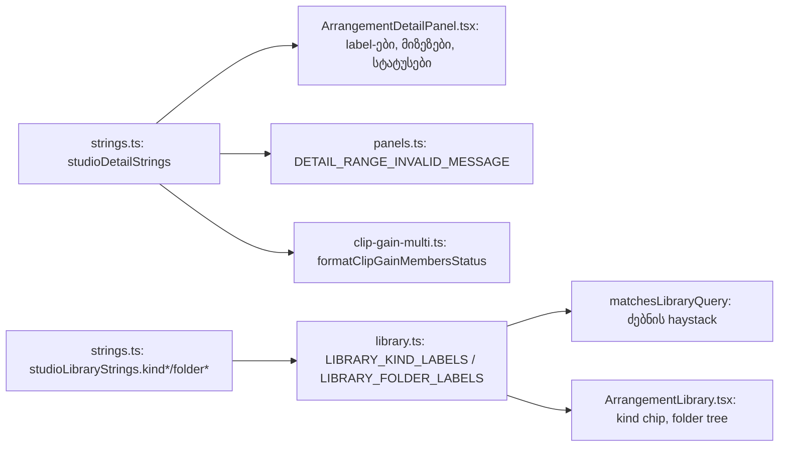

# Studio V-0.4e — Clip Detail panel, range/Clip Gain შეტყობინებები და ბიბლიოთეკის kind/folder label-ები ინგლისურად

**თარიღი:** 2026-10-24
**სტატუსი:** In Progress (C round 142 — FAIL: C-R142-01; round 143 fix-up; C round 143 ჯერ არ გაშვებულა)
**შეცვლილი პროექტი:** Store

## კონტექსტი

VISUAL-A-ის V-0 ეტაპი Studio-ს UI ტექსტებს ეტაპობრივად ინგლისურზე გადაიყვანს. V-0.4d-ის შემდეგ ქართული ტექსტი ჯერ კიდევ რჩებოდა `/studio-lab`-ის ქვედა Clip Detail panel-ში (სათაური, label-ები, მიზეზები, pending ნიშანი, toggle და separator), range-ისა და Clip Gain-ის სტატუსის შეტყობინებებში, ასევე ბიბლიოთეკის kind chip-სა და folder-ის სახელებში (`მუსიკა`, `სტემი`, `სტემები`). ეს რაუნდი ამ ოთხ წყაროს ცვლის (გადაწყვეტილება D-29z107). ამის შემდეგ ქართული წყარო მხოლოდ V-0.5-ის არეალში რჩება.

## მიდგომა

- `strings.ts`-ს ბოლო export-ად დაემატა ახალი ობიექტი `studioDetailStrings`: plain string-ები და რამდენიმე პატარა pure formatter (`rangeApplied`, `clipGainUnchanged`, `clipCount`, `clipGainMembers`, `collapsedValueText`). განშტოებები (`isCollapsed`, selection/group/none) caller-ში დარჩა.
- `studioLibraryStrings`-ს ბოლოს ოთხი key დაემატა: `kindMusic`, `kindStem`, `folderMusic`, `folderStems`. `sfx: 'SFX'` ლათინური literal-ია და უცვლელია.
- არსებულმა export-ებმა სახელი და ტიპი შეინარჩუნეს. `LIBRARY_KIND_LABELS`, `LIBRARY_FOLDER_LABELS` და `DETAIL_RANGE_INVALID_MESSAGE` მნიშვნელობას მოდულიდან იღებენ. detail panel-ის ლოკალური `DETAIL_*` კონსტანტებიც ასევე: diff მინიმალურია.
- `Clip Gain უცვლელია: X.` ხუთ ადგილას ერთ formatter-ად (`clipGainUnchanged`) გაერთიანდა. `studioClipStrings.historyUnchanged` არ გამოგვიყენებია, რადგან ის value-ს არ შეიცავს და სხვა წინადადებაა.
- `clipCount` მხოლობით/მრავლობით ფორმას არჩევს (`1 clip` / `2 clips`). იგივე ლოგიკა `clipGainMembers`-ში მოდულის შიდა helper-ით გამოიყენება, output §1.1-ის ზუსტად შესაბამისია.
- pending hint ისევ `FULL_TEXT.slice(LABEL.length)`-ით მიიღება. ინგლისური სრული ტექსტი ზუსტად label-ით იწყება, ამიტომ sr-only ნაწილი არის ` — Enter saves, Esc reverts`.
- რამდენიმე კლიპის შენიშვნა "group"-ს აღარ ახსენებს (R3), რადგან round 141-დან `Group N` Group Track-ია: ტექსტი იწყება `The selected clips …`-ით.
- ბიბლიოთეკის ძებნის haystack-ში kind label შედის. ამიტომ ახლა `music` და `stem` (case-insensitive) kind-ით ემთხვევა, ქართული `მუსიკა` kind-ით აღარ ემთხვევა. სათაურები და collection label-ები მონაცემებია და არ შეცვლილა.
- ალტერნატივა იყო label-ების პირდაპირ კომპონენტში literal-ებად დატოვება. უარვყავით, რადგან V-0-ის module contract ყველა UI ტექსტს ერთ leaf მოდულში ითხოვს.

## სტრინგების რუკა (glossary)

| ძველი (ქართული) | ახალი (English) | key |
|---|---|---|
| კლიპის დეტალები | Clip details | `panelTitle` |
| არაფერია არჩეული | Nothing selected | `nothingSelected` |
| აირჩიე კლიპი, რომ დეტალები ნახო | Select a clip to see its details | `noSelectionHint` |
| ჯგუფი ერთად გადაადგილდება · Delete შლის · Ctrl+D აორმაგებს | The selected clips move together · Delete deletes them · Ctrl+D duplicates them | `multiClipNote` |
| ვიდეოკლიპი · ტალღა არ ჩანს | Video clip · no waveform | `videoPlaceholder` |
| range ერთ კლიპზე ისმება — აირჩიე ერთი | A time selection is set on one clip — select only one | `rangeMultiReason` |
| ჯერ აირჩიე კლიპი | Select a clip first | `noneReason` |
| წყარო უცვლელი რჩება | The source file stays unchanged | `sourceUnchanged` |
| Clip Gain მხოლოდ აუდიო კლიპებზე ისმება — ამოიღე ვიდეო მონიშვნიდან | Clip Gain works on audio clips only — remove the video from the selection | `clipGainMultiReason` |
| ვიდეო კლიპს Clip Gain არ აქვს — ხმა: ხაზის Volume/Mute | A video clip has no Clip Gain — use the track Volume/Mute | `clipGainVideoReason` |
| Clip Gain: შეიყვანე რიცხვი dB-ში (−60…+24). | Clip Gain: enter a number in dB (−60…+24). | `clipGainInvalid` |
| შეუნახავია — Enter ინახავს, Esc აბრუნებს | Unsaved — Enter saves, Esc reverts | `pendingFull` |
| შეუნახავია | Unsaved | `pendingLabel` |
| მონიშვნა: {start} — {end} · {track}. | Time selection: {start} — {end} · {track}. | `rangeApplied` |
| Clip Gain უცვლელია: {value}. | Clip Gain unchanged: {value}. | `clipGainUnchanged` |
| {N} კლიპი | 1 clip / {N} clips | `clipCount` |
| Clip Gain: {N} კლიპი — {range}. | Clip Gain: 1 clip / {N} clips — {range}. | `clipGainMembers` |
| ხაზი / ხაზები | Track / Tracks | `trackLabel` / `tracksLabel` |
| დასაწყისი / სიგრძე / წყაროდან | Start / Length / Source offset | `startLabel` / `lengthLabel` / `sourceOffsetLabel` |
| საიდან, წმ / სადამდე, წმ | From, s / To, s | `rangeFromLabel` / `rangeToLabel` |
| range-ის დასაწყისი (წამი) / დასასრული (წამი) | Time selection start (seconds) / end (seconds) | `rangeStartLabel` / `rangeEndLabel` |
| მონიშვნა (ღილაკი) | Set selection | `applyRange` |
| Clip Gain-ის განულება (0 dB) | Reset Clip Gain (0 dB) | `clipGainResetLabel` |
| დეტალების სიმაღლე | Details height | `heightLabel` |
| დაკეცილია · {h} px | collapsed · {h} px | `collapsedValueText` |
| დეტალების გაშლა / დაკეცვა | Expand details / Collapse details | `expandLabel` / `collapseLabel` |
| გაშლა ▸ / დაკეცვა ▾ | Expand ▸ / Collapse ▾ | `expandText` / `collapseText` |
| მონაკვეთი კლიპის საზღვრებში უნდა იყოს; დასასრული დასაწყისზე მეტი უნდა იყოს. | The time selection must stay inside the clip, and its end must be after its start. | `rangeInvalid` |
| ბიბლიოთეკის kind: მუსიკა / სტემი | Music / Stem | `kindMusic` / `kindStem` |
| ბიბლიოთეკის folder: მუსიკა / სტემები | Music / Stems | `folderMusic` / `folderStems` |

## არქიტექტურა

## შეცვლილი ფაილები

- `app/lib/arrangement/strings.ts` — `studioLibraryStrings`-ის 4 ახალი key და ახალი `studioDetailStrings`.
- `app/components/arrangement/ArrangementDetailPanel.tsx` — 38 ქართული ხაზი მოდულის მნიშვნელობებით; class, testid ან handler არ შეცვლილა.
- `app/lib/arrangement/panels.ts` — `DETAIL_RANGE_INVALID_MESSAGE` მოდულიდან.
- `app/lib/arrangement/clip-gain-multi.ts` — `formatClipGainMembersStatus` იყენებს `clipGainMembers`-ს.
- `app/lib/arrangement/library.ts` — kind/folder label-ები მოდულიდან.
- `app/lib/arrangement/__tests__/strings.test.ts` — import-ები, `studioLibraryStrings`-ის plain სია, ST39-ის ზუსტი რაოდენობა (`17`) და ახალი ST41–ST44.
- 13 pin ფაილი — ქართული literal-ები ზუსტი ინგლისურით; `library.test`-ში LB-SEARCH.
- ახალი `app/lib/arrangement/__tests__/detail-panel-strings-ui.test.tsx` — DPS1–DPS4.
- `docs/implementation/2026/quarter-IV/117-studio-v0-default-names.md` — სტატუსი Completed.

## პრობლემები და გადაწყვეტები

- **Problem:** `detail-panel-fit.test` l.24 (`PENDING_HIDDEN_HINT`) ქართულს შეიცავდა, მაგრამ B-ის 56 pin ხაზის სიაში არ იყო. **Solution:** R7-ის მიხედვით შეიცვალა ` — Enter saves, Esc reverts`-ით, matcher-ი უცვლელია.
- **Problem:** `detail-panel-polish.test`-ის ორი assertion (`not.toMatch(/\b(start|offset)\b/i)`) ამოწმებდა, რომ ინგლისური არ გაჟონილიყო. ახლა label-ები განზრახ `Start` / `Source offset`-ია. **Solution:** იმავე ხაზზე guard-ი ძველი ქართული label-ების არარსებობაზე გადატრიალდა. ტესტი არ წაშლილა.
- **Problem:** დავალება ითხოვდა, რომ `stems` kind-ით დაემთხვია stem წყაროებს. haystack-ში kind label არის `Stem`, ხოლო `stem` სტრიქონი `stems`-ს არ შეიცავს, ამიტომ `stems` kind-ით 0 წყაროს ემთხვევა. **Solution:** `library.ts`-ის ქცევა არ შეგვიცვლია. LB-SEARCH ამოწმებს `stem`-ს, შეუსაბამობა კი B-ს გადაეცა.
- **Problem (გადაუწყვეტელი, stop rule):** რეალურ Chromium-ში 1440×900-ზე, video კლიპის არჩევისას, `clipGainVideoReason` შუა სვეტში (max 408 px) 2 ხაზად გადადის. baseline-ში ქართული ტექსტი 1 ხაზი იყო (327 px). ეს LAYOUT-ის საზღვარს არღვევს. ტექსტი B-ის §1.1-ით ზუსტადაა განსაზღვრული, class-ის შეცვლა კი stop rule-ით აკრძალულია. **Solution:** კოდი არ შეცვლილა, საკითხი B-ს გადაეცა გაზომილი ალტერნატივებით (მაგ. `A video clip has no Clip Gain — use the track Volume/Mute`: 1 ხაზი, 329 px). 1280-ზე ბოლო ხაზების panel-ის ქვემოთ გასვლა ქართული ტექსტითაც იგივეა, ანუ ეს რაუნდის შედეგი არ არის.
- **Problem (C-R142-01, Medium):** C round 142-მა იგივე დაადასტურა: 1440×900-ზე video კლიპის არჩევისას ინგლისური `clipGainVideoReason` 2 ხაზად გადადის, video placeholder კი baseline-თან შედარებით d = (+16, −8, −32, 0)-ით იძვრის. ქართული ტექსტის ჩანაცვლებით იმავე DOM-ზე 1 ხაზი და 0 px მიიღება, ანუ მიზეზი ინგლისური ტექსტია. **Solution:** A-ის გაზომილი კანდიდატებიდან (`a-round-142/probe/out/video-reason-candidates-a142.json`) B-მ D-29z108-ით აირჩია `A video clip has no Clip Gain — use the track Volume/Mute` (1 ხაზი, 329 px; ქართული baseline 327 px). წაიშალა მხოლოდ „for its sound“, აზრი იგივე რჩება. class და key არ შეცვლილა. 1280-ზე ყველა კანდიდატი და ქართული baseline-იც 2 ხაზია, ეს დარღვევა არ არის (R3).
- **Problem:** Biome-მა რამდენიმე შეცვლილი ხაზი (გრძელი const-ები, `ariaLabels` მასივები) ხელახლა გადაიტანა. **Solution:** ხელით გადატანილია `--write`-ის გარეშე, ანგარიშში ჩამოთვლილია.

## ტესტირება

- `npm run typecheck` და `npm run lint` exit 0; read-only `npx biome check` შეცვლილ ფაილებზე: 0 diagnostic.
- `npx vitest run` 82 ფაილზე (13 pin ფაილი, `strings.test`, ახალი ფაილი, 11 მეზობელი და import grep-ით ნაპოვნი ფაილები): 1294/1294 მწვანეა. `strings.test` 40 → 44 `it`, ახალ ფაილში 4; pin ფაილებში `it`-ების რაოდენობა უცვლელია.
- მუტაციები m82–m87 (m86 ორჯერ): თითოეულმა დასახელებული ტესტები გააწითლა, ფაილები აღდგა და sha256-ით შემოწმდა.
- A-ის ბრაუზერის probe (`tmp/studio-real-loop/a-round-142/probe/`): 1440-ზე video reason 1 → 2 ხაზი (იხ. ზემოთ). დანარჩენი reason-ები და group block baseline-ს არ აღემატება.
- სრული suite, `npm run verify`, build და e2e root-ის gate-ზეა.

## TODO / შემდეგი ნაბიჯები

- B: `clipGainVideoReason`-ის მოკლე ტექსტის დამტკიცება, რომ 1440-ზე 1 ხაზში ჩაეტიოს (LAYOUT).
- C round 142: ბრაუზერში შემოწმება 1440×900-სა და 1280×720-ზე (DETAIL-TEXT, DETAIL-STATUS, CLIP-GAIN-AUDIO, LIBRARY-LABELS, GEO-COUNT, LAYOUT, REG-141).
- B: §3.2/R8-ში `stems` kind-ით match-ის მოთხოვნის გასწორება ან folder label-ის haystack-ში დამატების გადაწყვეტა.
- V-0.5: ბიბლიოთეკის panel-ის საკუთარი ტექსტი, preview, dock, route meta title, `collection.ts`, `studio-lab-demo.ts`, context-ის l.3468.
