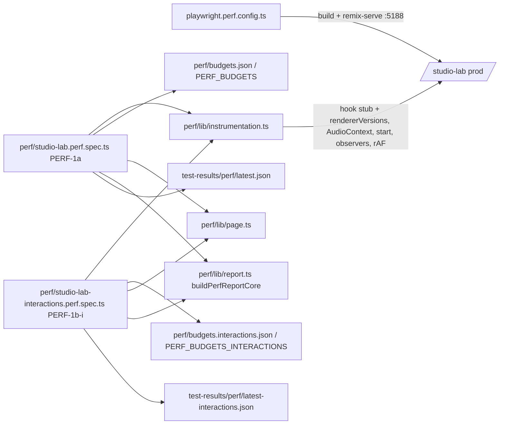

# Studio-ს interaction baseline-ები (PERF-1b-i): drag-ები, clip click, zoom, play/pause

**თარიღი:** 2026-10-27
**სტატუსი:** Completed (C round 214 PASS)
**შეცვლილი პროექტი:** Store (მხოლოდ სატესტო ინფრასტრუქტურა და docs; `app/` არ შეცვლილა)

## კონტექსტი

SABA-B-5-ის მოთხოვნაა: "B checks the other continuous drags (fade handles, clip gain, range, trim) with the same harness and lists the ones that need the same treatment as PERF tasks". PERF-1a (doc 163) fader-ებს ზომავს. PERF-1b ორად გაიყო (D-29z206): PERF-1b-i (ეს რაუნდი) ზომავს interaction სცენარებს, PERF-1b-ii (round 216) კი export-ს, bytes-ს, DOM-სა და memory-ს. PERF-1a უკვე 525 s-ს იღებს 15 წუთიანი limit-იდან, ამიტომ ახალი სცენარები ცალკე spec-ში წავიდა.

## მიდგომა

- **ცალკე, თვითკმარი spec** (D-29z207, tech-lead): `perf/studio-lab-interactions.perf.spec.ts`, ერთი ტესტი `studio-lab perf harness PERF-1b-i`. თავდაპირველად PERF-1a-ის მცირე pure helper-ები გადმოკოპირდა; round 223-იდან (PERF-HARNESS-SHARED-LIB) საერთო helper-ები (`snapshot`, `waitForQuiet`, `startTasks`, `setPlayback`/`isPlaying`, `blurActive`, `rateRowId`, `audioClips`) `perf/lib/page.ts`-დან, report-ის median/determinism ლოგიკა კი `perf/lib/report.ts`-ის `buildPerfReportCore`-დან იმპორტდება (`175-perf-harness-shared-lib.md`). move-to-paint-ის p95 (`moveToPaintP95`) spec-ში რჩება.
- **ცალკე budget-ები და შედეგები.** `perf/budgets.interactions.json` (144 სტრიქონი, ყველა id `interact.`-ით იწყება), იტვირთება არსებული `loadPerfBudgets`-ით; override: `PERF_BUDGETS_INTERACTIONS`. შედეგები: `test-results/perf/perf-1b-i-<ISO>.json` და `test-results/perf/latest-interactions.json`, `harness: 'PERF-1b-i'`. PERF-1a-ის `latest.json` ახალ spec-ს არ ეხება. ორი წესი იგივეა: "measured row without a budget row" და "row not measured N times".
- **Row design (D-29z174 ნიმუში).** ყველა ახალი მეტრიკა `record`-ია. `assert` მხოლოდ liveness და setup სტრიქონებია. interaction-ის ბიუჯეტების assert-ები იმ PERF ფიქსებთან ერთად მოვა, რომლებიც შესაბამის interaction-ს ფლობენ.
- **Pass-ები.** `cpuRates [1, 6]`, 3 pass თითო rate-ზე. თითო pass არის ერთი ახალი browser context, 1440×900 (`newContext({ viewport })`; `innerWidths` report-ში = 1440). Throttle ირთვება Add-ის შემდეგ, როგორც PERF-1a-ში. 30 clip-იანი ბლოკი და load სტრიქონები მხოლოდ 1×-ზეა. 2–7 ნაბიჯები ორივე rate-ზე იზომება, 6×-ის id-ს აქვს `.6x` სუფიქსი (ყველა მეტრიკაზე, wall-clock-ის ჩათვლით; 1×-ზე სუფიქსი არ არის).
- **Drag-ები.** `dragSteps = 60`, +120 px მარჯვნივ. drag ორ ნახევრად სრულდება (30 + 30 step): შუაში და ბოლოს, `mouse.up`-მდე, liveness-ისთვის იკითხება clip-ის მდგომარეობა. grab point `document.elementFromPoint`-ით მოწმდება: წერტილი და (range/move-ზე) +120 px წერტილიც უნდა ეკუთვნოდეს target-ს და viewport-ში იყოს. styling class-ის selector არ გამოიყენება (L12).

### Pass-ის თანმიმდევრობა

1. მხოლოდ 1×: `/studio-lab` → ready (`interact.load.ready-ms`), ბიბლიოთეკის Add; ველოდებით clip-ს, მის waveform-ს და "სიჩუმეს" (`interact.harness.hook-live`). fixed wait არ არის.
2. 6×-ზე throttle ირთვება.
3. clip click (`interact.click.*`, `interact.harness.click-live`).
4. zoom 1 clip-ით: 5 × `=` და 5 × `-`, თითო key თავისი ფანჯრით (`interact.zoom.1.*`, `interact.harness.zoom-live`).
5. ოთხი drag, stopped: range, fade-in, trim start, move; ყოველის შემდეგ reset. შემდეგ cross-lane move (round 335-იდან, `measureLaneDrag`): clip-ის name bar-ზე press, 10 step +40 px საკუთარ lane-ზე, 1 step ქვემოთ შემდეგ lane-ზე და იქ 10 step +40 px, 1 step უკან და 10 step +40 px საკუთარ lane-ზე, release, reset Ctrl+Z-ით (`interact.drag.lane.stopped.*`, `interact.harness.drag-lane-live`).
   - **lane-ის ფონის range drag, stopped** (round 363-იდან, `measureBackgroundRangeDrag`, ორივე CPU rate-ზე): stopped drag-ების შემდეგ და cross-lane move-მდე. press clip-ის lane-ისგან განსხვავებული lane-ის ცარიელ ფონზე (press-ის და +120 px-ის წერტილი ორივე lane-ის ელემენტზე მოდის, clip-ისა და control-ის გარეშე), 60 step +120 px, mid და end წაკითხვა. reset: ერთი click clip-ის name bar-ზე (არა lane-ის ფონზე, რომელიც Insert Marker-ს გადაიტანდა), შემდეგ "სიჩუმე". reset-ის შემდეგ problem იწერება, თუ clip არ არის მონიშნული ან მონიშვნა drag-მდელს არ უდრის, range ელემენტი დარჩა ან Undo-ს `title` შეიცვალა; round 364-იდან ასევე, თუ clip-ის `data-clip-start` ან width შეიცვალა (drag-მდე და reset-ის შემდეგ) ან `data-insert-marker` name bar-ის click-ის წინ და შემდეგ განსხვავდება (ან marker ორივე წაკითხვაზე ვერ მოიძებნა). ეს წაკითხვები გაზომვის ფანჯრის გარეთაა (`interact.drag.background-range.stopped.*`, `interact.harness.drag-background-range-live`).
6. Home (seek 0), შემდეგ Space → playing (`interact.play.start-*`, 1×: `interact.harness.audio-running`).
7. ოთხი drag, playing; ყოველის წინ Home (seek 0), რომ Follow-მა timeline არ გადაახვიოს და playhead clip-ის შიგნით დარჩეს. შემდეგ იგივე cross-lane move, Home-ის შემდეგ (`interact.drag.lane.playing.*`).
8. Space → stopped (`interact.play.stop-*`). შემდეგ group ბლოკი (round 339-იდან, ორივე CPU rate-ზე):
   - **group setup** (`setupGroupClips`): clip-ის name bar-ზე click, blur, Ctrl+D (ასლი clip-ის შემდეგ, 2 audio clip), შემდეგ Ctrl+click პირველი clip-ის name bar-ზე (2 მონიშნული clip). თუ setup ვერ გამოვიდა, `interact.harness.drag-group-live` 0-ია და დარჩენილი ასლი Ctrl+Z-ით იშლება.
   - **group drag stopped** (`measureGroupDrag`): პირველი clip-ის name bar-ზე press, იგივე სამი segment, რაც cross-lane move-ში (10 step +40 px საკუთარ lane-ზე, 1 step ქვემოთ და 10 step +40 px იქ, 1 step უკან და 10 step +40 px), release, reset Ctrl+Z-ით (`interact.drag.group.stopped.*`).
   - **group drag playing:** Space, `waitForPlaybackSettled`, Home და იგივე gesture, reset Ctrl+Z-ით, Space (`interact.drag.group.playing.*`).
   - **group teardown** (`teardownGroupClips`): Ctrl+Z ასლს შლის (Undo-ს `title`-ის საწყისზე დაბრუნებამდე, მაქს. 3 დაჭერა; 1-ზე მეტი problem-ია); 1 clip, clip-ის საწყისი state და Undo-ს საწყისი `title`, სხვაგვარად problem.
9. მხოლოდ 1×: clip-ის header click, Ctrl+D × 29 (`interact.harness.clips-30`), zoom 30 clip-ით: key-ები (`interact.zoom.30.*`), in-first და out-first გზა (`interact.zoom.30.in.*`, `interact.zoom.30.out.*`), Space, Home, fade-in drag პირველ clip-ზე (`interact.drag.fade.30.playing.*`), Space, Ctrl+wheel out-first (`interact.zoom.30.wheel.*`).
10. მხოლოდ 1×, 30 კლიპის ბლოკის შემდეგ: "-" მანამ, სანამ 2 კლიპის name bar გამოჩნდება, click ერთზე (setup), შემდეგ click იმავე lane-ის სხვა კლიპის name bar-ზე და ხელახლა იმავეზე (`interact.select.same-lane.30.*`, `interact.select.reclick.30.*`, `interact.harness.select-same-lane-live`).
11. მხოლოდ 1×, ბოლოს (round 344-იდან, video ბლოკი):
    - **video setup** (`setupVideoClip`): თუ video lane ცარიელი არ არის, problem და `null`. Undo-ს `title`-ის წაკითხვა, `public/videos/hero/1.mp4` `arrangement-video-input`-ით (`setInputFiles`), ზუსტად 1 video clip-ის მოლოდინი (30 s) და "სიჩუმე"; თუ Undo-ს `title` არ შეიცვალა, problem და `null`; clip-ის `data-clip-id`-ის არქონა problem-ია. შემდეგ blur და `=` (თითოს შემდეგ 150 ms "სიჩუმე"), სანამ clip-ის name bar ≥ 480 px სიგანის გახდება, მაქს. 16 key; უფრო ვიწრო problem-ია და `null`. import playhead-ს 0-ზე აბრუნებს და range-ს ასუფთავებს, ამიტომ ბლოკი ყველა სხვა ნაბიჯის შემდეგაა. რიგი სხვა მიზეზითაც აუცილებელია: ჩავარდნილი setup video clip-ს ტოვებს, zoom-in key-ები კი წარმატებული teardown-ის შემდეგაც რჩება, ამიტომ ამ ბლოკის შემდეგ დამატებული ნაბიჯი ამ მდგომარეობას მიიღებდა.
    - **video drag stopped** (`measureDrag`, `drag: 'move'`): name bar-ზე move, იგივე 60 step +120 px, reset Ctrl+Z-ით (`interact.drag.video.stopped.*`).
    - **video drag playing:** Space, `waitForPlaybackSettled`, Home და იგივე gesture, reset Ctrl+Z-ით, Space (`interact.drag.video.playing.*`).
    - **video teardown** (`teardownVideoClip`): blur, Ctrl+Z Undo-ს `title`-ის საწყისზე დაბრუნებამდე (მაქს. 3; 1-ზე მეტი problem-ია); 0 video clip და Undo-ს საწყისი `title`, სხვაგვარად problem.

ზუსტი სია JSON-ის `sequence` ველშია.

### Reset-ის მეთოდი

- **fade, trim, move:** Ctrl+Z (focus blur-ის შემდეგ), მაგრამ **მხოლოდ მაშინ, თუ Undo ღილაკის `title` drag-ის შემდეგ შეიცვალა**. ასე drag, რომელმაც history entry არ შექმნა, სხვა (მაგ. Add-ის) entry-ს ვერ გააუქმებს.
- **range:** Escape range-ს არ ასუფთავებს (probe-ით შემოწმდა). ამიტომ range body-ზე იმავე grab point-ზე უმოძრაო click კეთდება: `finishGesture` range-ს ასუფთავებს და playhead-ს იქ გადაიტანს (`ArrangementClip.tsx` ~l.730).
- **Reset-ის შემოწმება:** `data-clip-start`, `data-fade-in` და clip-ის width drag-მდელ მნიშვნელობებს უბრუნდება, `[data-range-start]` ელემენტი 0-ია, clip-ში range label აღარ ჩანს, Undo-ს `title` კი drag-მდელ entry-ზე დაბრუნდა. დარღვევა pass-ს აგდებს ("reset failed").

### Liveness-ის წესები

| სტრიქონი | წესი |
|---|---|
| `interact.harness.click-live` | Add-ის შემდეგ `Clip Gain — fader` enabled-ია (დამატებული clip არჩეულია); Stems ხაზის ცარიელ ადგილზე click მონიშვნას ხსნის, fader disabled ხდება (`StudioWorkspace.tsx` ~l.1727); clip header-ზე click-ის შემდეგ ისევ enabled-ია და ზუსტად 1 fader არსებობს. round 281-იდან (`210-perf-harness-load-diagnostics.md`) detail-ს სამი ძველი key-ის შემდეგ ემატება `clipTrackId` (clip-ის lane) და `emptyLaneTrackId` (deselect click-ის lane); გაზომილია `music` და `stems`. მნიშვნელობა და წესი უცვლელია |
| `interact.harness.zoom-live`, `interact.harness.zoom-30-live` | `Zoom (px/s)` slider-ის მნიშვნელობა ყოველ `=`-ზე იზრდება, ყოველ `-`-ზე კლებულობს და იმავე მნიშვნელობებით ბრუნდება (i-ური მნიშვნელობა = (10 − i)-ური; 678 → 851 → 678). round 224-იდან (GATE214-S4) ყოველი მნიშვნელობა მკაცრად slider-ის `min`-სა და `max`-ს შორისაა (clamp-ის გარეშე); `min`/`max` პირველი key-ის `t0`-მდე იკითხება და detail-ში იწერება (`sliderMin`, `sliderMax`). თუ რომელიმე attribute აკლია ან რიცხვი არ არის, pass-ს ემატება problem `zoom slider min/max missing` და zoom არ იზომება. slider-ის მნიშვნელობა მთელი ნაბიჯია (`sliderPositionFromZoom` იყენებს `Math.round`-ს), ამიტომ ზუსტი შედარება სწორია |
| `interact.harness.drag-range-live` | clip-ის range label-ის ბოლო დრო შუაში და ბოლოს არსებობს და იზრდება |
| `interact.harness.drag-fade-live`, `interact.harness.drag-fade-30-live` | `data-fade-in` იზრდება დასაწყისიდან შუამდე და შუიდან ბოლომდე |
| `interact.harness.drag-trim-live`, `interact.harness.drag-move-live` | `data-clip-start` იცვლება დასაწყისიდან შუამდე და შუიდან ბოლომდე |
| `interact.harness.audio-running` | Play ღილაკის `data-playing` = `true` (round 259-იდან), tracked context = `running` და Space-იდან "სიჩუმემდე" ≥ 1 `start()` (GATE206-S6-ის იგივე წესი) |
| `interact.harness.drag-lane-live` | round 335-იდან (owner `PERF-DRAG-PREVIEW-c3-i`); round 338-იდან assert `== 1` (`.6x`-იც). 1 მხოლოდ მაშინ, როცა stopped და playing ორივეში: (a) cross-ის წაკითხვაზე შემდეგ lane-ში (`data-track-id` = ცარიელი წერტილის lane) ≥ 1 `arrangement-lane-move-ghost`-ია `data-blocked="false"`-ით; (b) უკან დაბრუნების წაკითხვაზე document-ში 0 ghost-ია; (c) release-ის შემდეგ clip-ის უახლოესი `[data-track-id]` საკუთარი lane-ია და `data-clip-start` შეიცვალა; (d) reset-ის შემდეგ ხელახალი წაკითხვა start-ს, fade-in-ს, width-ს, range-ის არარსებობასა და საკუთარ lane-ს აბრუნებს; (e, round 338-იდან) target lane-ის პირველი ghost-ის start შესვლის წაკითხვიდან cross-ის წაკითხვამდე იზრდება. ghost-ის წაკითხვამდე double-`requestAnimationFrame` settle-ია. ჩავარდნილი პირობა problem-ად იწერება თავისი ასოთი და მნიშვნელობებით. `setLive` reset-ის შემდეგ იძახება |
| `interact.harness.drag-group-live` | round 339-იდან, assert `== 1` (`.6x`-იც), owner `PERF-DRAG-PREVIEW-c4-i`. 1 მხოლოდ მაშინ, როცა stopped და playing ორივეში: (f) ასლის `data-clip-start` პირველი (საკუთარი lane-ის) segment-ის და double-`requestAnimationFrame` settle-ის შემდეგ შეიცვალა (ასლი დაჭერილ clip-თან ერთად მოძრაობს); (a) cross-ის წაკითხვაზე შემდეგ lane-ში ზუსტად 2 non-blocked `arrangement-lane-move-ghost`-ია; (e) target lane-ის პირველი ghost-ის start შესვლის წაკითხვიდან cross-ის წაკითხვამდე იზრდება; (b) უკან დაბრუნების წაკითხვაზე document-ში 0 ghost-ია; (c) release-ის შემდეგ ორივე clip-ის უახლოესი `[data-track-id]` საკუთარი lane-ია და ორივე ერთი და იგივე დადებითი delta-თი (±0.0015 s) გადავიდა; (d) reset-ის შემდეგ ორივე clip-ის state საწყისია, თითო საკუთარ lane-ზე. ჩავარდნილი პირობა problem-ად იწერება თავისი ასოთი; failed setup 0-ს წერს. `setLive` reset-ის შემდეგ იძახება. mutant MU-GROUP-SINGLE (Ctrl+click გამოტოვებული) row-ს 0-ად აქცევს |
| `interact.harness.drag-video-live` | round 344-იდან (owner `PERF-DRAG-PREVIEW-c5-i`, `record`); round 345-იდან assert `== 1`, owner `PERF-DRAG-PREVIEW-c5-ii`, მხოლოდ 1×. 1 მხოლოდ მაშინ, როცა stopped და playing ორივე video drag-ზე imported video clip-ის (`data-clip-id`-ით ნაპოვნი) `data-clip-start` იცვლება დასაწყისიდან შუამდე და შუიდან ბოლომდე. row ორივე drag-ის liveness-ის AND-ია (თითო `measureDrag` თავის შედეგს წერს); ორივე drag-ის შემდეგ `setLive` მხოლოდ `zoomKeys`-ს ამატებს და row-ს ვერ ზრდის. ჩავარდნილი setup (არაცარიელი video lane, import-ის Undo entry-ის არქონა, clip id-ის არქონა, name bar < 480 px 16 key-ის შემდეგ) 0-ს წერს `{ setup: 'failed' }`-ით და problem-ით; მკვდარი drag problem-ს წერს, problem კი `failures`-ში გადადის |
| `interact.harness.clips-30` | Ctrl+D-ის ყოველი დაჭერის შემდეგ clip-ების რაოდენობა = დაჭერა + 1; ბოლოს 30 და 30 განსხვავებული `data-clip-start` |

drag-ის liveness სტრიქონი 1 მხოლოდ მაშინაა, როცა stopped და playing ორივე ცოცხალია. 0 liveness ასევე failure-ს წერს.

### DEVIATION — needs B ruling: `interact.harness.drag-range-live` signal

task ითხოვდა: "`[data-range-end]` exists and changes during the drag". clip body-ის range gesture `allTracks`-ს არ აყენებს, `data-range-start`/`data-range-end` კი მხოლოდ all-tracks range-ის overlay-ზე იხატება (`ArrangementLane.tsx` l.1016–1026, `range?.allTracks`). probe-მა (dev server, 1440×900) აჩვენა: drag-ის შემდეგ clip-ში ჩანს `00:07.525 – 00:10.525 · 3.000 s`, "Zoom to the time selection (Z)" აქტიურია, `[data-range-start]` კი 0-ია. ამიტომ liveness-ის სიგნალია clip-ის range label-ის ბოლო დრო (text selector, L12-ით დაშვებული). თუ range all-tracks გახდება, clip-ის label ქრება და row ვარდება. reset-ის შემოწმება `[data-range-start]` = 0-ს კვლავ ამოწმებს, დამატებით კი label-ის გაქრობას.

### DEVIATION (მცირე): `interact.harness.click-live`

task ითხოვდა: "after the click, the `Clip Gain — fader` slider count is 1". fader ყოველთვის იხატება (მონიშვნის გარეშე disabled-ია, `ArrangementDetailPanel.tsx` ~l.705), ამიტომ count მონიშვნას ვერ ამტკიცებს. სიგნალია enabled → disabled (ცარიელი ხაზის click) → enabled (clip click); count = 1 დამატებით მოწმდება.

## არქიტექტურა

round 224-იდან PERF-1b-i ბირთვს გადასცემს მხოლოდ `assertWhenPartial: false`-ს; 1×/6× შედარება და guard problem-ები არ აქვს. determinism-ს ბირთვი ყოველ `kind: deterministic` სტრიქონზე `perf/lib/determinism.ts`-ის contract-ით ამოწმებს (`176-perf-determinism-contract.md`); `interactionDeterminismMetrics` წაიშალა. report-ის envelope (`harness` … `rows`) spec-ში რჩება, ამიტომ JSON-ის key-ების რიგი არ შეცვლილა. clip click-ის deselect click კვლავ ცარიელ Stems lane-ზე ხდება (literal `'stems'`; GATE214-S2 B-ის გადაწყვეტილებას ელოდება, `175-perf-harness-shared-lib.md`). `clipById` და lane-ის selector attribute-ის მნიშვნელობას `quotedAttributeValue`-ით ბრჭყალებში სვამს და `"`, `\` ან ახალი ხაზის შემცველ id-ზე Error-ს აგდებს (GATE214-S3).

## მეტრიკები

| მეტრიკა | განმარტება |
|---|---|
| `commits-per-move` | move-ის ფანჯრის commit-ები ÷ ყველა pointermove, in-page pointerdown-იდან pointerup-მდე, პირველის ჩათვლით (`movesInWindow`). commit-ების ფანჯარა იწყება in-page pointerdown-ის მომდევნო პირველი move-ის შემდეგ და მთავრდება in-page pointerup-მდე (PERF-1a-ის `move-components-*`-ის ფანჯარა). PERF-1a-ის `commits-per-move`-ისგან განსხვავებით settle-ს არ შეიცავს |
| `move-components-per-move`, `move-components-max` | ფანჯრის rendered კომპონენტების ჯამი ÷ ყველა pointermove pointerdown-იდან pointerup-მდე, პირველის ჩათვლით (`movesInWindow`); ერთი commit-ის მაქსიმუმი. per-commit მედიანა არ გამოიყენება (probe-ით bimodal-ია) |
| `release-commits` | commit-ები pointerup-იდან "სიჩუმემდე" (მინ. 600 ms, შემდეგ 200 ms commit/`start()`-ის გარეშე, მაქს. 3 s) |
| `move-restarts`, `release-restarts` | `start()` გამოძახებები (non-offline) move-ის ფანჯარაში და pointerup-იდან "სიჩუმემდე"; detail აჯგუფებს task-ებად |
| `move-to-paint-p95` | PERF-1a-ის sampler, pointerup-მდე; wall-clock, ტრენდი (±30 %) |
| `interact.click.commits`, `.components` | click-იდან "სიჩუმემდე"; components = ჯამი, detail-ში per-commit ზომები |
| `interact.click.event-duration-max` | ყველაზე გრძელი Event Timing entry (≥ 16 ms) ფანჯარაში; თუ არ არის, ყველაზე გრძელი LoAF; არც ერთის შემთხვევაში 0. detail.source ასახელებს წყაროს. wall-clock |
| `commits-per-key`, `components-per-key`, `components-max` | 10 key-ის ფანჯრის ჯამი ÷ 10; ერთი commit-ის მაქსიმუმი. key-ის ფანჯარა: დაჭერიდან "სიჩუმემდე" (მინ. 300 ms) |
| `key-window-longest-ms` | ყველაზე გრძელი დრო key-ის დაჭერიდან (page-ის `performance.now()` დაჭერამდე) მისი ფანჯრის ბოლო commit-მდე; detail.longestLoafMs. wall-clock |
| `interact.play.start-*`, `interact.play.stop-*` | Space-იდან "სიჩუმემდე" (მინ. 1 s): commit-ები, კომპონენტების ჯამი, `start()`-ები |
| `interact.select.same-lane.30.*`, `interact.select.reclick.30.*` | 1× only, pass-ის ბოლო ნაბიჯი (30 კლიპი). Setup: "-" მანამ, სანამ 2 კლიპის name bar გამოჩნდება (მაქს. 16), შემდეგ click პირველზე. გაზომვა: click იმავე lane-ის სხვა, ხილულ და მონიშვნის გარეშე კლიპის name bar-ზე, "სიჩუმემდე"; შემდეგ იმავე წერტილზე ხელახალი click. `commits` (same-lane-ზე wallclock, reclick-ზე deterministic) და `components` (ჯამი, detail-ში per-commit ზომები) |

**Determinism (round 224-იდან).** ყოველი `kind: deterministic` სტრიქონი სამ pass-ში contract-ით მოწმდება: `commits-per-move` (round 225-მდე, იხ. ქვემოთ) და `move-components-per-move` ratio-ა (detail-ის `windowCommits`/`movesInWindow` ან `componentsSum`/`movesInWindow` ზუსტად ტოლია), `commits / key` და `components / key` ერთეულები და ყველა რაოდენობა ზუსტია (exact). უცნობი ერთეული run-ს აგდებს. ძველი ±10 % / ±2 ტოლერანსი, რომელიც ratio სტრიქონებს ვერ აგდებდა (code-review M2), წაიშალა. დეტალები და failure-ის ტექსტები: `176-perf-determinism-contract.md`. 1×/6×-ის cross-rate შემოწმება ამ spec-ში არ არის (task არ ითხოვდა). ცხრილში 1×/6× component რიცხვები მაინც ერთნაირია, `commits-per-move` კი fade-ზე 1 / 0.983-ია.

**round 225-იდან drag-ის 16 `commits-per-move` სტრიქონი wallclock-ია** (`interact.drag.{range,fade,trim,move}.{stopped,playing}.commits-per-move`, 1× და 6×; D-29z259, C-R224-01). ეს რიცხვი დროის ფანჯრის შიგნით დათვლილი commit-ებია (`t > firstMove`, `t < up`). C-ის round 224-ის დატვირთულ run-ში `interact.drag.fade.playing.commits-per-move`-ის `windowCommits` იყო [60, 59, 60], `movesInWindow` [60, 60, 60], ხოლო იმავე ფანჯრის `componentsSum` სამივე pass-ში 5782 და `release-commits` [1, 1, 1]. ანუ commit-ების რაოდენობა scheduling-ზეა დამოკიდებული, render-ის სამუშაო კი არა. სტრიქონები `mode: "record"`-ია `budget: null`-ით, ამიტომ assert არ იკარგება; ისინი კვლავ იზომება და report-ში ჩანს. იმავე ფანჯრის render-ის სამუშაო ზუსტად მოწმდება `move-components-per-move`-ით (ratio `componentsSum`/`movesInWindow`) და `move-components-max`-ით (exact). PERF-1a-ის 24 fader-ის `commits-per-move` deterministic რჩება: ის მთელ gesture-ს ითვლის (`rendered.length`) და არა დროის ფანჯარას, და 25 შენახულ report-ში არასდროს შეცვლილა.

**PERF-8a-იდან range drag-ის 5 სტრიქონი assert-ია** (owner `PERF-8a`, range store, `230-perf-range-store.md`): `interact.drag.range.stopped.move-components-per-move` და `interact.drag.range.playing.move-components-per-move` `<= 15`, `interact.drag.range.stopped.move-components-max` და `interact.drag.range.playing.move-components-max` `<= 35`, `interact.drag.range.playing.move-restarts` `== 0`. გაზომილი production build-ზე (1×): per move 108.167 (HEAD `50662e1`) → 9.233 (A, round 320), max 30, move-restarts 0. Max არის პირველი move-ის null→range commit, `ArrangementTransport`-ის `hasRange` flip-ის ჩათვლით (D-29z864); ის gesture-ზე ერთხელ ხდება. `commits-per-move` სტრიქონები (wallclock) და `.6x` სტრიქონები `record` რჩება; `interact.harness.drag-range-live` კვლავ assert `== 1`-ია.

**PERF-8b-იდან (selection store, `231-perf-selection-store.md`) 5 ახალი სტრიქონი** (owner `PERF-8b`): `interact.harness.select-same-lane-live` assert `== 1`-ია (1, როცა click-ის შემდეგ detail panel-ის From მნიშვნელობა click-ილი კლიპის `data-clip-start`-ს უდრის, active track-ის `aria-pressed` lane არ შეცვლილა და `[data-range-start]` 0-ია; class-ს არ კითხულობს). დანარჩენი ოთხი (`interact.select.same-lane.30.commits`, `.components`, `interact.select.reclick.30.commits`, `.components`) `record`-ია, რადგან B-მ მხოლოდ type-only sketch ააგო (D-29z893). A-ის production run-ში (round 324, 1×, სამი pass): same-lane components HEAD `53c5c79` 107 (105,2,0) → A 25 (23,2,0); reclick HEAD 2 commit / 92 → A 1 commit / 0. იმავე run-ში clip click (`interact.click.components`) 103 → 106 და fade/trim/move drag-ის per-move 2-ით მეტია: dev name probe-ით ზედმეტი სახელები მხოლოდ selection subscriber-ებია (`ArrangementDetailPanelWithSelectionInner`, `ArrangementSelectedClipReadoutInner`, click-ზე `ArrangementSelectionCountInner`-იც), თითო instance-ზე ერთხელ (round 323 §2-ის ტოლერანსი).

**PERF-DRAG-PREVIEW-ის ეტაპ a-დან (preview store, `232-perf-drag-preview.md`)** `interact.drag.trim.playing.move-restarts` და `interact.drag.move.playing.move-restarts` assert `== 0`-ია (owner `PERF-DRAG-PREVIEW-a`; `.6x` ასლები `record` რჩება). trim/move-ის დანარჩენი row-ები `record`-ია (D-29z917). A-ის production run-ში (round 325, 1× და 6×, სამი pass, ორივეზე `failures` []): trim `move-components-per-move` HEAD `b925434` 106.2 → A 24.583, `move-components-max` 106 → 23, `commits-per-move` 1.967 ორივეზე; move `move-components-per-move` 105.317 → 106.85 (window-ის commit-ები 118 → 120), max 107 ორივეზე; ოთხივე `move-restarts` 0. move-ის სცენარში ყოველი move project end-ს ცვლის, ამიტომ `StudioWorkspace` კვლავ render-დება (ეტაპი c). fade და zoom-ის row-ები commit-ზე 1-ით გაიზარდა (ახალი `ArrangementOverviewWithPreviewInner`, ერთხელ თითო workspace commit-ზე).

**PERF-DRAG-PREVIEW-ის ეტაპ b-დან (status preview store, `232-perf-drag-preview.md`)** ხუთი fade row assert-ია (owner `PERF-DRAG-PREVIEW-b`): `interact.drag.fade.stopped.move-components-per-move`, `interact.drag.fade.playing.move-components-per-move`, `interact.drag.fade.stopped.move-components-max` და `interact.drag.fade.playing.move-components-max` `<= 24`, `interact.drag.fade.playing.move-restarts` `== 0`; `.6x` ასლები `record` რჩება, trim/move-ის per-move row-ები კი `record`-ია ეტაპ c-მდე (D-29z932). A-ის production run-ში (round 327, 1× და 6×, სამი pass, `failures` []): fade `move-components-per-move` HEAD `234ccdd` 103.25 → A 21.633 (stopped და playing), `move-components-max` 105 → 22, `move-restarts` 0. stopped `release-commits` 1 → 2 (`releaseComponentsMax` 96; B-ის probe-ით მეორე commit 0 component-ს render-ავს), playing 1 → 1. trim, move და range-ის row-ები HEAD-ის run-ს უდრის.

**PERF-DRAG-PREVIEW-ის ეტაპ c3-i-დან (round 335, `232-perf-drag-preview.md`) 26 `interact.drag.lane.*` / `interact.harness.drag-lane-live` სტრიქონი** (owner `PERF-DRAG-PREVIEW-c3-i`; round 338-მდე ყველა `record` იყო): თითო state-ზე `move-components-per-move` (ratio `componentsSum`/`movesInWindow`; `movesInWindow` ითვლის ყველა pointermove-ს pointerdown-იდან pointerup-მდე, პირველის ჩათვლით), `move-components-max` და `release-commits` deterministic-ია და whole window-ს იყენებს (`firstMove < t < up`, როგორც სხვა drag-ებში); `cross-components-per-move` (step-ი შემდეგ lane-ზე → ghost-ის წაკითხვა) და `lane-components-per-move` (`firstMove < t < t1` და `t2 < t < up`; პირველი pointermove move-ად არ ითვლება, მისი commit კი ითვლება) wallclock-ია, რადგან საზღვრები in-page timestamp-ებია (L37); playing-ზე დამატებით `move-restarts` და `release-restarts` (deterministic); liveness და ყოველის `.6x` ასლი. `commits-per-move` metric არ გამოიყენება. ეტაპ c3-ii-დან (round 338, `clipLaneDrag` store) 7 row `assert`-ია: `interact.drag.lane.{stopped,playing}.move-components-per-move` `<= 25` (owner `PERF-DRAG-PREVIEW-c3-ii`; B-ის sketch 24.906, mutant A 25.25 წითელია), `interact.drag.lane.{stopped,playing}.release-commits` `== 1` და `interact.drag.lane.playing.move-restarts` `== 0` (owner `PERF-DRAG-PREVIEW-c3-ii`), `interact.harness.drag-lane-live` და `.6x` `== 1` (owner `PERF-DRAG-PREVIEW-c3-i`; liveness-ს დაემატა check (e): target lane-ის პირველი ghost-ის `data-ghost-start` შესვლის წაკითხვიდან cross-ის წაკითხვამდე უნდა გაიზარდოს, mutant E-ზე 0). დანარჩენი 19 row `record` რჩება: `move-components-max` (101, same-lane commit), wallclock `cross-`/`lane-components-per-move`, `release-restarts` და component-ის `.6x` ასლები.

**PERF-DRAG-PREVIEW-ის ეტაპ c4-i-დან (round 339, `232-perf-drag-preview.md`) 26 `interact.drag.group.*` / `interact.harness.drag-group-live` სტრიქონი** (owner `PERF-DRAG-PREVIEW-c4-i`): ორი მონიშნული clip-ის group move, gesture და windows lane-ის სტრიქონებისაა (whole `firstMove < t < up`, cross `t1 < t < t2`, lane `firstMove`-დან). თითო state-ზე `move-components-per-move`, `move-components-max` და `release-commits` deterministic-ია, `cross-components-per-move` და `lane-components-per-move` wallclock (L37); playing-ზე დამატებით `move-restarts` და `release-restarts`; liveness და ყოველის `.6x` ასლი. `commits-per-move` metric არ გამოიყენება. 24 სტრიქონი `record`-ია (`budget: null`): ისინი HEAD-ის group preview-ს (provider-ის history ყოველ move-ზე) იწერენ, და c4-ii მათ წინააღმდეგ იზომება. `interact.harness.drag-group-live` და `.6x` assert `== 1`-ია (B-ის sketch run-ი და mutant MU-GROUP-SINGLE, L58).

**PERF-DRAG-PREVIEW-ის ეტაპ c4-ii-დან (round 343, `232-perf-drag-preview.md`) 10 group სტრიქონი assert-ია** (owner `PERF-DRAG-PREVIEW-c4-ii`; group move-ის preview store-შია): `interact.drag.group.{stopped,playing}.move-components-per-move` და `.6x` `<= 27` (HEAD 74.781, B-ის საბოლოო sketch 26.969; perf mutant MU-HEAD-SOURCE ამ ოთხ assert-ს წითლად აქცევს), `interact.drag.group.{stopped,playing}.release-commits` და `.6x` `== 1`, `interact.drag.group.playing.move-restarts` და `.6x` `== 0`. `move-components-max` (106 → 104), wallclock `cross-`/`lane-components-per-move` (16.727 → 14, 110.45 → 35.45) და `release-restarts` (2) `record` რჩება. სულ 219 სტრიქონი, 12 assert group სტრიქონი, 55 assert სტრიქონი.

**PERF-DRAG-PREVIEW-ის ეტაპ c5-i-დან (round 344, `232-perf-drag-preview.md`) 11 `interact.drag.video.*` / `interact.harness.drag-video-live` სტრიქონი** (owner `PERF-DRAG-PREVIEW-c5-i`, ყველა `record`, `budget: null`): video clip-ის name bar-ის move, მხოლოდ 1× და pass-ის ბოლოს (`.6x` ასლი არ არის). თითო state-ზე `move-components-per-move`, `move-components-max`, `release-commits` და `move-to-paint-p95` (wallclock); playing-ზე დამატებით `move-restarts` და `release-restarts`; unit და kind `interact.drag.move.*`-ის შესაბამისი სტრიქონისაა. გამონაკლისი: `interact.drag.video.playing.move-components-per-move` wallclock-ია (B-ის sketch-ზე `componentsSum` სამ pass-ში [5903, 5901, 5903] იყო). spec ამ ბლოკზე `rows: 'all-but-ratio'`-ს იყენებს, ამიტომ `commits-per-move` სტრიქონი არ იწერება და ასეთი სტრიქონები 16 რჩება. სულ 230 სტრიქონი, 55 assert სტრიქონი. სტრიქონები HEAD-ის video preview-ს (provider-ის history ყოველ move-ზე) იწერენ; c5-ii მათ წინააღმდეგ იზომება. **ეტაპ c5-ii-დან (round 345) 5 video სტრიქონი assert-ია** (owner `PERF-DRAG-PREVIEW-c5-ii`; video კლიპის preview store-შია): `interact.drag.video.stopped.move-components-per-move` `<= 24` (HEAD 98.35, B-ის sketch 23.617), `interact.drag.video.{stopped,playing}.release-commits` `== 1`, `interact.drag.video.playing.move-restarts` `== 0` და `interact.harness.drag-video-live` `== 1`. `record` რჩება ორივე `move-components-max` (100 → 25), ორივე `move-to-paint-p95`, `release-restarts` და playing-ის wallclock `move-components-per-move`. სულ 230 სტრიქონი, 5 assert video სტრიქონი, 60 assert სტრიქონი.

- **PERF-10b-ii-b-დან (rounds 363–364, D-29z1181, `234-perf-playback-store.md` ეტაპი 5) 12 `interact.drag.background-range.stopped.*` / `interact.harness.drag-background-range-live` სტრიქონი** (owner `PERF-10b-ii-b`, ყველა `record`, `budget: null`): lane-ის ფონის range drag (time selection), stopped, 1× და `.6x`. `commits-per-move`, `move-components-max`, `release-commits`, `move-to-paint-p95`, `move-components-per-move` და liveness; `kind` და `unit` `interact.drag.range.stopped.*` / `interact.harness.drag-range-live`-ის შესაბამისია. liveness 1-ია, როცა mid-სა და end-ზე target lane-ში ზუსტად 1 `arrangement-lane-range`-ია და სხვა lane-ებში 0, readout-ის end დრო mid-იდან end-მდე იზრდება, reset-ის შემდეგ კი 0 lane-range და 0 `[data-range-start]` რჩება. wallclock `commits-per-move` სტრიქონები ამიერიდან 18-ია (perf-lib-ის DC-KINDS). სულ 264 სტრიქონი, 95 assert სტრიქონი.

## შედეგები (A, round 214: ორი საბოლოო run, საბოლოო tree)

run 1: `durationMs` 313989 (5.2 min), run 2: 299362 (5.0 min); ორივე exit 0, `complete: true`, `failures: []`, `reactRenderer` 18.3.1. სრული ცხრილი (1× / 6× მედიანები, run 1 / run 2):

| row | 1× median (run 1 / run 2) | 6× median (run 1 / run 2) | samples run 1 (1×) |
|---|---|---|---|
| `interact.load.ready-ms` | 911 / 909 | — | [953, 911, 878] |
| `interact.harness.hook-live` | 2 / 2 | — | [2, 2, 2] |
| `interact.harness.audio-running` | 1 / 1 | — | [1, 1, 1] |
| `interact.harness.click-live` | 1 / 1 | 1 / 1 | [1, 1, 1] |
| `interact.click.commits` | 3 / 3 | 3 / 3 | [3, 3, 3] |
| `interact.click.components` | 102 / 102 | 102 / 102 | [102, 102, 102] |
| `interact.click.event-duration-max` | 16 / 24 | 88 / 88 | [24, 16, 16] |
| `interact.harness.zoom-live` | 1 / 1 | 1 / 1 | [1, 1, 1] |
| `interact.zoom.1.commits-per-key` | 1 / 1 | 1 / 1 | [1, 1, 1] |
| `interact.zoom.1.components-per-key` | 95 / 95 | 95 / 95 | [95, 95, 95] |
| `interact.zoom.1.components-max` | 95 / 95 | 95 / 95 | [95, 95, 95] |
| `interact.zoom.1.key-window-longest-ms` | 13.7 / 13.1 | 91.6 / 79.1 | [12.8, 13.7, 13.8] |
| `interact.harness.drag-range-live` | 1 / 1 | 1 / 1 | [1, 1, 1] |
| `interact.drag.range.stopped.commits-per-move` | 1.983 / 1.983 | 1.983 / 1.983 | [1.983, 1.983, 1.983] |
| `interact.drag.range.stopped.move-components-per-move` | 101.283 / 101.283 | 101.283 / 101.283 | [101.283, 101.283, 101.283] |
| `interact.drag.range.stopped.move-components-max` | 98 / 98 | 98 / 98 | [98, 98, 98] |
| `interact.drag.range.stopped.release-commits` | 1 / 1 | 1 / 1 | [1, 1, 1] |
| `interact.drag.range.stopped.move-to-paint-p95` | 5.3 / 4.8 | 39.5 / 37 | [4.8, 5.3, 5.6] |
| `interact.drag.range.playing.commits-per-move` | 1.983 / 1.983 | 1.983 / 1.983 | [1.983, 1.983, 1.983] |
| `interact.drag.range.playing.move-components-per-move` | 101.283 / 101.283 | 101.283 / 101.283 | [101.283, 101.283, 101.283] |
| `interact.drag.range.playing.move-components-max` | 98 / 98 | 98 / 98 | [98, 98, 98] |
| `interact.drag.range.playing.release-commits` | 1 / 1 | 1 / 1 | [1, 1, 1] |
| `interact.drag.range.playing.move-to-paint-p95` | 6.5 / 6.4 | 43.7 / 96.7 | [5.9, 6.5, 6.6] |
| `interact.drag.range.playing.move-restarts` | 0 / 0 | 0 / 0 | [0, 0, 0] |
| `interact.drag.range.playing.release-restarts` | 0 / 0 | 0 / 0 | [0, 0, 0] |
| `interact.harness.drag-fade-live` | 1 / 1 | 1 / 1 | [1, 1, 1] |
| `interact.drag.fade.stopped.commits-per-move` | 1 / 1 | 0.983 / 0.983 | [1, 1, 1] |
| `interact.drag.fade.stopped.move-components-per-move` | 96.367 / 96.367 | 96.367 / 96.367 | [96.367, 96.367, 96.367] |
| `interact.drag.fade.stopped.move-components-max` | 98 / 98 | 98 / 98 | [98, 98, 98] |
| `interact.drag.fade.stopped.release-commits` | 1 / 1 | 1 / 1 | [1, 1, 1] |
| `interact.drag.fade.stopped.move-to-paint-p95` | 4.5 / 4.5 | 36.1 / 32.8 | [3.9, 4.5, 4.8] |
| `interact.drag.fade.playing.commits-per-move` | 1 / 1 | 0.983 / 0.983 | [1, 1, 1] |
| `interact.drag.fade.playing.move-components-per-move` | 96.367 / 96.367 | 96.367 / 96.367 | [96.367, 96.367, 96.367] |
| `interact.drag.fade.playing.move-components-max` | 98 / 98 | 98 / 98 | [98, 98, 98] |
| `interact.drag.fade.playing.release-commits` | 1 / 1 | 1 / 1 | [1, 1, 1] |
| `interact.drag.fade.playing.move-to-paint-p95` | 5.9 / 6 | 40.8 / 81.8 | [5.5, 5.9, 7.3] |
| `interact.drag.fade.playing.move-restarts` | 0 / 0 | 0 / 0 | [0, 0, 0] |
| `interact.drag.fade.playing.release-restarts` | 1 / 1 | 1 / 1 | [1, 1, 1] |
| `interact.harness.drag-trim-live` | 1 / 1 | 1 / 1 | [1, 1, 1] |
| `interact.drag.trim.stopped.commits-per-move` | 1.967 / 1.967 | 1.967 / 1.967 | [1.967, 1.967, 1.967] |
| `interact.drag.trim.stopped.move-components-per-move` | 101.283 / 101.283 | 101.283 / 101.283 | [101.283, 101.283, 101.283] |
| `interact.drag.trim.stopped.move-components-max` | 98 / 98 | 98 / 98 | [98, 98, 98] |
| `interact.drag.trim.stopped.release-commits` | 1 / 1 | 1 / 1 | [1, 1, 1] |
| `interact.drag.trim.stopped.move-to-paint-p95` | 7.6 / 7 | 57.5 / 50.4 | [7.6, 7.2, 7.8] |
| `interact.drag.trim.playing.commits-per-move` | 1.967 / 1.967 | 1.967 / 1.967 | [1.967, 1.967, 1.967] |
| `interact.drag.trim.playing.move-components-per-move` | 101.283 / 101.283 | 101.283 / 101.283 | [101.283, 101.283, 101.283] |
| `interact.drag.trim.playing.move-components-max` | 98 / 98 | 98 / 98 | [98, 98, 98] |
| `interact.drag.trim.playing.release-commits` | 1 / 1 | 1 / 1 | [1, 1, 1] |
| `interact.drag.trim.playing.move-to-paint-p95` | 8.6 / 8.8 | 56.9 / 105.6 | [8.6, 8.5, 8.7] |
| `interact.drag.trim.playing.move-restarts` | 0 / 0 | 0 / 0 | [0, 0, 0] |
| `interact.drag.trim.playing.release-restarts` | 1 / 1 | 1 / 1 | [1, 1, 1] |
| `interact.harness.drag-move-live` | 1 / 1 | 1 / 1 | [1, 1, 1] |
| `interact.drag.move.stopped.commits-per-move` | 1.967 / 1.967 | 1.967 / 1.967 | [1.967, 1.967, 1.967] |
| `interact.drag.move.stopped.move-components-per-move` | 101.383 / 101.383 | 101.383 / 101.383 | [101.383, 101.383, 101.383] |
| `interact.drag.move.stopped.move-components-max` | 100 / 100 | 100 / 100 | [100, 100, 100] |
| `interact.drag.move.stopped.release-commits` | 1 / 1 | 1 / 1 | [1, 1, 1] |
| `interact.drag.move.stopped.move-to-paint-p95` | 6.4 / 6 | 44.1 / 39.5 | [5.7, 8.1, 6.4] |
| `interact.drag.move.playing.commits-per-move` | 1.967 / 1.967 | 1.967 / 1.967 | [1.967, 1.967, 1.967] |
| `interact.drag.move.playing.move-components-per-move` | 101.383 / 101.383 | 101.383 / 101.383 | [101.383, 101.383, 101.383] |
| `interact.drag.move.playing.move-components-max` | 100 / 100 | 100 / 100 | [100, 100, 100] |
| `interact.drag.move.playing.release-commits` | 1 / 1 | 1 / 1 | [1, 1, 1] |
| `interact.drag.move.playing.move-to-paint-p95` | 8.4 / 8.2 | 68.2 / 102.9 | [8.4, 8.1, 8.7] |
| `interact.drag.move.playing.move-restarts` | 0 / 0 | 0 / 0 | [0, 0, 0] |
| `interact.drag.move.playing.release-restarts` | 1 / 1 | 1 / 1 | [1, 1, 1] |
| `interact.play.start-commits` | 1 / 1 | 1 / 1 | [1, 1, 1] |
| `interact.play.start-components` | 87 / 87 | 87 / 87 | [87, 87, 87] |
| `interact.play.start-sources` | 1 / 1 | 1 / 1 | [1, 1, 1] |
| `interact.play.stop-commits` | 1 / 1 | 1 / 1 | [1, 1, 1] |
| `interact.play.stop-components` | 87 / 87 | 87 / 87 | [87, 87, 87] |
| `interact.harness.clips-30` | 30 / 30 | — | [30, 30, 30] |
| `interact.harness.zoom-30-live` | 1 / 1 | — | [1, 1, 1] |
| `interact.zoom.30.commits-per-key` | 1 / 1 | — | [1, 1, 1] |
| `interact.zoom.30.components-per-key` | 240 / 240 | — | [240, 240, 240] |
| `interact.zoom.30.components-max` | 240 / 240 | — | [240, 240, 240] |
| `interact.zoom.30.key-window-longest-ms` | 110.3 / 103.6 | — | [98.5, 110.3, 113.1] |
| `interact.harness.drag-fade-30-live` | 1 / 1 | — | [1, 1, 1] |
| `interact.drag.fade.30.playing.move-components-per-move` | 96.367 / 96.367 | — | [96.367, 96.367, 96.367] |
| `interact.drag.fade.30.playing.release-restarts` | 30 / 30 | — | [30, 30, 30] |

wall-clock სტრიქონები (`*.move-to-paint-p95`, `*.key-window-longest-ms`, `interact.click.event-duration-max`, `interact.load.ready-ms`) ტრენდია და run-ებს შორის იცვლება. მაგალითად `interact.drag.range.playing.move-to-paint-p95.6x` 43.7 / 96.7 ms-ია, ამიტომ assert-ად არ გამოდგება.

## PERF candidates

B-ისთვის წინადადებაა; B round 216-ის დაგეგმვისას გადაწყვეტს. ჩემით task არ გამიხსნია. რიცხვები production build-ის 1× მედიანებია (6×-ზე კომპონენტები იგივეა). restart-ები playing მდგომარეობაშია.

| სცენარი | კომპონენტი / move (key, click) | restarts / move | restarts release-ზე | ვერდიქტი | preview path |
|---|---|---|---|---|---|
| range body drag | 101.283 (`interact.drag.range.stopped.move-components-per-move`), 1.983 commit / move | 0 | 0 | **Same treatment as the faders** | `ArrangementClip.tsx:687` `setTimeRange({...})` → `ArrangementContext.tsx:1572` `setTimeRange` → `:739` `setRange` → `setRangeState`: ყოველ move-ზე ახალი range object და provider-ის re-render |
| fade-in handle drag | 96.367, 1 commit / move | 0 | 1 (1 clip), **30 (30 clip, `interact.drag.fade.30.playing.release-restarts`)** | **Same treatment as the faders + commit restart** | `ArrangementClip.tsx:503` `previewArrangement(next)` → `ArrangementContext.tsx:1588` `previewArrangement` → `updateHistory` (ყოველ move-ზე ახალი `present`); release-ზე commit → graph rebuild → ყველა clip-ის restart |
| trim start drag | 101.283, 1.967 commit / move | 0 | 1 (1 clip) | **Same treatment as the faders + commit restart** (30 clip-ზე არ გაზომილა; release-ის გზა fade-ის commit-ის იგივეა, ეს დასკვნაა) | `ArrangementClip.tsx:674` `previewArrangement(next)` → `ArrangementContext.tsx:1588` |
| clip move drag | 101.383, 1.967 commit / move | 0 | 1 (1 clip) | **Same treatment as the faders + commit restart** (30 clip-ზე არ გაზომილა; დასკვნა) | `ArrangementClip.tsx:634` `previewArrangement(next)` → `ArrangementContext.tsx:1588` |
| fade-in drag, 30 clips | 96.367 (`interact.drag.fade.30.playing.move-components-per-move`) | — | 30 | **Commit restart**: release-ზე 30-ვე clip restart-დება; კანდიდატი: მხოლოდ შეცვლილი clip-ის reschedule | იგივე, რაც fade-ზე |
| zoom key (`=` / `-`) | 95 / key (1 clip), **240 / key (30 clip)**, 1 commit / key; `interact.zoom.30.key-window-longest-ms` ≈ 98–113 ms 1×-ზე | — | — | **ok** key-ისთვის (დისკრეტული, 1 commit). კომპონენტები clip-ების რაოდენობასთან ერთად იზრდება; Ctrl+wheel zoom უწყვეტია და ცალკე გაზომვას იმსახურებს (ჰიპოთეზა, არ გაზომილა) | `StudioWorkspace.tsx:1228` `stepTimelineZoomBy` → `:1134` `applyTimelineView` |
| clip click | 102 (3 commit) | — | — | **ok** | `ArrangementClip.tsx:448` `selectClip` |
| play / pause | 87 თითო (1 commit); `start-sources` 1 (1 clip) | — | — | **ok** (30 clip-ით play არ გაზომილა) | `ArrangementContext.tsx:1269` `togglePlayback` |

ოთხივე drag-ზე move-ის დროს `start()` 0-ია. graph-ის rebuild მხოლოდ commit-ზე ხდება.

## Hygiene (PERF-1a)

- **GATE206-S3 (renderer version).** `instrumentation.ts`: devtools hook stub-ის `inject` renderer-ის `version`-ს იწერს, როცა ის string-ია (`in` + `typeof` type guard, `as`-ის გარეშე). წაკითხვა: `window.__czabaPerf.rendererVersions()`. ორივე spec failure-ს წერს, თუ renderer არ ჩაიდგა ან major ≠ 18. ორივე report-ს აქვს `reactRenderer` ველი. budget სტრიქონი არ დამატებულა.
- **GATE206-S6 (audio really runs).** `harness.audio-running` = 1 მხოლოდ მაშინ, როცა context `running`-ია (და Play ღილაკის `data-playing` = `true`, round 259-იდან) **და** Space-იდან 5 s idle ფანჯრის ბოლომდე ≥ 1 `start()` ჩაიწერა. detail: `contextRunning`, `starts`. id, mode და budget (`== 1`) უცვლელია, `budgets.json`-ში მხოლოდ `note` შეიცვალა. ახალ spec-ს იგივე წესით აქვს `interact.harness.audio-running`.
- **GATE211-S4 (fixed wait).** `selectClipGainMembers`-ში `waitForTimeout(2000)` შეიცვალა state wait-ით: 2 audio clip და 2 `arrangement-clip-waveform` (ის მხოლოდ peaks-ის მზადყოფნის შემდეგ იხატება). Add-ის შემდეგ `waitForTimeout(2000)` (`harness.hook-live`-ის საზომი ფანჯარა) ruling-ის მიხედვით უცვლელია.

## შეცვლილი ფაილები

- `perf/studio-lab-interactions.perf.spec.ts`: ახალი. PERF-1b-i-ის სცენარები, liveness, report.
- `perf/budgets.interactions.json`: ახალი, 144 სტრიქონი (12 მხოლოდ 1×-ზე, 66 × 2 rate).
- `perf/studio-lab.perf.spec.ts`: მხოლოდ S3, S6 და S4.
- `perf/lib/instrumentation.ts`: მხოლოდ S3 (`rendererVersions`).
- `perf/budgets.json`: მხოლოდ `harness.audio-running`-ის `note`.
- `docs/implementation/2026/quarter-IV/163-studio-perf-harness.md`: l.67 (`harness.audio-running`) და ერთი წინადადება, რომელიც ამ doc-ზე მიუთითებს.
- `docs/implementation/2026/quarter-IV/167-waveform-outline-path.md`: post-PASS სტრიქონები (L28, D-29z205).
- `docs/implementation/2026/quarter-IV/168-perf-interactions-baseline.md`: ეს doc.

## პრობლემები და გადაწყვეტები

- **Problem:** `[data-range-*]` clip range-ზე არ იხატება. **Solution:** liveness clip-ის range label-ზე გადავიდა (იხ. DEVIATION).
- **Problem:** Escape clip range-ს არ ასუფთავებს. **Solution:** range body-ზე უმოძრაო click; ის playhead-საც გადაიტანს, ამიტომ play-ის და ყოველი playing drag-ის წინ Home (seek 0) კეთდება.
- **Problem:** Add-ის შემდეგ clip უკვე არჩეულია, Clip Gain fader კი ყოველთვის იხატება. **Solution:** მონიშვნა Stems ხაზის ცარიელ ადგილზე click-ით იხსნება; სიგნალი fader-ის enabled მდგომარეობაა.
- **Problem:** `[data-clip-start="0.000"]` locator trim/move drag-ის შუაში აღარ ემთხვევა clip-ს. **Solution:** clip იძებნება `data-clip-id`-ით, რომელიც Add-ის შემდეგ იკითხება; Undo id-ს ინარჩუნებს.
- **Problem:** Ctrl+Z უშედეგო drag-ის შემდეგ წინა history entry-ს (Add-ს) გააუქმებდა. **Solution:** Ctrl+Z მხოლოდ Undo ღილაკის `title`-ის ცვლილებისას; reset-ის შემდეგ `title` drag-მდელს უნდა დაემთხვეს.
- **Problem (code-review M1):** play-ის start ფანჯარა playhead-ის ბოლო click-ის ადგილზე იყო დამოკიდებული. **Solution:** Space-ის წინ Home.
- **Problem:** `biome.json` მხოლოდ `app/**`-ს მოიცავს, ამიტომ `npx biome check perf/` არაფერს ამოწმებს ("No files were processed"). **Solution:** როგორც round 206/208-ში: ასლი scratch-ში, includes `perf/**`-ზე გაფართოებული; `biome check` → 7 ფაილი, "No fixes applied", 0 diagnostic.

## ტესტირება

ყველა run რეალურ headless Chromium-ში (cloud runner), production build-ზე (`playwright.perf.config.ts`, :5188), საბოლოო tree-ზე, თანმიმდევრულად და build-ის პარალელურად გაშვების გარეშე.

- `npx playwright test --config playwright.perf.config.ts perf/studio-lab-interactions.perf.spec.ts` ორჯერ: exit 0 ორივეჯერ (5.4 min და 5.2 min build-ის ჩათვლით). `durationMs`: 313989 და 299362 (≤ 12 min, fallback არ დასჭირდა), `complete: true`, `failures: []`. ყოველი budget სტრიქონი 3-ჯერ გაიზომა. ყველა deterministic სტრიქონის sample ორივე run-ში ერთნაირია.
- PERF-1a ერთხელ (`perf/studio-lab.perf.spec.ts`): exit 0, `durationMs` 454474, `failures: []`, `reactRenderer` 18.3.1. 316 სტრიქონი, თითო 3-ჯერ გაზომილი; ყველა assert PASS. 167 deterministic მედიანა ზუსტად უდრის `a-round-212/perf-run-1.json`-ს (0 სხვაობა). `harness.audio-running` = 1 სამივე pass-ში, detail `contextRunning: true`, `starts: 1`.
- `latest.json` და `latest-interactions.json` ცალკე ფაილებია (`test-results/perf/`).
- `npm run typecheck`: exit 0. Biome: scratch substitute, 0 diagnostic.

**Red-proof (named mutants, `/tmp/r214-scratch/store` ასლზე; store-ის tree არ შეცვლილა).**
- **M1 (liveness):** ახალ spec-ში stopped fade-in drag-ის `mouse.down` გამოტოვებულია (`if (baseId !== 'interact.drag.fade.stopped') await page.mouse.down();`). run ვარდება (exit 1): `assert failed interact.harness.drag-fade-live: measured median 0 [0, 0, 0], budget == 1` (და `.6x`), ყოველ pass-ში `drag did not change its target`, ამასთან `interact.drag.fade.stopped.*` სტრიქონებზე `row not measured 3 times`. სხვა liveness სტრიქონები გადის.
- **M2 + M3 (ერთი scratch run, ორივე spec, `npm run test:perf`-ის ექვივალენტი):** scratch `instrumentation.ts`-ში წაშლილია `state.starts.push(...)` (M2), renderer-ის version კი ჩაიწერება როგორც `'17.0.2'` (M3). exit 1. PERF-1a report: `React renderer major is not 18: 17.0.2` (6 pass-ში), `assert failed harness.audio-running: measured median 0 [0, 0, 0], budget == 1` და `assert failed harness.restart-live: measured median 0 [0, 0, 0], budget >= 1` (restart-live-იც `start()`-ს ითვლის). PERF-1b-i report: `React renderer major is not 18: 17.0.2` (6 pass-ში), `play: audio not running (context running true, start() calls 0)` და `assert failed interact.harness.audio-running: measured median 0 [0, 0, 0], budget == 1`. ორივე report-ის `reactRenderer` = `17.0.2`.
- **M4 (budgets file):** `PERF_BUDGETS_INTERACTIONS` ასლი, სადაც `interact.harness.clips-30`-ის budget არის `== 31`. exit 1, ერთადერთი failure: `assert failed interact.harness.clips-30: measured median 30 [30, 30, 30], budget == 31`.

## TODO / შემდეგი ნაბიჯები

- **B (round 216-ის დაგეგმვა):** PERF candidates-ის ვერდიქტები. `interact.harness.drag-range-live` სიგნალის DEVIATION-ის დადასტურება ან შეცვლა.
- **PERF-HARNESS-SHARED-LIB (round 223):** შესრულდა. საერთო helper-ები და report-ის ბირთვი `perf/lib/page.ts`-სა და `perf/lib/report.ts`-შია (`175-perf-harness-shared-lib.md`).
- **PERF-HARNESS-SHARED-LIB-b-i (round 224):** ratio სტრიქონების determinism (code-review M2) და GATE214-S4 (zoom-ის სიმეტრიული გზა და clamp-ის გარეშე) — `176-perf-determinism-contract.md`.
- **PERF-HARNESS-SHARED-LIB-b-i fix-up (round 225):** drag-ის 16 `commits-per-move` სტრიქონი wallclock-ია (C-R224-01) — `176-perf-determinism-contract.md`.
- **R224-WINDOW-BOUNDARY-WATCH:** fader-ისა და drag-ის `release-commits` (ორივე `pointerup`-ზე იყოფა) და `move-components-per-move` (იგივე move-ის ფანჯარა) deterministic რჩება. თუ ვალიდური დატვირთული ან სუფთა run რომელიმეში ცვლილებას აჩვენებს, B ამ კლასებს ერთად, მტკიცებულებით გადააკლასიფიცირებს.
- **PERF-HARNESS-SHARED-LIB-b-ii:** b-ii-1 (round 279, `208-perf-harness-state-waits.md`) შესრულდა: PERF-1b-i load-ის შემდეგ `waitForCollectionReady`-ს ელოდება, 30 clip-ით Play-ის შემდეგ `waitForPlaybackSettled`-ს (GATE214-S1), deselect lane კი `emptyLanePointAfterClip`-ით DOM-ის რიგით აირჩევა (GATE214-S2, D-29z254; fixture-ში ისევ `stems`, ამიტომ sequence-ის ტექსტი და budget-ების note უცვლელია). ამ spec-ის baseline არ შეცვლილა. R216-MEM-POLLS-HEADROOM b-ii-2-ში გადავიდა და round 280-ში შესრულდა (`209-perf-export-window-page-clock.md`): მხოლოდ PERF-1b-ii-ის export-ის ფანჯარა შეიცვალა, ამ spec-ს არ ეხება. round 281-ში (`210-perf-harness-load-diagnostics.md`) შესრულდა D-29z254-ის დარჩენილი ნაწილიც: click-live-ის detail-ში ორივე lane-ის id ჩანს (B-R280-CLICK-LIVE-LANE-ID). `measureLoadReady` საერთო `waitForLibraryReady`-ს იძახებს, ხოლო `waitForCollectionReady` ჩავარდნილ demo collection-ზე დასახელებული შეცდომით წყდება (GATE279-S1).
- **PERF-1b-ii (round 216):** export long tasks და peak memory, JS bytes per route, DOM per clip, backing-store MB, GATE206-S5.
- trim/move release restarts 30 clip-ით და Ctrl+wheel zoom ჯერ არ გაზომილა.
