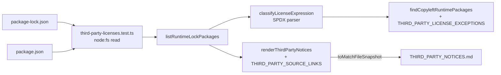

# Third-party notices და GPL/AGPL runtime licence test (OSS-LIC)

**თარიღი:** 2026-10-28
**სტატუსი:** Completed (C round 219 PASS)
**შეცვლილი პროექტი:** Store (ახალი pure module, unit test და generated `THIRD_PARTY_NOTICES.md`; app-ის კოდი და bundle უცვლელია)

## კონტექსტი

Open-source adoption-ის გეგმამ (`oss-adoption.md`, OSS-LIC), რომელიც საბამ დაამტკიცა, ორი რამ მოითხოვა: პირველ ახალ dependency-ზე (`mediabunny` + `@mediabunny/mp3-encoder`) საჭიროა ფაილი, რომელიც ყველა runtime dependency-ს აღწერს (package, version, licence, link) LAME-ის შენიშვნასთან ერთად. საჭიროა unit test-იც, რომელიც `package-lock.json`-ს კითხულობს და ჩავარდება, როცა runtime dependency-ის licence GPL-* ან AGPL-*-ია. devDependencies გამორიცხულია, გამონაკლისებისთვის კი არსებობს ცალსახა allow-list.

აქამდე licence-ის კონტროლი არ გვქონდა: transitive dependency GPL licence-ით შეუმჩნევლად შემოვიდოდა.

## მიდგომა

- **Runtime-ის განმარტება.** ყველა lock entry, რომელსაც `dev: true` არ აქვს. `devOptional`, `optional` და `peer` entry-ები runtime-ად ითვლება. ეს კონსერვატიული არჩევანია: lightningcss-ის binaries და typescript ცხრილშია და ამას არ "ვასწორებთ". root `""` entry გამოტოვებულია. სახელს ვიღებთ entry-ის `name` ველიდან (alias), ან path-ის ბოლო `node_modules/`-ის შემდეგი ნაწილიდან (scoped სახელების ჩათვლით). `link: true` და `inBundle: true` entry **unknown**-ია და ჩავარდება, არ გამოიტოვება. Notices-ის ცხრილში ერთნაირი name@version ერთ სტრიქონს იძლევა. Finder კი **ყოველ** runtime entry-ს ცალ-ცალკე ამოწმებს, რომ licence-იანმა duplicate-მა იმავე name@version-ის `inBundle` ან licence-ის გარეშე ასლი არ დამალოს.
- **Classifier.** SPDX expression-ს ვყოფთ tokens-ად და ვაანალიზებთ recursive-descent parser-ით (`WITH` > `AND` > `OR`, ფრჩხილებით). მთელ string-ზე regex არ გამოიყენება. Copyleft id-ია ის, რომელიც იწყება `GPL-`/`AGPL-`-ით, ან არის bare `GPL`/`AGPL`, მოძველებული ფორმების ჩათვლით (`GPL-2.0+`, `GPL-2.0-with-classpath-exception`). შედარება case-insensitive-ია; operators-იც (`and`/`or`/`with`) case-insensitive-ად მიიღება — ეს შეგნებული არჩევანია და TL1-ში აქვს რიგი. ცარიელი ან მხოლოდ whitespace-იანი licence ველი „licence-ის არქონად“ ითვლება. `OR` სუფთაა, თუ ერთი ალტერნატივა მაინც სუფთაა. `AND` copyleft-ია, თუ ერთი ნაწილი მაინც copyleft-ია. `X WITH exception`-ს `X`-ის კლასი აქვს. ცარიელი, არასწორი expression (დაუბალანსებელი ფრჩხილი, ცარიელი operand, ჩამოკიდებული operator), `UNLICENSED` და `SEE LICENSE IN …` **unknown**-ია. Legacy `{ type }` ობიექტის `type` გამოიყენება.
- **LGPL-ის ruling.** `LGPL-*` და bare `LGPL` **არ** ითვლება copyleft-ად: spec მხოლოდ GPL-*-ს და AGPL-*-ს ასახელებს, LAME (ერთადერთი LGPL კოდი, რომელსაც ვაწვდით) კი notice-ით არის დაფარული და არა test-ით. Naive `/GPL/` regex LGPL-საც მონიშნავდა. ამას TL1-ის LGPL შემთხვევები და mutant (c) ამოწმებს.
- **გამონაკლისები და stale წესი.** `THIRD_PARTY_LICENSE_EXCEPTIONS`-ში დღეს ერთი ჩანაწერია: `limiter@1.1.5`, asserted `MIT`. Lock-ში მას `license` ველი არ აქვს, მისი `package.json` კი legacy `"licenses": [{"type": "MIT"}]`-ს იყენებს (გზა: firebase-admin > jwks-rsa). Exception ემთხვევა მხოლოდ name + version-ს. Exception stale-ია და test ჩავარდება, თუ ამ name@version-ის runtime entry აღარ არსებობს, ან entry-ს საკუთარი `license` ველი გაუჩნდა. `node-forge@1.3.3` (`(BSD-3-Clause OR GPL-2.0)`) exception-ის გარეშე გადის, OR წესით.
- **Notices ფაილი generated-ია.** `THIRD_PARTY_NOTICES.md` ზუსტად `renderThirdPartyNotices(lock)`-ის შედეგია. ხელით დაწერილი ტექსტი (intro, LAME, MPL sources, run-time downloads) module-ის constant-ებშია. ცხრილი ერთ runtime name@version-ზე ერთ სტრიქონს შეიცავს. სორტირება code point-ით ხდება (`<`/`>`, არა `localeCompare`), version-ებიც, ამიტომ `1.10.0` `1.9.0`-ზე ადრე მოდის (semver order არ არის; TL7). დრო და გარემოზე დამოკიდებული მონაცემი ფაილში არ არის. Exception-ის სტრიქონში ჩანს `MIT (asserted; see exceptions)` და ცალკე "License exceptions" სექცია მიზეზით.
- **Regeneration.** `npx vitest run app/lib/__tests__/third-party-licenses.test.ts -u`. `CI=true`-ზე vitest snapshot-ს არ წერს, ამიტომ ძველი ან დაკარგული ფაილი gate-ზე ჩავარდება.
- **Drift წესი.** ნებისმიერი `chore(deps)`-ის ან lock-only ცვლილების შემდეგ (add, remove, `npm update`, transitive bump) TL5 წითელია, სანამ notices თავიდან არ დაგენერირდება. ამიტომ ყოველი დავალება, რომელიც deps request-ს ქმნის ან ასეთ ცვლილებას მოსდევს, `THIRD_PARTY_NOTICES.md`-ს grant-ად აძლევს და TL5-ს covering test-ად ასახელებს.
- **LAME-ის ფაქტები.** MP3 export იყენებს LAME 3.100-ს, რომელიც `@mediabunny/mp3-encoder` (MPL-2.0) package-მა WebAssembly-ში დააკომპილირა. **შესწორება `oss-adoption.md`-ის ტექსტზე:** LAME-ის wasm ცალკე ფაილად არ მოდის. ის base64-ით არის inlined package-ის JavaScript-ში (`dist/modules/build/lame.js`-ში `AGFzbQ` magic ჩანს, package-ში `.wasm` ფაილი 0-ია). WASM-ის bytes უცვლელად გადის. Package-ის JavaScript კი build tool-ის მიერ app-ის კოდთან ერთად bundled და minified-ია და მხოლოდ MP3 export-ის დაწყებისას იტვირთება. LAME LGPL-ითაა ლიცენზირებული; მისი licence გვერდი ვერსიას არ ასახელებს. Notice-ში ოთხი ბმულია (lame.sourceforge.io, license.txt, SourceForge-ის source download, encoder package-ის source). `www.mp3dev.org` მხოლოდ ტექსტად წერია (code span-ში): ის Google sign-in გვერდზე გადამისამართდება.
- **FFmpeg core.** `@ffmpeg/core@0.12.6` lock-ში არ არის. legacy purchased-Studio MP3 export მას run time-ზე `unpkg.com`-იდან ტვირთავს (`app/utils/ffmpeg.ts`). მისი npm licence ველი MIT-ია, მაგრამ შიგნით არსებული FFmpeg build შეიძლება სხვა licence-ის კომპონენტებს შეიცავდეს. ეს **არ არის გადამოწმებული**; notice არცერთ მხარეს არ ამტკიცებს.
- **ალტერნატივები.** `license-checker`-ის მსგავსი dependency არ დაგვიმატებია (packages-ის დაყენება აკრძალულია და lock საკმარისი წყაროა). `node_modules`-ის წაკითხვაზეც უარი ვთქვით, რადგან source of truth მხოლოდ `package-lock.json`-ია.

## არქიტექტურა

Module pure-ია: `node:` import, file IO და React არ აქვს. მას მხოლოდ test იყენებს, ამიტომ client ან server bundle-ში არ ხვდება.

## შეცვლილი ფაილები

- `app/lib/third-party-licenses.ts` — ახალი pure module: classifier, lock walker, copyleft finder, exceptions, MPL source links და notices renderer.
- `app/lib/__tests__/third-party-licenses.test.ts` — ახალი test, რიგები TL1–TL7.
- `THIRD_PARTY_NOTICES.md` — generated ფაილი repo root-ში (563 runtime package).
- `docs/implementation/2026/quarter-IV/171-oss-lic-third-party-notices.md` — ეს დოკუმენტი.

## პრობლემები და გადაწყვეტები

- **Problem:** repo-scan test-ი (TL4/TL5) საწყის ასლზე წითლად ვერ გამოჩნდება. → **Solution:** red-proof-ი named mutants-ით: (a) `OR`, როგორც `AND`; (b) `dev` filter-ის გარეშე; (c) `/GPL/i` raw string-ზე; (d) exception version-ის გარეშე; (e) notices-იდან წაშლილი სტრიქონი; (f) `await`-ის გარეშე + (e); (g) `limiter` exception-ის გარეშე. ყოველი mutant დროებით გამოიყენებოდა და sha256-ით აღდგენა მოწმდებოდა.
- **Problem:** `toMatchFileSnapshot` promise-ს აბრუნებს; `await`-ის გარეშე test შეიძლება ვერაფერს ამოწმებდეს. → **Solution:** TL5 იყენებს `await expect(...).toMatchFileSnapshot(...)`. Mutant (f) აჩვენებს, რომ vitest 4.0.16 ჯერჯერობით თვითონ ელოდება ჩამოკიდებულ assertion-ს და აფრთხილებს ("was not awaited … will cause the test to fail"). ამიტომ `await` სავალდებულოა, რომ ქცევა vitest-ის ვერსიაზე არ იყოს დამოკიდებული.
- **Problem:** GFM bare `www.` domain-ს ავტომატურად ბმულად აქცევს. → **Solution:** `www.mp3dev.org` code span-შია; TL6 ამოწმებს, რომ ის არც `http(s)://` და არც markdown link არ არის.
- **Problem:** TypeScript strict `as`-ის გარეშე. → **Solution:** lock-ი `unknown`-ად იკითხება და type guards-ით ვიწროვდება (`isPlainRecord`, `Reflect.get` → `unknown`).

## ტესტირება

- `npx vitest run app/lib/__tests__/third-party-licenses.test.ts` — 51 test, გადის ჩვეულებრივადაც და `CI=true`-ზეც (`-u`-ის გარეშე).
  - **TL1** — classifier, table-driven (clean / copyleft / unknown, LGPL შემთხვევები, `GPL-2.0-with-classpath-exception`, dangling `WITH`, lowercase operators და legacy `{ type }`).
  - **TL2** — walker in-memory fixture lock-ზე (root, `dev`, `devOptional`/`optional`/`peer`, alias, nested scoped, `link`/`inBundle`, duplicates, licence-იანი duplicate-ის მიღმა დამალული `inBundle` ასლი).
  - **TL3** — exceptions და stale წესი fixtures-ზე, მათ შორის: exception GPL licence-ს ვერ მალავს.
  - **TL4** — რეალური lock: 0 failure, 0 stale exception; anchors: `mediabunny`, `@mediabunny/mp3-encoder`, `node-forge`, `limiter`, dev filter.
  - **TL5** — `THIRD_PARTY_NOTICES.md`-ის sync, `await … toMatchFileSnapshot`.
  - **TL6** — notices-ის შიგთავსი: ყველა `package.json` dependency, MPL source links, LAME-ის ოთხი ბმული და ტექსტი, `@ffmpeg/core@0.12.6`, `\r`-ის არქონა და ერთი trailing newline.
  - **TL7** — renderer-ის დეტერმინიზმი (shuffled keys, code-point order).
- Mutants (a)–(e) და (g) შესაბამის რიგებს აწითლებს; (f) informational-ია.
- `npm run typecheck` და `npm run lint` გადის; Biome scoped check ორ `.ts` ფაილზე გადის.
- L23 scanner-ის 10 ფაილი (mp3-encoder, strings, export-dialog-a11y-copy, export-progress-ui, store-focus-ring, store-theme-tokens, studio-focus-ring, timeline-cursor-map, panel-radius-ui, studio-theme-obsidian) — 166/166 გადის.

## TODO / შემდეგი ნაბიჯები

- PERF-16b (legacy MP3 path-ის გადაყვანა shared encoder-ზე და `@ffmpeg/*`-ის წაშლა) notices-იდან შლის "Run-time downloads" ჩანაწერს და `THIRD_PARTY_NOTICES.md`-ს თავიდან აგენერირებს (drift წესი).
- **For Saba:** იურიდიული კითხვა — საკმარისია თუ არა LGPL LAME-ისთვის ეს notice და source ბმულები, როცა WASM app-ის bundled chunk-შია ჩადგმული (მაგ. "replaceability"-ის მოთხოვნა). ეს ფაილი ამაზე არაფერს ამტკიცებს.
- PERF-8 (zustand) — შემდეგი deps ცვლილება, რომელიც notices-ის regeneration-ს მოითხოვს.
