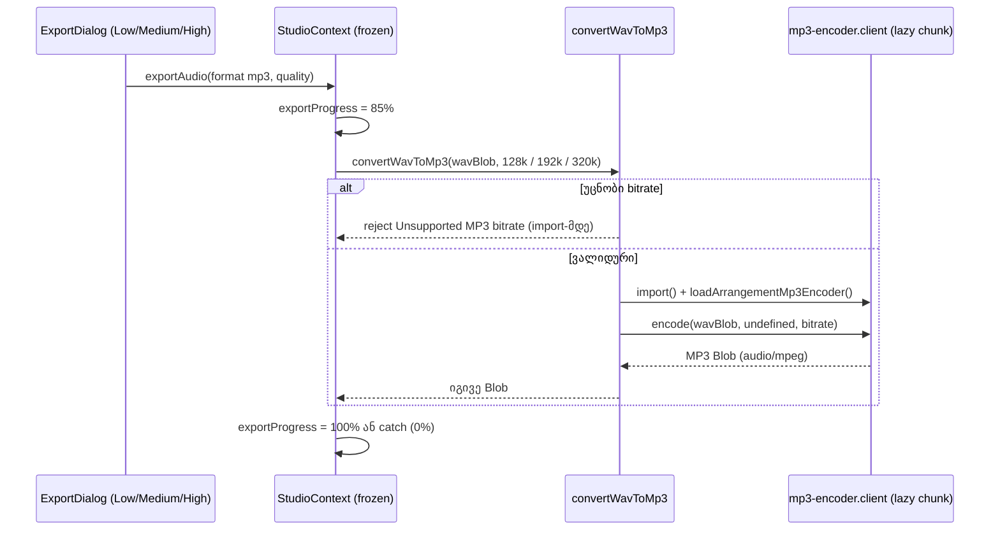

# PERF-16b-i: ნაყიდი Studio-ს MP3 ექსპორტი საერთო LAME encoder-ზე

**თარიღი:** 2026-10-28
**სტატუსი:** Completed (C round 221 PASS)
**შეცვლილი პროექტი:** Store (`app/utils/ffmpeg.ts` facade, საერთო MP3 encoder-ის bitrate option, third-party notices, unit tests, დოკუმენტაცია)

## კონტექსტი

Open-source adoption-ის გეგმის PERF-16 row (`oss-adoption.md`) მოითხოვს, რომ MP3 ექსპორტი mediabunny + `@mediabunny/mp3-encoder`-ით მუშაობდეს და `@ffmpeg/*` და unpkg-ის URL წაიშალოს. ექსპორტის დიალოგი, progress, cancel და ფაილის სახელები უნდა დარჩეს ისე, როგორც არის.

PERF-16a-მ (doc 170) lab-ის (`/studio-lab`) MP3 ექსპორტი უკვე გადაიყვანა საერთო encoder-ზე. ნაყიდი Studio (`/studio/:productId`) კი ისევ `app/utils/ffmpeg.ts`-ს იყენებდა. ის FFmpeg core-ს (~31MB) ექსპორტის დროს `unpkg.com`-იდან ტვირთავდა. ეს იყო მესამე მხარის origin და ლიცენზიურად გადაუმოწმებელი binary, რაც `THIRD_PARTY_NOTICES.md`-ში ცალკე სექციით იყო აღნიშნული.

PERF-16b ორ ეტაპად იყოფა (D-29z229):

- **16b-i (ეს დოკუმენტი):** კოდი. Legacy გზა საერთო encoder-ს გადაეცემა, quality tier-ები ნარჩუნდება, notices-იდან run-time download-ის შენიშვნა ქრება.
- **16b-ii (შემდეგი PERF რაუნდი):** პაკეტები. `@ffmpeg/ffmpeg` და `@ffmpeg/util`-ის წაშლა root-ის მიერ, `vite.config.ts`-ის `optimizeDeps.exclude` და notices-ის ხელახალი გენერაცია.

იმავე რაუნდში გასწორდა C-R219-01 (Low): licence classifier `GPLv3`-ის ტიპის მართლწერას (ტირის გარეშე) copyleft-ად არ ცნობდა.

## მიდგომა

### Facade (`app/utils/ffmpeg.ts`)

ფაილი იგივე path-ზე რჩება, რადგან წაშლა ან გადარქმევა საბას ნებართვას საჭიროებს. ფაილში დარჩა ერთადერთი export, `convertWavToMp3(wavBlob, bitrate = '320k')`. `loadFFmpeg` და `onFFmpegProgress` წაიშალა: პირველს მხოლოდ ტესტის mock იყენებდა, მეორეს არავინ.

Bitrate map ზუსტია: `'128k'` → 128000, `'192k'` → 192000, `'320k'` → 320000. ნებისმიერი სხვა string (`'256k'`, `''`, `'320'`, `'320K'`) უარყოფილია `Unsupported MP3 bitrate: <value>` შეცდომით, **encoder-ის module-ის import-მდე**. ასე უარყოფილი გამოძახება encoder-ის chunk-ს არ ტვირთავს.

ვალიდური გამოძახება აკეთებს `await import('~/lib/arrangement/mp3-encoder.client')`-ს, შემდეგ **ყოველ ჯერზე** `loadArrangementMp3Encoder()`-ს და `encode(wavBlob, undefined, { bitrate })`-ს. encoder-ის ობიექტი cache-ში არ ინახება, ამიტომ reset-ის შემდეგ ძველი ობიექტი არ გამოიყენება. Load-ის ან encode-ის შეცდომა უცვლელად გადაეცემა, არც wrap-დება და არც იმალება.

ფაილის სახელი ახლა ffmpeg-ს ამბობს, თუმცა კოდი მას აღარ იყენებს. ამიტომ ფაილში დარჩა ერთი `TODO` (rename-ის საკითხი საბასთვის).

### საერთო encoder-ის bitrate option

`ArrangementMp3Encoder.encode(wav, onProgress?, options?)`, სადაც `options` არის `ArrangementMp3EncodeOptions` (`{ bitrate?: number }`). დასაშვები მნიშვნელობები exported `ARRANGEMENT_MP3_BITRATES`-შია: `[128000, 192000, 320000]`. Default 320000-ია, ამიტომ lab-ის გამოძახება (`encode(blob, onProgress)`) უცვლელად 320 kbps-ს იძლევა. სიის გარეთ მნიშვნელობა (`0`-ის ჩათვლით, default-ის `??`-ის გამო) უარყოფილია `new Input(...)`-მდე და `Conversion.init`-მდე, ამიტომ dispose-საც არაფერი სჭირდება. Generation/reset, progress gating და შეცდომის ტექსტები უცვლელია.

B-ის real-Chromium probe-მა (`b-round-219/bitrate-probe.log`) აჩვენა, რომ mediabunny 1.62.1 + LAME სამივე tier-ზე CBR-ს იძლევა ზუსტი bitrate-ით (MPEG-1 Layer III, 48 kHz, joint stereo).

### StudioContext გაყინულია

`app/contexts/StudioContext.tsx` ამ რაუნდში არ შეცვლილა. მისი გამოძახება `convertWavToMp3(wavBlob, bitrate)` და catch path იგივეა. Progress იგივე რჩება: 85% გამოძახებამდე, 100% შემდეგ, შუალედური MP3 progress-ის გარეშე (როგორც FFmpeg-ის დროს იყო). შეცდომისას catch აყენებს `isExporting: false`-ს და `exportProgress: 0`-ს და შეცდომას ხელახლა აგდებს.

### Single consumer per page (D-29z230)

`resetArrangementMp3Encoder()` module-wide რჩება. გვერდზე მაქსიმუმ ერთი encoder consumer არის, რადგან `StudioProvider` მხოლოდ `routes/studio.$productId.tsx`-ში mount-დება, `ArrangementProvider` კი მხოლოდ `routes/studio-lab.tsx`-ში. Per-call signal არ დაემატა: ამას გაყინული `ArrangementContext`-ის შეცვლა დასჭირდებოდა, დაკვირვებული დეფექტი კი არ არსებობს.

**ცნობილი race (დოკუმენტირებული, არ არის გასწორებული):** მომხმარებელი იწყებს lab-ის MP3 ექსპორტს, client-side ნავიგაციით გადადის `/studio/:id`-ზე და legacy MP3 ექსპორტს იწყებს, სანამ lab-ის pending `import()` დასრულდება. ამ დროს lab-ის დაგვიანებულმა `resetArrangementMp3Encoder()`-მა legacy encode შეიძლება უარყოს. load-ის ან `Conversion.init`-ის დროს შეცდომაა "MP3 encoder reset during …", `execute()`-ის დროს კი mediabunny-ის cancel შეცდომა ("Conversion was canceled.", ME12). ეს უსაფრთხოდ ვარდება: StudioContext-ის catch state-ს აბრუნებს, ფაილი არ იქმნება და მომხმარებელს ექსპორტის თავიდან დაწყება შეუძლია.

### Notices და licence classifier

აპის კოდი `@ffmpeg/core`-ს აღარ ტვირთავს, ამიტომ `NOTICES_RUNTIME_DOWNLOADS_SECTION` და მისი ადგილი renderer-ში წაიშალა. `@ffmpeg/ffmpeg` და `@ffmpeg/util`-ის ცხრილის row-ები 16b-ii-მდე რჩება, რადგან ისინი ჯერ ისევ lock-შია. Intro ახლა ამბობს: "lists every runtime (non-dev) entry in `package-lock.json`, a superset of what the store ships" (gate-219 S3).

**C-R219-01:** `COPYLEFT_ID_PATTERN = /^A?GPL(?:V?\d|[-+]|$)/i` თითო token-ზე გამოიყენება. ახლა copyleft-ად ითვლება `GPLv3`, `GPLv2+`, `GPL2`, `AGPLv3`. `^` anchor-ის გამო `LGPLv3` და `LGPL-2.1-only` clean რჩება.

B-ის rulings:

- **R-219-2 (შეიცვალა):** `LicenseRef-`-ით დაწყებული id (case-insensitive) **unknown**-ია, ამიტომ ვარდება, სანამ ვინმე არ გადაამოწმებს. სხვა well-formed, არა-GPL id `clean` რჩება. `clean` ნიშნავს "GPL/AGPL ვერ მოიძებნა" და არა "permissive": TL1-ის row `Proprietary` → clean ამ მნიშვნელობას აფიქსირებს. SPDX id-ების სია არ შემოგვაქვს, რადგან spec-ის scope GPL/AGPL-ია.
- **R-219-3 (მიღებულია):** პატარა ასოებით `and`, `or` და `with` დაშვებული რჩება, რადგან npm metadata-ს case განსხვავებულია.
- **R-219-4 (მიღებულია):** ცარიელი ან მხოლოდ whitespace licence string licence-ის არქონას ნიშნავს: ის unknown-ია და exception-ით შეიძლება დაიფაროს.

**Gate-219 S2:** TL5-ში `existsSync(NOTICES_PATH)` snapshot-მდე მოწმდება, ამიტომ `CI=true`-ს გარეშე გაშვება წაშლილ ფაილს ჩუმად ვეღარ შექმნის. წაშლილი ფაილის აღსადგენად ჯერ ცარიელი `THIRD_PARTY_NOTICES.md` შექმენით, შემდეგ გაუშვით `-u`.

**Drift rule (L35, შესწორებული):** ნებისმიერი deps ან lock ცვლილების შემდეგ შეიძლება გაწითლდეს TL4 (version anchors, მაგ. `mediabunny@1.62.1`, `node-forge@1.3.3`, `limiter@1.1.5`) და TL5 (notices sync). TL4-ის anchors განზრახ რჩება (S4). 16b-ii და PERF-8 (zustand) ამიტომ `THIRD_PARTY_NOTICES.md`-სა და licence test-ს grant-ად იღებენ.

## არქიტექტურა

## შეცვლილი ფაილები

- `app/utils/ffmpeg.ts`: thin facade, bitrate map, `TODO` rename-ზე.
- `app/lib/arrangement/mp3-encoder.client.ts`: `ArrangementMp3EncodeOptions`, `ARRANGEMENT_MP3_BITRATES`, ვალიდაცია `Input`-მდე, `Quality({ bitrate })`.
- `app/utils/__tests__/ffmpeg.test.ts` (ახალი): LF1–LF5.
- `app/lib/arrangement/__tests__/mp3-encoder.test.ts`: ME10–ME12.
- `app/lib/arrangement/__tests__/export-progress-ui.test.tsx`: მხოლოდ `loadFFmpeg` mock-ის წაშლა (PU5-ის დანარჩენი assertion-ები უცვლელია).
- `app/lib/third-party-licenses.ts`: run-time downloads სექციის წაშლა, intro, copyleft pattern, `LicenseRef-` → unknown.
- `app/lib/__tests__/third-party-licenses.test.ts`: TL1-ის ახალი row-ები, TL5-ის existence check, TL6-ის შეცვლილი row, TL8.
- `THIRD_PARTY_NOTICES.md`: ხელახლა დაგენერირებული (`-u`), ხელით არ შეცვლილა.
- `docs/technical/diagrams/studio-audio-pipeline.md`: intro, §7, §10, §12.

## პრობლემები და გადაწყვეტები

- **პრობლემა:** უცნობი bitrate-ის შემთხვევაში encoder-ის chunk მაინც შეიძლებოდა ჩატვირთულიყო, თუ ვალიდაცია import-ის შემდეგ მოხდებოდა. **გადაწყვეტა:** map lookup და throw ხდება `import()`-მდე. LF2 ამოწმებს, რომ mock module-ის factory საერთოდ არ გამოძახებულა.
- **პრობლემა:** `{ bitrate: 0 }` `||` default-ით ჩუმად 320000-ად იქცეოდა. **გადაწყვეტა:** `??`, ამიტომ `0` უარყოფილია (ME11).
- **პრობლემა:** ME9 ითვლის `mp3-encoder.client`-ის ყოველ ტექსტურ ხსენებას non-test app ფაილებში. **გადაწყვეტა:** facade-ში ერთადერთი ხსენება `import('~/lib/arrangement/mp3-encoder.client')`-ია, `import type`-ისა და path-ის ხსენებიანი კომენტარის გარეშე.
- **პრობლემა:** run-time downloads სექციის წაშლის შემდეგ ახალ კოდს unpkg-ის ან `@ffmpeg/*`-ის დაბრუნება შეუმჩნევლად შეეძლო. **გადაწყვეტა:** TL8 repo scan და მისი named mutant (ძველი l.38 URL და `@ffmpeg` import scratch ფაილში).

## ტესტირება

- `app/utils/__tests__/ffmpeg.test.ts`:
  - **LF1:** `'128k'`, `'192k'`, `'320k'` და argument-ის გარეშე გამოძახება → `encode(wav, undefined, { bitrate })` 128000/192000/320000/320000-ით, იგივე `wav` reference-ით.
  - **LF2:** `'256k'`, `''`, `'320'`, `'320K'` → reject import-მდე.
  - **LF3:** Blob უცვლელად ბრუნდება, load და encode-ის rejection უცვლელად გადაეცემა.
  - **LF4:** ორი გამოძახება = ორი load.
  - **LF5:** source-ში არ არის `@ffmpeg`, `unpkg` და `FFmpeg`; runtime exports = `['convertWavToMp3']`.
- `mp3-encoder.test.ts`:
  - **ME10:** bitrate `Quality`-ში ხვდება. ME4 ისევ 320000 default-ს აფიქსირებს.
  - **ME11:** 256000 და 0 → reject, `FakeInput` 0, `Conversion.init` არ გამოძახებულა.
  - **ME12:** "a reset cancels every in-flight encode, whichever caller started it". ორი პარალელური encode სხვადასხვა bitrate-ით, ერთი reset ორივეს უარყოფს და ორივე conversion-ს აუქმებს, ახალი load კი წარმატებით ასრულებს encode-ს.
  - **ME9:** import boundary მწვანე რჩება.
- `third-party-licenses.test.ts`:
  - **TL1:** ახალი row-ები `GPLv3`, `GPLv2+`, `GPL2`, `AGPLv3`, `MIT AND GPLv2`, `(MIT OR GPLv3)`, `LGPLv3`, `LGPL-2.1-only`, `LicenseRef-Proprietary`, `Proprietary`.
  - **TL5:** existence check.
  - **TL6:** "there is no run-time downloads section".
  - **TL8:** repo scan (`unpkg` ან `@ffmpeg/` ნებისმიერ non-test app ფაილში, C-ის SOURCE-GREP-ის ტოლი pattern) და მისი named mutant.
- Notices-ის `-u` გენერაციის შემდეგ ჩვეულებრივმა და `CI=true` გაშვებამ PASS მისცა. `git diff` მხოლოდ intro-ს და წაშლილ სექციას აჩვენებს. ცხრილი (563 row) უცვლელია.
- Red-proof mutants (a)–(h) და შედეგები A-ის ანგარიშშია (`a-round-220.md`).
- Browser-ის შემოწმება (FACADE-REAL-220, LAB-MP3-220, BUNDLE-220, PERF-RUN-220) C-ის რაუნდია. ნაყიდი Studio-ს UI-ით MP3 ექსპორტი (LEGACY-UI-220) cloud-ში BLOCKED-ია ("backend unavailable in cloud").

## TODO / შემდეგი ნაბიჯები

- **16b-ii:** root remove request `@ffmpeg/ffmpeg`-სა და `@ffmpeg/util`-ზე, `vite.config.ts`-ის `optimizeDeps.exclude`-ის grant, notices-ის ხელახალი გენერაცია და ffmpeg-ის დარჩენილი ხსენებები დოკუმენტაციაში.
- **TODO (საბასთვის):** `app/utils/ffmpeg.ts`-ის გადარქმევა legacy-mp3 facade-ად, როცა file rename-ზე ნებართვა იქნება.
- **TODO:** შუალედური MP3 progress legacy Studio-ში (signal LEGACY-MP3-PROGRESS). დღეს 85% → 100%.
- **TODO:** ცნობილი lab → legacy reset race. per-call cancel signal მხოლოდ დაკვირვებული დეფექტის შემთხვევაში.
