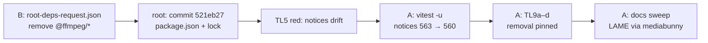

# PERF-16b-ii: `@ffmpeg/ffmpeg` და `@ffmpeg/util` პროექტიდან ამოღება

**თარიღი:** 2026-10-28
**სტატუსი:** Completed (C round 221 PASS)
**შეცვლილი პროექტი:** Store (third-party notices, license test TL9, Studio-ს დოკუმენტაცია)

## კონტექსტი

Open-source adoption-ის გეგმის PERF-16 row (`oss-adoption.md`) ითხოვს: "Remove `@ffmpeg/*` and the unpkg URL." PERF-16a-მ (doc 170) lab-ის MP3 ექსპორტი საერთო LAME encoder-ზე (`mediabunny` + `@mediabunny/mp3-encoder`) გადაიყვანა. PERF-16b-i-მ (doc 172) ნაყიდი Studio-ც იმავე encoder-ზე გადაიყვანა და unpkg-ის URL წაშალა. ამის შემდეგ app-ის კოდი `@ffmpeg/*`-ს აღარ იყენებდა (SOURCE-GREP-220: 0 hit), თუმცა ორი package ჯერ კიდევ `package.json`-სა და `package-lock.json`-ში იყო. `@ffmpeg/core` (GPL-2.0+) არასდროს ყოფილა დაინსტალირებული — ის მხოლოდ run time-ზე იტვირთებოდა და ეს ჩატვირთვა round 220-ში წაიშალა.

ეს არის PERF-16b-ის მეორე და ბოლო ეტაპი.

## მიდგომა

- **Package-ები root-მა ამოიღო, არა A-მ.** Dependency-ების წესის მიხედვით (`oss-adoption.md`, "Dependencies: how they get in") B-მ დაწერა `root-deps-request.json` (`remove: ["@ffmpeg/ffmpeg", "@ffmpeg/util"]`). Root-მა გააკეთა commit `521eb27` — `chore(deps): remove @ffmpeg/ffmpeg @ffmpeg/util (root, OSS plan approved by Saba)` — პირდაპირ `c4e6c9d`-ზე. ის მხოლოდ `package.json`-ს (2 ხაზი) და `package-lock.json`-ს ცვლის.
- **Lock-იდან წაიშალა 3 entry:** `node_modules/@ffmpeg/ffmpeg` (0.12.15), `node_modules/@ffmpeg/types` (0.12.4, transitive) და `node_modules/@ffmpeg/util` (0.12.2), პლუს root `dependencies`-ის 2 ხაზი. ეს ზუსტად ემთხვევა B-ის scratch run-ს.
- **Notices ხელით არ შეცვლილა.** `THIRD_PARTY_NOTICES.md` ხელახლა დაგენერირდა (`vitest -u`). Diff: სათაური `## Runtime packages (563)` → `(560)` და 3 `@ffmpeg/*` row-ის წაშლა. სხვა არაფერი.
- **TL9 წაშლას აფიქსირებს** (`app/lib/__tests__/third-party-licenses.test.ts`). Test-local helper-ები (`listFfmpegPackageJsonKeys`, `listFfmpegLockKeys`, `listFfmpegLockRootDependencies`) კითხულობენ იმავე რეალურ `package.json`-სა და `package-lock.json`-ს, რასაც TL4 და TL6. `third-party-licenses.ts`-ში ახალი export არ დამატებულა.
- **Docs sweep.** Studio-ს დოკუმენტაციის granted სექციებში FFmpeg.wasm-ის, `@ffmpeg/*`-ის, `loadFFmpeg`-ის და "3–5MB"-ის მტკიცებები ჩანაცვლდა დღევანდელი ქცევით: MP3 ექსპორტი საერთო LAME encoder-ით, რომელიც საჭიროებისას იტვირთება იმავე origin-იდან, ცალკე lazy chunk-ით. ნაყიდი Studio წერს 128/192/320 kbps-ს (Low/Medium/High), lab — 320 kbps CBR-ს. ძველი code sample წაიშალა და მის ადგილას მხოლოდ რეალური signature დარჩა: `convertWavToMp3(wavBlob: Blob, bitrate: string = '320k'): Promise<Blob>`. დასაშვები მნიშვნელობებია `'128k'`, `'192k'`, `'320k'`, სხვა იწვევს შეცდომას.
- **`app/utils/ffmpeg.ts` სახელს ინარჩუნებს** (SABA-Q-FFMPEG-FILENAME). Granted სექციებში `ffmpeg` დარჩა მხოლოდ path-ად, "legacy სახელის" შენიშვნით.
- **`vite.config.ts`: VITE-EXCLUDE-STALE: no root grant.** `root-grant-r221-vite.json` არ არსებობდა და root-ის deps commit-ს ეს ფაილი არ შეუცვლია. ამიტომ l.26–28-ის `optimizeDeps.exclude: ['@ffmpeg/ffmpeg', '@ffmpeg/util']` byte-identical დარჩა. B-ის scratch run-ის მიხედვით ეს dead, მაგრამ უვნებელი config-ია (Low).

### დარჩენილი `ffmpeg` mention-ები (განზრახ დატოვებული)

| ფაილი | რატომ რჩება |
|---|---|
| `docs/technical/overview.md` l.138, l.441 | `utils/ffmpeg.ts`-ს "MP3 conversion"-ად ასახელებს — ეს ისევ მართალია |
| `docs/technical/studio-audio-pipeline.md` l.275 | path-ს ასახელებს — ისევ მართალია |
| `docs/technical/claude-code-setup.md` l.147 | `.claude` studio-specialist agent-ის ცოდნას აღწერს; agent ფაილები root/Saba-ს proposal-ია |
| `docs/learning/features/01-social-media-automation.md` l.391 | server-side ვიდეოს ffmpeg — სხვა ხელსაწყო |
| `PRE_PRODUCTION_CHECKLIST.md` l.124 | ისტორიული checklist (Low) |
| `prompts/industry-kits/music-audio-store.md` | სხვა პროექტების generic template |
| `docs/implementation/`, `docs/plans/`, `docs/bugs/` | ისტორიული ჩანაწერები, უცვლელი |

## არქიტექტურა

MP3 ექსპორტის runtime გზა ამ რაუნდში არ შეცვლილა (doc 172): `StudioContext` → `app/utils/ffmpeg.ts` (`convertWavToMp3`) → dynamic `import()` → `app/lib/arrangement/mp3-encoder.client.ts`.

## შეცვლილი ფაილები

- `THIRD_PARTY_NOTICES.md` — ხელახლა დაგენერირებული (count 560, 3 row ნაკლები)
- `app/lib/__tests__/third-party-licenses.test.ts` — TL9a–TL9d და test-local helper-ები
- `docs/technical/studio.md` — Tech Stack, Core Components, Export System → Architecture, "MP3 encoding (LAME via mediabunny)" (ყოფილი "FFmpeg.wasm Integration"), "3. Why LAME via mediabunny?" (ყოფილი "3. Why FFmpeg.wasm?"), File Structure, Testing Checklist → Export, Dependencies, Last Updated
- `docs/technical/debug-studio.md` — "5. Export fails", Testing Checklist
- `docs/design/components/audio-player.md` — ExportDialog / Export Flow
- `docs/learning/README.md` — Tech Stack
- `docs/learning/architecture/02-audio-studio-system.md` — ტერმინოლოგია, User Journey (Mermaid message), Export Pipeline (Mermaid subgraph და node label-ები), Trade-offs, Key Takeaways
- `docs/implementation/2026/quarter-IV/172-perf-16b-i-legacy-mp3-shared-encoder.md` — მხოლოდ სტატუსის ხაზი (PERF-16b დასრულდა)
- `docs/implementation/2026/quarter-IV/173-perf-16b-ii-remove-ffmpeg-packages.md` — ეს დოკუმენტი

`package.json` და `package-lock.json` root-ის commit-შია და A-ს არ შეუცვლია.

## პრობლემები და გადაწყვეტები

- **Problem:** deps commit-ის შემდეგ TL5 (notices sync) წითელია, რადგან notices ჯერ კიდევ 563 package-ს ასახელებს. **Solution:** notices ხელახლა დაგენერირდა; diff შემოწმდა, რომ მხოლოდ count და 3 row შეიცვალა. Master-ზე deps-only commit-ზე CI წითელია, სანამ ეს რაუნდი არ გამოქვეყნდება — ეს მოსალოდნელია.
- **Problem:** task-ში მოცემული sample signature (`bitrate?: '128k' | '192k' | '320k'`) რეალურ კოდს არ ემთხვევა — კოდში არის `bitrate: string = '320k'` და runtime-ზე შემოწმება. **Solution:** docs-ში ჩაიწერა რეალური signature, დასაშვები მნიშვნელობები კი ცალკე, ტექსტად.
- **Problem:** TL9d-ს "c4e6c9d lock"-ის შემოწმება სჭირდება git-ის გამოძახების გარეშე. **Solution:** inline fixture-ი 3 `@ffmpeg/*` key-ით და ერთი სუფთა key-ით. Helper-მა ზუსტად ეს 3 უნდა დააბრუნოს.
- **Problem:** Mermaid label-ების გადარქმევამ დიაგრამა არ უნდა გატეხოს. **Solution:** node id-ები და edge-ები უცვლელია, შეიცვალა მხოლოდ label-ები. `02-audio-studio-system.md`-ის 6-ივე block Chromium-ში `mermaid.parse`-ით (mermaid 11.17.2) იპარსება.

## ტესტირება

- `CI=true npx vitest run app/lib/__tests__/third-party-licenses.test.ts`: 67/67, მათ შორის TL5 (notices sync), TL6, TL8 და ახალი TL9a, TL9b, TL9c, TL9d.
- Red-proof (თითოეული — დროებითი ცვლილება და sha256-ით აღდგენა):
  - (a) helper მიმართულია `c4e6c9d`-ის lock-ის `/tmp` ასლზე → TL9b წითელია და ასახელებს 3 key-ს; collateral: TL5, TL9c;
  - (b) `c4e6c9d`-ის `package.json` → TL9a წითელია; collateral: TL6;
  - (c) notices `c4e6c9d`-ის ვერსიით → მხოლოდ TL5 წითელია;
  - (d) `listFfmpegLockKeys` აბრუნებს `[]`-ს → TL9d წითელია.
- Covering ფაილები: `app/utils/__tests__/ffmpeg.test.ts`, `app/lib/arrangement/__tests__/mp3-encoder.test.ts`, `app/lib/arrangement/__tests__/export-progress-ui.test.tsx`, `app/lib/arrangement/__tests__/export-mp3.test.tsx`; ასევე `npm run typecheck` და `npm run lint`.
- **Browser (C, round 221): LEGACY-UI-STUBBED-221.** ნაყიდი Studio (`/studio/middle-east`) იხსნება stubbed backend პასუხებით (fake `auth_user`, `/api/downloads`, `/api/studio-token`, synthetic WAV stems). რეალური ExportDialog ქმნის `Middle East-export.mp3`-ს Low/Medium/High-ზე, frame-walk-ით 128/192/320 kbps. **ეს ამტკიცებს მხოლოდ client-side ექსპორტის გზას რეალურ dialog-სა და Chromium-ში. Ownership-ს ან auth-ს არ ამტკიცებს** — ის დარჩა LEGACY-OWNERSHIP-221-ში, როგორც backend-only (BLOCKED: backend unavailable in cloud).
- **C-R220-01-ის ახალი baseline:** script-ები studio-lab 44/0, home 41/0, guard 42/0 (third-party 0) და bytes `c-round-220/perf-run-1.json`-დან. Script-ების რაოდენობის ცვლილება ფასდება იმით, თუ რა იტვირთება, და არა რაოდენობით.

## TODO / შემდეგი ნაბიჯები

- **SABA-Q-FFMPEG-FILENAME:** `app/utils/ffmpeg.ts`-ის გადარქმევა legacy-mp3 facade-ად, Saba-ს ნებართვის შემდეგ.
- **`.claude/**` და `.codex/**` proposal (root/Saba):** მოძველებული ffmpeg ინსტრუქციები — `.claude/agents/studio-specialist.md`, `.codex/agents/studio-specialist.toml`, `.claude/primitives/AUDIO_ARCHITECTURE.md`, `.claude/agents/performance-optimizer.md` და მისი `.codex` წყვილი, `.claude/skills/ffmpeg-wasm/SKILL.md`, `ffmpeg-wasm` skill-ის row `CLAUDE.md`-სა და `AGENTS.md`-ში.
- **B-R220-LEGACY-EXPORT-NO-STEMS (Medium, round 222):** ExportDialog იხსნება 0/10 მონიშნული stem-ით, რადგან `useState` initializer stem-ების ჩატვირთვამდე ეშვება.
- **Export-pipeline architecture checkpoint:** WAV worker, საერთო encoder და მისი reset scope, legacy `StudioContext` export.
- **VITE-EXCLUDE-STALE (Low):** `vite.config.ts`-ის მკვდარი `optimizeDeps` block root-ის გადაწყვეტილებას ელოდება (`b-round-220-root-request-vite.md`).
