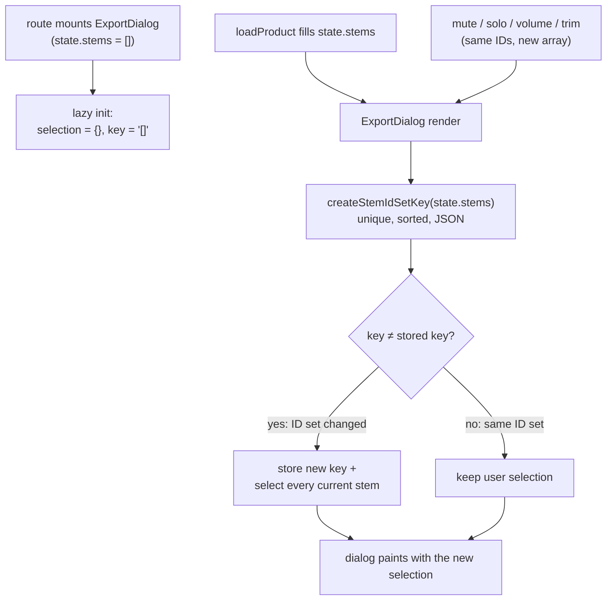

# ნაყიდი Studio-ს Export dialog: ყველა stem მონიშნულია stem-ების ჩატვირთვის შემდეგ

**თარიღი:** 2026-10-28
**სტატუსი:** Completed (C round 222 PASS)
**შეცვლილი პროექტი:** Store (ნაყიდი Studio-ს `ExportDialog`, ახალი component test)

## კონტექსტი

ბაგი **B-R220-LEGACY-EXPORT-NO-STEMS** (Medium). ნაყიდ Studio-ში (`/studio/:productId`) "Export Mix"-ზე დაჭერისას dialog იხსნებოდა 10-დან 0 მონიშნული stem-ით, და "Export Audio" ღილაკი disabled იყო, სანამ მომხმარებელი "Select All"-ს არ დააჭერდა. ეს ბაგი dialog-ის დაწერის დღიდან არსებობდა; PERF-16-ს ის არ გამოუწვევია. B-მ ის round-221-ის დაგეგმვისას იპოვა Playwright-ის `page.route` stub-ებით (HR-LEGACY-STUBBED), C-მ კი round 221-ში 4-დან 4 გაშვებაში გაიმეორა.

**მიზეზი:** route `ExportDialog`-ს ერთხელ mount-ავს, მანამდე, სანამ `loadProduct` `state.stems`-ს შეავსებს. `selectedStems`-ის `useState` initializer-მა ამიტომ ცარიელი Set დაიმახსოვრა, და მას შემდეგ მას არაფერი აახლებდა. Component მუდმივად mounted რჩება, ამიტომ initializer თავიდან არასდროს ეშვება.

## მიდგომა

**კონტრაქტი (B, D-29z237):**

1. **Trigger არის stem ID-ების სიმრავლე.** როცა `state.stems`-ის ID-ების სიმრავლე იცვლება (პირველი ჩატვირთვა, stem-ის დამატება, წაშლა ან სხვა პროდუქტი), მონიშვნა ხდება **ყველა მიმდინარე stem**.
2. **იგივე ID-ები → ცვლილება არ ხდება.** `StudioContext` mute-ზე, solo-ზე, volume-ზე, trim-ზე და loading-ზე `state.stems`-ს ახალ მასივად აგებს, მაგრამ იმავე ID-ებით. ასეთი rebuild მონიშვნას არ ეხება. მხოლოდ რიგის შეცვლაც ცვლილებად არ ითვლება.
3. **მომხმარებლის toggle-ები რჩება** dialog-ის დახურვისა და ხელახლა გახსნისას, სანამ ID-ების სიმრავლე იგივეა.
4. **წაშლილი ID მონიშვნიდან გადის**, ამიტომ "Select All" / "Deselect All" ლეიბლის შედარება (`selectedStems.size === state.stems.length`) სწორი რჩება.

**იმპლემენტაცია:** "წინა key-ის state-ში შენახვის" pattern, render-ის დროს. ფაილში დაემატა ერთი პატარა pure helper, `createStemIdSetKey`, რომელიც ID-ებს duplicate-ების გარეშე ალაგებს და JSON string-ად აქცევს. ასე key რიგზე და გამეორებებზე არ არის დამოკიდებული, ხოლო JSON-ის quoting გამყოფის კოლიზიას გამორიცხავს. Component ინახავს key-ს, რომლისთვისაც მონიშვნა ბოლოს შეიქმნა. თუ მიმდინარე key განსხვავდება, იმავე render-ში ორივე state ახლდება. React ამ render-ს ხელახლა უშვებს, სანამ DOM-ს შეეხება, ამიტომ dialog ძველი მონიშვნით არც ერთხელ არ იხატება. `useState` initializer ახლა lazy ფუნქციაა. JSX, კლასები, ტექსტი, `handleExport` და `handleAbletonExport` უცვლელია.

**უარყოფილი ალტერნატივები:**

- **ყოველ გახსნაზე reset.** ის მომხმარებლის შეგნებულ არჩევანს წაშლიდა ხელახლა გახსნისას, ეს კი ბაგის საჭიროებაზე დიდი ქცევითი ცვლილებაა.
- **`useEffect`, რომელიც `[state.stems]`-ზე reset-ს აკეთებს.** ეს არღვევს მე-2 წესს, რადგან mute/solo/volume-ის ყოველი rebuild მონიშვნას წაშლის. მე-2 წესის დარღვევა named mutant-ით შემოწმდა (იხ. "ტესტირება"). გარდა ამისა, effect ერთ დამატებით commit-ს ძველი მონიშვნით აკეთებს. კონტრაქტის მე-5 წესს (ძველი მონიშვნით render-ის არქონა) ტესტი **არ** ამოწმებს: Testing Library-ის `render`/`rerender` effect-ებს `act()`-ში ასრულებს, ამიტომ `[stemIdSetKey]`-ზე დამოკიდებული effect-ის mutant ES1–ES7-ს გაივლიდა. მე-5 წესს იცავს render-ის დროს განახლების pattern და code review.
- **`key` prop route-ში** (`studio.$productId.tsx`). Route protected ფაილია, ამიტომ ეს ვარიანტი უარყოფილია.

**მე-4 წესის შედეგი:** როცა stem იშლება, ID-ების სიმრავლე იცვლება და მონიშვნა მთლიანად ყველა დარჩენილ stem-ზე ბრუნდება (პირველი წესი). დარჩენილ stem-ებზე მომხმარებლის წინა toggle-ებიც ამ დროს იკარგება. ეს მხოლოდ წაშლილი ID-ის ამოღება არ არის.

**Ableton Live 12-თან შედარება** (Reference Manual, "Managing Files and Sets" → §5.1.3.1 "Selection Options"; B-მა 2026-10-28-ს შეამოწმა):

| ქცევა | Manual-ში | CZABA |
|---|---|---|
| რა ირენდერება | **Rendered Track** chooser: Main, All Individual Tracks, Selected Tracks Only, ან ერთი track. Manual Main-ს უწოდებს ვარიანტს, რომელსაც "most users will choose". | Chooser არ არის. მონიშნული stem-ები ერთ ფაილად ერევა. ყველა stem მონიშნული = სრული mix, რაც **Main**-ის უახლოესი ანალოგია. |
| ნაგულისხმევი არჩევანი | **არ არის ნათქვამი.** Manual chooser-ის default-ს არ ასახელებს. | ყველა stem მონიშნული CZABA-ს გადაწყვეტილებაა. იმის მტკიცება, რომ Live-ის default Main-ია, არ კეთდება (წყარო არ არსებობს). |
| ნაწილის არჩევა | "Selected Tracks Only" რენდერს უკეთებს მხოლოდ იმ track-ებს, რომლებიც dialog-ის გახსნამდე იყო მონიშნული. | Stem-ების ჩართვა და გამორთვა dialog-ის შიგნით ხდება, და არჩევანი რჩება, სანამ stem-ების სიმრავლე იგივეა. |
| პარამეტრების დამახსოვრება | **არ არის ნათქვამი.** | Toggle-ები რჩება, სანამ dialog mounted-ია. Storage-ში არაფერი იწერება. |

შეგნებული განსხვავებები: Rendered Track chooser-ის არქონა (CZABA-ს მოდელი: ნაყიდი stem-ები → ერთი პერსონალური mixdown) და per-stem checkbox-ები, რომელთაც Live-ში პირდაპირი ანალოგი არ აქვთ.

## არქიტექტურა

## შეცვლილი ფაილები

- `app/components/studio/ExportDialog.tsx`: `selectedStems`-ის ინიციალიზაცია და მისი სინქრონიზაცია stem ID-ების სიმრავლესთან, პლუს pure helper `createStemIdSetKey` (narrow grant, D-29z166-ის პრეცედენტი).
- `app/lib/__tests__/legacy-export-dialog-stems.test.tsx`: ახალი, row-ები ES1–ES7.
- `docs/implementation/2026/quarter-IV/174-legacy-export-dialog-stem-selection.md`: ეს დოკუმენტი.

## პრობლემები და გადაწყვეტები

- **პრობლემა:** `StudioContext` `state.stems`-ს იმავე ID-ებით ხშირად აგებს თავიდან, ამიტომ array identity trigger-ად არ გამოდგება. **გადაწყვეტა:** trigger არის ID-ების სიმრავლის key (unique + sorted), რომელსაც ES3 და ES4 იცავს.
- **პრობლემა:** ID-ების რიგი შეიძლება შეიცვალოს ისე, რომ სიმრავლე იგივე დარჩეს. **გადაწყვეტა:** key-ის აგებამდე ID-ები ლაგდება. Mutant-მა `.sort()`-ის გარეშე ES4 გააწითლა.
- **პრობლემა:** component test-ს `StudioContext` mock სჭირდება, რეპოში კი ასეთი mock არ არსებობს. **გადაწყვეტა:** `vi.hoisted` mutable ობიექტი, რომელსაც `useStudio` აბრუნებს. ყოველ `rerender`-ს ახალი element გადაეცემა (L27). `~/utils/ableton-export` mock-ით ჩანაცვლდა, `exportAudio` კი არასდროს resolve-ებად Promise-ს აბრუნებს, რათა jsdom-ში `URL.createObjectURL` არ გამოიძახოს.

## ტესტირება

`app/lib/__tests__/legacy-export-dialog-stems.test.tsx`, jsdom, Testing Library. ელემენტები role-ით და accessible name-ით იძებნება, class-ით არა.

| Row | რას ამოწმებს |
|---|---|
| ES1 | dialog დახურულ მდგომარეობაში mount-დება ცარიელი stem-ებით → 10 stem იტვირთება → გახსნისას 10/10 მონიშნულია, "Export Audio" enabled-ია, ერთი "Deselect All" ღილაკია |
| ES2 | mount-ისას უკვე არსებული 3 stem → 3/3 მონიშნულია (initializer-ის გზა) |
| ES3 | 3 stem, მომხმარებელი მე-2-ს მოხსნის → rebuild იმავე ID-ებით, შეცვლილი `isMuted`/`volume`-ით → ისევ 2/3, იგივე ორი; დახურვის და ხელახლა გახსნის შემდეგაც |
| ES4 | იგივე ID-ები სხვა რიგით → მონიშვნა უცვლელია |
| ES5 | `a,b`, მოხსნილია `a` → სიმრავლე იცვლება `x,y`-ით → 2/2; "Export Audio" → `exportAudio` ერთხელ, `includedStemIds` = `['x','y']` |
| ES6 | `a,b,c` → `c` იშლება → 2/2 და "Deselect All"; Deselect All → 0 და Export disabled; Select All → 2/2 |
| ES7 | 10 stem mount-ის შემდეგ → Ableton tab → "Download .als" enabled-ია |

**Red-proof (L23):**

- **საწყისი ასლი** (HEAD `6dd45a1`, grant-ის start sha256 OK): ES1, ES5, ES6 და ES7 წითელია, ES2, ES3 და ES4 მწვანე. პირველი ჩავარდნილი assertion-ები: ES1 — 0 მონიშნული 10-ის ნაცვლად; ES5 — 0 მონიშნული 2-ის ნაცვლად; ES6 — "Deselect All" ღილაკი არ მოიძებნა (ლეიბლი "Select All" იყო, რადგან ძველი Set ჯერ კიდევ `c`-ს შეიცავდა); ES7 — "Download .als" disabled იყო.
- **Mutant 1:** `useEffect`, რომელიც `[state.stems]` identity-ზე reset-ს აკეთებს → ES3 და ES4 წითელია, დანარჩენი 5 მწვანე.
- **Mutant 2:** key `.sort()`-ის გარეშე → ES4 წითელია.
- **ტესტით დაუფარავი:** კონტრაქტის მე-5 წესი (იხ. "მიდგომა") და React `StrictMode`-ში გაშვება. ორივე code review-თ შემოწმდა.
- **საბოლოო ვერსია:** 7/7 მწვანე, `npm run typecheck` rc 0. Biome-ს ორ ფაილზე ახალი diagnostic არ მოუცია; `ExportDialog.tsx`-ის 10 ძველი a11y warning (Low) უცვლელია.

Browser-ის შემოწმება (stub-ებით, ორივე viewport-ზე) C-ს ეკუთვნის, round 222.

## TODO / შემდეგი ნაბიჯები

- Export pipeline-ის frontend-architect checkpoint (PERF-16-ის საზღვარი, `b-round-221-checkpoint-request.md`) root-თან ერთად.
- რეალური ownership-ის შემოწმება backend-ის გავლით (LEGACY-OWNERSHIP) მხოლოდ backend-ის მქონე გარემოში შეიძლება; cloud-ში ის BLOCKED-ია.
- `ExportDialog.tsx`-ის 10 ძველი Biome a11y warning (Low) ამ round-ის ფარგლებს გარეთ რჩება.
