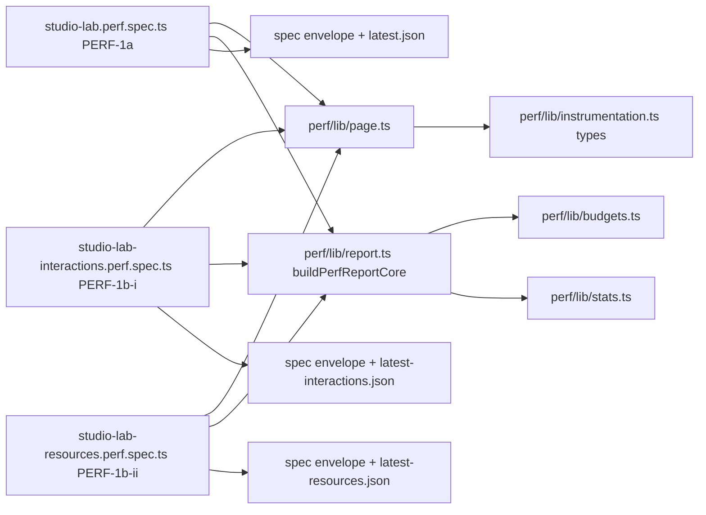

# Perf harness-ის საერთო helper-ები `perf/lib/`-ში (PERF-HARNESS-SHARED-LIB)

**თარიღი:** 2026-10-28
**სტატუსი:** Completed (C round 223 PASS)
**შეცვლილი პროექტი:** Store

## კონტექსტი

Playwright-ის სამ perf spec-ს (PERF-1a `perf/studio-lab.perf.spec.ts`, PERF-1b-i `perf/studio-lab-interactions.perf.spec.ts`, PERF-1b-ii `perf/studio-lab-resources.perf.spec.ts`) ერთი და იგივე page helper-ებისა და report builder-ის საკუთარი ასლები ჰქონდა. არქიტექტურის სიგნალი PERF-HARNESS-SHARED-LIB მესამედ round 216-ზე დაფიქსირდა (ასევე ARCH-GATE217-REPORT-HELPERS; პროექტის „3+ ადგილის“ წესი). ყოველი შემდეგი PERF დავალება ამ spec-ებს სტრიქონებს უმატებს, ასე რომ ასლები ერთმანეთს სულ უფრო დაშორდებოდა. ეს რაუნდი ასლებს ერთხელ გადაიტანს და ამასთან ერთად ხურავს ოთხ მცირე harness Low-ს, რომლებიც იმავე კოდს ეხება. მეხუთე, GATE214-S2, B-ის გადაწყვეტილებას ელოდება (იხ. ქვემოთ). `app/**` არ შეცვლილა.

## მიდგომა

- **ზუსტი გადატანა და არა გაერთიანება.** helper-ების ტანი უცვლელია. report-ის ხუთი რეალური განსხვავება ბირთვის option-ებად დარჩა და ერთ ქცევად არ გაერთიანდა.
- **ბირთვი აბრუნებს მხოლოდ `{ complete, failures, rows }`-ს.** report-ის envelope (`harness`, `complete`, `startedAt` … `sequence`, `passes`, `failures`, `rows`) თითო spec-ში დარჩა, ამიტომ report-ისა და თითო სტრიქონის JSON key-ების რიგი byte-identical-ია.
- **`storeRoot` `perf/lib`-ში არ ითვლება.** spec-ში ის არის `path.resolve(dirname, '..')`; `perf/lib`-ში იგივე გამოსახულება `perf/`-ზე მიუთითებდა და `budgetsFile` ჩუმად შეიცვლებოდა.
- **Unit-test ფაილი არ დამატებულა** (D-29z246). `vitest.config.ts` მხოლოდ `app/**`-ს მოიცავს და `app/`-ში მოთავსებული ტესტი, რომელიც `perf/`-ს იმპორტებს, layering-ს არღვევს. მუდმივი `perf/lib/report.test.ts` თავისი include-ით stage b-ს ეკუთვნის, config-ის owner-თან ერთად. ამ რაუნდის მტკიცებულებაა scratch equivalence script და Chromium-ის რეალური perf run.
- **გაყოფა (D-29z244).** ratio სტრიქონების determinism-ის ტოლერანსის გამკაცრება (A-R214 M2) ამ რაუნდის „არაფერი შეიცვალა“ მტკიცებულებას დაარღვევდა, ამიტომ ის უცვლელი მოცულობით გადავიდა PERF-HARNESS-SHARED-LIB-b-ში.

### Helper-ების რუკა (`perf/lib/page.ts`)

| Helper | ვინ იყენებს | შენიშვნა |
|---|---|---|
| `nowIn`, `snapshot`, `blurActive` | 1a, 1b-i, 1b-ii | ტანი უცვლელია |
| `QuietWaitResult`, `waitForQuietState(page, from, minMs)` | lib-ის შიგნით (`waitForQuiet`, `waitForStudioQuiet`) | round 279. ძველი `waitForQuiet`-ის loop-ი: `{ at, capped }`-ს აბრუნებს. `capped` = true მხოლოდ მაშინ, როცა loop-ი 3 s-იანმა cap-მა გააჩერა და არა სიწყნარემ. quiet-ის პირობა, cap და 50 ms-იანი poll უცვლელია. `quietMs = 200` და `settleCapMs = 3000` lib-ის (export-ის გარეშე) კონსტანტებია და `page.evaluate`-ს არგუმენტად გადაეცემა |
| `waitForQuiet(page, from, minMs)` | 1a, 1b-i, 1b-ii | signature უცვლელია; `waitForQuietState(...).at`-ს აბრუნებს, ამიტომ ყველა არსებული გამოძახება იგივეა |
| `waitForStudioQuiet(page, problems, label)` | 1b-ii (export-ის dialog), lib | round 279. სიწყნარე „ახლადან“, `minMs` 0. cap-ზე `problems`-ში ჩაწერს `${label}: no 200 ms without commits or start() calls within 3000 ms` — cap ჩუმად არასდროს გადის |
| `waitForCollectionReady(page, problems, label)` | 1a, 1b-i (load-ის შემდეგ) | round 279; round 281-იდან (`210-perf-harness-load-diagnostics.md`) `arrangement-status`-ის ტექსტი ჯერ უნდა დაემთხვეს `perfCollectionSettledPattern`-ს (ready ან failed, 15 s). failed ტექსტზე აგდებს `${label}: demo collection failed: <status>`-ს, სხვა არა-ready ტექსტზე `${label}: demo collection status is not ready: <status>`-ს (`problems`-ში არაფერს წერს; spec-ის catch ერთხელ ჩაწერს `aborted at load: …`-ს). ready-ზე `waitForStudioQuiet` |
| `LibraryReadyState`, `waitForLibraryReady(page)` | 1a, 1b-i, 1b-ii (load-ის გაზომვა) | round 281. ერთი `page.waitForFunction` (`polling: 'raf'`, 90 s) ყოველ frame-ზე ჯერ status-ს ამოწმებს: `perfCollectionFailedPattern`-ზე აბრუნებს failed მდგომარეობას და Node-ის მხარე აგდებს `demo collection failed before the library was ready: <status>`-ს; სხვა შემთხვევაში ძველი პირობა (Add enabled და preview waveform-ის `rect`) და აბრუნებს `readyMs`-ს (`performance.now()`). 1b-ii დაბრუნებულ რიცხვს არ იყენებს |
| `waitForPlaybackSettled(page, problems, label)` | 1a, 1b-i (Play-ის შემდეგ) | round 279. `expect.poll(isPlaying)` = true (15 s), შემდეგ `waitForStudioQuiet` |
| `reactRendererProblem` | 1a, 1b-i, 1b-ii | `expectedReactMajor = '18'` lib-ის კონსტანტაა (მხოლოდ Node-ის მხარე) |
| `playButton`, `audioRunning`, `isPlaying`, `setPlayback` | 1a, 1b-i | 1b-ii მათ არ იმპორტებს. `isPlaying`-ს lib-ის შიგნით `waitForPlaybackSettled`-იც იყენებს |
| `startTasks` | 1a, 1b-i | — |
| `rateRowId`, `audioClips` | 1b-i, 1b-ii | 1a-ს საკუთარი `faderRowId` რჩება (wall-clock სტრიქონს ყოველთვის აქვს სუფიქსი) |

`perfCollectionReadyPattern` (`perf/lib/app-labels.ts`, round 279) არის `^` + `workspaceCollectionCopy('demo').ready`-ის escape-ირებული ტექსტი, იმპორტით `app/lib/arrangement/collection.ts`-დან. ბოლოში anchor არ აქვს, რადგან settled status ready წინადადების შემდეგ ტექსტს შეიძლება ამატებდეს. round 281-ში დაემატა `perfCollectionFailedPattern` (`failed(count)`-ის ორივე ფორმა, 1 და 2, count-ის ნაცვლად `\d+`; private `countedTemplatePattern` import-ისას აგდებს, თუ ტექსტში count ზუსტად ერთხელ არ არის) და `perfCollectionSettledPattern` (ready ან failed). სტატუსის ტექსტი harness-ში ხელით არ იწერება.

spec-ში რჩება: `storeRoot`, `resultsDir` და budget-ების გზები; 1b-ii-ის `declare global` და `installBlockingFrameObserver`; spec-ის საკუთარი locator-ები (`clipById`, `clipGainFader`, `zoomSlider`, `faderLocator`, `slider` …) და 1b-i-ის `emptyLanePointAfterClip`; page-error-ის problem სტრიქონები (1b-i, 1b-ii; 1a-ს ასეთი არ აქვს). round 279-ის შემდეგ შენარჩუნებული fixed wait-ები (თითოეული გაზომვის განსაზღვრების ნაწილია, `208-perf-harness-state-waits.md`): 1a-ის `waitForTimeout(2000)` Add-ის შემდეგ (`harness.hook-live`-ის ფანჯარა), 1a-ის `waitForTimeout(idleSettleMs)` Play-ის შემდეგ და `waitForTimeout(idleMeasureMs)` (`play.idle-*`), 1b-ii-ის `waitForTimeout(idleSettleMs)` load-ის შემდეგ (ready heap-ის წაკითხვამდე), 300 ms forced GC-ის შემდეგ და `observerSettleMs`.

### Report-ის ბირთვი (`perf/lib/report.ts`)

export-ები: `PerfSample` (ძველი spec-ების `PassSample`), `PerfReportPass`, `PerfReportRow`, `PerfReportCore`, `PerfReportCoreOptions`, `rateSuffix`, `formatLimit` და `buildPerfReportCore`. ბირთვს ყველა spec გადასცემს `budgets`, `passes`, `cpuRates` და `passesPerRate`.

| Option | PERF-1a | PERF-1b-i | PERF-1b-ii |
|---|---|---|---|
| `determinismMetrics` | `determinismMetrics` (5 მეტრიკა) | `interactionDeterminismMetrics` | `resourceDeterminismMetrics` |
| `determinismRequiresKind` | `false` | `true` | `true` |
| `assertWhenPartial` | `false` | `false` | `true` (`complete || values.length > 0`) |
| `crossRateMetrics` | 4 მეტრიკა (1×/6× შედარება) | — | — |
| `guardProblems` | — | — | time guard, `failures`-ის სათავეში |

`failures`-ის რიგი იგივეა, რაც HEAD-ში: guard problem-ები → pass-ების problem-ები → „measured row without a budget row“ → თითო სტრიქონზე, budget-ის რიგით, „row not measured“ / „assert failed“ / „nondeterministic count“ → „rows short … because a pass aborted“ → 1×/6× შედარება. failure-ის ტექსტები byte-identical-ია.

### ხაფანგები R1–R5

- **R1.** `page.evaluate`-ის, `locator.evaluate`-ისა და `addInitScript`-ის ფუნქციის ტანში import ან მოდულის/lib-ის კონსტანტა არ გამოიყენება. კონსტანტები `evaluate`-ს არგუმენტად გადაეცემა. ასეთი შეცდომა კომპილირდება, მაგრამ მხოლოდ runtime-ში აგდებს `ReferenceError`-ს. თვითონ import-ირებული ფუნქციის არგუმენტად გადაცემა (`addInitScript(installPerfInstrumentation)`) და type annotation-ები ნებადართულია.
- **R2.** გაზომვის თითო ფანჯარაში `page.evaluate`-ის round trip-ების რაოდენობა და რიგი უცვლელია; `nowIn` სხვა გამოძახებასთან არ გაერთიანებულა.
- **R3.** `isolatedModules`-ის გამო ტიპებისთვის `import type` / `export type` (ან inline `type`) გამოიყენება.
- **R4.** არც `any`, არც type assertion (`as`), არც `@ts-ignore` / `@ts-expect-error`; ყველგან semicolon.
- **R5.** სამ spec-სა და ორ ახალ ფაილში გამოუყენებელი import ან ლოკალური ცვლადი არ რჩება. Biome `perf/`-ს არ ამოწმებს (L30) და `noUnusedLocals` გამორთულია, ამიტომ შემოწმება scratch tsconfig-ით ხდება.

### დახურული Low-ები

| Id | რა შეიცვალა |
|---|---|
| GATE214-S3 | `clipById` და lane-ის selector attribute-ის მნიშვნელობას `quotedAttributeValue`-ით სვამს: `"`, `\`, ახალი ხაზი, CR ან FF შემცველ id-ზე Error-ს აგდებს. fixture-ის id-ებისთვის selector იგივეა |
| GATE214-S5 | `perf/budgets.json`-ში `harness.audio-running`-ის `note` და doc 163-ის ცხრილის სტრიქონი ახლა ამბობს „1 s after the Play button's label turns Pause (it is awaited up to 15 s after the Space press)“, რასაც `setPlayback` + `waitForTimeout(idleSettleMs)` აკეთებს. სხვა byte არ შეცვლილა |
| GATE217-S1 | 1b-ii-ის "WAV created" observer ისევ `document.body`-ზეა, მაგრამ მისი handle ინახება `window.__czabaExportObserver`-ში და `measureExport`-ის გარე `finally`-ში ითიშება, export-ის ფანჯრის დახურვის შემდეგ, მაშინაც, როცა ტექსტი არ გამოჩნდა. თუ handle ვერ გათავისუფლდა, pass-ს problem ემატება |
| GATE217-S2 | `download.path()`-ის 30 s-იანი `Promise.race` timer `.finally`-ში იწმინდება (მხოლოდ Node-ის მხარე) |

### GATE214-S2: შესრულდა round 279-ში (D-29z254, round 279-ში ხელახლა გადაწყვეტილი)

round 223-ში task-ის ვარაუდი („clip-ის lane fixture-ში `stems`-ია“) რეალურ run-ში არ დადასტურდა: Add clip-ს Music lane-ზე სვამს და Music lane-ს Add-ის შემდეგ მარჯვენა ნახევარში ცარიელი წერტილი არ აქვს. ამიტომ deselect click მაშინ literal `'stems'`-ზე დარჩა.

round 279-ში `emptyLanePoint(page, 'stems')` შეიცვალა `emptyLanePointAfterClip(clip)`-ით და ძველი `emptyLanePoint` წაიშალა. ახალი helper იწყებს გაზომილი clip-ის `closest('[data-track-id]')`-იდან და DOM-ის რიგით მის **შემდეგ** მყოფ `[data-track-id]` lane-ებს გადის; lane-ს, რომელიც clip-ის lane-ს შეიცავს ან მასშია, ტოვებს. probe იგივეა: lane-ის შუა y-ზე `elementFromPoint` ყოველ 8 px-ში, მხოლოდ ფანჯრის მარჯვენა ნახევარში, clip-ის, button-ის, input-ისა და slider-ის გარეთ. თუ შემდეგ lane-ებში ასეთი წერტილი არ არის, ან არჩეული lane clip-ის საკუთარი lane-ია, Error-ს აგდებს. fixture-ში რიგია video, music, stems, sfx, ამიტომ არჩეული lane ისევ `stems`-ია და ქცევა უცვლელია. D-29z254-ის „არჩეული id click-live-ის detail-ში ჩაიწერება“ ნაწილი round 279-ში არ გაკეთდა (ეკვივალენტობის contract-ი, D-29z640); ის round 281-ში შესრულდა (`210-perf-harness-load-diagnostics.md`). helper ახლა აბრუნებს `EmptyLanePoint`-ს (`x`, `y`, `trackId`, `clipTrackId`), ხოლო click-live-ის detail-ს სამი ძველი key-ის შემდეგ ემატება `clipTrackId` და `emptyLaneTrackId` (გაზომილი `music` და `stems`). Error-ის ტექსტებში `null` აღარ ჩნდება: clip lane-ის გარეშე → `the clip is not inside a lane with a data-track-id`, `data-track-id`-ის გარეშე lane-ზე ნაპოვნი წერტილი → `the empty timeline point is on a lane without a data-track-id`.

### Stage b-ში გადასული (PERF-HARNESS-SHARED-LIB-b)

Stage b მნიშვნელობით ორად გაიყო (D-29z252):

- **b-i (round 224, `176-perf-determinism-contract.md`):** A-R214 M2 (`countsAgree` წაიშალა, მის ნაცვლად სტრიქონის determinism contract: exact / tenths / ratio, უცნობ ერთეულზე fail-closed), GATE214-S4 (zoom-ის სიმეტრიული გზა და clamp-ის გარეშე; ზუსტი შედარება სწორია, რადგან slider-ის მნიშვნელობა მთელია) და `perf/lib/report.test.ts`. per-row `tolerancePct` **არ** დაემატა: contract კოდშია, budget-ის JSON-ში ახალი key არ არის, ხოლო გამოუყენებელი optional `tolerancePct` `budgets.ts`-დან წაიშალა. vitest-ის include root-ის გადაწყვეტილებაა.
- **b-ii (შემდეგი რაუნდი, baseline-ის ხელახალი გაზომვით):** GATE214-S1 (fixed wait-ების ნაცვლად მდგომარეობის ლოდინი), R216-MEM-POLLS-HEADROOM (export-ის ფანჯრის ფილტრი `peak-backing-delta-mib`-საც კვებავს), GATE214-S2 (D-29z254), GATE223-S2 (export observer `try`-ის შიგნით) და PERF-1A-TIMEOUT-HEADROOM.

## არქიტექტურა

თითო spec იძახებს `buildPerfReportCore`-ს თავისი option-ებით, მიღებულ `complete`-ს, `failures`-სა და `rows`-ს საკუთარ envelope literal-ში იმავე ადგილებზე სვამს, სადაც ადრე იყო, და შემდეგ ითვლის `finishedAt`-ს.

## შეცვლილი ფაილები

- `perf/lib/page.ts` (ახალი): page-ისა და locator-ის საერთო helper-ები.
- `perf/lib/report.ts` (ახალი): report-ის ბირთვი, `formatLimit`, `rateSuffix` და ტიპები.
- `perf/studio-lab.perf.spec.ts`: ასლები წაიშალა და იმპორტდება lib-იდან; `buildReport` ბირთვს იძახებს.
- `perf/studio-lab-interactions.perf.spec.ts`: იგივე, პლუს GATE214-S3.
- `perf/studio-lab-resources.perf.spec.ts`: იგივე, პლუს GATE217-S1 და GATE217-S2.
- `perf/budgets.json`: მხოლოდ `harness.audio-running`-ის `note` (GATE214-S5).
- `docs/implementation/2026/quarter-IV/163-studio-perf-harness.md`, `168-perf-interactions-baseline.md`, `169-perf-resources-baseline.md`: მხოლოდ granted სექციები (არქიტექტურა, მიდგომის პირველი bullet, S5-ის ცხრილის სტრიქონი, TODO).

## პრობლემები და გადაწყვეტები

- **Problem:** envelope-ში ბირთვის spread (`{ harness, ...core, … }`) JSON key-ების რიგს შეცვლიდა. **Solution:** ბირთვი მხოლოდ სამ ველს აბრუნებს, spec კი მათ ძველ ადგილებზე სვამს.
- **Problem:** `PerfReportPass`-ის ტიპი სამ განსხვავებულ pass result-ს უნდა იღებდეს. **Solution:** მინიმალური სტრუქტურული interface (`cpuRate`, `pass`, `samples`, `problems`, `abortedAt`), რომელსაც სამივე spec-ის ტიპი type assertion-ის გარეშე აკმაყოფილებს.
- **Problem:** GATE214-S2-ის ფიქსმა (lane clip-იდან) click-ის target შეცვალა: clip Music lane-ზეა და არა Stems-ზე, ამიტომ PERF-1b-i პირველ run-ში ჩავარდა. **Solution:** ცვლილება HEAD-ის ქცევაზე დაბრუნდა და საკითხი B-ს გადაეცა (STOP). Low ღია რჩება.
- **Problem:** spec-ების პირდაპირ იმპორტი scratch script-ში შეუძლებელია, რადგან ისინი მოდულის დონეზე Playwright-ის `test()`-ს იძახებენ. **Solution:** scratch generator HEAD-ისა და ახალი spec-ის ტექსტს `test(...)`-მდე ჭრის, `./lib/` import-ებს repo-ს აბსოლუტურ გზებზე ცვლის და builder-ს აექსპორტებს. ასლები ინახება მხოლოდ loop-ის საქაღალდეში, repo-ში არა.
- **Problem:** Biome `perf/`-ს არ ამოწმებს და `noUnusedLocals` გამორთულია, ამიტომ წაშლის შემდეგ დარჩენილი import-ები შეუმჩნეველი რჩებოდა. **Solution:** scratch tsconfig `noUnusedLocals`/`noUnusedParameters`-ით; ერთმა mutant-მა (დამატებული გამოუყენებელი `median` import) აჩვენა, რომ ის TS6133-ს იჭერს.

## ტესტირება

- **Scratch equivalence script** (loop-ის საქაღალდე `a-round-223/equiv/`, repo-ს გარეთ): HEAD `2d4a93f`-ის სამი builder და ახალი ბირთვი + spec-ის envelope ერთსა და იმავე canned `budgets`-სა და `passes`-ს იღებს. `JSON.stringify` შედარდება `startedAt`, `finishedAt` და `durationMs`-ის წაშლის შემდეგ. შემთხვევები: სრული run, aborted pass მოკლე სტრიქონით, არასრული run budget-ს გარეთ assert სტრიქონით, 1a-ის 1×/6× შეუსაბამობა, 1b-ii-ის guard problem, `kind: "wallclock"` სტრიქონი deterministic მეტრიკით და budget-ის გარეშე გაზომილი id. 21 შედარება (7 × 3) ტოლია. Named mutant-ები (M-A: 1b-ii-ზე `assertWhenPartial` `false`; M-B: 1b-i-ზე kind-ის ფილტრი მოხსნილი; M-C: 1a-ზე 1×/6× შედარება მოხსნილი) თითოეული თავის შემთხვევაზე წითლდება.
- **რეალური perf run 1** (GATE214-S2-ის ფიქსით): PERF-1b-i ჩავარდა, 6-ვე pass შეწყდა „lane music has no empty timeline point“-ით; PERF-1b-ii და PERF-1a (7.2 წთ) გაიარა. PERF-1a-ის report-ში `load.longtasks-over-50` (deterministic, record) იყო 1 [1, 1, 1], oracle-ში კი 2; run 2-ში ეს აღარ განმეორდა, ამიტომ გარემოს ხმაურად ითვლება. S2 გაუქმდა.
- **რეალური perf run 2** (საბოლოო tree): `CI=true npx playwright test --config playwright.perf.config.ts`, Chromium, production build :5188-ზე; სამივე spec გაიარა (rc 0, 13.5 წთ; PERF-1a 7.1 წთ 15 წთ-იანი limit-დან). შემდეგ `b-round-222/scripts/equiv-check.py` სამივე report-ს ადარებს oracle-ს `b-round-222/baseline-results/`-დან (`latest.json`-ზე `--note-exempt harness.audio-running`). სტრიქონები: 1a 316 (167 deterministic), 1b-i 144 (122), 1b-ii 61 (38); ყველა deterministic median და ყველა assert სტრიქონის `pass` იგივეა, `complete` = true, `failures` ცარიელია.
- **`npm run typecheck`:** rc 0. **`npm run lint`:** 0 error (`perf/`-ს არ ფარავს, L30).
- **Scratch tsconfig** (`noUnusedLocals`, `noUnusedParameters`, include `perf/**/*.ts`): 0 diagnostic.
- **ეკვივალენტობის ფარგლები (gate-223 S1):** report-ის ტოლობა დამტკიცებულია მხოლოდ ერთნაირი pass-ებისთვის. შეცდომის გზაზე (დახურული page ან ჩავარდნილი pass, როცა `page.evaluate` ვერ სრულდება) 1b-ii-ის ახალმა `finally`-მ შეიძლება ერთი დამატებითი problem დაამატოს: „the "WAV created" observer was not released“, რასაც HEAD არ წერდა. ნორმალურ run-ში ეს არ ხდება.

## TODO / შემდეგი ნაბიჯები

- **PERF-HARNESS-SHARED-LIB-b-i (round 224):** per-row determinism contract, GATE214-S4 და `perf/lib/report.test.ts` (`176-perf-determinism-contract.md`). `tolerancePct`-ის გეგმა შეიცვალა: contract კოდშია და JSON-ის ველი არ დაემატა.
- **PERF-HARNESS-SHARED-LIB-b-ii:** ორ ეტაპად გაიყო (D-29z636). **b-ii-1 (round 279, `208-perf-harness-state-waits.md`):** GATE214-S1 (load-ისა და Play-ის შემდეგ და export-ის dialog-ზე fixed wait-ების ნაცვლად მდგომარეობის ლოდინი; გაზომვის განმსაზღვრელი wait-ები დარჩა), GATE214-S2 (`emptyLanePointAfterClip`) და GATE223-S2 (export observer-ი და heap poll loop-ი `try`-ის შიგნით); baseline-ები უცვლელია. **b-ii-2 (round 280, `209-perf-export-window-page-clock.md`)** შესრულდა: export-ის heap ნიმუშები page-ის საათზე, request-response-ის შუა წერტილით ითვლება; `perf/lib/**` არ შეცვლილა. R216-MEM-POLLS-HEADROOM watch რჩება.
- **Round 281 (`210-perf-harness-load-diagnostics.md`):** შესრულდა. load-ის ლოდინები ჩავარდნილ demo source-ს დასახელებული შეცდომით აჩერებს (GATE279-S1; status-ის ლოდინი მხოლოდ 1a-სა და 1b-i-შია, 1b-ii-ს მხოლოდ library-ready ლოდინი აქვს), 90 s-იანი library-ready wait-ის სამი ასლი ერთ `waitForLibraryReady`-შია, click-live-ის detail-ში lane-ების id-ებია (B-R280-CLICK-LIVE-LANE-ID), „lane null“ კი აღარ ჩნდება (A-R279-REVIEW-LANE-NULL).
- `perf/**/*.test.ts`-ის vitest include (`b-round-223-root-request-vitest.md`): root-ის გადაწყვეტილებას ელოდება.
- DOC-PERF-LINEREF-DRIFT-223 (deferred Low): docs 163/168/169-ის არა-granted სექციებში spec-ის ხაზის ნომერი არ მოიძებნა. ერთადერთი მოძველებული მითითებაა doc 168-ის §შეცვლილი ფაილები: „163-studio-perf-harness.md: l.67“. doc 163-ის §არქიტექტურაში დამატებული ტექსტის შემდეგ ეს სტრიქონი ქვემოთ ჩამოიწია.
- PERF-1A-TIMEOUT-HEADROOM: PERF-1a 15 წთ-იანი limit-ის ნახევარზე მეტს იყენებს (watch item, stage b ან root-ის `playwright.perf.config.ts`).
