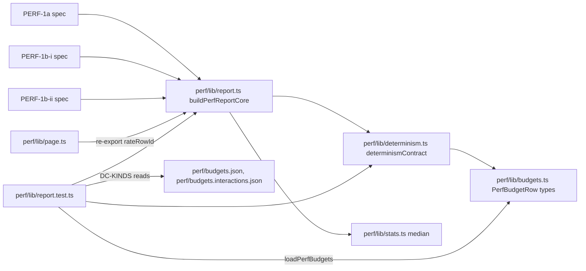
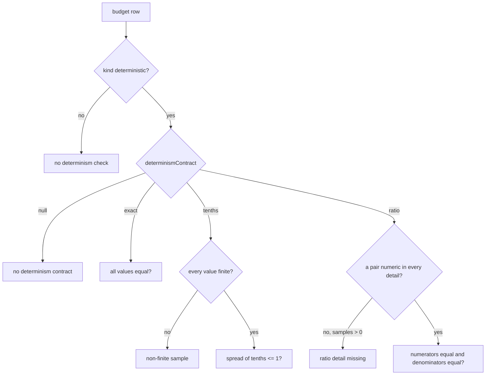

# Perf harness-ის determinism contract სტრიქონის დონეზე (PERF-HARNESS-SHARED-LIB-b-i)

**თარიღი:** 2026-10-28
**სტატუსი:** Completed (C round 280 PASS)
**შეცვლილი პროექტი:** Store

## კონტექსტი

Perf harness-ის report-ის ბირთვი (`perf/lib/report.ts`, `buildPerfReportCore`) determinism-ს `countsAgree`-ით ამოწმებდა: სამი sample median-ს ±max(2, 10 %)-ით უნდა დაშორებოდა. ratio სტრიქონებზე ეს შემოწმება ვერასდროს ჩავარდებოდა (A-R214 M2): `commits-per-move` დაახლოებით 0.75–2-ია, `move-components-per-move` 0.65–101. ამას გარდა, შემოწმება spec-ების საკუთარ metric-ების სიმრავლეებს მიჰყვებოდა, ამიტომ მხოლოდ PERF-1a-ში 59 deterministic სტრიქონი საერთოდ არ მოწმდებოდა. ყოველი შემდეგი PERF დავალება ამ შემოწმებას მტკიცებულებად იყენებს, ამიტომ PERF-2-მდე შემოწმებას ჩავარდნის უნარი უნდა ჰქონდეს.

round 224 stage b-ის პირველი ნახევარია (D-29z252): მხოლოდ report-ის სემანტიკა იცვლება. გაზომვის ფანჯრები, ლოდინები და click-ები არ შეცვლილა, ამიტომ ყოველი გაზომილი median round 223-ის C-ის report-ებს უნდა ემთხვეოდეს. `app/**` არ შეცვლილა.

round 225 იმავე stage-ის fix-up-ია სამ finding-ზე: C-R224-01 (drag-ის windowed `commits-per-move` scheduling-ზეა დამოკიდებული), A-R224-REVIEW-TENTHS-NAN (`tenths` contract NaN-სა და ±Infinity-ს უშვებდა) და C-R224-02 (0.2-ის ზღვარს ტესტი არ ჰქონდა). გაზომვა და `app/**` არც ამ რაუნდში შეცვლილა.

## მიდგომა

- **Contract კოდშია და არა JSON-ში** (tech-lead). `perf/lib/determinism.ts`-ის `determinismContract(row)` სტრიქონის `metric`-ითა და `unit`-ით ირჩევს contract-ს. budget-ის ფაილებში ახალი key არ დამატებულა, ამიტომ budget-ებისა და report-ის სტრიქონების key-ების რიგი byte-stable რჩება. performance-optimizer-ის ალტერნატივა (`toleranceAbs` / `ratioOf` ველები JSON-ში) არ იქნა მიღებული (`b-round-223.md` §5).
- **შემოწმება ყოველ `kind: "deterministic"` სტრიქონს ეხება ყველა spec-ში.** spec-ების საკუთარი სიმრავლეები (`determinismMetrics`, `interactionDeterminismMetrics`, `resourceDeterminismMetrics`) და ბირთვის option-ები `determinismMetrics` და `determinismRequiresKind` წაიშალა. სტრიქონის `kind` ერთადერთი წყაროა.
- **Fail-closed.** deterministic სტრიქონი, რომლის ერთეულისთვის contract არ არსებობს, run-ს აგდებს, 0 ან 1 sample-ის შემთხვევაშიც.
- **1×/6× შედარება** კვლავ მხოლოდ PERF-1a-შია, იგივე `crossRateMetrics` სიმრავლით, მაგრამ ახლა მედიანები ზუსტად უნდა ემთხვეოდეს (`base !== other`).
- **`tolerancePct` არ დაემატა.** doc 175-ის TODO გეგმავდა `PerfBudgetRow.tolerancePct`-ს; ეს რაუნდი გეგმას ცვლის: contract კოდშია, ხოლო გამოუყენებელი optional `tolerancePct` `perf/lib/budgets.ts`-დან (interface-ის ველი და `readRow`-ის სტრიქონი) წაიშალა.
- **`countsAgree` წაიშალა** `perf/lib/stats.ts`-დან: grep-ით მას სხვა იმპორტიორი აღარ ჰყავს.
- **`rowRate` და `rateRowId`** `perf/lib/report.ts`-ის მოდულის დონეზეა და ექსპორტდება. `perf/lib/page.ts` `rateRowId`-ს ხელახლა აექსპორტებს (`export { rateRowId } from './report';`), ამიტომ spec-ების import-ები არ შეცვლილა.

### Contract-ის ცხრილი (`determinismContract`)

| რიგი | პირობა | Contract | შემოწმება |
|---|---|---|---|
| 1 | metric `commits-per-move` | `ratio`, წყვილები `windowCommits`/`movesInWindow`, შემდეგ `commits`/`moves` | პირველი წყვილი, რომლის ორივე key ყველა sample-ის `detail`-ში რიცხვია; მრიცხველები ზუსტად ტოლია და მნიშვნელებიც ზუსტად ტოლია |
| 1 | metric `move-components-per-move` | `ratio`, წყვილი `componentsSum`/`movesInWindow` | იგივე |
| 2 | unit `MiB` | `tenths` | ყველა მნიშვნელობა სასრულია (`Number.isFinite`), შემდეგ `Math.round(max * 10) - Math.round(min * 10) <= 1` |
| 3 | unit `count`, `components`, `elements`, `bytes`, `start() calls`, `boolean (1 = true)`, `commits / key`, `components / key` | `exact` | ყველა მნიშვნელობა ზუსტად ტოლია |
| 4 | სხვა | `null` | failure (fail-closed) |

zoom-ის `commits-per-key` და `components-per-key` მნიშვნელობით ზუსტია: მნიშვნელი key-ების ფიქსირებული რაოდენობაა (10), ამიტომ მრიცხველის 1-ით ცვლილება მესამე ათწილად ნიშნაში ჩანს. B-ის inventory (`b-round-223/det-metric-inventory.txt`) round 223-ის სამი report-ის ყველა deterministic metric/unit წყვილს 1–3 რიგებით ფარავს.

### Failure-ის ახალი ტექსტები

`failures`-ში ისინი იმავე ადგილზეა, სადაც ძველი „nondeterministic count“ იყო: თითო budget სტრიქონზე „row not measured“ → „assert failed“ → determinism.

| შემთხვევა | ტექსტი |
|---|---|
| contract არ არის | `no determinism contract <id>: metric <metric>, unit <unit>` |
| `exact` | `nondeterministic count <id>: [<values>]` (ძველი ტექსტი) |
| `tenths`, არასასრული sample (round 225-იდან) | `nondeterministic MiB <id>: [<values>] (non-finite sample)`. NaN, Infinity ან -Infinity ერთ sample-შიც run-ს აგდებს; ადრე `Math.round(NaN)`-ის გამო `spread > 1` false იყო და სტრიქონი გადიოდა |
| `tenths` | `nondeterministic MiB <id>: [<values>] (spread over 0.1)`. სხვაობა 0.1-მდე დამრგვალებულ მნიშვნელობებზე ითვლება, ამიტომ [65.05, 65.24] გადის, [65.04, 65.15] კი ვარდება; [65.1, 65] გადის, [65.2, 65] ვარდება |
| `ratio`, detail აკლია (≥ 1 sample) | `ratio detail missing <id>: needs one of windowCommits/movesInWindow, commits/moves` (წყვილები `num/den`, `, `-ით) |
| `ratio`, სხვაობა | `nondeterministic ratio <id>: numerators [<…>], denominators [<…>]` |
| 1×/6× (PERF-1a) | `nondeterministic count <id>: 1x <base> vs 6x <other>` (ტექსტი უცვლელია, შედარება ზუსტია) |

დანარჩენი უცვლელია: `assertWhenPartial`, `guardProblems`, `complete`, „row not measured“, „assert failed“, „measured row without a budget row“, `shortByAbort` და `failures`-ის რიგი.

### გადაკლასიფიცირებული სტრიქონები

- `load.longtasks-over-50` (PERF-1a, `perf/budgets.json`): `kind` → `"wallclock"`. B-ის replay-მ (`b-round-223/replay-exact.txt`, round 222–223-ის 13 სრული report) აჩვენა, რომ ეს ერთადერთი deterministic სტრიქონია, რომელიც ერთი run-ის შიგნით იცვლება ([1, 1, 2], [1, 2, 1], [1, 2, 2]). long task-ების რაოდენობა scheduling-ზეა დამოკიდებული.
- `res.export.1.longtasks-over-50` (PERF-1b-ii, `perf/budgets.resources.json`): `kind` → `"wallclock"` იმავე მიზეზით (D-29z257).
- **round 225 (D-29z259, C-R224-01):** PERF-1b-i-ის 16 სტრიქონი `interact.drag.(range|fade|trim|move).(stopped|playing).commits-per-move(.6x)?` (`perf/budgets.interactions.json`): `kind` → `"wallclock"`. ეს რიცხვი დროის ფანჯრის შიგნით დათვლილი commit-ებია (`windowCommits`: `t > firstMove` და `t < up`). C-ის round 224-ის run 1-ში, რომელიც C-ის საკუთარი პარალელური დატვირთვით გაეშვა (`c-round-224/run1-contaminated/`), `interact.drag.fade.playing.commits-per-move`-მა მისცა `windowCommits` [60, 59, 60] და `movesInWindow` [60, 60, 60], ხოლო იმავე pass-ებში `componentsSum` სამივეჯერ 5782 იყო, `move-components-per-move` [96.367 ×3] და `release-commits` [1, 1, 1]. ანუ დაკარგული commit release-ის ფანჯარაში არ გადასულა და render-ის სამუშაო არ შეცვლილა. C-ის round 224-ის სუფთა re-run 60/60 ×3-ს იძლეოდა, 6× კი ყოველ pass-ში 59/60-ს; round 225-ის A-ის სუფთა run-ში 1× 59/60 ×3 იყო (§ტესტირება, EQUIV-225). B-ის replay-მ (`b-round-224/commit-count-replay.txt`, round 210–224-ის 25 report, 185 commit/component სტრიქონი) მხოლოდ ეს ერთი დაკვირვება იპოვა ცვლადად. სტრიქონები `mode: "record"`-ია და `budget: null`, ამიტომ assert არ იკარგება; render-ის სამუშაო იმავე ფანჯარაში ზუსტად მოწმდება `move-components-per-move`-ით და `move-components-max`-ით. **დადასტურებული ფაქტი:** დატვირთვისას ფანჯრის commit-ების რაოდენობა შეიცვალა, render-ის სამუშაო კი არა. **დასკვნა:** commit-ების დრო ან გაერთიანება scheduling-ზეა დამოკიდებული. **ჰიპოთეზა (არ შემოწმებულა):** ეს ხდება საწყის საზღვარზე (`t > firstMove`) ან render-ის გარეშე commit-ით.
- **PERF-1a-ის 24 fader `commits-per-move` deterministic რჩება:** ის მთელ gesture-ს ითვლის (`rendered.length`, `commits`/`moves`), და არა დროის ფანჯარას, და შენახულ 25 report-ში არასდროს შეცვლილა. `determinism.ts` უცვლელია: თუ drag-ის სტრიქონი ოდესმე deterministic-ად დაბრუნდება, ის ისევ `windowCommits`/`movesInWindow`-ით შემოწმდება.
- PERF-1a-ის 48 deterministic სტრიქონის (`commits-per-move` 24, `release-commits` 24) `note`-იდან წაიშალა წინადადება „Not determinism-checked.“: ახლა ორივე მოწმდება.

### GATE214-S4: zoom-live

slider-ის მნიშვნელობა მთელი ნაბიჯია (`sliderPositionFromZoom` იყენებს `Math.round`-ს, 1000 ნაბიჯი), ამიტომ ზუსტი შედარება სწორია და რჩება. სუსტი ადგილი იყო zoom-ის მაქსიმუმზე ან მინიმუმზე clamp-ილი გზა. ახლა `measureZoom` პირველი key-ის `t0`-მდე კითხულობს slider-ის `min` და `max` attribute-ებს; თუ რომელიმე აკლია ან სასრული რიცხვი არ არის, pass-ს ემატება problem `zoom slider min/max missing` და zoom არ იზომება (HTML-ის default დიაპაზონზე fallback არ ხდება). `live` დამატებით მოითხოვს სიმეტრიულ გზას (`values[i] === values[values.length - 1 - i]`) და ყოველ მნიშვნელობას მკაცრად `min`-სა და `max`-ს შორის. detail-ს დაემატა `sliderMin` და `sliderMax`; problem-ის სტრიქონი ჩავარდნილ წესს ასახელებს. fixture-ზე მნიშვნელობა 1 რჩება (678…851…678, 0–1000-ის შიგნით).

### PERF-1a-ის `commits-per-move` detail

`commits-per-move`-ს დაემატა `detail: { commits: rendered.length, moves }`, რათა ratio contract-მა მრიცხველი და მნიშვნელი შეამოწმოს. მნიშვნელობის გამოსახულება უცვლელია.

## არქიტექტურა

## შეცვლილი ფაილები

- `perf/lib/determinism.ts` (ახალი): `DeterminismContract` და `determinismContract`.
- `perf/lib/report.ts`: determinism-ის შემოწმება contract-ით, 1×/6×-ის ზუსტი შედარება, ექსპორტირებული `rowRate` და `rateRowId`; option-ები `determinismMetrics` და `determinismRequiresKind` წაიშალა.
- `perf/lib/report.test.ts` (ახალი): DC-* unit ტესტები.
- `perf/lib/stats.ts`: `countsAgree` წაიშალა.
- `perf/lib/budgets.ts`: გამოუყენებელი `tolerancePct` წაიშალა.
- `perf/lib/page.ts`: `rateRowId` ხელახლა ექსპორტდება `./report`-იდან.
- `perf/studio-lab.perf.spec.ts`: `determinismMetrics` და ორი option წაიშალა; `commits-per-move`-ს detail დაემატა.
- `perf/studio-lab-interactions.perf.spec.ts`: `interactionDeterminismMetrics` და ორი option წაიშალა; GATE214-S4.
- `perf/studio-lab-resources.perf.spec.ts`: `resourceDeterminismMetrics` და ორი option წაიშალა.
- `perf/budgets.json`, `perf/budgets.resources.json`, `perf/budgets.interactions.json`: ორი `kind`, 48 წინადადების წაშლა და ხუთი `note`.
- `docs/implementation/2026/quarter-IV/163-studio-perf-harness.md`, `168-perf-interactions-baseline.md`, `169-perf-resources-baseline.md`, `175-perf-harness-shared-lib.md`: მხოლოდ granted სექციები.

round 225:

- `perf/lib/report.ts`: `tenths`-ში არასასრული sample-ის guard.
- `perf/lib/report.test.ts`: DC-MIB-EDGE, DC-MIB-NONFINITE და DC-KINDS.
- `perf/budgets.interactions.json`: 16 `kind` → `"wallclock"`; სხვა byte არ შეცვლილა.
- `docs/implementation/2026/quarter-IV/168-perf-interactions-baseline.md`: §მეტრიკები-ის Determinism აბზაცი და §TODO.

## პრობლემები და გადაწყვეტები

- **Problem:** round 223-ის report-ებში PERF-1a-ის `commits-per-move`-ს detail არ ჰქონდა, ამიტომ ratio contract მათ ვერ შეამოწმებდა. **Solution:** spec-ს დაემატა `{ commits, moves }` detail, ხოლო contract-ს მეორე წყვილი `commits`/`moves`. offline replay-ში ძველ report-ებზე ზუსტად ეს 24 სტრიქონი იძლევა „ratio detail missing“-ს, რაც მოსალოდნელია.
- **Problem:** task-ის DC-DENOM-ის შემავალი მონაცემი (60/60, 60/60, 59/59) მრიცხველსაც ცვლის, ამიტომ მხოლოდ მრიცხველის შემმოწმებელი mutant (MU-2) მასზე არ გაწითლდებოდა. **Solution:** DC-DENOM ინარჩუნებს B-ის შემთხვევას და ამატებს მეორე assertion-ს, სადაც მხოლოდ მნიშვნელი იცვლება (60/60, 60/60, 60/61). MU-2 სწორედ მასზე წითლდება.
- **Problem:** `vitest.config.ts` მხოლოდ `app/**/*.test.{ts,tsx}`-ს მოიცავს, root-ის grant კი რაუნდის დასაწყისში არ არსებობდა (§0.3, შემთხვევა 3). **Solution:** `vitest.config.ts` არ შეცვლილა; ტესტი scratch config-ით ეშვება (`/tmp/a224-vitest.config.ts`: `root` = store, `include` = `perf/**/*.test.ts`, `environment` = `node`).
- **Problem:** Biome `perf/`-ს არ ამოწმებს (L30). **Solution:** შეცვლილი perf ფაილების scratch ასლებზე Biome გაეშვა პროექტის format/lint წესებით, `files.includes`-ის გარეშე; შედეგი სუფთაა.

- **Problem (C-R224-01, Medium):** drag-ის windowed `commits-per-move` deterministic სტრიქონად იყო მონიშნული, თუმცა დატვირთვისას [60, 59, 60]-ს იძლევა. **Solution:** 16 windowed drag სტრიქონი wallclock-ია (D-29z259); fader-ის 24 whole-gesture სტრიქონი ზუსტი რჩება. DC-KINDS ორივე ფაილში ამ დაყოფას აფიქსირებს.
- **Problem (A-R224-REVIEW-TENTHS-NAN, Medium):** `tenths`-ში `Math.round(NaN)` NaN-ია, `NaN > 1` false, ამიტომ NaN ან ±Infinity sample-ის მქონე MiB სტრიქონი გადიოდა: fail-open contract-ში, რომელიც fail-closed უნდა იყოს. **Solution:** spread-ის გამოთვლამდე `Number.isFinite`-ის guard და ტექსტი `(non-finite sample)` (D-29z260). exact და ratio contract-ებს ეს არ სჭირდება: NaN მათ `===`-ით აგდებს.
- **Problem (C-R224-02, Low):** 0.2-ის ზღვარს ტესტი არ ჰქონდა და C-ის mutant `spread > 2` ცოცხალი რჩებოდა. **Solution:** DC-MIB-EDGE ([65.2, 65, 65] ვარდება).

## ტესტირება

### round 225

- **Unit-ტესტი `perf/lib/report.test.ts`:** not gate-covered until root adds the include. ეშვება scratch config-ით (`root` = store, `include` = `perf/**/*.test.ts`, `environment` = `node`; ასლი `a-round-225/a225-vitest.config.ts`). 19/19 მწვანეა. შემთხვევები: DC-INT, DC-INT-OK, DC-RATIO, DC-DENOM, DC-RATIO-ALT, DC-MISSING, DC-MIB-OK, DC-MIB, DC-UNKNOWN, DC-CONTRACT, DC-WALL, DC-CROSS, DC-CROSS-OFF, DC-PARTIAL, DC-ORDER, DC-RATE, DC-MIB-EDGE, DC-MIB-NONFINITE და DC-KINDS. DC-KINDS ნამდვილ budget ფაილებს `loadPerfBudgets`-ით კითხულობს, გზით ტესტის ფაილიდან (`import.meta.url`).
- **Red-proof (named mutants, მთელი `perf/`-ის scratch ასლებზე loop-ის საქაღალდეში):** MU-7 (§2.2-ის guard წაშლილი) წითლდება DC-MIB-NONFINITE-ზე; MU-8 (`spread > 2`) წითლდება DC-MIB-EDGE-ზე; MU-9 (`interact.drag.fade.playing.commits-per-move` → `deterministic`) წითლდება DC-KINDS-ზე; MU-10 (`fader.track.stopped.commits-per-move` → `wallclock` `budgets.json`-ში) წითლდება DC-KINDS-ზე. თითოეულზე სხვა ტესტი არ წითლდება.
- **Offline replay (საბოლოო tree):** C-ის round 224-ის სამი report (`c-round-224/reports/`): 0 failure თითოეულზე. `c-round-224/run1-contaminated/latest-interactions.json`: 0 failure (HEAD-ის ბირთვი და budget-ები იმავე report-ზე 1 failure-ს იძლევა: `nondeterministic ratio interact.drag.fade.playing.commits-per-move: numerators [60, 59, 60], denominators [60, 60, 60]`). `res.mem.backing-ready-mib`-ში ჩასმული NaN: ზუსტად 1 failure, `nondeterministic MiB res.mem.backing-ready-mib: [140.3, NaN, 140.3] (non-finite sample)` (HEAD-ზე: 0).
- **EQUIV-225 (რეალური Chromium):** `CI=true npx playwright test --config playwright.perf.config.ts studio-lab-interactions studio-lab-resources` (production build :5188-ზე, სხვა CPU-ს დატვირთვის გარეშე, L38): ორივე გაიარა (rc 0, 6.8 წთ; PERF-1b-i 5.5 წთ / `durationMs` 327960, PERF-1b-ii 1.0 წთ / 62795). `b-round-224/scripts/equiv-check-b2.py` C-ის round 224-ის report-ებთან: ორივე rc 0 (1b-i: 144 სტრიქონი, 106 შედარებული deterministic, 16 გადაკლასიფიცირებული, 0 problem; 1b-ii: 61, 37, 0, 0). `complete` = true, `failures` ცარიელია, abort და pass problem არ არის. ამ სუფთა run-ში `interact.drag.fade.playing.commits-per-move` (1×) `windowCommits` [59, 59, 59]-ია, C-ის round 224-ის სუფთა re-run-ში კი 60 ×3 იყო: სტრიქონი scheduling-ზეა დამოკიდებული სუფთა run-ებს შორისაც.
- **`npm run typecheck`:** rc 0. **`npm run lint`:** rc 0 (`perf/`-ს არ ფარავს, L30). შეცვლილი TS ფაილების scratch ასლებზე Biome (პროექტის წესები `files.includes`-ის გარეშე): სუფთაა.

### round 224

- **Unit-ტესტი `perf/lib/report.test.ts`:** ეშვებოდა scratch config-ით: `npx vitest run --config /tmp/a224-vitest.config.ts`. 16/16 მწვანე იყო.
- **Red-proof (named mutants, ახალი ბირთვის scratch ასლებზე loop-ის საქაღალდეში):** MU-1 (exact → `countsAgree`) წითლდება DC-INT-ზე (და DC-ORDER-ზე); MU-2 (ratio-ში მხოლოდ მრიცხველები) წითლდება DC-DENOM-ზე; MU-3 (tenths-ის ზღვარი 0.5) წითლდება DC-MIB-ზე; MU-4 (`null` contract → გამოტოვება) წითლდება DC-UNKNOWN-ზე (და DC-ORDER-ზე); MU-5 (1×/6× → `countsAgree`) წითლდება DC-CROSS-ზე (და DC-ORDER-ზე); MU-6 (`assertWhenPartial` იგნორირებული) წითლდება DC-PARTIAL-ზე.
- **Offline replay:** round 223-ის C-ის report-ები (`c-round-223/reports/latest*.json`; `samples[i]` და `details[i]` → pass i) ახალ ბირთვს ახალი budget-ებით მიეწოდა. PERF-1a: ზუსტად 24 `ratio detail missing` (`commits-per-move`, 1× და 6×) და სხვა არაფერი; PERF-1b-i და PERF-1b-ii: 0 failure.
- **EQUIV-224 (რეალური Chromium):** `CI=true npx playwright test --config playwright.perf.config.ts` (production build :5188-ზე): სამივე spec გაიარა (rc 0, 11.6 წთ; PERF-1a 5.8 წთ, PERF-1b-i 4.6 წთ, PERF-1b-ii 56 წმ). `b-round-223/scripts/equiv-check-b1.py` round 223-ის C-ის report-ებთან: სამივე rc 0, `complete` = true, `failures` ცარიელია; ყველა შედარებული deterministic median იგივეა (1a 166, 1b-i 122, 1b-ii 37). PERF-1a-ის `commits-per-move` detail-ში ახლა `{ commits, moves }`-ია. ახალი report-ების offline replay ახალ ბირთვზე: 0 failure. zoom-live სამივე სტრიქონი [1, 1, 1]-ია (`sliderMin` 0, `sliderMax` 1000).
- **`npm run typecheck`:** rc 0. **`npm run lint`:** 0 error (`perf/`-ს არ ფარავს, L30). **Scratch tsconfig** (`noUnusedLocals`, `noUnusedParameters`, include `perf/**/*.ts`): 0 diagnostic; გამოუყენებელი `median` import-ის mutant TS6133-ს იძლევა.

## TODO / შემდეგი ნაბიჯები

- **PERF-HARNESS-SHARED-LIB-b-ii** (D-29z252; ორ ეტაპად, D-29z636): **b-ii-1 (round 279, `208-perf-harness-state-waits.md`)** შესრულდა baseline-ის ცვლილების გარეშე: GATE214-S1 (fixed wait-ების ნაცვლად state wait-ები იქ, სადაც wait გაზომვას არ განსაზღვრავს; PERF-1a-ის 2,000 ms-იანი Add-ის ლოდინი `harness.hook-live`-ის ფანჯარაა და დარჩა, D-29z637), GATE214-S2 (D-29z254: deselect lane = გაზომილი clip-ის lane-ის შემდეგ DOM-ის რიგით პირველი lane ცარიელი მარჯვენა ნახევრით) და GATE223-S2 (export observer-ი და heap poll loop-ი `try`-ის შიგნით). **b-ii-2 (round 280, `209-perf-export-window-page-clock.md`)** შესრულდა: export-ის heap ნიმუში ითვლება request-response-ის შუა წერტილით page-ის საათზე (თითო export-ზე გაზომილი clock probe); ეკვივალენტობა named exception-ებით (8 note და ორი 1× peak სტრიქონი ±0.1, D-29z647). R216-MEM-POLLS-HEADROOM watch რჩება. ამით PERF-HARNESS-SHARED-LIB-b დასრულდა. PERF-1A-TIMEOUT-HEADROOM root-ს გადაეცა (ROOT-REQ-PERF-TIMEOUT, D-29z638).
- **R224-WINDOW-BOUNDARY-WATCH** (D-29z259): fader-ის `release-commits` assert სტრიქონები, drag-ის `release-commits` (ორივე `pointerup`-ზე იყოფა) და `move-components-per-move` (იგივე ფანჯარა) deterministic რჩება. თუ ვალიდური დატვირთული ან სუფთა run რომელიმეში ცვლილებას აჩვენებს, B ამ კლასებს ერთად, მტკიცებულებით გადააკლასიფიცირებს.
- `perf/**/*.test.ts`-ის vitest include (`b-round-223-root-request-vitest.md`): მანამდე `report.test.ts` gate-ის სრულ suite-ში არ ეშვება.
- DOC-PERF-LINEREF-DRIFT-223 (deferred Low): granted სექციების გარეთ მოძველებული ხაზის მითითებები.
