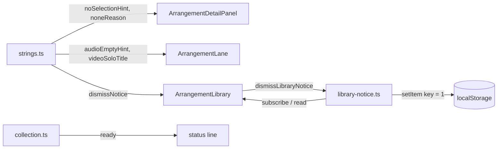

# Calm Studio — Clip details-ის ცარიელი მდგომარეობა, library notice, first-run status და ცარიელი lane-ის hint (SABA-B-8 CALM-2b)

**თარიღი:** 2026-10-28
**სტატუსი:** Completed (C round 231 PASS)
**შეცვლილი პროექტი:** Store

## კონტექსტი

Saba-მ (2026-10-28) Studio-ს ეკრანი გადატვირთულად მიიჩნია. CALM-1-მა (doc 177) shortcut ხაზი მოხსნა,
CALM-2a-მ (doc 178) — canvas-ისა და dock-ის წინადადებები. ეს ეტაპი CALM-2-ის ბოლოა და Saba-ს
decision 2-ის დარჩენილ ოთხ პუნქტს ასრულებს:

- Clip details-ის ცარიელი მდგომარეობა ერთ ხაზად იქცევა, ველები კი ადგილზე რჩება;
- library notice ერთი წინადადებაა („Synthetic demo stems — not CZABA catalogue audio.“) და
  მომხმარებელს შეუძლია მისი დახურვა, რაც browser-ში ახსოვს;
- first-run status ასწავლის drag-ს, Enter-სა და `?`-ს;
- DUX-R-4(a) ცარიელი lane-ის hint მხოლოდ აქტიურ ცარიელ lane-ზე და მხოლოდ პირველ clip-მდე ჩანს.

ცარიელ demo-ზე (S0) baseline-ზე გაზომილი ტექსტის რიგები: 1440×900-ზე 8 (status 1, „Nothing
selected“ 1, hint 1, ორი „Select a clip first“ 2, notice 3), 1280×720-ზე 5 (status 1, „Nothing
selected“ 1, notice 3; detail panel აქ collapsed-ით იწყება). B-ის scratch-ზე მოსალოდნელია 1440-ზე 5
(status, hint, notice 2, lane hint) და 1280-ზე 4 (status, notice 2, lane hint).

## მიდგომა

- **Detail panel, არაფერი არ არის მონიშნული:** header label ცარიელი string-ია (ელემენტი და „Clip
  details“ `h2` რჩება), ერთადერთი ხილული ხაზი არის `arrangement-detail-hint` — „Select a clip to edit
  its time selection and Clip Gain.“. `studioDetailStrings.nothingSelected` წაიშალა, რადგან consumer
  აღარ ჰყავს (ერთი წყარო). ხაზი body-შია და არა header-ში: 1280-ზე panel collapsed-ია და header-ის
  წინადადება იქ მუდმივად დარჩებოდა.
- **მიზეზები `sr-only`-ით და არა წაშლით:** ორი „Select a clip first“ `
` ინარჩუნებს `id`-ს, ტექსტსა და
  სვეტს, მხოლოდ none მდგომარეობაში იღებს `sr-only`-ს. From, To, Clip Gain-ის ველისა და fader-ის
  `aria-describedby` კვლავ მათზე მიდის (Apply ღილაკს `aria-describedby` არ აქვს, მხოლოდ `disabled`); ეს ერთადერთი არა-hover მიზეზია, რომელსაც SYS-5 მოგვიანებით
  გააძლიერებს. group-ისა და video-ს მდგომარეობაში მიზეზები სხვა ტექსტია და ხილული რჩება.
- **Notice ორ რიგზე:** Saba-ს ზუსტი წინადადება 12 px-ზე 291 px-ია, library-ის content box კი default
  სიგანეზე 264 px (dismiss ღილაკის გვერდით 236 px). ამიტომ ის ერთი წინადადებაა ორ რიგზე (ადრე 3 რიგი).
  შრიფტი, ფორმულირება და truncation არ შეცვლილა; კითხვა Saba-სთვის ჩაწერილია როგორც
  `SABA-Q-NOTICE-ONE-ROW`.
- **Dismiss:** notice-ის გვერდით X ღილაკი (search-clear-ის pattern, საერთო SABA-B-4 `:focus-visible`
  ring). Click ან keyboard activation წერს `czaba-studio-notice-dismissed:<collection.id>` = `1`-ს
  `localStorage`-ში და focus-ს library search-ზე გადაიტანს, რომ `body`-ზე არ ჩამოვარდეს. თუ storage
  error-ს აგდებს, in-memory set notice-ს ამ გვერდისთვის მაინც მალავს. მნიშვნელობა collection-ზე და
  browser-ზეა მიბმული, პერსონალურ მონაცემს არ შეიცავს.
- **Server snapshot:** `useSyncExternalStore`-ის server snapshot არის „ხილული“, რადგან `/studio-lab`
  server-rendered-ია. დახურულ browser-ში notice server HTML-შია და hydration-ის დროს ქრება.
- **First-run status:** demo და purchased origin-ისთვის ერთი pattern — „… collection ready. Drag a sound
  onto a track, or press Enter to add it. Press ? for shortcuts.“. `?` არის shortcut sheet-ის key
  (`shortcuts.ts`, row `shortcuts`). purchased ტექსტი მხოლოდ unit ტესტით მოწმდება, რადგან route-ს
  backend სჭირდება.
- **ცარიელი lane-ის hint:** „Drag a sound here, or press Enter to add it“ ჩანს, როცა lane აუდიოა,
  აქტიურია, folded არ არის, არც library ghost და არც OS file drag არ არის მასზე, და მთელ პროექტში 0
  clip-ია (video clip-იც ითვლება). Undo-ით ან ყველა clip-ის წაშლით ცარიელ პროექტში hint ბრუნდება —
  ეს empty-state ხაზია და არა ერთჯერადი tip; ახალი შენახული state არ სჭირდება. hint
  `pointer-events-none`-ია, ამიტომ lane-ის ყველა gesture (მაგ. time selection) უცვლელია. video
  lane-ს თავისი hint რჩება.
- **GATE229-S3:** ვიდეო ტრეკის Solo `title` ახლა `studioLaneStrings.videoSoloTitle`-ს კითხულობს;
  ხილული ტექსტი იგივეა.
- **Ableton Live 12** (task §3): drag და Enter ემთხვევა manual-ის 4.10-ს; lane hint ფიქსირებულ
  ტრეკზეა და არა ახალი ტრეკის drop area-ში (6.1, შეგნებული განსხვავება); Info View არ გვაქვს (2.2.2);
  detail panel-ის ცარიელ მდგომარეობასა და notice-ის dismiss-ზე წყარო ვერ მოიძებნა.

## არქიტექტურა

## შეცვლილი ფაილები

- `app/lib/arrangement/strings.ts` — წაიშალა `nothingSelected`; შეიცვალა `noSelectionHint`; დაემატა `videoSoloTitle`, `audioEmptyHint`, `dismissNotice`.
- `app/lib/arrangement/collection.ts` — ორი `ready` ტექსტი; გამოუყენებელი import წაიშალა.
- `app/data/studio-lab-demo.ts` — demo collection-ის `notice`.
- `app/components/arrangement/ArrangementDetailPanel.tsx` — ცარიელი header label და `sr-only` მიზეზები none მდგომარეობაში.
- `app/components/arrangement/ArrangementLane.tsx` — ცარიელი lane-ის hint და ვიდეო Solo-ს `title`.
- `app/components/arrangement/ArrangementLibrary.tsx` — notice-ის row dismiss ღილაკით და `useSyncExternalStore` read.
- `app/lib/arrangement/library-notice.ts` (ახალი) — dismiss-ის storage key, read, write და subscribe.
- `app/lib/arrangement/__tests__/strings.test.ts` — ST36, ST41, ST49 და ახალი ST-C2b.
- `app/lib/arrangement/__tests__/collection.test.ts` — PC9 და ახალი PC10.
- `app/lib/arrangement/__tests__/collection-load-status.test.tsx`, `purchased-collection-ui.test.tsx`, `library-row-strings-ui.test.tsx` — ready ტექსტები.
- `app/lib/arrangement/__tests__/detail-panel-strings-ui.test.tsx` (DPS1) და `detail-panel.test.tsx` — header და hint.
- `app/data/__tests__/studio-lab-demo.test.ts` — DL-VAL notice.
- `app/lib/arrangement/__tests__/detail-panel-reason.test.tsx` — ახალი RF7.
- `app/lib/arrangement/__tests__/lane-strings-ui.test.tsx` — LSU8-ის ერთი ხაზი და ახალი LSU9.
- `app/lib/arrangement/__tests__/library-notice-ui.test.tsx` (ახალი) — LN1–LN6.

## პრობლემები და გადაწყვეტები

- **პრობლემა:** „Select a clip first“-ის წაშლა ოთხ disabled ველს `aria-describedby`-ის სამიზნეს
  წაართმევდა. **გადაწყვეტა:** `
` რჩება DOM-ში `sr-only`-ით; RF7 ამოწმებს, რომ From, To და Clip Gain
  ველის `aria-describedby` არსებულ ელემენტზე მიდის ამ ტექსტით (MU-9 → RF3 და RF7 წითელი). ვიზუალური
  დამალვა jsdom-ში არ მოწმდება და class pin არ დაემატა (MU-8: არც ერთი ტესტი არ წითლდება —
  browser-only, C-DETAIL-231).
- **პრობლემა:** server ვერ ხედავს `localStorage`-ს, ამიტომ დახურულ browser-ში notice server HTML-შია.
  **გადაწყვეტა:** server snapshot შეგნებულად „ხილულია“ (LN5) და notice hydration-ის დროს ქრება; ეს
  მოკლე flash-ის რისკია, რომელსაც C ზომავს (C-NOTICE-231).
- **პრობლემა:** in-memory set module state-ია და ტესტებს შორის რჩება. **გადაწყვეტა:** ყოველი LN ტესტი,
  რომელიც notice-ს ხურავს, საკუთარ collection id-ს იყენებს; test-only export არ დაემატა.

## ტესტირება

- **ST-C2b** — `nothingSelected` აღარ არსებობს; `noSelectionHint`, `audioEmptyHint`, `dismissNotice` ზუსტია; `videoSoloTitle` = `soloLabel(videoMixLabel)`.
- **PC10** — ორივე origin-ის `ready` მთავრდება `Press ? for shortcuts.`-ით (key `findStudioShortcut('shortcuts')`-იდან), შეიცავს drag-სა და Enter-ს და აღარ შეიცავს `(Enter or Add)`-ს.
- **RF7** — არაფერი მონიშნული: ცარიელი header, ახალი hint, `aria-describedby` → „Select a clip first“; clip-ის მონიშვნის შემდეგ header = clip-ის სათაური და მიზეზები ქრება.
- **LSU9** — ერთი hint აქტიურ Music lane-ზე; SFX-ის გააქტიურებით გადადის; Video აქტიურზე 0; clip-ის დამატებით 0, Undo-ით 1; clip SFX-ზე, როცა Music აქტიურია — 0 (წესი პროექტის დონისაა); OS file drag-ისა და library drag-ის დროს Music-ზე 0, dragleave-ის შემდეგ 1; Music-ის fold-ით 0, unfold-ით 1 (სრული ვარიანტი, fold-ის ნაბიჯით). **LSU8** — ვიდეო Solo `title` = `videoSoloTitle`.
- **LN1–LN6** — ტექსტი და ღილაკი; click → დამალვა, key = `1`, focus search-ზე; preset key მალავს მხოლოდ თავის collection-ს; storage error-ზე მაინც იმალება; `renderToString` შეიცავს notice-ს; Enter ფოკუსირებულ ღილაკზე clip-ს არ ამატებს (control: Enter `body`-ზე ამატებს).
- **Mutants:** MU-1 (header ტექსტი) → DPS1, RF7; MU-2 (`clips.length === 0`), MU-3 (`isActive`), MU-4 (`!isVideo`, ნაბიჯი 3), MU-FOLD (`density !== 'folded'`), MU-2b (lane-ის საკუთარი `clips`), MU-FILE (`!isFileDragOver`) და MU-GHOST (`libraryGhost === null`) → LSU9 (MU-FILE-ზე LSU4-იც); MU-5 (storage write) → LN2, LN4; MU-6 (server snapshot) → LN5; MU-7 (ძველი demo ready) → PC9, PC10; MU-8 (`sr-only`) → browser-only; MU-9 (მიზეზის წაშლა) → RF3, RF7.
- Covering set: 29 test file, 562 ტესტი მწვანე; `npm run typecheck` და `npm run lint` rc 0.

## TODO / შემდეგი ნაბიჯები

- **CALM-3:** Overview-ს empty state და Ctrl+Alt+O.
- **SYS-5:** disabled ველების მიზეზები keyboard-ით მისაწვდომი.
- dismiss სხვა tab-ში ამ tab-ის notice-ს reload-მდე არ მალავს (`storage` event-ის subscription არ არის).
- **SABA-Q-NOTICE-ONE-ROW:** Saba-ს პასუხი — ორი რიგი დარჩეს, უფრო მოკლე ფორმულირება, თუ library-ის გაფართოება.
