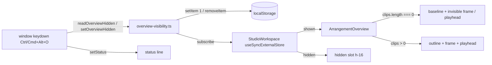

# Calm Studio — Overview-ს მშვიდი ცარიელი მდგომარეობა და Ctrl+Alt+O (SABA-B-8 CALM-3)

**თარიღი:** 2026-10-28
**სტატუსი:** Completed (C round 232 PASS)
**შეცვლილი პროექტი:** Store

## კონტექსტი

Saba-მ (2026-10-28) Studio-ს ეკრანი გადატვირთულად მიიჩნია (SABA-B-8). CALM-1-მა (doc 177) shortcut
ხაზი მოხსნა, CALM-2a-მ და CALM-2b-მ (doc 178, 179) — დამხმარე წინადადებები. ცარიელ პროექტში
Overview მაინც 64 px-იანი ჩარჩოიანი ყუთი იყო შიგთავსის გარეშე: outline, view frame და playhead
არაფერს აჩვენებდა. ეს CALM-ის ბოლო ეტაპია და Saba-ს decision 3-ს ასრულებს:

- ცარიელ პროექტში Overview რჩება, მაგრამ თხელი, მშვიდი ხაზია; სრული სახე პირველ clip-თან ჩნდება, bbox
  უცვლელია;
- Overview იმალება და ჩნდება **Ctrl+Alt+O**-ით (Mac-ზე Cmd+Option+O), როგორც Ableton Live 12-ში
  (manual 42.1); არჩევანი browser-ს ახსოვს და shortcut sheet-ში ჩანს;
- ვიდეოს გარეშე მთელი dock row-ის დაკეცვა **არ** არის დამტკიცებული.

## მიდგომა

- **ცარიელის ერთი წესი:** empty ⇔ `arrangement.clips.length === 0` — პროექტის დონეზე, ვიდეო clip-იც
  ითვლება (იგივე წესი, რაც CALM-2b-ის lane hint-ს აქვს). Undo-თ 0 clip-ზე დაბრუნებისას empty state
  ბრუნდება.
- **ცარიელი სახე:** root-ს აქვს `data-overview-state` (`empty` / `full`); ფონი empty-ზე
  `bg-transparent`-ია. outline overlay-ის ნაცვლად (child 0) ჩნდება 1 px baseline
  (`arrangement-overview-baseline`, `bg-outline`, `rounded-panel`-ის გარეშე). view frame და playhead
  DOM-ში რჩება `invisible`-ით, ამიტომ `aria-valuenow` / `aria-valuetext` კვლავ ახლდება და ← / →,
  click, drag და double-click (Fit) უცვლელად მუშაობს. role, `aria-label`, `title` და handler-ები არ
  შეცვლილა.
- **Toggle:** `overview-visibility.ts` იმავე pattern-ს მიჰყვება, რასაც `library-notice.ts`
  (`useSyncExternalStore`, in-memory მნიშვნელობა, `localStorage`). key ერთია browser-ზე —
  `czaba-studio-overview-hidden` = `1`, როცა დამალულია; ჩვენებისას key იშლება. ეს view preference-ია
  და არა content-ის ფაქტი, ამიტომ collection-ზე არ არის მიბმული. storage error-ზე toggle ამ
  session-ში მაინც მუშაობს.
- **Key branch:** `StudioWorkspace`-ის window `keydown` handler-ში, floating video Escape-ის შემდეგ.
  პირობა code-based-ია (`KeyO` + Alt + Ctrl ან Meta, Shift-ის გარეშე), ამიტომ ქართულ layout-ზეც
  მუშაობს (`event.key` = `ო`). shortcut sheet-ის, Export-ის და text field-ის early return-ები მასაც
  ეხება. auto-repeat და აქტიური pointer gesture იგნორდება. ეს view state-ია: history-ში ჩანაწერი
  არ ემატება და Undo მას არ ეხება. status line ერთხელ ადასტურებს მოქმედებას და ასწავლის დაბრუნების
  გზას („Overview hidden. Ctrl+Alt+O shows it again.“ / „Overview shown. Ctrl+Alt+O hides it.“).
- **AltGr-ის ზღვარი:** AltGr (Windows-ის ზოგ layout-ზე Ctrl+Alt, მაგ. Polish `ó`) იგნორდება
  (`getModifierState('AltGraph')`), რომ სიმბოლო აიკრიფოს. ასეთ layout-ზე toggle-ს მარცხენა Ctrl+Alt
  სჭირდება.
- **Hidden slot:** დამალვისას Overview-ს ადგილს იკავებს `aria-hidden` ცარიელი 64 px slot
  (`arrangement-overview-hidden-slot`). dock row-ის სიმაღლეს ვიდეოს monitor ადგენს, ხოლო baseline
  probe-მა აჩვენა, რომ slot-ის გარეშე caption row 68 px-ით ჩამოიწევს. dock-ის დაკეცვა Saba-ს არ
  დაუმტკიცებია.
- **Focus:** თუ დამალვისას Overview-ზეა focus, კოდი focus-ს არ გადაიტანს (ახალი სამიზნე არ
  იქმნება). Chromium ინახავს sequential focus-ის საწყის წერტილს, ამიტომ შემდეგი Tab
  `arrangement-video-expand`-ზე გადადის; ცვლილებას status line აცხადებს.
- **Sheet:** `shortcuts.ts`-ში „Zoom & view“ ჯგუფს `overview-scroll`-ის შემდეგ ემატება
  `overview-toggle` (`Ctrl+Alt+O`, aria `Control+Alt+O Meta+Alt+O`). sheet row-ს წყაროდან ხატავს.
- **GATE229-S2:** dock-ის caption row-ს მოეხსნა `justify-between gap-2` — row-ს ერთი child აქვს, bbox
  არ იცვლება.
- **Ableton Live 12** (task §3): Overview-ს როლი და gesture-ები (6.1) და Ctrl+Alt+O / Cmd+Option+O
  (42.1) ემთხვევა. ცარიელი Arrangement-ის Overview-ზე და არჩევანის session-ებს შორის შენახვაზე
  წყარო ვერ მოიძებნა; View menu-ის ჩანაწერი და ხილული ღილაკი შეგნებულად არ დაემატა (Saba: „no new
  visible control“).

## არქიტექტურა

## შეცვლილი ფაილები

- `app/lib/arrangement/overview-visibility.ts` (ახალი) — storage key, read, set და subscribe.
- `app/components/arrangement/ArrangementOverview.tsx` — empty state (`data-overview-state`, baseline, `invisible` frame და playhead, ფონის პირობა).
- `app/components/arrangement/StudioWorkspace.tsx` — visibility read, hidden slot და Ctrl+Alt+O branch.
- `app/components/arrangement/ArrangementVideoDock.tsx` — caption row-ის კლასები (GATE229-S2).
- `app/lib/arrangement/shortcuts.ts` — `overview-toggle` row.
- `app/lib/arrangement/strings.ts` — `overviewHidden`, `overviewShown`.
- `app/lib/arrangement/__tests__/strings.test.ts` — ST17-ის map და key list, ახალი ST-C3.
- `app/lib/arrangement/__tests__/shortcuts.test.ts` — SC1-ის row order, SC5-ის რაოდენობა 9, ახალი SC-C3.
- `app/lib/arrangement/__tests__/panel-radius-ui.test.tsx` — Overview root-ის site literal (ფონი პირობაში გადავიდა).
- `app/lib/arrangement/__tests__/overview-visibility-ui.test.tsx` (ახალი) — OV-E1, OV-E2, OV-T1, OV-T2, OV-T4, OV-T5.
- `app/lib/arrangement/__tests__/overview-visibility-persist-ui.test.tsx` (ახალი) — OV-T3.

## პრობლემები და გადაწყვეტები

- **პრობლემა:** frozen ტესტები (OV1, DXC4, PNR4, TH5) outline overlay-ის ზუსტ ხაზს, `rounded-panel`-ის
  რაოდენობას, `children[1]`-ს როგორც bar rows container-ს და playhead-ის token-ებს ამოწმებენ.
  **გადაწყვეტა:** empty-ზე baseline ცვლის overlay-ს child 0-ის პოზიციაზე, `rounded-panel`-ის გარეშე;
  overlay-ის ხაზი byte-identical-ია და მხოლოდ clip-ებით ჩანს; frame და playhead მხოლოდ `invisible`-ს
  იღებენ.
- **პრობლემა:** server ვერ ხედავს `localStorage`-ს. **გადაწყვეტა:** server snapshot „ნაჩვენებია“
  (route SSR-ია, როგორც CALM-2b-ის notice); დამალულ browser-ში client mount storage-ს კითხულობს და
  slot-ს აჩენს. ეს hydration-ის მოკლე flash-ის რისკია, რომელსაც C ზომავს (C-TOGGLE-PERSIST).
- **პრობლემა:** in-memory მნიშვნელობა module state-ია და storage-ზე წინ იკითხება, ამიტომ ერთ ფაილში
  preset key-ის წაკითხვა ტესტების რიგზე იქნებოდა დამოკიდებული. **გადაწყვეტა:** OV-T3 ცალკე ფაილშია
  (`overview-visibility-persist-ui.test.tsx`), სადაც `setOverviewHidden` არ გამოიძახება და vitest-ის
  file isolation in-memory მნიშვნელობას `null`-ით იწყებს.
- **პრობლემა:** frame-ის `invisible` jsdom-ში არ მოწმდება და class pin აკრძალულია. **გადაწყვეტა:**
  MU-8 browser-only-ა (C-OVERVIEW-EMPTY, computed `visibility: hidden`).

## ტესტირება

- **OV-E1** — 0 clip: `empty`, baseline არის child 0, child 1 bar rows container-ია; ერთი clip-ის
  დამატებით `full` და baseline-ის გარეშე; `undo()`-ით ისევ `empty`.
- **OV-E2** — ცარიელ Overview-ზე `aria-valuenow` და `aria-valuemax` არის, ArrowRight/ArrowLeft
  `aria-valuenow`-ს 0 → 5 → 0 ცვლის.
- **OV-T1** — Ctrl+Alt+O body-ზე: default prevented, Overview არ არის, slot `aria-hidden="true"`-ით,
  key = `1`, status = `overviewHidden`; Meta+Alt+O აბრუნებს, key იშლება, status = `overviewShown`.
- **OV-T2** — AltGr (`fireEvent` აბრუნებს `true`-ს), Shift, `repeat` (default prevented), library search,
  ღია shortcut sheet, აქტიური pointer gesture, Ctrl+O Alt-ის გარეშე და Alt+O Ctrl/Meta-ს გარეშე —
  Overview ჩანს და key არ იწერება.
- **OV-T3** (`overview-visibility-persist-ui.test.tsx`) — key = `1`: `renderToString` Overview-ს
  ხატავს, client `render` კი slot-ს.
- **OV-T4** — toggle history-ში არ ჩნდება: `undoLabel` იგივეა დამალვისა და ჩვენების შემდეგ, `undo()`
  წინა edit-ს აუქმებს.
- **OV-T5** — storage-ის error-ზე toggle ამ session-ში მაინც მალავს და აჩენს.
- **ST-C3** — ორი status string ზუსტია და შეიცავს `findStudioShortcut('overview-toggle')`-ის key-ს.
- **SC-C3** — `overview-toggle`-ის keys, aria, ჯგუფი `zoom-view`, პოზიცია `overview-scroll`-ის შემდეგ;
  `filterStudioShortcutGroups('overview')` შეიცავს `fit`, `overview-scroll`, `overview-toggle`-ს.
- **Mutants:** MU-1 (`hasClips`-ის ინვერსია) → OV-E1, OV-E2; MU-2 (AltGraph guard) და MU-3 (`repeat`
  guard) → OV-T2; MU-9 (pointer gesture guard) → OV-T2; MU-4 (server snapshot = `readOverviewHidden`) → OV-T3; MU-5 (`'0'`-ის ჩაწერა
  წაშლის ნაცვლად), MU-6 (`null` slot-ის ნაცვლად) და MU-7 (status-ების გაცვლა) → OV-T1, OV-T5; MU-8
  (frame-ის `invisible`) → browser-only.
- Covering set: 32 test file, 541 ტესტი მწვანე; N2 და N4 `--sequence.shuffle`-ითაც; `npm run typecheck`
  და `npm run lint` rc 0.

## TODO / შემდეგი ნაბიჯები

- **TLM-R232-MAC:** Cmd+Option+O რეალურ Mac-ზე (Tech Lead manual check).
- სხვა tab-ში toggle ამ tab-ს reload-მდე არ ცვლის (`storage` event-ის subscription არ არის).
- Architecture checkpoint (`b-round-231-checkpoint-request.md`): ორი `useSyncExternalStore` storage
  helper და `StudioWorkspace`-ის keydown handler-ის ზრდა.
