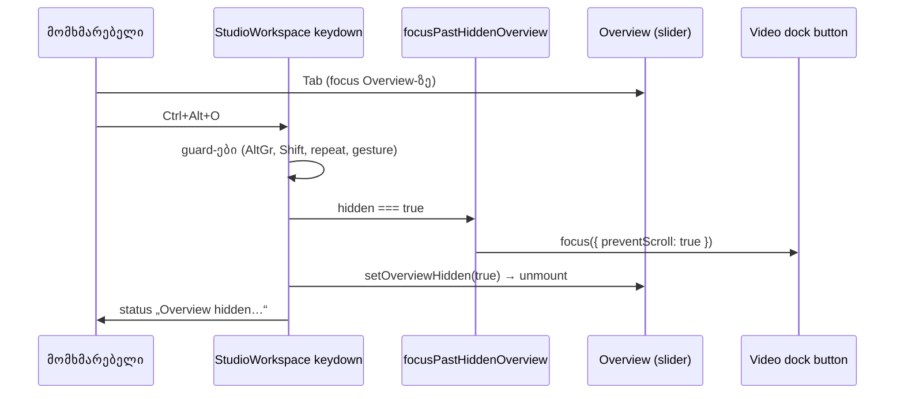

# Calm Studio — დამალული Overview-დან focus-ის გადაცემა (SABA-B-8 CALM-3, GATE232-S1)

**თარიღი:** 2026-10-28
**სტატუსი:** Completed (C round 233 PASS)
**შეცვლილი პროექტი:** Store

## კონტექსტი

CALM-3-მა (doc 180) Overview-ს დამალვა Ctrl+Alt+O-ზე (Mac-ზე Cmd+Option+O) დაამატა. როცა keyboard focus
თავად Overview slider-ზე იყო, დამალვისას Overview unmount ხდებოდა და `document.activeElement` `body`
ხდებოდა. C-მ ეს round 232-ში გაზომა (C-TOGGLE-FOCUS: BODY), B-მ baseline-ზე გაიმეორა. gate 232-ის
code-reviewer-მა (suggestion 1) ეს Medium a11y პრობლემად შეაფასა: keyboard და screen reader
მომხმარებელი ადგილს კარგავს. focus ring ქრება და virtual cursor-ს არავინ ეუბნება, სად წავიდა focus.
Chromium-ი შემდეგ Tab-ს მაინც სწორად აგრძელებს, მაგრამ ეს არ კმარა.

round 232-ის წესი „focus კოდით არ გადაადგილდება“ (D-29z309) B-მ D-29z314-ით გააუქმა: keyboard
ბრძანებამ, რომელიც focus-იან control-ს შლის, focus განსაზღვრულ control-ს უნდა გადასცეს (WCAG 2.2
SC 2.4.3 Focus Order; WAI-ARIA APG „Developing a Keyboard Interface“).

ამავე რაუნდის task-ში შევიდა C-R232-01 (render-budget-ის ტესტის timeout headroom). A-მ აღმოაჩინა, რომ მისი
premise არასწორი იყო; დეტალები ქვემოთ, „მიდგომა“-ში.

## მიდგომა

**სამიზნის წესი:** focus გადადის იმ ელემენტზე, რომელსაც შემდეგი Tab მიაღწევდა, ანუ „ერთით წინ“.
ეს keyboard მომხმარებლისთვის ყველაზე პროგნოზირებადი ცვლილებაა. ზუსტად:

- `StudioWorkspace.tsx`-ში ემატება module-level helper `focusPastHiddenOverview`. ის მუშაობს მხოლოდ
  მაშინ, როცა `document.activeElement` `[data-timeline-overview]`-ის შიგნითაა. პოულობს გარე
  `[data-testid="arrangement-video-dock"]`-ს და focus-ს (`preventScroll: true`) გადასცემს dock-ის
  პირველ `button`-ს, რომელიც document order-ში Overview-ს მოსდევს, არ არის `disabled` და აქვს
  `tabIndex >= 0`.
- docked ვიდეოს დროს ეს არის `arrangement-video-expand`, floating ვიდეოს დროს —
  `arrangement-video-placeholder-return`.
- helper-ს Ctrl+Alt+O-ის branch იძახებს **მხოლოდ დამალვისას** და `setOverviewHidden(true)`-მდე,
  სანამ Overview ჯერ კიდევ mounted-ია. არსებული guard-ები (AltGr, Shift, repeat, pointer gesture,
  text field, ღია sheet) იმავე რიგით რჩება.
- **ჩვენება focus-ს არ ცვლის**, რადგან არაფერი unmount ხდება. თუ focus სხვაგან არის (Play ღილაკი,
  separator, `body`), ის არც დამალვისას და არც ჩვენებისას არ გადაადგილდება.
- status-ის ტექსტი („Overview hidden. Ctrl+Alt+O shows it again.“) უცვლელია. ახალი persistent
  ტექსტი არ ემატება.

**უარყოფილი ალტერნატივა:** reviewer-ის შეთავაზება იყო timeline scroller. მას `tabIndex` არ აქვს, ამიტომ
`.focus()` არაფერს აკეთებს. `tabIndex`-ის დამატება ახალ Tab stop-ს შექმნიდა და
`revealKeyboardFocusBelowChrome`-ს გაააქტიურებდა.

**`compareDocumentPosition` ფილტრი** დამცავია: დღეს dock-ში Overview-მდე არც ერთი ღილაკი არ დგას,
ამიტომ მას ცალკე ტესტი არ აქვს (B-ის MU-2 mutant მწვანე რჩება).

**render-budget:** ტესტს „does not re-render clips, overview bars, library rows or ruler ticks over
Play → Pause → Play“ `15000` timeout HEAD-ზე უკვე ჰქონდა (commit 4c07d5f-იდან). round 232-ის STOP და
C-R232-01-ის premise შეცდომით ფიქრობდა, რომ ის 5,000 ms default-ზე იყო. task-ით გაცემულმა ერთხაზიანმა
ცვლილებამ (l.377) `15000` მიანიჭა მეზობელ ტესტს „moves the playhead, ruler handle and transport time
on playback frames without React renders“ (gate 232: 991 ms). ცვლილება უვნებელია; C-R232-01-ის
ბედს (invalid / დარჩეს / წაიშალოს) B წყვეტს. assertion-ები უცვლელია.

## არქიტექტურა

## შეცვლილი ფაილები

- `app/components/arrangement/StudioWorkspace.tsx`: helper `focusPastHiddenOverview` და მისი ერთი
  გამოძახება Ctrl+Alt+O-ის branch-ში.
- `app/lib/arrangement/__tests__/overview-visibility-ui.test.tsx`: ახალი შემთხვევა OV-T6.
- `app/lib/arrangement/__tests__/render-budget.test.tsx`: `15000` timeout ტესტზე „moves the playhead, ruler
  handle and transport time on playback frames without React renders“ (l.377).
- `docs/implementation/2026/quarter-IV/181-calm-3-overview-focus-rescue.md`: ეს დოკუმენტი.

## პრობლემები და გადაწყვეტები

- **Problem:** focus-იანი Overview-ს unmount-ისას focus `body`-ზე ვარდებოდა.
  **Solution:** focus გადაეცემა შემდეგ Tab stop-ს dock-ში, unmount-მდე.
- **Problem:** helper-ის გამოძახება `setOverviewHidden`-ის შემდეგ ვერ იმუშავებდა, რადგან Overview უკვე
  წაშლილი იქნებოდა და `activeElement`-ის შემოწმება აზრს დაკარგავდა.
  **Solution:** გამოძახება ხდება state-ის ცვლილებამდე, guard-ების შემდეგ.
- **Problem:** task-მა render-budget-ის ტესტისთვის timeout-ის დამატება მოითხოვა, მაგრამ ამ ტესტს
  `15000` უკვე ჰქონდა, ხოლო გაცემული ხაზი (l.377) მეზობელ ტესტს ხურავს.
  **Solution:** A-მ გაცემული ერთხაზიანი ცვლილება შეასრულა (უვნებელია) და შეუსაბამობა B-ს გადასცა.

## ტესტირება

- **OV-T6** (`overview-visibility-ui.test.tsx`), „hiding the focused Overview moves focus to the next
  dock control, never to body (GATE232-S1)“:
  - Play ღილაკზე focus-ის დროს დამალვა/ჩვენება focus-ს არ ცვლის;
  - focus-იანი Overview-ს დამალვა focus-ს `arrangement-video-expand`-ზე გადასცემს, ჩვენება კი იქვე ტოვებს;
  - floating ვიდეოს დროს სამიზნეა `arrangement-video-placeholder-return`.
- **Mutant MU-1** (helper-ის გამოძახება ამოღებულია): OV-T6 წითლდება, დანარჩენი 6 შემთხვევა მწვანე
  რჩება.
- **render-budget** (`render-budget.test.tsx`): „does not re-render clips, overview bars, library rows
  or ruler ticks over Play → Pause → Play“ (15,000 ms limit HEAD-იდან) და „moves the playhead, ruler
  handle and transport time on playback frames without React renders“ (ახლა 15,000 ms) მწვანეა.
- `npm run typecheck` და `npm run lint` rc 0. B-ის covering set (32 ფაილი) მწვანეა.
  `overview-visibility-ui.test.tsx` `--sequence.shuffle`-ითაც გადის.
- Chromium-ის self-check `/studio-lab`-ზე, 1440×900 და 1280×720: docked და floating სამიზნეები ემთხვევა
  `:focus-visible`-ს და ხილული outline აქვთ. Tab/Shift+Tab შემდეგ და წინა stop-ზე მიდის, page error არ
  არის. დამოუკიდებელ browser შემოწმებას C ატარებს.

## TODO / შემდეგი ნაბიჯები

- [ ] TLM-R232-ALTGR-WIN: Windows-ზე Polish/German layout-ით მარცხენა Ctrl+Alt+O და Firefox
  (Tech Lead-ის manual შემოწმება).
- [ ] TLM-R232-MAC: Cmd+Option+O რეალურ Mac-ზე (Tech Lead-ის manual შემოწმება).
- [ ] B-R232-DOC180-FOCUS-STALE: doc 180-ის l.42–51 ჯერ კიდევ round 232-ის „focus is not moved“ წესს
  აღწერს. ამ დოკუმენტმა ის ჩაანაცვლა. doc 180-ს ერთხაზიანი შენიშვნა დაემატება მომდევნო owner-ის
  შეხებისას ან polish pass-ში.
