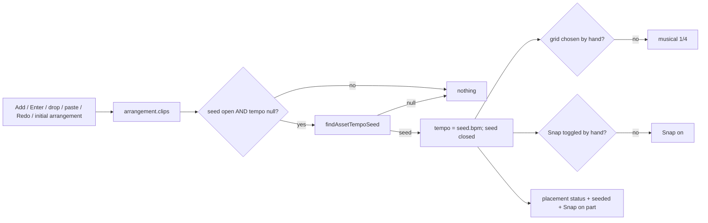

# SABA-B-11a ეტაპი 1 — პროექტის tempo კატალოგის BPM-იდან, musical grid და Snap

**თარიღი:** 2026-10-28
**სტატუსი:** Completed (C round 235 PASS)
**შეცვლილი პროექტი:** Store

## კონტექსტი

საბას გადაწყვეტილება 3 (2026-10-28): თუ პროექტში არის asset კატალოგის BPM-ით, Studio tempo-ს მისგან
იღებს, default grid musical ხდება და Snap ირთვება. თუ არცერთ asset-ს BPM არ აქვს (SFX, ambience),
grid რჩება წამებში — **120 BPM არასდროს იგონება**. შერეულ პროექტში tempo მუსიკალური asset-იდან
მოდის. მომხმარებელს grid-ის ოჯახის ხელით შეცვლა შეუძლია, min:sec ruler ყოველთვის ჩანს და აუდიო
არასდროს იჭიმება.

მანამდე `tempoBpm` ყოველთვის `null`-ით იწყებოდა და მხოლოდ მომხმარებელს შეეძლო მისი აკრეფა.
`WorkspaceSource`-ს BPM ველი არ ჰქონდა, თუმცა კატალოგს (`MusicAsset.bpm`) აქვს. ამიტომ ყოველი
პროექტი 1 s grid-ით და გამორთული Snap-ით იწყებოდა, ხოლო musical დაყოფები BPM-ის აკრეფამდე
მიუწვდომელი იყო.

რატომ გამოგვრჩა: round 47-ის seconds grid დროებითი ერთეული იყო და default-ად დარჩა. **L45**
(build the reference's unit first) ამბობს, რომ ჯერ reference-ის ერთეული (Live-ის beat-time grid)
და მისი რეალური წყარო (კატალოგის BPM) უნდა აშენდეს, და დროებითი ერთეული საბას გარეშე default-ად
არ რჩება. L44-ის მიხედვით planner-ის „deliberate difference“ საბას გადაწყვეტილება არ არის.

## მიდგომა

- `WorkspaceSource.bpm?: number` — asset-ის კატალოგის tempo. ველის არქონა ნიშნავს „უცნობს“ და
  default-ს არასდროს.
- `/studio-lab`-ის ხუთ სინთეზურ წყაროს (`demo-synth-mix` და ოთხი `demo-stem-*`) აქვს
  `bpm = 60 / DEMO_STEM_BEAT_SECONDS` (= 120). ეს კომპოზიციის რეალური tempo-ა (0.5 s beat,
  4/4) და არა მოგონილი default. დანარჩენ ოთხ demo წყაროს BPM არ აქვს.
- სუფთა ფუნქცია `findAssetTempoSeed(clips, tracks, sources)` ირჩევს `audio` track-ზე მდებარე
  clip-ს, რომლის წყაროა `music` ან `stem` და რომელსაც ვალიდური BPM აქვს (2 ათწილადამდე
  დამრგვალებული, 20…999 — როგორც `parseTempoBpm`-ში). `sfx` BPM-ითაც კი იგნორირდება. იმარჯვებს
  ყველაზე ადრეული `start`, თანაბარზე — array-ის რიგი.
- `StudioWorkspace`-ში: სამი ref (`tempoSeedOpenRef`, `gridHandChosenRef`, `snapHandChosenRef`) და
  ერთი effect `arrangement.clips`, `arrangement.tracks`, `collection.sources`-ზე. Effect ყოველ
  ცვლილებაზე ეშვება, მაგრამ მაშინვე ბრუნდება, თუ seed დახურულია ან tempo უკვე არის. ამიტომ ფარავს
  clip-ის დამატების ყველა გზას (Add, Enter, drag-drop, paste, duplicate) და საწყის arrangement-საც.
  Redo პირველ seed-ს ვერ გამოიწვევს: BPM-იანი clip დამატებისთანავე ავსებს tempo-ს, Undo კი seed-ს
  აღარ ხსნის.
- Seed-ისას: tempo = `seed.bpm`; თუ grid ხელით არ აურჩევიათ → musical **`1/4`** (D-29z324, adaptive
  grid-მდე, 11b); თუ Snap ხელით არ შეუცვლიათ → Snap **on**. Status = მიმდინარე ტექსტი (placement)
  + `studioTempoStrings.seeded(...)` + (მხოლოდ თუ Snap ჩაირთო) `studioGridStrings.snapOnStatus`
  მიმდინარე დაყოფის label-ით — ჩვეულებრივ `Snap on — grid 1/4 (G)`, ხელით არჩეული grid-ისას კი
  მისი seconds label (მაგ. `0.5 s`).
- ხელით არჩევანი იმარჯვებს: `changeTempo` ხურავს seed-ს (გასუფთავებაც არჩევანია);
  `changeGridDivision` flag-ს რთავს მხოლოდ მისი ორი refusal guard-ის შემდეგ; `toggleSnap` ყოველთვის
  რთავს flag-ს. Tempo row `onTempoChange`-ს მხოლოდ მნიშვნელობის ცვლილებისას იძახებს, ამიტომ ცარიელ
  ველში Enter ან focus/blur seed-ს არ ხურავს.
- Seed ერთჯერადია: clip-ის წაშლა, Undo ან სხვა BPM-იანი asset-ის დამატება tempo-ს, grid-ს და Snap-ს
  არ ცვლის.

განხილული ალტერნატივა: seed-ის გამოძახება მხოლოდ library Add-ის handler-ში. უარვყავით, რადგან
drag-drop, paste, Redo და საწყისი arrangement გამორჩებოდა.

### Ableton-თან განსხვავებები (reference: Live 12 manual 9.1.1, 9.2, 6.1, 6.10)

- Live-ში Set-ის tempo მომხმარებლის მნიშვნელობაა და clip-ის დამატება მას არ ცვლის. CZABA-ში
  პირველი music/stem asset BPM-ით tempo-ს ერთხელ ავსებს — **საბას გადაწყვეტილება 3**.
- Live-ს seconds grid არ აქვს; CZABA-ში BPM-ის გარეშე grid წამებშია — **საბას გადაწყვეტილება**
  (Logic / Pro Tools-ის მსგავსად).
- Tempo, grid და Snap CZABA-ს Undo history-ს გარეთაა (არსებული D-29z30 R4); Live-ში Set-ის
  ცვლილებები, სავარაუდოდ, undoable-ია. კითხვა საბასთვის: `SABA-Q-TEMPO-UNDO` (L44).
- `1/4` დროებითია, სანამ adaptive grid (11b) დაემატება.

## არქიტექტურა

## შეცვლილი ფაილები

- `app/types/arrangement.ts` — `WorkspaceSource.bpm?: number`.
- `app/data/studio-lab-demo.ts` — `bpm` ხუთ სინთეზურ წყაროზე.
- `app/lib/arrangement/strings.ts` — `studioTempoStrings.seeded`.
- `app/lib/arrangement/tempo-seed.ts` (ახალი) — `findAssetTempoSeed`.
- `app/components/arrangement/StudioWorkspace.tsx` — seed ref-ები, seed effect, flag-ები
  `toggleSnap`, `changeGridDivision`, `changeTempo`-ში.
- `app/lib/arrangement/__tests__/tempo-seed.test.ts` (ახალი) — TS1–TS6.
- `app/lib/arrangement/__tests__/tempo-seed-ui.test.tsx` (ახალი) — TU1–TU8.
- `app/lib/arrangement/__tests__/strings.test.ts` — `seeded` key, sample, ზუსტი output და
  `tempo-seed.ts` no-Georgian სიაში (ST17/ST18/ST19).
- `app/data/__tests__/studio-lab-demo.test.ts` — DL-BPM.

## პრობლემები და გადაწყვეტები

- **პრობლემა:** placement-ის ტექსტი seed-ის status-ში არ უნდა დაიკარგოს. **გადაწყვეტა:**
  round 237-იდან effect წერს ფუნქციური `setStatus((current) => …)`-ით: reducer-ის მიმდინარე
  ტექსტს უმატებს seed-ის ნაწილებს, ცარიელ ნაწილებს ფილტრავს. TU2 ზუსტ ტექსტს ამოწმებს; დეტალები
  doc 185-შია.
- **პრობლემა:** grid-ის უარყოფილი არჩევანი (musical id tempo-ს გარეშე) „ხელით არჩევანად“ არ უნდა
  ჩაითვალოს. **გადაწყვეტა:** `gridHandChosenRef` ირთვება refusal guard-ების შემდეგ.
- **პრობლემა:** ცარიელ tempo ველზე შეხება არჩევანი არ არის. **გადაწყვეტა:** seed იხურება მხოლოდ
  `changeTempo`-ში, რომელსაც tempo row მხოლოდ რეალური ცვლილებისას იძახებს (TU4).
- **პრობლემა:** clip-ის start მილიწამამდე მრგვალდება, ამიტომ 60/90 s grid-ზე snap 0.667-ს იძლევა.
  **გადაწყვეტა:** TU7 ადარებს `toBeCloseTo(x, 3)`-ით (სხვაობა < 0.0005 s).

## ტესტირება

- TS1–TS6 (`tempo-seed.test.ts`): clip-ების გარეშე, stem 90, sfx/BPM-ის გარეშე music
  იგნორირება, ყველაზე ადრეული start და თანაბარი start, არავალიდური მნიშვნელობები და
  დამრგვალება, video track.
- TU1–TU8 (`tempo-seed-ui.test.tsx`): mount-ის მდგომარეობა, seed და status-ის ზუსტი ტექსტი,
  შერეული პროექტი, მომხმარებლის tempo-ს უპირატესობა (grid და Snap არ იცვლება), ხელით არჩეული
  grid, ხელით გამორთული და ხელით ჩართული Snap, ერთჯერადობა და Undo,
  60/90 s snap და Alt bypass, საწყის arrangement-ზე seed.
- DL-BPM (`studio-lab-demo.test.ts`): ხუთ სინთეზურ წყაროს `bpm === 120` აქვს, დანარჩენ ოთხს
  `bpm` property საერთოდ არ აქვს.
- Mutant MU-A (A-ს ანგარიში `a-round-234.md`, log `a-round-234-mu-a.log`): seed effect-ის
  წაშლისას tempo-seed-ui-ში 7 ტესტი წითლდება (TU2–TU8), TU1 მწვანე რჩება.
- რეალური ბრაუზერის შემოწმება C-ს ეკუთვნის (round 234, `/studio-lab`).

## TODO / შემდეგი ნაბიჯები

- SABA-B-11a ეტაპი 2: bars ruler ინტერაქტიული ხდება, ზედა ზოლზე click playback-ს იწყებს,
  seconds ruler-ის როლი.
- SABA-B-11b: adaptive grid (`1/4`-ის ნაცვლად) და 4/5 key-ები.
- `app/routes/studio.$productId.tsx` (დაცული, SRW-21 `deferred_user`) `bpm`-ს მოგვიანებით
  გადასცემს; ამ ეტაპში მხოლოდ optional ველი დაემატა.
- `SABA-Q-TEMPO-UNDO` — საბას პასუხამდე tempo/grid/Snap Undo history-ს გარეთ რჩება.
- გამოსწორებულია round 237-ში (doc 185): mount-ის seed-ის status-ს provider-ის loading/ready
  ჩანაწერი აღარ გადაფარავს — ready ცვლის მხოლოდ loading prefix-ს (TU10), ხოლო Add-ის შემდეგ
  placement + seed რჩება (TU9).
