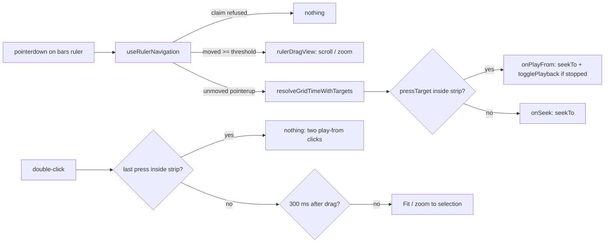

# SABA-B-11a ეტაპი 2 — ინტერაქტიული bars ruler და scrub strip

**თარიღი:** 2026-10-28
**სტატუსი:** Completed (C round 235 PASS)
**შეცვლილი პროექტი:** Store

## კონტექსტი

საბას გადაწყვეტილება 2 (2026-10-28): bars ruler-ის ზედა ზოლზე click playback-ს იწყებს ამ
წერტილიდან, როგორც Live-ის scrub area. გადაწყვეტილება 3: BPM-ით grid musical-ია, min:sec ruler
ყოველთვის ჩანს. დამტკიცებული review (`transport-grid-review.md` §4.3) 11a-ში ასახელებს
„bars ruler ინტერაქტიული ხდება“ (drag = scroll/zoom, click = პოზიცია).

მანამდე bars ruler მხოლოდ საჩვენებელი იყო (`role="presentation"`, handler-ების გარეშე), ხოლო
ruler-ის ყველა gesture seconds ruler-ზე ცხოვრობდა. ამიტომ musical ruler-ით — reference-ის
ერთეულით (L45) — ნავიგაცია და playback-ის დაწყება შეუძლებელი იყო.

## მიდგომა

- **Hook-ის გამოყოფა.** seconds ruler-ის navigation gesture (left-button guard, gesture claim,
  pointer capture და `watchUncapturedPointerGesture` fallback, `TIMELINE_DRAG_THRESHOLD_PX`,
  `rulerDragView` ერთ rAF-ში, `onNavigationMove` პირველ მოძრაობაზე, 300 ms double-click-after-drag
  guard, unmount cleanup) უცვლელად გადავიდა `useRulerNavigation`-ში. ორივე ruler ერთსა და იმავე
  ლოგიკას იყენებს; seconds ruler-ის ქცევა, markup, `title` და testid არ შეცვლილა.
- **ორი ზონა, ერთი ელემენტი.** tempo-ს არსებობისას bars ruler-ის პირველი შვილი არის
  `arrangement-bars-scrub-strip` — სრული სიგანე, ზედა 10 px (`h-2.5`), მხოლოდ hover tint
  (`hover:bg-foreground/8`). ზონა განისაზღვრება `pointerdown`-ის target-ით:
  `stripRef.current.contains(pressTarget)`. ცალკე px მუდმივა არ არსებობს, ამიტომ hit zone და
  დახატული ზოლი ყოველთვის ერთი ელემენტია. `pointerup`-ის target capture-ის გამო root-ია, ამიტომ
  hook target-ს `pointerdown`-ზე ინახავს.
- **Snap-ის წესი.** შეუმოძრავებელი click: `resolveGridTimeWithTargets(anchorTime, snapSeconds,
  gridSeconds, altKey, markers)` — იგივე, რაც seconds ruler-ზე (editing grid + markers, როცა Snap
  ჩართულია; Alt გვერდს უვლის). ზოლში → `onPlayFrom(time)`, ქვემოთ → `onSeek(time)`.
- **Drag და double-click.** ორივე ზონიდან drag = scroll/zoom (`rulerDragView`), seek-ისა და
  playback-ის გარეშე; ქვედა ზონის double-click = Fit ან zoom time selection-ზე, იმავე after-drag
  guard-ით. ზოლში დაწყებული double-click Fit-ს არ უშვებს: ის ორი „play from here“ click-ია
  (round 236, იხ. doc 184).
- **`playFromRuler`** (`StudioWorkspace`) მხოლოდ context-ის `playFrom(time)`-ს გადასცემს
  (round 236, doc 184). დაკვრისას `playFrom` მხოლოდ `seekTo`-ს აკეთებს — click ხტება და დაკვრა
  გრძელდება. გაჩერებულზე, პროექტის ბოლოში ან მის მიღმა, აქტიური loop-ის გარეშე: status =
  `playPastEnd` და playback არ იწყება. სხვა შემთხვევაში `seekTo` + `togglePlayback`, რომლის
  guard-ები (მაგ. ცარიელი პროექტი → `nothingToPlay`) უცვლელია.
- **Tempo-ს გარეშე** bars ruler ზუსტად ისე რენდერდება, როგორც მანამდე: handler-ების, `title`-ის,
  შვილისა და cursor კლასის გარეშე.
- **აღმოჩენადობა.** ზოლს აქვს tooltip `Click = play from here`; `?` sheet-ის Transport ჯგუფში
  დაემატა სტრიქონი `Play from a point (needs a BPM)` — `Click the top strip of the bars ruler`.
  ეკრანზე მუდმივი ტექსტი არ დამატებულა (L39).
- **ალტერნატივა, რომელიც უარვყავით:** `offsetY < 10` შედარება (B-ს sketch) — ორი წყარო ერთი
  საზღვრისთვის; ზოლის სიმაღლის შეცვლისას hit zone და ხატვა ერთმანეთს დაშორდებოდა.

### Ableton-თან მიმართება და გადახრები

- Scrub area-ზე click playback-ს იწყებს (Live 12 manual 6.1, 6.3) — აშენებულია.
- დაკვრისას click ხტება; „დაკვრა გრძელდება“ ექსპერტის დასკვნაა, არა manual-ის ციტატა.
- Scrub ზოლის ადგილი და სიმაღლე Live-ში დადასტურებული არ არის — **საბას გადაწყვეტილება 2**.
- Live jump-ს launch Quantization მენიუთი ამრგვალებს; CZABA-ში ასეთი მენიუ არ არის, ამიტომ
  editing grid გამოიყენება — კითხვა საბასთვის `SABA-Q-SCRUB-QUANTIZE`.
- Hold-to-loop scrub area-ში არ აშენებულა — `SABA-Q-SCRUB-HOLD-LOOP`.
- Right-click → Add Locator (ვიდეოში ნანახი) არ აშენებულა — `SABA-Q-SCRUB-ADD-LOCATOR`.
- Seconds ruler-ზე click კვლავ playhead-ს სვამს (BPM-ის გარეშე პროექტს სხვა ruler არ აქვს) —
  `SABA-Q-TIME-RULER-ROLE`. ქვედა ზონის click-ის ეფექტი Live-ში დოკუმენტირებული არ არის; CZABA-ს
  გადაწყვეტილებაა და იმავე კითხვაშია.
- Insert Marker-ის სემანტიკა (დაკვრისას click მხოლოდ მარკერს ამოძრავებს) SABA-B-10a-ში მოდის;
  მანამდე ქვედა ზონის click ზუსტად seconds ruler-ის click-ს იმეორებს.

## არქიტექტურა

## შეცვლილი ფაილები

- `app/hooks/useRulerNavigation.ts` (ახალი) — ruler-ის navigation gesture.
- `app/components/arrangement/ArrangementRuler.tsx` — seconds ruler hook-ს იყენებს.
- `app/components/arrangement/ArrangementTempoRow.tsx` — `BarsRulerGestures`, prop
  `rulerGestures`, scrub strip, ზონის ტესტი.
- `app/components/arrangement/StudioWorkspace.tsx` — `playFromRuler`, `barsRulerGestures`.
- `app/lib/arrangement/strings.ts` — `studioTempoStrings.scrubStripTitle`.
- `app/lib/arrangement/shortcuts.ts` — სტრიქონი `play-from-point`.
- `app/lib/arrangement/__tests__/bars-ruler-ui.test.tsx` (ახალი) — BR1–BR11, BR4b.
- `app/lib/arrangement/__tests__/strings.test.ts` — ST17-ის key სია და literal.
- `app/lib/arrangement/__tests__/shortcuts.test.ts` — SC1-ის რიგი, SC4-ში keys assertion.
- `docs/implementation/2026/quarter-IV/182-saba-b-11a-tempo-seed.md` — სტატუსის სტრიქონი.

## პრობლემები და გადაწყვეტები

- **პრობლემა:** pointer capture-ის შემდეგ `pointerup`-ის target root-ია, ზოლი არა.
  **გადაწყვეტა:** hook `pointerdown`-ის `event.target`-ს navigation record-ზე ინახავს და click-ს
  `pressTarget`-ად გადასცემს.
- **პრობლემა:** BU8 მოითხოვს, რომ playhead frame-ებმა bars ruler ხელახლა არ დაარენდეროს.
  **გადაწყვეტა:** `barsRulerGestures` არის `useMemo` სტაბილური callback-ებითა და primitive-ებით;
  `playFromRuler` `[]` deps-ით `workspaceRef`-ს კითხულობს; `ArrangementBarsRulerInner` memo რჩება.
  BR11 ამოწმებს, რომ memo-ს მოხსნა (MU-MEMO) წითლდება.
- **პრობლემა:** BU7 მოითხოვს, რომ tempo-ს გარეშე bars ruler ცარიელი იყოს.
  **გადაწყვეტა:** handler-ები, `title` და ზოლი მხოლოდ `bpm !== null`-ზე ემატება; BR1 ამას
  ამოწმებს და MU-C-ზე წითლდება.
- **პრობლემა:** ზოლის სიმაღლე (10 px) WCAG 2.5.8-ის 24 px-ზე ნაკლებია. **გადაწყვეტა:**
  ჩაწერილი კომპრომისი — row 20 px-ია და პოზიციები არ იცვლება; კლავიატურის ექვივალენტი არსებობს
  (playhead handle ←/→, შემდეგ Space ან Play).

## ტესტირება

- `bars-ruler-ui.test.tsx`:
  - BR1 — tempo-ს გარეშე: `title`, ზოლი და ტექსტი არ არის; click-ები და drag არაფერს ცვლის.
  - BR2 — ზოლზე click გაჩერებულზე: დაკვრა 4.000 s-დან (90 BPM, 1/4).
  - BR3 — ზოლზე click დაკვრისას: დაკვრა გრძელდება, პოზიცია 8.000 s.
  - BR4 / BR4b — ქვედა ზონა: 6.000 s, გაჩერებულზე არ უკრავს, დაკვრისას გრძელდება.
  - BR5 — Alt ორივე ზონაზე და Snap off: თავისუფალი დრო.
  - BR6 — drag ორივე ზონიდან: scroll და zoom, seek-ისა და playback-ის გარეშე; `pointercancel` და
    `lostpointercapture` click-ს არ იწვევს.
  - BR7 — double-click: Fit (იგივე status, რაც seconds ruler-ზე); drag-ის შემდეგ — არაფერი.
  - BR8 — ბოლოს მიღმა: `playPastEnd`; ცარიელ პროექტში: `nothingToPlay`.
  - BR9 — seconds ruler-ის click tempo-თი უცვლელია, `title` = `rulerTitle`.
  - BR10 — სხვა gesture-ის claim-ის დროს press უარყოფილია.
  - BR11 — workspace-ის re-render უცვლელი gesture-ებით bars ruler-ს ხელახლა არ არენდერებს
    (marks ხელახლა არ ითვლება); Snap-ის გადართვა კი არენდერებს.
- Mutant-ები (გამოყენებული, გაშვებული და დაბრუნებული):
  - MU-B (ზოლი `onSeek`-ს იძახებს): 5 წითელი — BR2, BR3, BR4b, BR5, BR8.
  - MU-C (handler-ები tempo-ს გარეშეც): 1 წითელი — BR1.
  - MU-D (`pointercancel` / `lostpointercapture` click-ად ითვლება): 1 წითელი — BR6.
  - MU-MEMO (`barsRulerGestures` `useMemo`-ს გარეშე): 1 წითელი — BR11; `tempo-window-ui` BU8 და
    `render-budget` მწვანე რჩება, რადგან playhead frame-ები `StudioWorkspace`-ს არ არენდერებს.
- ST17 (`strings.test.ts`) და SC1 (`shortcuts.test.ts`) ახალ key-სა და სტრიქონს ამოწმებს.
- რეალური ბრაუზერის შემოწმება C-ს ეკუთვნის (round 235, `/studio-lab`).

## TODO / შემდეგი ნაბიჯები

- SABA-B-10a: Insert Marker-ისა და playhead-ის ცალკე მოდელი; ქვედა ზონის click დაკვრისას მხოლოდ
  მარკერს ამოძრავებს.
- საბას კითხვები: `SABA-Q-TIME-RULER-ROLE`, `SABA-Q-SCRUB-QUANTIZE`, `SABA-Q-SCRUB-HOLD-LOOP`,
  `SABA-Q-SCRUB-ADD-LOCATOR`.
- SABA-B-11b: adaptive grid და 4/5 key-ები.
