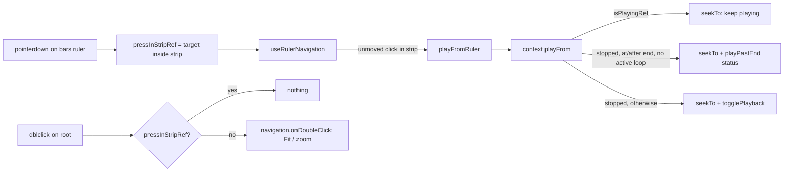

# SABA-B-11a FIX-1 — scrub strip-ის play-from გზა

**თარიღი:** 2026-10-28
**სტატუსი:** Completed (C round 236 PASS)
**შეცვლილი პროექტი:** Store

## კონტექსტი

SABA-B-11a-ის მეორე ეტაპმა (round 235, doc 183) bars ruler-ს scrub strip დაუმატა: ზოლზე click
playback-ს ამ წერტილიდან იწყებს. ამ ერთ გზაში სამი ბაგი დარჩა:

| Id | Severity | პრობლემა |
|---|---|---|
| GATE235-S1 | Medium | ზოლზე double-click playback-ს იწყებს **და** Fit-საც უშვებს — view მთელ პროექტზე იკეცება, თან დაკვრა გრძელდება. |
| A-R235-REVIEW-M1 | Medium (latent) | `playFromRuler` „დავიწყო თუ არა“-ს render-ის დროინდელი `isPlaying`-ით წყვეტდა, ხოლო `togglePlayback` `isPlayingRef`-ს კითხულობს. თუ ორი მნიშვნელობა განსხვავდება (playback-ის დაწყება და strip click ერთ task-ში, React-ის commit-მდე), click playback-ს **აჩერებდა**. |
| C-R235-01 | Low | ზოლზე click, რომელიც პროექტის ბოლოზე snap-დება, 0-დან უკრავდა: `togglePlayback`-ის „ბოლოში Space → 0-დან“ წესი ცხადი „play from here“-ისთვის არასწორია. |

## მიდგომა

- **`playFrom(time)` context-ში.** `ArrangementContextValue`-ს დაემატა ერთი წევრი; ის context-ში
  ცხოვრობს, რადგან `isPlayingRef` და `historyRef` იქ არის.
  - დაკვრისას (`isPlayingRef.current`): `seekTo(target)` — იგივე ნახტომი, დაკვრა გრძელდება.
  - გაჩერებულზე, თუ `end > 0`, `target >= end − ARRANGEMENT_EPS` და აქტიური loop არ არის
    (`resolveActiveLoop(...) === null`): `stopLibraryPreview()`, `seekTo(target)` და status =
    `playPastEndMessage(target, end)`. playback არ იწყება.
  - სხვა შემთხვევაში: `seekTo(target)`, შემდეგ `togglePlayback()` — მისი ყველა guard
    (`nothingToPlay`, `playPastEnd`, loop, preview-ის გაჩერება) უცვლელად მოქმედებს.
  - `togglePlayback`, `seekTo` და Space-ის ქცევა არ შეცვლილა: Space ბოლოში ისევ 0-დან უკრავს.
- **`playFromRuler`** (`StudioWorkspace`) ახლა მხოლოდ `workspaceRef.current.playFrom(time)`-ს
  იძახებს და `[]` deps-ით რჩება, ამიტომ `barsRulerGestures` სტაბილურია (BR11). doc 183-ის
  `playFromRuler` bullet (`seekTo` + `togglePlayback` გაჩერებულზე) ძველ ქცევას აღწერს; ამ
  რაუნდის grant მას არ ფარავდა, ამიტომ ის უცვლელია და მოქმედ ქცევას ეს doc აღწერს.
- **ზოლის double-click.** `ArrangementBarsRulerInner` root-ის `onPointerDown`-ზე ინახავს, იყო თუ
  არა press ზოლში (`pressInStripRef`), შემდეგ კი `navigation.onPointerDown`-ს იძახებს.
  `onDoubleClick` ზოლში დაწყებულ press-ზე არაფერს აკეთებს; ქვედა ზონაში ისევ Fit ან zoom time
  selection-ზე, 300 ms after-drag guard-ით. tempo-ს გარეშე ორივე handler `undefined` რჩება.
  წესი: გადაწყვეტს **ბოლო** press. ზოლში press და მერე ქვედა ზონაში press-ის შემდეგ მოსული
  `dblclick` Fit-ს უშვებს; ზოლი ~10 px-ია, ამიტომ ეს მხოლოდ საზღვარზე ხდება.
- **რატომ press და არა `event.target`.** Chromium-ში pointer capture-ის შემდეგ `pointerup`,
  `click` **და `dblclick`** root-ზე (`arrangement-bars-ruler`) მოდის, მხოლოდ `pointerdown`-ის
  target არის `arrangement-bars-scrub-strip`. წყარო: B-ის probe
  (`tmp/studio-real-loop/b-round-235/probe/dbl-baseline.json`) და A-ის probe (round 236).
  `clientY`-ის px მუდმივასთან შედარებაც უარყოფილია: ზონის ერთადერთი წესი დახატული ზოლის
  ელემენტია.
- **შეტყობინება ზუსტად ბოლოში.** ახალი სტრიქონი არ დაემატა (D-29z333): არსებული `playPastEnd`
  ტექსტი („nothing to play here“) ბოლოშიც მართალია. ფორმულირების დაზუსტება („at the end“)
  `deferred_low_polish`-შია (B-R236-END-WORDING).

### Reference: Ableton Live 12

წყარო: Live 12 manual, [6 Arrangement View](https://www.ableton.com/en/live-manual/12/arrangement-view/)
§6.1, §6.2, §6.3 (B, WebFetch 2026-10-28, round 235).

| ქცევა | Live | CZABA |
|---|---|---|
| click scrub area-ში | 6.1: „Clicking anywhere in the scrub area launches playback from that point.“ — დადასტურებული | უცვლელი: ზოლზე click snap-ებულ წერტილიდან უკრავს |
| double-click scrub area-ში | manual-ში **ვერ მოიძებნა**; დასკვნა 6.1-დან: ორი click = ორი launch | CZABA-ს გადაწყვეტილება (D-29z333): ორი „play from here“ click, Fit-ის გარეშე. საბას კითხვა `SABA-Q-SCRUB-DOUBLE-CLICK` |
| double-click beat-time ruler-ში | 6.1: zoom selection-ზე ან მთელ Arrangement-ზე — დადასტურებული | ქვედა ზონა უცვლელი: Fit ან zoom selection-ზე |
| scrub click Arrangement-ის ბოლოში | manual-ში **ვერ მოიძებნა** | CZABA-ს წესი: პროექტს მკაცრი ბოლო აქვს, ამიტომ `playPastEnd` და დაკვრა არ იწყება. ეს „Live-შიც ასეა“ არ არის |
| scrub click დაკვრისას | 6.3: ნახტომი quantize-ბა — დადასტურებული; დაკვრის გაგრძელება დასკვნაა | უცვლელი: ნახტომი და დაკვრა გრძელდება; გადაწყვეტილება ახლა playing ref-ს კითხულობს |
| Follow ruler-ის click-ზე | 6.2: Follow ჩერდება beat-time ruler-ზე click-ისას — დადასტურებული | დროებითი გადახრა (C-R235-02, Low): SABA-B-10a-ში |

**Deviations:** double-click-ზე Fit-ის არქონა (scrub area-ს დოკუმენტირებული მნიშვნელობა
„launch playback“-ია; საბასთან კითხვად); ბოლოს წესი (CZABA-ს player-ს მკაცრი ბოლო აქვს); Follow
(ელოდება 10a-ს).

## არქიტექტურა

## შეცვლილი ფაილები

- `app/contexts/ArrangementContext.tsx` — `playFrom` (interface, `useCallback`, value და deps).
- `app/components/arrangement/StudioWorkspace.tsx` — `playFromRuler` → `playFrom`.
- `app/components/arrangement/ArrangementTempoRow.tsx` — `pressInStripRef`, `onPointerDown`
  wrapper, `onDoubleClick` guard.
- `app/lib/arrangement/__tests__/bars-ruler-ui.test.tsx` — BR12, BR13, BR14.
- `docs/implementation/2026/quarter-IV/183-saba-b-11a-bars-ruler.md` — „Drag და double-click“
  bullet და mermaid-ის `Dbl` შტო.

## პრობლემები და გადაწყვეტები

- **პრობლემა:** `dblclick`-ის target capture-ის გამო root-ია, ამიტომ `event.target`-ით ზონა ვერ
  დგინდება. **გადაწყვეტა:** ზონა `pointerdown`-ზე ჩაიწერება `pressInStripRef`-ში.
- **პრობლემა:** render-ის `isPlaying` და `isPlayingRef` შეიძლება განსხვავდებოდეს.
  **გადაწყვეტა:** გადაწყვეტილება context-ის `playFrom`-შია, რომელიც ref-ს კითხულობს.
- **პრობლემა:** ბოლოში click 0-დან უკრავდა. **გადაწყვეტა:** `playFrom`-ის end guard, Space-ის წესის
  შეუცვლელად.

## ტესტირება

- `bars-ruler-ui.test.tsx`:
  - BR12 — ზოლზე ორი click + root-ის `doubleClick`: დაკვრა 4.000 s-დან, status უცვლელი (Fit არ
    არის); ქვედა ზონის წყვილი + `doubleClick`: Fit status.
  - BR13 — click 15.95 s-ზე snap-დება 16.000-ზე (პროექტის ბოლო): არ უკრავს, პოზიცია 16.000,
    status = `playPastEndMessage(16, 16)`; შემდეგ `togglePlayback()` 0-დან უკრავს. loop 14–18
    (ბოლოს მიღმა) აქტიურია, ამიტომ იგივე click 16.000-დან უკრავს; loop 2–6-ით და გაშვებული
    library preview-ით click არ უკრავს, preview ჩერდება და status ისევ `playPastEnd`-ია.
  - BR14 — ერთ `act`-ში `togglePlayback()` და ზოლზე click 8.2 s-ზე: დაკვრა გრძელდება 8.000 s-დან.
  - BR7 — ქვედა ზონის Fit და after-drag guard უცვლელია.
- Mutant-ები (A-მ გამოიყენა, გაუშვა და დააბრუნა; შედეგი `a-round-236.md`-შია):
  MU-R (render-ის `isPlaying` შემოწმება), MU-E (end guard-ის გათიშვა), MU-T (ზონა
  `event.target`-ით), MU-L (`resolveActiveLoop`-ის პირობის წაშლა), MU-P (end guard-ში
  `stopLibraryPreview()`-ის წაშლა).
- რეალური ბრაუზერის მიღება C-ს ეკუთვნის (round 236, `/studio-lab`, 1440×900 და 1280×720).

## TODO / შემდეგი ნაბიჯები

- `SABA-Q-SCRUB-DOUBLE-CLICK` — საბას პასუხი.
- B-R236-END-WORDING — ბოლოს შეტყობინების დაზუსტება (`deferred_low_polish`).
- C-R235-02 (Follow ruler-ის click-ზე) — SABA-B-10a-ში.
- doc 183-ის `playFromRuler` bullet-ის განახლება — B-ს გადაწყვეტილება (grant-ის გარეთაა).
