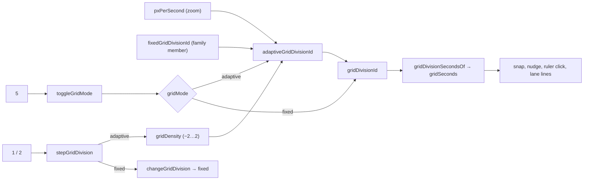

# SABA-B-11b — zoom-adaptive grid (ეტაპები 1 და 2a): `5`, `1`/`2` როგორც adaptive density, grid menu-ის ჯგუფები და `4`

**თარიღი:** 2026-10-29
**სტატუსი:** Completed (C round 248 PASS)
**შეცვლილი პროექტი:** Store

## კონტექსტი

საბამ 2026-10-28-ს (SABA-B-11, `transport-grid-review.md` §1, მე-3 რიგი) დააფიქსირა, რომ
„selection ხაზიდან ხაზზე ხტება“. HEAD-ზე grid ნებისმიერ zoom-ზე fixed იყო: 1 s 320 px/s-ზე
320 px-იანი ნახტომია, 0.1 s კი Fit-ზე 5 px-იანი, უხილავი ხაზები. ABL-R-8 (2026-10-25) იმავეს
ამბობს: შორ zoom-ზე 0.1 s ან 1/32 ზედმეტად მკვრივია, ახლოს 10 s ზედმეტად უხეში.

Ableton Live 12-ის manual 6.10 („Using the Editing Grid“): „The grid can be set to be either
zoom-adaptive or fixed“. Live-ის default adaptive-ია (GRGG ვიდეო 0:44, Live 11). adaptive რეჟიმში
ეკრანზე ხაზებს შორის მანძილი zoom-ისას დაახლოებით მუდმივია.

ეს ეტაპი (round 239) ორივე grid family-სთვის (musical და seconds) adaptive-ს ხდის default-ად,
ამატებს `5` toggle-ს და `1`/`2`-ს adaptive density-ის ცვლილებად აქცევს. ხელით არჩეული division
კვლავ დღევანდელ fixed grid-ს იძლევა.

## მიდგომა

**წესი.** adaptive pick არის family-ის ყველაზე წვრილი წევრი, რომლის spacing (`seconds × px/s`)
≥ 24 px-ია (`GRID_ADAPTIVE_MIN_SPACING_PX`); თუ ვერცერთი აღწევს, family-ის ყველაზე ფართო წევრი.
შედეგი = `family[clamp(base − density)]`, დადებითი density უფრო ფართოა. density-ს 5 დონე აქვს
(−2 … 2, `GRID_ADAPTIVE_DENSITY_MIN/MAX`), default 0 (Medium).

**რატომ 24 px (D-29z357).**

- 24 CSS px არის WCAG 2.5.8-ის მინიმალური target size, ამიტომ ყოველი snap უჯრა მინიმალური ზომის
  pointer target რჩება.
- 40 px/s default zoom-ზე ის HEAD-ის 1 s seconds grid-ს ინარჩუნებს, ანუ ცარიელი project-ი load-ზე
  იგივეა.
- B-ის გაზომვა სრულ suite-ზე (`b-round-238/precheck-runs.json`): v1, 20 px — 83 წითელი ტესტი 13
  ფაილში (40 px/s-ზე seconds pick 0.5 s ხდება, ყოველი SRW-14 რიგი კი 1 s-ს ამოწმებს); v2, 24 px —
  2 წითელი (`strings.test.ts`-ის key სიები).
- Live-ის threshold გამოქვეყნებული არ არის, ამიტომ ეს Saba-ს კითხვად მიდის (SABA-Q-11B-DENSITY).

**შედეგი 120 BPM seed-ზე (D-29z359).** 40 px/s-ზე 1/4 @ 120 = 20 px < 24, ამიტომ 120 BPM-იანი seed
ახლა `1/2`-ს ირჩევს და status-ი `Snap on — grid 1/2 (G)`-ით მთავრდება (HEAD-ზე `1/4` იყო).
90 BPM-ზე `1/4` რჩება (26.67 px).

**„division-ის არჩევა = fixed“.** select-ში, menu-ში ან fixed რეჟიმის `1`/`2`-ით division-ის
არჩევა ნიშნავს „ეს სიგანე ყოველ zoom-ზე“ (`changeGridDivision` რეჟიმს `fixed`-ზე აყენებს).

**`5` (`toggleGridMode`).** adaptive → fixed მიმდინარე pick-ს ყინავს; fixed → adaptive density-ს
0-ზე აბრუნებს და მიმდინარე family-ში თავიდან ირჩევს. status: `Adaptive grid — follows zoom, now
<label> (5)` / `Fixed grid — <label> at every zoom (5)`. history-ში ჩანაწერი არ იწერება: grid view
setting-ია, Snap-ის მსგავსად.

**`1`/`2` adaptive რეჟიმში.** density ერთი დონით იცვლება; family-ის ბოლოს — არსებული
`gridDivisionEndMessage`; density-ის ზღვარზე (±2), როცა family-ში ჯერ კიდევ არის ადგილი —
`adaptiveNarrowest/Widest(label)`.

**density-ის მოდელი (D-29z361, round 240).** ყოველ `1`/`2`-ზე density ხილულ pick-ზე თავიდან
„ებმება“: შენახული density იმდენი დონით იცვლება, რამდენიც საჭიროა, რომ ხილული division ზუსტად ერთი
family ნაბიჯით შეიცვალოს. family-ის ბოლოს ან ±2 ზღვარზე density და `gridHandChosen` უცვლელია და
status-ში შესაბამისი ტექსტი ჩანს. ამრიგად ღილაკი არასდროს „იყლაპება“, შენახული density კი აღწერს იმას,
რაც ეკრანზეა zoom-ის base-თან შედარებით. clamp-ის მქონე family-ის ბოლოს „ყოველი დაჭერა ერთი ხილული
ნაბიჯია“ და „უკან zoom აჩვენებს დაჭერების ჯამს“ ერთდროულად შეუძლებელია, ამიტომ არჩეულია პირველი.
Live-ის manual-ში clamp-ის შემთხვევა აღწერილი არ არის, ამიტომ ეს Saba-ს კითხვაა
(SABA-Q-11B-DENSITY-MODEL).

**`3` adaptive რეჟიმში** family-ს triplet-ზე (ან straight-ზე) ცვლის და adaptive რჩება.

**ჩუმი zoom.** zoom status-ს არ წერს და announcement-ს არ იწვევს: `gridDivisionId` და
`gridSeconds` render-ისას ითვლება, ახალი effect-ის გარეშე (Live-ში readout უბრალოდ იცვლება).

**განხილული ალტერნატივები.** 20 px (ზემოთ გაზომილი 83 წითელი ტესტი და შეცვლილი default view) და
ახალი readout ქვედა მარჯვენა კუთხეში (Live-ის მსგავსად) — ეს უარყოფილია L39-ის გამო: pick-ს
არსებული division `<select>` აჩვენებს.

**Ableton-თან შედარება (`current-task.md` §3).**

| # | ქცევა | Live | CZABA |
|---|---|---|---|
| R1 | ორი რეჟიმი | დადასტურებული (6.10) | ორივე რეჟიმი |
| R2 | adaptive default | დასკვნა Live 12-ისთვის (Live 10/11 წყაროები) | default adaptive |
| R3 | Ctrl/Cmd+5 რეჟიმს ცვლის | დადასტურებული (6.10, KS 42.13) | **plain `5`** (deviation ⚖1) |
| R4 | Ctrl/Cmd+1/2 density | დადასტურებული | fixed: შემდეგი division; adaptive: density-ის 1 დონე |
| R5 | Ctrl/Cmd+3 triplets | დადასტურებული | `3`, adaptive რჩება |
| R6 | Ctrl/Cmd+4 Snap | დადასტურებული | ეტაპი 2a (round 241): plain `4` + `G` |
| R7 | readout ქვედა მარჯვნივ | დადასტურებული | არსებული `<select>` (deviation ⚖2 → SABA-Q-11B-READOUT) |
| R8 | context menu-ის adaptive/fixed პუნქტები | ნაწილობრივ | ეტაპი 2a (round 241) |
| R9 | threshold px-ში | წყარო ვერ მოიძებნა | 24 px → SABA-Q-11B-DENSITY |
| R10 | fixed სიგანის არჩევა grid-ს fixed-ად აქცევს | დასკვნა | select/menu = fixed |
| R11 | zoom grid-ს ჩუმად ცვლის | ვიდეოში ნანახი | status-ის გარეშე |
| R12 | seconds grid | Live-ში არ არის | CZABA family, იგივე წესით |

**Deviation-ები.** ⚖1 — Ctrl+1…5 Chrome-ში tab-ებს ცვლის (D-29z24), ამიტომ plain ციფრები
(SABA-Q-11B-PLAIN-DIGITS). ⚖2 — readout-ის პოზიცია (SABA-Q-11B-READOUT). ორივე Saba-ს კითხვაა
(L43, L44) და არა დადასტურებული გადაწყვეტილება.

**ეტაპების დაყოფა (D-29z368, round 241).** ძველი „ეტაპი 2“ ორად გაიყო: 2a (round 241) — menu,
`4` და GATE239-S4; 2b (შემდეგი) — snap უხილავ grid-ზე არ ჯდება. ამიტომ ეს doc ახლა „stage k of 3“-ს
აღწერს.

**Menu-ის ჯგუფები და ერთი check (ეტაპი 2a, D-29z369).** lane-ის context menu-ში (`ArrangementGridMenu`)
ზემოთ არის `<fieldset>` „Adaptive grid“ ხუთი `menuitemradio`-თი (Widest, Wide, Medium, Narrow,
Narrowest = density 2 … −2, `GRID_ADAPTIVE_WIDTH_OPTIONS`), `
`-ის შემდეგ — „Fixed grid“ არსებული
division-ებით, შემდეგ Snap (G) და, BPM-ის შემთხვევაში, Triplets (3). მთელ menu-ში მხოლოდ ერთი
item არის checked: adaptive რეჟიმში ის სიგანე, რომლის density შენახულ `gridDensity`-ს უდრის, fixed
რეჟიმში — მიმდინარე division. ეს ცვლის round 239-ის კონტრაქტს („checked = მიმდინარე pick“);
მიმდინარე adaptive pick კვლავ ჩანს division `<select>`-სა და მის accessible description-ში. სიგანის
არჩევა (`chooseGridMenuAdaptiveDensity`) `stepGridDivision`-სა და `toggleGridMode`-ს გვერდს უვლის,
ამიტომ მათი side effect-ები (L49) ცალ-ცალკე გადაწყდა: `gridHandChosen = true`, რეჟიმი → adaptive და
density ← არჩეული დონე რჩება; `toggleGridMode`-ის density-ის 0-ზე დაბრუნება არ ხდება, რადგან
მომხმარებელმა დონე ცალსახად აირჩია. status: `Adaptive grid — <Width>, now <label>`. menu იხურება და
focus უბრუნდება იმ ელემენტს, რომელსაც menu-ს გახსნამდე ჰქონდა.

**`4` = Snap (ეტაპი 2a, D-29z370).** plain `4` (Ctrl/Meta/Alt/Shift-ის გარეშე, text field-ის და
dialog-ის გარეთ, auto-repeat-ის გარეშე) `toggleSnap()`-ს იძახებს, როგორც G; იგივე ხდება focused
division `<select>`-ზე (type-ahead-ის გარეშე). ეს ჩუმი alias-ია: status-ები და Snap ღილაკის tooltip
`(G)`-ს ინარჩუნებს, რადგან G ძირითადი გასაღებია და ეს ტექსტები ~40 ტესტშია დაფიქსირებული. მეორე
გასაღები ჩანს იქ, სადაც გასაღებები ჩამოთვლილია: `?` sheet-ის რიგი „Snap on / off“ (`G`, `4`), Snap
ღილაკის `aria-keyshortcuts="G 4"` და select-ის `1 2 4 5` / `1 2 3 4 5`. tooltip-ისა და aria-ს
შეუსაბამობა შეგნებულია (signal B-R240-SNAP-ARIA-TOOLTIP-MISMATCH).

**GATE239-S4 (ეტაპი 2a, D-29z369).** რეჟიმი hover-ის გარეშე ორი გზით იკითხება, ახალი ელემენტის
გარეშე: (a) menu-ში — checked item-ის ჯგუფი („Adaptive grid“ ან „Fixed grid“) არის რეჟიმი; (b)
მოსვენებულ მდგომარეობაში — Chromium select-ის `title`-ს accessible description-ად აჩვენებს (სახელი
`aria-label`-იდანაა), რომელიც `Adaptive: follows zoom — 5 for fixed` ან `Fixed at every zoom — 5 for
adaptive`-ს შეიცავს. `aria-describedby` `sr-only` span-ზე უარყოფილია: ის title-ს ჩაანაცვლებდა და
`1 — narrower, 2 — wider` მინიშნებას დაკარგავდა.

**Ableton-თან შედარება, ეტაპი 2a.** Live 12 manual 6.10: grid-ის სიგანე adaptive და fixed რეჟიმში
track lane-ების context menu-დან იცვლება (დადასტურებული); Ctrl/Cmd+4 Snap-ს რთავს/თიშავს
(დადასტურებული) — CZABA-ში plain `4` (⚖1). ჯგუფების სახელები „Adaptive Grid“/„Fixed Grid“ და
Widest/Narrowest/Narrow ნაწილობრივ დადასტურებულია Live 10/11 წყაროებით; Wide და Medium, რიგი და
Medium-ის default — დასკვნაა. ერთი check adaptive რეჟიმში — წყარო ვერ მოიძებნა. deviation-ები: ⚖3 —
ორი flat ჯგუფი submenu-ების ნაცვლად; ⚖4 — „Off“ პუნქტი არ არის (Snap off მისი ეკვივალენტია,
SABA-Q-11B-MENU-OFF); ⚖5 — Mac-ზე bypass Option-ია და არა Cmd (SABA-Q-11B-MAC-BYPASS, კოდი არ
შეცვლილა).

**დამალული ხაზები აჩერებს Snap-ს (ეტაპი 2b, round 248, D-29z420).** grid დამალულია, როცა
`gridLinesVisible(gridSeconds, pxPerSecond)` false-ია (ხაზებს შორის 6 px-ზე ნაკლები,
`GRID_LINE_MIN_SPACING_PX`): fixed division zoom out-ზე (0.1 s 60 px/s-ზე ქვემოთ, 1/32 120 BPM-ზე
96 px/s-ზე ქვემოთ) ან adaptive family-ის ფართო ბოლოზე (10 s 0.6 px/s-ზე ქვემოთ). ამ დროს ყოველი grid
snap ისე იქცევა, როგორც Snap off: clip move/trim, library drop, ruler click, playhead drag,
ცარიელ lane-ზე click, bars ruler, tempo row, markers და loop brace. clip-edge და marker სამიზნეებიც
არ მუშაობს, რადგან ისინი მხოლოდ non-null grid step-ით მიიღწევა. keyboard step-ები Snap off-ის
ბიჯს იყენებს: მონიშნული clip `NUDGE_SECONDS`-ით (0.1 s), loop brace და marker 0.1 s-ით. Alt დამალულ
grid-ს არასდროს რთავს: Snap off-ზე Alt ხილულ grid-ს კვლავ დროებით რთავს (Live 6.10), Snap on-ზე
კვლავ bypass-ია. Snap toggle მომხმარებლის არჩევანს ინარჩუნებს (`data-snap`, `aria-pressed` და
ღილაკის ტექსტი `on`); zoom in ხაზების გამოჩენამდე snap-ს მაშინვე აბრუნებს, გასაღების გარეშე.
მექანიზმი `StudioWorkspace`-შია: ორი derived მნიშვნელობა — `snapGridSeconds` (ხილულ ხაზებზე
`gridSeconds`, თორემ `undefined`) და `activeSnapSeconds` (Snap on და ხილული ხაზები, თორემ `null`) —
ხუთ prop-ს კვებავს; ორი ref-გზა (ცარიელ lane-ზე click-ის seek და arrow nudge) ზუსტად gesture-ის
მომენტში კითხულობს `pxPerSecondRef`-ს. `ArrangementLane`-ს აქვს ახალი optional prop
`snapGridSeconds` (library drop და clip), ხოლო lane-ის `gridSeconds` ხაზების დახატვისთვის რჩება.
სიგნალები: grid control-ის `data-snap-paused`, Snap ღილაკის `snapPausedTitle`, select-ის
`titleLinesHidden` („…so Snap is paused. Zoom in.“) და `withSnapPausedNote`, რომელიც ექვს grid
მოქმედებას (`toggleSnap` on, `changeGridDivision`, `stepGridDivision`-ის adaptive შტო,
`toggleGridMode`, `toggleGridTriplet`-ის adaptive შტო, `chooseGridMenuAdaptiveDensity`)
`snapPausedNote`-ს უმატებს. zoom status-ს არ წერს (D-29z357), ამიტომ ხილული/დამალული ზღვრის
გადაკვეთა ბოლო status-ს ტოვებს. **უარყოფილი ალტერნატივა — coarsening:** უახლოეს ხილულ ბიჯზე snap
ისევ დაუხატავ ხაზებზე დაჯდებოდა (`ArrangementLane` `gridSeconds`-ს ხატავს), ხოლო უფრო მსხვილი
ბიჯის დახატვა readout-ს („1/32“) დახატულ ხაზებს დააშორებდა და Live-ში დაუდოკუმენტირებელ „fixed
floor-ით“ რეჟიმს შექმნიდა. ეს ვარიანტი SABA-Q-11B-HIDDEN-SNAP-შია. **`grid.ts` უცვლელია:**
არსებულ `resolveSnapStep`-ს grid-ად `undefined`-ის გადაცემა ორივე Alt შემთხვევაში უკვე `null`-ს
იძლევა, ამიტომ მისი კონტრაქტი (SP1) და სხვა გამომძახებლები არ იცვლება. **გაზომილი ფაქტი**
(B-ის browser probe, `b-round-247/head-probe3.json`, `scratch-probe.json`): HEAD-ზე `0.1` 40 px/s-ზე
Snap on-ით ruler click 11.1/13.3-ზე ჯდებოდა, fix-ზე 11.133/13.299 (თავისუფალი). **დასკვნა:**
Live-ში დამალულ ხაზებზე snap-ის ქცევის წყარო ვერ მოიძებნა; adaptive რეჟიმი ამ მდგომარეობას
თავიდან იცილებს, ამიტომ პაუზა CZABA-ს გადაწყვეტილებაა (⚖, parity დაუდასტურებელია).

## არქიტექტურა

`resolveAdaptiveGrid` იგივე chooser-ს სინქრონულად იძახებს `pxPerSecondRef`-დან, რათა handler-ებმა
(`changeTempo`, seed, `toggleGridMode`, `stepGridDivision`, `toggleGridTriplet`) refs შემდეგ
render-მდე სწორად წაიკითხონ. snap, Alt bypass, edges, markers და ყველა gesture `gridSeconds`-ს
უცვლელად კითხულობს; მხოლოდ მისი მნიშვნელობა მიჰყვება zoom-ს.

## შეცვლილი ფაილები

- `app/lib/arrangement/grid-divisions.ts` — `GridMode`, სამი კონსტანტა, `gridDivisionSecondsOf`,
  `adaptiveGridDivisionId` და ერთი private helper (მხოლოდ დამატება).
- `app/components/arrangement/StudioWorkspace.tsx` — grid ბლოკი: `gridMode`/`gridDensity`,
  chooser-ით გამოთვლილი `gridDivisionId`/`gridSeconds`, `resolveAdaptiveGrid`, `toggleGridMode`,
  `Digit5` window handler-სა და division `<select>`-ში, `aria-keyshortcuts`, title suffix,
  `data-grid-mode`.
- `app/lib/arrangement/strings.ts` — `studioGridStrings`-ის 6 ახალი property.
- `app/lib/arrangement/shortcuts.ts` — `grid-mode` რიგი (`5`) Grid & snap ჯგუფში.
- `app/lib/arrangement/__tests__/grid-adaptive.test.ts` — ახალი, GA1–GA8.
- `app/lib/arrangement/__tests__/grid-adaptive-ui.test.tsx` — ახალი, GAU1–GAU23.
- `grid-snap-keys.test.tsx`, `grid-snap-ui.test.tsx`, `grid-triplet-ui.test.tsx`,
  `grid-musical-ui.test.tsx`, `shortcuts.test.ts`, `strings.test.ts` — მხოლოდ მოსალოდნელი
  მნიშვნელობები (aria, title suffix, shortcut-ის რიგი, string-ის key-ები); არცერთი assertion არ
  წაშლილა.

ეტაპი 2a (round 241):

- `app/components/arrangement/ArrangementGridMenu.tsx` — props `gridMode`, `adaptiveDensity`,
  `onChooseAdaptiveDensity`; „Adaptive grid“ და „Fixed grid“ `<fieldset>` ჯგუფები; ერთი check;
  index-ების გამოთვლა (`widthCount`, `snapIndex`, `tripletIndex`, `checkedIndex` fallback-ით 0-ზე).
- `app/components/arrangement/StudioWorkspace.tsx` — `chooseGridMenuAdaptiveDensity`, menu-ის სამი
  ახალი prop, `Digit4` window handler-სა და select-ის `onKeyDown`-ში, `aria-keyshortcuts`.
- `app/lib/arrangement/grid-divisions.ts` — `GridAdaptiveWidthOption`, `GRID_ADAPTIVE_WIDTH_OPTIONS`
  (მხოლოდ დამატება).
- `app/lib/arrangement/strings.ts` — `studioGridStrings`-ის 8 ახალი property.
- `app/lib/arrangement/shortcuts.ts` — `snap` რიგის გასაღებები `G`, `4`.
- `grid-adaptive-ui.test.tsx` — GAU18–GAU23, GAU1-ის aria, GAU14-ის `ZOOM_TEN_STEPS_OUT_FROM_320`.
- `grid-musical-ui.test.tsx`, `grid-snap-keys.test.tsx`, `grid-snap-menu.test.tsx`,
  `grid-snap-ui.test.tsx`, `grid-triplet-ui.test.tsx`, `label-status-colour-ui.test.tsx`,
  `strings.test.ts` — მხოლოდ მოსალოდნელი მნიშვნელობები და query-ის scope (`fixedGridRadios`);
  არცერთი assertion არ წაშლილა.
- `app/lib/arrangement/__tests__/grid-snap-menu.test.tsx` — GM36–GM39 და helper `rightPressThenBlur`
  (round 242, C-R241-01; მხოლოდ დამატება).

ეტაპი 2b (round 248):

- `app/components/arrangement/StudioWorkspace.tsx` — `snapGridSeconds`, `activeSnapSeconds`,
  `gridLinesShown`-ის გადატანა, ხუთი snap prop, ორი ref-გზა, `withSnapPausedNote` ექვს status-ში,
  `data-snap-paused` და Snap ღილაკის paused title.
- `app/components/arrangement/ArrangementLane.tsx` — optional prop `snapGridSeconds` (library drop და
  clip-ის `gridSeconds`).
- `app/components/arrangement/ArrangementTempoRow.tsx` — `BarsRulerGestures.gridSeconds` →
  `number | undefined`.
- `app/lib/arrangement/strings.ts` — `titleLinesHidden`-ის ტექსტი, ახალი `snapPausedTitle` და
  `snapPausedNote`.
- `grid-snap-ui.test.tsx` — GS10 ახალ კონტრაქტზე, HS1–HS5; `grid-snap-position.test.tsx` — HP1–HP2;
  `grid-musical-ui.test.tsx` — GU12 nudge-მდე 100 px/s zoom; `grid-musical.test.ts` (GM5) და
  `strings.test.ts` (ST23, ST24) — მხოლოდ დაფიქსირებული ტექსტი. არცერთი assertion არ წაშლილა.

## პრობლემები და გადაწყვეტები

**Problem:** 40 px/s-ზე ერთი threshold ერთდროულად ვერ იძლევა „seconds 1 s“-ს და „1/4 @ 120“-ს
(0.5 s = 1/4 @ 120 = 20 px). → **Solution:** არჩეულია seconds მხარე (24 px), რადგან ცარიელი
`/studio-lab` ყოველი ვიზიტის პირველი ხედია; 120 BPM seed `1/2`-ს ირჩევს (D-29z359).

**Problem:** focused division `<select>` `5`-ზე type-ahead-ით „5 s“-ზე გადავიდოდა (C-R59-01-ის
კლასი). → **Solution:** `Digit5` `<select>`-ის `onKeyDown`-შიც მუშავდება `preventDefault`-ით
(GAU7).

**Problem:** handler-ები refs-ს შემდეგ render-მდე კითხულობენ, adaptive pick კი render-ში
ითვლება. → **Solution:** `resolveAdaptiveGrid` refs-ს სინქრონულად აახლებს იმავე chooser-ით.

**Problem:** zoom-ზე status-ის წერა screen reader-ს ყოველ zoom ნაბიჯზე დაალაპარაკებდა. →
**Solution:** pick render-ში ითვლება, effect-ის გარეშე; GAU2 ამოწმებს, რომ `statusSequence` არ
იცვლება.

**Problem (code-reviewer, Medium):** BPM-ის გასუფთავებისას adaptive რეჟიმში refs და status
seconds state-ის fixed მნიშვნელობას იღებდა (მაგ. „1 s“), ეკრანზე კი adaptive pick ჩანდა (0.1 s). →
**Solution:** `changeTempo` `resolveAdaptiveGrid(String(seconds), null)`-ს იძახებს და status-ში
გადაწყვეტილ ნაბიჯს წერს (GAU11).

**Problem (code-reviewer, Medium):** შენახული density family-ის ბოლოზე clamp-ის მიღმა რჩებოდა
(`1` `1`, zoom 320-მდე, `2` → ეკრანზე არაფერი იცვლებოდა). → **Solution:** `stepGridDivision`
density-ს მანამ აბიჯებს, სანამ ხილული pick არ შეიცვლება ან ზღვარს (±2) არ მიაღწევს (GAU12).

**Problem (code-reviewer, Low):** musical id BPM-ის გარეშე `bar`-ს აბრუნებდა. → **Solution:**
`adaptiveGridDivisionId` ასეთ შემთხვევაში input-ს აბრუნებს (GA6).

**Problem (GATE239-S2, Medium, round 239-ის რეგრესია):** adaptive `1`/`2` `changeGridDivision`-ს
აღარ იძახებდა და `gridHandChosen`-ს აღარ აყენებდა. ამიტომ `1` (0.5 s) და შემდეგ BPM-იანი asset-ის
დამატება grid-ს musical family-ზე (`1/4`) გადაიყვანდა და მომხმარებლის არჩევანი იკარგებოდა (11a-ს
კონტრაქტი, `tempo-seed-ui.test.tsx` TU5). → **Solution:** `stepGridDivision`-ის adaptive შტოში `gridHandChosenRef.current =
true` ორივე უარის guard-ის (family-ის ბოლო, density-ის ზღვარი) შემდეგ ყენდება, `gridDensityRef`-ის
ჩაწერამდე. უარყოფილი ღილაკი ხელით არჩევანად არ ითვლება. `toggleGridMode` (`5`) და `toggleGridTriplet`
უცვლელია (D-29z362). ტესტები: GAU16, GAU17.

**Problem (GATE239-S1 / C-R239-01):** clamp-ის მქონე family-ის ბოლოს დაჭერის შემდეგ უკან zoom
დაჭერების ჯამზე უფრო ფართო grid-ს აჩვენებს. → **Solution:** კოდი არ შეცვლილა, მიღებულია ruling
D-29z361 (იხ. `## მიდგომა`). reviewer-ის შემოთავაზებული ფორმულა (`base − indexOf(current) + step`)
B-ის simulation-ში იგივე შედეგს იძლევა: `eq2.mjs` — 19,710 შემთხვევა, `eq.mjs` — 960, 0 განსხვავება.
აბსოლუტური დონის მოდელი უარყოფილია, რადგან clamp-ზე პირველ ერთ-ორ `2`-ს ეკრანზე არაფერს ცვლის.
round 239-ის reviewer-მა ზუსტად ეს შეაფასა Medium #2-ად. მნიშვნელობები GAU12, GAU14 და GAU15-შია
დაფიქსირებული.

**Problem (GATE239-S4, Low, ეტაპი 2a):** Adaptive/Fixed რეჟიმი მხოლოდ select-ის title-ში (hover)
და გარდამავალ status-ში ჩანდა. → **Solution:** menu-ის დასახელებული ჯგუფები ერთი check-ით და
select-ის accessible description (იხ. `## მიდგომა`); ახალი ელემენტი არ დამატებულა.

**Problem (D-29z369, ეტაპი 2a):** ერთი check-ის წესი ცვლის round 239-ის კონტრაქტს, რომელსაც GM1 და
GU9 ამოწმებდა (adaptive რეჟიმში fixed division-ი იყო checked). → **Solution:** GM1 და GU9-ში
მოსალოდნელი მნიშვნელობა შეიცვალა (fixed ჯგუფში checked არაფერია, დამატებით Medium checked-ია);
query `fixedGridRadios(menu)`-ით Fixed ჯგუფზეა შეზღუდული. assertion არ წაშლილა.

**Problem (GATE240-S2, Low):** GAU14-ში magic number `34.359738368`. → **Solution:** დასახელებული
კონსტანტა `ZOOM_TEN_STEPS_OUT_FROM_320`.

**Problem (GATE239-S3, Low):** family-ის ბოლოს შემოწმება density loop-ის შემდეგ ხდებოდა, ამიტომ
loop უშედეგოდ ტრიალებდა. → **Solution:** `next === null` შემოწმება loop-მდე გადავიდა. ქცევა
იგივეა (GAU12-ის family-ის ბოლოს ტექსტი, GAU17).

**Problem (C-R241-01, Medium, ეტაპი 2a fix-up):** Snap toggle-ზე keyboard focus-ის შემდეგ lane-ზე
მარჯვენა click-ით გახსნილი grid menu Escape-ზე ან არჩევანზე focus-ს BODY-ს უბრუნებდა. მიზეზი:
მარჯვენა ღილაკის `mousedown` focus-ს `contextmenu`-მდე ხსნის (blur → BODY), ამიტომ
`handleGridMenuRequest` დასაბრუნებელ ელემენტად BODY-ს იმახსოვრებდა. → **Solution:**
`handleLaneBackgroundPointerDown` მარჯვენა დაჭერისას (`button === 2`) აქტიურ ელემენტს
`gridMenuPressFocusRef`-ში ინახავს, early return-მდე (ასე clip-ის სხეულზე დაჭერაც იფარება).
`handleGridMenuRequest` ამ ref-ს ყოველთვის პირველად კითხულობს და ასუფთავებს; press-ის ელემენტს
მხოლოდ მაშინ იყენებს, როცა request-ის დროს აქტიური ელემენტი BODY-ა ან `HTMLElement` არ არის.
`closeGridMenu` უცვლელია.
ტესტები: GM36 (Escape), GM37 (Narrow და `0.5 s`), GM38 (request-ის დროს focused ელემენტი იმარჯვებს),
GM39 (clip-ის სხეული).
**შენიშვნა (რაუნდები 243–244):** მარჯვენა დაჭერის focus-ის ჩაწერა ახლა scroller-ის capture handler-შია (`releaseEditFocusOnTimelinePointerDown`), იხ. doc 187 და doc 188.

**Problem (ეტაპი 2b):** grid-ის ხაზები zoom out-ზე იმალებოდა, მაგრამ Snap მათზე მაინც სვამდა
clip-ს, playhead-ს და marker-ს (title-ში „Snap still works“) — მომხმარებელი ხედავდა გადახტომას
ხაზებზე, რომლებიც ეკრანზე არ ჩანდა. → **Solution:** `activeSnapSeconds` ხუთ prop-ში და ორ ref-გზაში
`gridLinesVisible` შემოწმებით; title, `data-snap-paused` და grid მოქმედებების status ამბობს
„paused — zoom in“.

**Problem (ეტაპი 2b):** Snap off-ზე Alt დამალულ grid-ს რთავდა, რადგან `resolveSnapStep` Alt-ზე
`gridSeconds`-ს დამოუკიდებლად აბრუნებს (B-ის browser probe HEAD-ზე: Alt ruler click 970 adaptive
10 s-ზე და 18.7 `0.1`-ზე 40 px/s-ზე). → **Solution:** დამალულ ხაზებზე snap-ის ყველა გამომძახებელს
grid-ად `undefined` გადაეცემა (`snapGridSeconds`), ამიტომ Alt-იც თავისუფალ დროს იძლევა; ხილულ
grid-ზე Alt უცვლელად რთავს snap-ს.

## ტესტირება

- `grid-adaptive.test.ts`: GA1 (seconds family 5 zoom-ზე), GA2 (invariant 5 family × 30 zoom),
  GA3 (musical), GA4 (triplet), GA5 (density და clamp), GA6 (უცნობი id, 0/უარყოფითი/NaN zoom,
  musical id BPM-ის გარეშე),
  GA7 (`gridDivisionSecondsOf`), GA8 (კონსტანტები).
- `grid-adaptive-ui.test.tsx`: GAU1 (mount), GAU2 (ჩუმი zoom), GAU3 (`5` და zoom), GAU4 (density
  `1`/`2`), GAU5 (select = fixed), GAU6 (90 BPM seed ორივე რეჟიმში), GAU7 (`5` select-ზე,
  modifier-ები, auto-repeat), GAU8 (text field-ები და Export), GAU9 (snap adaptive 0.25 s-ზე და
  Undo), GAU10 (`3` adaptive რეჟიმში), GAU11 (BPM-ის გასუფთავება adaptive რეჟიმში 320 px/s-ზე),
  GAU12 (density zoom-ის შემდეგ ღილაკს არ „ყლაპავს“; round 240-დან უკან zoom 40 px/s-ზე → 5 s,
  adaptive), GAU13 (`5` adaptive-ზე density-ს Medium-ზე აბრუნებს), GAU14 (C-R239-01: `1 1`, zoom
  320 → 0.1 s, `2` → 0.25 s, zoom 34.36 px/s → 2 s), GAU15 (სარკე ფართო ბოლოზე: `2 2`, zoom 0.5 →
  10 s, `1` → 5 s, zoom 40 → 0.5 s), GAU16 (GATE239-S2: adaptive `1` და შემდეგ 90 BPM seed → 0.5 s
  რჩება), GAU17 (უარყოფილი `1` family-ის ბოლოს ხელით არჩევანი არ არის: seed → `1/32`).
- Mutant-ები scratch ასლზე: MU-FIXED-DEFAULT, MU-DENSITY-IGNORED, MU-ZOOM-STATUS, MU-SELECT-5
  (შედეგები `a-round-239.md`-ში); round 240: MU-FLAG-MISSING (GAU16 წითელი) და
  MU-FLAG-BEFORE-GUARDS (flag adaptive შტოს პირველ statement-ად; GAU17 წითელი), შედეგები
  `a-round-240.md`-ში. flag-ის პოზიცია ორ guard-ს შორის ტესტით ვერ დაფიქსირდება: ±2 ზღვრამდე
  მისვლას წინა მიღებული დაჭერები სჭირდება, რომლებმაც flag უკვე დააყენეს.
- ეტაპი 2a: GAU18 (menu mount-ზე: ორი ჯგუფი, checked მხოლოდ Medium, focus Medium-ზე), GAU19
  (Narrow → adaptive 0.5 s, status, ხელახლა გახსნისას Narrow checked, zoom 80 px/s → 0.25 s), GAU20
  (fixed რეჟიმში checked მხოლოდ `1 s`; Wide → adaptive 2 s, title-ის adaptive suffix), GAU21 (Narrow
  და შემდეგ 90 BPM seed → 0.5 s რჩება), GAU22 (`4`, დაჭერილი `4`, Ctrl+4, Alt+4, `4` BPM ველში),
  GAU23 (`4` focused select-ზე).
- ეტაპი 2a-ს mutant-ები scratch ასლზე (`a-round-241.md`): MU-MENU-FLAG-MISSING (GAU21 წითელი),
  MU-MENU-MODE-MISSING (GAU20), MU-MENU-DENSITY-MISSING (GAU19, GAU20, GAU21),
  MU-CHECK-PICK-IN-ADAPTIVE (GAU18, GAU19, GAU20), MU-4-REPEAT (GAU22).
- ეტაპი 2a-ს covering set: 49 ფაილი, 780 ტესტი; `npm run typecheck`, `npm run lint`, Biome;
  Playwright `/studio-lab`-ზე 1440×900 და 1280×720.
- ეტაპი 2a fix-up (round 242, C-R241-01): GM36, GM37, GM38, GM39 (`grid-snap-menu.test.tsx`);
  mutant-ები scratch ასლზე: MU-NO-PRESS-CAPTURE (GM36, GM37, GM39 წითელი) და MU-PRESS-WINS (GM38
  წითელი), შედეგები `a-round-242.md`-ში.
- ეტაპი 1: covering set (39 ფაილი) + ორი ახალი ფაილი, `npm run typecheck`, Biome, Playwright `/studio-lab`-ზე
  1440×900 და 1280×720.
- ეტაპი 2b (round 248): GS10 (0.1 s 40 px/s-ზე: `data-snap-paused` true, drag თავისუფალი 7.325;
  60 px/s-ზე 7.5), HS1 (paused title, status-ის note, zoom status-ს არ ცვლის, ხილულ grid-ზე note არ
  არის), HS2 (Snap off + Alt: დამალულზე თავისუფალი, ხილულზე snap), HS3 (Snap on + Alt დამალულზე),
  HS4 (arrow nudge დამალულზე 0.1 s, ხილულზე შემდეგ ხაზამდე), HS5 (adaptive 0.5 px/s-ზე, 10 s,
  თავისუფალი 12.3), HP1 (ruler, ცარიელი lane და playhead drag), HP2 (Alt ruler-სა და lane-ზე), GU12
  (1/32 nudge 100 px/s-ზე, HEAD-ის მნიშვნელობები); GM5, ST23, ST24 — ტექსტები.
- ეტაპი 2b-ს 10 გაშვება scratch ასლზე (`a-round-248.md`): FIX-CONTROL, MU-HEAD,
  MU-ACTIVE-IGNORES-LINES, MU-ALT-ENABLES-HIDDEN, MU-LANE-FORWARDS-DRAW-GRID,
  MU-SEEK-REF-IGNORES-LINES, MU-NUDGE-HIDDEN, MU-NO-NOTE, MU-TITLE-NOT-PAUSED, MU-PAUSED-ATTR.
- ეტაპი 2b-ს covering set: 134 ფაილი, 2,073 ტესტი; `npm run typecheck`, `npm run lint`, Biome;
  Playwright `/studio-lab`-ზე 1440×900 და 1280×720.

## TODO / შემდეგი ნაბიჯები

ეტაპი 2a (round 241): menu-ის ჯგუფები, `4` და GATE239-S4 (სტატუსი — l.4, C-ის შემოწმების შემდეგ).

ეტაპი 2b (round 248) დასრულდა: დამალულ grid ხაზებზე Snap ჩერდება (Alt-ის ჩათვლით), title-ები და
grid status-ები ამას ამბობს (D-29z420). სტატუსი — l.4, C-ის შემოწმების შემდეგ.

ABL-R-8 ამ ეტაპის C PASS-ზე იხურება.

ARCH-CHECKPOINT-TEMPO-GRID: tempo/grid ბლოკის არქიტექტურული checkpoint root-ს ხელახლა ეთხოვება
feature-ის ამ საზღვარზე (D-29z423, `b-round-247-checkpoint-request.md`); ეს refactor-ის დავალება არ
არის.

Saba-ს კითხვები: SABA-Q-11B-DENSITY, SABA-Q-11B-READOUT, SABA-Q-11B-PLAIN-DIGITS,
SABA-Q-11B-DENSITY-MODEL, SABA-Q-11B-MENU-OFF, SABA-Q-11B-MAC-BYPASS,
SABA-Q-11B-HIDDEN-SNAP (დამალული grid-ის პაუზა და ალტერნატივები: ხილული ბიჯის დახატვა, edge/marker
მაგნიტიზმი პაუზის დროს, ერთჯერადი status zoom-ზე).
