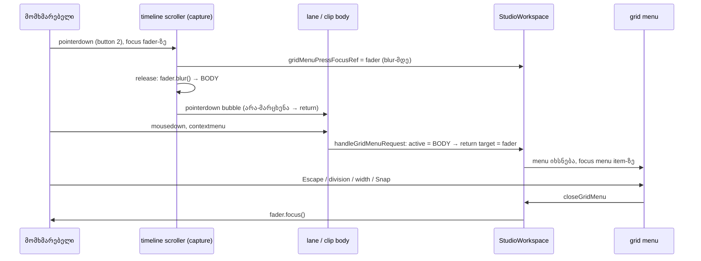

# C-R242-01 — grid menu-ის დახურვის შემდეგ focus ბრუნდება edit control-ზე, რომელიც მარჯვენა დაჭერამ გაათავისუფლა

**თარიღი:** 2026-10-29
**სტატუსი:** Completed (C round 243 PASS)
**შეცვლილი პროექტი:** Store

## კონტექსტი

Round 242-მა lane-ის grid menu-ს (მარჯვენა click ცარიელ lane-ზე ან clip body-ზე) დაუმატა focus return:
Escape-ის, division-ის, width-ის ან Snap item-ის შემდეგ focus უნდა დაბრუნდეს იმ ელემენტზე, რომელსაც
ის მარჯვენა დაჭერამდე ჰქონდა. C-მ round 242-ში Chromium-ში ორივე viewport-ზე გაზომა ხარვეზი
(**C-R242-01**, A-ს reviewer-ის **A-R242-REVIEW-M1**-თან გაერთიანებული): track-ის Volume fader-ზე
Tab-ით მისვლა, ცარიელ lane-ზე მარჯვენა click და Escape — focus `BODY`-ზე რჩება. B-მ HEAD `7e5b23c`-ზე
იგივე გაიმეორა ოთხი origin-ისთვის: Volume fader, BPM ველი (`arrangement-tempo-input`), loop brace და
marker flag.

მიზეზი event-ების თანმიმდევრობაშია. timeline scroller-ის `onPointerDownCapture` handler
(`releaseEditFocusOnTimelinePointerDown`, D-29z22-F, round 57) capture ფაზაში `blur()`-ს უკეთებს
range input-ს, typing field-ს, loop brace-სა და marker-ს. lane-ის bubble handler
(`handleLaneBackgroundPointerDown`) press-time focus-ს მხოლოდ ამის შემდეგ ინახავდა, ამიტომ `BODY`-ს
ინახავდა. Snap toggle-ს release არ ეხება, ამიტომ round 242-ის recipe-მ (მხოლოდ Snap toggle) ხარვეზი
ვერ დაიჭირა.

## მიდგომა

**D-29z382 გადაწყვეტილება:** მარჯვენა დაჭერა, რომელიც grid menu-ს ხსნის, keyboard ownership-ს
არ იღებს. lane-ზე ან clip body-ზე მარჯვენა დაჭერა არაფერს არედაქტირებს (`handleLaneBackgroundPointerDown`
და clip-ის `beginGesture` არა-მარცხენა ღილაკზე ბრუნდება), ამიტომ menu-ს focus return იმარჯვებს:
focus ბრუნდება დაჭერამდე focused ელემენტზე — fader, pan, BPM ველი, brace, marker flag ან სხვა.

- release თავისთავად რჩება: control კვლავ blur-დება დაჭერისას, მისი edit commit-დება როგორც ადრე,
  menu კი focus-ს იღებს.
- უცვლელია D-29z22-F: **მარცხენა** დაჭერა timeline-ზე (FR1, FR2, FR4) და მარჯვენა დაჭერა იქ, სადაც
  grid menu არ იხსნება (header, ruler, loop strip, native menu) — იქ release blur-ს აკეთებს და
  აღდგენა არ ხდება.

**რატომ გადავიდა capture.** scroller-ის capture handler ყოველთვის lane-ის bubble handler-მდე
სრულდება, ამიტომ lane-ის მხარეს ჩაწერილი მნიშვნელობა release-ით blur-დებულ ელემენტს ვერასდროს
დაინახავს. ერთადერთი ჩაწერა ახლა release handler-შია, `const focused = …`-ის შემდეგ პირველ
statement-ად: `event.button === 2`-ზე
`gridMenuPressFocusRef` იღებს `activeElement`-ს blur-ის გადაწყვეტილებამდე. lane-ის ძველი ჩაწერა
წაიშალა — ორის ნაცვლად ერთი writer.

**უარყოფილი ალტერნატივა:** release-ის გამოტოვება მარჯვენა დაჭერაზე. ეს შეცვლიდა menu-ს გარეშე
გზებსაც (header, ruler) და ორ writer-ს დატოვებდა.

**Stale მნიშვნელობა (D-29z384).** capture ყოველ მარჯვენა დაჭერაზე წერს scroller-ში, menu-ს გარეშე
გზებზეც. ეს უვნებელია: ყოველი menu request ჯერ კითხულობს და ასუფთავებს მნიშვნელობას (უარყოფილიც);
მნიშვნელობა გამოიყენება მხოლოდ მაშინ, როცა request-ისას active element `BODY`-ა; მომდევნო
მარჯვენა დაჭერა მას გადააწერს; `closeGridMenu` disconnected ელემენტს გამოტოვებს. Mac-ის
Ctrl+click `button 0`-ია — lane-ის ფონზე ან clip-ზე pointer gesture-ს იწყებს, ამიტომ მისი
request უარყოფილია და მნიშვნელობა სუფთავდება.

## არქიტექტურა

## შეცვლილი ფაილები

- `app/components/arrangement/StudioWorkspace.tsx` — `releaseEditFocusOnTimelinePointerDown`
  მარჯვენა დაჭერაზე blur-მდე ინახავს press-time focus-ს; `handleLaneBackgroundPointerDown`-დან
  წაიშალა მარჯვენა ღილაკის ჩაწერის ბლოკი. ახალი სახელი, export ან dependency არ დამატებულა.
- `app/lib/arrangement/__tests__/grid-snap-menu.test.tsx` — FR3 გადაიწერა D-29z382-ის კონტრაქტზე;
  დაემატა GM40–GM43.

## პრობლემები და გადაწყვეტები

**პრობლემა:** C-R242-01 — fader, BPM ველი, loop brace ან marker flag-იდან გახსნილი menu-ს დახურვის
შემდეგ focus `BODY`-ზე რჩებოდა, რადგან press-time focus release-ის blur-ის შემდეგ იწერებოდა.
**გადაწყვეტა:** ჩაწერა გადავიდა scroller-ის capture handler-ის დასაწყისში, blur-მდე.

**პრობლემა:** FR3-ის ძველი კონტრაქტი („menu brace-ს არ აღადგენს; ArrowRight clip-ს ამოძრავებს“)
პირდაპირ ეწინააღმდეგებოდა L47-სა და WAI-ARIA menu pattern-ს.
**გადაწყვეტა:** FR3 გადაიწერა: menu-ს გახსნისას focus brace-ზე არ არის, Escape-ის შემდეგ focus
brace-ზეა, `ArrowRight` loop-ს 12.4 / 14.2-ზე გადაწევს, `s1` კი 4.3-ზე რჩება. ძველი შემოწმება
არ წაშლილა ჩანაცვლების გარეშე — ახალი row საპირისპირო შედეგს პოზიტიურად ამოწმებს.

**შეზღუდვა:** marker add/rename editor blur-ზე commit-დება და unmount-დება, ამიტომ დასაბრუნებელი
ელემენტი არ არსებობს — focus `BODY`-ზე რჩება. ეს სხვა მექანიზმია (B-R242-MARKER-EDITOR-MENU-FOCUS).

## ტესტირება

- `grid-snap-menu.test.tsx`: GM40 (Volume fader, Escape და `0.5 s`), GM41 (BPM ველი), GM42
  (marker flag), GM43 (fader, clip body გზა) და გადაწერილი FR3 — ყველა jsdom-ში იმეორებს რეალურ
  თანმიმდევრობას (მარჯვენა `pointerdown` → blur `BODY`-ზე → `contextmenu`).
- Covering set (B-ის `covering.txt`, 67 ფაილი): 67/67 ფაილი, 1153/1153 ტესტი მწვანე; ყველაზე
  ნელი ტესტი 2.5 s (20 s timeout).
- Mutants (repo-ს გარეთ scratch ასლზე, ფაილი 47 ტესტით):
  - MU-LANE-CAPTURE-ONLY (HEAD-ის lane capture ახალი ტესტებით): წითელია FR3, GM40, GM41, GM42, GM43;
  - MU-NO-SCROLLER-CAPTURE (fix ახალი scroller ბლოკის გარეშე): წითელია FR3, GM36, GM37, GM39,
    GM40, GM41, GM42, GM43;
  - MU-PRESS-WINS (`pressFocus` ყოველთვის იმარჯვებს): წითელია GM38.
- `npm run typecheck` rc 0; `npm run lint` rc 0 (მხოლოდ არსებული warnings); Biome ორივე შეცვლილ
  ფაილზე: no fixes.
- Playwright Chromium `/studio-lab`-ზე, 1440×900 და 1280×720: Escape-ის შემდეგ focus ბრუნდება
  fader-ზე, BPM ველზე, brace-სა და marker flag-ზე, `:focus-visible` true და brass outline 1px;
  fader-ზე `0.5 s`-ის შემდეგ focus fader-ზეა (`:focus-visible` false, mouse modality). 0 page error.

## TODO / შემდეგი ნაბიჯები

- **B-R242-MARKER-EDITOR-MENU-FOCUS** (Medium): marker editor-იდან გახსნილი menu-ს დახურვის შემდეგ
  focus target (კანდიდატი: commit-ებული marker-ის flag) — საჭიროა `ArrangementMarkerRow`-ის plumbing.
- სხვა editor, რომელიც blur-ზე unmount-დება (მაგ. clip rename ველი), შესაძლოა იგივე შედეგს
  იძლეოდეს — დაუდასტურებელი ჰიპოთეზაა, browser-ში არ შემოწმებულა.
- `useGridMenuFocusReturn` hook-ად გამოყოფა (reviewer-ის შენიშვნა) — ARCH-CHECKPOINT-TEMPO-GRID-ის
  addendum 8, დაგეგმილი არ არის.
