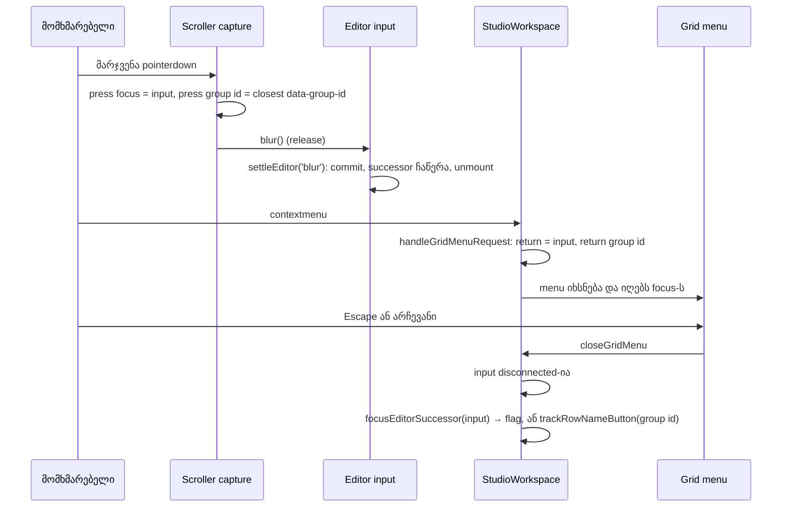

# B-R242/B-R243 — grid menu-ის დახურვის შემდეგ focus მიდის იქ, სადაც Enter მიიყვანდა: marker და group name editor-ები

**თარიღი:** 2026-10-29
**სტატუსი:** Completed (C round 244 PASS)
**შეცვლილი პროექტი:** Store

## კონტექსტი

Round 243-მა (doc 187) lane-ის grid menu-ს focus return გაასწორა იმ edit control-ებისთვის, რომლებსაც
timeline scroller-ის capture handler (`releaseEditFocusOnTimelinePointerDown`) მარჯვენა დაჭერისას
blur-ს უკეთებს: fader, BPM ველი, loop brace, marker flag. ორი inline editor მაინც დარჩა ხარვეზით:

- **B-R242-MARKER-EDITOR-MENU-FOCUS** (Medium, pre-existing): marker-ის **add** editor (`M`) ან
  **rename** editor (`F2` flag-ზე) ღიაა, მომხმარებელი ცარიელ lane-ზე მარჯვენა click-ს აკეთებს და
  Escape-ს აჭერს. marker editor-ის საკუთარ blur-ზე commit-დება, input unmount-დება და focus `BODY`-ზე
  რჩება.
- **B-R243-GROUP-EDITOR-MENU-FOCUS** (Medium, pre-existing): group name editor (`F2` group-ის სახელზე)
  იგივენაირად იქცევა — rename commit-დება, input ქრება, focus `BODY`-ზეა.

ორივეს ერთი მექანიზმი აქვს: menu-ს დასაბრუნებელი ელემენტი (editor-ის input) menu-ს დახურვის დროს
DOM-ში აღარ არსებობს, ამიტომ `closeGridMenu` ვერაფერს აფოკუსებდა.

იმავე რაუნდში დაიხურა round 243-ის reviewer-ებისა და gate-243-ის Low-ები (D-29z393):

- **A-R243-REVIEW-L1 (= GATE243-S3):** `gridMenuPressFocusRef` მხოლოდ მარჯვენა დაჭერაზე იწერებოდა,
  ამიტომ შემდეგ მარცხენა დაჭერას ძველი მნიშვნელობა რჩებოდა.
- **A-R243-REVIEW-L2:** header-ის გზას (მარჯვენა დაჭერა, menu არ იხსნება) ტესტი არ ჰქონდა.
- **A-R243-REVIEW-L3:** GM40–GM43 blur-ს ხელით აკეთებდნენ, ამიტომ მათი `BODY` setup check ვერ
  ჩავარდებოდა.
- **GATE243-S2:** BPM ველის შემთხვევა mouse-ით არჩევის შემდეგ ტესტით არ იყო დაფარული.

## მიდგომა

**D-29z392 გადაწყვეტილება:** მარჯვენა დაჭერაზე commit რჩება — editor-ის blur ისევ იგივე history
entry-ს, status-სა და სახელის წესებს იძლევა. როცა menu იხურება და მისი დასაბრუნებელი ელემენტი
disconnected-ია, focus მიდის ამ editor-ის **successor**-ზე: ელემენტზე, სადაც Enter მიიყვანდა.

| Editor-ის გზა | Successor |
|---|---|
| marker add, commit-ებული | ახალი marker-ის flag |
| marker add იმ დროზე, სადაც marker უკვე არის | არსებული marker-ის flag |
| marker rename: commit-ებული, ცარიელი draft (სახელი რჩება) ან უცვლელი | `editor.id`-ის flag |
| group rename | ამ group-ის name button (`trackRowNameButton`) |

- **Successor იწერება settle-ის დროს**, არა selection-იდან: ცარიელი draft-ის rename გზა
  `setSelectedMarkerId`-მდე ბრუნდება. `ArrangementMarkerRow`-ის `settleEditor` მხოლოდ
  `reason === 'blur'`-ზე ინახავს `{ input, markerId }`-ს `blurSuccessorRef`-ში; `openEditor` მას ასუფთავებს.
- **Identity check:** ახალი handle მეთოდი `focusEditorSuccessor(element)` ref-ს ყოველ გამოძახებაზე
  ასუფთავებს (D-29z398) და flag-ს მხოლოდ მაშინ აფოკუსებს, როცა ჩაწერილი input **ზუსტად** menu-ს
  დასაბრუნებელი ელემენტია. ყოველი სხვა blur-იც (მარცხენა დაჭერა, Tab, click სხვაგან) წერს
  successor-ს, მაგრამ მას menu არ მოიხმარს, ამიტომ focus იქ რჩება, სადაც მომხმარებელმა გადაიტანა
  (MU14: focus სხვა ველზე გადატანით commit; GM49: ხელით blur-ით settle-ებული editor).
- **Group id იწერება დაჭერისას.** detached node-ს `closest('[data-group-id]')` `null`-ს აბრუნებს,
  ამიტომ `releaseEditFocusOnTimelinePointerDown` release-მდე, როცა input ჯერ კიდევ DOM-შია, module
  ფუნქციით `groupNameEditorRowId` ინახავს group id-ს `gridMenuPressGroupIdRef`-ში.
  `handleGridMenuRequest` მას დასაბრუნებელ group-ად მხოლოდ მაშინ ინახავს, როცა focused ელემენტი
  press-ის ელემენტია.
- **L1:** იგივე capture handler ახლა ყოველ დაჭერაზე წერს `gridMenuPressFocusRef`-ს (მარჯვენა
  დაჭერისას focused ელემენტს, სხვა შემთხვევაში `null`-ს). ის კვლავ ერთადერთი writer-ია და release-ის
  პირობამდე სრულდება.

**უარყოფილი ვარიანტი:** მარჯვენა დაჭერაზე release-ის გამოტოვება, რომ editor ცოცხალი დარჩეს. ეს ვერ
იმუშავებს: menu თავად იღებს focus-ს (`in:BUTTON` event log-ში), ამიტომ ეს blur editor-ს მაინც
commit-ს და unmount-ს გაუკეთებდა. გარდა ამისა, ის შეცვლიდა იმ გზებს, სადაც menu არ იხსნება.

**უცვლელია:** მარცხენა დაჭერა timeline-ზე (D-29z22-F: FR1, FR2, FR4), blur-ით commit, რომელიც
focus-ს მომხმარებლის არჩეულ ადგილას ტოვებს (MU14), მარჯვენა დაჭერა იქ, სადაც
grid menu არ იხსნება (header, ruler, loop strip: GM14, GM47), Escape editor-ში (restore) და Enter
editor-ში (focus გადადის flag-ზე, gesture guard-ის ჩათვლით).

## არქიტექტურა

## შეცვლილი ფაილები

- `app/components/arrangement/ArrangementMarkerRow.tsx` — `blurSuccessorRef`, successor-ის ჩაწერა
  `settleEditor`-ის სამ გზაზე, ახალი handle მეთოდი `focusEditorSuccessor`.
- `app/components/arrangement/StudioWorkspace.tsx` — `groupNameEditorRowId`, ორი group id ref, L1
  ჩაწერა capture handler-ში, successor-ის fallback-ები `closeGridMenu`-ში.
- `app/lib/arrangement/__tests__/grid-snap-menu.test.tsx` — `rightPress` helper, GM40–GM43-ის setup
  (L3) და ახალი რიგები GM44–GM49.
- `docs/implementation/2026/quarter-IV/186-saba-b-11b-adaptive-grid.md` — ერთი შენიშვნის ხაზი ჩაწერის
  ახალ ადგილზე.
- `docs/implementation/2026/quarter-IV/188-marker-group-editor-menu-focus.md` — ეს დოკუმენტი.

## პრობლემები და გადაწყვეტები

**Problem (B-R242-MARKER-EDITOR-MENU-FOCUS, Medium):** marker-ის add ან rename editor-იდან მარჯვენა
click და Escape — focus `BODY`-ზე. → **Solution:** `settleEditor` blur-ზე successor flag-ს წერს;
`closeGridMenu` disconnected დასაბრუნებელ ელემენტზე `focusEditorSuccessor`-ს იძახებს (GM44, GM45).

**Problem (B-R243-GROUP-EDITOR-MENU-FOCUS, Medium):** group name editor-იდან იგივე შედეგი. →
**Solution:** group id დაჭერისას იწერება, `closeGridMenu` კი fallback-ად group-ის name button-ს
აფოკუსებს (GM46). GM49 ამოწმებს, რომ ადრე, ხელით blur-ით settle-ებული marker editor-ის
successor ამ return-ს არ იტაცებს.

**Problem (A-R243-REVIEW-L1 = GATE243-S3, Low):** ძველი press მნიშვნელობა მარცხენა დაჭერის შემდეგ
რჩებოდა. → **Solution:** ჩაწერა ყოველ დაჭერაზე, მარჯვენას გარდა `null` (GM47).

**Problem (A-R243-REVIEW-L2, Low):** header-ის გზა ტესტის გარეშე. → **Solution:** GM47 — header-ის
`contextmenu` არ არის prevented და grid menu არ იხსნება.

**Problem (A-R243-REVIEW-L3, Low):** GM40–GM43-ის `BODY` setup check ვერ ჩავარდებოდა. →
**Solution:** ისინი ახლა `rightPress`-ს იძახებენ, blur-ს რეალური release აკეთებს.

**Problem (GATE243-S2, Low):** BPM ველი mouse არჩევის შემდეგ დაუფარავი იყო. → **Solution:** GM48 —
focus ბრუნდება ველზე და მისი `value` უცვლელია.

## ტესტირება

- `grid-snap-menu.test.tsx`: GM40–GM49 (GM44 marker add + Escape, GM45 rename + `0.5 s`, GM46 group +
  Escape, GM47 header/L1, GM48 BPM, GM49 identity) და FR1–FR4; `markers-ui.test.tsx`: MU14 (focus სხვა
  ველზე გადატანით commit — focus იქვე რჩება; MU-ALWAYS-SUCCESSOR მას წითლად აქცევს).
- B-ის covering set (`b-round-243/covering.txt`, 67 ფაილი) და შვიდი mutant: MU-HEAD,
  MU-NO-MARKER-FALLBACK, MU-NO-GROUP-FALLBACK, MU-L1-REVERT, MU-RELEASE-LEFT-ONLY,
  MU-SUCCESSOR-NO-IDENTITY, MU-ALWAYS-SUCCESSOR — თითოეული ახალ რიგებს წითლად აქცევს.
- Browser probe Chromium-ში 1440×900 და 1280×720-ზე: marker add, marker rename და group name editor —
  Escape-ის შემდეგ focus successor-ზეა, `:focus-visible` და brass outline; კონტროლად Volume fader;
  მარცხენა click-ის მეზობელი ქცევა (`BODY`) უცვლელია.

## TODO / შემდეგი ნაბიჯები

- ARCH-CHECKPOINT-TEMPO-GRID addendum 9: `useGridMenuFocusReturn`-ის გამოყოფა (ამ კოდზე მესამე focus
  ცვლილებაა, rounds 242–244). ცალკე დავალებაა, behaviour round-ში არ კეთდება.
- ROOT-RECON-MARKER-ENTER (Enter აქტიური pointer gesture-ის დროს) — სხვა გზაა, ცალკე რჩება.
- B-R243-UNDO-MARKER-FOCUS: Undo, რომელიც focused flag-ს აქრობს, focus-ს `BODY`-ზე ტოვებს — ცალკე
  დაგეგმილია.
- doc 187-ის ჰიპოთეზა („clip rename ველი შეიძლება marker editor-ივით იქცეოდეს“) შემოწმდა: ასეთი
  editor არ არსებობს — `app/components`-ში inline name input მხოლოდ marker-ისა და group-ისაა.
