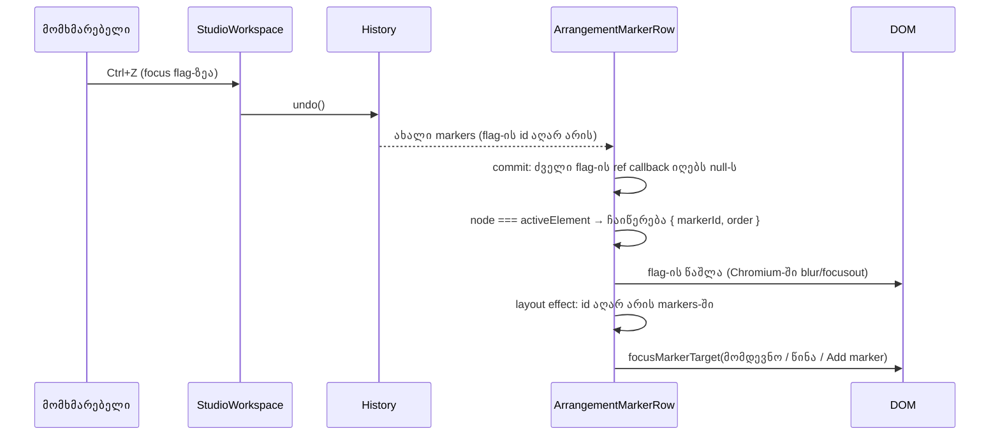

# B-R243-UNDO-MARKER-FOCUS — როცა history step ან Cut Time focused marker flag-ს შლის, focus გადადის მომდევნო flag-ზე

**თარიღი:** 2026-10-29
**სტატუსი:** Completed (C round 246 PASS)
**შეცვლილი პროექტი:** Store

## კონტექსტი

**B-R243-UNDO-MARKER-FOCUS** (Medium, pre-existing): marker flag-ზე focus-ის დროს history-ის ნაბიჯი
flag-ს DOM-იდან შლიდა და focus `BODY`-ზე რჩებოდა. B-მ ეს HEAD `e9fb805`-ზე ორივე viewport-ზე
გაზომა (1440×900 და 1280×720). ერთი მექანიზმი (focused flag-ის id `markers`-იდან ქრება) სამი გზით
მიდის:

- **Undo of an add:** `M`, `Enter` (focus ახალ flag-ზეა), `Ctrl+Z` — flag ქრება, focus `BODY`-ზეა.
- **Redo of a delete:** flag-ის წაშლა, `Ctrl+Z` (flag ბრუნდება), flag-ზე focus, `Ctrl+Shift+Z` ან
  `Ctrl+Y` — flag ისევ ქრება, focus `BODY`-ზეა.
- **Cut Time:** time selection-ში მოქცეულ focused flag-ს `Ctrl+Shift+X` შლის.

`Delete`/`Backspace` flag-ზე (`removeMarker`) ამ პრობლემას არ ჰქონდა: ის focus-ს მეზობელზე commit-მდე
გადაიტანს. history-ის გზები კი `removeMarker`-ს გვერდს უვლიან.

## მიდგომა

**D-29z408 წესი.** როცა focused flag ნებისმიერი გზით ქრება marker-ების სიიდან, focus გადადის:

1. მომდევნო flag-ზე დროის მიხედვით, რომელიც ჯერ კიდევ არსებობს;
2. თუ ასეთი არ არის — წინა არსებულ flag-ზე;
3. თუ არც ეს არის — **Add marker** ღილაკზე (`arrangement-marker-add`).

ეს `removeMarker`-ის იგივე წესია (MU8, MU8b), გაფართოებული: ერთსა და იმავე ნაბიჯში წაშლილი
მეზობლები გამოტოვდება (Cut Time-მა შეიძლება რამდენიმე flag ერთად წაშალოს).

- focus, რომელიც წაშლილ flag-ზე **არ** იყო (`BODY`, სხვა flag, სხვა control), არ გადაადგილდება.
- ნაბიჯი, რომელიც flag-ის id-ს ინარჩუნებს (Move Marker, Rename), focus-ს იმავე flag-ზე ტოვებს.
- status-ის ტექსტები და history labels უცვლელია: `Undo: Add Marker`, `Redo: Delete Marker`, Cut Time-ის
  შეტყობინება.

**რატომ ref detach-ზე იწერება ჩანაწერი.** `ArrangementMarkerRow` თითოეულ flag-ს inline ref callback-ით
არეგისტრირებს. როცა callback `null`-ს იღებს და შენახული node არის `document.activeElement`, კომპონენტი
იმახსოვრებს `{ markerId, order }`-ს, სადაც `order` ძველი render-ის დროის რიგია. შემდეგ deps-ის გარეშე
`useIsomorphicLayoutEffect` ამ ჩანაწერს კითხულობს, ასუფთავებს და, თუ id `markers`-ში აღარ არის,
successor-ს `focusMarkerTarget`-ით აფოკუსებს.

გარემოს ფაქტები, რამაც ეს გადაწყვიტა (B-ის probe-ები, D-29z408):

- **დადასტურებული (Chromium 143):** focused ელემენტის წაშლისას იშვება `blur` და `focusout`,
  `activeElement` ხდება `BODY`.
- **დადასტურებული (jsdom):** წაშლისას არც `blur` იშვება, არც `focusout`; React 18 წაშლილი ელემენტის
  ref-ს `null`-ით იძახებს, როცა ის **ჯერ კიდევ** `activeElement`-ია.
- **დასკვნა, პირდაპირ არ დაბეჭდილა:** Chromium-შიც React ref-ს წაშლამდე აცლის. ეს გამომდინარეობს იქიდან,
  რომ ბრაუზერის probe ორივე viewport-ზე successor-ზე ჯდება; რიგი მხოლოდ jsdom-ში დაიბეჭდა. ეს ასევე
  ემთხვევა React 18-ის commit-ის რიგს (ref detach mutation phase-ში, host node-ის წაშლამდე), მაგრამ
  Chromium-ში პირდაპირ არ გაზომილა.

**უარყოფილი დიზაინები:**

- **`onBlur` handler:** Chromium წაშლისას blur-ს უშვებს, ამიტომ ჩანაწერი გამოყენებამდე წაიშლებოდა.
  jsdom blur-ს არ უშვებს, ანუ ტესტები გაივლიდა, ბრაუზერი კი ჩავარდებოდა.
- **„წაშლის შემდეგ focus `BODY`-ზეა“:** ეს იპარავს focus-ს, რომელიც მომხმარებელმა თავად დატოვა
  `BODY`-ზე (mutant MU-BODY-BASED, MU21 წითლდება).
- **`StudioWorkspace`-ში `undo()`-ის გარშემო:** Cut Time და მომავალი წაშლის გზები გამოგვრჩებოდა.
  RETRO 245-ზე `tech-lead`-მა ფიქსი MarkerRow-ში დასვა.

## არქიტექტურა

## შეცვლილი ფაილები

- `app/components/arrangement/ArrangementMarkerRow.tsx` — module ფუნქცია `focusSuccessorAfterRemoval`,
  ref `detachedFocusRef`, ჩანაწერი flag-ის ref callback-ის `null` branch-ში და deps-ის გარეშე layout
  effect. `removeMarker`, `settleEditor`, menus, drag-ის კოდი და status ტექსტები უცვლელია.
- `app/lib/arrangement/__tests__/markers-ui.test.tsx` — helper `pressCtrlKey` და ტესტები MU18–MU23.
- `docs/implementation/2026/quarter-IV/189-marker-undo-focus.md` — ეს დოკუმენტი.

## პრობლემები და გადაწყვეტები

**Problem:** history-ის ნაბიჯი (Undo of add, Redo of delete) ან Cut Time focused flag-ს შლიდა და focus
`BODY`-ზე რჩებოდა. keyboard-ის მომხმარებელი პოზიციას კარგავდა: შემდეგი Tab გვერდის დასაწყისიდან იწყებოდა.
**Solution:** flag-ის ref detach-ზე იწერება, იყო თუ არა ის focused. commit-ის შემდეგ layout effect
focus-ს D-29z408-ის successor-ზე გადაიტანს მხოლოდ მაშინ, თუ id მართლა გაქრა `markers`-იდან.

**Problem:** inline ref-ის გამო React ყოველ render-ზე flag-ებს detach/re-attach-ს უკეთებს, ამიტომ ჩანაწერი
ყოველ render-ზე შეიძლება გაჩნდეს.
**Solution:** effect არაფერს აკეთებს, თუ id ისევ `markers`-შია (MU22; mutant MU-NO-ID-CHECK ამ check-ის
გარეშე რვა ტესტს აწითლებს).

**Problem:** Cut Time-მა შეიძლება რამდენიმე მეზობელი flag ერთად წაშალოს.
**Solution:** successor-ის ძებნა ძველ რიგში მიდის და იღებს პირველ id-ს, რომელიც ჯერ კიდევ არსებობს
(MU23; mutant MU-NEXT-NOT-SURVIVOR).

**Problem (რისკი მომავლისთვის):** ჩანაწერის `order` სწორია მხოლოდ იმიტომ, რომ flag-ის ref callback inline-ია
და ყოველ render-ზე ხელახლა იქმნება, ამიტომ მისი `null` გამოძახება ბოლო commit-ის `markers`-ს ხედავს.
**Solution:** callback inline რჩება. თუ ვინმე მას stable callback-ად (per id ან `useCallback`) გადააკეთებს,
`order` შეიძლება ჩუმად მოძველდეს. ასეთი ცვლილება MU19 და MU23-ით უნდა შემოწმდეს.

## ტესტირება

- **Unit (`markers-ui.test.tsx`):**
  - MU18 — `Ctrl+Z` add-ზე: focus Add marker-ზე;
  - MU19 — შუაში და ბოლოში დამატებული flag-ის Undo: მომდევნო, შემდეგ წინა flag;
  - MU20 — Redo of delete `Ctrl+Shift+Z`-ით და `Ctrl+Y`-ით: მომდევნო flag;
  - MU21 — focus, რომელიც წაშლილ flag-ზე არ იყო (სხვა flag, `BODY`), არ გადაადგილდება;
  - MU22 — Move Marker-ის Undo: focus იმავე flag-ზე რჩება;
  - MU23 — Cut Time: მომდევნო გადარჩენილი flag, შემდეგ წინა.
- **Covering set (`b-round-245/covering.txt`):** 58 ფაილი, 1,115/1,115 მწვანე.
- **Red proofs (8 run, scratch copy რეპოს გარეთ):**

| Run | რა იცვლება | წითელი ტესტები |
|---|---|---|
| FIX-CONTROL | არაფერი | არცერთი (31/31) |
| MU-HEAD | `e9fb805`-ის ფაილი ახალი ტესტებით | MU18, MU19, MU20, MU23 |
| MU-ALWAYS-ADD | successor ყოველთვის Add marker-ია | MU19, MU20, MU23 |
| MU-PREVIOUS-FIRST | ჯერ წინა flag, მერე მომდევნო | MU19, MU20, MU23 |
| MU-STEAL | ჩანაწერი ყოველ detach-ზე, focus-ის შემოწმების გარეშე; ბოლო detach წინას გადაწერს | MU19, MU20, MU23 |
| MU-NO-ID-CHECK | effect-ს აკლია „id ჯერ კიდევ `markers`-შია“ check | MU4, MU7, MU8, MU8e, MU17, MU20, MU21, MU22 |
| MU-NEXT-NOT-SURVIVOR | აიღება `order[index + 1]`, მაშინაც კი, როცა ისიც წაიშალა | MU23 |
| MU-BODY-BASED | ჩანაწერის ნაცვლად: „`activeElement` არის `BODY` და რომელიმე id გაქრა“ | MU21 |

MU-STEAL-ში ჩანაწერს ბოლო detach წყვეტს. MU21-ში ბოლო detach გადარჩენილ flag-ს ეკუთვნის, ამიტომ MU21
ამ mutant-ზე მწვანე რჩება; MU-STEAL-ს MU19, MU20 და MU23 იჭერს.

- **Browser (Playwright, Chromium, `/studio-lab`, 1440×900 და 1280×720):**
  - addUndo → Add marker;
  - addUndoNeighbour → `Marker 1 — 00:00.100`;
  - deleteRedo → Add marker, status `Redo: Delete Marker`;
  - moveUndo → იგივე flag.

  ყველა შემთხვევაში `:focus-visible` მართალია და brass outline `solid 1px` 0.8 opacity-ით იხატება;
  page error 0-ია.

## TODO / შემდეგი ნაბიჯები

- **B-R245-UNDO-GROUP-FOCUS** (Medium, ცალკე owner — `StudioWorkspace.tsx`): `Undo: Group Tracks` ან
  `Redo: Ungroup Tracks` group name-ზე focus-ის დროს ისევ `BODY`-ზე ტოვებს focus-ს. ის შემდეგ
  რაუნდშია დაგეგმილი.
- ARCH-CHECKPOINT-STUDIOWORKSPACE-FOCUS-STATUS-ის მეოთხე კითხვა: საერთო focus-successor მექანიზმი
  marker-ისა და group row-ისთვის.
