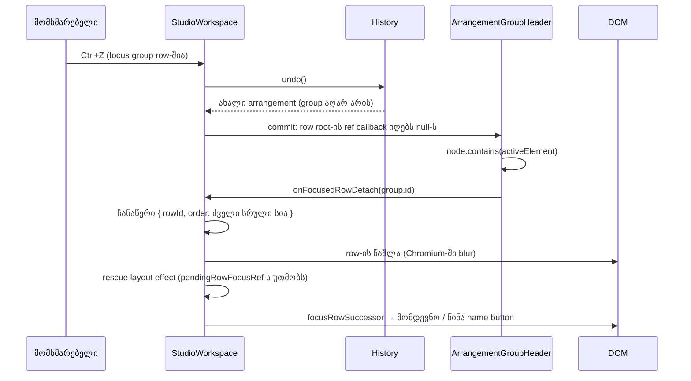

# B-R245-UNDO-GROUP-FOCUS — როცა history step focused group row-ს შლის, focus გადადის მომდევნო row-ის name button-ზე

**თარიღი:** 2026-10-29
**სტატუსი:** Completed (C round 247 PASS)
**შეცვლილი პროექტი:** Store

## კონტექსტი

**B-R245-UNDO-GROUP-FOCUS** (Medium, pre-existing): group row-ის რომელიმე control-ზე focus-ის დროს
(name, fold, mute, volume) history-ის ნაბიჯი row-ს DOM-იდან შლიდა და focus `BODY`-ზე რჩებოდა. B-მ ეს
HEAD `869d767`-ზე ორივე viewport-ზე გაზომა (1440×900 და 1280×720). row ორი გზით ქრება:

- **Undo of a group:** `Ctrl+G` (focus group name-ზე გადადის), `Ctrl+Z` — status `Undo: Group Tracks`,
  0 group, focus `BODY`-ზეა.
- **Redo of an ungroup:** `Ctrl+Shift+G`, `Ctrl+Z` (group ბრუნდება), focus group name-ზე,
  `Ctrl+Shift+Z` ან `Ctrl+Y` — status `Redo: Ungroup Tracks`, focus `BODY`-ზეა.

იგივე ხდებოდა folded group-ზე და nested group-ის გარე row-ზე. history ტრეკებს არ ამატებს, არ შლის და არ
აადგილებს (lane rows track id-ით არის key-ებული), ამიტომ history step-ს მხოლოდ group row შეუძლია წაშალოს.

## მიდგომა

**D-29z415 წესი.** როცა history step შლის group row-ს, რომლის შიგნითაც focus იყო (name, fold, mute, solo ან
volume), focus გადადის:

1. **მომდევნო** row-ზე წინა commit-ის სრულ row რიგში, რომლის name button-იც render-ებულია;
2. თუ ასეთი არ არის — **წინა** ასეთ row-ზე.

„სრული რიგი“ folded group-ის დამალულ წევრებსაც მოიცავს, რადგან Undo მათ ისევ აჩენს. პრაქტიკაში მომდევნო
row group-ის პირველი ყოფილი წევრია: პირველი track, ან nested group-ის შემთხვევაში შიდა group-ის name.
ეს ემთხვევა არსებულ `Ctrl+Shift+G` წესს („focus პირველ child-ზე“, UC9).

- **explicit focus request იმარჯვებს.** `ungroupSelectedTrackRows` იმავე commit-ში focused row-ს შლის და
  თავად ასახელებს სამიზნეს (`childIds[0]`) `pendingRowFocusRef`-ით. rescue ამ ref-ის არსებობისას არაფერს
  აკეთებს (GF7). `ungroupSelectedTrackRows` თავად უცვლელია (L49), ანუ selection, status და history იგივეა.
- focus, რომელიც წაშლილ row-ში **არ** იყო (`BODY`, სხვა track, group-ის member track, toolbar), არ
  გადაადგილდება (GF6).
- status-ის ტექსტები, history labels, selection და audio უცვლელია.

**რატომ row root-ის ref detach-ზე იწერება ჩანაწერი.** `ArrangementGroupHeader` row root-ზე
(`data-testid="arrangement-group-row"`) memoised ref callback-ს (`attachRowNode`) სვამს. როცა callback
`null`-ს იღებს და შენახული node შეიცავს `document.activeElement`-ს, კომპონენტი იძახებს
`onFocusedRowDetach(group.id)`-ს. `StudioWorkspace` (`recordFocusedRowDetach`) იმახსოვრებს
`{ rowId, order }`-ს, სადაც `order` ბოლო commit-ის სრული row სიაა (`committedTrackRowsRef`). შემდეგ deps-ის
გარეშე `useIsomorphicLayoutEffect` ჩანაწერს კითხულობს, ასუფთავებს და, თუ id `trackRowsRef.current`-ში აღარ
არის და `pendingRowFocusRef` ცარიელია, `focusRowSuccessor`-ით successor-ის name button-ს აფოკუსებს.
`contains` row root-ზე ყველა control-ს ფარავს, არა მხოლოდ name button-ს.

**რატომ ბოლო commit-ის სრული სია:**

- render-ის დროს `trackRowsRef.current` უკვე ახალი სიაა, სადაც წაშლილი row აღარ არის (mutant
  MU-RENDER-ORDER — GF1–GF5 წითლდება).
- ხილული სია (`trackRows`) folded group-ის დამალულ წევრებს არ შეიცავს (mutant MU-VISIBLE-ORDER — GF4
  წითლდება).

გარემოს ფაქტები:

- **დადასტურებული (Chromium):** focused ელემენტის წაშლისას იშვება `blur` (INFO-B246-CHROMIUM-BLUR-ON-REMOVAL).
- **დადასტურებული (jsdom, რაუნდი 246):** React წაშლილი host-ის ref-ს `null`-ით იძახებს, სანამ node DOM-იდან
  მოიხსნება.
- **დასკვნა, პირდაპირ არ დაბეჭდილა:** Chromium-შიც ref detach წაშლამდე ხდება. ეს გამომდინარეობს იქიდან, რომ
  browser probe ორივე viewport-ზე successor-ზე ჯდება; რიგი მხოლოდ jsdom-ში დაიბეჭდა.

**უარყოფილი დიზაინები:**

- **`onBlur` handler:** Chromium წაშლისას blur-ს უშვებს, jsdom — არა; ტესტები გაივლიდა, ბრაუზერი კი არა.
- **„წაშლის შემდეგ focus `BODY`-ზეა“:** იპარავს focus-ს, რომელიც მომხმარებელმა თავად დატოვა `BODY`-ზე
  (mutant MU-BODY-BASED — GF6 წითლდება).
- **key handler-ში `undo()`-ის გარშემო:** მომავალი row-ის წაშლის გზები გამოგვრჩებოდა; row-focus-ის ცოდნა
  ისედაც `pendingRowFocusRef`-თან ერთად `StudioWorkspace`-შია. ეს რაუნდ 246-ის per-owner pattern-ია.
- **საერთო focus-successor მექანიზმი marker-ისა და row-ისთვის:** gate 246-ის reviewer-ის იდეაა; აქ არ
  აშენდა, ჩაიწერა checkpoint-ის კითხვად (D-29z416).

## არქიტექტურა

## შეცვლილი ფაილები

- `app/components/arrangement/ArrangementGroupHeader.tsx` — required prop `onFocusedRowDetach`, ref
  `rowNodeRef` და memoised `attachRowNode` row root-ზე. editor, fold, mute, solo, volume, overview,
  strings და classes უცვლელია.
- `app/components/arrangement/StudioWorkspace.tsx` — module ფუნქცია `focusRowSuccessor`, refs
  `committedTrackRowsRef` და `detachedRowFocusRef`, ორი deps-ის გარეშე layout effect და
  `recordFocusedRowDetach`. `groupSelectedTrackRows`, `ungroupSelectedTrackRows`,
  `setTrackGroupsCollapsed`, `closeGridMenu`, key handler, status ტექსტები და history labels უცვლელია.
- `app/lib/arrangement/__tests__/track-group-collapse-ui.test.tsx` — helpers და ტესტები GF1–GF7.
- `docs/implementation/2026/quarter-IV/190-group-undo-focus.md` — ეს დოკუმენტი.

## პრობლემები და გადაწყვეტები

**Problem:** `Undo: Group Tracks` ან `Redo: Ungroup Tracks` focused group row-ს შლიდა და focus `BODY`-ზე
რჩებოდა. keyboard-ის მომხმარებელი პოზიციას კარგავდა: შემდეგი Tab გვერდის დასაწყისიდან იწყებოდა.
**Solution:** row root-ის ref detach-ზე იწერება, იყო თუ არა focus row-ში; commit-ის შემდეგ layout effect focus-ს
D-29z415-ის successor-ზე გადაიტანს, თუ row მართლა გაქრა და explicit focus request არ არსებობს.

**Problem:** `Ctrl+Shift+G` იმავე commit-ში შლის focused row-ს და საკუთარ სამიზნეს ასახელებს.
**Solution:** rescue effect `pendingRowFocusRef`-ის effect-მდე დგას და ref-ის არსებობისას არაფერს აკეთებს;
explicit სამიზნე იმარჯვებს (GF7; mutant MU-PRECEDENCE-INVERTED).

**Problem:** callback-ის `null` გამოძახება re-render-ზეც რომ ხდებოდეს, ჩანაწერი ზედმეტად გაჩნდებოდა.
**Solution:** `attachRowNode` memoised-ია (`[group.id, onFocusedRowDetach]`, ორივე სტაბილური), ამიტომ `null`
მხოლოდ unmount-ზე მოდის; effect დამატებით ამოწმებს, რომ id აღარ არის `trackRowsRef.current`-ში.

## ტესტირება

- **Unit (`track-group-collapse-ui.test.tsx`):**
  - GF1 — `Ctrl+Z` group name-ზე: 0 group, focus პირველ წევრზე;
  - GF2 — Redo of ungroup `Ctrl+Shift+Z`-ით და `Ctrl+Y`-ით: focus პირველ ყოფილ წევრზე;
  - GF3 — fold, mute და volume control: იგივე successor;
  - GF4 — folded group-ის Undo: focus ახლა ხილულ პირველ წევრზე;
  - GF5 — nested: გარე group-ის Undo — focus პირველ child-ზე; შიდა რჩება და focus-ს ინარჩუნებს;
  - GF6 — Video, member track და `BODY`: focus არ გადაადგილდება;
  - GF7 — `Ctrl+Shift+G` საკუთარ სამიზნეს (`childIds[0]`) ინარჩუნებს.

  solo control-ს ცალკე ტესტი არ აქვს: row root-ზე `contains` მას კონსტრუქციით ფარავს. წესის მეორე ნაწილს
  („წინა row“) ტესტი არ აქვს, რადგან group-ის history step-ში მომდევნო row ყოველთვის არსებობს (group-ის
  პირველი წევრი).
- **Red proofs (9 run, scratch copy რეპოს გარეთ):**

| Run | რა იცვლება | წითელი ტესტები |
|---|---|---|
| FIX-CONTROL | არაფერი | არცერთი |
| MU-HEAD | `869d767`-ის ორივე source ფაილი ახალი ტესტებით | GF1–GF5 |
| MU-PREVIOUS-FIRST | ჯერ წინა row, მერე მომდევნო | GF1–GF5 |
| MU-NO-CONTAINS | ჩანაწერი ყოველ detach-ზე, focus-ის შემოწმების გარეშე | GF5, GF6 |
| MU-NAME-ONLY | ჩანაწერი მხოლოდ მაშინ, როცა focused ელემენტი group name button-ია | GF3, GF5 |
| MU-VISIBLE-ORDER | რიგი ხილული row-ებიდან (`trackRows`) | GF4 |
| MU-RENDER-ORDER | რიგი detach-ის მომენტის `trackRowsRef.current`-დან | GF1–GF5 |
| MU-PRECEDENCE-INVERTED | rescue `pendingRowFocusRef`-ს არ უთმობს და მის შემდეგ ეშვება | GF7 |
| MU-BODY-BASED | ჩანაწერი მაშინაც, როცა focus უკვე `BODY`-ზეა | GF6 |

- **Covering set-ის შედეგი:** 96 ფაილი, 1,492/1,492 მწვანე.
- **Browser (Playwright, Chromium, `/studio-lab`, 1440×900 და 1280×720):** groupUndo, ungroupRedo,
  groupUndoY, foldFocusUndo, muteFocusUndo, volumeFocusUndo, collapsedUndo — focus Music name button-ზე;
  nestedOuterUndo — Group 1-ის name-ზე; groupUndoTab-ში `:focus-visible` მართალია და brass outline
  იხატება. no-steal და keep-row control-ები HEAD-ის ტოლია.

## TODO / შემდეგი ნაბიჯები

- ARCH-CHECKPOINT-STUDIOWORKSPACE-FOCUS-STATUS-ის მეოთხე კითხვა (D-29z416): საერთო focus-successor
  მექანიზმი marker flag-ებისა და group row-ებისთვის.
- `blurGroupVolume` წაშლისას (C-VOLUME-REMOVAL-247): Chromium focused group fader-ის წაშლისას blur-ს უშვებს
  და `blurVolumeTarget` უკვე არარსებული group-ისთვის ეშვება. HEAD-ზე page error არ ჩანს; ქცევა უცვლელია.
