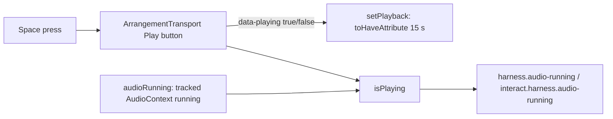

# Perf harness — playing სიგნალი `data-playing`-ზე და clip-body title-ის განახლება (C-R258-01)

**თარიღი:** 2026-10-30
**სტატუსი:** Completed (C round 259 PASS)
**შეცვლილი პროექტი:** Store

## კონტექსტი

Round 258-ის regression sweep-მა აღმოაჩინა C-R258-01 (Medium): `npm run test:perf` PERF-1a-სა და PERF-1b-i-ის ყოველ pass-ს აგდებდა. მიზეზი harness-ში იყო და არა app-ში:

- SABA-B-9-ის პირველმა ეტაპმა (round 256) Play ღილაკის სახელი მუდმივი `Play` გახადა და `Pause` სახელი მოხსნა. playing მდგომარეობა ახლა Play ღილაკის `data-playing="true"` attribute-ია (`app/components/arrangement/ArrangementTransport.tsx`).
- SABA-B-10a-მ (rounds 252–253) clip-body-ს title შეცვალა: `drag = time selection · click = playhead` → `drag = time selection · click = insert marker` (`app/lib/arrangement/strings.ts`, `rangeBodyTitle`).

`perf/`-ში ექვსი მოძველებული hit იყო: `perf/lib/page.ts`-ის სამი (`playButton`, `isPlaying`, `setPlayback`), `perf/studio-lab-interactions.perf.spec.ts`-ის `dragTarget` `'range'` და ორი `note` (`perf/budgets.json`, `perf/budgets.interactions.json`). `test:perf` gate row არ არის, ამიტომ fader/drag/playback budget-ები gate 225-ის შემდეგ არ იზომებოდა.

## მიდგომა

- Play ღილაკი იძებნება ზუსტი სახელით (`name: 'Play', exact: true`); Stop ცალკე ღილაკია საკუთარი სახელით.
- `isPlaying` და `setPlayback` კითხულობს `data-playing`-ს. `isPlaying` ისევ მოითხოვს `audioRunning`-საც (GATE206-S6), ამიტომ attribute მარტო playing-ს ვერ ადასტურებს.
- `dragTarget` `'range'` ახალ title-ს ეძებს, `exact: true`-თი.
- `budgets*.json`-ში მხოლოდ `note` ტექსტი შეიცვალა; id, mode, budget, unit, determinism და რიგი უცვლელია.
- ალტერნატივა — harness-მა label-ები პირდაპირ `strings.ts`-იდან შემოიტანოს, ან gate-ში მოკლე `test:perf` smoke — ამ რაუნდის ფარგლებს გარეთაა და RETRO 260-ის კანდიდატია (PERF-HARNESS-STRINGS-DRIFT).
- ახალი grep წესი (D-29z512, lessons L12/L23): წაშლილი ან გადარქმეული accessible name, title ან testid იძებნება `app/**/__tests__`-ში **და** `perf/**`-ში.

## არქიტექტურა

## შეცვლილი ფაილები

- `perf/lib/page.ts` — `playButton`, `isPlaying`, `setPlayback`
- `perf/studio-lab-interactions.perf.spec.ts` — `dragTarget` `'range'`
- `perf/budgets.json` — `note` (l.28)
- `perf/budgets.interactions.json` — `note` (l.39)
- `docs/implementation/2026/quarter-IV/163-studio-perf-harness.md` — liveness-ის აღწერა
- `docs/implementation/2026/quarter-IV/168-perf-interactions-baseline.md` — liveness-ის აღწერა
- `docs/implementation/2026/quarter-IV/194-perf-harness-playing-signal.md` — ეს დოკუმენტი

## პრობლემები და გადაწყვეტები

- **Problem:** `setPlayback` ელოდებოდა `aria-label="Pause"`-ს, რომელიც round 256-ის შემდეგ აღარ არსებობს, და PERF-1a ყოველ pass-ზე timeout-ით ვარდებოდა. **Solution:** ლოდინი `data-playing`-ზე, იგივე 15 s timeout-ით.
- **Problem:** PERF-1b-i-ის range drag ძველ title-ს ეძებდა. **Solution:** title `strings.ts`-ის `rangeBodyTitle`-ს დაემთხვა.
- **Problem:** rename-ის grep-ები მხოლოდ `app/**/__tests__`-ს მოიცავდა. **Solution:** D-29z512 — grep root-ებს `perf/**` დაემატა.

## ტესტირება

- `npm run typecheck` — `perf/**`-ს მოიცავს (Biome `perf/`-ს არ ამოწმებს).
- `npm run lint` — app scope.
- `npm run test:perf` ცალკე (L38): `perf/studio-lab.perf.spec.ts`, `perf/studio-lab-interactions.perf.spec.ts`, `perf/studio-lab-resources.perf.spec.ts`; liveness row-ები `harness.audio-running` და `interact.harness.audio-running`.
- `grep -rn "Pause\|click = playhead" perf` — 0 hit.

**A-ს run (round 259, 2026-10-30):** `npm run test:perf` rc 0, 3/3 spec passed (15.2 min: PERF-1b-i 5.4 min, PERF-1b-ii 1.1 min, PERF-1a 8.4 min). სამივე report-ში `complete: true`, `failures: []`, 6/6 pass `abortedAt: null`, 0 page error, 0 problem; assert row-ები: 92/92, 17/17, 15/15 გავიდა. `harness.audio-running` = 1, `interact.harness.audio-running` = 1. PERF-1a track/group/master fader-ებზე `*.playing.restarts` = 0, `move-components-max` = 1 (budget ≤ 3), `release-commits` = 1 (budget ≥ 1), 1×-ზეც და 6×-ზეც. საბოლოო შემოწმება C round 259-ისაა.

## TODO / შემდეგი ნაბიჯები

- RETRO 260: PERF-HARNESS-STRINGS-DRIFT (harness-ის label-ები `strings.ts`-იდან ან gate-ის `test:perf` smoke).
- INFO-B259-COMPONENT-DRIFT: per-commit component რაოდენობის +6…+7 ცვლილება `80fbb3b`-თან შედარებით — B-ის ruling 259 → 260 დაგეგმვისას.
