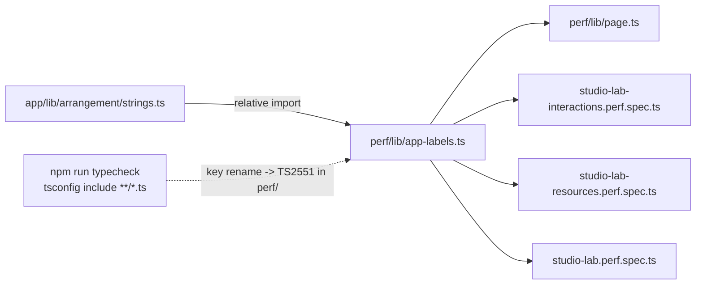

# Perf harness — app-ის ტექსტები `strings.ts`-იდან (PERF-HARNESS-STRINGS-DRIFT)

**თარიღი:** 2026-10-30
**სტატუსი:** Completed (C round 261 PASS)
**შეცვლილი პროექტი:** Store

## კონტექსტი

C-R258-01 (Medium, დაიხურა round 259-ში): perf harness ორი რაუნდის განმავლობაში ჩუმად იყო გატეხილი. ის app-ის label-ებს კოპირებული string literal-ებით ეძებდა (`Pause`, `… click = playhead`), app-მა კი ეს ტექსტები გადაარქვა. `test:perf` gate-ის row არ არის, ამიტომ ძველი locator ვერავინ შენიშნა.

მიზანი: `app/lib/arrangement/strings.ts`-ში label-ის key-ის გადარქმევამ ან წაშლამ `npm run typecheck` gate-ზე წითელი გახადოს, შეცდომით `perf/` ფაილში, სანამ harness მოძველდება.

## მიდგომა

- ახალი `perf/lib/app-labels.ts` არის ერთადერთი ადგილი, საიდანაც perf კოდი app-ის ტექსტს იღებს. ის `strings.ts`-ს **relative** path-ით აიმპორტებს (`../../app/lib/arrangement/strings`). `strings.ts` მხოლოდ `./shortcuts`-ს აიმპორტებს, `shortcuts.ts` კი არაფერს, ამიტომ `~` alias საჭირო არ არის.
- **კლასი (a), 11 key:** `playLabel`, `formatButtonWav`, `closeButton`, `wavDone`, `zoomSliderLabel`, `rangeBodyTitle`, `trimStartLabel`, `moveTitle`, `add`, `activeTrackLabel`, `studioGroupHeaderStrings.volumeLabel`. მნიშვნელობები property access-ით იკითხება, ასე რომ key-ის გადარქმევა TS2339/TS2551-ს იძლევა.
- **Regex-ები ფუნქციებიდან.** ფუნქციას placeholder-ად `\u0000` sentinel გადაეცემა, შედეგი მასზე იყოფა prefix-ად და suffix-ად, ესენი escape-დება. ასე მიიღება `moveTitle`-ის suffix (` — drag to move$`), `volumeLabel`-ის group regex (`^Volume — .+ \(group\)$`) და `wavDone`-ის prefix (`^WAV created:` და length pattern). მიღებული `source` ძველი literal-ების byte-ზე იდენტურია.
- **კლასი (b), 6 inline label:** `Clip Gain — fader`, `Volume — ${mixLabel}`, `Pan — ${track.name}`, `Master Volume`, `Export`, `Undo`. მათ `strings.ts`-ში key არ აქვთ. მათი გადატანა `app/**`-ის ცვლილება იქნებოდა, ეს რაუნდი კი მას არ ფარავს. ისინი `perfInlineLabels` allowlist-შია, მონაცემის სახით: `{ label, sourceFile, sourceNeedle }`. template label-ებისთვის (`Volume — `, `Pan — `) perf კოდი builder ფუნქციას იყენებს.
- **კლასი (c), fixture მონაცემი:** `Music`, `Stems`, `SFX` და `Soft impact` named constant-ებია. `app/data/*` არ იმპორტდება, რადგან `studio-lab-demo.ts` `~` alias-ს იყენებს.
- `page.waitForFunction`/`page.evaluate`-ის closure ბრაუზერში serialize-დება, ამიტომ `Add` label და `WAV created:` marker მას `arg`-ით გადაეცემა და არა closure-ით.
- განხილული ალტერნატივა: label-ების `strings.ts`-ში გადატანა. ის უარყოფილია, რადგან `app/**` ამ რაუნდში არ არის granted. ჩაწერილია signal-ად: SIG-R261-INLINE-LABELS.

## არქიტექტურა

## შეცვლილი ფაილები

- `perf/lib/app-labels.ts` — ახალი
- `perf/lib/page.ts`
- `perf/studio-lab-interactions.perf.spec.ts`
- `perf/studio-lab-resources.perf.spec.ts`
- `perf/studio-lab.perf.spec.ts`
- `docs/implementation/2026/quarter-IV/195-perf-harness-strings-drift.md` — ახალი

## პრობლემები და გადაწყვეტები

- **Problem:** `waitForFunction`-ის callback ბრაუზერში სრულდება, იმპორტირებული const იქ მიუწვდომელია. → **Solution:** label `arg`-ად გადაეცემა (ადრე იქ `undefined` იყო), callback კი მას პარამეტრიდან კითხულობს.
- **Problem:** resources spec-ის step-ის აღწერასა და შეცდომის ტექსტებში `WAV created` literal-ად ეწერა. ეს sweep-ში მოხვდებოდა, step-ის სახელი კი უცვლელი უნდა დარჩეს. → **Solution:** ტექსტი template-ით აიგება (`perfWavDoneName`, `perfWavDonePrefix`) და მისი მნიშვნელობა byte-ზე იგივეა.
- **Problem:** template label-ის ერთ-ერთი ნაწილი შეიძლება რეგულარული გამოსახულების სპეციალური სიმბოლო იყოს (`(`, `)`). → **Solution:** `escapeRegExp`. ამასთან `splitAtSentinel` შეცდომას აგდებს, თუ ფუნქციის შედეგში placeholder ზუსტად ერთხელ არ გვხვდება (დაკარგულია ან მეორდება).

## ტესტირება

- `npm run typecheck`: rc 0.
- Mutant, scratch ასლზე (`store/`-ის გარეთ): `zoomSliderLabel` → `zoomSliderLabelX` და `moveTitle` → `moveTitleX`. ორივე `npx tsc --noEmit`-ში `perf/lib/app-labels.ts`-ის TS2551 შეცდომას იძლევა. control rc 0.
- `npm run test:perf` ცალკე გაეშვა (L38), სამივე spec-ით: `perf/studio-lab.perf.spec.ts`, `perf/studio-lab-interactions.perf.spec.ts`, `perf/studio-lab-resources.perf.spec.ts`. შედეგი `a-round-261.md`-შია.
- გამოყვანილი regex-ების `source` ძველ literal-ებს out-of-band შევადარე (ახალი ტესტ-ფაილი არ დაემატა).

**შეზღუდვები:**

1. Key, რომელიც `strings.ts`-ში ჯერ კიდევ არსებობს, მაგრამ კომპონენტი აღარ არენდერებს (ან სხვა ტექსტს არენდერებს), typecheck-ში **არ** ჩანს. ამას მხოლოდ `npm run test:perf`-ის გაშვება აჩენს.
2. კლასი (b)-ის 6 inline label (`Clip Gain — fader`, `Volume — …`, `Pan — …`, `Master Volume`, `Export`, `Undo`) gate-ით drift-ისგან **არ** არის დაცული (SIG-R261-INLINE-LABELS). `sourceNeedle` მხოლოდ ხელით შესამოწმებელი მონაცემია.
3. `perf/studio-lab-interactions.perf.spec.ts`-ის `rangeLabelEnd` parser pattern (range-ის წარწერის `–` და `·` გამყოფები `ArrangementClip.tsx`-ის inline JSX-იდან) ამ რაუნდის კლასებში არ შედის და ასევე არ არის დაცული.
4. `tsconfig.json`-ის `**/*.ts` include-ის გამო `strings.ts` ახლა perf compile-შიც შედის. თუ `strings.ts`-ს მომავალში `~` import დაემატება, Playwright-ის loader-მა შეიძლება ის ვერ გადაჭრას.

## TODO / შემდეგი ნაბიჯები

- SIG-R261-INLINE-LABELS: 6 inline label-ის `strings.ts`-ში გადატანა. SABA-B-9-ის მე-2 ეტაპზე (Transport/Master) ხელახლა განიხილება.
- `rangeLabelEnd` გამყოფების წყარო `strings.ts`-ში (B-ის გადასაწყვეტი).
