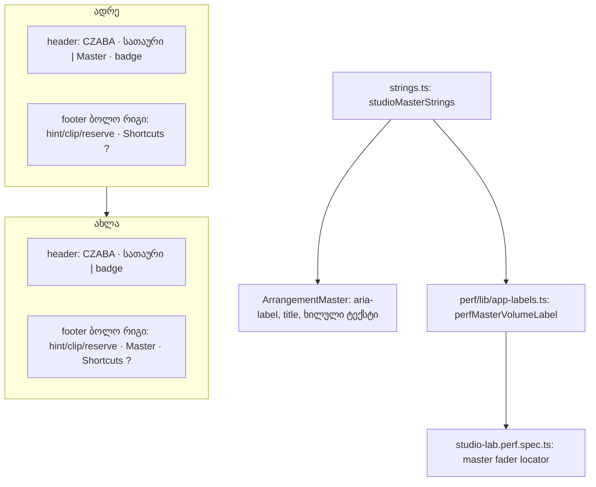

# SABA-B-9 ეტაპი 2 — Master volume სამუშაო სივრცის ქვედა მარჯვენა კუთხეში

**თარიღი:** 2026-10-30
**სტატუსი:** Completed (C round 262 PASS)
**შეცვლილი პროექტი:** Store

## კონტექსტი

Master-ის ჯგუფი (`ArrangementMaster`: Mute, Volume fader, readout, meter და Peak) header-ის
მარჯვენა მხარეს იდგა. Saba-ს გადაწყვეტილება 4 (SABA-B-9) ამბობს, რომ Master volume სამუშაო
სივრცის ქვედა მარჯვენა კუთხეში უნდა გადავიდეს, იქ, სადაც Ableton Live ინახავს Main track-ის
mixer-ს. ეს ერთადერთი დამტკიცებული პოზიციის ცვლილებაა. ეტაპი 1 (doc 193) transport-ის
ცენტრალურ ჯგუფსა და Stop ღილაკს ეხებოდა. ეს ეტაპი SABA-B-9-ს ხურავს.

Live 12-ის manual-ის მიხედვით (Mixing §18.4) "Main track ... occupies the bottom end of the
Arrangement View". mixer-ის ჩვენება/დამალვის ღილაკი Live-ის ფანჯრის ქვედა მარჯვენა კუთხეშია
(Arrangement View §6.15).

ამავე რაუნდში Master-ის inline ტექსტები (`Master`, `Master Mute`, `Master Volume`)
`strings.ts`-ში გადავიდა (SIG-R261-INLINE-LABELS). ამიტომ perf harness-ის locator ახლა
პირდაპირ string-ების წყაროდან კითხულობს სახელს.

## მიდგომა

- **ადგილი:** Master-ის ჯგუფი footer-ის ბოლო რიგში ჩაჯდა, `Shortcuts ?` ღილაკის წინ. ის
  რიგის ფიქსირებულ child slot-შია, ternary-ის (lane-move hint / selected clip / reserve)
  შემდეგ. ამიტომ footer-ის შიგთავსის ცვლილება Master-ს არ remount-ავს და fader-ზე
  ფოკუსი არ იკარგება.
- **ზომა:** Master-ის რიგი 20 px სიმაღლისაა (`M` ღილაკი `h-5`), footer-ის ბოლო რიგი კი
  16 px იყო. ამიტომ footer ყველა მდგომარეობაში ზუსტად +4 px იზრდება (49 → 53, range-ით
  69 → 73), timeline-ის scroller კი 4 px-ს კარგავს (516 → 512 1440×900-ზე, 406 → 402
  1280×720-ზე). header და toolbar უცვლელია. `M` ღილაკის 16 px-მდე დაპატარავება არ
  დაიშვა: დამტკიცებული იყო მხოლოდ პოზიცია და არა კონტროლის ზომა.
- **ტექსტები:** `studioMasterStrings` (`groupLabel`, `muteLabel`, `volumeLabel`) იგივე
  მნიშვნელობებს შეიცავს, რაც ადრე inline იყო. ამიტომ DOM-ის ტექსტი და accessible
  სახელები ბაიტ-ბაიტ უცვლელია. Peak-ის ტექსტები (`studioMeterStrings`) უცვლელია. undo
  label-ები `MASTER_VOLUME_LABEL` (`Master Volume`) და `MASTER_MUTE_LABEL` (`Master Mute`)
  `ArrangementContext.tsx`-ში inline რჩება (ფაილი ამ რაუნდის grant-ში არ იყო).
- **Perf:** `perfMasterVolumeLabel` = `studioMasterStrings.volumeLabel`; `perfInlineLabels`-დან
  `masterVolume` ამოიშალა (დარჩა 5 ჩანაწერი).

### Ableton-ისგან განსხვავებები (SABA-Q-9-MASTER-ROW)

ყველა განსხვავება ერთ კითხვად მიდის Saba-სთან (L43/L44). ქვემოთ ჩამოთვლილი ნაგულისხმევი
ვარიანტი არის ის, რაც ამ რაუნდში აშენდა.

- **D1 — footer-ის კუთხე და არა Main track-ის რიგი lane-ების ქვეშ.** Live-ის ზუსტი ფორმა
  ახალი მუდმივი ზოლი იქნებოდა, რაც lane-ების გეომეტრიას ცვლის და screen budget-ით (L39)
  დამტკიცების გარეშე Medium-ია. Saba-მ დაამტკიცა გადატანა "bottom-right corner"-ში და არა
  ახალი რიგი.
- **D2 — Master `Shortcuts ?`-ის მარცხნივ და არა თავად კუთხეში; დამალვა შეუძლებელია.**
  `Shortcuts ?`-ის პოზიცია გაყინულია. Live-ში კუთხეში mixer-ის toggle-ია, ხოლო
  Ctrl+Alt+M mixer-ს მალავს. ჩვენთან ასეთი shortcut არ არის.
- **D3 — lane-ების mixer მარცხნივ რჩება.** Live-ში Track Controls მარჯვნივაა (§6.15). ეს
  არსებული პოზიციაა და არ გადატანილა.
- **D4 — `M` ღილაკი და ორმაგი click → 0 dB Volume-ზე.** ეს CZABA-ს უკვე არსებული ქცევაა
  (SRW-13). აქ მხოლოდ სისრულისთვის არის ჩამოთვლილი.

## არქიტექტურა

## შეცვლილი ფაილები

- `app/components/arrangement/StudioWorkspace.tsx`: `<ArrangementMaster />` header-იდან
  footer-ის ბოლო რიგში, `Shortcuts ?`-ის წინ.
- `app/components/arrangement/ArrangementMaster.tsx`: label-ები `studioMasterStrings`-იდან.
- `app/lib/arrangement/strings.ts`: ახალი `studioMasterStrings` ობიექტი.
- `app/lib/arrangement/__tests__/master-ui.test.tsx`: განლაგების row footer-ზე, ახალი
  LABELS და FOCUS-KEEP row-ები.
- `app/lib/arrangement/__tests__/meter-ui.test.tsx`: Peak-ის რიგითობა (Play-ის შემდეგ,
  `Shortcuts ?`-ის წინ, footer-ში).
- `app/lib/arrangement/__tests__/studio-theme-obsidian.test.tsx`: TH9-ში label-ების
  რიგითობა `['Zoom', 'BPM', 'Markers', 'Loop', 'Master']`.
- `perf/lib/app-labels.ts`, `perf/studio-lab.perf.spec.ts`: master fader-ის locator.
- `docs/implementation/2026/quarter-IV/193-saba-b-9-centre-transport.md`: სტატუსის ხაზი
  (ეტაპი 2 of 2 დასრულდა).

## პრობლემები და გადაწყვეტები

- **პრობლემა:** footer-ის ბოლო რიგი 16 px-ია, Master-ის რიგი კი 20 px.
  **გადაწყვეტა:** B-ის წესი (D-29z532): footer იზრდება ზუსტად +4 px-ით და timeline 4 px-ს
  კარგავს. კონტროლის ზომა არ იცვლება.
- **პრობლემა:** ternary-ის ტოტში ჩასმული Master footer-ის ყოველ ცვლილებაზე remount-დებოდა
  და fader-ის ფოკუსს დაკარგავდა.
  **გადაწყვეტა:** Master ternary-ის შემდეგ ცალკე, ფიქსირებულ slot-შია. FOCUS-KEEP row ამას
  ამოწმებს, ხოლო mutant (Master reserve-ის ტოტში) წითლდება.
- **პრობლემა:** perf locator inline ტექსტზე იყო მიბმული (C-R258-01 კლასი).
  **გადაწყვეტა:** locator ახლა `studioMasterStrings.volumeLabel`-ს კითხულობს, ამიტომ ველის
  გადარქმევა typecheck-ში perf-ის შეცდომას იწვევს.

## ტესტირება

- `master-ui.test.tsx`:
  - "sits in the footer's last row, directly before the Shortcuts button, and renders 0 times
    per Play frame": footer შეიცავს Mute-სა და Volume-ს, header არა. Master-ის შემდეგი
    sibling `Shortcuts ?` ღილაკია. Play წინ უსწრებს Master Mute-ს, Master Peak კი
    `Shortcuts ?`-ს. Play-ის კადრზე 0 render, Stop მუშაობს.
  - "LABELS: names the group, Mute and Volume from studioMasterStrings with no inline
    literals": სახელები `studioMasterStrings`-ს უდრის, წყაროში inline literal არ არის.
  - "FOCUS-KEEP: keeps the same focused Master Volume node while the footer content changes":
    clip-ის დამატება/მონიშვნა, მონიშვნის მოხსნა და time range-ის დაყენება იგივე focused
    fader node-ს ტოვებს.
- `meter-ui.test.tsx`: "puts Master Peak after Master Volume, after Play and before the
  Shortcuts button in the footer".
- `studio-theme-obsidian.test.tsx`: "TH9: the five Latin section labels use the label tokens
  and keep their text content".
- Mutant-ები (scratch ასლზე): inline `aria-label="Master Volume"` → LABELS წითელი; Master
  ternary-ის ტოტში → FOCUS-KEEP წითელი; Master header-ში → განლაგების row და meter-ui
  row წითელი.
- ბრაუზერი (Chromium, `/studio-lab`): footer 53 px (range-ით 73), scroller 512/402 px,
  header 35 px, toolbar 49/87 px, Master-ის x მდგომარეობებს შორის უცვლელია, 1024×720-ზე
  overlap 0. Shift+Tab `Shortcuts ?`-იდან: Master Peak → Master Volume → Master Mute,
  ხილული ring-ით.
- `npm run test:perf`: master fader სცენარი ახალი locator-ით.

## TODO / შემდეგი ნაბიჯები

- SABA-Q-9-MASTER-ROW (D1–D3) Saba-სთან: Main track-ის რიგი lane-ების ქვეშ, Master-ისა და
  `Shortcuts ?`-ის ადგილების გაცვლა, Master-ის დამალვა (Ctrl+Alt+M), lane mixer-ები მარჯვნივ.
- undo label-ები `MASTER_VOLUME_LABEL` და `MASTER_MUTE_LABEL` `ArrangementContext.tsx`-ში inline
  რჩება. ისინი შემდეგ რაუნდში უნდა გადავიდეს `studioMasterStrings`-ზე, როცა ეს ფაილი
  grant-ში იქნება.
