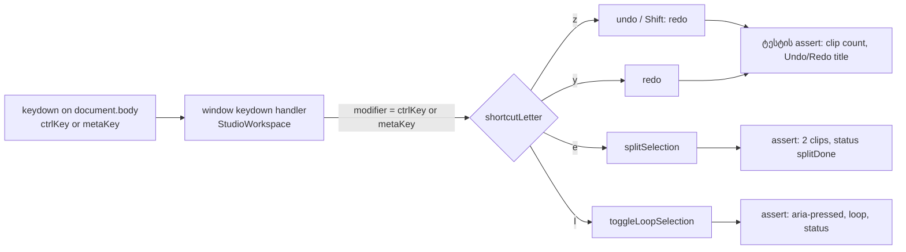

# L46 contract check — Meta (Cmd) shortcut-ების handler-ის ტესტები (L46-CONTRACT-CHECKS)

**თარიღი:** 2026-10-30
**სტატუსი:** Completed (C round 264 PASS)
**შეცვლილი პროექტი:** Store

## კონტექსტი

Studio-ის ღილაკები `aria-keyshortcuts`-ში Mac-ის ვარიანტსაც აცხადებს: `Control+Z Meta+Z`, `Control+Shift+Z Meta+Shift+Z Control+Y Meta+Y`, `Control+E Meta+E`, `Control+L Meta+L`. Window-ის `keydown` handler-ი `ctrlKey`-სა და `metaKey`-ს ერთ modifier-ად აერთიანებს. ამის ტესტი jsdom-ში მხოლოდ Meta+Alt+O-სა და Meta+Shift+Space-ს ჰქონდა; Meta+Z / Shift+Z / Y / E / L-ზე handler-ის row არ არსებობდა (TLM-R228-META-KEYS, TLM-R232-MAC).

Saba-ს ჯერ არ უპასუხია პლატფორმის ხელით შემოწმებაზე (macOS-ის რეალური Cmd, Windows AltGr, VoiceOver/NVDA, Safari). L46-ის მიხედვით ვადაგასული parked check-ის ის ნაწილი, რომლის შემოწმებაც cloud-ში პატიოსნად შეიძლება, ხელახლა გაიხსნა. ეს დოკუმენტი მის jsdom ნაწილს აღწერს. პლატფორმის ნაწილი Saba-სთან რჩება.

## მიდგომა

- დაემატა ერთი ახალი ტესტის ფაილი. app-ის კოდი არ შეცვლილა. მიზანი იყო, Meta-ს გზა ტესტით დაცულიყო, რომ `ctrlKey || metaKey` პირობიდან `metaKey`-ის ამოღება შეუმჩნეველი აღარ დარჩეს.
- თითო row (MS1–MS5) `it.each`-ით ორჯერ ეშვება: Ctrl ნახევარი (`ctrlKey: true`, საკონტროლო) და Meta ნახევარი (`metaKey: true, ctrlKey: false`). ორივე ნახევარი იდენტურ ეფექტს ამოწმებს. ასე mutant-ის დროს ჩანს, რომელი ნახევარი გაწითლდა.
- ყოველი row **ეფექტს** ამოწმებს (clip-ების რაოდენობა, Undo/Redo-ს `title`, Loop-ის `aria-pressed`, status-ის ტექსტი) და `defaultPrevented` მხოლოდ ეფექტის შემდეგ, დამატებით მოწმდება. ამიტომ mutant-ზე პირველი წითელი ხაზი ეფექტისაა.
- MS6 ნეგატიური row-ია: მხოლოდ Alt (Ctrl/Meta-ს გარეშე) Z, E და L-ზე არაფერს ცვლის. ის ამტკიცებს, რომ MS1–MS5 modifier-ის შემოწმების გარეშე არ გადის.
- Render-ის scaffolding (`@remix-run/react` mock, fake audio კლასები, `ArrangementProvider` + `createArrangement` + `StudioWorkspace`) `overview-visibility-ui.test.tsx`-იდან არის კოპირებული, B-ის ინსტრუქციის მიხედვით; სხვა ტესტის ფაილიდან import არ ხდება.
- Split-ისა და loop-ის state context API-ით იქმნება (`selectClip`, `setInsertMarker`, `setTimeRange`). Ruler-ის pointer-ის ემულაცია საჭირო არ გახდა.

## არქიტექტურა

## შეცვლილი ფაილები

- `app/lib/arrangement/__tests__/meta-shortcuts-ui.test.tsx` — ახალი. MS1–MS5 (თითო Ctrl და Meta ნახევრით) და MS6, სულ 11 ტესტი.
- `docs/implementation/2026/quarter-IV/197-l46-meta-shortcut-contract.md` — ეს დოკუმენტი.

## პრობლემები და გადაწყვეტები

- **პრობლემა:** პირველ ვერსიაში `expect(press(...)).toBe(false)` ეფექტამდე იდგა, და mutant M1-ზე პირველ წითელ ხაზად `defaultPrevented` ჩნდებოდა და არა ეფექტი. **გადაწყვეტა:** `dispatchEvent`-ის შედეგი ცვლადში ინახება და ეფექტის assert-ის შემდეგ მოწმდება. ახლა M1-ზე ყველა წითელი ხაზი ეფექტის ხაზია.
- **პრობლემა:** `.claude/prompts/new-test.md` service-ის ტესტის შაბლონია და UI handler-ის ტესტს არ ერგება. **გადაწყვეტა:** გამოყენებულია `app/lib/arrangement/__tests__`-ის არსებული კონვენცია (row id სახელში, fresh mount თითო ტესტზე).

## ტესტირება

Row-ები (ყველა `meta-shortcuts-ui.test.tsx`-შია):

- **MS1** Ctrl/Meta+Z: ერთი clip-ის დამატების შემდეგ clip-ები 1 → 0; Undo-ს `title` label-ს კარგავს, Redo-ს `title` იღებს დამატების label-ს.
- **MS2** Ctrl/Meta+Shift+Z: API-ით undo-ს შემდეგ (ასე M1 სწორედ Shift+Z ნაბიჯს ამოწმებს) clip-ები 0 → 1; Undo-ს `title` label-ს აბრუნებს, Redo-ს `title` ცარიელდება.
- **MS3** Ctrl/Meta+Y: undo-ს შემდეგ clip-ები 0 → 1; `redoLabel` null ხდება.
- **MS4** Ctrl/Meta+E: მონიშნული clip insert marker-ზე (5 s) ორად იყოფა, start-ები `[0, 5]`, status `Clip split at 00:05.000.`.
- **MS5** Ctrl/Meta+L: 2.5–7.5 s time selection-ით loop ირთვება (`aria-pressed` true, status `Loop created and turned on: 00:02.500 — 00:07.500.`), მეორე დაჭერა თიშავს (`aria-pressed` false, status `Loop is off; the range is kept.`).
- **MS6** მხოლოდ Alt + Z/E/L: clip-ების რაოდენობა, undo label, loop, `aria-pressed` და status უცვლელია, event არ არის prevented.

Red-proof-ები `store/`-ის გარეთ scratch ასლზე (მხოლოდ ახალი ფაილი):

- **M1** (`const modifier = event.ctrlKey;`): ხუთივე Meta ნახევარი წითელია ეფექტის ხაზზე, ხუთივე Ctrl ნახევარი და MS6 მწვანეა.
- **M2** (`key === 'y'` branch-იდან `current.redo();` წაშლილია): MS3-ის ორივე ნახევარი წითელია.

Targeted run (ახალი ფაილი, `overview-visibility-ui.test.tsx`, `insert-marker-ui.test.tsx`): 3/3 ფაილი, 47/47 ტესტი მწვანე. Typecheck და lint სუფთაა.

## TODO / შემდეგი ნაბიჯები

- C round 264: ბრაუზერის row-ები CC-META, CC-ALTGR, CC-SR-ORDER და CC-CTRLCLICK ორივე viewport-ზე.
- პლატფორმის ნაწილი (macOS-ის რეალური Cmd და Ctrl+click, Windows AltGr, VoiceOver/NVDA, Safari) Saba-ს ხელით შემოწმებას ელოდება.
- GATE244-S4 (Ctrl+click-ით გახსნილი grid menu-ს focus return) `deferred_low_polish`-ში რჩება; მისი გამოსწორება `StudioWorkspace.tsx`-ის grant-ს მოითხოვს.
