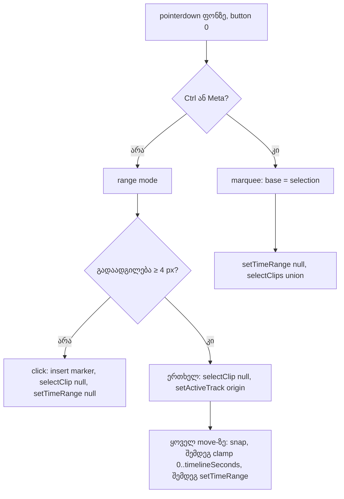

# SABA-B-11c ეტაპი 1 — time selection ცარიელ lane-ზე, clip-ის საზღვრის გარეშე, marquee Ctrl/Cmd-ზე

**თარიღი:** 2026-10-30
**სტატუსი:** Completed (C round 271 PASS)
**შეცვლილი პროექტი:** Store

## კონტექსტი

Ableton Live 12-ის manual-ის Arrangement View 6.9-ის მიხედვით, Arrangement-ის ფონზე click insert marker-ს სვამს, click-and-drag კი timespan-ს ირჩევს. CZABA Studio-ში ცარიელ lane-ზე drag ამ დრომდე marquee-ს (clip-ების მართკუთხა მონიშვნას) იწყებდა. Time selection მხოლოდ clip-ის სხეულზე იწყებოდა და clip-ის საზღვრებში იყო ჩაკეტილი. Saba-მ გადაწყვიტა, რომ selection clip-ის კიდეზე არ უნდა ჩერდებოდეს (SABA-B-11c, `transport-grid-review.md` §4.3).

ეს ეტაპი 2-დან პირველია. Relative snap (ეტაპი 2) Saba-ს R49-T პასუხს ელოდება.

## მიდგომა

- **ფონზე ჩვეულებრივი drag (ან Shift+drag):** 4 px-ის ზღვრის შემდეგ ხდება time selection იმ lane-ზე, სადაც drag დაიწყო. Snap-ის წესი იგივეა, რაც clip-ში: grid ხაზები და marker-ები, Alt-ით bypass, დამალული grid-ის დროს snap არ მოქმედებს. თუ ორივე ბოლო ერთ ხაზზე ხვდება, selection არ იქმნება. გააქტიურებისას clip-ების მონიშვნა ერთხელ იწმინდება და active track ხდება საწყისი lane.
- **Ctrl/Cmd+drag ფონზე:** ძველი marquee, უცვლელი ქცევით: base = მიმდინარე მონიშვნა, გააქტიურებისას `setTimeRange(null)`. ეს CZABA-ს შეგნებული განსხვავებაა (D1). Live-ის manual-ში marquee აღწერილი არ არის. კითხვა Saba-ს გადაეცა: `questions-11c.md`, SABA-Q-11C-MARQUEE.
- **Click (ზღვრის ქვემოთ):** უცვლელია. ის insert marker-ს სვამს, მონიშვნას და selection-ს წმენდს.
- **Clip-ის შიგნით drag:** `[clip.start, clipEnd]` საზღვარი მოიხსნა. ახალი საზღვარია `[0, timelineSeconds]`.
- **საზღვარი:** `timelineSeconds` prop-ით გადაეცემა (`StudioWorkspace` → `ArrangementLane` → `ArrangementClipView`). `getBoundingClientRect()` არ გამოიყენება, რადგან jsdom-ში ის 0-ს აბრუნებს. ორივე ახალი prop optional-ია, რათა `ArrangementLane`/`ArrangementClipView`-ის პირდაპირი mount-ის მქონე ტესტების ტიპები არ დაირღვეს.
- **Vertical drag:** selection რჩება საწყის lane-ზე (D2). `TimeRange`-ს მხოლოდ ერთი `trackId` ან ყველა track შეუძლია. ყველა track-ზე გავრცელება Ctrl+Shift+L-ით ხდება.
- **Rendering (ერთი ელემენტი, ერთი წესი):** თუ ერთი lane-ის range ერთი clip-ის შიგნითაა, ის ისევ clip-ის შიდა overlay-ით ჩანს. ასეთ დროს `[data-range-start]` ელემენტი არ იქმნება, ასე რომ perf-ის in-clip კონტრაქტი შენარჩუნებულია. ყველა სხვა ერთი lane-ის range იხატება იმავე `arrangement-lane-range` ელემენტით, რომელსაც all-tracks range იყენებს. ის მხოლოდ საკუთარ row-შია და label-ში „all tracks“ არ აქვს.
- **Shortcut sheet:** დაემატა ორი row: `select-area` („Ctrl + drag on a lane“) და `select-time` („Drag in a lane“). ახალი მუდმივი ტექსტი ან tooltip არ დამატებულა.
- **Split time selection-ზე (Ctrl+E ან Split ღილაკი), წესი D3 (რაუნდი 266):** clip-ის საზღვრის მოხსნის შემდეგ range შეიძლება clip-ის კიდეს სცდებოდეს. `splitClipsByRange` ახლა range-ის lane-ზე ყველა clip-ს იღებს, რომელიც range-ს კვეთს, და თითოეულს ჭრის range-ის იმ კიდეებზე, რომლებიც clip-ის შიგნითაა (`splitClipAt`-ის `MIN_CLIP_DURATION`-ის დაცვით). შედეგია `middleIds` — თითო clip-ის შიდა ნაწილი, clip-ების რიგით. range-ში მთლიანად მოქცეული clip ჭრის გარეშე მოინიშნება, თუ სხვა clip იმავე range-ში გაიჭრა (MS6). თუ არცერთ clip-ზე ჭრა არ მოხდა (მხოლოდ ცარიელი სივრცე, მხოლოდ მთლიანად დაფარული clip-ები, ან `MIN_CLIP_DURATION`-ზე ნაკლები გადაფარვა), შედეგი `null`-ია და status ძველი „Could not split at the time selection.“ რჩება. ერთი ნაწილისას status და მონიშვნა HEAD-ის ტოლია (`splitRangeDone`, ერთი clip მოინიშნება; ტექსტი „both edges“ უცვლელია, თუმცა ჭრა შეიძლება მხოლოდ ერთ კიდეზე მოხდეს — copy-ის საკითხი B-ს გადაეცა); ორი ან მეტი ნაწილისას ყველა მოინიშნება და status არის ახალი `splitRangeClipsDone(count)`. History-ში ერთი `historySplitRange` ჩანაწერია. All-tracks range-ზე უარი და insert marker-ის branch-ები უცვლელია. D3 Live-ის manual-ით დადასტურებული არ არის; ის Saba-ს კითხვაა (SABA-Q-11C-SPLIT-SPAN).
- **Copy (C-R265-02):** export dialog-ის `rangeMissingReason` და Ctrl+L-ის `needsSelection` ახლა ამბობს „drag in a lane“. ძველი ტექსტი („on the ruler“, „on the waveform“) არასწორი იყო: ruler time range-ს არ ქმნის.

განხილული ალტერნატივები:
- marquee-ს Shift-ზე გადატანა. უარყოფილია, რადგან Shift Live-ში selection-ის გაფართოებისთვისაა.
- multi-lane ნაწილობრივი range. ის model-ის ცვლილებას მოითხოვს და ამ ეტაპის ფარგლებს სცდება.

## არქიტექტურა

## შეცვლილი ფაილები

- `app/components/arrangement/StudioWorkspace.tsx`: `MarqueeGesture.mode`, range-ის branch, `timelineSecondsRef`, `timelineSeconds` prop-ი lane-ზე
- `app/components/arrangement/ArrangementLane.tsx`: lane overlay ყველა range-ზე, რომელიც ერთი clip-ის შიგნით არაა; `timelineSeconds` prop-ის გადაცემა
- `app/components/arrangement/ArrangementClip.tsx`: clip-ის clamp-ის მოხსნა, `timelineSeconds` prop-ი
- `app/lib/arrangement/shortcuts.ts`: `select-area`, `select-time`
- `app/lib/arrangement/__tests__/background-time-selection-ui.test.tsx` (ახალი): BT1–BT9
- ტესტების გადაწერა: SP13, UC10b, TG9 (`ctrlKey: true`), SE8 (ახალი კონტრაქტი, `end: 24`), SC1 (ორი id)
- რაუნდი 266:
  - `app/lib/arrangement/model.ts`: `splitClipsByRange` (D3, `middleIds`);
  - `app/contexts/ArrangementContext.tsx`: `splitSelection`-ის range branch;
  - `app/lib/arrangement/strings.ts`: `rangeMissingReason`, `needsSelection`, ახალი `splitRangeClipsDone`;
  - `app/lib/arrangement/__tests__/model.test.ts`: `middleIds`-ის გადაწერა, MS1–MS7;
  - `app/lib/arrangement/__tests__/strings.test.ts`: ST1, ST7, ST8, ST10;
  - `app/lib/arrangement/__tests__/background-time-selection-ui.test.tsx`: BS1–BS4

## პრობლემები და გადაწყვეტები

- **Problem:** jsdom-ში lane-ის სიგანე `getBoundingClientRect()`-დან 0 გამოდის, რაც საზღვარს [0, 0]-მდე დაკეცავდა. **Solution:** `timelineSeconds` prop/ref-ით გადაეცემა; ტესტი მას lane-ის `style.width / px-per-second`-ით ადარებს (BT6).
- **Problem:** non-granted ტესტები `ArrangementLane`-სა და `ArrangementClipView`-ს პირდაპირ mount-ავს. **Solution:** ახალი prop-ები optional-ია. Lane-ის fallback არის `timelineWidth / pxPerSecond`, clip-ისა — `Number.POSITIVE_INFINITY` (HEAD-ის ქცევის ტოლი ზედა საზღვრის გარეშე).
- **Problem:** code-reviewer-მა აღმოაჩინა, რომ მხოლოდ ვერტიკალური drag (≥ 4 px) Snap-ის გარეშე `{start: X, end: X}` range-ს ქმნიდა. **Solution:** ფონის path-ში ბოლოები ჯერ მრგვალდება და შემდეგ დარდება. ტოლი ბოლოები ყოველთვის `setTimeRange(null)`-ს იძლევა, ასე რომ ვერტიკალური drag HEAD-ის marquee-ის მსგავსად მთავრდება: მონიშვნა იწმინდება, range არ იქმნება (BT9). Clip-ის path უცვლელია.
- **Problem:** marquee-ს branch-ის ჩანაცვლებისას მისი side effect-ები შეიძლებოდა დაკარგულიყო (L49). **Solution:** marquee რჩება უცვლელი (BT4 ამოწმებს `setTimeRange(null)`-სა და base-ის union-ს). range-ის branch-ში მონიშვნის წაშლასა და active track-ს BT1 ამოწმებს.

- **Problem (C-R265-01, Medium):** clip-ის clamp-ის მოხსნის შემდეგ clip-ის შიგნით დაწყებული drag clip-ის დასაწყისს სცდებოდა (მაგ. 6.25–12.5, clip 10-დან). `splitClipsByRange` მხოლოდ იმ clip-ს ეძებდა, რომელიც range-ს მთლიანად შეიცავს, ამიტომ Ctrl+E უარს ამბობდა, HEAD-ზე კი იგივე gesture clip-ს ჭრიდა. **Solution:** წესი D3 (იხ. მიდგომა): ჭრა range-ის თითოეულ კიდეზე, რომელიც clip-ის შიგნითაა. იგივე gesture კვლავ იძლევა clip-ებს 10-სა და 12.5-ზე და `splitRangeDone`-ს (MS1, BS1, BS4).

## ტესტირება

- `background-time-selection-ui.test.tsx`, რაუნდ 265-ში 16 test (რაუნდ 266-ის BS1–BS4-ით სულ 20):
  - BT1 — სამი row: plain drag; Shift drag; all-tracks range-ის ჩანაცვლება, მონიშვნის ერთჯერადი წაშლა და pointercancel-ის შემდეგ ბოლო range-ის შენარჩუნება;
  - BT2 — ორი row: grid და Alt; marker-ზე snap;
  - BT3 — ორი row: clip-ები და ცარიელი სივრცე;
  - BT4 — Ctrl და Meta;
  - BT5;
  - BT6 — ორი row: clip-ში და ფონზე;
  - BT7;
  - BT8;
  - BT9 — ორი row: მხოლოდ ვერტიკალური drag ნულოვანი სიგრძის range-ს არ ქმნის; drag მეორე lane-ზე მთავრდება.
- Mutant-ები scratch ასლზე (`store/`-ის გარეთ), მხოლოდ ახალი ფაილით:
  - M1 (marquee ყოველთვის): BT1, BT3 და BT9 წითელია;
  - M2 (clip-ის clamp აღდგენილია): BT6 წითელია;
  - M3 (overlay მხოლოდ all-tracks-ზე): BT1-ის overlay assertion წითელია;
  - M4 (HEAD-ის `StudioWorkspace.tsx`): BT1-ის „no marquee“ წითელია;
  - M5 (ნულოვანი სიგრძის range-ის დაცვა მხოლოდ snap-ის დროს მოქმედებს): BT9-ის ვერტიკალური row წითელია.
- გადაწერილი ტესტები: SP13, UC10b, TG9, SE8, SC1. ასევე `delete-selection-ui`, `shortcut-sheet-ui`, `workspace-strings-ui` და `selection` — ყველა მწვანეა.
- `npm run typecheck`, `npm run lint` და scoped `biome check` გავიდა.
- რაუნდი 266:
  - `model.test.ts`: MS1 (range clip-ის დასაწყისს სცდება), MS2 (gap-ის გავლით ორი clip), MS3 (ცარიელი სივრცე ან მთლიანად დაფარული clip → `null`), MS4 (`MIN_CLIP_DURATION`-ზე ახლო კიდე არ იჭრება), MS5 (სხვა track-ის clip უცვლელია), MS6 (მთლიანად მოქცეული clip გაჭრილის გვერდით მოინიშნება), MS7 (მინიმუმზე ნაკლები გადაფარვა ან მხოლოდ შეხება არ იჭრება და არ მოინიშნება); `middleIds`-ის გადაწერილი row (`produces three parts with the middle one returned`);
  - `background-time-selection-ui.test.tsx`: BS1 (Ctrl+E, Undo), BS2 (ორი ნაწილი, `splitRangeClipsDone(2)`, ერთი Undo), BS3 (უარი, history არ იცვლება), BS4 (Split ღილაკი); BT1–BT9 უცვლელია;
  - `strings.test.ts`: ST1 და ST10 (ახალი ტექსტები), ST7 და ST8 (`splitRangeClipsDone`);
  - Mutant-ები scratch ასლზე: M6 (HEAD-ის სრული შემცველობის `find`) — MS1, MS2, BS1, BS2, BS4 წითელია; M7 (მხოლოდ პირველი clip) — MS2, MS6, BS2; M8 (ყოველთვის ერთი clip-ის branch) — BS2; M9 (`changed` იგნორირებულია) — MS3, MS7, BS3; M10 (მხოლოდ გაჭრილი clip-ები მოინიშნება) — MS6; M11 (`MIN_CLIP_DURATION`-ის skip წაშლილია) — MS7. M6-ზე ასევე წითელია MS6 და MS7.
- ბრაუზერის შემოწმება C-ს ეკუთვნის (C round 265).

## TODO / შემდეგი ნაბიჯები

- ეტაპი 2: relative snap off-grid clip-ის drag-ზე. ელოდება Saba-ს R49-T პასუხს.
- Saba-ს კითხვები: SABA-Q-11C-MARQUEE (D1), SABA-Q-11C-MULTILANE (D2), SABA-Q-11C-SPLIT-SPAN (Split-ის წესი D3 და Split ყველა track-ზე).
- Live-ის Shift-click-ით selection-ის გაფართოება ამ ეტაპში არ შედის.
