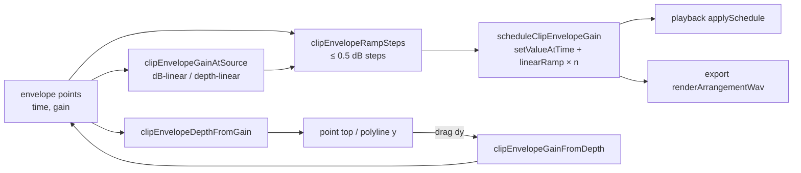

# SABA-B-7 — clip-ის volume envelope lane fader-ის dB სკალაზე

**თარიღი:** 2026-10-30
**სტატუსი:** Completed (C round 269 PASS)
**შეცვლილი პროექტი:** Store

## კონტექსტი

საბამ (2026-10-28) envelope-ის წერტილი ბოლომდე ჩამოათრია, მაგრამ მუსიკა ბოლომდე არ ჩაჩუმდა. მიზეზი gain-ის ბაგი არ იყო. Envelope-ის ვერტიკალური ღერძი, წერტილებს შორის ხაზი და playback/export-ის `linearRampToValueAtTime` linear gain-ში მუშაობდა. ამიტომ 0 dB → −∞ ხაზი სიგრძის 25/50/75 %-ზე −2.5/−6.0/−12.0 dB-ს აჩვენებდა: მუსიკა თითქმის ბოლომდე ხმამაღლა რჩებოდა და მხოლოდ ბოლოს ქრებოდა. Envelope რაუნდებში 82–83 აიწყო, reference-first წესამდე. C მხოლოდ ბოლოებს ამოწმებდა და შიდა წერტილებს არ ზომავდა (lessons L41).

საბას გადაწყვეტილება (2026-10-30, option A, D-29z573): ღერძი dB-linear-ია 0-დან −60 dB-მდე, ბოლოში −∞. სკალა იგივეა, რაც lane-ის Volume fader-ს აქვს (`TRACK_VOLUME_DB_MIN`). Readout dB-ში რჩება. შენახული წერტილების gain არ იცვლება; იცვლება წერტილებს შორის ხაზის ფორმა და წერტილის სიმაღლე. Legacy flag არ არის.

## მიდგომა

**Ableton-ის წყარო.** Live 12-ის volume fader-ის taper root-მა საბას კომპიუტერზე Live 12-ში გაზომა (`reference/ableton-live-measurements-2026-10-30.md` §1): −12/−24/−36 dB სკალის 0.22/0.42/0.63-ზეა. Option A ამას −36 dB-მდე 0.03-ის სიზუსტით ემთხვევა. Manual 27.2.3: clip-ის volume envelope ფარდობითია და ხმას არ აძლიერებს; ბოლო სიჩუმეა. შეგნებული განსხვავებები (საბამ დაამტკიცა): D1 readout dB-შია და არა %-ში; D2 −60 dB-ის ქვემოთ მნიშვნელობა −∞-ია; D3 interpolation fader-ის dB სკალაზე ხდება.

**გადაწყვეტილება (D-29z578).** ყველა ფუნქცია `envelope.ts`-შია:
- **Depth** (წერტილის სიმაღლე ზემოდან, 0…1): `clipEnvelopeDepthFromGain` და `clipEnvelopeGainFromDepth`. ორივე `TRACK_VOLUME_DB_MIN`-ს იყენებს; −60 literal-ად არ წერია.
- **Interpolation** (`clipEnvelopeGainAtSource`): თუ ორივე gain > 0, dB-ში linear-ია და არ იჭრება, ასე რომ −60 dB-ის ქვემოთ შენახული ორი წერტილი თავის დონეს ინარჩუნებს. თუ ერთ-ერთი 0-ია, linear-ია depth-ში. წერტილზე ზუსტად შენახული gain ბრუნდება.
- **Scheduling:** `clipEnvelopeRampSteps` window-ს ყოფს knot-ებად (window-ის დასაწყისი, შიდა წერტილები, window-ის ბოლო). თითო წყვილზე `ceil(span / 0.5)` ნაბიჯია (`CLIP_ENVELOPE_RAMP_STEP_DB` = 0.5). `scheduleClipEnvelopeGain` თითო ნაბიჯზე ერთ `linearRampToValueAtTime`-ს იძახებს. `setValueCurveAtTime`, exponential ramp და `setTargetAtTime` envelope-ზე არ გამოიყენება. Fade, clip gain და track gain არ შეცვლილა.
- **Display/drag** (`ArrangementClipEnvelope.tsx`): წერტილის `top` და polyline-ის y = depth. Drag ახალ gain-ს `gain(depth(original) + dy / bodyHeight)`-ით ითვლის. თუ ვერტიკალური delta ზუსტად 0-ია, შენახული gain byte-for-byte რჩება, რათა legacy gain ჰორიზონტალური drag-ით არ გადაიწეროს.
- **Storage:** `{ time, gain }`, 4 ათწილადით. ფორმატი უცვლელია, მიგრაცია არ ყოფილა.

**ალტერნატივები.** (1) `setValueCurveAtTime` მკვრივი მასივით — საბამ 2026-10-30-ს უარყო (no `setValueCurveAtTime`). (2) Exponential ramp — 0-მდე ვერ მიდის. (3) Live-ის % ღერძი — % → dB-ის კავშირი გაზომილი არ არის (R4), ამიტომ საბამ option A აირჩია.

## არქიტექტურა

## შეცვლილი ფაილები

- `app/lib/arrangement/envelope.ts`: depth/gain mapping, dB interpolation, `clipEnvelopeRampSteps`, `CLIP_ENVELOPE_RAMP_STEP_DB`.
- `app/lib/arrangement/graph.client.ts`: `scheduleClipEnvelopeGain` და import.
- `app/components/arrangement/ArrangementClipEnvelope.tsx`: წერტილის `top`, polyline-ის vertex-ები, drag mapping და import.
- `app/lib/arrangement/__tests__/envelope.test.ts`: EV1, EV2, EV4, EV5a/b/c/e და EV6b ახალ კონტრაქტზე; ახალი DB1–DB6.
- `app/lib/arrangement/__tests__/clip-envelope-ui.test.tsx`: EU2, EU3, EU5 და EU7 ახალ კონტრაქტზე; ახალი EUDB1–EUDB3.
- `app/lib/arrangement/__tests__/export-range.test.ts`: XR2 (envelope crossing).

## პრობლემები და გადაწყვეტები

- **Problem:** ერთი linear ramp 0 dB-დან 0-მდე gain-ში linear-ია და არა dB-ში. **Solution:** ramp დაიყო ≤ 0.5 dB ნაბიჯებად. ბოლო ნაბიჯი ზუსტად 0-ზე ჯდება, ასე რომ ორ ბოლო წერტილს შორის სრული სიჩუმეა (DB4).
- **Problem:** ძველი linear drag-ით შენახული gain −60 dB-ის ქვემოთ (მაგ. 0.0005) depth-ში ბოლოზე იჭრება, ამიტომ ჰორიზონტალური drag მას 0-ად გადააქცევდა. **Solution:** dy = 0 შენახულ gain-ს ინარჩუნებს (EUDB3). ორ ასეთ წერტილს შორის interpolation dB-შია და დონე რჩება (DB5).
- **Problem:** ხაზზე წერტილის დამატებამ ხმა არ უნდა შეცვალოს. **Solution:** ახალი წერტილი ხაზის მნიშვნელობას იღებს, 4 ათწილადით. 25 %-ზე სხვაობა ≤ 0.05 dB-ია (DB6).
- **Problem:** ტესტის fake AudioParam მნიშვნელობებს 6 ათწილადამდე ამრგვალებს. **Solution:** ნაბიჯის ≤ 0.5 dB შემოწმება დაუმრგვალებელ call-ებზე სრულდება. ნაბიჯების რაოდენობა ტესტში დამოუკიდებლად, literal-ად წერია, რათა helper-ის mutant-მა ის ვერ გაიაროს.
- **მიღებული შეზღუდვა:** −50 dB-ის ქვემოთ 4-ათწილადიანი შენახვის ბიჯი 0.1 dB-იან readout-ზე უხეშია (−55 dB-ზე დაახლოებით 0.5 dB). −60 dB-ის ქვემოთ შენახული legacy gain ბოლოში იხატება, ხმა კი dB-ში ინტერპოლირდება. `/studio-lab`-ში ასეთი წერტილი არ არის. თუ ასეთი legacy წერტილის მეზობელი 0-ია, ორივე ბოლო depth 1-ზეა, ამიტომ ეს სეგმენტი ერთი ნაბიჯით ramp-დება, lookup კი შიგნით 0-ს აბრუნებს. სხვაობა დაახლოებით −66 dB-ის დონეზეა.
- **ნაბიჯების რაოდენობა:** კოდი `ceil(span / 0.5 − 1e-9)`-ს იყენებს. 1e-9 იცავს მცურავი წერტილის შეცდომისგან (მაგ. 60 dB → ზუსტად 120 ნაბიჯი და არა 121). კონტრაქტის `ceil(span / 0.5)`-დან სხვაობა მხოლოდ 1e-9-ის ფარგლებშია.

## ტესტირება

- `envelope.test.ts`: DB1 (0 dB → 0, 25/50/75 %-ზე −15/−30/−45 dB ± 0.01, წერტილებზე ზუსტად), DB2 (depth↔gain round-trip), DB3 (`trackVolumeFromDb`-ის იგივე სკალა), DB4 (120 ნაბიჯი, ≤ 0.5 dB, ბოლო ნაბიჯი ზუსტად 0; ბრტყელი სეგმენტი = 1 ნაბიჯი; window შუიდან), DB5 (legacy < −60 dB), DB6 (დამატება ხაზს ინარჩუნებს). EV5a/b/c/e და EV6b ამოწმებს `set`-ს, knot-ების ზუსტ დროსა და gain-ს, ნაბიჯების რაოდენობას სეგმენტზე, ≤ 0.5 dB ბიჯს და მკაცრად ზრდად დროს.
- `clip-envelope-ui.test.tsx`: EUDB1 (წერტილების `top`: 0 / 10.03 / 50 / 100 %), EUDB2 (body-ის ნახევარი = −30.0 dB, ბოლოს ქვემოთ = −∞ dB, თითო Undo entry), EUDB3 (ჰორიზონტალური drag 0.0005-ს ინარჩუნებს). EU3 quarter-ში მეოთხედი = −15.0 dB (0.1778).
- `export-range.test.ts` XR2: window-ის დასაწყისი −30 dB-ია, 60 ნაბიჯი 1-მდე render-დროით 1-მდე, შემდეგ 1 რჩება.
- Mutant-ები (M-LINEAR, M-NO-STEPS, M-DISPLAY, M-DRAG, M-DY0, M-FLOOR) scratch ასლზე წითლდება; mutation-ის გარეშე ყველა მწვანეა.
- Browser-ის მიღება (export-ის taper-ი და სიჩუმე, drag-ის readout, playback meter) C-ის რაუნდ 269-ის სტრიქონებია.

## TODO / შემდეგი ნაბიჯები

- მომავალი კანდიდატები, scope-ის გარეთ (საბა, 2026-10-30): Alt-drag curves, Edit Value, წერტილების grid snap.
- −60 dB-ის ქვემოთ შენახული legacy gain-ის ხატვისა და ხმის შეუსაბამობა: თუ რეალურ პროექტში გამოჩნდება, ცალკე დავალება.
