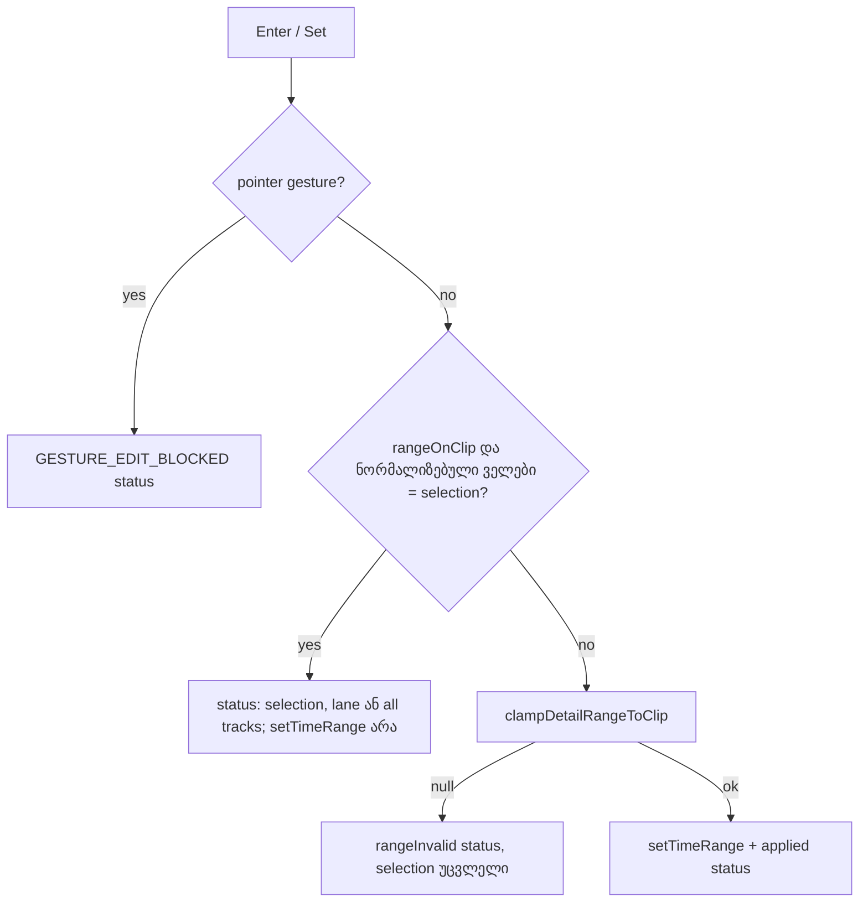

# GATE266-S1 — detail panel-ის From/To რეალურ time selection-ს აჩვენებს

**თარიღი:** 2026-10-30
**სტატუსი:** Completed (C round 270 PASS)
**შეცვლილი პროექტი:** Store

## კონტექსტი

SABA-B-11c-ის პირველი ეტაპიდან (რაუნდი 265) clip-ის შიგნით დაწყებული drag clip-ის კიდეს შეიძლება გასცდეს, clip კი მონიშნული რჩება. Detail panel-ის From/To ველები ("Time selection start/end (seconds)") ამ დროს selection-ის მხოლოდ clip-ზე მოხვედრილ ნაწილს აჩვენებდა (`Math.max`/`Math.min` clamp). Enter ან Set ამ clamp-ილ მნიშვნელობებს `setTimeRange`-ში აგზავნიდა და მომხმარებლის selection-ს ჩუმად ამოკლებდა (მაგ. 00:06.250 — 00:12.500 → 00:10.000 — 00:12.500). იგივე მიზეზით all-tracks selection (Ctrl+Shift+L) Enter-ის შემდეგ ერთ ხაზზე ბრუნდებოდა (B-R269-DETAIL-ALLTRACKS-DROP).

Split-ის შეტყობინებები (GATE266-S4, B-R266-CLIPS-SPLIT-COPY) ამბობდა "both edges" და "the 2 parts", მაშინაც, როცა მხოლოდ ერთი კიდე გაიჭრა ან ერთი clip საერთოდ არ გაჭრილა.

## მიდგომა

- **ჩვენება:** როცა selection clip-ის ხაზზეა და clip-ს ფარავს (`rangeOnClip`), ველები selection-ის საკუთარ start/end-ს აჩვენებს, clamp-ის გარეშე. სხვა შემთხვევაში ისევ clip-ის საზღვრებს აჩვენებს. Waveform-ის overlay უცვლელია: ის clip-ზე მოხვედრილ ნაწილს ხატავს, რაც სწორია.
- **Enter / Set (keep branch):** თუ ორივე ველის მნიშვნელობა, ნორმალიზებული `rangeInputText(parseSecondsInput(...))`-ით, ემთხვევა selection-ს, `setTimeRange` არ გამოიძახება. Range ობიექტი, `allTracks`-ის ჩათვლით, იგივე რჩება და status აცხადებს "Time selection: … · <ხაზი>." ან "· all tracks.". ნორმალიზებული შედარების გამო `0.500` იგივეა, რაც `0.5`.
- **შეცვლილი მნიშვნელობები:** არსებული გზა უცვლელია: `clampDetailRangeToClip` (±0.01 s) ან `rangeInvalid`.
- **Split-ის ტექსტი:** ნეიტრალური ფორმულირება, რომელიც ერთი კიდის, ორი კიდისა და მთელი clip-ის შემთხვევაში სიმართლეს ამბობს. Live-ის ბრძანების სახელსაც ("Split Clip at Selection") უფრო ახლოსაა.
- **უარყოფილი (D-29z581):** ველების გათიშვა მიზეზის ტექსტით: focus-ის ქვეშ disabled ღილაკი და ახალი მუდმივი ხაზი. Clamp-ის მოხსნა, რაც ახალ შესაძლებლობას შექმნიდა (LATER-DETAIL-LANE-RANGE-EDIT, საბას გადასაწყვეტი).

## არქიტექტურა

## შეცვლილი ფაილები

- `app/components/arrangement/ArrangementDetailPanel.tsx` — `studioEditStrings` import, From/To-ის ჩვენება clamp-ის გარეშე, keep branch `applyDetailRange`-ში.
- `app/lib/arrangement/strings.ts` — `splitRangeDone`, `splitRangeClipsDone`, `splitRangeTitle`.
- `app/lib/arrangement/__tests__/detail-panel-polish.test.tsx` — partial-overlap ტესტის გადაწერა; ახალი describe DR1–DR6.
- `app/lib/arrangement/__tests__/background-time-selection-ui.test.tsx` — BS2-ის literal, `expectSplitPastStart`-ის literal, ახალი BS5 და DP1.
- `app/lib/arrangement/__tests__/strings.test.ts` — ST6 და ST7 literal-ები.
- `app/lib/arrangement/__tests__/navigation-strings-ui.test.tsx` — NS2 literal.

## პრობლემები და გადაწყვეტები

- **Problem:** ველები clamp-ილ ნაწილს აჩვენებდა და Enter selection-ს ამოკლებდა. → **Solution:** ველები selection-ს აჩვენებს; უცვლელი მნიშვნელობით Enter selection-ს ტოვებს და აცხადებს.
- **Problem:** Enter all-tracks selection-ს ერთ ხაზად აქცევდა. → **Solution:** keep branch range-ს არ ეხება და status-ში "all tracks"-ს წერს.
- **Problem:** ხელახლა აკრეფილი ტოლი მნიშვნელობა (`0.500`) raw text-ის შედარებისას შეცვლილად ჩაითვლებოდა და selection-ს მოჭრიდა. → **Solution:** შედარება ნორმალიზებულ მნიშვნელობებზე (DR6).
- **Problem:** ამოცანის ახალი ტესტის id "BS3" უკვე გამოყენებული იყო ("BS3 a range over empty space only…"). → **Solution:** ახალ row-ს BS5 ჰქვია, შინაარსი უცვლელია.
- **Within-tolerance:** selection 1.995–7.25 clip-ზე, რომელიც 2-ზე იწყება, ახლა `1.995`-ს აჩვენებს და Enter მას ტოვებს. აქამდე Enter მას 2-მდე ანორმალიზებდა. ეს განზრახ ქცევაა.

## ტესტირება

- `detail-panel-polish.test.tsx`: "shows the whole time selection for a range that only partly lies on the clip (GATE266-S1)", DR1 (past start, Enter და Set), DR2 (past end), DR3 (all tracks), DR4 (guard: შეცვლილი მნიშვნელობა — refuse/apply), DR5 (guard: clip-ის გარეთ selection), DR6 (ნორმალიზებული შედარება).
- `background-time-selection-ui.test.tsx`: DP1 (რეალური drag past start, ველები 6.25/12.5, Enter selection-ს ტოვებს), BS5 (ერთი გაჭრა, ორი clip მონიშნული, ახალი ტექსტი), BS1/BS4 ერთი კიდის literal-ით, BS2.
- `strings.test.ts` ST6/ST7, `navigation-strings-ui.test.tsx` NS2.
- Mutant-ები (M-CLAMP-DISPLAY, M-NO-KEEP, M-LANE, M-RAW-TEXT, M-STR-DONE, M-STR-CLIPS, M-STR-TITLE) თითოეული წითლდება მოსალოდნელ row-ებზე.
- `npm run typecheck`, `npm run lint`, Biome შეცვლილ ფაილებზე; ბრაუზერის შემოწმება C-ის რაუნდში (1440×900, 1280×720).

## TODO / შემდეგი ნაბიჯები

- LATER-DETAIL-LANE-RANGE-EDIT — panel-იდან clip-ის გარეთ selection-ის რედაქტირება (ახალი შესაძლებლობა, საბას გადასაწყვეტი, რიგში არ არის).
- RC-R266-PANEL-CLAMP-CONSUMER — retro-ს კანდიდატი (RETRO 275).
