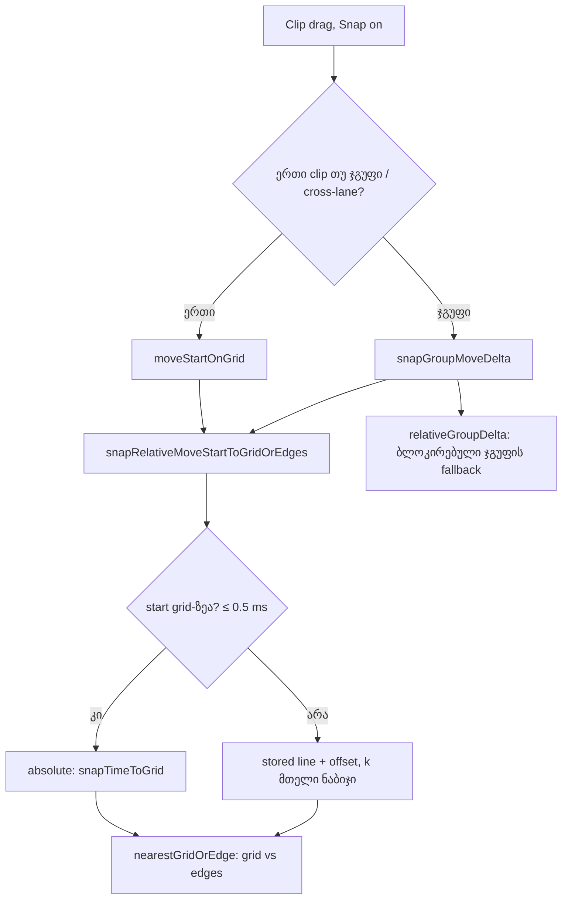

# SABA-B-11c ეტაპი 2 — relative snap: off-grid clip ინახავს offset-ს და მოძრაობს მთელი grid division-ებით

**თარიღი:** 2026-10-30
**სტატუსი:** Completed (C round 271 PASS)
**შეცვლილი პროექტი:** Store

## კონტექსტი

Snap ჩართულ რეჟიმში clip-ის გადატანა clip-ის start-ს უახლოეს **absolute** grid line-ზე სვამდა. clip, რომელიც grid-ს გარეთ იდგა (მაგ. 4.3 წამზე, 1 s grid), 3 px-იანი drag threshold-ის გადალახვის შემდეგ მცირე ხელის კანკალზეც კი ნახევარ division-მდე ხტებოდა (F1-ABSOLUTE-SNAP, R49-T ნაწილი 1).

საბამ 2026-10-30-ს აირჩია ვარიანტი (a): off-grid clip ინახავს თავის offset-ს და მოძრაობს მთელი division-ებით (4.3 → 5.3 → 6.3). Ableton Live 12-ის manual-ში (§6.7, §6.10) off-grid clip-ის offset-ზე წყარო ვერ მოიძებნა; ეს საბას გადაწყვეტილებაა და root-ის Live გაზომვის მოთხოვნა (LIVE-MEAS-11C-OFFSET) ღიაა.

**ქცევის ცვლილება შენახული პროექტებისთვის (D-29z587):** არსებულ პროექტში off-grid clip-ის Snap-ით გადატანა აღარ აგდებს მას უახლოეს grid line-ზე. მონაცემები (clip-ის start-ები) არ იცვლება; იცვლება მხოლოდ შემდეგი drag-ის შედეგი.

## მიდგომა

ერთი წესი: drag გადააქვს დაჭერილი clip მთელი grid ნაბიჯებით, დათვლილი იქიდან, სადაც ის იწყებოდა. on-grid clip-ისთვის (offset = 0) შედეგი ზუსტად წინანდელია.

- **on-grid განსაზღვრა:** start ითვლება grid-ზე, თუ stored grid line-იდან 0.5 ms-ზე ნაკლებითაა დაშორებული (`GRID_OFFSET_TOLERANCE`). clip start-ები მთელ მილიწამებშია შენახული, ხოლო musical ნაბიჯების stored line-ები მილიწამამდეა დამრგვალებული.
- **off-grid candidate:** stored line start-ზე ან მის ქვემოთ + offset, გადატანილი `k` მთელი ნაბიჯით (`k` = drag-ის დამრგვალებული ნაბიჯების რაოდენობა). offset ითვლება stored line-იდან, ამიტომ musical ნაბიჯზე (მაგ. 60/90 s) მრავალი drag-ის შემდეგ drift არ გროვდება. candidate არასოდეს ეცემა offset-ზე დაბლა (ანუ 0-ზე ქვემოთ).
- **magnetic edges:** სხვა clip-ის საზღვრები და marker-ები candidate-ს ეჯიბრებიან როგორც ადრე: raw პოზიციასთან უახლოესი იგებს, თანაბრობისას grid candidate.
- **ჯგუფი და cross-lane:** grid candidate დაჭერილი clip-ისაა; ყველა clip ერთ delta-ზე მოძრაობს და თავის offset-ს ინახავს. off-grid ჯგუფი, რომელსაც მეზობელი ბლოკავს, ჩერდება ბოლო მთელ ნაბიჯზე მეზობლამდე (არა თვით ზღვარზე, რომ offset არ დაიკარგოს). ეს fallback-იც stored line-იდან ითვლება.

**უცვლელი (განზრახ):** library drop, trim edges, in-clip და background range, loop brace, arrow nudge, markers/ruler/tempo — ყველა absolute რჩება. nudge-ზე და loop brace-ზე საბას კითხვაა (SABA-Q-11C-NUDGE), ხოლო grid-ზე დაბრუნების გზაზე — SABA-Q-11C-REALIGN. Alt-ის წესი (`resolveSnapStep`: Alt Snap-ს დროებით აბრუნებს), Shift და 3 px threshold უცვლელია; როცა Alt Snap off-ზე snap-ს რთავს, ეს drag-იც relative-ია (HS2: 7.325 → 7.525).

**უარყოფილი ალტერნატივები:** "relative" badge ან status შეტყობინება (ახალი ტექსტი იმისთვის, რასაც თვალი ისედაც ხედავს), offset-ის guide line (ახალი ვიზუალური კონცეფცია), candidate `anchor + k·step`-ით (musical ნაბიჯზე drift).

Snap ღილაკის tooltip: `Snap on — clips follow the grid (G)` (ძველი "clips land on the grid" off-grid drag-ისთვის აღარ იყო მართალი).

## არქიტექტურა

## შეცვლილი ფაილები

- `app/lib/arrangement/grid.ts` — on-grid შემოწმება, relative grid candidate, `snapRelativeMoveStartToGridOrEdges`, ჯგუფის relative fallback; `snapGroupMoveDelta`-ის სხეული იყენებს relative candidate-ს. სხვა export-ები უცვლელია.
- `app/components/arrangement/ArrangementClip.tsx` — `moveStartOnGrid` იძახებს relative ფუნქციას (import და ერთი გამოძახება).
- `app/lib/arrangement/strings.ts` — `snapOnTitle`.
- `app/lib/arrangement/__tests__/grid-edges.test.ts` — RU1–RU8, RG1, RG2.
- `app/lib/arrangement/__tests__/grid-snap-ui.test.tsx` — GS5, GS5b, GS6, GS6b, GS10, HS2 გადაწერილია ახალ კონტრაქტზე; ახალი RS1–RS5.
- `app/lib/arrangement/__tests__/grid-snap-clip-edges.test.tsx` — CM11 გადაწერილია.
- `app/lib/arrangement/__tests__/strings.test.ts` — `snapOnTitle` literal.

## პრობლემები და გადაწყვეტები

- **პრობლემა:** off-grid clip-ის absolute snap-ით მცირე კანკალი clip-ს ნახევარ division-მდე აგდებდა და ახალ Undo ჩანაწერს ქმნიდა. **გადაწყვეტა:** relative candidate — კანკალი `k = 0`-ს იძლევა, clip ადგილზე რჩება და არსებული "nothing changed" status ჩნდება (RS1, RU8).
- **პრობლემა:** musical ნაბიჯზე (60/90 s) `anchor + k·step` მრავალ drag-ზე drift-ს აგროვებს. **გადაწყვეტა:** offset ითვლება stored line-იდან და candidate stored line-ზე იგება (RU5, RU7).
- **პრობლემა:** ბლოკირებული off-grid ჯგუფი ზღვარზე გაჩერებით offset-ს კარგავდა. **გადაწყვეტა:** fallback — ბოლო მთელი ნაბიჯი ზღვრის შიგნით, 0-ისკენ (RG1, GS5b).
- **პრობლემა (code-reviewer):** musical ნაბიჯზე stored line-ებს შორის მანძილი `n·step`-ზე ≤ 1 ms-ით მეტი შეიძლება იყოს, ამიტომ ბლოკირებული ჯგუფის fallback ზღვარს ოდნავ გადააჭარბებდა. **გადაწყვეტა:** fallback ზღვრებში მოწმდება; თუ არ ეტევა, ერთი ნაბიჯით 0-ისკენ, ბოლოს 0 (RG2).
- **პრობლემა:** sub-millisecond on-grid start-ები (მაგ. 6.0004) relative გზაზე არ უნდა გადავიდეს. **გადაწყვეტა:** 0.5 ms tolerance (RU2, RU6).

## ტესტირება

- Unit: RU1–RU8 და RG1 (`grid-edges.test.ts`) — offset, on-grid ეკვივალენტობა absolute ფუნქციასთან, 0-ის ქვედა ზღვარი, edges და tie, musical ნაბიჯი, tolerance, drift, jitter მეზობელ edge-თან, ჯგუფის fallback; RG2 — musical ნაბიჯზე ბლოკირებული ჯგუფი ზღვარს არ სცდება.
- UI (jsdom): RS1–RS5 (`grid-snap-ui.test.tsx`) და გადაწერილი GS5, GS5b, GS6, GS6b, GS10, HS2, CM11.
- Mutation: §7-ის რვა mutant (absolute single/group, tolerance 0/wide, drift, edges off, group clamp zero, ძველი title) — თითოეული წითელია ჩამოთვლილ row-ებზე.
- Browser: C-ის შემოწმება `/studio-lab`-ზე 1440×900 და 1280×720 ზომებზე (round 271).

## TODO / შემდეგი ნაბიჯები

- SABA-Q-11C-NUDGE: arrow nudge და loop brace — relative თუ absolute (საბას პასუხს ელოდება).
- SABA-Q-11C-REALIGN: off-grid clip-ის grid-ზე დაბრუნების Snap-იანი გზა (მაგ. time start როგორც magnetic edge).
- LIVE-MEAS-11C-OFFSET: root-ის გაზომვა Ableton Live 12-ში; განსხვავებული შედეგი საბასთან კითხვად მიდის.
