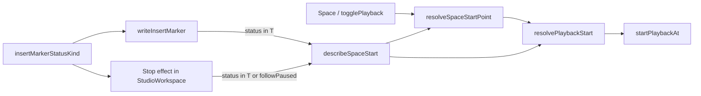

# SYS-6 ეტაპი 1 — status line, რომელიც insert marker-ს ასახელებს, marker-ს მიჰყვება და Stop-ზე Space-ის რეალურ ქცევას ამბობს

**თარიღი:** 2026-10-30
**სტატუსი:** Completed (C round 274 PASS)
**შეცვლილი პროექტი:** Store

## კონტექსტი

status line-ის ტექსტი, რომელიც insert marker-ს ასახელებს („…from here“, „…at 00:04.000“), ერთხელ იწერებოდა და marker-ის გადაადგილებისას აღარ ახლდებოდა. Stop-ის effect-ი (`StudioWorkspace.tsx`) კი წერდა „Stopped — Space plays from the insert marker at t“-ს და არ ამოწმებდა, სინამდვილეში საიდან დაუკრავდა Space. B-მ 66b570a-ზე Chromium-ში ორივე viewport-ზე გაიმეორა სამი Low:

- **C-R253-01:** marker 17 s-ზე, პროექტი 16 s. Stop-ის შემდეგ ეწერა „Space plays from … 00:17.000“, Space კი უარს ამბობდა.
- **C-R254-OBS-01:** marker ზუსტად ბოლოში (16 s). ტექსტი ამბობდა „from 00:16.000“, Space კი 0-დან უკრავდა.
- **B-R253-STALE-PLAYING-STATUS-RESIDUAL:** Ctrl+←/→-ით marker-ის გადატანის შემდეგ ძველი „playback continues“ ტექსტი რჩებოდა playback-ის დროსაც და Stop-ის შემდეგაც.

ძირეული მიზეზი ერთია: `writeInsertMarker` status-ს არ ეხებოდა. „დაუკრავს თუ არა Space აქ?“ predicate კი მხოლოდ `startPlaybackAt`-ის შიგნით არსებობდა.

## მიდგომა

B-ის კონტრაქტი D-29z594 (round 272):

1. **ერთი predicate.** ახალი pure მოდული `app/lib/arrangement/playback-start.ts`:
   - `resolvePlaybackStart` აბრუნებს `empty`, `past-end` ან `play {from}`-ს. `startPlaybackAt` ახლა მას იძახებს და predicate-ის მეორე ასლი აღარ არსებობს.
   - `resolveSpaceStartPoint` ირჩევს time selection-ის საწყისს ან insert marker-ს.
   - `insertMarkerStatusKind` ამოიცნობს ტექსტებს, რომლებიც marker-ს ასახელებენ (set T). ტექსტიდან იღებს `mm:ss.mmm` token-ებს, template-ებს ხელახლა აწყობს და მთელ სტრიქონს ადარებს, ამიტომ template-ის ცვლილება matching-ს ჩუმად ვერ დაარღვევს.
2. **`describeSpaceStart()`** context-ის ახალი ველია. ის აბრუნებს ზუსტად იმ ტექსტს, რომელიც Space-ის რეალურ შედეგს შეესაბამება:
   - უარის შემთხვევაში იგივე `playPastEndMessage`-ს, რომელსაც Space დაწერდა;
   - ბოლოში ახალ `insertMarkerAfterStopFromStart`-ს;
   - selection-ის დროს ახალ `selectionAfterStop`-ს;
   - სხვა შემთხვევაში უცვლელ `insertMarkerAfterStop`-ს.
3. **Rule W** (`writeInsertMarker`): თუ მიმდინარე status T-შია, marker-ის ჩაწერის შემდეგ ის ხელახლა იწერება:
   - Follow-paused ფორმა რჩება Follow-paused ფორმად;
   - playback-ის დროს იწერება playing ფორმა;
   - გაჩერებულ მდგომარეობაში იწერება `describeSpaceStart()`.

   T-ს გარეთ ტექსტი არ იცვლება და `statusSequence` არ იზრდება, რადგან გამოიყენება `setStatus`-ის function form. caller-ის მკაფიო ჩანაწერი, რომელიც W-ის შემდეგ იწერება, საბოლოო რჩება (`setInsertMarker`, `moveInsertMarkerToPlayhead`, `playFrom`-ის უარი).
4. **Rule S** (Stop effect): სამი ზუსტი შედარება შეიცვალა `insertMarkerStatusKind(...) !== null || followPaused`-ით, ჩანაწერი კი `describeSpaceStart()`-ით. Follow-resume ლოგიკა უცვლელია.

**სად იწყება playback, არ შეცვლილა:** Space, Shift+Space და top-strip `playFrom` HEAD-ის მსგავსად მუშაობს. ასევე უცვლელია `playFrom`-ის at-end უარი (signal B-R272-PLAYFROM-END-ASYMMETRY).

**უარყოფილი ალტერნატივა:** Stop effect-ში marker-ის დროით ზუსტი შედარების შენარჩუნება. ის ვერ ცნობს T-ის „stopped“ ფორმებს, მაგალითად `insertMarkerToPlayhead`-ს playback-ის დროს. ამას mutant M-STOP-EXACT ამტკიცებს.

## არქიტექტურა

## შეცვლილი ფაილები

- `app/lib/arrangement/playback-start.ts` (ახალი)
- `app/contexts/ArrangementContext.tsx`
- `app/components/arrangement/StudioWorkspace.tsx`
- `app/lib/arrangement/strings.ts`
- `app/lib/arrangement/__tests__/strings.test.ts` (მხოლოდ დამატებები)
- `app/lib/arrangement/__tests__/playback-start.test.ts` (ახალი, PBS1–PBS8)
- `app/lib/arrangement/__tests__/status-lifetime.test.tsx` (ახალი, LT1–LT11)
- `docs/implementation/2026/quarter-IV/203-sys-6-status-lifetime-stage-1.md`

## პრობლემები და გადაწყვეტები

**პრობლემა:** Rule W-ის updater `useReducer`-ის reducer-ში render-ის დროს სრულდება და refs-ებს კითხულობს.
**გადაწყვეტა:** `placeInsertMarker` range-ს `latestRef`-ში `setRange(null)`-ით სინქრონულად ასუფთავებს. reducer მოგვიანებით, render-ის დროს მუშაობს, ამიტომ `describeSpaceStart` უკვე გასუფთავებულ range-ს ხედავს. LT8-ის ბოლო ნაწილი ამას ამოწმებს: selection ტექსტის შემდეგ Home range-ს ასუფთავებს და მოსალოდნელი ტექსტია `insertMarkerAfterStop('00:00.000')`.

**გვერდითი ეფექტი (code-reviewer Medium; B-ის გადაწყვეტილებას ელოდება):** `playFrom` (top-strip ან marker flag) გაჩერებული T ტექსტიდან ახლა `insertMarkerWhilePlaying(t)`-ს წერს. W-ის updater render-ის დროს მუშაობს, როცა `isPlayingRef` უკვე true-ა. HEAD-ზე „Stopped — … ძველი t“ რჩებოდა. ახალი ტექსტი სწორია, მაგრამ §3.7 B-R272-STOPPED-TEXT-WHILE-PLAYING-ს ეტაპ 2-ს აკუთვნებს და strip click-ისთვის „Stopped — …“-ის შენარჩუნებას ელოდა. Space-ის გზაზე „Stopped — …“ ისევ რჩება. ამ ქცევას LT row არ აფიქსირებს.

**პრობლემა:** B-ის ცხრილით M-STOP-EXACT-ს LT3/LT4 უნდა გაეწითლებინა, მაგრამ Rule W playing ტექსტს marker-თან სინქრონში ინახავს, ამიტომ ზუსტი შედარებაც ემთხვევა და ორივე მწვანე რჩება.
**გადაწყვეტა:** LT10-ს დაემატა ბოლო ნაწილი: playback-ის დროს Ctrl+Shift+Space, შემდეგ Stop, მოლოდინი `insertMarkerAfterStop(t)`. ეს ნაწილი mutant-ს წითლად აქცევს.

**პრობლემა:** LT9-ის პირველი ვერსიაში Follow scroll-ით ჩერდებოდა. marker უკვე 0-ზე იყო, ამიტომ Ctrl+← marker-ს არ ამოძრავებდა და row ვერაფერს ამოწმებდა.
**გადაწყვეტა:** row ჯერ ruler-ზე 4 s-ზე აჭერს, რაც Follow-ს აჩერებს, შემდეგ Follow-ს აჭერს (`followResumed`) და მერე Ctrl+←-ს. marker 4-დან 0-ზე გადადის, ხოლო ტექსტი და `statusSequence` უცვლელი რჩება.

## ტესტირება

- **targeted vitest, 9 ფაილი, 244/244 PASS:** `playback-start`, `status-lifetime`, `strings`, `bars-ruler-ui`, `insert-marker-ui`, `ArrangementContext`, `status-announcement-ui`, `pending-status`, `markers-ui`. ყველაზე ნელი LT row არის LT1, დაახლოებით 0.56 s (timeout 15 s).
- **`npm run typecheck`, `npm run lint` და Biome** შეცვლილ ფაილებზე: rc 0.
- **LT4** რეალურ `tick`-ის ბოლოს ამოწმებს captured `requestAnimationFrame`-ით. effect-დონის ჩანაცვლება საჭირო არ გახდა.
- **mutant-ები §7:** ყველა 8 წითლდება. A-ის ინტერპრეტაციები:
  - M-STOP-EXACT აბრუნებს მხოლოდ HEAD-ის `if`-ს, ჩანაწერი `describeSpaceStart()` რჩება;
  - M-PRED-COPY-ში `startPlaybackAt`-ის საკუთარი predicate არის `current >= end - EPS`, ანუ ბოლოშიც უარს ამბობს. ზუსტად `> end + EPS` → `>= end + EPS` ცვლილება მხოლოდ end+EPS წერტილში განსხვავდება და ვერცერთ row-ს ვერ გააწითლებდა.

  შედეგები:
  - M-STOP-EXACT → LT10
  - M-NO-W → LT3–LT8, LT10
  - M-W-ALWAYS-STOPPED → LT3, LT4, LT7, LT10
  - M-DESCRIBE-MARKER-ONLY → LT1, LT2, LT4–LT6, LT8, LT11
  - M-PRED-COPY → LT2, LT11
  - M-KIND-LOOSE → PBS8
  - M-SEQ-BUMP → LT9
  - M-ORIGIN → PBS7, LT8
- browser-ის შემოწმება C-ის row-ებია (B-PASTEND, B-ATEND, B-RESIDUAL-*, B-STOPPED-MOVE, B-UNRELATED, B-AUDIO, LT-WIDTH).

## TODO / შემდეგი ნაბიჯები

- SYS-6 ეტაპი 2 (round 273, D-29z596):
  - C-R271-01: nudge-ის status;
  - GATE270-S2: repeat announcement;
  - B-R272-STOPPED-TEXT-WHILE-PLAYING: playback-ის დაწყებისას „Stopped — …“ ტექსტი რჩება;
  - INFO-C248-STALE-NOTE.
- ეტაპი 2-ის შემდეგ ამ doc-ის l.4 → `Completed`.
- B-R272-PLAYFROM-END-ASYMMETRY დარჩა signal-ად. ცვლილება მხოლოდ B-ის გადაწყვეტილებით.
