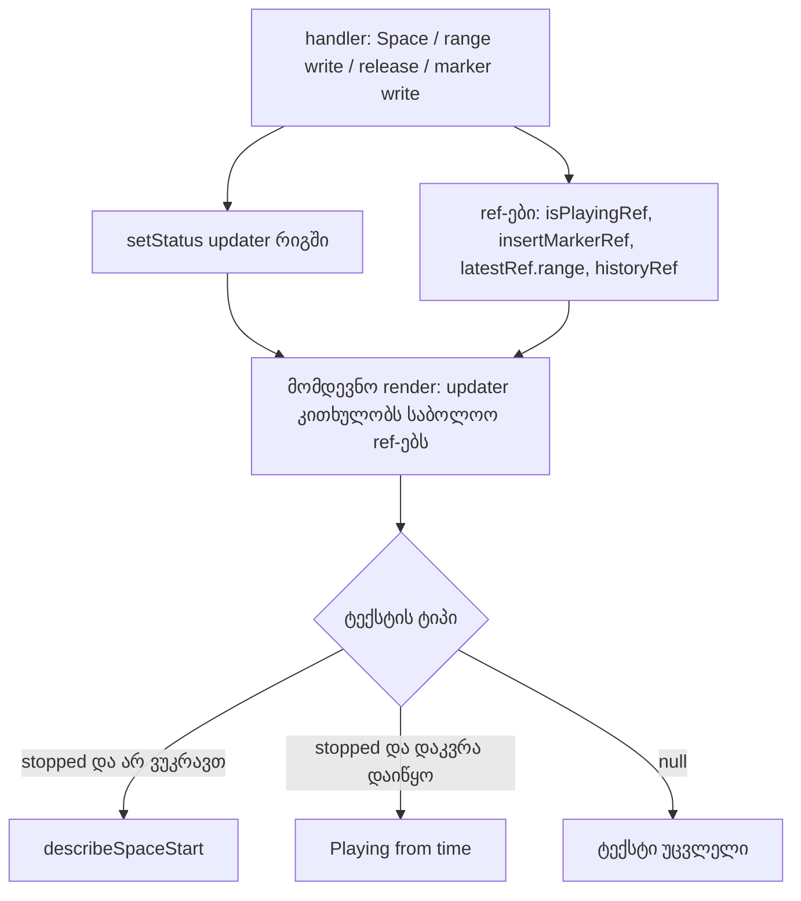

# SYS-6 ეტაპი 2 — status line აღწერს მოქმედების ბოლოს არსებულ მდგომარეობას: Space, range-ის ჩაწერა და gesture-ის release

**თარიღი:** 2026-10-30
**სტატუსი:** Completed (C round 274 PASS)
**შეცვლილი პროექტი:** Store

## კონტექსტი

SYS-6-ის პირველმა ეტაპმა (doc 203, რაუნდი 272) status line-ის ტექსტები, რომლებიც Space-ის საწყის წერტილს ასახელებს, insert marker-ის ჩაწერას (`writeInsertMarker`) მიაბა. მარკერის გარდა საწყისი წერტილი სხვა გზითაც იცვლება, ამიტომ ტექსტი ზოგჯერ ძველი რჩებოდა. B-მ ოთხივე შემთხვევა b288be7-ზე Chromium-ში ორივე viewport-ზე გაიმეორა:

- **C-R272-01:** მარკერი 4 s-ზე, Stop, შემდეგ კლიპის ქვედა ნაწილში range-ის drag 2-დან 5 s-მდე. ტექსტი ისევ „… insert marker at 00:04.000“-ს ამბობდა, Space კი selection-ის დასაწყისიდან უკრავდა.
- **B-R272-STOPPED-TEXT-WHILE-PLAYING:** Space-ის შემდეგ `data-playing=true` იყო, ხაზი კი ისევ „Stopped — …“-ს ამბობდა.
- **GATE272-S3:** selection 17–18 s-ზე, პროექტი 16 s. Space-ის უარის ტექსტი Home-ის შემდეგაც რჩებოდა, თუმცა range გაქრა და მარკერი 0-ზე იყო.
- **GATE272-S1 (Medium):** gate-მა იკითხა, რა მომენტის მდგომარეობას კითხულობს status-ის function update. ეს ეტაპი ამ წესს აფიქსირებს.

## მიდგომა

**წესი ერთი წინადადებით:** status-ის function-form update აღწერს **იმ მოქმედების ბოლოს არსებულ მდგომარეობას, რომელმაც ის რიგში ჩააყენა** — ანუ მდგომარეობას, რომელსაც React ხედავს, როცა update-ს მომდევნო render-ში იყენებს, handler-ის დასრულების შემდეგ, როცა handler-ის ჩაწერილი ყველა ref უკვე საბოლოოა.

ალტერნატივა იყო snapshot ჩაწერის მომენტში. ის უარვყავით: `placeInsertMarker` ჯერ მარკერს წერს, შემდეგ კი range-ს ასუფთავებს. snapshot აღწერდა range-ს, რომელსაც იგივე handler მაშინვე შლის. `playFrom` კი დაკვრისას „Stopped“ ტექსტს აჩვენებდა. React 18-ში `useReducer`-ის function dispatch რიგში დგება და მომდევნო render-ში სრულდება, ამიტომ late read დეტერმინისტულია.

ახალი წესები, ყველა ამ late read-ზე:

- **ერთი საერთო helper (`rewriteStoppedTruth`, provider-ის შიგნით):** თუ არ ვუკრავთ და ტექსტი „stopped“ ტიპისაა, ტექსტი თავიდან გამოიყვანება `describeSpaceStart`-იდან. სხვა ტექსტი უცვლელია.
- **Rule R:** range-ის ყოველი ჩაწერა (`setRange`) helper-ს იძახებს, მაგრამ მხოლოდ მაშინ, როცა pointer gesture აქტიური არ არის. drag-ის დროს status არ იცვლება და pixel-ზე announcement არ ხდება.
- **Rule G:** gesture-ის release `statusAfterGestureRelease`-ის შედეგს helper-ში ატარებს. drag-ის ბოლოს ერთი სწორი ტექსტი იწერება.
- **Rule P:** დაკვრის წარმატებული დაწყება „stopped“ ტექსტს ცვლის ახალი ტექსტით `Playing from <time>.`. სხვა ტექსტები (კლიპის დამატება, `Loop is on.`, Follow resumed) რჩება.
- **კლასიფიკატორი (`insertMarkerStatusKind`):** ახალი ტიპი `'playing-from'`. selection-ის past-end და at-end ფორმები ახლა `'stopped'` ტიპისაა (ეს ხურავს GATE272-S3-ს). playhead-ის ფორმები `null` რჩება.
- **GATE272-S2:** render-ის დროს მინიჭებული `describeSpaceStartRef` წაიშალა. `describeSpaceStart` `writeInsertMarker`-ის ზემოთ გადავიდა და პირდაპირ გამოიძახება; მისი ტანი უცვლელია.

უცვლელი დარჩა: სად უკრავს Space (`resolvePlaybackStart`, `resolveSpaceStartPoint`, `togglePlayback`), Stop-ის effect-ი (`StudioWorkspace.tsx`), `reduceArrangementStatus` და ყველა ცალსახა `setStatus(string)`.

**SYS-6 ახლა 3 ეტაპისგან შედგება.** ეს ცვლის doc 203-ის „stage 1 of 2“-ს. მესამე ეტაპი (რაუნდი 274) edit-ის შედეგის ტექსტებს ეხება.

## არქიტექტურა

## შეცვლილი ფაილები

- `app/contexts/ArrangementContext.tsx` — `describeSpaceStart` ზემოთ გადავიდა, ref წაიშალა; `rewriteStoppedTruth`; Rule R `setRange`-ში; Rule G gesture-ის release-ში; Rule P `startPlaybackAt`-ში.
- `app/lib/arrangement/playback-start.ts` — `'playing-from'` ტიპი და selection-ის past-end ფორმები კლასიფიკატორში.
- `app/lib/arrangement/strings.ts` — ერთი ახალი formatter `playingFrom`.
- `app/lib/arrangement/__tests__/playback-start.test.ts` — row id-ები `PB1`–`PB8` → `PBS1`–`PBS8` (id-ები `store-focus-fixups.test.tsx`-ში უკვე იყო); PBS8 და ახალი PBS9.
- `app/lib/arrangement/__tests__/strings.test.ts` — `playingFrom`-ის sample (ST12) და ზუსტი ტექსტი (ST11).
- `app/lib/arrangement/__tests__/status-lifetime.test.tsx` — LT8-ის შუა ნაბიჯი და ახალი LT12–LT19.
- `docs/implementation/2026/quarter-IV/203-sys-6-status-lifetime-stage-1.md` — მხოლოდ `PB`→`PBS` id-ები.

## პრობლემები და გადაწყვეტები

- **პრობლემა:** range-ის ჩაწერა drag-ის დროს pointermove-ზე ხდება და ყოველი ჩაწერა ახალ ტექსტს ჩააყენებდა. **გადაწყვეტა:** Rule R-ს gesture-ის guard აქვს, ხოლო ტექსტს Rule G release-ზე ერთხელ წერს (LT17: drag-ის დროს sequence არ იცვლება, release-ზე +1).
- **პრობლემა:** დაკვრის დაწყებისას ყოველთვის ახალი ტექსტის ჩაწერა წაშლიდა სასარგებლო ტექსტებს. **გადაწყვეტა:** Rule P მხოლოდ „stopped“ ტიპის ტექსტს ცვლის (LT15).
- **პრობლემა:** trim, move ან fade, რომელიც პროექტის ბოლოს ცვლის, release-ზე „stopped“ ტექსტს ახალ ბოლოსთან მიმართებით თავიდან ითვლის. **გადაწყვეტა:** ეს მოსალოდნელია, რადგან ტექსტი ახლა სიმართლეს ამბობს, HEAD-ზე კი ძველი რჩებოდა. თუ edit release-ის შემდეგ საკუთარ ტექსტს წერს, მისი ტექსტი რჩება.
- **ცნობილი ზღვარი:** დაკვრისას range-ის არსებობისას `insertMarkerWhilePlaying` უცვლელია (B-R273-PLAYING-TEXT-WITH-RANGE, ჰიპოთეზა; ამ ეტაპში არ შედის; LT19-ის მეორე ნაწილი ამ ქცევას აფიქსირებს).

## ტესტირება

- `playback-start.test.ts`: PBS8 (selection-ის ორივე ფორმა `'stopped'`, `playingFrom` `'playing-from'`), PBS9 (playhead-ის ფორმები `null`, ერთი სიმბოლოთი შეცვლილი ტექსტი `null`).
- `strings.test.ts`: ST11 (`Playing from 00:04.000.`), ST12 (ქართული სიმბოლო არ არის).
- `status-lifetime.test.tsx`: LT8 (range-ის ჩაწერა stopped ტექსტს selection-ის ფორმად აქცევს), LT12 (strip click stopped მდგომარეობიდან), LT13 (marker და range ერთ handler-ში, ორივე რიგით), LT14 (Rule P და Stop, სამი ნაწილით), LT15 (clobber control), LT16 (`Playing from` ტექსტის სიცოცხლე), LT17 (Rule R და Rule G gesture-ის დროს), LT18 (GATE272-S3), LT19 (ფარგლები). LT10 უცვლელია.
- mutant-ები M-NO-R, M-R-NO-GUARD, M-NO-G, M-NO-P, M-P-ALWAYS, M-NO-KIND-FROM, M-NO-SEL-PASTEND, M-SNAPSHOT და M-STOP-EXACT წითლად გადაამოწმა A-მ; შედეგები `a-round-273.md`-შია.
- ბრაუზერის შემოწმება (Chromium, `/studio-lab`, 1440×900 და 1280×720) C-ის რაუნდ 273-ის ნაწილია.

## TODO / შემდეგი ნაბიჯები

- ეტაპი 3 (რაუნდი 274): edit-ის შედეგის ტექსტები (C-R271-01-NUDGE-STALE-STATUS), GATE270-S2-REPEAT-ANNOUNCE-ის შემოწმება, INFO-C248-STALE-NOTE.
- B-R273-PLAYING-TEXT-WITH-RANGE: დაკვრის ტექსტი range-ის არსებობისას (ჰიპოთეზა, ჯერ არ შემოწმებულა).
- ეტაპის დასრულებისას doc 203-ისა და ამ doc-ის მე-4 ხაზი `Completed (C round 274 PASS)`-ად შეიცვლება.
