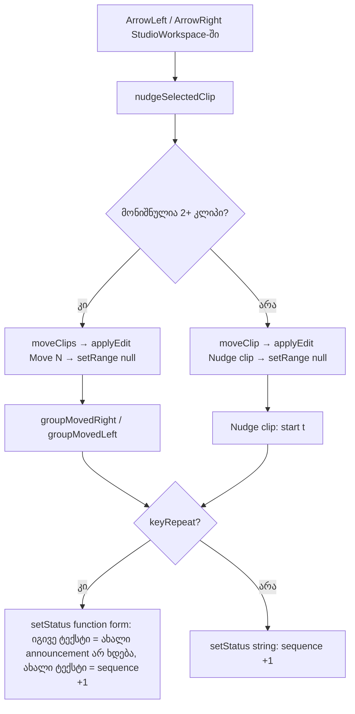

# SYS-6 ეტაპი 3 — arrow-key nudge-ი status line-ში საკუთარ შედეგს ამბობს

**თარიღი:** 2026-10-30
**სტატუსი:** Completed (C round 274 PASS)
**შეცვლილი პროექტი:** Store

## კონტექსტი

SYS-6-ის მესამე და ბოლო ეტაპი (რაუნდი 274). C-R271-01-NUDGE-STALE-STATUS: კლიპის ან კლიპების ჯგუფის arrow-key nudge-ი (`nudgeSelectedClip`) Undo-ს ისტორიაში ჩანაწერს ამატებდა, მაგრამ status line-ში არაფერს წერდა. ამიტომ ხაზზე წინა ტექსტი რჩებოდა, რომელიც უკვე მცდარი იყო. მაგალითად, „“…” added to the Music track at 00:00.000.“ ჩანდა მაშინ, როცა კლიპი უკვე 1 s-ზე იდგა. თუ წინა ტექსტი „Stopped — …“ ტიპისა იყო, Rule R ყოველ ნაბიჯზე transport-ის ტექსტს თავიდან წერდა, edit-ს კი არაფერს ამბობდა (A-R273-REPEAT-PASTEND). B-მ ორივე ვარიანტი (ერთი კლიპი და ჯგუფი) 52b17e4-ზე Chromium-ში ორივე viewport-ზე გაიმეორა.

## მიდგომა

- **ერთი კლიპი:** არსებული `applyEdit(...)` და `setRange(null)`-ის შემდეგ იწერება `Nudge clip: start <t>.`. დრო აიღება commit-ებული arrangement-იდან (`next`), ამიტომ ტექსტი კლიპის რეალურ ადგილს ასახელებს. ახალი formatter-ია `studioMoveStrings.nudged`. „Nudge clip“ იგივე edit-ის Undo label-ია, ხოლო `<label>: start <t>.` ფორმა drag release-ის ტექსტს იმეორებს.
- **ჯგუფი:** გამოიყენება group drag-ის უკვე ტესტირებული ტექსტები `groupMovedRight` / `groupMovedLeft`. label არის `historyMoveClips(count)`, Undo-ს იგივე ჩანაწერი. მანძილი პირველი მონიშნული კლიპის start-ების სხვაობაა. მაგალითი: `Move (2): 2 clips moved 00:01.000 to the right.`
- **დაჭერილი ღილაკის წესი (held key):** key-repeat-ზე ჩაწერა ყოველთვის function form-ით ხდება, როგორც უკვე ხდება უარის branch-ებში. ერთი კლიპის შემთხვევაში ყოველი ნაბიჯი ახალ start-ს ასახელებს, ამიტომ ყოველი ნაბიჯი ხმოვანდება. ეს „ცვალებადი readout ყოველ ცვლილებაზე ხმოვანდება“ წესს ემთხვევა. ჯგუფის შემთხვევაში ნაბიჯის მანძილი ყოველთვის ერთი და იგივეა. function form იმავე ტექსტს აბრუნებს, ამიტომ hold-ის დროს ახალი announcement არ ხდება, ახალი დაჭერა კი ტექსტს ისევ ახმოვანებს. უარის ტექსტი hold-ში ერთხელ იწერება, როგორც ადრე.
- **Clobber-ის წესი:** nudge-ის შედეგი ცვლის ნებისმიერ წინა ტექსტს: clip-added, „Stopped — …“, past-end უარი, `Loop is on.` ან Follow resumed. ეს edit-ის ცხადი შედეგია, ამიტომ „ბოლო შეტყობინება იმარჯვებს“, როგორც drag release-სა და clip-added-ზე. ტექსტი `setRange(null)`-ის შემდეგ იწერება. Space-ის, Stop-ისა და marker-ის გადაადგილების დროს ტექსტი რჩება, რადგან ის T ტიპის არ არის და კლიპი არ მოძრაობს. ტექსტი იცვლება მომდევნო nudge-ზე, drag release-ზე ან Undo/Redo-ზე (`Undo: Nudge clip`).
- **უარყოფილი ალტერნატივები:** ხაზის გასუფთავება nudge-ის შემდეგ (edit არ ხმოვანდება), key-repeat-ზე ჩაწერის გამოტოვება (ტექსტი ერთი ნაბიჯით ჩამორჩება), transport-ის ტექსტის თავიდან ჩაწერა (Space-ს აღწერს და არა edit-ს), ჯგუფისთვის ახალი ფორმულირება (იგივე მნიშვნელობის მეორე ტექსტი).

## არქიტექტურა

## შეცვლილი ფაილები

- `app/contexts/ArrangementContext.tsx` — `nudgeSelectedClip`-ის ორ წარმატებულ branch-ში status-ის ჩაწერა.
- `app/lib/arrangement/strings.ts` — `studioMoveStrings.nudged`.
- `app/lib/arrangement/__tests__/strings.test.ts` — ST12-ის sample და ST11-ის ზუსტი ტექსტი.
- `app/lib/arrangement/__tests__/status-announcement-ui.test.tsx` — SK7-სა და NZ3-ის ზუსტი `added` სია (4 ელემენტი) და ახალი SK13, SK14, SK15.
- `app/lib/arrangement/__tests__/status-lifetime.test.tsx` — describe-ის სათაური და ახალი LT20, LT21.
- `app/lib/arrangement/__tests__/playback-start.test.ts` — describe-ის სათაური.
- `docs/implementation/2026/quarter-IV/203-…`, `204-…` — მე-4 ხაზი.

## პრობლემები და გადაწყვეტები

- **პრობლემა:** GATE270-S2-REPEAT-ANNOUNCE ვარაუდობდა, რომ იგივე სტრიქონის ჩაწერისას React update-ს გამოტოვებს. **გადაწყვეტა:** ვარაუდი მცდარია. აქტიური gesture-ის გარეშე სტრიქონის ჩაწერა sequence-ს ყოველთვის ზრდის, live region კი span-ს sequence-ის მიხედვით re-key-ს უკეთებს. B-მ ბრაუზერში დაადასტურა: ორჯერ Enter Detail Start-სა და Clip Gain-ში თითო დაჭერაზე 2 mutation-ს იძლევა. არსებული SK8 და SK12 ამას უკვე აფიქსირებს. კოდი არ შეცვლილა და finding დაიხურა.
- **პრობლემა:** B-R273-PLAYING-TEXT-WITH-RANGE: დაკვრისას range 2–5-ის შემდეგ Ctrl+← ამბობს „Stop, then Space plays from here“, თუმცა Space selection-ის დასაწყისიდან უკრავს. **გადაწყვეტა:** ეს Low-ია და `deferred_low_polish`-ში გადავიდა (D-29z602). სწორ გამოსწორებას ორი ახალი template და კლასიფიკატორის ორი ტიპი სჭირდება, ამიტომ ამ ეტაპში არ შედის.
- **პრობლემა:** ჯგუფის nudge-ის დროს `moveClips` start-ებს float-ის ცდომილებით აგროვებს: ოთხი 0.1 s ნაბიჯის შემდეგ (პირველი დაჭერა და სამი repeat) 5-დან ვიღებთ 5.399999999999999-ს. **გადაწყვეტა:** status-ის ტექსტი ამას არ განიცდის, რადგან `formatArrangementTime` ms-მდე ამრგვალებს. SK14 პოზიციებს ms-ის სიზუსტით ადარებს. `moveClips` ამ რაუნდის grant-ში არ შედის, ამიტომ დაკვირვება B-ს გადაეცა.

## ტესტირება

- `strings.test.ts`: ST11 (`Nudge clip: start 00:01.000.`), ST12 (ქართული სიმბოლო არ არის).
- `status-announcement-ui.test.tsx`: SK7 და NZ3 (ყოველი წარმატებული ნაბიჯის ტექსტი და უარი ერთხელ), SK13 (ერთი კლიპი hold-ში: 4 ტექსტი, sequence +4), SK14 (ჯგუფი hold-ში: პირველი დაჭერა ხმოვანდება, repeat-ები არა, ახალი დაჭერა კი ისევ), SK15 (ჯგუფის მიმართულება და მანძილი).
- `status-lifetime.test.tsx`: LT20 (nudge-ის ტექსტი ყოველ ნაბიჯზე, შემდეგ `Undo: Nudge clip`), LT21 (nudge ცვლის ზუსტ stopped ტექსტს `insertMarkerAfterStop('00:04.000')`; Space და Stop ტექსტსა და sequence-ს არ ცვლის).
- mutant-ები M-NO-SINGLE, M-NO-GROUP, M-GROUP-ALWAYS-RIGHT, M-SINGLE-PRE-START, M-GROUP-NUDGE-LABEL, M-GROUP-REPEAT-STRING და M-REPEAT-SILENT A-მ წითლად გადაამოწმა; შედეგები `a-round-274.md`-შია.
- ბრაუზერის შემოწმება (Chromium, `/studio-lab`, 1440×900 და 1280×720) C-ის რაუნდ 274-ის ნაწილია.

## TODO / შემდეგი ნაბიჯები

- B-R273-PLAYING-TEXT-WITH-RANGE — `deferred_low_polish`.
- INFO-C248-STALE-NOTE — Saba-ს პასუხს ელოდება (SABA-Q-11B-HIDDEN-SNAP).
- Rule S-ის provider-ში გადატანა — root-ის architecture checkpoint-ის პასუხს ელოდება.
- `moveClips`-ის float-ის ცდომილება ჯგუფის nudge-ის დროს — B-ს დაკვირვება.
