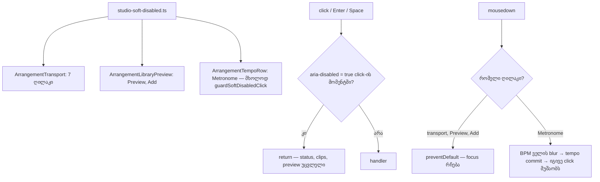

# SYS-5 ეტაპი 2 — metronome, ბიბლიოთეკის Preview და Add keyboard-ით მისაწვდომი რჩება, soft-disabled helper საერთო ფაილშია

**თარიღი:** 2026-10-30
**სტატუსი:** Completed (C round 278 PASS)
**შეცვლილი პროექტი:** Store

## კონტექსტი

SYS-5-ის პირველმა ეტაპმა (doc 206, რაუნდები 276–277) transport-ის შვიდი ღილაკი native `disabled`-დან `aria-disabled`-ზე გადაიყვანა. დარჩა სამი ღილაკი, რომლებიც მიუწვდომელ მდგომარეობაში ისევ native `disabled`-ს იყენებდა და ამიტომ Tab-ის რიგიდან ქრებოდა:

- **Metronome** — BPM-ის გარეშე მიუწვდომელია; მიზეზი (`Metronome — set a BPM first`) მხოლოდ მაუსის hover-ზე ჩანდა (ROOT-R66-L3, მიზეზის ნაწილი).
- **Add** — ვიდეოს ხაზზე მიუწვდომელია და `title` საერთოდ არ ჰქონდა (C-R130-ADD-DISABLED-NO-REASON).
- **Preview** — Add-ის გვერდით იგივე ნიმუშით, title-ის გარეშე.

პირველი ეტაპიდან დარჩა სამი საკითხი: soft-disabled ღილაკზე ბრაუზერი `cursor: pointer`-ს აჩვენებდა (C-R276-01), მიზნის გარეშე Delete-ის accessible name ისევ „Delete — the selected clip; leaves a gap“ იყო (A-R276-REVIEW-DELETE-NAME), helper და შვიდი ხელით დაწერილი guard კი `ArrangementTransport.tsx`-ში ლოკალურად იდგა (A-R276-ARCH-GUARD-IN-HELPER). ეს Saba-ს დამტკიცებული DUX-R-4(b)-ის დასკვნითი ეტაპია.

## მიდგომა

- **საერთო helper:** ახალი ფაილი `app/components/arrangement/studio-soft-disabled.ts` (`studio-focus.ts`-ისა და `studio-fader.ts`-ის მეზობელი) აექსპორტებს `SoftDisabledButtonProps`-ს, `softDisabledButtonProps`-ს, `isSoftDisabledButton`-სა და ახალ `guardSoftDisabledClick(handler)`-ს. wrapper click-ის მომენტში DOM-ის `aria-disabled`-ს კითხულობს და მიუწვდომელ ღილაკზე handler-ს არ იძახებს. `onClick` `softDisabledButtonProps`-ში არ ჩაიდო, რადგან შემდეგ დაწერილი `onClick` prop მას ჩუმად გადაფარავდა (`tech-lead`, D-29z627).
- **Transport:** ლოკალური ასლები წაიშალა; შვიდივე guard ახლა `guardSoftDisabledClick(...)`-ით არის შეფუთული, `armFocusHandoff` ისევ action-მდე სრულდება.
- **Preview და Add:** native `disabled`-ის ნაცვლად `softDisabledButtonProps(...)` (Preview — `!isReady`, Add — `!canAdd`) და შეფუთული `onClick`. click ან Enter მიუწვდომელ ღილაკზე არაფერს აკეთებს და status-ს არ წერს (Space ნებისმიერ Studio ღილაკზე, ხელმისაწვდომზეც, workspace-ის play/stop-ს რთავს — უცვლელი ქცევა), თუმცა `addSourceToActiveTrack` და `startLibraryPreview` უარის შემთხვევაში status-ს წერენ. Keyboard-ის სხვა გზები (Enter ბიბლიოთეკის სტრიქონზე, გლობალური Enter, preview wave-ის Space/Enter) უცვლელია.
- **მიზეზები `title`-ში:** რიგი იმეორებს `addSourceToActiveTrack`-ის უარის რიგს: ხმა არ არის → ჩატვირთვა ჩავარდა → ჯერ იტვირთება → აქტიური ხაზი audio არ არის. ამიტომ title არასოდეს ეწინააღმდეგება keyboard-ის გზით დაწერილ status-ს. Accessible name-ები (`Add`, `Preview`/`Stop`, `Metronome`) არ შეცვლილა. ეკრანზე მუდმივი ახალი ტექსტი არ დამატებულა (L39).
- **Metronome, variant X:** `aria-disabled` და შეფუთული `onClick`, მაგრამ **`onMouseDown` preventDefault-ის გარეშე**. B-მ HEAD-ზე გაზომა: მომხმარებელი BPM ველში წერს `120`-ს Enter-ის გარეშე და აჭერს Metronome-ს. mousedown ველს blur-ს უკეთებს, tempo commit-დება, ღილაკი click-მდე ხელმისაწვდომი ხდება და იგივე click metronome-ს რთავს. საერთო ნიმუში (preventDefault) ამ click-ს მკვდრად აქცევდა. ეს C-R276-02-ის ვიწრო გამონაკლისია (`product-designer`, D-29z628).
- **Cursor:** ყველა soft-disabled ღილაკს აქვს `aria-disabled:cursor-not-allowed!`. layered `!important` სჯობს `app.css`-ის unlayered `button { cursor:pointer }` წესს (D-29z630).
- **Delete-ის სახელი:** მიზნის გარეშე `aria-label` = `Delete`; კლიპის მონიშვნისას — `deleteClipLabel`, range-ისას — range-ის hint (D-29z629).
- **Perf predicate:** სამ perf spec-ში `!add.disabled` → `add.getAttribute('aria-disabled') !== 'true'`, რადგან `add.disabled` ახლა ყოველთვის false-ია.
- **უარყოფილი ალტერნატივები:** Preview-ის native-ზე დატოვება (Tab ერთ ღილაკზე გაჩერდებოდა და მეზობელს გამოტოვებდა); metronome-ზე `softDisabledButtonProps` (ზემოთ აღწერილი dead click); მიზეზის status line-ში ჩაწერა (stage-1 Q1).

## არქიტექტურა

## შეცვლილი ფაილები

- `app/components/arrangement/studio-soft-disabled.ts` — ახალი: საერთო soft-disabled helper და click wrapper
- `app/components/arrangement/ArrangementTransport.tsx` — ლოკალური helper-ის წაშლა, import, შვიდი შეფუთული guard, cursor `!`, Delete-ის `aria-label`
- `app/components/arrangement/ArrangementTempoRow.tsx` — Metronome ღილაკი (`aria-disabled`, wrapper, label ``-ში, class token-ები)
- `app/components/arrangement/ArrangementLibraryPreview.tsx` — Preview და Add ღილაკები, ორი title კონსტანტა
- `app/lib/arrangement/strings.ts` — `studioLibraryPanelStrings`-ში რვა ახალი key
- `perf/studio-lab-interactions.perf.spec.ts`, `perf/studio-lab.perf.spec.ts`, `perf/studio-lab-resources.perf.spec.ts` — Add-ის ready predicate
- ტესტები: `studio-soft-disabled.test.tsx` (ახალი), `metronome-ui`, `library-preview`, `self-disabling-focus`, `held-enter-add`, `mode-toggle-colour-ui`, `library-row-strings-ui`, `drag-feedback-colour-ui`, `transport-centre-ui`, `strings.test.ts`
- `docs/implementation/2026/quarter-IV/206-sys-5-disabled-reasons-stage-1.md` — სტატუსი და რაუნდის ნომრები

## პრობლემები და გადაწყვეტები

- **Problem:** `aria-disabled:cursor-not-allowed` ბრაუზერში არ მოქმედებდა (`button { cursor:pointer }` unlayered-ია). **Solution:** `!` ფორმა; SD7 და SD9 ამოწმებს token-ს, C კი computed `cursor`-ს ბრაუზერში.
- **Problem:** LPA4-ის საწყისი ვერსია (`libraryPreviewSourceId` რჩება `null`) guard-ის წაშლაზე მწვანე რჩებოდა, რადგან `startLibraryPreview` ჩაუტვირთავ ხმაზე თავადაც ჩერდება. **Solution:** LPA4-ს დაემატა status-ის უცვლელობის შემოწმება — guard-ის გარეშე `startLibraryPreview` „not loaded“ status-ს წერს და ტესტი წითლდება.
- **Problem:** UI13-ისთვის guard-ის წაშლა წითელ ტესტს არ იძლევა, რადგან workspace-ის `toggleMetronome` tempo-ს გარეშე თავადაც ჩერდება (L52). **Solution:** UI13-ის red-proof არის `handleTempoBlur`-ის commit-ის გათიშვა; preventDefault-ის ნაწილს UI12 ამოწმებს (`mouseDown` აბრუნებს `true`-ს).
- **Problem:** `aria-disabled:` შეიცავს `disabled:` ქვესტრიქონს. **Solution:** SD9-ის regex `(^|[^a-z-])disabled:` მხოლოდ თავისუფალ `disabled:` token-ს ითვლის.

## ტესტირება

- `studio-soft-disabled.test.tsx`: SDU1 (props და mousedown), SDU2 (wrapper ბლოკავს/ატარებს click-ს, `currentTarget` ღილაკია), SDU3 (მხოლოდ `"true"`), SDU4 (wrapper DOM-ს click-ის მომენტში კითხულობს).
- `metronome-ui.test.tsx`: UI1, UI2, UI6, UI11 გადავიდა `aria-disabled`-ზე; ახალი UI12 (focusable, `` label, click no-op, mousedown არ არის default-prevented), UI13 (variant X: `120` Enter-ის გარეშე → იგივე click რთავს), UI14 (`abc` → უარი, focus toggle-ზე, არა BODY).
- `library-preview.test.tsx`: LPA1 (ვიდეოს ხაზზე Add: clip და status უცვლელი), LPA2 (audio ხაზზე Add ხელმისაწვდომი, title, +1 clip), LPA3 (no sound / loading / failed — ზუსტი title-ები, ყველა jsdom-ში მიღწევადია), LPA4 (Preview click ჩაუტვირთავ ხმაზე: preview და status უცვლელი), LPA5 (focused Add ხელმისაწვდომი ხდება ადგილზე).
- `self-disabling-focus.test.tsx`: SD7 (cursor `!`), SD8 (Delete-ის სახელი სამ მდგომარეობაში), SD9 (TempoRow და LibraryPreview source-ში 0 `enabled:`/`disabled:` token და 0 `disabled={`; rendered ღილაკებზე cursor `!`).
- `held-enter-add.test.tsx` HA5: ხელმისაწვდომ Add-ს `aria-disabled` არ აქვს.
- Mutant-ები (G, C ×3 ფაილი, D, A, M, SDU1, SDU3, SDU4, UI12, UI13, SD9) წითელია; დეტალები A-ის ანგარიშშია (`a-round-278.md`).
- ბრაუზერის შემოწმება (Tab, AX tree, cursor, variant X, ΔE) C-ის რაუნდ 278-ის ანგარიშშია.

## TODO / შემდეგი ნაბიჯები

- B-R276-CURSOR-UNLAYERED-GLOBAL: app-ის სხვა native disabled ღილაკებზე `cursor` ისევ unlayered წესს ემორჩილება (`deferred_low_polish`).
- B-R275-FOCUS-REASON-VISIBLE (Low): keyboard focus-ზე მიზეზი ვიზუალურად არ ჩანს.
- ROOT-R66-L3-ის 16 px target-ის ნაწილი `deferred_low_polish`-ში რჩება.
- LIVE-MEAS-SYS5-DISABLED: Live-ში მიუწვდომელი control-ების ქცევა ჯერ გაუზომავია.
