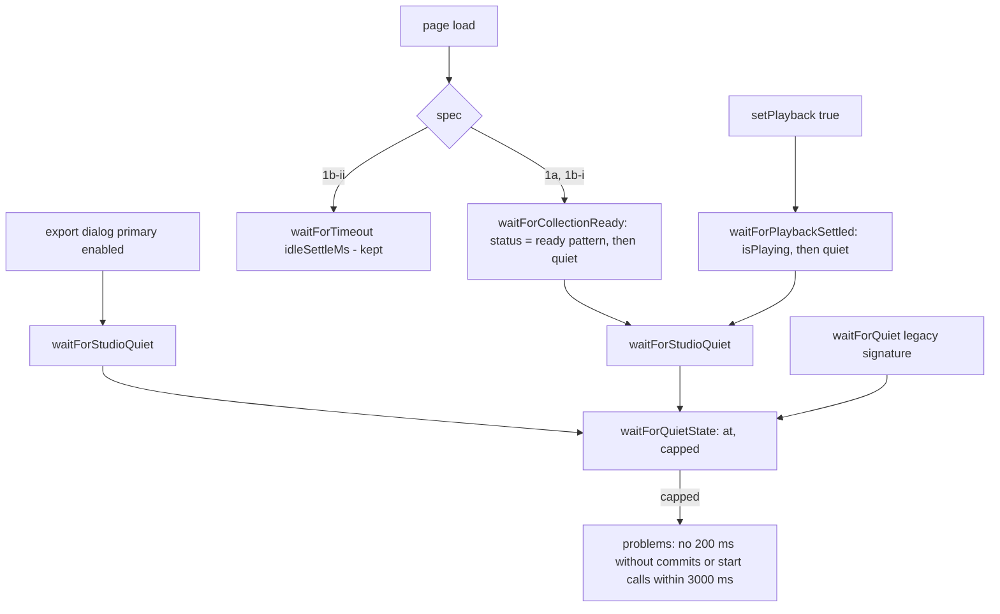
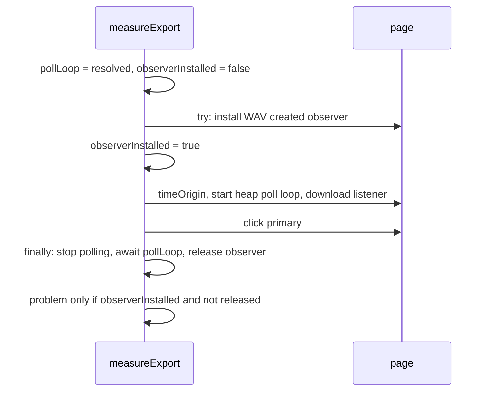

# Perf harness: მდგომარეობის ლოდინი fixed wait-ების ნაცვლად, deselect lane DOM-იდან და export observer-ის გათავისუფლება ყველა გზაზე (PERF-HARNESS-SHARED-LIB-b-ii-1)

**თარიღი:** 2026-10-31
**სტატუსი:** Completed (C round 280 PASS)
**შეცვლილი პროექტი:** Store

## კონტექსტი

სამი perf spec (PERF-1a, PERF-1b-i, PERF-1b-ii) გაზომვის ფანჯრებს გარეთ რამდენიმე ადგილას ფიქსირებულ `idleSettleMs`-ს (1000 ms) ან 300 ms-ს ელოდებოდა (GATE214-S1). fixed wait ან დროს კარგავს, ან ნელ მანქანაზე დაგვიანებულ სამუშაოს შემდეგ ფანჯარაში უშვებს. PERF-1b-i-ის deselect click lane-ს hard-coded id-ით (`'stems'`) ირჩევდა (GATE214-S2). PERF-1b-ii-ში "WAV created" observer-ი და heap poll loop-ი `try`-მდე იწყებოდა (GATE223-S2). HEAD-ზე რეალური გზა იყო observer-ის დაყენების შემდეგ `timeOrigin`-ის `evaluate`-ის შეცდომა: observer-ი გაუთავისუფლებელი რჩებოდა. poll loop-სა და `try`-ს შორის HEAD-ზე შეცდომის რეალისტური წყარო არ იყო, მაგრამ იქ ჩამატებული ნებისმიერი კოდი loop-ს დახურული context-ის შემდეგაც 50 ms-ში ერთხელ CDP-ზე დატოვებდა.

B-მა გაზომა, რომ load-ის შემდეგ მარტო „სიწყნარე“ არ კმარა: readiness-ის commit ~1.06–1.13 s-ზე ხდება, „Demo collection ready…“ სტატუსის commit კი ~470–510 ms-ით გვიან. 200 ms-იანი სიწყნარე მათ შორის ბრუნდება და გვიანი commit Add-ის ფანჯარაში ხვდება (`harness.hook-live` 2 → 3).

`app/**` არ შეცვლილა; ეს test-only რაუნდია. stage b-ii ორად გაიყო (D-29z636): ეს არის b-ii-1, R216-MEM-POLLS-HEADROOM b-ii-2-ში გადავიდა (round 280).

## მიდგომა

- **თითო ადგილზე ცალკე გადაწყვეტილება (D-29z637).** wait იცვლება მხოლოდ იქ, სადაც ის გაზომვას არ განსაზღვრავს:
  - 1a და 1b-i load-ის შემდეგ → `waitForCollectionReady` (ჯერ ready სტატუსის ტექსტი, შემდეგ სიწყნარე);
  - 1a Play-ის შემდეგ group fader-მდე და 1b-i Play-ის შემდეგ 30 clip-ით → `waitForPlaybackSettled` (ჯერ `isPlaying`, შემდეგ სიწყნარე);
  - 1b-ii export-ის dialog-ის primary ღილაკის ჩართვის შემდეგ → `waitForStudioQuiet`.
- **დარჩა (გაზომვის განსაზღვრების ნაწილია):** 1a-ის 2000 ms Add-ის შემდეგ (`harness.hook-live`-ის ფანჯარა, doc 168-ის გადაწყვეტილება), 1a-ის 1 s Play-ის შემდეგ და idle ფანჯარა (`play.idle-*`), 1b-ii-ის `idleSettleMs` load-ის შემდეგ (`res.mem.used-ready-mib` load-იდან გასულ დროზეა დამოკიდებული: HEAD-ზე 5.3, status wait-ით 5.9–6.0), 300 ms forced GC-ის შემდეგ (GC-ის დასრულებას page-ის სიგნალი არ აქვს) და `observerSettleMs` (buffered observer callback-ებს rAF არ იძლევა გარანტიას).
- **cap ჩუმად არ გადის.** ძველი `waitForQuiet` 3 s-იან cap-ზეც ისე ბრუნდებოდა, თითქოს სიწყნარე იყო. ახალი `waitForQuietState` აბრუნებს `capped`-ს, `waitForStudioQuiet` კი ამ შემთხვევაში pass-ის `problems`-ში წერს. `waitForQuiet`-ის signature და არსებული გამოძახებები უცვლელია.
- **სტატუსის ტექსტი app-იდან.** `perfCollectionReadyPattern` აიგება `workspaceCollectionCopy('demo').ready`-იდან, ამიტომ ტექსტის ცვლილება wait-ს ჩუმად ვერ გატეხავს. pattern მხოლოდ დასაწყისშია anchor-ირებული, რადგან settled status ready წინადადების შემდეგ ტექსტს შეიძლება ამატებდეს.
- **deselect lane (GATE214-S2).** `emptyLanePointAfterClip(clip)` clip-ის lane-იდან DOM-ის რიგით შემდეგ lane-ებს გადის; probe ძველივეა. fixture-ში რიგია video, music, stems, sfx და clip Music-ზეა, ამიტომ არჩეული lane ისევ `stems`-ია. ძველი `emptyLanePoint` წაიშალა (სხვა გამომძახებელი არ ჰქონდა).
- **გათავისუფლება ყველა გზაზე (GATE223-S2).** observer-ის დაყენება, `timeOrigin`-ის წაკითხვა, poll loop-ის დაწყება და download listener-ი `try`-ის შიგნით გადავიდა, იგივე რიგით. `pollLoop` `try`-მდე `Promise.resolve()`-ით ცხადდება; `observerInstalled` flag-ი `true` ხდება observer-ის დაყენებისთანავე და „not released“ problem მხოლოდ დაყენებულ observer-ზე იწერება.
- **ალტერნატივები, რომლებიც არ მივიღეთ:** მარტო quiet wait load-ის შემდეგ (B-ის sketch v1: `hook-live` 2 → 3, ready heap არადეტერმინისტული), named exception l.579-ზე (`performance-optimizer`; `tech-lead`-ის keep აირჩია B-მ) და double-rAF `observerSettleMs`-ის ნაცვლად.
- **ეკვივალენტობის contract-ი (D-29z640):** named exception არ არის; ყველა deterministic median, assert-ის pass და envelope B-ის HEAD oracle-ის (`873d835`) ტოლი უნდა იყოს.

## არქიტექტურა

## შეცვლილი ფაილები

- `perf/lib/page.ts`: `QuietWaitResult`, `waitForQuietState`, `waitForStudioQuiet`, `waitForCollectionReady`, `waitForPlaybackSettled`; `waitForQuiet` wrapper-ად იქცა; import `./app-labels`-იდან.
- `perf/lib/app-labels.ts`: `workspaceCollectionCopy`-ის import და `perfCollectionReadyPattern`.
- `perf/studio-lab.perf.spec.ts` (PERF-1a): load-ისა და group fader-ის წინა Play-ის wait-ები; import-ები.
- `perf/studio-lab-interactions.perf.spec.ts` (PERF-1b-i): load-ისა და 30 clip-ით Play-ის wait-ები; `emptyLanePointAfterClip` და მისი გამოძახება; import-ები.
- `perf/studio-lab-resources.perf.spec.ts` (PERF-1b-ii): export-ის dialog-ის wait; observer-ი, `timeOrigin`, poll loop-ი და download listener-ი `try`-ის შიგნით, `observerInstalled` flag-ი; import-ები.
- `docs/implementation/2026/quarter-IV/175-perf-harness-shared-lib.md`: helper-ების რუკა, GATE214-S2-ის სექცია და b-ii-ის TODO bullet.
- `docs/implementation/2026/quarter-IV/168-perf-interactions-baseline.md`, `169-perf-resources-baseline.md`, `176-perf-determinism-contract.md`: მხოლოდ b-ii-ის TODO bullet.

## პრობლემები და გადაწყვეტები

- **Problem:** load-ის შემდეგ quiet wait ready commit-სა და სტატუსის commit-ს შორის ბრუნდებოდა და სტატუსის commit Add-ის ფანჯარაში ხვდებოდა. **Solution:** ჯერ ready სტატუსის ტექსტის ლოდინი, შემდეგ სიწყნარე (`waitForCollectionReady`).
- **Problem:** 1b-ii-ში ready heap-ის მნიშვნელობა load-იდან გასულ დროზეა დამოკიდებული და ნებისმიერი state wait მას ცვლიდა. **Solution:** იქ fixed `idleSettleMs` დარჩა, როგორც გაზომვის განსაზღვრების ნაწილი.
- **Problem:** `waitForQuiet` cap-ზეც „სიწყნარეს“ აბრუნებდა, ამიტომ ვერ ჩანდა, wait რეალურად დამშვიდდა თუ არა. **Solution:** `capped` შედეგი და ხმამაღალი problem ახალ helper-ებში; ძველი signature უცვლელია.
- **Problem:** `try`-მდე აგდებული შეცდომა (HEAD-ზე `timeOrigin`-ის `evaluate`) observer-ს არ ათავისუფლებდა; poll loop-ის დაწყებასა და `try`-ს შორის ჩამატებული კოდი კი loop-საც გაჟონავდა. **Solution:** ყველაფერი `try`-ში, `pollLoop`-ის resolved საწყისი მნიშვნელობა და `observerInstalled` flag-ი.

## ტესტირება

- **`npm run typecheck`:** rc 0 (ფარავს `perf/**`-ს). **`npm run lint`:** rc 0 (`perf/`-ს არ ფარავს, L30). vitest-ის სტრიქონი არ დაემატა: `vitest.config.ts` მხოლოდ `app/**`-ს მოიცავს.
- **რეალური perf run** (`CI=true npx playwright test --config playwright.perf.config.ts`, Chromium 143.0.7499.4, production build :5188-ზე, მარტო): 3/3 გაიარა, 12.8 წთ. PERF-1b-i 5.1 წთ, PERF-1b-ii 1.0 წთ, PERF-1a 6.4 წთ (15 წთ-იანი limit-ის 43 %). სამივე report-ში `complete` = true, `failures` ცარიელია და pass-ებს `abortedAt`/`problems` არ აქვს.
- **ეკვივალენტობა:** `b-round-222/scripts/equiv-check.py` სამივე report-ს ადარებს B-ის oracle-ს (`b-round-278/baseline-results/`, HEAD `873d835`): სამივე rc 0, 0 problem (PERF-1a 316 სტრიქონი / 166 deterministic, PERF-1b-i 144 / 106, PERF-1b-ii 61 / 37).
- **Named mutant-ები** (scratch ასლებზე, repo-ს გარეთ: `git archive 873d835` + ეს diff + mutant, მხოლოდ დასახელებული spec): MU-READY (pass 1 `abortedAt` = `load`, `toHaveText` timeout), MU-CAP (`export 1: dialog open: no 200 ms without commits or start() calls within 3000 ms`), MU-PLAY (`abortedAt` = `play with 30 clips`), MU-LANE (`abortedAt` = `clip click`, ტექსტში `music`), MU-OBS-1 (`abortedAt` = `export 1 clip`, „was not released“ არ არის), MU-OBS-2 („was not released“ არის) — ყველა წითელია; კონტროლი MU-OBS-3 ამ სტრიქონზე მწვანეა („was not released“ არ არის).

## TODO / შემდეგი ნაბიჯები

- **PERF-HARNESS-SHARED-LIB-b-ii-2 (round 280, `209-perf-export-window-page-clock.md`):** შესრულდა. export-ის heap ნიმუში ფანჯარაში ითვლება request-response-ის შუა წერტილით page-ის საათზე, რომელსაც თითო export-ზე გაზომილი clock probe იძლევა; `mem-polls` detail-ში ჩანს ძველი endpoint წესის რაოდენობაც. R216-MEM-POLLS-HEADROOM watch რჩება (export-ზე დაახლოებით +1 ნიმუში).
- ROOT-REQ-PERF-TIMEOUT (PERF-1A-TIMEOUT-HEADROOM): PERF-1a 15 წთ-იანი limit-ის ნახევარზე მეტს იყენებს; root-ის გადაწყვეტილებას ელოდება.
- ROOT-REQ-VITEST-PERF-INCLUDE: `perf/**`-ის unit ტესტები vitest-ის include-ში ჯერ არ შედის.
- D-29z254-ის „არჩეული lane-ის id click-live-ის detail-ში“ ნაწილი round 281-ში შესრულდა (B-R280-CLICK-LIVE-LANE-ID, `210-perf-harness-load-diagnostics.md`): detail-ს ემატება `clipTrackId` და `emptyLaneTrackId`. იმავე რაუნდში GATE279-S1 (ჩავარდნილი demo source load-ზე დასახელებული შეცდომით წყვეტს pass-ს) და A-R279-REVIEW-LANE-NULL შესრულდა.
