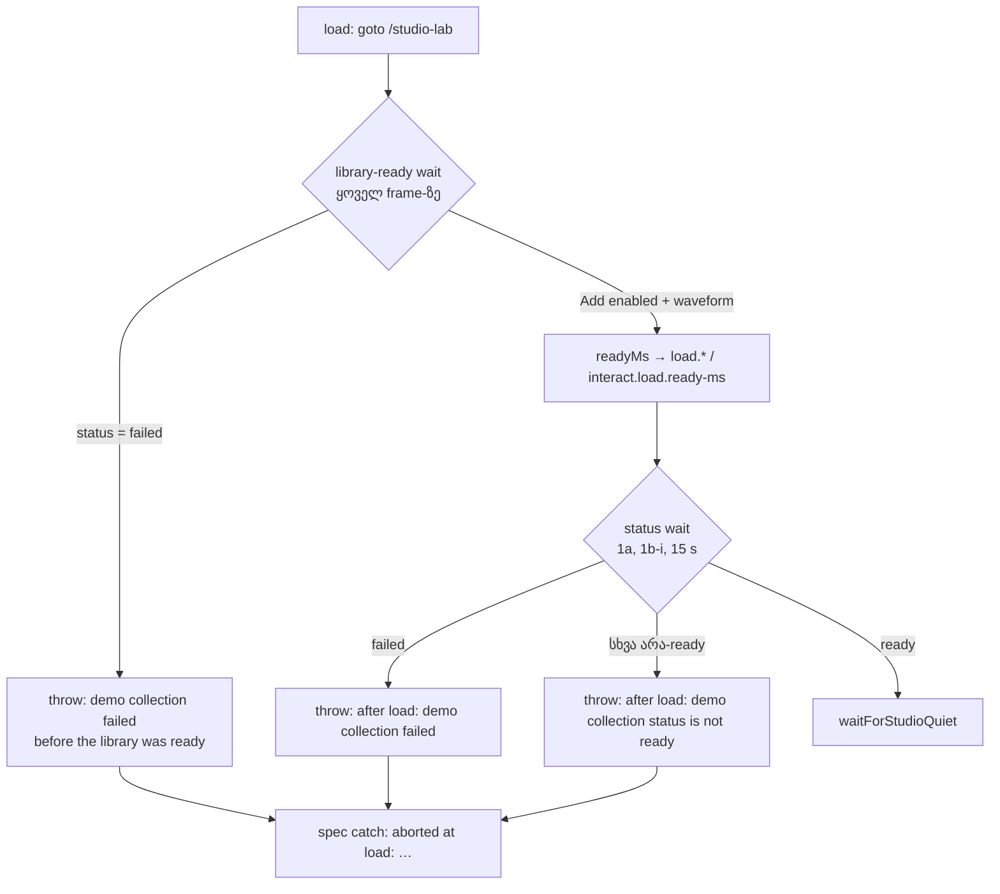

# Perf harness: ჩავარდნილი demo source load-ზე დასახელებული შეცდომით, lane-ების id click-live-ში (PERF-HARNESS-DIAG-281)

**თარიღი:** 2026-10-31
**სტატუსი:** Completed (C round 281 PASS)
**შეცვლილი პროექტი:** Store (მხოლოდ perf harness და docs; `app/` არ შეცვლილა)

## კონტექსტი

ამ რაუნდმა სამი მჭიდროდ დაკავშირებული harness-ის საკითხი დახურა (D-29z645):

| Id | Severity | რა |
|---|---|---|
| GATE279-S1 | Medium | ჩავარდნილი demo source და ნელი ლოდინი ერთნაირად გამოიყურებოდა: pass generic timeout-ით წყდებოდა |
| B-R280-CLICK-LIVE-LANE-ID | Low | D-29z254-ის დარჩენილი ნაწილი: deselect click-ის lane-ის id `interact.harness.click-live`-ის detail-ში არ ჩანდა |
| A-R279-REVIEW-LANE-NULL | Low | `emptyLanePointAfterClip`-ის Error-ის ტექსტში `found.ownTrack` შეიძლება `null` ყოფილიყო („lane null“) |

ყოველ perf pass-ში load-ის შემდეგ ორი ლოდინი მუშაობს:

1. **library-ready ლოდინი** (სამივე spec): page ყოველ frame-ზე, 90 s-მდე, ელოდება ბიბლიოთეკის Add ღილაკის enabled მდგომარეობას და preview waveform-ის დახატვას. HEAD-ზე სამ spec-ში ამის სამი ასლი იყო.
2. **status-ის ლოდინი** (`waitForCollectionReady`, მხოლოდ PERF-1a და PERF-1b-i): 15 s-მდე ელოდება, რომ status line ready ტექსტს დაემთხვეს.

B-მ `145f6c1`-ზე გაზომა, რას აკეთებს ჩავარდნილი demo source (dev server, 1440×900, `page.route` abort):

| abort-ებული request | status line | Add / waveform | HEAD-ზე რომელი ლოდინი ვარდება |
|---|---|---|---|
| არცერთი | `Demo collection ready. …` ≈ 2.3 s-ზე | enabled / დახატულია | არცერთი |
| `/middle-east.mp3` (არჩეული item) | `1 sound in the demo collection failed to load — details are in the library.` | `aria-disabled="true"` / არ არის | library-ready, **90 s**-ის შემდეგ: `page.waitForFunction: Timeout 90000ms exceeded.` |
| `/videos/hero/hero-music.mp3` (არაარჩეული) | იგივე failed ტექსტი | enabled / დახატულია | status-ის ლოდინი, **15 s**-ის შემდეგ, generic `toHaveText` timeout-ით (1a, 1b-i); PERF-1b-ii ვერაფერს ამჩნევს |
| ორივე | `2 sounds in the demo collection failed to load — details are in the library.` | — | როგორც `/middle-east.mp3`-ზე |

**წინაპირობის შესწორება (B-R281-GATE279-S1-PREMISE, D-29z657).** gate-ის reviewer-მა მიზეზად `waitForCollectionReady` დაასახელა. B-ის პირველმა sketch-მა მხოლოდ ის შეცვალა, მაგრამ mutant-მა აჩვენა, რომ არჩეული source-ის ჩავარდნისას ჯერ 90 s-იანი library-ready ლოდინი ვარდება და ახალი შემოწმება ვერასდროს მიდის. ამიტომ დიზაინი იმავე სამი საკითხის ფარგლებში გაფართოვდა: failed status-ს ორივე ლოდინი ამოწმებს.

## მიდგომა

- **ორი ახალი pattern აპის copy-დან** (`perf/lib/app-labels.ts`). private `countedTemplatePattern(render)` `failed(count)`-ს count 1-ითა და 2-ით არენდერებს (copy-ს singular და plural ფორმა აქვს), count-ის ციფრებს ზუსტად ერთხელ პოულობს (სხვა შემთხვევაში import-ისას აგდებს `count template needs exactly one count: <JSON>`), ტექსტს escape-ს უკეთებს და ორ ფორმას `|`-ით აერთებს, count-ის ნაცვლად `\d+`-ით. `perfCollectionFailedPattern` = `^(?:…)`, `perfCollectionSettledPattern` = ready ან failed. ორივე მხოლოდ დასაწყისშია anchor-ებული, როგორც ready pattern, რადგან settled ტექსტს loading-ის სუფიქსი შეიძლება მოჰყვეს.
- **საერთო `waitForLibraryReady(page)`** (`perf/lib/page.ts`). ერთი `page.waitForFunction` (`polling: 'raf'`, 90 s, უცვლელი). page-ში ყოველ frame-ზე ჯერ `[data-testid="arrangement-status"]`-ის ტექსტი მოწმდება `perfCollectionFailedPattern.source`-ით (`source` string გადაეცემა, ისევე როგორც არსებული `rangeLabelEnd.source`; pattern-ს flag-ები არ აქვს, ამიტომ არაფერი იკარგება). დამთხვევისას ბრუნდება `{ readyMs: null, failedStatus }`, Node-ის მხარე კი აგდებს `demo collection failed before the library was ready: <status>`-ს. სხვა შემთხვევაში HEAD-ის პირობა უცვლელია და ბრუნდება `{ readyMs: performance.now(), failedStatus: null }`. `state === null`-ის შემოწმება type guard-ია და არა assertion: `waitForFunction` მხოლოდ truthy მნიშვნელობაზე სრულდება, მაგრამ handle-ის ტიპი falsy მნიშვნელობასაც შეიცავს.
- **სამი call site.** PERF-1a `measureLoad` და PERF-1b-i `measureLoadReady` `readyMs`-ს `waitForLibraryReady`-დან იღებენ; PERF-1b-ii `measureLoadReady` მას იძახებს და რიცხვს არ იყენებს (HEAD-ზეც boolean იგნორირდებოდა).
- **`waitForCollectionReady`** ახლა `perfCollectionSettledPattern`-ს ელოდება (15 s), შემდეგ ტექსტს კითხულობს: failed-ზე აგდებს `${label}: demo collection failed: <status>`-ს, არა-ready-ზე `${label}: demo collection status is not ready: <status>`-ს (`performance-optimizer`: უცნობ status-ზე ჩუმად არ გავაგრძელოთ), ready-ზე `waitForStudioQuiet`-ს იძახებს. signature და ორი caller უცვლელია.
- **მხოლოდ throw, `problems.push` არა** (`tech-lead`): spec-ის catch load-ზე ჩავარდნას ერთხელ წერს, როგორც `aborted at load: <პირველი ხაზი>`.
- **ორი prefix განზრახ განსხვავდება**, რომ run-ში ჩანდეს, რომელმა ლოდინმა დაიჭირა: `aborted at load: demo collection failed before the library was ready: …` (library-ready) და `aborted at load: after load: demo collection failed: …` (status).
- **resources spec-ის scope.** PERF-1b-ii იღებს საერთო library-ready ლოდინს (მისი HEAD ასლი იგივე DOM-ის პირობას ამოწმებდა, ახალია მხოლოდ failed შტო). status-ის ლოდინი მას არ ემატება (`tech-lead` (b)): ready სიგნალი სხვაა და load-იდან გასულ დროზე დამოკიდებული სტრიქონები (`res.mem.used-ready-mib`) გადაადგილდებოდა. არაარჩეული source-ის შემთხვევა ამ spec-ში signal-ად რჩება (B-R281-RESOURCES-READY-FAILED).
- **lane-ის id-ები.** ახალი `interface EmptyLanePoint extends GrabPoint { trackId; clipTrackId }`. `emptyLanePointAfterClip` page-ის `evaluate`-ის შემდეგ რიგით ამოწმებს: clip lane-ის გარეშე → `the clip is not inside a lane with a data-track-id`; წერტილი არ არის → ძველი ტექსტი (`ownTrack` აქ უკვე string-ია); წერტილის lane-ს id არ აქვს → `the empty timeline point is on a lane without a data-track-id`; ძველი საკუთარი lane-ის შემოწმება. non-null ან type assertion არ არის. click-live-ის detail-ს სამი ძველი key-ის შემდეგ ემატება `clipTrackId` და `emptyLaneTrackId`. მნიშვნელობა, `live` წესი და problem ტექსტი უცვლელია. გაზომილი lane-ები `music` → `stems`-ია, ამიტომ sequence-ის ტექსტი და budget-ების note („empty Stems lane“) უცვლელია (`tech-lead` (c)).

## არქიტექტურა

## შეცვლილი ფაილები

- `perf/lib/app-labels.ts` — `countedTemplatePattern`, `perfCollectionFailedPattern`, `perfCollectionSettledPattern`.
- `perf/lib/page.ts` — import-ის ბლოკი, `waitForCollectionReady`-ის ტანი, ახალი `LibraryReadyState` და `waitForLibraryReady`.
- `perf/studio-lab.perf.spec.ts` — import და `measureLoad`-ის ლოდინი.
- `perf/studio-lab-interactions.perf.spec.ts` — import, `measureLoadReady`, `EmptyLanePoint`, `emptyLanePointAfterClip`-ის guard-ები და ტექსტები, click-live-ის detail.
- `perf/studio-lab-resources.perf.spec.ts` — import და `measureLoadReady`-ის ტანი.
- `docs/implementation/2026/quarter-IV/210-perf-harness-load-diagnostics.md` (ახალი) — ეს დოკუმენტი.
- docs 168 (Liveness-ის წესები, TODO), 169 (მიდგომის შესავალი, TODO), 175 (Helper-ების რუკა, GATE214-S2, TODO), 208 და 209 (round 281-ის TODO ბულეტი).

## პრობლემები და გადაწყვეტები

- **პრობლემა:** პირველი sketch ჯერ `problems`-ში წერდა და შემდეგ აგდებდა, ამიტომ spec-ის catch იგივე ჩავარდნას მეორედ ჩაწერდა (`tech-lead` (a1)). **გადაწყვეტა:** ორივე ლოდინი მხოლოდ აგდებს; ჩანაწერს ერთხელ spec-ის catch აკეთებს.
- **პრობლემა:** v1 sketch-მა მხოლოდ `waitForCollectionReady` შეცვალა და ვერასდროს ამოქმედდებოდა: `/middle-east.mp3`-ის ჩავარდნისას ყოველი pass ისევ `page.waitForFunction: Timeout 90000ms exceeded.`-ით წყდებოდა (`b-round-280/head-load-control-partial.json`, D-29z657). **გადაწყვეტა:** failed status-ს library-ready ლოდინიც ამოწმებს, და მისი სამი ასლი ერთ საერთო helper-ში გაერთიანდა.
- **პრობლემა:** `found.ownTrack` შეიძლება `null` ყოფილიყო და ტექსტში „lane null“ ჩნდებოდა. **გადაწყვეტა:** ცალკე guard პირველ რიგში; ამის შემდეგ ტიპი string-ია, რაც MU-NO-OWN-GUARD-მა დაადასტურა (guard-ის გარეშე TS2322).

## ტესტირება

`perf/**` vitest-ისა და Biome-ის include-ში არ შედის (L30), ამიტომ მტკიცებულებაა რეალური perf run, ეკვივალენტობის შემოწმება და დასახელებული mutant-ები. A-ის ზუსტი ბრძანებები და შედეგები `a-round-281.md`-შია.

- **TYPECHECK:** `npm run typecheck` rc 0. `npm run lint` rc 0 (მხოლოდ `app/`, 0 error).
- **PERF-RUN:** `CI=true npx playwright test --config playwright.perf.config.ts`, მარტო: **3 passed (13.4m)**. PERF-1b-i 5.1 წთ, PERF-1b-ii 1.1 წთ, PERF-1a 7.0 წთ.
- **EQUIV:** C-ის oracle-ებთან (`c-round-279/results-1/latest.json`, `latest-interactions.json`, `c-round-280/run-1/latest-resources.json`): PERF-1a 316 სტრიქონი / 166 deterministic / **0 problem**; PERF-1b-i 144 / 106 / **0 problem**; PERF-1b-ii 61 / 37 / **0 problem**, 1 tolerated (`res.export.1.peak-backing-delta-mib` 65 → 65.1, დასახელებული `--tol` სტრიქონი). სამივე rc 0.
- **DETAIL-LANE:** `interact.harness.click-live`-სა და `.6x`-ის 6/6 ნიმუშს სამი ძველი key-ის შემდეგ აქვს `clipTrackId` = `music` და `emptyLaneTrackId` = `stems`; report `complete: true`, `failures` ცარიელია.
- **MU-FAILED-SOURCE** (`**/middle-east.mp3` abort): `1 failed`; 6/6 pass `abortedAt` = `load`, ზუსტად ერთი problem: `aborted at load: demo collection failed before the library was ready: 1 sound in the demo collection failed to load — details are in the library.`; მთელი report `durationMs` 9206 (HEAD-ზე 90 s pass-ზე).
- **MU-FAILED-OTHER** (`**/hero-music.mp3` abort): `1 failed`; 6/6 pass `abortedAt` = `load`, ერთი problem იგივე ზუსტი status ტექსტით; 6/6-ში დაიჭირა library-ready ლოდინმა (`… before the library was ready: …`); `durationMs` 6716.
- **MU-STATUS-WAIT** (library-ready-ის failed შემოწმება გამორთულია, `**/hero-music.mp3` abort): `1 failed`; 6/6 pass-ში ზუსტად `aborted at load: after load: demo collection failed: 1 sound in the demo collection failed to load — details are in the library.`; `durationMs` 6969. ეს ამტკიცებს `waitForCollectionReady`-ის შტოს.
- **MU-NO-OWN-GUARD** (`ownTrack === null` guard წაშლილია): `tsc` rc 2, `TS2322: Type 'string | null' is not assignable to type 'string'` l.237-ზე (`clipTrackId: found.ownTrack,`).
- **HEAD-CONTROL:** `b-round-280/head-load-control-partial.json` — HEAD-ის load ნაბიჯი `/middle-east.mp3`-ის ჩავარდნისას pass-ზე 90 s-ს ელოდება (`page.waitForFunction: Timeout 90000ms exceeded.`).

## TODO / შემდეგი ნაბიჯები

- **B-R281-RESOURCES-READY-FAILED** (signal, Low): PERF-1b-ii-ს status-ის ლოდინი არ აქვს, ამიტომ არაარჩეული source-ის (`/hero-music.mp3`) ჩავარდნისას შეიძლება გააგრძელოს და გაზომოს.
- **GATE280-S1** (6×-ის შუა წერტილის round-trip-ის სტატისტიკა ნიმუშზე; R216-MEM-POLLS-HEADROOM watch-ს კვებავს) და **GATE280-S2** (probe-ის არხი poll-ის არხის წინააღმდეგ) ღიაა.
- **არქიტექტურის სიგნალები (დაგეგმილი არ არის):** A-R279-ARCH-IDLESETTLE-ROLES, GATE279-ARCH-COPY-STRINGS და GATE280-ARCH-PAGE-CLOCK-HELPERS.
- round 279-ის ლოდინების ჩანაწერი: `208-perf-harness-state-waits.md`; helper-ების მიმდინარე რუკა: `175-perf-harness-shared-lib.md`.
- ROOT-REQ-PERF-TIMEOUT და ROOT-REQ-VITEST-PERF-INCLUDE root-ის გადაწყვეტილებას ელოდება.
