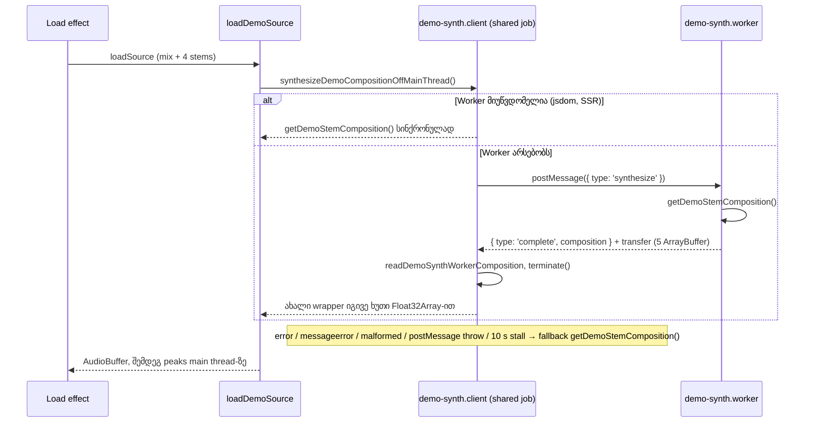

# Demo stem-ების synthesis module Web Worker-ში (PERF-2)

**თარიღი:** 2026-10-31
**სტატუსი:** Completed (C round 283 PASS)
**შეცვლილი პროექტი:** Store (`/studio-lab`-ის demo collection, perf harness, tests, docs)

## კონტექსტი

`/studio-lab`-ის demo collection-ში ოთხი synth stem (16 s, 48 kHz) და მათი mix იქმნება `getDemoStemComposition()`-ით. HEAD `000da42`-ზე ეს synthesis სინქრონულად სრულდებოდა `loadDemoSource`-ში, load effect-ის ერთ task-ში, main thread-ზე:

- Node-ში composition-ის აგება 412–413 ms-ია (`b-round-281/synth-node-timing.txt`, 3 run).
- Production build-ზე, Chromium-ში, 1440×900-ზე LoAF-ის script attribution-ით ორი long task ჩანს (`b-round-281/loaf-head.json`):
  - პირველი, 83–131 ms, hydration-მდე: parsing, style ან layout. მის LoAF-ში 5 ms-ზე გრძელი script არ არის, ამიტომ ის synth არ არის;
  - მეორე, 363–367 ms: ერთი script, `MessagePort.onmessage` (React-ის scheduler, რომელიც load effect-ს უშვებს). ეს არის synth.
- C-ის PERF-1a run-მა (round 281) `load.longtask-max` 366/368/368 აჩვენა.

perf-plan-ის სტრიქონი „load long task < 100 ms“ ამ ფორმით სრულად ვერ შესრულდება: PERF-2 synth-ის task-ს აშორებს, მაგრამ პირველი frame-ის task synth არ არის: B-ის sketch-ის PERF-1a run-ში `load.longtask-max` იყო [115, 108, 77] (`b-round-281/v2-1a/latest.json`), ხოლო round 282-ის A-ისა და C-ის run-ებში 82 და 73 ms-მდე. ამიტომ PERF-2-ის კრიტერიუმია `load.script-max` < 100 და synth-ის task-ის გაქრობა, არა „ყოველი load long task < 100 ms“. პირველი frame-ის task ცალკე სიგნალია: **PERF2-FIRST-FRAME-LONGTASK** (info).

## მიდგომა

- ახალი `demo-synth.client.ts` ერთ საერთო job-ს იწყებს (module-level promise, `??=`). ხუთი ერთდროული source და StrictMode-ის ხელახალი გაშვება მას იზიარებს, და job remount-საც უძლებს, როგორც ადრე `cachedDemoComposition`.
- Job ქმნის module Worker-ს, რთავს 10 s-ის stall timer-ს და აგზავნის `{ type: 'synthesize' }`-ს. სწორ `complete` შეტყობინებაზე resolve ხდება მიღებული ხუთი `Float32Array`-ით.
- Worker composition-ს აგებს და აგზავნის transfer list-ით (ხუთი `ArrayBuffer`), copy-ის გარეშე.
- **Fallback:** constructor-ის throw, `onerror`, `onmessageerror`, არასწორი შეტყობინება, `postMessage`-ის throw ან stall timer — ყველა შემთხვევაში ხდება ჩუმი fallback main thread-ის `getDemoStemComposition()`-ზე. Synthesis სუფთა და დეტერმინისტულია, worker-ის ჩავარდნა ინფრასტრუქტურის პრობლემაა, ამიტომ demo მუშაობას აგრძელებს. worker-ის შექმნის შემდეგ ყოველ გზაზე timer იწმინდება, სამი handler `null` ხდება და `terminate()` ერთხელ იძახება (constructor-ის throw-ზე worker და timer არ არსებობს).
- `typeof Worker === 'undefined'`-ზე (jsdom, SSR) client პირდაპირ სინქრონულ composition-ს აბრუნებს.
- `studio-lab-demo.ts`-ში `synthesizeDemoSamples` `async` გახდა: stem-ები და `demo-synth-mix` საერთო job-ს ელოდება, soft impact (6 ms) და slow rise (24 ms) სინქრონულად რჩება (ერთი job-ის ტიპი).
- Abort, unmount და StrictMode: client-ს abort wiring არ აქვს. Job გრძელდება, ხოლო load effect abort-ის შემდეგ შედეგებს ყრის. `ArrangementContext.tsx` და `demo-synth.ts` არ შეცვლილა.

**უარყოფილი ვარიანტები:**
- chunked yielding: main thread-ზე მაინც რჩება ~413 ms სამუშაო და resumable generator-ები დასჭირდებოდა;
- lazy synthesis პირველ გამოყენებაზე: ბიბლიოთეკა 5 item-ს duration-ისა და waveform-ის გარეშე აჩვენებდა და status ready-ზე ვერასოდეს გადავიდოდა;
- peaks worker-ში (`WeakMap` hand-off): `ArrangementContext.tsx`-ს შეეხებოდა, PERF-5-ს ეკუთვნის;
- stereo copy-ის მოშორება `generateDemoStereoChannels`-ში: ~1 ms source-ზე, სიგნალი PERF2-STEREO-COPY.

## არქიტექტურა

## შეცვლილი ფაილები

- `app/lib/arrangement/demo-synth.client.ts` — ახალი: საერთო job, worker-ის შექმნა, შეტყობინების სტრუქტურული შემოწმება `as`-ის გარეშე, transfer list, fallback-ები
- `app/lib/arrangement/demo-synth.worker.ts` — ახალი: synthesis worker-ში და გაგზავნა transfer-ით
- `app/data/studio-lab-demo.ts` — synth source-ები საერთო job-ს ელოდება; `demoSynths`-ს `demo-synth-mix` აღარ აქვს
- `perf/lib/instrumentation.ts` — LoAF entry-ს ყველაზე გრძელი script-ის `scriptMax`
- `perf/studio-lab.perf.spec.ts` — `measureSettled` (მხოლოდ 1×): settled-მდე ფანჯრის ოთხი სტრიქონი
- `perf/budgets.json` — ოთხი ახალი სტრიქონი; `load.commits` და `load.components` `wallclock`-ზე გადავიდა
- `app/lib/arrangement/__tests__/demo-synth-worker.test.ts` — ახალი: DW1–DW11
- `docs/implementation/2026/quarter-IV/163-studio-perf-harness.md`, `169-perf-resources-baseline.md` — harness-ის ახალი სტრიქონები და `scriptMax`

## პრობლემები და გადაწყვეტები

- **Problem:** worker-ის შეტყობინება mp3 decode-ს ეჯიბრება, ამიტომ `load.commits` და `load.components` pass-ებს შორის იცვლება ([5, 6, 5] და [371, 464, 371] C-ის round 282-ის run-ში). **Solution:** ორივე სტრიქონი `deterministic`-დან `wallclock`-ზე გადავიდა, როგორც round 224-ში `load.longtasks-over-50`.
- **Problem:** პირველი frame-ის long task (hydration-მდე) synth არ არის და `load.longtask-max`-ს 100-თან ახლოს ან მის ზემოთ ტოვებს (B-ის sketch run [115, 108, 77], `b-round-281/v2-1a/latest.json`). **Solution:** ceiling assert დადგა `load.script-max`-ზე (LoAF-ის ყველაზე გრძელი script settled-მდე), ხოლო პირველი frame-ის task სიგნალად დარჩა (PERF2-FIRST-FRAME-LONGTASK).
- **Problem (C-R282-01):** DW3 და DW9 `toBe`-ით ელოდა, რომ შედეგი ზუსტად ის ობიექტი იქნებოდა, რომელიც worker-მა გამოაგზავნა. Client-ი კი ტიპის დასავიწროებლად `as`-ის გარეშე ახალ wrapper-ს აბრუნებს, იმავე ხუთი array-ით. **Solution (ვარიანტი (a), კოდი უცვლელი):** client-ი ახალ wrapper-ს აბრუნებს **იმავე** ხუთი array-ის გარშემო, ამიტომ row-ები array-ებს `toBe`-ით ამოწმებს, wrapper-ს კი მნიშვნელობით (`toStrictEqual`); ყველა გამომძახებელი ერთ შედეგის ობიექტს იღებს. ვარიანტი (b), მიღებული ობიექტის დაბრუნება, type assertion-ს ან შეუმოწმებელ type predicate-ს მოითხოვდა.
- **Problem (C-R282-03):** DW10-ის sample-ების ციკლი ცარიელი იყო: worker module და ტესტი ერთ `demo-synth` module instance-ს იზიარებდა, ამიტომ თითო array საკუთარ თავს ედარებოდა (MU-U4 ძველ ფაილზე DW10-ს მწვანედ ტოვებდა). **Solution:** handler-ის გაგზავნის შემდეგ ტესტი `vi.resetModules()`-ს იძახებს და `demo-synth`-ს თავიდან იმპორტავს, ანუ `expected` დამოუკიდებლად იქმნება; ციკლამდე მოწმდება, რომ ყოველი გაგზავნილი array სხვა ობიექტია (`a === b` → `false`). `expect(a).not.toBe(b)` ორ 768 000-float array-ზე DW10-ს ~16.6 s-მდე აგრძელებდა (vitest failure hint-ისთვის deep equality-ს ითვლის), 5 s-ის default timeout-ის ზემოთ, ამიტომ `===` ფორმა დარჩა.

## ტესტირება

**Unit (`demo-synth-worker.test.ts`, vitest, jsdom):**

| Row | რას ამოწმებს |
|---|---|
| DW1 | Worker global-ის გარეშე resolve სინქრონული composition-ის ობიექტზე |
| DW2 | ხუთი ერთდროული გამოძახება: ერთი worker და ერთი `synthesize` შეტყობინება |
| DW3 | სწორი `complete`: ხუთივე შედეგი = ერთი ობიექტი, wrapper `toStrictEqual`, ხუთი array `toBe`; worker გათავისუფლებულია |
| DW4 | `onerror` → fallback stall timer-ის მოლოდინის გარეშე |
| DW5 | `onmessageerror` → fallback stall timer-ის მოლოდინის გარეშე |
| DW6 | არასწორი შეტყობინება → fallback: (a) composition-ის გარეშე, (b) pulse stem ჩვეულებრივი array-ია |
| DW7 | Worker constructor-ის throw → fallback |
| DW8 | stall timer → fallback მხოლოდ სრული timeout-ის შემდეგ |
| DW9 | მომდევნო გამოძახება დასრულებულ job-ს იყენებს ახალი worker-ის გარეშე (`toBe` პირველ შედეგზე) |
| DW10 | worker module აგზავნის სრულ composition-ს დამოუკიდებლად აგებულ `expected`-თან შედარებით და transfer-ში ზუსტად ხუთ buffer-ს |
| DW11 | `postMessage`-ის throw → fallback stall timer-ის მოლოდინის გარეშე, არაფერი გაიგზავნა, worker გათავისუფლებულია |

- A, round 283: 5 ფაილი / 101 ტესტი PASS (`demo-synth-worker`, `demo-synth`, `studio-lab-demo`, `library-notice-ui`, `strings`); DW10 0.72 s.
- **Mutant-ები** (scratch ასლზე, თითო ერთი ხაზი კოდში): MU-U1 (`??=` → `=`) აწითლებს DW2, DW3, DW9; MU-U2 (`onerror` fallback-ის გარეშე) — DW4; MU-U3 (transfer list-ის გარეშე) — DW10; MU-U4 (worker გაგზავნამდე mix-ს გადაწერს) — DW10; MU-U5 (`postMessage` catch-ში `finish(null)`-ის ნაცვლად `return`) — DW11. საკონტროლო: MU-U4 round 282-ის ძველ ტესტ ფაილზე DW10-ს მწვანედ ტოვებს.

**Perf და browser — round 282-ის გაზომვები იმავე კოდის byte-ებზე** (ექვსი კოდის ფაილი round 283-ში byte-identical დარჩა, ამიტომ თავიდან არ გაზომილა):
- A-ის perf run: `a-round-282.md` §Perf და `a-round-282/perf/` — `3 passed (13.2m)`; `load.script-max` assert PASS, მედიანა 46 [40…59], ზღვარი < 100.
- C-ის perf run: `c-round-282.md` §Perf — `3 passed (13.1m)`; `load.script-max` მედიანა 44 [41, 53, 44]; `load.commits` [5, 6, 5], `load.components` [371, 464, 371].
- EQUIV: `c-round-282/equiv.txt` — ხუთივე შედარება rc 0, 0 problems.
- MU-SYNC-FALLBACK (client ყოველთვის სინქრონულ გზას ირჩევს): `load.script-max` assert ვარდება, მედიანა 372 (A) და 371 (C).
- WAV export-ის sha256 ორივე viewport-ზე უცვლელია: pulse `1fea093b…`, ყველა 7 clip `72228706…` (`c-round-282/export-c282.json`).
- JS bytes: C-ის EQUIV-ში (1b-ii vs C round 281) მხოლოდ ოთხი `res.js.*` სტრიქონი შეიცვალა: studio-lab encoded 366522 → 366987, decoded 1161439 → 1162601, home 263569 → 263571, studio-guard 286179 → 286181 (`c-round-282.md` §Perf).
- WORKER-BROWSER: `c-round-282/worker-probe.json` — worker-ის chunk-ის request და dedicated worker ყოველ run-ში, 100 ms-ზე გრძელი script 0, page error 0.

## TODO / შემდეგი ნაბიჯები

- **PERF2-FIRST-FRAME-LONGTASK** (info): hydration-მდე პირველი frame-ის long task; კანდიდატები PERF-11 (root diet) და PERF-7 (fonts).
- **PERF2-STEREO-COPY:** `generateDemoStereoChannels`-ის stereo copy (~1 ms source-ზე), PERF-5-სთვის.
- Peaks worker-ში (PERF-5).
- **A-R282-REVIEW-WORKER-PROTOCOL** (არქიტექტურის შენიშვნა, დაგეგმილი არ არის): worker↔client protocol (`DemoSynthWorkerResponse`, `demoCompositionTransfer`) client-შია, ამიტომ worker საკუთარ launcher-ს იმპორტავს. შესაძლებელია ნეიტრალურ module-ში გადატანა ქცევის ცვლილების გარეშე.
