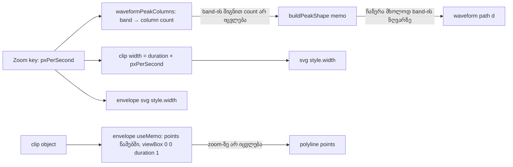

# Zoom-ის დროს waveform-ის column band-ები და envelope-ის ხაზი წამებში (PERF-3a)

**თარიღი:** 2026-10-31
**სტატუსი:** Completed (PERF-3a stage; C round 284 PASS; PERF-3 exit → doc 222)
**შეცვლილი პროექტი:** Store (`/studio-lab`-ის Arrangement: lane waveform, clip envelope, tests, docs)

## კონტექსტი

PERF-3-ის outline ამბობდა, რომ zoom-ის ყოველ ნაბიჯზე waveform-ის path თავიდან იწერება. B-მ ეს premise HEAD `54a3fcc`-ზე ხელახლა გაზომა (D-29z673): production build, Chromium 1440×900, `/studio-lab`, Add და Ctrl+D ×29 — 30 clip, თითო 101.352 s, probe `b-round-283/zoom-probe3.cjs`.

- **Zoom in, შემდეგ out** (`=` ×5, `-` ×5; 40 → 122.1 → 40 px/s): waveform-ის `d` attribute-ის ჩაწერები key-ზე `[30,0,0,0,0,0,0,0,0,30]`, სულ 60, 3/3 გაშვებაში (`b-round-283/probe-results/head-in-*.json`). Event Timing keydown: 88–104 ms key 1-სა და 10-ზე (path-ის გადაწერა), 152 ms key 5-ზე, 104 ms key 6-ზე, დანარჩენზე დაახლოებით 40 ms.
- **Zoom out, შემდეგ in** (40 → 13.1 → 40 px/s): ჩაწერები `[30 ×10]`, სულ 300, 3/3 გაშვებაში (`b-round-283/probe-results/head-out-*.json`); Event Timing 40–128 ms.
- **მიზეზი:** lane waveform-ის column count იყო `round(min(width, 4096))`, და path-ის memo ამ რიცხვზეა მიბმული. cap-ის ქვემოთ zoom-ის ყოველი ნაბიჯი count-ს ცვლის და 30-ივე path-ს გადაწერს; cap-ის ზემოთ (101-წამიანი clip 4096 px-ზე განიერია დაახლოებით 41 px/s-დან) — არა.
- **Ruler:** key 5-ზე (122.1 px/s) document-ს **6,142 DOM node** ემატება (`b-round-283/head-detail.json`, `dNodes`). testid-ების აღწერით ხუთ `=` key-ზე `arrangement-ruler`-ის subtree 30 clip-ით 6,143 node-ით იზრდება, 1 clip-ით — 264-ით (`b-round-283/probe-results/nodes-head-30.json`, `nodes-head-1.json`). seconds ruler მთელ arrangement-ზე ყოველ ნაბიჯზე ერთ tick-ს ხატავს — ეს ყველაზე ნელი zoom key-ის მიზეზია და PERF-3b-ს ეკუთვნის.
- **Envelope:** Env mode-ში (30 ხაზი, თითოში 2 polyline) სამ `=` key-ზე (40 → 50 → 62.5 → 78.1 px/s) HEAD წერს 180 `points` და 90 `viewBox` attribute-ს (`b-round-283/probe-results/head-env-*.json`), რადგან ხაზის x კოორდინატები პიქსელებში იყო.

ამიტომ PERF-3 სამ ეტაპად გაიყო (D-29z685): **PERF-3a** (ეს ეტაპი) — waveform-ის column band-ები და envelope-ის ხაზი წამებში; **PERF-3b** — ruler-ის tick windowing; **PERF-3c** — harness-ის row-ები და საბოლოო მიზანი.

## მიდგომა

### Column band-ები (D-29z674)

`waveformPeakColumns(duration, pxPerSecond)` column count-ს zoom band-ის მიხედვით ირჩევს და არა პიქსელის მიხედვით. ციკლი `bucketsPerColumn`-ს 1-დან ×4-ით ზრდის, სანამ `bucketsPerColumn × 4 × (pxPerSecond / 100) ≤ 1`; შედეგად `bucketsPerColumn` არის 4-ის უდიდესი ხარისხი, რომლისთვისაც `bucketsPerColumn × (pxPerSecond / 100) ≤ 1` (ან 1). მაგალითად 20 px/s-ზე ეს 4-ია. შედეგი `max(1, min(4096, ceil(ceil(duration × 100) / bucketsPerColumn)))`. თუ სიგანე არა-finite-ია ან 0.5 px-ზე ნაკლებია (`round(width) ≤ 0`), ფუნქცია 0-ს აბრუნებს, როგორც ძველი ფორმულა.

თვისებები:
- პიქსელზე მინიმუმ ერთი column (cap-ისა და bucket-ების რაოდენობამდე) და ოთხზე ნაკლები;
- count მუდმივია band-ებში: 25 px/s-ის ზემოთ, (6.25, 25] და (1.5625, 6.25] — ქვედა ზღვარი ღიაა (მაგ. 6.25 px/s უკვე შემდეგ band-ს ეკუთვნის), ზღვრები ×4-ით.

**ალტერნატივა:** `performance-optimizer`-ის წესი — 2-ის შემდეგი ხარისხი ≥ სიგანეზე. უარყოფილია: 1.25×-იანი ნაბიჯებით ის path-ს დაახლოებით ყოველ მესამე ნაბიჯზე მაინც გადაწერს, band-ები კი 25-დან 320 px/s-მდე საერთოდ არ გადაწერს (`tech-lead`-ის consult).

`PEAK_SHAPE_MAX_COLUMNS` (4096) `ArrangementClip.tsx`-დან `peaks.ts`-ში გადავიდა, ახალი ფუნქციის გვერდით; სხვა მომხმარებელი არ ჰქონდა. `buildPeakShape`, მისი memo, waveform-ის svg, fades svg, video, folded და gain-draft ქცევა უცვლელია. Detail panel-ის waveform ფიქსირებულ column count-ს ინარჩუნებს.

### Envelope-ის ხაზი წამებში (D-29z675)

ხილული წერტილები, პირველი/ბოლო gain, polyline-ის `points` (x = `time − sourceOffset` წამებში, ბოლო წერტილი `duration`-ზე, ან 1-ზე თუ duration ≤ 0) და editor-ის `slots` ერთ `useMemo`-შია `[clip]`-ზე, early return-ის ზემოთ. viewBox არის `0 0 <spanSeconds> 1`; zoom-ზე იცვლება მხოლოდ svg-ის `style.width` (`max(1, width)`). `left` offset, `vectorEffect="non-scaling-stroke"`, ორი polyline და editor-ის pixel პოზიციები და handler-ები უცვლელია.

**< 1 px clip-ის წესი:** `lineWidth` რჩება `max(1, width)`, ამიტომ sub-pixel clip-ის შიდა vertex-ები 1 px-ზე აისახება. მიღებულია — უხილავია.

### რა არ შედის ამ ეტაპში

ruler, bars ruler, fades svg, `ArrangementDetailPanel`, perf harness და budget-ები, context split (PERF-10).

## არქიტექტურა

## შეცვლილი ფაილები

| ფაილი | დანიშნულება |
|---|---|
| `app/lib/arrangement/peaks.ts` | `PEAK_SHAPE_MAX_COLUMNS` და `waveformPeakColumns` (band-ის წესი) |
| `app/components/arrangement/ArrangementClip.tsx` | column count `waveformPeakColumns`-იდან; ლოკალური constant წაიშალა |
| `app/components/arrangement/ArrangementClipEnvelope.tsx` | ხაზის points/viewBox წამებში, memo `[clip]`-ზე |
| `app/lib/arrangement/__tests__/waveform-outline-path.test.tsx` | ZQ2, ZQ2b |
| `app/lib/arrangement/__tests__/clip-gain-waveform.test.tsx` | ZQ1 |
| `app/lib/arrangement/__tests__/clip-envelope-ui.test.tsx` | ZQ3; EU5 და EU7 გადაწერილია წამებზე |
| `docs/implementation/2026/quarter-IV/212-perf-zoom-waveform-columns.md` | ეს დოკუმენტი |

## პრობლემები და გადაწყვეტები

- **პრობლემა:** waveform-ის სიმკვეთრე 41 px/s-ის ქვემოთ — band-ში პიქსელზე 1–4 column მოდის, ამიტომ spike-ები ოდნავ რბილად anti-alias-დება. **გადაწყვეტა:** B-მ pixel-ები შეადარა (`b-round-283/imgdiff-head-vs-sketch.json`): ≥ 50 px/s-ზე waveform pixel-identical-ია HEAD-თან (meanAbs 0); cap-ის ქვემოთ meanAbs ≤ 5.001, |Δ| > 32 pixel-ების წილი ≤ 6.057 %, 13.1 px/s-ზე (`b-round-283/shots/compare-out4.png`: იგივე ფორმა, ოდნავ რბილი spike-ები). C-ის WAVE-PIXELS row ამას ზღუდავს.
- **პრობლემა:** EU5 და EU7 ხაზის vertex-ებს პიქსელებში ამოწმებდნენ (40 px/s). **გადაწყვეტა:** ორივე გადაიწერა წამებზე (EU7 `[0,0.2],[2,0.2]`; EU5 `[0,0],[4,0],[8,0.2],[12,0],[16,0]` და `'0,0 1,0'`) — ტოლი სიძლიერის ჩანაცვლება, assertion არ დაკარგულა. AL1 უცვლელია და pixel alignment-ს კვლავ ამტკიცებს.
- **პრობლემა:** memo-ს deps-ის შეცდომა envelope-ის რედაქტირებას გატეხდა. **გადაწყვეტა:** mutant Z4 (deps `[]`) EU3/EU4/AL1/EUDB2/EUDB3 row-ებზე წითელია.

## ტესტირება

- **Unit (A, round 284):** `waveform-outline-path`, `clip-gain-waveform`, `waveform-zoom`, `clip-gain-pointer-preview`, `content-colour-ui`, `clip-envelope-ui`, `strings`, `affordance-colour-ui`, `studio-theme-obsidian` — 9 ფაილი / 171 ტესტი PASS. `npm run typecheck` rc 0; `npm run lint` 0 error, 205 warning (gate 283-ის ტოლი).
- **Row-ები:**
  - **ZQ1** — 40 px/s-ზე lane column-ები `[1200, 200]`; zoom 50 → 62.5 → 80 `{d, columns}`-ს არ ცვლის, `MutationObserver` 0 `d`/`viewBox` ჩაწერას აფიქსირებს; 20 px/s — 300 და 50 column, ზუსტად 2 `d` ჩაწერა.
  - **ZQ2** — `waveformPeakColumns`-ის 18-შემთხვევიანი ცხრილი (band-ის ზღვრები, cap, < 1 px, NaN, 0 px/s).
  - **ZQ2b** — 0.5…320 px/s ×1.25 sweep ოთხ duration-ზე: column-ები ≥ min(cap, round(width), buckets) და ≤ ceil(4 × width) + 1.
  - **ZQ3** — viewBox `0 0 16 1`; zoom 50 → 62.5 → 80-ზე იგივე svg node, `style.width` = 16 × zoom, `points` უცვლელი, 0 mutation.
  - **EU5, EU7** — vertex-ები წამებში.
- **Mutant-ები** (A-მ საკუთარ scratch ასლზე გაუშვა; B-ის შედეგი `b-round-283/mutants.txt`):

| Mutant | ცვლილება | წითელია |
|---|---|---|
| HEADCODE | HEAD-ის სამი code ფაილი (`peaks.ts` შენარჩუნებით) | ZQ1, ZQ3, EU5, EU7 |
| Z1 | HEAD-ის ფორმულა `ArrangementClip.tsx`-ში | ZQ1 |
| Z2 | band factor 4 → 2 | ZQ2, ZQ1 |
| Z3 | envelope-ის x პიქსელებში memo-ში | EU5, AL1 ×2 |
| Z4 | memo deps `[]` | EU3/EU4/AL1/EUDB2/EUDB3 (9 row) |
| Z5 | band-ების გარეშე | ZQ2, ZQ2b, ZQ1 |

- **ბრაუზერის smoke (A, საკუთარი production build):** `zoom-probe3.cjs`, `in` mode, 30 clip — `d` ჩაწერები ყველა key-ზე 0 (sum 0). B-ის sketch-ის გაზომვები: zoom in `[0 ×10]`, zoom out `[0,0,30,0,0,0,0,30,0,0]` (მხოლოდ 25 px/s-ის გადაკვეთაზე), envelope 0 `points`/`viewBox` ჩაწერა, dot-ისა და vertex-ის Δ 0 px ორივე viewport-ზე (`b-round-283/probe-results/sketch-*.json`). საბოლოო ბრაუზერის მტკიცებულება C round 284-ისაა.

## TODO / შემდეგი ნაბიჯები

- **PERF-3b:** seconds ruler-ის tick windowing (`play.idle-commits`-ის შენარჩუნებით).
- Harness-ის row-ები: Event Timing p95 თითო zoom key-ზე, path-ის გადაწერები, ruler-ის node-ები და Ctrl+wheel baseline (`scope_addition_d29z215`).
- PERF-3-ის საბოლოო მიზანი 30 clip-ით PERF-3c-ზე გაიზომა (doc 222); exit-ის გადაწყვეტილება და PERF-3d იქაა.
