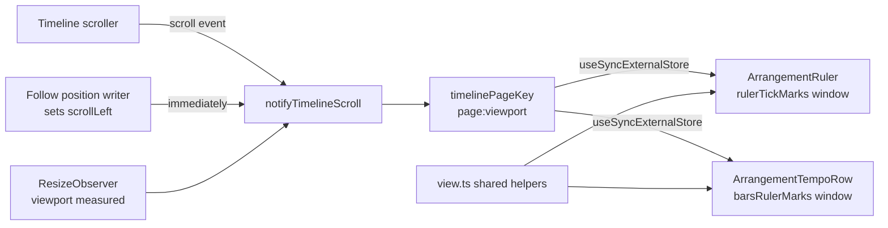

# Seconds ruler-ის tick-ები მხოლოდ page window-ში და Follow page flip-ის შევსება (PERF-3b)

**თარიღი:** 2026-10-31
**სტატუსი:** Completed (PERF-3b stage; C round 285 PASS; PERF-3 exit → doc 222)
**შეცვლილი პროექტი:** Store (`/studio-lab`-ის Arrangement: seconds ruler, bars ruler-ის page helper-ები, Follow scroll, tests, docs)

## კონტექსტი

PERF-3a-ის (doc 212) შემდეგ zoom-ის ყველაზე ნელი key seconds ruler-ზე დარჩა. B-მ round 284 → 285-ის დაგეგმვისას HEAD `0f99960` გაზომა: production build, Chromium, `/studio-lab`, Add და Ctrl+D ×29 — 30 clip, თითო 101.352 s, probe `b-round-284/ruler-probe.cjs`.

- **HEAD:** seconds ruler მთელ arrangement-ზე ყოველ tick-ს ხატავს. 40 px/s-ზე ruler-ში **6,143** element-ია ორივე viewport-ზე, 122.1 px/s-ზე (zoom key 5) — **12,286**. Event Timing keydown key 5-ზე 112 ms (1440) და 160 ms (1280), key 6-ზე 64–72 ms (`b-round-284/probe-results/head-in-1440.json`, `head-in-1280.json`).
- Follow playback 40 px/s-ზე და scroll jump-ები ruler-ის DOM-ს არ ცვლის (`head-follow*.json`, `head-jump-*.json`) — პრობლემა მხოლოდ tick-ების რაოდენობაა.
- bars ruler-ს (tempo row) უკვე ჰქონდა სამი viewport-ის page window; seconds ruler-ს — არა.

## მიდგომა

- **საერთო page helper-ები (D-29z683).** bars ruler-ის private helper-ები `view.ts`-ში გადავიდა საერთო export-ებად, ქცევის შეცვლის გარეშე: `TimelinePxWindow`, `TimelinePage`, `readTimelinePage`, `timelinePageKey`, `getServerTimelinePageKey`, `parseTimelinePageKey`, `timelinePageWindow`. window არის `[(page − 1) × viewport, (page + 2) × viewport]`. ორივე ruler ერთსა და იმავე კოდს იყენებს, ასე რომ ორი ასლი ვეღარ დაშორდება ერთმანეთს.
- **`rulerTickMarks(seconds, pxPerSecond, rulerWindow?)`.** window-ის გარეშე აბრუნებს HEAD-ის იმავე სიას. window-ით აგებს მხოლოდ window-ის გარშემო index range-ს (მცირე slack-ით), label-ს ითვლის **სრული** ruler-ის სიგანის მიხედვით და ტოვებს მხოლოდ `fromPx ≤ x ≤ toPx` mark-ებს — შედეგი სრული სიის window-ით გაფილტრული ვერსიის ტოლია. non-finite ან შებრუნებული window → `[]`, ისევე როგორც `barsRulerMarks`-ში.
- **`ArrangementRuler`.** ახალი optional prop-ები `getTimelineViewportPx` და `subscribeTimelineScroll`. page key იკითხება `useSyncExternalStore`-ით; memo-ს ticks component-ს `fromPx`/`toPx` რიცხვებად გადაეცემა, ამიტომ page-ის შიგნით scroll render-ს არ იწვევს. თითო tick-ს დაემატა `data-testid="arrangement-ruler-tick"` და `data-time` (1e-6 s-მდე დამრგვალებული, bars mark-ების ფორმატით). ეს attribute-ები არ ჩანს.
- **უცნობი viewport (D-29z684).** SSR-ზე ან ჯერ გაუზომავ scroller-ზე viewport 0-ია და **ყველა** tick იხატება — იგივე წესი, რაც bars ruler-ს უკვე ჰქონდა. ბრაუზერში resize effect scroll listener-ებს ატყობინებს და mount-ზევე window ცვლის სრულ სიას (start count 94 — 1440, 78 — 1280). `performance-optimizer`-ის capped fallback უარყოფილია: bars ruler-ის ქცევას შეცვლიდა და jsdom-ის full-render row-ებს (BU1, SR1, `tempo-ui`) დაარღვევდა.
- **უარყოფილი ალტერნატივები:** CSS gradient ხაზები (ყოველ tick-ს label აქვს, დაზოგვა არ არის); hysteresis-იანი tile-ები (page window-ს უკვე აქვს — page-ის შიგნით scroll არაფერს ხატავს, SR3); helper-ების მეორე ასლი ruler-ში (დრიფტის რისკი).
- **Follow notify.** Follow-ის position writer `scrollLeft`-ის დაყენების შემდეგ მაშინვე იძახებს `notifyTimelineScroll()`-ს. scroll event-ის შემდეგი notify იგივე page key-ს პოულობს და render-ს აღარ იწვევს.
- **სამ ეტაპად დაყოფა (D-29z685):** PERF-3a (doc 212) — waveform და envelope; **PERF-3b** (ეს ეტაპი) — ruler-ის tick windowing; **PERF-3c** — harness-ის row-ები და PERF-3-ის საბოლოო გადაწყვეტილება, რადგან ის perf harness-ის კონტრაქტს ცვლის.

## არქიტექტურა

key იცვლება მხოლოდ page-ის გადაკვეთისას ან viewport-ის ზომის ცვლილებისას; playhead-ის frame-ები key-ს არ ეხება (SR5).

## შეცვლილი ფაილები

- `app/lib/arrangement/view.ts` — საერთო page helper-ები და `rulerTickMarks`-ის window.
- `app/components/arrangement/ArrangementRuler.tsx` — page key-ის subscription, windowed ticks, tick-ის testid და `data-time`.
- `app/components/arrangement/ArrangementTempoRow.tsx` — private helper-ების ნაცვლად საერთო import-ები.
- `app/components/arrangement/StudioWorkspace.tsx` — ruler-ს ორი prop; Follow writer-ში `notifyTimelineScroll()` და dependency.
- `app/lib/arrangement/__tests__/view.test.ts` — RW1–RW3.
- `app/lib/arrangement/__tests__/tempo-window-ui.test.tsx` — SR1–SR6.
- `docs/implementation/2026/quarter-IV/212-perf-zoom-waveform-columns.md` — სამეტაპიანი დაყოფის სამი ხაზი.

## პრობლემები და გადაწყვეტები

- **პრობლემა:** 30 clip-ზე seconds ruler 6,143–12,286 element-ს ხატავდა, zoom key 5 კი 112–160 ms-ს იღებდა. **გადაწყვეტა:** სამი viewport-ის page window. B-ის sketch-ის გაზომვა (`b-round-284/probe-results/final-in-1440.json`, `final-in-1280.json`, `final-out-*.json`): `in` path — 1440: 94, შემდეგ `[76,62,50,40,64,40,50,62,76,94]`; 1280: 78, შემდეგ `[64,52,42,34,52,34,42,52,64,78]`. `out` path — 1440: `[60,74,92,48,60,48,92,74,60,94]`; 1280: `[50,62,78,40,50,40,78,62,50,78]`. Event Timing `in` key-ებზე 16–24 ms (1440) და 16 ms (1280); `out` path-ის მაქსიმუმი 56 ms (1440) და 48 ms (1280) key 8-ზე — ეს PERF-3a-ის 25 px/s waveform band-ის გადაკვეთაა და არა ruler. jump-ები 25 / 50 / 99.9 / 0 %-ზე: 140 / 140 / 129 / 94 (1440) და 114 / 114 / 114 / 78 (1280) (`final-jump-*.json`). ყველა ნაბიჯსა და jump-ზე ხილული tick-ებიდან 0 აკლია (`coverage`).
- **პრობლემა:** ruler-ის pixel-ები არ უნდა შეცვლილიყო. **გადაწყვეტა/მტკიცებულება:** ხილული ruler-ის 28 screenshot თითო viewport-ზე HEAD-ის pixel-ების იდენტურია, meanAbs 0 (`final-imgdiff-1440.json`, `final-imgdiff-1280.json`). `follow-zoom-stopped` არ შედარდება — ორი build playback-ს სხვადასხვა პოზიციაზე აჩერებს.
- **პრობლემა (B-მ იპოვა):** დაახლოებით 298 px/s-ზე Follow view-ს `scrollLeft`-ით აბრუნებს, page key კი მხოლოდ შემდეგი frame-ის scroll event-ზე ახლდებოდა. post-frame შემოწმებამ (`flip-probe.cjs`: `requestAnimationFrame` → `setTimeout 0`, ანუ რაც დაიხატა) page-ის გადაკვეთის ყოველ flip-ზე **ერთი დახატული frame** იპოვა ხილული tick-ების გარეშე: `[1,1]` (1440) და `[1,1,1]` (1280) (`sketch-flipT-1440.json`, `sketch-flipT-1280.json`, fix-ის გარეშე). **გადაწყვეტა:** Follow writer-ში `notifyTimelineScroll()`. ოთხი გაშვება — 18 flip, 0 gap frame (`final-flipT-1440-1.json`, `-2`, `final-flipT-1280-1.json`, `-2`). ადრეულმა `rAF` შემოწმებამ ორივე ვერსიაში არაფერი იპოვა (`sketch-flip-*.json`), რადგან Follow writer-მდე ეშვება; ვალიდური oracle მხოლოდ post-frame შემოწმებაა.
- **დასკვნა, არ გაზომილა:** bars ruler-ს HEAD-ზე tempo-ს არსებობისას სავარაუდოდ იგივე gap ჰქონდა (იგივე page key და notify). ბრაუზერის probe მხოლოდ seconds ruler-ს ამოწმებს; jsdom-ში SR6 ამტკიცებს, რომ fix-ის შემდეგ ორივე ruler ახალ window-ს scroll event-მდე აჩვენებს.
- **გვერდითი ეფექტები:** overview-ის frame Follow scroll-ის იმავე frame-ში ახლდება (ერთი frame-ით ადრე — სწორი); `handleTimelineScroll` notify-ით არ იძახება, ამიტომ marker menu-ს დახურვა და Follow-ის pause ისევ მხოლოდ რეალურ scroll event-ზე ხდება; უცვლელ key-ზე React render არ ხდება (SR5, BU8).

## ტესტირება

- **Unit (`view.test.ts`):**
  - RW1 — 4 duration × 7 zoom × 5 page (viewport 1216): windowed სია = სრული სია, window-ით გაფილტრული, label-ებით; 3040.56 s 122.1 px/s-ზე page 0-ით 40 mark-ს აძლევს, სრულ სიაში 6,082-ია.
  - RW2 — NaN, Infinity და შებრუნებული window → `[]`; `undefined` → სრული სია.
  - RW3 — page helper-ები: viewport 0/NaN → null, უარყოფითი scroll → page 0, key-ის round-trip, page 2-ის window `{1216, 4864}`.
- **UI (`tempo-window-ui.test.tsx`):**
  - SR1 — გაუზომავი viewport ყველა tick-ს ხატავს (266).
  - SR2 — გაზომილი viewport მხოლოდ page 0-ის window-ს ხატავს, ხილული მონაკვეთი სრულია.
  - SR3 — page-ის შიგნით scroll არაფერს ხატავს; შემდეგ page-ზე ticks ერთხელ იხატება.
  - SR4 — keyboard `=`-ის შემდეგ პირველი render უკვე ახალ view-ს იყენებს.
  - SR5 — resize ხელახლა ზომავს; 30 playhead frame — 0 tick render და 0 `clientWidth` წაკითხვა.
  - SR6 — BPM 999, playing, `setPosition(12)`: Follow scroll event-ის გარეშე გადადის და ორივე ruler უკვე ახალ window-ს აჩვენებს.
  - BU1–BU8 (bars ruler) უცვლელია და მწვანეა.
- **Mutant-ები** (`b-round-284/mu.sh`, თითო თავის row-ზე წითელი): HEADRULER (SR2–SR6), W1 (SR2–SR6), W2 (RW1, RW2, SR2), W3 (RW1, RW2), W4 (SR2–SR6), W5 (SR3), W6 (RW3, BU2–BU7, SR2, SR3, SR4, SR6), W7 (SR6).
- **A:** typecheck rc 0; lint rc 0; covering suite 69 file / 1,261 test PASS; რვავე mutant წითელია თავის row-ებზე; ბრაუზერის smoke A-ის production build-ზე (`ruler-probe.cjs`, `in`, 1440×900): 94, შემდეგ `[76,62,50,40,64,40,50,62,76,94]`, 0 აკლია. საბოლოო ბრაუზერის მტკიცებულება C round 285-ისაა.

## TODO / შემდეგი ნაბიჯები

- PERF-3c (doc 222): harness-ის row-ები ორივე მიმართულებით და Ctrl+wheel; exit-ის გადაწყვეტილება და `res.dom.ruler-1/2`-ის შენიშვნები იქაა.
