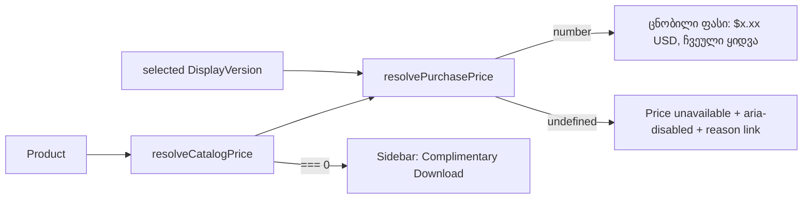

# პროდუქტის გვერდზე catalogue ფასი და „Price unavailable“ მდგომარეობა (FIX-PD-1a, F9)

**თარიღი:** 2026-10-31
**სტატუსი:** Completed (C round 286 PASS)
**შეცვლილი პროექტი:** Store (product page: `product-utils`, `ProductDetailPage`, `PurchaseHeader`, `ProductSidebar`, tests, docs)

## კონტექსტი

2026-10-31-ის product design review-ის F9 ფინდინგის მიხედვით, product page ზოგჯერ `$0.00`-ს აჩვენებს, მაშინ როცა `/store`-ის ბარათზე სწორი ფასი ჩანს. B-მ HEAD `60bfb38` mock API-ზე გაზომა (`b-round-285/probe/`):

- `/products/door-slams`-ზე (SFX, `variants` არ აქვს, `standardPrice` 9) ბარათი `$9`-ს აჩვენებდა, გვერდი კი `$0.00USD`-ს. Buy Now და Add to Cart ჩართული იყო.
- მიზეზი ორ ნაწილად: `createDisplayVersions` SFX-ისთვის, რომელსაც ვარიანტი არ აქვს, განზრახ `[]`-ს აბრუნებს. `ProductDetailPage` კი `selectedVersion?.price ?? 0`-ს იყენებდა, ამიტომ version-ის არარსებობა $0 Standard-ს ემსგავსებოდა.
- იმავე კლასის მეზობელი დეფექტი: `ProductSidebar` უცნობ ფასზე `?? 0`-ით „Complimentary Download“-ს აჩვენებდა.

## მიდგომა

- **ერთი წესი ბარათისთვის და გვერდისთვის.** `resolveCatalogPrice` ბარათის წესს (`standardPrice ?? minPrice ?? variants[0].price`) იმეორებს, მაგრამ მხოლოდ ვალიდურ მნიშვნელობას იღებს: finite number ≥ 0. `null`, `NaN` და უარყოფითი რიცხვი გამოტოვდება, ხოლო როცა ვალიდური ფასი არ არის, ფუნქცია `undefined`-ს აბრუნებს. ცხადი `0` ვალიდურია და ძველი „free“ მდგომარეობა რჩება.
- **`resolvePurchasePrice`.** რეალური backend variant-ისა (id > 0) და synthetic Premium-ისთვის (id −2) version-ის ფასს აბრუნებს. Version-ის არარსებობისას ან synthetic Standard-ზე (id −1) catalogue-ის ფასს იყენებს.
- **უცნობი ფასი `PurchaseHeader`-ში.**
  - „Total Price“ label რჩება; ციფრის ნაცვლად ჩანს `Price unavailable`.
  - Add to Cart და Buy Now ადგილზე რჩება `aria-disabled="true"`-ით და `aria-describedby`-ით, რომელიც reason line-ზე მიუთითებს. Native `disabled` არ აქვთ, ამიტომ Tab-ით მისაწვდომია.
  - Handler-ების დასაწყისში `price === undefined` guard დგას, sign-in-ის შემოწმებამდე. ამიტომ toast, modal, cart/buyNow გამოძახება და analytics არ ხდება.
  - Reason line: `Price unavailable — contact us to buy it.`, სადაც „contact us“ `/support`-ის ბმულია.
- **Owner და loading panel-ები** იგივე რიგით რჩება. Upgrade panel (Case 3) მხოლოდ ცნობილ ფასზე ჩნდება.
- **უარყოფილი ვარიანტები:**
  - ღილაკების ჩანაცვლება ერთი contact panel-ით. ეს Saba-ს „Buy is disabled with a reason“-ს ეწინააღმდეგება და ფასის გამოჩენისას layout გადახტება.
  - `createDisplayVersions`-ის `?? 0`-ის შეცვლა. ის frozen-ია, ხოლო SFX-ის `[]` ტესტი უცვლელი უნდა დარჩეს.
  - `/hire-us` ბმული. ის commission-ებისთვისაა.

## არქიტექტურა

## შეცვლილი ფაილები

- `app/lib/product-utils.ts`: ორი ახალი export, `resolveCatalogPrice` და `resolvePurchasePrice`. არსებული ფუნქციები უცვლელია.
- `app/components/product/ProductDetailPage.tsx`: `currentPrice` ახლა `resolvePurchasePrice`-ს იყენებს.
- `app/components/product/PurchaseHeader.tsx`: `price: number | undefined`, უცნობი ფასის მდგომარეობა და handler guard-ები.
- `app/components/product/ProductSidebar.tsx`: `isFree = resolveCatalogPrice(product) === 0`.
- `app/lib/__tests__/product-utils.test.ts`: append-only `describe('purchase price resolution')` (PR1–PR6).
- `app/lib/__tests__/product-price-unavailable.test.tsx`: ახალი RTL ფაილი (PU1–PU7).

## პრობლემები და გადაწყვეტები

- **Problem:** SFX-ს version არ აქვს და გვერდზე `$0.00` ჩანდა. → **Solution:** version-ის არარსებობისას გვერდი catalogue-ის ფასს იღებს `resolveCatalogPrice`-ით, იმავე წესით, რასაც ბარათი.
- **Problem:** უცნობ ფასზე ყიდვა $0-ით შესაძლებელი ჩანდა. → **Solution:** ღილაკებს `aria-disabled` და handler guard აქვთ, ხოლო ხილული reason line `/support`-ზე მიუთითებს.
- **Problem:** Sidebar უცნობ ფასზე „Complimentary Download“-ს აჩვენებდა. → **Solution:** `isFree` მხოლოდ ცხად `0`-ზეა true.
- **Problem:** `app/styles/app.css`-ის unlayered `button { cursor:pointer }` layered utility-ებს ჯობნის, ამიტომ `aria-disabled:cursor-not-allowed` არ მოქმედებდა (computed cursor `pointer` იყო). → **Solution:** `aria-disabled:cursor-not-allowed!` (important modifier, Studio-ს არსებული pattern). Browser-ში გაზომილი cursor ახლა `not-allowed`-ია.
- **Problem:** `product-utils.test.ts`-ის import block-ის შეცვლა append-only წესით აკრძალულია. → **Solution:** ახალი export-ები ტესტებში dynamic `await import('../product-utils')`-ით შემოდის.

## ტესტირება

- **Unit (`product-utils.test.ts`):**
  - PR1: catalogue-ის რიგი.
  - PR2: `null`, `NaN` და უარყოფითი მნიშვნელობა გამოტოვდება; ვალიდური ფასის გარეშე შედეგი `undefined`-ია.
  - PR3: ცხადი 0.
  - PR4: რეალური variant ჯობნის catalogue-ის ფასს; non-finite ფასი უცნობია.
  - PR5: version-ის გარეშე catalogue-ის ფასი; ფასის არმქონე Track-ის synthetic Standard უცნობია.
  - PR6: synthetic Premium.
- **RTL (`product-price-unavailable.test.tsx`):**
  - PU1: door-slams-ის მსგავსი პროდუქტი, `$9.00`.
  - PU2: უცნობი ფასი, `aria-disabled` და reason-ის ტექსტი.
  - PU3/PU4: click, Enter და Space გვერდით ეფექტს არ იწვევს (signed out / signed in).
  - PU5: owner და loading panel-ების რიგი.
  - PU6: ცნობილი ფასი, cart და buyNow არგუმენტები, analytics-ის ფასი და Premium `$99.00`.
  - PU7: sidebar-ის free badge.
- **Mutants:** M1–M5 და M2b. თითოეული წითელია თავის მოთხოვნილ row-ზე (`a-round-286/mutants.txt`).
- **Covering ფაილები:** 7 ფაილი, 124/124 PASS; typecheck და lint rc 0.
- **Browser (A smoke):** `/products/door-slams` 1440-ზე `$9.00USD`-ს აჩვენებს და `$0.00` არსად ჩანს. A-მ priceless fixture-იც შეამოწმა mock-ის ასლით, ორივე viewport-ზე: `aria-disabled`, cursor `not-allowed`, 0 dialog და activation-ის შემდეგ 0 `/api/cart|auth|orders` request; ბმული `/support`-ზე გადადის. საბოლოო შემოწმება C-ის B-* row-ებია.

## TODO / შემდეგი ნაბიჯები

- **FIX-PD-1b:** demo-ს ინგლისური სახელები და კოლექციის label ერთხელ, ჯგუფის სათაურად (F7, SR-230-6).
- **FIX-PD-1c:** `/studio-lab`-ის მცირე ეკრანის (900 px-ზე ნაკლები) მდგომარეობა (F8).
- **ღია signal:** ფასის არმქონე Track-ის synthetic Standard-ის version card (`VersionSelector`) კვლავ `$0`-ს აჩვენებს, რადგან `createDisplayVersions`-ის `?? 0` frozen-ია. მისი გასწორება B-ის ცალკე დავალებაა.
- **PD-FREE-HEADER (STORE-4):** ცხადი 0 ფასი header-ში კვლავ `$0.00`-ად ჩანს.
