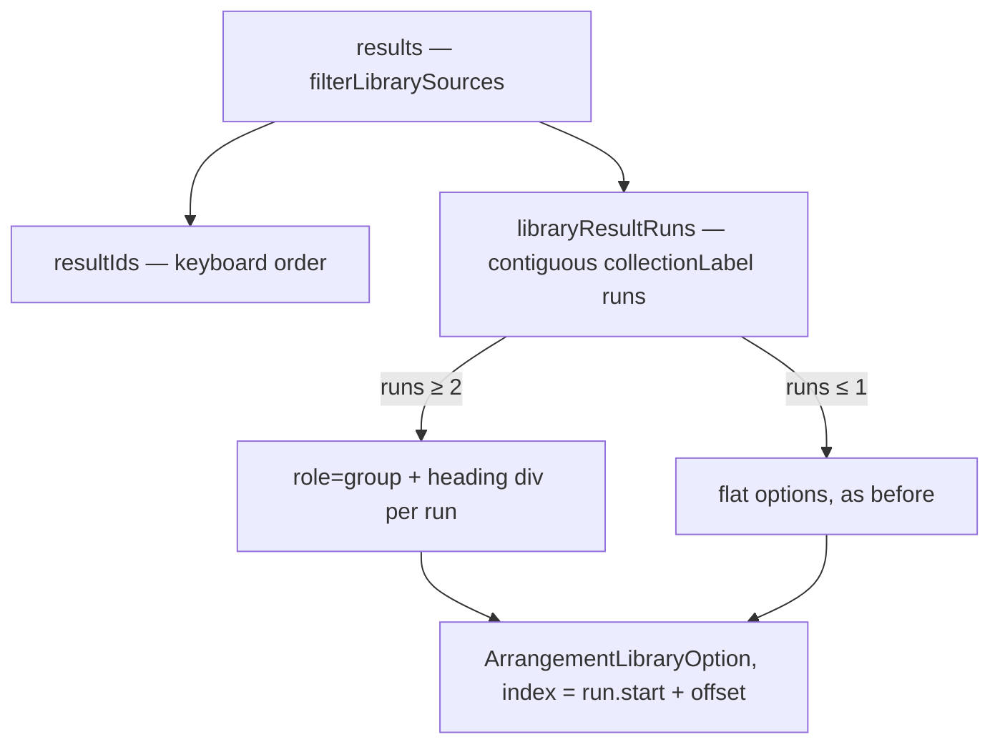

# Demo-ს ინგლისური სახელები და კოლექციის სათაური library-ში ერთხელ (FIX-PD-1b, F7 + SR-230-6)

**თარიღი:** 2026-10-31
**სტატუსი:** Completed (C round 289 PASS)
**შეცვლილი პროექტი:** Store (`studio-lab-demo.ts`, `ArrangementLibrary.tsx`, tests, docs)

## კონტექსტი

Studio-ს UI ინგლისურია, მაგრამ `/studio-lab`-ის demo data ქართული დარჩა (product review F7, Medium):

- სინთეზური კომპოზიცია და მისი სტემები ქართულად ერქვა („ღამის პულსი“, „ბასი“…), public preview-ების სათაურებში კი „საჯარო preview“ ეწერა.
- ბასის დამატების შემდეგ clip-ის სახელი, status, Undo ღილაკი და footer-ის „Clip:“ ხაზიც ქართული ხდებოდა.
- `strings.test.ts` ამ ხაზებს „დარჩენილ“ გამონაკლისად ინახავდა (`DEMO_REMAINING_GEORGIAN_LINES`) და ცალკე task არავის შეუქმნია.

ამასთან, ყოველ სინთეზურ ბარათზე მოკლე სათაურის ქვეშ მეორდებოდა `Synthetic demo · <კომპოზიცია>` (ხუთჯერ). SR-230-6 (Saba-ს endorse) ითხოვს, კოლექცია ერთხელ ითქვას.

**დაპირება:** ინგლისური Studio UI, სადაც კოლექციის სახელი ყველა ბარათზე აღარ მეორდება. Heading ჩანს მხოლოდ მაშინ, როცა შედეგები ≥ 2 კოლექციას მოიცავს. ერთი კოლექციის ძიებასა და purchased library-ში ბარათი მოკლე სათაურს აჩვენებს, სრული სათაური კი (`<კომპოზიცია> · <ნაწილი>`) ჩანს hover `title`-ში, accessible description-სა და preview-ის სათაურში (SABA-Q-LIB-SINGLE-RUN — Saba-ს კითხვა, 2026-10-31).

## მიდგომა

1. **Data:** `studio-lab-demo.ts`-ში მხოლოდ 9 ქართული literal შეიცვალა: `Night Pulse`, `Pulse` / `Bass` / `Pad` / `Melody`, `Full mix`, `… — public preview`. id-ები, `kind`, `bpm`, `origin`, notice და loader-ები უცვლელია; demo audio source id-ით იტვირთება, არა სათაურით.
2. **Library:** option-იდან ამოვიდა კოლექციის ხაზი (`arrangement-library-option-context`). შედეგები იყოფა `collectionLabel`-ის **მიმდევრობით runs**-ად (`resultIds`-ის რიგით). თუ run ≥ 2-ია, თითო run იხვევა `role="group"`-ში, რომელსაც `aria-labelledby` აკავშირებს მარტივ heading `div`-თან. 0 ან 1 run-ზე option-ები ისე იხატება, როგორც ადრე — wrapper-ისა და heading-ის გარეშე.
3. **Heading:** `text-xs`, `text-muted`, `break-words` (144 px სიგანეზე ერთ ხაზზე truncate ორივე label-ს ჭრიდა — B-ის გაზომვა, D-29z709). არ არის focusable, არ არის `option` და არც `heading` role (listbox-ში დაუშვებელია).
4. **Biome:** `useSemanticElements` `<fieldset>`-ს ითხოვს; ერთი `biome-ignore` ხაზი დაემატა იმავე პრეცედენტით, როგორც `role="separator"`-ზე.

**უარყოფილი ალტერნატივები** (product-designer, 2026-10-31): header row group role-ის გარეშე (screen reader კონტექსტს კარგავს), sticky heading (`scrollIntoView` 1280-ზე პირველ option-ს მალავს), heading ყოველთვის (tree-ს იმეორებს, screen budget), heading მხოლოდ short-title ჯგუფებზე (preview-ები ზედა ჯგუფის წევრებად ჩანან).

**Ableton-თან განსხვავება:** Live 12-ის Browser-ის content pane სახელებს აჩვენებს; ძიების შედეგში ადგილმდებარეობის ჩვენება manual-ში დადასტურებული არ არის (LIVE-MEAS-BROWSER-SEARCH-LOCATION მოთხოვნილია). Group heading CZABA-ს შეგნებული განსხვავებაა — მოკლე სათაური კოლექციის გარეშე ორაზროვანია.

**Edge rule (D-29z709):** label, რომელიც სხვის შემდეგ ბრუნდება (A, B, A), 3 ჯგუფს იძლევა და heading A ორჯერ ჩანს — რიგი heading-ების რაოდენობაზე მნიშვნელოვანია. Demo-სა და purchased data-ში ეს დღეს არ ხდება.

## არქიტექტურა

`isFocusTarget` ისევ `results`-ის გლობალურ index-ს იყენებს, ამიტომ roving `tabIndex=0` მხოლოდ ერთ option-ზეა, ჯგუფების რაოდენობის მიუხედავად.

**Buyer-side ეფექტი:** purchased კოლექციას ერთი `collectionLabel` აქვს — run ერთია, heading არ ჩანს, ბარათებიდან კი პროდუქტის ხაზი ქრება. პროდუქტის სახელი რჩება tree node-ში, option-ის `title`-ში და clip-ის სახელში.

## შეცვლილი ფაილები

- `app/data/studio-lab-demo.ts` — 9 ქართული literal → ინგლისური.
- `app/components/arrangement/ArrangementLibrary.tsx` — option context ხაზის წაშლა; `useId` + `libraryResultRuns`; group heading-ის render.
- `app/lib/arrangement/__tests__/strings.test.ts` — `DEMO_REMAINING_GEORGIAN_LINES` ცარიელი მასივი გახდა (ST47/ST51 assertion-ები უცვლელია).
- `app/data/__tests__/studio-lab-demo.test.ts` — DL-VAL-ის collection label pin + ახალი DL-EN.
- `app/lib/arrangement/__tests__/library-group-heading-ui.test.tsx` — ახალი (LG1–LG7).
- `docs/implementation/2026/quarter-IV/216-fix-pd-demo-names-group-heading.md` — ეს doc.

## პრობლემები და გადაწყვეტები

- **Problem:** ჯგუფში option-ების index-ით render-ისას ყოველი ჯგუფის პირველ option-ს `tabIndex=0` მიიღებდა. → **Solution:** render-ს გადაეცემა `run.start + offset`, ანუ `results`-ის index; LG2 ამოწმებს, რომ tabbable მხოლოდ ერთი option-ია.
- **Problem:** first-appearance დაჯგუფება DOM-ის რიგს შეცვლიდა, keyboard კი `resultIds`-ით მოძრაობს — focus ვიზუალურად ხტებოდა. → **Solution:** მხოლოდ მიმდევრობითი runs; LG7 (A, B, A → 3 ჯგუფი) და mutant M3 ამას იცავს.
- **Problem:** Biome `useSemanticElements` `role="group"`-ზე. → **Solution:** ერთი დასაბუთებული `biome-ignore` (listbox-ს მხოლოდ group/option შვილები შეიძლება ჰყავდეს).
- **Problem:** task-ში `Fragment` import-იც იყო ნახსენები. → **Solution:** ternary-ს `Fragment` არ სჭირდება; გამოუყენებელი import Biome-ს ჩააგდებდა, ამიტომ მხოლოდ `useId` დაემატა.

## ტესტირება

- `npm run typecheck` — rc 0; Biome — 5 owned code ფაილი სუფთაა.
- Covering run, 15 ფაილი / 255 ტესტი PASS (studio-lab-demo, strings, library, collection, library-focus-handoff, library-notice-ui, library-preview, library-row-strings-ui, library-video-return-focus, purchased-collection-ui, collection-load-status, held-enter-add, tempo-seed-ui, floating-video, library-group-heading-ui).
- ახალი row-ები: **DL-EN** (9 სათაური/მოკლე სათაური, 0 ქართული code point), **LG1** (All view: 2 დასახელებული group, 0 context ხაზი, source order), **LG2** (heading არ არის focusable/option; ArrowDown/ArrowUp `resultIds`-ის რიგით), **LG3** (collection node/folder → 0 group), **LG4** (ძიება: ცარიელი / ერთი კოლექცია → 0 group, ორი → 2), **LG5** (purchased-style ერთი კოლექცია → 0 group), **LG6** (`title` სრული, ბარათზე მოკლე), **LG7** (A, B, A → 3 group).
- Mutants M1–M5 scratch copy-ზე: M1 (heading ≥ 1 run-ზე) → LG3/LG4/LG5 წითელი; M2 (context ხაზი დაბრუნდა) → LG1/LG5; M3 (first-appearance დაჯგუფება) → LG7; M4 (heading `tabIndex=0`) → LG2; M5 (ერთი სახელი ქართულად) → DL-EN.
- Browser-ის მიღება (B-NAMES, B-GROUPS, B-KEYS, B-STATES, B-JOURNEY, B-SCREEN) C-ის round 289-ის row-ებია.

## TODO / შემდეგი ნაბიჯები

- SABA-Q-FIXPD1B-NAMES: „Pulse“/„Melody“ თუ „Rhythm“/„Lead“ — Saba-ს პასუხის მოლოდინში.
- SR-275-6 (public preview-ების უფრო მოკლე collection label) — `awaiting_user`.
- LIVE-MEAS-BROWSER-SEARCH-LOCATION — root-ის გაზომვა Live 12-ში.
- `library.test.ts`-ის საკუთარი ქართული fixture და legacy track-name fixture-ები ამ ეტაპის ფარგლებს გარეთაა.
