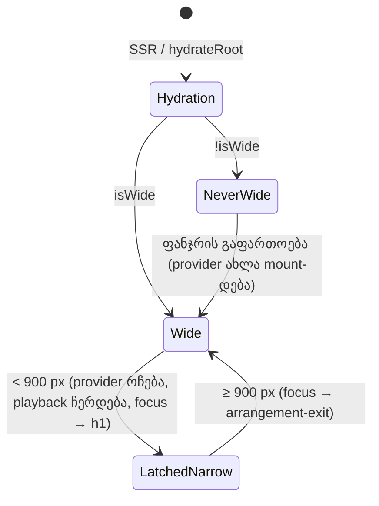

# `/studio-lab`-ის ვიწრო ფანჯრის მდგომარეობა (FIX-PD-1c, F8)

**თარიღი:** 2026-10-31
**სტატუსი:** Completed (C round 294 PASS)
**შეცვლილი პროექტი:** Store (`studio-lab.tsx`, ახალი hook და კომპონენტი, tests, docs)

## კონტექსტი

product-designer-ის 2026-10-31-ის მიმოხილვის F8 (Medium): 900 px-ზე ვიწრო ფანჯარაში `/studio-lab` სრულ workspace-ს ხატავდა. 390×844-ზე toolbar-ის ხუთი ღილაკი ერთმანეთს ფარავდა და timeline ეკრანს გარეთ გადიოდა. route-ს სიგანის gate არ ჰქონდა; legacy route-ის `MobileBlocker` დაცულია და ამ რაუნდს არ ეხება. arrangement მხოლოდ მეხსიერებაშია, ამიტომ provider-ის unmount მომხმარებლის clip-ებსა და Undo history-ს დაკარგავდა.

დაპირება: ტელეფონზე ვიზიტორი ხედავს მშვიდ გვერდს, სადაც CZABA-ს preview-ს მოუსმენს და ბმულს საკუთარ თავს გაუგზავნის. desktop-ზე ფანჯრის შევიწროება ნამუშევარს არ კარგავს.

## მიდგომა

- ახალი hook `useStudioWideViewport` კითხულობს `matchMedia('(min-width: 900px)')`-ს `useSyncExternalStore`-ით; `matchMedia`-ის არქონისას `innerWidth >= 900` და `resize`. server snapshot არის `true` (wide), ამიტომ SSR HTML და hydration-ის პირველი render ერთნაირია.
- `useStudioHydrated` `false`-ია server-ზე და hydration pass-ში, `true` შემდეგ. latch `wasWide` მხოლოდ hydration-ის შემდეგ ირთვება, თორემ ტელეფონზე ჩატვირთვა „wide-ად ნანახად“ ჩაითვლებოდა.
- gate route-შია, `ArrangementProvider`-ის ზემოთ (tech-lead). ოთხი მდგომარეობა:
  - **SSR და hydration:** workspace (`contents max-[900px]:hidden` wrapper-ში) + დამალული ვიწრო ეკრანი (`min-[900px]:hidden`). CSS ირჩევს ხილულს, ამიტომ ტელეფონზე toolbar არ ციმციმებს. Tailwind v4-ში `max-[900px]` არის `width < 900`, `min-[900px]` — `width >= 900`, ანუ ზუსტი დამატებები.
  - **არასოდეს wide:** მხოლოდ ვიწრო ეკრანი, provider-ის გარეშე, ავტომატური focus-ის გარეშე.
  - **wide:** workspace ჩვეულებრივ.
  - **wide-ის შემდეგ შევიწროებული:** provider იმავე პოზიციაზე რჩება (clip-ები, mix, history ცოცხალია), `StudioWorkspace` unmount-დება (მისი window key listener-ები ქრება), route-ის `StopPlaybackOnNarrow` playback-ს `togglePlayback`-ით, ხოლო library preview-ს `stopLibraryPreview`-ით აჩერებს, focus გადადის ვიწრო ეკრანის h1-ზე.
- გაფართოებისას focus `arrangement-exit`-ზე გადადის მხოლოდ მაშინ, როცა ის ვიწრო ეკრანში ან `body`-ზე იყო.
- ვიწრო ეკრანი (`StudioNarrowScreen`) context-ს არ იყენებს: `← CZABA`, სათაური „The Studio works on a computer“, ბრაუზერის `<audio controls preload="metadata">` (`scheme-dark`), „Send link“ (`navigator.share` → clipboard → read-only „Studio link“ ველი) და status.
- `preload="metadata"` (R2): ხანგრძლივობა Play-მდე ჩანს. tech-lead-ის `none` უარყოფილია, რადგან provider იმავე ფაილს ამ გვერდზე უკვე ითხოვს.

უარყოფილი ვარიანტები:

- **მხოლოდ CSS:** workspace ტელეფონზეც mount-ებული რჩება და Space/Delete დამალულ workspace-ზე იმოქმედებდა.
- **workspace mount-ებული + key guard:** `StudioWorkspace.tsx`-ის ცვლილებას მოითხოვდა (frozen).
- **provider-ის unmount ვიწროზე:** მომხმარებლის ნამუშევარი და Undo history დაიკარგებოდა.

## არქიტექტურა

## შეცვლილი ფაილები

- `app/hooks/useStudioWideViewport.ts` — ახალი: `STUDIO_WIDE_MIN_PX`, `useStudioWideViewport`, `useStudioHydrated`.
- `app/hooks/index.ts` — ორი hook-ის export.
- `app/components/arrangement/StudioNarrowScreen.tsx` — ახალი ვიწრო ეკრანი.
- `app/components/arrangement/index.ts` — export.
- `app/routes/studio-lab.tsx` — gate, latch, `StopPlaybackOnNarrow`, გაფართოების focus.
- `app/lib/arrangement/__tests__/studio-narrow-gate-ui.test.tsx` — ახალი, NG1–NG9.
- `app/lib/arrangement/__tests__/studio-theme-obsidian.test.tsx` — TH4 (ახალი marker ფაილი) და TH10 (ორი h1 სამიზნე).
- `app/lib/arrangement/__tests__/library-row-strings-ui.test.tsx` — describe-ის `{ timeout: 15_000 }` (LRS4 headroom).

## პრობლემები და გადაწყვეტები

- **პრობლემა:** hydration pass-ში `useSyncExternalStore` server snapshot-ს (`true`) აბრუნებს, ამიტომ ტელეფონზე latch შეცდომით ჩაირთვებოდა. **გადაწყვეტა:** `useStudioHydrated`, latch მხოლოდ `isHydrated && isWide`-ზე (NG9).
- **პრობლემა:** ერთი და იგივე `StudioNarrowScreen` დამალული და latched branch-ში ერთსა და იმავე პოზიციაზეა, ამიტომ React მას არ remount-ავდა და h1-ის focus არ მოხდებოდა. **გადაწყვეტა:** ორ branch-ს სხვადასხვა `key`.
- **პრობლემა:** Biome-ის `useSemanticElements` `role="status"`-იან `
`-ზე ignore-ს ან `<output>`-ს ითხოვდა. **გადაწყვეტა:** `<output aria-live="polite">` (implicit `status` role, იგივე ნიმუში, რაც workspace-ის status line-ში); ignore არ დამატებულა.
- **პრობლემა:** jsdom-ში hydration ვიდეო dock-ის `<video muted>`-ზე `Prop muted did not match`-ს წერს; რეალურ Chromium-ში 390/899/900/1440-ზე hydration warning არ ჩანს. **გადაწყვეტა:** NG9 ყველა hydration warning-ს ამოწმებს, გარდა ამ ერთი, უკვე არსებული jsdom-ის `muted` შემთხვევისა.
- **პრობლემა (C-R292-01, Medium):** library-ის preview (`Preview` ღილაკი) ვიწრო ეკრანის უკან ჟღერდებოდა ბოლომდე, რადგან provider latched branch-ში mount-ებული რჩება და `StopPlaybackOnNarrow` მხოლოდ transport-ს აჩერებდა; ვიწრო ეკრანზე მისი გაჩერების კონტროლი არ იყო, გაფართოების შემდეგ ღილაკი ისევ `Stop`-ს აჩვენებდა. **გადაწყვეტა:** `StopPlaybackOnNarrow` mount-ზე ერთხელ იძახებს context-ის `stopLibraryPreview`-ს (NG5c). არასოდეს-wide branch-ს ეს არ ეხებოდა: იქ provider მხოლოდ hydration pass-შია mount-ებული და შემდეგ unmount-დება, ამიტომ preview ვერ დაიწყება, ხოლო provider-ის unmount cleanup `stopLibraryPreview`-ს მაინც იძახებს.
- **პრობლემა (GATE293-T1, Medium):** Store-ის მხარის guard ST6 (`store-theme-tokens.test.ts`) theme marker-ს მხოლოდ `StudioWorkspace.tsx`-სა და `app.css`-ზე ამაგრებდა, ამიტომ ვიწრო ეკრანის marker-მა სრული suite ჩააგდო და gate 293 ჩავარდა. **გადაწყვეტა:** ST6-ის ზუსტ map-ს დაემატა `StudioNarrowScreen.tsx` (total 4, script 2). guard ისევ per-file რჩება, ამიტომ Store-ის markup-ზე marker მას მაინც ჩააგდებს.

## ტესტირება

- NG1–NG9 (NG5b, NG5c, NG7a–d, NG9b, NG9c ქვე-რიგებით; ფაილის describe-ს 15 000 ms timeout აქვს): ვიწრო/wide render, SSR HTML-ის ორივე ხე და ერთი theme marker, 900 px-ის საზღვარი, latched შევიწროება (mute და Ctrl+Z history რჩება, focus ორივე მიმართულებით), Space/Delete ვიწროზე transport-ს არ აღწევს, დაკვრისას შევიწროება playback-ს აჩერებს (NG5b), library preview-ის დროს შევიწროება preview-ს აჩერებს და გაფართოების შემდეგ ღილაკი `Preview`-ს აჩვენებს (NG5c), desktop hydration focus-ს არ ცვლის (NG9c), Send link-ის ოთხი გზა, audio error, hydration autofocus-ისა და warning-ის გარეშე.
- TH4 და TH10 განახლდა; LRS4 იგივეა, describe-ს 15 000 ms timeout აქვს. ST6 (store-theme-tokens) განახლდა: ზუსტ map-ში დაემატა `StudioNarrowScreen.tsx`; TH4-ის სათაური ასახავს ორივე Studio-ს ზედაპირს.
- Playwright Chromium (A-ს შემოწმება): 390/899 — ვიწრო ეკრანი, `body` focus, `scrollWidth` = viewport; 900/1440 — workspace; შევიწროება/გაფართოება 1440 და 1280-დან — clip, mute და Undo რჩება, playback ჩერდება.

## TODO / შემდეგი ნაბიჯები

- **ცნობილი შეზღუდვა (B-R291-NARROW-PREFETCH, გადადებული):** provider hydration pass-ში ერთხელ mount-დება, ამიტომ ტელეფონზე, როგორც HEAD-ზე, მისი source-load effect abort-მდე: ორივე demo mp3-ს ითხოვს, ორ მოკლე synthetic SFX-ს main thread-ზე აგენერირებს და synth worker-ს უშვებს, რომელიც module-level cache-ის გამო abort-ით არ ჩერდება. გამოსწორება frozen ფაილებს (`ArrangementContext.tsx` / demo data) ეხება და ცალკე დავალებაა.
- ტელეფონზე hydration-ის შემდეგ ვიწრო ეკრანი ერთხელ remount-დება (SSR-ის დამალული ხიდან ცალკე branch-ზე); თუ მომხმარებელმა hydration-მდე native player-ზე Play დააჭირა, preview გაჩერდება. ერთი key-ის შენარჩუნება ამას აგვარებს, მაგრამ გაფართოებისას დამალული player-ი workspace-ის უკან ხმას გააგრძელებდა, ამიტომ ეს B-ს გადაწყვეტაზე რჩება.
- desktop-ზე დამალული `<audio preload="metadata">` `/middle-east.mp3`-ის metadata-ს ერთ დამატებით request-ს აგზავნის.
- Saba-ს კითხვები (არადამბლოკავი): **SABA-Q-FIXPD1C-ESCAPE** („Continue anyway“-ის გარეშე) და **SABA-Q-FIXPD1C-COPY** (product-designer-ის ალტერნატიული ტექსტი).
