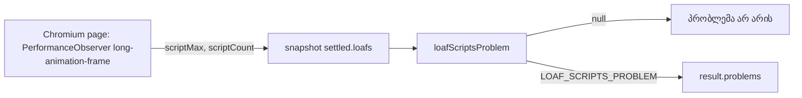

# ტესტის ოთხი სტრიქონი, რომელსაც ჩავარდნა შეუძლია (SYS-VACUOUS-ROWS)

**თარიღი:** 2026-10-31
**სტატუსი:** Completed (C round 295 PASS)
**შეცვლილი პროექტი:** Store (მხოლოდ tests და perf harness, docs)

## კონტექსტი

RETRO 290-მა (D-29z716) ოთხი deferred Low ერთ systemic task-ად, SYS-VACUOUS-ROWS-ად გააერთიანა. ოთხივეს ერთი root cause აქვს (lesson L52): ტესტის სტრიქონი, რომელსაც ვერცერთი mutant ვერ აწითლებს. ასეთი სტრიქონი მწვანეა მაშინაც, როცა მის მიერ დასახელებული ქცევა გაფუჭებულია.

- **C-R283-01:** `demo-synth-worker`-ის DW1–DW11 მწვანე რჩებოდა, თუ `demo-synth.client.ts`-დან `clearTimeout(stallTimer)` წაიშლებოდა. დარჩენილი timer მოგვიანებით worker-ს მეორედ ათავისუფლებდა.
- **A-R278-REVIEW-METRONOME-SPY:** `metronome-ui`-ის UI12 მწვანე რჩებოდა, თუ metronome ღილაკს `guardSoftDisabledClick` wrapper მოეხსნებოდა, რადგან `toggleMetronome` tempo-ს არქონისას თავად ბრუნდება.
- **A-R284-REVIEW-ZQ3-VACUITY:** `clip-envelope-ui`-ის ZQ3-ში `before` შეიძლება `undefined` იყოს, როცა `<polyline>` არ არსებობს; მაშინ ყოველი შედარება `undefined === undefined`-ია.
- **A-R283-REVIEW-LOAF-SCRIPTS:** perf harness-ის `harness.loaf-scripts` შემოწმება `scriptMax`-ის არსებობას ამოწმებდა. `scriptMax` ცარიელ `scripts: []`-ზეც 0-ია, ამიტომ ფანჯარა, სადაც არცერთ long-animation-frame entry-ს script timing არ ჰქონდა, შემოწმებას გადიოდა.

## მიდგომა

- თითო სტრიქონს ერთი mutant აქვს, რომელიც მას აწითლებს; B-მ თითოეული scratch ასლზე გაუშვა, A-მ გაიმეორა.
- **DW12 / DW12b:** fake timers-ით ოთხი დასრულების გზა (სწორი `complete`, malformed message, `onerror`, `onmessageerror`) და throwing `postMessage`. worker-ის შექმნისას ერთი timer-ია, დასრულების შემდეგ 0, ხოლო stall timeout-ის გასვლის შემდეგ worker მეორედ არ თავისუფლდება.
- **SD10:** `ArrangementTempoRow` provider-ის გარეშე, `onMetronomeToggle` spy-ით. tempo-ს გარეშე click spy-ს 0-ჯერ იძახებს; tempo 120-ზე იგივე click ერთხელ (positive control). ასე guard ღილაკზე მოწმდება და არა context-ის early return-ზე.
- **ZQ3:** ერთი `expect(before).toBeTruthy()`.
- **LOAF1:** შემოწმება გადავიდა `perf/lib/report.ts`-ის `loafScriptsProblem`-ში, რომელიც `null`-ს მხოლოდ მაშინ აბრუნებს, როცა ერთ entry-ს მაინც `scriptCount > 0` აქვს. instrumentation observer-ი `scriptCount`-ს inline spread-ით წერს.
- **რატომ inline:** `installPerfInstrumentation` Playwright-ის `addInitScript(fn)`-ით serialise-დება და გვერდში module scope-ის გარეშე ეშვება; import-ირებული helper იქ `undefined` იქნებოდა. ამიტომ observer-ში helper არ არის გატანილი, ხოლო წესი (`loafScriptsProblem`) Node მხარეს, spec-შია.
- უარყოფილი ვარიანტი: `scriptMax`-ზე დაფუძნებული შემოწმება. `scriptMax` ერთნაირად 0-ია ცარიელ მასივზე და script-ზე, რომლის duration 0-ია, ამიტომ entry-ში script-ის არსებობას პირდაპირ არ ზომავს; რაოდენობა (`scriptCount`) ზომავს.

## არქიტექტურა

## შეცვლილი ფაილები

- `app/lib/arrangement/__tests__/demo-synth-worker.test.ts` — DW12 (4 case) და DW12b.
- `app/lib/arrangement/__tests__/self-disabling-focus.test.tsx` — `ArrangementTempoRow`-ის import და SD10 (2 case).
- `app/lib/arrangement/__tests__/clip-envelope-ui.test.tsx` — ZQ3-ის ერთი assertion.
- `perf/lib/instrumentation.ts` — `PerfTimedEntry.scriptCount` და observer-ის inline spread.
- `perf/lib/report.ts` — `LOAF_SCRIPTS_PROBLEM` და `loafScriptsProblem`.
- `perf/lib/report.test.ts` — LOAF1 (4 case).
- `perf/studio-lab.perf.spec.ts` — `harness.loaf-scripts` შემოწმება `loafScriptsProblem`-ით.

app-ის runtime ფაილი არ შეცვლილა.

## პრობლემები და გადაწყვეტები

- **C-R283-01** → Problem: stall timer-ის გაუსუფთავებლობა ვერცერთ DW სტრიქონს ვერ აწითლებდა. Solution: DW12/DW12b timer-ების რაოდენობას და timeout-ის შემდეგ worker-ის მდგომარეობას ამოწმებს; mutant (a) ორივეს აწითლებს.
- **A-R278-REVIEW-METRONOME-SPY** → Problem: UI12 guard-ის მოხსნისას მწვანე რჩებოდა. Solution: SD10 ღილაკს provider-ის გარეშე ამოწმებს spy-ით; mutant (b) no-tempo case-ს აწითლებს, UI12 კი მწვანე რჩება (vacuity control).
- **A-R284-REVIEW-ZQ3-VACUITY** → Problem: polyline-ის გარეშე ZQ3 `undefined`-ს `undefined`-ს ადარებდა. Solution: `before` truthy უნდა იყოს; mutant (c) ZQ3-ს აწითლებს.
- **A-R283-REVIEW-LOAF-SCRIPTS** → Problem: ცარიელი `scripts` მასივი შემოწმებას აკმაყოფილებდა. Solution: `scriptCount` და `loafScriptsProblem`; mutant (d) (`> 0` → `>= 0`) LOAF1-ის „all empty“ და „no field“ case-ებს აწითლებს.

## ტესტირება

- covering set (`npx vitest run`): `demo-synth-worker.test.ts`, `self-disabling-focus.test.tsx`, `metronome-ui.test.tsx`, `clip-envelope-ui.test.tsx`.
- LOAF1 (`perf/lib/report.test.ts`) project-ის `vitest.config.ts`-ით არ ეშვება, რადგან მისი include მხოლოდ `app/**`-ია. A და C მას scratch ასლში, დროებითი config-ით უშვებენ (`test.include: ['perf/**/*.test.ts']`).
- mutants (a)–(d) scratch ასლზე: თითოეული თავის სტრიქონს აწითლებს.
- რეალური Chromium-ის LoAF შემოწმება და perf harness-ის გაშვება C-ის სტრიქონებია (B-LOAF-REAL, B-PERF-LOAF).
- observer-ის მხარეს (`scriptCount`-ის ჩაწერა `installPerfInstrumentation`-ში) unit სტრიქონი არ აქვს: LOAF1 `PerfTimedEntry`-ს ხელით აგებს. spread-ის წაშლას მხოლოდ რეალური Chromium-ის გაშვება (B-PERF-LOAF) დაიჭერს.

## TODO / შემდეგი ნაბიჯები

- ROOT-REQ-VITEST-PERF-INCLUDE: `vitest.config.ts`-ის include-ში `perf/**/*.test.ts`-ის დამატება, რომ LOAF1 და perf-ის სხვა unit ტესტები gate-მა გაუშვას.
