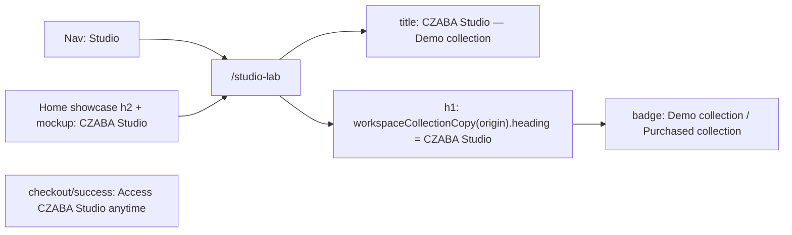
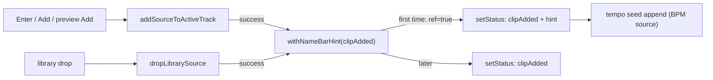

# ერთი სახელი "CZABA Studio" და one-time hint (NAME-AND-HINT)

**თარიღი:** 2026-11-02
**სტატუსი:** Completed (C round 303 PASS)
**შეცვლილი პროექტი:** Store

## კონტექსტი

PD-REVIEW-2026-10-31-ის F6-მა აჩვენა, რომ მომხმარებელი ერთ პროდუქტს სამი სახელით ხვდება: nav-ში "Studio", მთავარ გვერდზე "Personal Mixdown Studio", ხოლო თავად Studio-ში "CZABA Studio Lab · Workspace" და tab-ის სათაური "Studio Lab — Demo workspace | CZABA". "Lab" დაუმთავრებელ პროდუქტად იკითხება. Saba-მ 2026-10-31-ს (Q4) დაამტკიცა ერთი სახელი: "CZABA Studio" ყველგან, nav-ში მოკლედ "Studio"; demo სტატუსს badge ატარებს და არა სახელი.

NAME-AND-HINT ორ ეტაპად იყოფა (D-29z785):
- **ეტაპი a (რაუნდი 302, ეს დოკუმენტი):** სახელის გადარქმევა (Q4).
- **ეტაპი b (რაუნდი 303):** Q5 — პირველი clip-ის დამატების შემდეგ ერთჯერადი status "Drag a clip by its name bar to move it". ეს ეტაპი დაგეგმილია და არა გადადებული.

## მიდგომა

- **Tab-ის სათაური `CZABA Studio — Demo collection`.** ერთი სახელი პირველია, demo ნაწილი badge-ის სიტყვებს იმეორებს. "| CZABA" ბრენდს გაიმეორებდა (product-designer).
- **Studio-ს h1 მხოლოდ `CZABA Studio`.** "· Workspace" მეორე სახელია, ამიტომ muted span და `studioWorkspaceStrings.headingSuffix` სრულად წაიშალა. Demo და purchased origin-ს ახლა ერთი სათაური აქვს; მათ badge განასხვავებს ("Demo collection — no sign-in required" / "Purchased collection").
- **მთავარი გვერდის showcase:** h2 `CZABA Studio`, glow რჩება სიტყვაზე "Studio" — იმ სიტყვაზე, რომელსაც nav იყენებს. Mockup-ის ფანჯრის სათაურიც `CZABA Studio` გახდა.
- **Checkout success:** მესამე ნაბიჯი `Access CZABA Studio anytime` — მხოლოდ სახელი იცვლება, დაპირება იგივეა.
- **უარყოფილი:** `CZABA Studio | CZABA` (ბრენდის გამეორება), "· Workspace"-ის შენარჩუნება, checkout-ის დაპირების გადაწერა (scope-ის გარეთ).
- **შეგნებულად უცვლელი:** URL `/studio-lab` და export ფაილის სახელი `czaba-studio-lab` (გარე კონტრაქტებია: მომხმარებლის media bin-ები და perf liveness row), testimonial-ის ციტატა "The Mixdown Studio" (keep-list, მომხმარებლის სიტყვები), დაცული legacy route-ები (უკვე "Studio"-ს ამბობენ), docs და CLAUDE.md-ის tagline (UI არ არის).
- **Ableton reference:** ვერ მოიძებნა. Live 12-ის manual-ში ფანჯრის სათაურის ან პროდუქტის სახელის კონვენციის სექცია არ არის; სახელი Saba-ს Q4 გადაწყვეტილებაა.

## არქიტექტურა

h1 ტექსტი ერთი წყაროდან მოდის: `workspaceCollectionCopy(origin).heading`. Demo და purchased copy-ში heading ერთნაირია, ორიგინს badge აჩვენებს.

## შეცვლილი ფაილები

- `app/routes/studio-lab.tsx` — meta title.
- `app/lib/arrangement/collection.ts` — demo heading `CZABA Studio`.
- `app/lib/arrangement/strings.ts` — `headingSuffix` წაიშალა.
- `app/components/arrangement/StudioWorkspace.tsx` — h1 მხოლოდ heading-ს რენდერავს, suffix span აღარ არის.
- `app/components/home/StudioShowcase.tsx` — h2 და JSDoc ხაზი.
- `app/components/home/StudioMockup.tsx` — ფანჯრის სათაური (ერთ ხაზზე) და JSDoc ხაზი.
- `app/routes/checkout.success.tsx` — `STEPS`-ის მესამე სტრიქონი.
- `app/lib/arrangement/__tests__/strings.test.ts` — title literal და `studioWorkspaceStrings`-ის key list `headingSuffix`-ის გარეშე.
- `app/lib/arrangement/__tests__/collection.test.ts` — PC9: demo heading.
- `app/lib/arrangement/__tests__/purchased-collection-ui.test.tsx` — PW1/PW6: ორივე სათაური `CZABA Studio`, badge-ები განსხვავდება.
- `app/lib/__tests__/studio-naming.test.tsx` (ახალი) — NM1 და NM2.

## პრობლემები და გადაწყვეტები

- **პრობლემა:** "· Workspace"-ის წაშლის შემდეგ demo და purchased origin-ის h1 ერთნაირია, და origin-ის გარჩევა შეიძლება დაიკარგოს. **გადაწყვეტა:** badge უცვლელია; PW1/PW6 ამოწმებს, რომ სათაურები ტოლია და badge-ები განსხვავდება.
- **პრობლემა:** retired სახელი შეიძლება ახალ კოდში ან კომენტარში დაბრუნდეს. **გადაწყვეტა:** NM1 repo scan — `app/`-ის ყველა `.ts`/`.tsx` ფაილი `__tests__`-ის გარეთ, კომენტარების ჩათვლით, არ შეიცავს `Personal Mixdown|Studio Lab|Lab · Workspace|Demo workspace|headingSuffix`-ს.
- **პრობლემა:** Biome formatter-ი მოკლე mockup span-ს ერთ ხაზზე მოითხოვს. **გადაწყვეტა:** span ერთ ხაზზეა; scoped Biome check-ს ახალი diagnostic არ აქვს.
- **ღია კითხვები Saba-სთვის (L44):**
  - **SABA-Q-NAME-LAB-URL-FILE** — რჩება თუ არა URL `/studio-lab` და export ფაილის სახელი `czaba-studio-lab` (product-designer-მა `czaba-studio-demo` შესთავაზა).
  - **SABA-Q-NAME-TESTIMONIAL** — testimonial-ის ციტატა "The Mixdown Studio" რჩება სიტყვასიტყვით (რეკომენდებული default: დარჩეს).

## ტესტირება

- **NM1** (repo scan): retired სახელების 0 დამთხვევა `app/`-ის source ფაილებში.
- **NM2:** `StudioShowcase`-ის h2 ზუსტად `CZABA Studio`-ა, glow span `Studio`-ა, mockup-ის სათაური `CZABA Studio` არსებობს, retired სახელი რენდერში არ ჩანს.
- **PC9:** `workspaceCollectionCopy('demo').heading` = `CZABA Studio`.
- **PW1 / PW6:** purchased და demo h1 ზუსტად `CZABA Studio`-ა, badge-ები განსხვავებულია.
- `strings.test.ts`: route title literal და key list.
- Covering set (24 ფაილი, 361 ტესტი), `npm run typecheck`, `npm run lint` (205 warning, ახალი არცერთი). Red proof: mutants m1–m4 (A-ს scratch-ზე). ბრაუზერის row-ები (N-TITLE-H1, N-HOME, N-CHECKOUT, N-JOURNEY და სხვ.) C-ს რაუნდი 302-ის შემოწმებაა.

## ეტაპი b (რაუნდი 303): ერთჯერადი name bar hint (Q5)

**კონტექსტი.** Premiere-დან მოსული მონტაჟორი clip-ს body-თი ათრევს. CZABA-ში, როგორც Live-ში (manual §6.7 "only the clip bar is draggable", §6.9 body = time selection), body time selection-ს აკეთებს, clip-ს კი მხოლოდ name bar ამოძრავებს. Saba-ს Q5 (2026-10-31): პირველი clip-ის დამატების შემდეგ ერთჯერადი status "Drag a clip by its name bar to move it.". ქცევა არ იცვლება. Live-ში ასეთი hint არ არის — ეს CZABA-ს დამხმარეა, Saba-ს გადაწყვეტილებით.

**მიდგომა.**
- Hint იმავე `setStatus` write-ში ემატება, რომელშიც clip-added ტექსტია: ერთი polite announcement, მიზეზი და შემდეგი ნაბიჯი ერთად. მეორე write უარყოფილია (screen reader-მა შეიძლება პირველი გამოტოვოს; შემდეგი write-ები გადაწერდა).
- `withNameBarHint` (ArrangementContext) მხოლოდ string არგუმენტს ახვევს ორ წარმატებულ add path-ში: `addSourceToActiveTrack` (Enter, Add მენიუ, preview-ს Add) და `dropLibrarySource` (drag-drop). სხვა side effect-ები (`applyEdit`, selection, `setRange(null)`, active track) უცვლელია (L49).
- Lifetime: `nameBarHintShownRef`, ერთხელ provider-ის mount-ზე (გვერდის ჩატვირთვა ან Studio route-ზე დაბრუნება). Refusal, failed source, video lane და video import hint-ს არ აჩვენებს და არ "ხარჯავს". Undo მას თავიდან არ ააქტიურებს. localStorage არ გამოიყენება.
- BPM source-ზე tempo seed-ის არსებული function-form append hint-ის შემდეგ ემატება: add sentence → hint → tempo ტექსტი. Seed-ის კოდი უცვლელია.
- ტექსტი Saba-ს წინადადებაა სიტყვასიტყვით (`studioLibraryStrings.nameBarHint`); manual-ის ტერმინი "clip bar"-ია, Saba-ს ტექსტი — "name bar" (info).

**არქიტექტურა.**

**შეცვლილი ფაილები.**
- `app/contexts/ArrangementContext.tsx` — `nameBarHintShownRef`, `withNameBarHint`, ორი clip-added write და მათი deps.
- `app/lib/arrangement/strings.ts` — `studioLibraryStrings.nameBarHint`.
- `app/lib/arrangement/__tests__/name-bar-hint-ui.test.tsx` (ახალი) — NB1–NB9 და NB4b.
- `app/lib/arrangement/__tests__/tempo-seed-ui.test.tsx` — TU2, TU5, TU9.
- `app/lib/arrangement/__tests__/grid-snap-loop-drop.test.tsx` — SD1, SD2, DE1, DE2, DE3.
- `app/lib/arrangement/__tests__/status-lifetime.test.tsx` — LT15, LT19.
- `app/lib/arrangement/__tests__/failed-source-refusal.test.tsx` — FS7.
- `app/lib/arrangement/__tests__/strings.test.ts` — ST10 literal list.

**პრობლემები და გადაწყვეტები.**
- **პრობლემა:** 12 არსებული exact-text assertion ელოდა plain clip-added ტექსტს პირველ add-ზე. **გადაწყვეტა:** თითოეული განახლდა ისე, რომ პირველი add-ის მოლოდინი hint-ს შეიცავს; exact equality დარჩა, არცერთი assertion არ წაშლილა.
- **პრობლემა:** jsdom-ში `DragEvent` არ არსებობს, ამიტომ drop event-ის `clientX` იკარგებოდა და NB3-ის clip 0-ზე ჯდებოდა. **გადაწყვეტა:** იგივე `DragEvent` stub, რასაც `grid-snap-loop-drop` იყენებს; NB3 ზუსტ დროს (00:02.000) ამოწმებს. ეს test harness-ის ფაქტია და არა product bug.

**ტესტირება.**
- **NB1** Enter პირველ no-BPM source-ზე: clip-added + hint, ზუსტი literal, ერთი `arrangement-status`.
- **NB2** მეორე add — plain ტექსტი.
- **NB3** library drop პირველ add-ად — hint.
- **NB4** source not loaded, უცნობი id და video lane refusal — hint-ის გარეშე; შემდეგი წარმატება — hint-ით.
- **NB4b** failed source, not-loaded drop, blocked drop და edit gesture-ის დროს — hint-ის გარეშე; შემდეგი წარმატება — hint-ით (code-reviewer-ის Medium-ის შემდეგ დამატებული).
- **NB5** პირველი add → Undo (`Undo: Add — Song`) → ხელახალი add plain-ია.
- **NB6** BPM source: clip-added + hint + seed + Snap ტექსტი, სრული composite.
- **NB7** nearest free spot: `… (nearest free spot). Drag a clip by its name bar to move it.`
- **NB8** video import-ის status-ებში hint არ არის; შემდეგ library add hint-ით.
- **NB9** `nameBarHint` ზუსტი literal.
- განახლებული collision row-ები: TU2, TU5, TU9, SD1, SD2, DE1, DE2, DE3, LT15, LT19, FS7, ST10.
- Red proof: mutants m1–m8 A-ს scratch-ზე (flag არასდროს, append არასდროს, flag refusal-ზე, hint წინ, Undo re-arm; flag not-loaded drop-ზე, blocked drop-ზე და gesture refusal-ზე) — თითოეული შესაბამის NB row-ს აწითლებს.
- ბრაუზერის row-ები (H-FIRST-ENTER, H-SEED, H-UNDO, H-VIDEO-FIRST, H-BOX, H-SR, H-JOURNEY და სხვ.) C-ს რაუნდი 303-ის შემოწმებაა.

## TODO / შემდეგი ნაბიჯები

- **SABA-Q-NAME-HINT-LIFETIME** (awaiting_user): უნდა შეწყდეს თუ არა hint ამ ბრაუზერში პირველი ვიზიტის შემდეგ? Default: არა — ერთხელ Studio route-ის თითო mount-ზე.
- Saba-ს პასუხი SABA-Q-NAME-LAB-URL-FILE-სა და SABA-Q-NAME-TESTIMONIAL-ზე.
- B-R301-DOCS-OLD-NAME: ძველი სახელი `docs/technical/**`-სა და `CLAUDE.md`-ში (CLAUDE.md-ის tagline — "For Saba" შეთავაზება RETRO 305-ზე).
- B-R301-E2E-STALE-PERSONAL-STUDIO: `e2e/store-page.spec.ts`-ის მოძველებული მოლოდინი.
