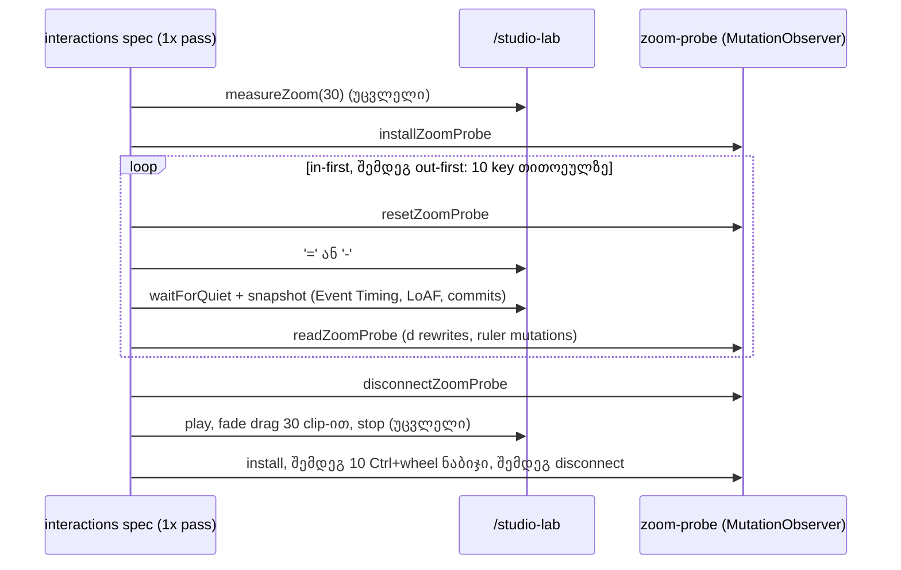

# Zoom-ის harness row-ები ორივე მიმართულებით და Ctrl+wheel; PERF-3-ის exit-ის გადაწყვეტილება (PERF-3c)

**თარიღი:** 2026-11-02
**სტატუსი:** Completed (C round 304 PASS)
**შეცვლილი პროექტი:** Store (perf harness: `perf/` და docs; `app/**` არ შეცვლილა)

## კონტექსტი

PERF-3-ის მიზანი (`perf-plan.md`): 30 clip-ით zoom keydown p95 < 50 ms და ≤ 1 commit თითო ნაბიჯზე. PERF-3a-მ (doc 212) waveform-ის column band-ები შემოიტანა, PERF-3b-მ (doc 213) კი seconds ruler-ის tick-ები page window-ით შეზღუდა. Harness-ის `interact.zoom.30.*` row-ები ზომავდა მხოლოდ "in-first" გზას (5 × `=`, შემდეგ 5 × `-`, 40 px/s-დან). ეს გზა 25 px/s band-ის საზღვარს არასდროს კვეთს. ამ row-ებში Event Timing არ იყო და ყველა `record` იყო, ამიტომ harness ნელ ნაბიჯს ვერ ხედავდა.

B-ის probe-მა (`b-round-303/probe`) HEAD-ზე აჩვენა: out-first გზაზე მე-3 და მე-8 key band-ს კვეთს, 30 waveform `d`-ს თავიდან წერს და keydown 56–88 ms-ია. PERF-3c ამ შემთხვევას harness-ში ზომავს და exit-ის გადაწყვეტილებას იწერს. გამოსწორება ცალკე ეტაპია, PERF-3d.

## მიდგომა

- **ორი ახალი გაზომვა, მხოლოდ 1× CPU-ზე:**
  - `measureZoomPath('in' | 'out')` მიდის არსებული `measureZoom(30)`-ის შემდეგ;
  - `measureZoomWheel` ბოლოსაა, `stop with 30 clips`-ის შემდეგ, რადგან wheel zoom კურსორზე ანკერდება და `scrollLeft`-ს ცვლის.
- **არსებული ფუნქციები და row-ები ბაიტ-იდენტურია.** იცვლება მხოლოდ `stats`-ის import ხაზი (`median` დაემატა).
- **ახალი lib module `perf/lib/zoom-probe.ts`:** MutationObserver `document.body`-ზე, რომელიც მხოლოდ ამ გაზომვების დროს არის ჩართული და მათ შემდეგ `finally`-ში ითიშება. ითვლის:
  - `d` ატრიბუტის ცვლილებას `path`-ზე, რომელსაც `closest('[data-testid="arrangement-clip-waveform"]')` აქვს (fade და envelope path არ ითვლება);
  - ruler-ის შიგნით დამატებულ და მოშორებულ child node-ებს.

  Read ჯერ `takeRecords()`-ით აგროვებს მოლოდინში მყოფ ჩანაწერებს, ამიტომ jsdom-ში და page-ში ერთნაირად ითვლის.
- **ნაბიჯების საერთო runner:** blur → probe reset → `t0` → მოქმედება → `waitForQuiet(keySettleMs)` → snapshot + probe read. ახალი ფიქსირებული ლოდინი არ დამატებულა. Keydown ms არის ფანჯრის Event Timing `keydown` entry-ების მაქსიმუმი; entry-ს არქონისას 0 (16 ms threshold). LoAF ითვლება, თუ entry ნაბიჯის ფანჯარას გადაფარავს (`t ≤ tEnd` და `t + duration ≥ t0`).
- **Wheel:** pointer დგას scroller-ის left + 524 px, top + 60 px წერტილში. თითო ნაბიჯი: `keyboard.down('Control')` → `mouse.wheel(0, ±100)` → `keyboard.up('Control')`.
- **Wall-clock row-ები `record`-ია.** 10 key-ზე p95 მაქსიმუმს უდრის, Event Timing-ს კი 8 ms granularity აქვს. 50 ms-ის მიზანი C-ის გადაწყვეტილების row-ა (EXIT) და არა CI assert.
- **Assert-ები deterministic count-ებზეა:** `in.path-rewrites == 0`, `out.path-rewrites == 60`, `wheel.path-rewrites == 60` და სამი live row.
- **PERF-3d (doc 223):** band crossing-ზე მხოლოდ timeline window-ში მყოფი clip-ის waveform იგება, ამიტომ `out.path-rewrites` = 3 და `wheel.path-rewrites` = 2 (1440×900).
- **უარყოფილი:** p95-ზე assert (shared runner-ზე ხმაურიანია); probe-ის `instrumentation.ts`-ში ჩადება (init script-ში ყოველთვის ჩართული იქნებოდა და ძველ row-ებს შეეხებოდა); `.6x` row-ები (task-ით გამორიცხულია).

## არქიტექტურა

## შეცვლილი ფაილები

- `perf/studio-lab-interactions.perf.spec.ts`: `runZoomProbeSteps`, `measureZoomPath`, `measureZoomWheel`, მათი გამოძახებები და import-ები.
- `perf/lib/zoom-probe.ts` (ახალი): install, read, reset და disconnect; page-ში `page.evaluate`-ით ეშვება.
- `perf/lib/zoom-probe.test.ts` (ახალი): jsdom-ის ტესტები ZP1–ZP6.
- `perf/budgets.interactions.json`: 18 ახალი row ბოლო `interact.zoom.30.*` row-ის შემდეგ, owner `PERF-3c`.
- `perf/budgets.resources.json`: `res.dom.ruler-1` და `res.dom.ruler-2`-ის `note`. PERF-3b-ის შემდეგ ruler page window-ს რენდერავს და რაოდენობა პროექტის სიგრძესთან ერთად აღარ იზრდება.
- `docs/implementation/2026/quarter-IV/212-perf-zoom-waveform-columns.md`, `213-perf-ruler-tick-window.md`: სტატუსი და PERF-3-ის exit-ის ბმული ამ დოკუმენტზე.

## პრობლემები და გადაწყვეტები

- **პრობლემა:** `page.evaluate`-ს გადაცემული ფუნქცია `toString()`-ით სერიალიზდება, ამიტომ module-ის helper-ს ვერ იყენებს. **გადაწყვეტა:** ყველა selector და tally ფუნქცია `installZoomProbe`-ის შიგნითაა. Read, reset და disconnect მხოლოდ `window.__czabaZoomProbe`-ს ეხება.
- **პრობლემა:** Observer შეიძლება მომდევნო row-ებში "გაჟონილიყო". **გადაწყვეტა:** Disconnect `finally`-ში ხდება. გათიშვის შემდეგ read აბრუნებს `connected: false`-ს და 0-ებს, ხოლო runner ამას harness-ის პრობლემად წერს. Fade drag-ის 30-clip row-ები უცვლელ კლასშია (`interact.harness.drag-fade-30-live` = 1, `move-components-per-move` = 103.25).
- **პრობლემა:** Ruler-ის remount observer-ს მოწყვეტდა. **გადაწყვეტა:** Observer `document.body`-ზეა და ruler-ს target-ის `closest`-ით ამოწმებს.
- **პრობლემა:** პირველ სრულ გაშვებაში out-ის `loaf-max-ms` იყო 73.1, 0, 0, თუმცა იმავე pass-ებში keydown 80–96 ms იყო (code-reviewer, Medium). snapshot LoAF-ს `t ∈ [t0, tEnd]`-ით ფილტრავდა, ამიტომ key-ის frame, რომელიც `t0`-ზე ცოტა ადრე დაიწყო, იკარგებოდა. **გადაწყვეტა:** ახალი LoAF row-ები ფანჯრის გადაფარვას ითვლის. მეორე გაშვებაში out-ის მე-3 და მე-8 key-ის LoAF სამივე pass-ში ჩანს (50.5–55.2 და 83.3–84.4 ms). არსებული row-ების ფილტრი უცვლელია.
- **პრობლემა:** Mutant-ის control dev server-ზე (5173) load-ზე ჩავარდა (4 page error dev რეჟიმში). **გადაწყვეტა:** Scratch გაზომვები production build-ზე გაეშვა (`remix-serve`, scratch port 5189), შემდეგ ეს server გაჩერდა.

## ტესტირება

**A-PERF-RUN.** `npm run test:perf` ორჯერ გაეშვა, ორივეჯერ მარტო. პირველი code-review-მდე იყო, მეორე საბოლოო tree-ზე. ქვემოთ საბოლოო გაშვების შედეგებია:
- rc 0, 3 test PASS, wall-clock 13.9 წუთი;
- interactions-ის `durationMs` 337,541 ms, ანუ 15-წუთიანი timeout-ის 37.5 % (პირველ გაშვებაში 339,158 ms);
- სამივე ანგარიში `complete`-ია, `failures` ცარიელია, 0 problem და 0 page error;
- ყოველ ახალ row-ს 3 sample აქვს, ყველა assert PASS-ია.

| Row | 3 sample | Median |
|---|---|---|
| `interact.harness.zoom-30-in-path-live` | 1, 1, 1 | 1 |
| `interact.harness.zoom-30-out-path-live` | 1, 1, 1 | 1 |
| `interact.harness.zoom-30-wheel-live` | 1, 1, 1 | 1 |
| `interact.zoom.30.in.keydown-max-ms` | 24, 24, 16 | 24 |
| `interact.zoom.30.in.keydown-median-ms` | 16, 16, 16 | 16 |
| `interact.zoom.30.in.loaf-max-ms` | 0, 0, 0 | 0 |
| `interact.zoom.30.in.commits-per-key` (max) | 1 (1) | 1 |
| `interact.zoom.30.in.path-rewrites` | 0, 0, 0 | 0 |
| `interact.zoom.30.in.ruler-mutations` | 90, 90, 90 | 90 |
| `interact.zoom.30.out.keydown-max-ms` | 80, 80, 88 | **80** |
| `interact.zoom.30.out.keydown-median-ms` | 16, 16, 16 | 16 |
| `interact.zoom.30.out.loaf-max-ms` | 83.3, 83.4, 84.4 | 83.4 |
| `interact.zoom.30.out.commits-per-key` (max) | 1 (1) | 1 |
| `interact.zoom.30.out.path-rewrites` | 60, 60, 60 | 60 |
| `interact.zoom.30.out.ruler-mutations` | 202, 202, 202 | 202 |
| `interact.zoom.30.wheel.loaf-max-ms` | 68.5, 69.6, 75.1 | 69.6 |
| `interact.zoom.30.wheel.commits-per-step` (max) | 1 (1) | 1 |
| `interact.zoom.30.wheel.path-rewrites` | 60, 60, 60 | 60 |

**გადაკვეთის პოზიციები.** ისინი B-ის probe-ს ემთხვევა:
- out `perKey` = `0,0,30,0,0,0,0,30,0,0`;
- wheel `perStep` = `0,0,0,30,0,0,30,0,0,0`;
- in ყველგან 0.

Out-ის keydown `perKey`-ზე მაღალი მნიშვნელობები მე-3 (48–56) და მე-8 (80–88) key-ზეა. Ruler-ის `perKey` (`29,7,9,50,6,6,50,9,7,29`) B-ის 1440-ის probe-ს ემთხვევა. Wheel-ის LoAF მხოლოდ მე-7 ნაბიჯზე ჩანს, ისევე როგორც B-ის probe-ში.

**PERF-3-ის exit — არ შესრულდა.**
- In-ის `keydown-max-ms` median 24 < 50, მაგრამ out-ის median **80 ≥ 50**.
- `commits-per-key` / `commits-per-step`-ის `detail.max` = 1 სამივე გზაზე. Commit-ის პირობა შესრულებულია.
- ნელი ნაბიჯები band-ის გადაკვეთის key-ებია. იქ 30 waveform path ერთ commit-ში თავიდან იწერება და LoAF 50–84 ms-ია.
- გამოსწორება **PERF-3d**-ია. საბოლოო გადაწყვეტილებას C round 304-ის PERF-RUN/EXIT row-ები აფიქსირებს.

**Unit და mutant-ები:**
- **Unit:** scratch config (`include: ['perf/lib/*.test.ts']`): `report.test.ts` 23 და `zoom-probe.test.ts` 6 (ZP1–ZP6), სულ 29/29 PASS. `vitest.config.ts` ისევ `app/**`-ს მოიცავს, ამიტომ gate ამ ტესტებს ჯერ ვერ ხედავს (ROOT-REQ-VITEST-PERF-INCLUDE).
- **m1:** filter `true` ხდება, ZP1 წითელია.
- **m2:** out `=`-ით იწყება. `out-path-live` = 0 და `out.path-rewrites` = 0, ორივე წითელი.
- **m3:** Control-ის გარეშე `wheel-live` = 0, წითელი.
- **m4:** observer key-ებამდე ითიშება. `out.path-rewrites` = 0, წითელი.
- **m5:** `observer.disconnect()` წაიშალა. ZP4 და ZP6 წითელია.
- m2–m4 საბოლოო spec-ზე ხელახლა გაეშვა.
- Unmutated control ყველა ახალ row-ზე მწვანეა.

**სხვა:** typecheck rc 0; lint rc 0; scoped Biome 5 perf path-ზე rc 0.

## TODO / შემდეგი ნაბიჯები

- **PERF-3d:** band-ის გადაკვეთის გამოსწორება. B-ის კანდიდატებია (a) integer path-ის სიმაღლეები scaled viewBox-ში და (b) per-source shape cache; ჯერ ორივე უნდა გაიზომოს. Exit-ის მიზანი უცვლელია.
- **ROOT-REQ-VITEST-PERF-INCLUDE:** gate-მა `perf/lib/*.test.ts` უნდა გაუშვას.
- `interactionSequence`-ის აღწერაში ახალი ნაბიჯები ჯერ არ წერია. B-ის გადასაწყვეტია (grant-ის გარეთაა).
