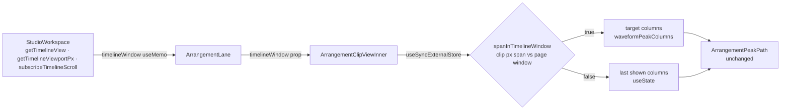

# Waveform-ის rebuild band crossing-ზე მხოლოდ timeline window-ში (PERF-3d)

**თარიღი:** 2026-11-03
**სტატუსი:** Completed (C round 306 PASS)
**შეცვლილი პროექტი:** Store (`app/components/arrangement/*`, `app/lib/arrangement/view.ts`, perf harness-ის budget-ები და docs)

## კონტექსტი

PERF-3-ის exit (`perf-plan.md`): 30 clip-ით zoom keydown < 50 ms და ≤ 1 commit თითო ნაბიჯზე. PERF-3c-მ (doc 222) harness-ში out-first გზა და Ctrl+wheel დაამატა. C round 304-მა HEAD `adf959d`-ზე `out` keydown max 80 ms გაზომა, ამიტომ exit არ შესრულდა.

B-ის probe-მა (`tmp/studio-real-loop/b-round-305/probe/`) მიზეზი აჩვენა:
- ნელი ნაბიჯები ზუსტად 25 px/s column band-ის crossing-ებია: თითო clip-ზე 4096 ↔ 2534 column, 30 `d` rewrite, 4096-ზე `d`-ის ჯამური სიგრძე 2.64 MB (`out-1440-1.json`, `wheel-out-1440-1.json`, script `zoom-attr.cjs`);
- crossing ზემოთ: keydown 104 ms, LoAF 90 ms, აქედან script 84 ms (forced style/layout 14), render 1.3 ms; crossing ქვემოთ 56 ms; wheel-ზე LoAF 54 / 86 ms, script 50 / 79 ms; crossing-ის გარეშე key 24 ms;
- იმ მომენტში 30 clip-იდან viewport-ში მხოლოდ 1–2 ჩანს (`scrollWidth` 80–123 k px);
- production build-ზე HEAD-ის out keydown თითო key-ზე `[16,16,56,24,16,16,16,80,16,16]`, LoAF 77 ms მე-8 key-ზე (`prod-head-*.json`);
- microbench (`path-bench.json`, 30 path × 4096 column): `toFixed(3)` path-ის აწყობა 32–55 ms, integer + relative `h1` 8–12 ms, `setAttribute('d')` ყველა ფორმატში 12–15 ms.

ანუ ხარჯის უმეტესი ნაწილი ეკრანს გარეთ მყოფი clip-ების path-ების აწყობაა.

## მიდგომა

- **Viewport gating არსებული timeline page window-ით.** Clip waveform იყენებს იმავე სამ-viewport-იან window-ს, რომელსაც seconds ruler და bars ruler იყენებს (PERF-3b, doc 213): `readTimelinePage` / `timelinePageWindow` (`app/lib/arrangement/view.ts`). წყარო `StudioWorkspace`-ის არსებული `getTimelineView` (zoom-ის render-ის დროს pending view-ს აბრუნებს), `getTimelineViewportPx` და `subscribeTimelineScroll` callback-ებია. ახალი scroll listener არ დამატებულა.
- **Clip window-ში:** column-ების რაოდენობა `waveformPeakColumns(clip.duration, pxPerSecond)`, როგორც ადრე. **Clip window-ს გარეთ:** რჩება ბოლოს ნაჩვენები column-ები. ძველ path-ს `preserveAspectRatio="none"` clip-ის box-ზე აწელს, სანამ scroll მას window-ში არ შემოიყვანს. Gating მხოლოდ zoom-ის column-ების რაოდენობას ეხება. Window-ს გარეთ მყოფი clip-ის რედაქტირება (trim, gain, undo) მის path-ს მაინც ხელახლა აგებს, ოღონდ ძველი column-ების რაოდენობით.
- **State pattern:** `useSyncExternalStore` per-clip boolean snapshot-ით ("clip window-შია?"), ამიტომ scroll-ზე re-render ხდება მხოლოდ იმ clip-ში, რომლის მდგომარეობაც შეიცვალა. ნაჩვენები column-ები `useState`-შია და render-ის დროს guarded `setState`-ით ახლდება ("adjust state while rendering"). React ამას commit-მდე ხელახლა არენდერებს და დამატებით commit-ს არ ქმნის. Ref-ში render-ის დროს არაფერი იწერება.
- **გაუზომავი viewport = ყველაფერი window-შია.** `readTimelinePage` აბრუნებს null-ს, როცა viewport-ის სიგანე > 0 არ არის, და `spanInTimelineWindow(…, undefined)` true-ა. ამიტომ jsdom-ის ტესტები და SSR უცვლელია.
- **Window-ის საზღვრები ორივე მხარეს inclusive-ია.** ახალი margin constant არ დამატებულა.
- **ვერტიკალური ღერძი gated არ არის:** lane-ები ცოტაა და 30-clip-იანი სცენარი ერთ lane-ზეა (სიგნალი `PERF-3D-VERTICAL-GATE`).
- **ხილული path-ები ბაიტ-იდენტურია.** `buildPeakShape` და `ArrangementPeakPath` არ შეცვლილა: path-ის ფორმატი, `toFixed(3)` და viewBox იგივეა. Detail panel-ის waveform საკუთარი column-ებით მუშაობს და ამ ცვლილებას არ ეხება.
- **Budget-ები (GATE304-M2):** `interact.zoom.30.out.path-rewrites` `==` 3 და `interact.zoom.30.wheel.path-rewrites` `==` 2 (ადრე ორივე 60). ორივე deterministic assert-ად რჩება: gating-ის დაკარგვისას 60-ს აჩვენებს, ხილული clip-ის rebuild-ის შეწყვეტისას კი ნაკლებს. `in.path-rewrites` `==` 0 უცვლელია. შვიდი keydown/LoAF row-ის note-ს დაემატა შენიშვნა, რომ ისინი zoom probe-ით იზომება (GATE304-L3). Spec-ის `interactionSequence`-ის ბოლო ჩანაწერი ახლა ზუსტად აღწერს zoom-ის ნაბიჯებს (C-R304-02).
- **უარყოფილი ვარიანტები:**
  - (a) integer path + relative `h1`: მარტო ≈ 65–75 ms იქნებოდა (`performance-optimizer`-ის შეფასება), ანუ exit მაინც არ შესრულდებოდა. ამასთან, ოთხ ტესტ ფაილში path-ის ფორმატის pin-ების შეცვლას მოითხოვდა (`tech-lead`). ხილული path-ებიც შეიცვლებოდა;
  - (b) per-source cache: gate-ის მიზეზს არ ხსნის, რადგან `d`-ის ჩაწერა თავისთავად 12–15 ms-ია 30 path-ზე;
  - (d) cap-ის 2048-მდე შემცირება: ≈ 70 ms (exit არ სრულდება) და ხილულ დეტალს ამცირებს;
  - IntersectionObserver: მისი callback მეორე commit-ს დაამატებდა; per-clip `getBoundingClientRect` layout-ს აიძულებდა; `startTransition` / `useDeferredValue`: ხილული clip-ის განახლებას დააგვიანებდა.

## არქიტექტურა

Scroll-ზე `subscribeTimelineScroll` listener-ები snapshot-ს ხელახლა კითხულობს. მხოლოდ ის clip ირენდერება, რომლის boolean-იც შეიცვალა. Window-ში შემოსვლისას guarded `setState` column-ებს target-ზე ასწორებს.

## შეცვლილი ფაილები

- `app/lib/arrangement/view.ts`: `TimelineWindowSource` interface და `spanInTimelineWindow` (inclusive საზღვრები; window-ის არქონისას true).
- `app/components/arrangement/ArrangementClip.tsx`: მხოლოდ `ArrangementClipViewInner`-ში column-ების gating, optional prop `timelineWindow` და ორი module-level helper (no-op subscription, server snapshot = true).
- `app/components/arrangement/ArrangementLane.tsx`: optional prop `timelineWindow`, რომელიც `ArrangementClipView`-ს გადაეცემა.
- `app/components/arrangement/StudioWorkspace.tsx`: ერთი `useMemo`, რომელიც სამ არსებულ callback-ს აერთიანებს, და prop `<ArrangementLane>`-ზე.
- `app/lib/arrangement/__tests__/waveform-window-ui.test.tsx` (ახალი): WG0–WG5.
- `perf/budgets.interactions.json`: ორი path-rewrites budget (60 → 3 და 60 → 2) და შვიდი note.
- `perf/studio-lab-interactions.perf.spec.ts`: მხოლოდ `interactionSequence`-ის ბოლო ჩანაწერის ტექსტი.
- `docs/implementation/2026/quarter-IV/222-perf-zoom-harness-rows.md`: ერთი ხაზი `## მიდგომა`-ში.

## პრობლემები და გადაწყვეტები

- **Problem:** window-ს გარეთ მყოფი clip-ის ძველი column-ების დამახსოვრება დამატებითი commit-ის გარეშე. **Solution:** `useState` და guarded `setState` render-ის დროს. React render-ს commit-მდე იმეორებს, ამიტომ `commits` `detail.max` 1 რჩება.
- **Problem:** jsdom-სა და SSR-ში viewport არ იზომება, ამიტომ gating ყველა clip-ს "გარეთ" ჩათვლიდა. **Solution:** გაუზომავი viewport ნიშნავს window-ის არქონას, ანუ ყველა clip ხილულად ითვლება (WG1).
- **Problem:** zoom-ის render-ის დროს scroll ჯერ ძველ ადგილასაა. **Solution:** `getTimelineView` zoom-ის დროს pending view-ს აბრუნებს, როგორც rulers-ისთვის. ამიტომ window ახალ, anchored პოზიციას ასახავს. Harness-ის out გზის key 4-ის ერთი rewrite სწორედ ეს anchored scroll-ია.

## ტესტირება

- **`waveform-window-ui.test.tsx`:** ერთი 200 s source, music lane-ზე `near` (0 s) და `far` (150 s), ორივე 50 s. Viewport 1216 px-ია.
  - WG0: `spanInTimelineWindow`: window-ის გარეშე true; შეხებადი საზღვრები true; 1 px-ით გარეთ false.
  - WG1: გაუზომავი viewport-ისას 40 → 20 px/s ორივე clip-ს ახალ column-ებზე აგებს.
  - WG2: გაზომილ viewport-ზე 40 → 20 px/s-ისას `near` ახლდება, `far` ძველ column-ებზე რჩება.
  - WG3: scroll-ი, რომელიც `far`-ს window-ში შემოიყვანს, მას ახალ column-ებზე აგებს.
  - WG4: `far`-ზე scroll-ის შემდეგ zoom უკან (20 → 40) `near`-ს ძველ (20-ის) column-ებზე ტოვებს, `far` კი 40-ის column-ებზეა.
  - WG5 (A-ს დამატება code-reviewer-ის Medium-ის გამო): რეალური anchored zoom (Zoom slider → `applyTimelineView`). Playhead 175 s-ზეა, scroll 3000. ახალი window pending view-დან (scroll ≈ 175 × zoom − 500) ითვლება: `far` ახალ band-ზე იგება, `near` კი ძველზე რჩება.
- **Mutant-ები** (scratch ასლზე, არა `store/`-ში):
  - MU-GATE-OFF → WG2, WG3, WG4 წითელი;
  - MU-NO-SCROLL → WG3 წითელი;
  - MU-FALLBACK → WG0, WG1 წითელი;
  - MU-EDGE → WG0 წითელი;
  - MU-NO-PENDING (`getTimelineView` pending view-ს უგულებელყოფს) → WG5 წითელი.

  აღდგენის შემდეგ ყველა row მწვანეა.
- **Covering set:** ახალი ფაილი, `view.test.ts`, `tempo-window-ui`, `render-budget` და waveform-ის pin-ების ფაილები (`clip-gain-pointer-preview`, `clip-gain-waveform`, `content-colour-ui`, `waveform-zoom`, `clip-envelope-ui`, `video-fades-ui`, `waveform-outline-path`) მწვანეა.
- **Perf harness** (`npm run test:perf`, ცალკე, A-ის გაშვება): rc 0, სამივე report `complete`, `failures` []. `in` / `out` `keydown-max-ms` მედიანა 24 / 24 ms, LoAF 0 / 0 / 0, `commits` `detail.max` 1, `zoom.30.components-per-key` 247. `path-rewrites`: in 0, out 3 (`0,0,1,1,0,0,0,1,0,0`), wheel 2 (`0,0,0,1,0,0,1,0,0,0`). საბოლოო EXIT-ის გადაწყვეტილება C-ის PERF-RUN და EXIT row-ებით მიიღება.
- **B-ის pre-check sketch-ზე:** visible paths HEAD-თან ბაიტ-იდენტურია 1440 და 1280-ზე (`visible-d-compare.txt`). Crossing-ის შემდეგ scroll-ისას თითო scroll step-ზე მაქსიმუმ 1 lazy rebuild ხდება და LoAF 0-ია (`scroll-sketch-1440.json`, `scroll-sketch-1280.json`). C ამას იმეორებს VIS-EQUIV და SCROLL-UPGRADE row-ებით.

## TODO / შემდეგი ნაბიჯები

- `PERF-3D-VERTICAL-GATE`: ვერტიკალური gating, თუ lane-ების რაოდენობა გაიზრდება (სიგნალი, არა დავალება).
- `PERF-3D-SCROLL-HARNESS-ROW`: harness-ის scroll row და distinct-sources ვარიანტი (კანდიდატი).
- Architecture checkpoint STUDIO-PERFORMANCE-ის ბოლოს: `StudioWorkspace.tsx`-ის ზომა და prop chain clip view-მდე.
