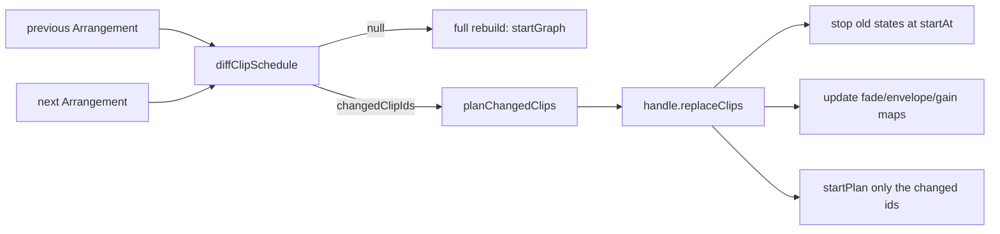

# Clip-ის edit-ის commit playback-ის დროს: per-clip schedule diff და `replaceClips` (PERF-COMMIT-RESCHEDULE: ეტაპი a და დახურვა მტკიცებულებით)

**თარიღი:** 2026-11-03
**სტატუსი:** Completed (C round 308 PASS)
**შეცვლილი პროექტი:** Store (`app/lib/arrangement/reschedule.ts`, `app/lib/arrangement/graph.client.ts` და მათი unit ტესტები)

## კონტექსტი

როცა clip-ის edit (fade, trim, move, Ctrl+Z) playback-ის დროს commit-დება, დღეს მთელი audio graph თავიდან იგება: `syncPlayback` (`app/contexts/ArrangementContext.tsx`) ხედავს შეცვლილ `scheduleKey`-ს და იძახებს `startGraph`-ს, ანუ ყველა clip თავიდან იწყება.

B-მ premise ხელახლა გაზომა HEAD `ecb832a`-ზე (production build, `tmp/studio-real-loop/b-round-306/probe/release-probe.cjs`, შედეგები `head-1440.json` და `head-1280.json`):
- 30 clip-ით ყოველი release (fade drag, trim drag, ყოველი Ctrl+Z) `start()`-ს 30-ჯერ იძახებს; burst 0.4–0.8 ms-ია;
- release-ის შემდეგ 800 ms-ში LoAF 0-ია, უდიდესი pointerup/keydown Event Timing 32 ms;
- main thread-ის ღირებულება უმნიშვნელოა. რჩება audio მხარე: edit-ის ირგვლივ დაახლოებით 60 source (იზრდება clip-ების რაოდენობასთან ერთად) და თვითონ splice. ეს ჯერ არ გაზომილა.

B-ის გადაწყვეტილება (D-29z813): ეტაპი ორად იყოფა. ეტაპი a (რაუნდი 307) ქმნის დატესტილ ნაწილებს და runtime გზას არ ცვლის. ეტაპი b მათ `syncPlayback`-ში ჩართავდა, მაგრამ მანამდე browser-ში უნდა გაეზომა churn და continuity, და თუ სარგებელი არ ჩანდა, ეტაპი უნდა დახურულიყო.

### გაზომვა და დახურვა (რაუნდი 308)

B-მ HEAD `d8e5ce5`-ზე გაზომა (dev server, რეალური Chromium, AudioWorklet tap რეალურ output-ზე; probe `tmp/studio-real-loop/b-round-307/probe/continuity-probe.cjs`). ეს B-ის რიცხვებია; C რაუნდ 308-ში მათ თავისი production build-ით იმეორებს (CONT-1, CONT-30):
- **1 clip** (Bass): play, ~2.5 s-ზე fade-out handle-ის drag (playhead-თან gain არ იცვლება); release 1 source-ს თავიდან იწყებს. 6/6 ვალიდურ run-ში (3 თითო viewport-ზე) splice-ის −3…+10 ms ფანჯარაში უდიდესი sample step 0.0016–0.0019-ია, splice-მდე წამის 99.9-ე პერცენტილი 0.0035; zero run 0; RMS ratio 0.79–1.08; უდიდესი step splice-დან 114–399 sample-ითაა დაშორებული, ანუ stem-ის შინაარსია და არა splice (`tmp/studio-real-loop/b-round-307/probe/continuity-head-dev.json`).
- **30 clip** (Add + 29× Ctrl+D): release 30 source-ს იწყებს. 6/6 ვალიდურ run-ში splice-ის step 0.0013–0.0015, იგივე 0.0035 baseline, zero run 0, RMS ratio 0.77–0.90, დაშორება 45–441 sample (`tmp/studio-real-loop/b-round-307/probe/continuity-head-dev-30.json`).
- **Chromium `ended`** (`tmp/studio-real-loop/b-round-307/probe/onended-probe.json`): დაწყებამდე გაჩერებული source `ended`-ს stop-ის დროს (0.311 s) იღებს; მეორე, უფრო გვიანი `stop()` იმარჯვებს (`ended` 0.908 s-ზე, throw-ის გარეშე).
- Main thread-ის ღირებულება (რაუნდი 306/307): 30-start burst 0.4–0.8 ms, LoAF 0, Event Timing ≤ 32 ms.

**გადაწყვეტილება (D-29z817):** დღევანდელ full rebuild-ს არც main thread-ზე აქვს გაზომილი ღირებულება და არც გასაგონი წყვეტა 1 ან 30 clip-ზე. Per-clip replace-ის ჩართვა `start()`-ის გამოძახებებს 30-დან ≤ 1-მდე შეამცირებდა, მომხმარებლისთვის ხილული სარგებლის გარეშე. ამიტომ ეტაპი b (wiring) არ იგზავნება და PERF-COMMIT-RESCHEDULE მტკიცებულებით იხურება. **პირობა:** დახურვა საბოლოოა, როცა C ამ მტკიცებულებას browser-ში იმეორებს; თუ C click-ს იპოვის, ეტაპი b-ii wiring-ად ხელახლა იხსნება.

**არ გაზომილა (D-29z819, ეს დასკვნებია და არა ფაქტები):**
- edit sounding clip-ზე, როცა ბევრი სხვა clip-იც ჟღერს (სავარაუდოდ ღირს დაახლოებით იმდენი, რამდენიც Play, რომელიც იმავე source-ებს იწყებს);
- `ended` Firefox-სა და Safari-ში;
- gain-ის შემცვლელი edit playhead-თან (ორივე გზაზე ლეგიტიმური gain step-ია, ამიტომ მათ ვერ არჩევს).

**ეტაპ a-ს გამაგრება (D-29z818):** ეტაპი a რჩება მომზადებულ კოდად (STEM-LANES-ს ან phase 2-ს შეიძლება დასჭირდეს per-clip reschedule), მაგრამ gate-307-ის review finding F1 მომავალი caller-ისთვის ხაფანგი იყო: `stop(when)` `replaceClips`-ის მიერ დაყენებულ stop-ს **გვიან** გადაწევდა, Chromium-ში კი გვიანი stop იმარჯვებს. ამიტომ რაუნდ 308-ში: stop არასოდეს გადაიწევს გვიან; `ReplaceClipShapes`-ის `clipFades` და `clipEnvelopes` სავალდებულოა (F5); `replaceClips`-ს ზემოთ TODO ამ doc-ზე მიუთითებს.

## მიდგომა

კონტრაქტი D-29z814-ის მიხედვით:

- **`diffClipSchedule(previous, next)`** (pure, `reschedule.ts`) აბრუნებს `{ changedClipIds }`-ს ან `null`-ს („full rebuild“). `null` ბრუნდება, როცა loop განსხვავდება (`JSON.stringify(loop)`, დამატება/წაშლაც), track id-ების რიგი განსხვავდება, ან clip id-ების სიმრავლე განსხვავდება (add, delete, split). სხვა შემთხვევაში `changedClipIds` `next.clips`-ის რიგით შეიცავს ყველა clip-ს, რომლის JSON `gainDb`-ის გარეშე განსხვავდება — იგივე წესი, რაც `scheduleKey`-ში. მხოლოდ რიგის შეცვლა `[]`-ს იძლევა: ეს შეგნებული განსხვავებაა `scheduleKey`-სგან, რადგან რიგი ხმას არ ცვლის.
- **`planChangedClips(next, ids, from)`** = `planSchedule(next, from)` გაფილტრული id-ებით; `from`-მდე დასრულებული clip item-ს არ იძლევა.
- **`ScheduleHandle.replaceClips(clipIds, items, from, startAt, shapes)`** (`graph.client.ts`): disconnected handle-ზე არაფერს აკეთებს. სხვა შემთხვევაში: (1) prune-ავს დასრულებულ state-ებს ისე, როგორც `appendPlan`; (2) `startAt`-ზე ზუსტად აჩერებს `clipIds`-ის ყველა არ-დასრულებულ state-ს, რომელიც უკვე `startAt`-ზე ან უფრო ადრე არ გაჩერებულა — მომავალში დაგეგმილის ჩათვლით; (3) თითო id-ზე `shapes`-იდან აყენებს ან შლის fade/envelope map-ის ჩანაწერს და აყენებს `clipGainTargets`-ს, თუ `shapes.clipGains`-ში არის; (4) `startPlan`-ით იწყებს მხოლოდ `clipIds`-ში მყოფ `items`-ს.
- **`stop(when)`-ის guard (რაუნდი 308):** clip-ისა და click-ის ორივე loop state-ს გამოტოვებს, როცა `state.ended || (state.stopAt !== null && state.stopAt <= (when ?? ctx.currentTime))`. ანუ stop შეიძლება ადრე გადაიწიოს (immediate `stop()` ან უფრო ადრეული `when`), მაგრამ არასოდეს გვიან. დღევანდელ caller-ებზე (`ArrangementContext.tsx`: `stopGraph`-ის ორი immediate `stop()` და `startGraph`-ის ერთჯერადი `previous.stop(stopAt)`) ქცევა უცვლელია.
- **`ReplaceClipShapes`:** `clipGains` optional რჩება (არარსებული gain ძველ target-ს ტოვებს); `clipFades` და `clipEnvelopes` სავალდებულოა — map-ში არარსებული id fade/envelope-ს შლის, ამიტომ caller-მა ცარიელი map ცხადად უნდა გადასცეს.
- handle-ის შექმნისას `options.clipFades` და `options.clipEnvelopes` კოპირდება ორ mutable map-ში (`clipFadeTargets`, `clipEnvelopeTargets`), როგორც `clipGainTargets`. `startPlan` მათ კითხულობს, ამიტომ replace ძველ fade-ს აღარ იმეორებს (tech-lead-ის მიერ ნაპოვნი ხაფანგი). არსებული გამოძახებების ქცევა უცვლელია.

უარყოფილი ალტერნატივა: diff-ის `ArrangementContext.tsx`-ში ჩაშენება ამავე რაუნდში. ის runtime-ს შეცვლიდა გაზომვამდე; performance-optimizer-მა და tech-lead-მა a/b გაყოფა დაადასტურეს (`tmp/studio-real-loop/b-round-306/consults.md`).

## არქიტექტურა

მხოლოდ `D`, `C` და `R` არსებობს; `syncPlayback`-იდან ისრები არ არის, რადგან ეტაპი b მტკიცებულებით დაიხურა (D-29z817). დღეს ყოველი commit full rebuild-ით მიდის.

## შეცვლილი ფაილები

- `app/lib/arrangement/reschedule.ts` — ახალი: `ClipScheduleDiff`, `diffClipSchedule`, `planChangedClips`.
- `app/lib/arrangement/__tests__/reschedule.test.ts` — ახალი: RS1–RS10.
- `app/lib/arrangement/graph.client.ts` — `ReplaceClipShapes` (`clipFades`/`clipEnvelopes` სავალდებულო), `ScheduleHandle.replaceClips` TODO-თი და მისი იმპლემენტაცია, ორი კოპირებული map, `startPlan` მათ კითხულობს; `stop(when)`-ის guard ორივე loop-ში (stop არასოდეს გადაიწევს გვიან).
- `app/lib/arrangement/__tests__/graph.test.ts` — ფაილის ბოლოს top-level `describe('replaceClips')` RC1–RC13-ით, `ReplaceShapes` ტიპით და `noShapes`-ით (ცხადი ცარიელი map-ები), და ერთი import ხაზი; describe-ის გარეთ არსებული ხაზი არ შეცვლილა.
- `docs/implementation/2026/quarter-IV/224-perf-commit-reschedule.md` — ეს doc.

## პრობლემები და გადაწყვეტები

- **Problem:** `startPlan` `options.clipFades`/`options.clipEnvelopes`-ს პირდაპირ კითხულობდა, ამიტომ replace შექმნისას დაფიქსირებულ ძველ fade-ს გაიმეორებდა. **Solution:** ორი mutable map, რომელსაც `replaceClips` ანახლებს; RC4 და RC9 ამას fade-ზე ამოწმებს (RC9 — `appendPlan`-ის loop refill-იც ახალ fade-ს იყენებს), RC11 — envelope-ზე.
- **Problem:** `graph.test.ts`-ის `FakeParam` მხოლოდ `setTargetAtTime`-ს იწერს, ამიტომ fade-ის automation-ის შედარება ცარიელი იქნებოდა. **Solution:** ახალ `describe`-ში ცალკე recording param/gain/context subclass-ები, რომლებიც `setValueAtTime`/`linearRampToValueAtTime`-ს იწერენ; RC4 ასევე ამოწმებს, რომ event-ების სია ცარიელი არ არის.
- **Problem:** ტესტში არსებული import ხაზების შეცვლა აკრძალული იყო, `Arrangement` ტიპი კი არ იყო import-ირებული. **Solution:** ტიპი გამოყვანილია `Parameters<typeof planChangedClips>[0]`-დან; დამატებულია მხოლოდ ერთი import (`planChangedClips`). საწყისი `applySchedule` გეგმა `planChangedClips(fixture, ['a', 'b', 'c'], 0)`-ით იგება, რაც `planSchedule(fixture, 0)`-ის ტოლია.
- **Problem (gate-307 F1):** `stop(when)` აჩერებდა state-ს, თუ მისი `stopAt` მომავალში იყო, ამიტომ `replaceClips`-ის `startAt`-ზე დაყენებულ stop-ს უფრო გვიანი `stop(when)` გადაწევდა, და Chromium-ში გვიანი stop იმარჯვებს (`tmp/studio-real-loop/b-round-307/probe/onended-probe.json`). **Solution:** guard-ის საზღვარი `when ?? ctx.currentTime`; RC12/RC13.
- **Problem (gate-307 F5):** optional `clipFades`/`clipEnvelopes`-ის გამოტოვება ჩუმად შლიდა fade-ს/envelope-ს. **Solution:** ორივე სავალდებულოა; ტესტებში `noShapes` ცხადად გადასცემს ცარიელ map-ებს.
- **Problem:** `graph.test.ts`-ის top import-ების შეცვლა არ შეიძლებოდა, `ReplaceClipShapes` კი არ იყო import-ირებული. **Solution:** `type ReplaceShapes = Parameters<ReturnType<typeof startFixture>['replaceClips']>[4]` describe-ის შიგნით.
- **Problem:** RC fixture-ში `a` და `b` ერთ source-ს იზიარებდნენ, რაც fake source-ების გარჩევას ართულებდა. **Solution:** RC fixture-ს იგივე დრო/offset/duration აქვს, მაგრამ თითო clip-ს საკუთარი buffer (`src-a`, `src-b`, `src-c`).

## ტესტირება

- `reschedule.test.ts`: RS1–RS10 (diff: deep copy, `gainDb`, fade, envelope/move/trim, loop, clip add/remove, track add/order, track mix/clip reorder; `planChangedClips`: mid-clip, დასრულებული და მომავალი clip).
- `graph.test.ts` → `describe('replaceClips')`: RC1 (მხოლოდ შეცვლილი clip ჩერდება `startAt`-ზე, ერთი ახალი source), RC2 (sounding clip-ის splice offset-ით უწყვეტია, 1e-9), RC3 (ჯერ დაუწყებელი clip ჩერდება და თავიდან იგეგმება), RC4 (fade-ის automation უდრის ახალ `applySchedule`-ს; fade-ის გარეშე replace fade gain-ს აშორებს), RC5 (id filter), RC6 (`activeSourceCount` და prune), RC7 (clip gain target), RC8 (disconnected handle), RC9 (`appendPlan` ახალ fade-ს იყენებს). code-reviewer-ის coverage finding-ის შემდეგ დამატებულია RC10 (განმეორებითი replace: უფრო გვიანი stop წინ იწევს, უკვე ადრე ან იმავე დროს დაგეგმილი stop რჩება; `onended`-ის გარეშე) და RC11 (envelope-ის set/delete, automation უდრის ახალ `applySchedule`-ს). gate-307 F1-ის შემდეგ: RC12 (`replaceClips(['b'], …, 2, 3)`-ის შემდეგ `handle.stop(3.5)` — ძველ `b`-ს `stops` `[3]` რჩება; `a`, `c` და ახალი `b` — `[3.5]`) და RC13 (handle metronome click-ებით: `stop(3)`, შემდეგ `stop(3.5)` — ყველა clip და click source `[3]`; შემდეგ immediate `stop()` — `[3, undefined]`; ამოწმებს, რომ click source ≥ 1 არსებობს).
- `metronome.test.ts` M10 (`stop(21)` შემდეგ `stop()` → `[21, undefined]`) guard-ის შემდეგაც მწვანეა.
- Mutant-ები (A-ს scratch ასლზე, `tmp/studio-real-loop/a-round-307/mut-*.log|diff`): MU-DIFF-FADE → RS3, MU-TRACK-SET → RS7, MU-SHAPES-IGNORED → RC4/RC9 (ასევე RC11), MU-STOP-NOW → RC1 (ასევე RC2, RC3, RC6, RC10), MU-SOUNDING-ONLY → RC3 (ასევე RC1, RC10), MU-NO-PRUNE → RC6, MU-ID-FILTER → RC5, დამატებითი MU-STOP-SKIP-ANY (ნებისმიერი `stopAt`-ის მქონე state-ის გამოტოვება) → RC10 და MU-STOP-EQUAL (`<=` → `<`) → RC10; ყველა წითელია და აღდგენის შემდეგ მწვანე. Stop guard-ის mutant-ები (`tmp/studio-real-loop/a-round-308/mutant-*.log` და `*.patch.txt`): MU-CLIP-STOP-LATER (clip loop ძველ guard-ს ტოვებს) → RC12, RC13; MU-CLICK-STOP-LATER (click loop) → RC13; MU-STOP-ONCE (`stopAt !== null` ყოველთვის გამოტოვება) → RC13 და M10; ყველა წითელია, აღდგენის შემდეგ მწვანე.
- Covering set (`graph`, `reschedule`, `metronome`, `clip-fades`, `envelope`, `clip-gain`, `master`, `track-group-mix`, `video-fades`, `schedule`, `fader-pointer-preview`, `metronome-horizon-ui`): 12 ფაილი, 211 ტესტი მწვანე; `npm run typecheck` rc 0.
- Browser-ის სტრიქონები C-ისაა: რაუნდი 307 — NO-CHANGE, PLAY-SMOKE-307, G307-AUTH; რაუნდი 308 — CONT-1, CONT-30, ENDED, NO-CHANGE, PLAY-SMOKE-308, G308-AUTH.

## TODO / შემდეგი ნაბიჯები

PERF-COMMIT-RESCHEDULE დახურულია მტკიცებულებით (D-29z817); wiring არ იგეგმება. ქვემოთ ჩამოთვლილი სამუშაო საჭიროა მხოლოდ **`replaceClips`-ის ნებისმიერი caller-ის დამატებამდე** (მაგ. STEM-LANES ან phase 2):
- **Full rebuild-ის ძველი სია (D-29z814 §4.4):** full rebuild რჩება `force`-ზე; `removed`-ზე; scrubbing-ზე; აქტიურ loop-ზე (`loopScheduleRef`) ან როცა `diffClipSchedule` = `null`; როცა metronome ჩართულია და `projectEnd` შეიცვალა. Incremental გზაზე `scheduledEndRef`/`scheduledKeyRef` (ან მათი შემცვლელი) ყოველთვის ახლდება; `from` = `positionAt(anchorRef.current, startAt)` არსებული anchor-ით. Harness-ში `interact.drag.trim.30.playing.release-restarts` record-იდან assert-ზე `<= 1` (არა `== 1`). Move 30 clip-ით: Ctrl+D-ის ასლები მიმდებარეა, ამიტომ move context unit სტრიქონით და 2-clip-ის browser სტრიქონით.
- **Replace-splice-ის continuity probe:** browser-ში destination tap, `replaceClips`-ით splice sounding clip-ზე, `continuity-probe.cjs`-ის click-ის წესით; დღევანდელი CONT სტრიქონები მხოლოდ full rebuild-ს ფარავს.
- **`gainDb`-ის წესი (gate-307 F4):** ახლა `scheduleKey`-შიც და `diffClipSchedule`-შიც წერია — ერთი მეორეს უნდა იყენებდეს. `shapes.clipGains` უნდა აიგოს ისე, როგორც `startGraph`-ში (`clipLinearGains(withMixOverride(...))`), და replace-ის შემდეგ mix-ის სინქრონი (`setClipGain` ყველა clip-ზე) უნდა დარჩეს.
- **`ended` Firefox-სა და Safari-ში:** დაწყებამდე გაჩერებულ source-ზე (RC3-ის გზა) `ended` უნდა მოვიდეს, თორემ prune state-ებს ვერ წაშლის და ისინი edit-ებს შორის დაგროვდება; Chromium-ში დადასტურებულია (`tmp/studio-real-loop/b-round-307/probe/onended-probe.json`).
- **Source registry-ის გამოყოფა (architecture signal, round 307 code-reviewer):** `applySchedule`-ის closure-ს სამი lifecycle ოპერაცია (append, stop, replace), კოპირებული prune ბლოკი და ორი mutable map აქვს; caller-ის დამატებამდე ცალკე შეზღუდული task `graph.client.ts`-ში (prune, `stopAt`, active count) RC6/RC10-ის მსგავსი ტესტებით. ეს B/root-ის გადასაწყვეტია.
