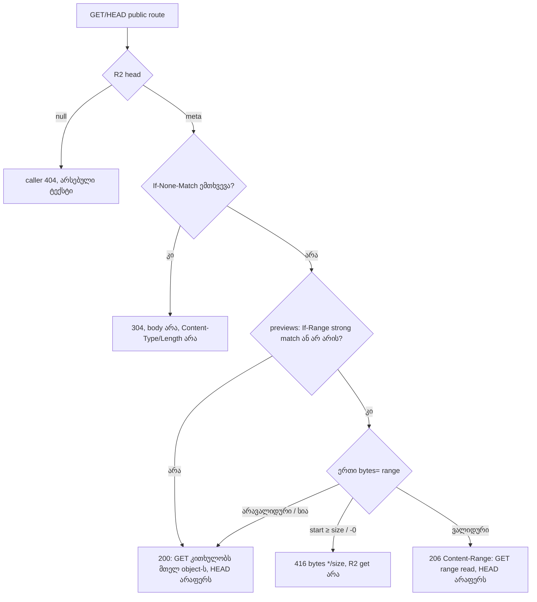

# R2 worker-ის public route-ები: ETag → 304 და ნამდვილი byte range (206/416) ორივე worker-ში (PERF-4a)

**თარიღი:** 2026-11-03
**სტატუსი:** Completed (C round 309 PASS)
**შეცვლილი პროექტი:** Store (`workers/r2-proxy.js`, `cloudflare/r2-worker.js`, `workers/r2-proxy.test.mjs`)

## კონტექსტი

PERF-4 (`docs/technical/performance/perf-plan.md`) R2 worker-ისგან ითხოვს ETag → 304-ს, previews-ზე Range → 206-ს, immutable hashed key-ებს და studio asset-ების სტაბილურ URL-ებს. ამ დროს purchased ფაილები `private` უნდა დარჩეს.

B-მ premise HEAD `738df73`-ზე გაზომა. ორივე worker ასლი Node HTTP adapter-ით და in-memory R2 fake-ით მოემსახურა, და ის Chromium 143-ით შეამოწმა. Fixture იყო 60 s-იანი WAV, ზომით 5,760,044 byte. Probe: `tmp/studio-real-loop/b-round-308/probe/worker-server.mjs` და `browser-probe.cjs`. შედეგები: `head-proxy-1440.json` და `head-alt-1440.json`. ორივე ასლმა ერთნაირად აჩვენა:
- `ETag` არ იგზავნება. `fetch(…, {cache: 'no-cache'})` revalidation-ზე ყველა 5,760,044 byte თავიდან ჩამოდის, status 200-ით;
- Range იგნორირდება. `Range: bytes=1000-1999`-ზე მოდის 200 და 5,760,044 byte, თუმცა preview `Accept-Ranges: bytes`-ს აცხადებს;
- unsatisfiable range-ზე (`bytes=999999999-`) მოდის 200 და მთელი body;
- `<audio>`-ის seek 50 s-ზე აგზავნის `Range: bytes=4784128-`-ს და იღებს 200-ს ყველა 5,760,044 byte-ით;
- cover image-ს (მხოლოდ `workers/` ასლში) ETag არ აქვს, ამიტომ მისი revalidation-იც სრული 200-ია.

იგივე probe B-ის sketch-ზე (`sketch-proxy-1440.json`, `sketch-alt-1440.json`) იძლევა:
- revalidation: 304, 0 body byte;
- range: 206, `bytes 1000-1999/5760044`, 1,000 byte;
- unsatisfiable: 416, `bytes */5760044`;
- seek: 206, 975,916 byte (5,760,044 − 4,784,128). Playback 50.0 s-დან 51.46 s-მდე გაგრძელდა;
- cover-ის revalidation: 304.

ეს ციფრები B-ის გაზომვაა. C იმავე probe-ს A-ს tree-ზე თავიდან უშვებს (WK-BROWSER-PROXY, WK-BROWSER-ALT და საკონტროლო WK-HEAD-CONTROL).

## მიდგომა

**PERF-4 სამ ეტაპად იყოფა (D-29z821).** არაფერი იშლება:
- **4a (ეს რაუნდი):** მხოლოდ public route-ები, ანუ previews (`/preview/…`) და covers (`/{handle}/cover.*`);
- **4b, `/studio/` caching:** `awaiting_user`. legacy stem client ყოველ URL-ს `?token=`-ს უმატებს (protected `app/routes/studio.$productId.tsx`). ახალი token ნიშნავს ახალ URL-ს და ახალ cache key-ს, ამიტომ ETag/304 `/studio/`-ზე დღეს თითქმის არასდროს დაემთხვევა. "Auth outside the URL" protected client-ის ცვლილებაა და **SRW-21-PLAN**-ს ეკუთვნის (root + Saba, ლუპის გარეთ). `private, no-cache` + ETag თუ დღევანდელი `private, no-store` Saba-ს გადაწყვეტილებაა (SABA-Q-PERF4-STUDIO-CACHE);
- **4c, immutable versioned key-ები:** backend/upload handoff. Versioned R2 key-ებს upload pipeline წერს, რომელიც ამ repository-ში არ არის. product API-მაც ეს version უნდა დააბრუნოს. Worker-ის `?v=` წესი (`immutable` მხოლოდ მაშინ, როცა `v` object-ის ETag-ს უდრის) 4c-ის ნაწილია.

`/studio/`, `/download/`, `/recordings/` და `/originals/` უცვლელია. მათ არ აქვთ `onlyIf`, ETag ან 304, და ინარჩუნებენ `private, no-store`-ს, თავიანთ Range წესებს და რიგს "token → scope → R2 read".

**ორივე ასლი ერთნაირად იცვლება.** `wrangler.toml` არ არსებობს, ამიტომ არ ვიცით, რომელია deployed (SABA-Q-WORKER-DEPLOYED). helper block ორივე ფაილის ბოლოს byte-ით იდენტურია, რასაც A-PARITY-ის `diff` ამოწმებს.

**კონტრაქტი (D-29z822), `servePublicObject`-ის რიგი:**
1. `head(r2Key)`. `null`-ზე helper აბრუნებს `null`-ს და caller თავის არსებულ 404-ს: `'File Not Found: ' + r2Key` ან `'Image Not Found'`;
2. Header-ები: არსებული CORS, `Access-Control-Expose-Headers: ETag, Content-Range, Accept-Ranges, Content-Length`, route-ის არსებული `Cache-Control` (`public, max-age=86400` previews-ზე, `public, max-age=604800` covers-ზე, `immutable`-ის გარეშე) და `ETag` = `httpEtag`, მხოლოდ თუ ის არსებობს;
3. `If-None-Match`-ის დამთხვევაზე (weak comparison, `*` ემთხვევა, სია მძიმით იყოფა) → **304** body-ის, `Content-Type`-ისა და `Content-Length`-ის გარეშე. ეს Range-მდე და ნებისმიერ body read-მდე ხდება;
4. `Content-Type` და, მხოლოდ previews-ზე, `Accept-Ranges: bytes`;
5. previews: თუ `If-Range` strongly არ უდრის `httpEtag`-ს (weak ან date მნიშვნელობა არათანაბრად ითვლება), Range იგნორირდება;
6. ერთი `bytes=` range: `a-b`, `a-`, `-n`. სია, სხვა unit, `b < a` ან ცარიელი spec → სრული 200. `a ≥ size`, `-0` ან `size` 0 → **416** `Content-Range: bytes */<size>`-ით, R2 `get`-ის გარეშე. `b` იჭრება `size − 1`-მდე;
7. range → **206** `Content-Range`-ით და slice-ის `Content-Length`-ით. GET კითხულობს `get(r2Key, { range: { offset, length } })`-ით. HEAD არაფერს კითხულობს;
8. სხვა შემთხვევაში → **200** სრული `Content-Length`-ით. თუ `get` `null`-ს დააბრუნებს (object head-სა და get-ს შორის წაიშალა), caller 404-ს აბრუნებს.

Covers (`workers/r2-proxy.js` მხოლოდ) helper-ს `allowRange: false`-ით იყენებს: Range იგნორირდება და პასუხი სრული 200 ან 304-ია.

**Consult-ები:** `performance-optimizer`-მა მისცა 304/206/416-ის წესები და Expose-Headers. `tech-lead`-მა მოითხოვა ორივე ასლის ერთნაირი ცვლილება, `/studio/`-ის `no-store` და protected path-ზე 401/403 R2 read-მდე `If-None-Match`-ის დროსაც. ერთადერთი განსხვავება `/studio/`-ის `no-cache` იყო და ის Saba-ს კითხვად გადავიდა.

## არქიტექტურა

Protected route-ები (`handleProtected`, `validateToken`, `isSafeFileName`), `fetch` router და `getContentType` ამ helper-ს არ იძახებენ და byte-ით HEAD `738df73`-ის იდენტურია.

## შეცვლილი ფაილები

- `workers/r2-proxy.js`: `handleImage` და `handlePreview` იძახებენ `servePublicObject`-ს. ბოლოს დაემატა helper block (`PUBLIC_EXPOSE_HEADERS`, `etagMatches`, `parseSingleRange`, `servePublicObject`);
- `cloudflare/r2-worker.js`: `handlePreview` და იგივე helper block. ამ ასლს image route არ აქვს;
- `workers/r2-proxy.test.mjs`: არსებულ `for (const [name, worker] …)` loop-ში დაემატა `publicRequest` helper (fake R2 `head`/`get`-ით, `{ offset, length }`-ის მხარდაჭერით და read/head-ების აღრიცხვით) და PR1–PR9 row-ები. არსებული row-ები, `request` და `tokenFor` უცვლელია;
- `docs/implementation/2026/quarter-IV/225-perf-r2-worker-cache-range.md`: ეს დოკუმენტი.

## პრობლემები და გადაწყვეტები

- **პრობლემა:** ოფიციალური R2 დოკუმენტაცია (Cloudflare R2 Workers API reference, სექციები "Bucket method definitions", "R2Object definition", "R2GetOptions › Ranged reads", B-მ წაიკითხა 2026-11-03) ადასტურებს, რომ `head` metadata-ს აბრუნებს, `get`-ს აქვს `range: { offset, length }` ან `suffix`, ჩავარდნილ `onlyIf`-ზე `body` undefined-ია და `httpEtag` header-ისთვის quoted ETag-ია. თუ როგორ პასუხობს ნამდვილი R2 object-ის ბოლოს გადაცილებულ range-ს, ეს **inference-ია** და დოკუმენტში ციტატა არ არის. **გადაწყვეტა:** range მოწმდება ნებისმიერ R2 read-მდე, ამიტომ ქცევა ამ inference-ზე არ არის დამოკიდებული. PR4 აჩვენებს, რომ unsatisfiable range-ზე `reads` 0-ია.
- **პრობლემა:** `<audio>` და WaveSurfer `Authorization` header-ს ვერ აგზავნიან, ამიტომ `/studio/` caching token-ის URL-დან გატანის გარეშე სარგებელს არ იძლევა. **გადაწყვეტა:** 4b გადავიდა SRW-21-PLAN-სა და Saba-ს კითხვაზე. `/studio/` `private, no-store`-ზე რჩება (PR8).
- **პრობლემა (ცნობილი race, მიღებულია):** `head` და შემდეგ `get` ორი ცალკე R2 ოპერაციაა. თუ object მათ შორის შეიცვალა, range შეიძლება ახალი ვერსიიდან მოვიდეს ძველი ETag-ით. **გადაწყვეტა:** key-ები იშვიათად იცვლება და 4c (versioned key-ები) ამ race-ს აქრობს. ჩაწერილია, მაგრამ არ გამოსწორებულა.
- **პრობლემა:** Biome `workers/`-ს და `cloudflare/`-ს არ ამოწმებს, და `npm run typecheck`-ის `include` მხოლოდ `**/*.ts(x)`-ია. **გადაწყვეტა:** ორივე worker-ზე დამატებით გაეშვა `node --check`.
- **პრობლემა:** `npm run verify` `node --test workers/r2-proxy.test.mjs`-ს არ უშვებს. **გადაწყვეტა:** C მას ცალკე row-ად (WK-UNIT) უშვებს. root-ს გაეგზავნა მოთხოვნა ROOT-REQ-VERIFY-WORKER-TESTS.

## ტესტირება

`node --test workers/r2-proxy.test.mjs`: 57 test, 57 pass, 0 fail (40 არსებული + 17 ახალი). PR1–PR8 ორივე ასლზე ეშვება, PR9 მხოლოდ `proxy`-ზე. Fake object 100 byte-ია, `httpEtag` `"etag-1"`.

| Row | რას ამოწმებს |
|---|---|
| PR1 | preview 200: `ETag`, `Cache-Control` `public, max-age=86400`, `Content-Length` 100, Expose-Headers ზუსტად |
| PR2 | `If-None-Match` (`"etag-1"`, `W/"etag-1"`, სია, `*`) Range-თან ერთად → 304, body null, `reads` 0, `Content-Type`/`Content-Length` არ არის. `"other"` → 200 |
| PR3 | `bytes=10-19`, `90-`, `-5`, `95-500` → 206 სწორი `Content-Range`-ით, სიგრძითა და პირველი byte-ით |
| PR4 | `bytes=100-`, `500-600`, `-0` → 416 `bytes */100`, `reads` 0 |
| PR5 | `5-2`, multi-range, `items=`, `If-Range` mismatch ან weak → სრული 200. strong `If-Range` → 206 |
| PR6 | HEAD სრული და range-ით → 200/206, `reads` 0 |
| PR7 | head null → 404 `File Not Found: mall/Preview/none.wav` |
| PR8 | `/studio/` ვალიდური token-ით და `If-None-Match`-ით → 200, `private, no-store`, ETag არ არის, `heads` 0. ცუდი token → 401, R2 ოპერაცია 0 |
| PR9 | cover: 200 ETag-ით და `public, max-age=604800`, 304, Range იგნორირდება (200), 404 `Image Not Found` |

**Mutant-ები** (scratch ასლზე და არასდროს `store/`-ში; log-ები და `.patch.txt` diff-ები `tmp/studio-real-loop/a-round-309/`-შია). თითოეული წითელია ჩამოთვლილ row-ებზე და აღდგენის შემდეგ მწვანეა (57/57):

| Mutant | ცვლილება | წითელი row-ები |
|---|---|---|
| MU-NO-INM | If-None-Match იგნორირდება | PR2 (ორივე), PR9 |
| MU-RANGE-200 | Range იგნორირდება | PR3, PR4, PR5, PR6 (ორივე) |
| MU-416-PASS | `start ≥ size` შემოწმება მოხსნილია | PR4 (ორივე) |
| MU-IFRANGE-IGNORED | range ემსახურება If-Range-ის მიუხედავად | PR5 (ორივე) |
| MU-HEAD-READS | HEAD `get`-მდე ჩადის | PR6 (ორივე) |
| MU-NO-EXPOSE | Expose-Headers მოხსნილია | PR1 (ორივე) |
| MU-STUDIO-CONDITIONAL | `/studio/` ჯერ public helper-ში გადის | PR8 + არსებული Studio/recording/UTF-8/token-reuse row-ები (ორივე), სულ 10 |
| MU-ONE-COPY | `cloudflare/r2-worker.js` HEAD-ზე რჩება | `alternate:` PR1–PR6 |

ასევე: `npx vitest run app/lib/__tests__/r2-tokens.server.test.ts app/lib/__tests__/download-routes.test.ts` → 32/32. `npm run typecheck` და `npm run lint` rc 0 (Biome-ის 205 warning gate 308-ის baseline-ს უდრის). `node --check` ორივე worker-ზე OK. Browser შემოწმება (304, 206 seek, 416, cover 304) C-ის row-ებია: WK-BROWSER-PROXY, WK-BROWSER-ALT და WK-HEAD-CONTROL.

## TODO / შემდეგი ნაბიჯები

- **Deploy ლუპის გარეთაა.** Root მხოლოდ git-ს აქვეყნებს. Cloudflare Worker-ს Saba (ან root მისი მითითებით) deploy-ს უკეთებს მას შემდეგ, რაც დადასტურდება, რომელი ასლია live (SABA-Q-WORKER-DEPLOYED). deploy-მდე production-ის ქცევა არ იცვლება. deploy-ის შემდეგ შესამოწმებელია:
  - revalidation-ზე 304;
  - `<audio>`-ის seek-ზე 206 Chrome-სა და **Safari**-ში. Safari 206-ზე უფრო მკაცრია და აქ არ იზომება;
  - cover-ის 304.
- **WK-STORE-PREVIEW-LIVE:** ProductCard-ის `<audio>` ნამდვილ worker preview-ზე. cloud mock API ლოკალურ `/…mp3`-ს ემსახურება, ამიტომ ეს აქ ვერ გაეშვება.
- **PERF-4b** (`awaiting_user`, SABA-Q-PERF4-STUDIO-CACHE): `/studio/` caching, token-ის URL-დან გატანის შემდეგ (SRW-21-PLAN).
- **PERF-4c** (backend/upload handoff): versioned R2 key-ები, product API-ის version და worker-ის `?v=` → `immutable`. ეს head/get race-საც აქრობს.
- **ROOT-REQ-VERIFY-WORKER-TESTS:** `node --test workers/r2-proxy.test.mjs` `npm run verify`-ში.
- **SABA-Q-WORKER-DEPLOYED:** პასუხის შემდეგ ზედმეტი ასლის მოხსნა ცალკე დავალებით.
- **B-R308-PROXY-AUDIO-YEAR-CACHE (Low, `deferred_low_polish`):** `app/routes/api.proxy.audio.ts` არა-versioned key-ებზე `public, max-age=31536000`-ს აყენებს. ეს ძველი ქცევაა და აქ არ შეცვლილა.
