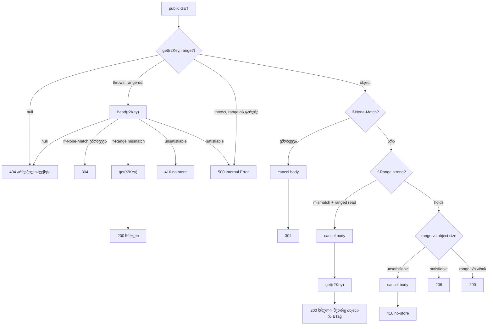

# R2 worker-ის public route-ები: ერთი R2 წაკითხვა თითო GET-ზე, `no-store` 416 (PERF-4d)

**თარიღი:** 2026-11-03
**სტატუსი:** Completed (C round 310 PASS)
**შეცვლილი პროექტი:** Store (`workers/r2-proxy.js`, `cloudflare/r2-worker.js`, `workers/r2-proxy.test.mjs`)

## კონტექსტი

PERF-4a-მ (doc 225) public route-ებს ETag → 304 და byte range (206/416) დაუმატა. Gate 309-ის code review-მ სამი დაკავშირებული finding აღრიცხა იმავე helper block-ში (`servePublicObject`):

- **GATE309-M1 (Medium):** ყოველი 200 და 206 ორ R2 call-ს აკეთებდა — ჯერ `head`, მერე `get`. ეს აორმაგებს ფასიან R2 ოპერაციებს და ყოველ `<audio>` seek-ს პირველი byte-ის წინ დამატებით round trip-ს უმატებს — ზუსტად იმ გზაზე, რომლის აჩქარებაც PERF-4a-ს მიზანი იყო.
- **GATE309-L2 (Low):** `head`/`get`-ს შორის ფაილი რომ შეიცვალოს, პასუხში ETag და size ერთი ვერსიიდან მოდის, bytes კი მეორედან.
- **GATE309-L3 (Low):** 416 პასუხს `public, max-age=86400` ჰქონდა, ანუ CDN-ს შეეძლო ის ერთი დღით შეენახა.

2026-10-23-ის bug gate-ის მიხედვით Medium ახალ scope-მდე სწორდება; სამივე ერთი owner-ის კოდშია, ამიტომ ერთი რაუნდია.

B-მ premise HEAD `b65febe`-ზე გაზომა: Node HTTP adapter-ით, R2 op-ების მთვლელით (`heads/gets/cancels`) და `R2_OOB=throw|short` რეჟიმით, რეალური Chromium 143-ით, 60 s-იანი WAV-ით (5,760,044 byte), 1440×900-ზე. ფორმატი `status:hHEADSgGETScCANCELS`:

| ნაბიჯი | HEAD `b65febe` | ახალი კოდი, R2 throw out-of-range-ზე | ახალი კოდი, R2 მოკლე object |
|---|---|---|---|
| revalidate (`If-None-Match`) | 304:h1g0c0 | 304:h0g1c1 | 304:h0g1c1 |
| range `bytes=1000-1999` | 206:**h1g1** | 206:**h0g1** | 206:h0g1 |
| unsatisfiable `bytes=999999999-` | 416:h1g0, `public, max-age=86400` | 416:h1g1, **`no-store`** | 416:h0g1c1, **`no-store`** |
| `<audio>` seek 50 s-ზე (თითო request) | 206:**h1g1** | 206:**h0g1** | 206:h0g1 |
| HEAD | 200:h1g0 | 200:h1g0 | 200:h1g0 |

ყოველ 206-ზე streamed bytes = `Content-Length` (0 შეუსაბამობა), seek 50.0 s-დან 51.46 s-მდე უკრავს, `error` null. Covers (`workers/` ასლი): 200:h1g1 / 304:h1g0 → 200:h0g1 / 304:h0g1c1. `cloudflare/` ასლს image route არ აქვს, ამიტომ მისი covers 404/404-ია — ეს არსებული ქცევაა.

ფაილები (loop folder, `tmp/studio-real-loop/b-round-309/probe/`): `worker-server.mjs`, `browser-probe.cjs`, `head-proxy-throw-1440.json`, `sketch-proxy-throw-1440.json`, `sketch-proxy-short-1440.json`, `sketch-alt-throw-1440.json`, `sketch-alt-short-1440.json`, შესაბამისი `*-server.log` და `summary.txt`; პირველი sketch-ის გაშვებები `v1/`-შია.

## მიდგომა

**ერთი R2 წაკითხვა თითო public GET-ზე.** `head` + `get`-ის ნაცვლად worker-ი ერთ `get`-ს აკეთებს: Range-ის გარეშე — `get(r2Key)`, ერთ `bytes=` range-ზე — `get(r2Key, { range })`, სადაც `a-b` → `{ offset: a, length: b − a + 1 }`, `a-` → `{ offset: a }`, `-n` (n > 0) → `{ suffix: n }`. `bytes=-0`, range list, სხვა unit, `b < a` ან ცარიელი spec → `get(r2Key)` range-ის გარეშე. HEAD რჩება ერთ `head(r2Key)`-ზე. `onlyIf` არსად არ გამოიყენება.

**თანმიმდევრობა (throw-ის გარეშე):**
1. `get` (ან HEAD-ზე `head`); null → caller-ის არსებული 404 ტექსტი.
2. Headers: არსებული CORS, `Access-Control-Expose-Headers: ETag, Content-Range, Accept-Ranges, Content-Length`, route-ის არსებული `Cache-Control`, `ETag` = `httpEtag` (თუ არსებობს).
3. `If-None-Match` ემთხვევა (`etagMatches`: weak comparison, `*`, comma list) → body-ის `cancel()`, შემდეგ **304** `Content-Type`/`Content-Length`/`Content-Range`-ის გარეშე. ეს range-მდე მოწმდება.
4. `Content-Type`; previews-ზე `Accept-Ranges: bytes`.
5. `If-Range` მხოლოდ strong match-ით ითვლება. Mismatch-ზე Range იგნორირდება: უკვე წაკითხული ranged body უქმდება და `get(r2Key)` თავიდან იკითხება; `ETag`, size და body მეორე object-იდან მოდის (ETag-ის არქონისას header იშლება).
6. Range `object.size`-ის მიმართ ისაზღვრება: `b` იჭრება `size − 1`-მდე; suffix-ისთვის start = `size − min(n, size)`.
7. **416**, როცა start ≥ size, suffix 0 ან size 0: body უქმდება, `Content-Range: bytes */<size>`, **`Cache-Control: no-store`**, `Content-Type`/`Content-Length` და body არ არის, `ETag` რჩება.
8. **206**: `Content-Range: bytes <first>-<last>/<size>`, `Content-Length` = last − first + 1, body — ranged `get`-ის. თუ R2 მოთხოვნილზე ნაკლებ byte-ს დააბრუნებს, clamp-ის წყალობით `Content-Length` მაინც ემთხვევა streamed bytes-ს.
9. სხვა შემთხვევაში **200**, `Content-Length` = size.
10. HEAD: იგივე ნაბიჯები `head`-ის metadata-დან, body-ის გარეშე; HEAD-ის 416-იც `no-store`-ია.

**Throw-ის გზა.** თუ ranged `get` throw-ს აკეთებს: `head(r2Key)` → null-ზე 404; `ETag` `head`-იდან; `If-None-Match` ემთხვევა → 304 (body არ იკითხება); `If-Range` mismatch → ერთი `get(r2Key)` და სრული 200 (3 call, იშვიათი); წინააღმდეგ შემთხვევაში unsatisfiable range → 416 (`no-store`), satisfiable → rethrow, ანუ router-ის არსებული `500 Internal Error`. Range-ის გარეშე `get`-ის throw უცვლელად rethrow-დება.

**`releaseBody`** `cancel()`-ის rejected promise-ს ყლაპავს, რომ 304 არასოდეს გადაიქცეს 500-ად.

**ალტერნატივები:**
- **`onlyIf: { etagDoesNotMatch }` 304-ისთვის** (performance-optimizer-ის შეთავაზება) — არ მივიღეთ ამ რაუნდში. R2-ის დოკუმენტაცია არ ამბობს, როგორ ადარებს `If-None-Match`-ს (weak/strong, list, `*`), ხოლო `etagMatches` PR2 matrix-ით დამტკიცებულია. ოპერაციების რაოდენობა ორივე გზაზე ერთია (ერთი `get`), R2-ს egress fee არ აქვს. გადადის post-deploy სიაში.
- **`Content-Range` `object.range`-იდან** (tech-lead-ის შეთავაზება) — არ მივიღეთ: R2 არ ადოკუმენტირებს, ეს ველი clamp-ილია თუ მოთხოვნილი; გამოთვლილი მნიშვნელობა deterministic-ია. ცნობილი ასიმეტრია: frozen `handleProtected` `Content-Range`-ს `object.range`-იდან აგებს. Public helper-ს ორივე R2 out-of-range რეჟიმში ერთნაირი 416 და clamp სჭირდება, protected გზა კი ამ რაუნდში frozen-ია.

**Consult-ების დასკვნები (B-ის დაგეგმვა):**
- **tech-lead:** ერთ-`get`-იანი დიზაინი სწორია, protected route-ები byte-identical რჩება, PERF-5-მდე უნდა გაკეთდეს. B-ის პირველ sketch-ში ორი Low defect იპოვა: throw-ის გზაზე failed `If-Range` 416-ს აბრუნებდა (RFC 9110-ით Range იგნორირდება → სრული 200) და matching `If-None-Match` 416-ს აბრუნებდა (If-None-Match Range-მდე მოწმდება → 304). ორივე გასწორდა; PR14/PR15 პირველ sketch-ზე წითელია, საბოლოოზე მწვანე. დაემატა `releaseBody`-ის hardening და mutant-ები MU-REFETCH-STALE-ETAG, MU-INM-STRONG, MU-THROW-NO-INM, MU-THROW-NO-IFRANGE, MU-RELEASE-THROWS.
- **performance-optimizer:** 304-ისთვის body-ის გახსნა და cancel იმავე ერთ Class B ოპერაციას ღირს, egress fee-ს გარეშე; seek-ები hot path-ია, ამიტომ PERF-5-მდე. რეალური R2 staging, TTFB p50/p95 და R2 Class B metrics cloud-ში მიუწვდომელია → post-deploy სია.

## არქიტექტურა

**Race (GATE309-L2).** ყოველი პასუხი ახლა ერთი R2 წაკითხვიდან მოდის, ამიტომ ETag, size და bytes ერთ ვერსიას ეკუთვნის. If-Range-ის re-read სამივეს მეორე object-იდან იღებს. რჩება ერთი ვიწრო ფანჯარა: ამ იშვიათ re-read-ზე `If-None-Match` პირველ object-თან მოწმდება — **B-R309-REFETCH-INM-WINDOW (Low)**, 4c-მდე მიღებულია.

**Frozen (ამ რაუნდში უცვლელი):** `/studio/`, `/download/`, `/recordings/`, `/originals/` (`private, no-store`, Range-ის წესები, „token → scope → R2 read“ თანმიმდევრობა), router, CORS `Allow-*`, `OPTIONS`, `validateToken`, `isSafeFileName`, `getContentType`, `handleImage`, `handlePreview`. ორივე worker-ში ყველაფერი `const PUBLIC_EXPOSE_HEADERS` ხაზამდე HEAD-თან byte-identical-ია. `?v=` და `immutable` არ შემოსულა (ეს 4c-ია); არსებული `public` max-age-ები 200/206/304-ზე რჩება.

## შეცვლილი ფაილები

- `workers/r2-proxy.js` — helper block (`const PUBLIC_EXPOSE_HEADERS`-დან ბოლომდე): `parseRangeSpec`, `resolveRangeSpec`, `r2RangeOf`, `releaseBody`, `unsatisfiableResponse` და გადაწერილი `servePublicObject`.
- `cloudflare/r2-worker.js` — იგივე block, byte-identical (A-PARITY diff ცარიელია).
- `workers/r2-proxy.test.mjs` — `publicRequest` fake (`ReadableStream` body cancel-ის ჩანაწერით, `outOfRange`, `failGet`, `changedOnSecondRead`, `empty`, `cancelRejects`) და PR row-ები; 40 protected row, `request` და `tokenFor` უცვლელია.
- `docs/implementation/2026/quarter-IV/226-perf-r2-worker-single-read.md` — ეს დოკუმენტი. Doc 225 არ შეცვლილა.

## პრობლემები და გადაწყვეტები

**Problem:** R2-ის დოკუმენტაცია (`https://developers.cloudflare.com/r2/api/workers/workers-api-reference/`, „Last updated Jul 31, 2026“, B-მ წაიკითხა 2026-11-03) არ ამბობს, რას აკეთებს R2 `offset`-ზე, რომელიც size-ს უდრის ან აღემატება: throw თუ ცარიელი body.
**Solution:** კონტრაქტი ორივე ქცევას ამუშავებს და ტესტები ორივე რეჟიმში გადის (`outOfRange: 'throw'|'short'`). რომელი branch მუშაობს რეალურ R2-ზე, post-deploy დაკვირვებაა და არა სისწორის რისკი.

დოკუმენტირებული ფაქტები: `get(key, { range })` იღებს `{ offset, length }`, `{ offset }` ან `{ suffix }`-ს; `length`-ზე „fewer bytes than this number may be returned“; `R2ObjectBody`-ს აქვს `size`, `httpEtag` (quoted) და `body` (`ReadableStream`); `onlyIf` იღებს `R2Conditional | Headers`-ს. **Inference (დაუდასტურებელი):** out-of-range `offset`-ის ქცევა; `onlyIf`-ის weak/list/`*` სემანტიკა; არის თუ არა `object.range` clamp-ილი; რას აკეთებს R2 size-ზე დიდ `suffix`-ზე (unit და probe fake ორივე clamp-ავს — post-deploy შემოწმება).

**Problem:** შეცვლილი კონტრაქტი PR2 — round 309 ამოწმებდა `reads` 0-ს 304-ზე Range-ით.
**Solution:** ახლა `reads` 1, body cancel-ილია, 0 body byte იგზავნება; row ახლა Range-ის გარეშე შემთხვევასაც ფარავს. დამატებით: `heads` 0, `opened` `[cancelled]`, `Cache-Control`, `Content-Range` null.

**Problem:** შეცვლილი კონტრაქტი PR4 — round 309 ამოწმებდა `reads` 0-ს 416-ზე.
**Solution:** ახლა `reads` 1, ყოველი გახსნილი body cancel-ილია, პასუხი `no-store`-ია, ორივე R2 რეჟიმში. მიზეზი gate-309-ის Medium #1-ია; reviewer-მა თავად აღნიშნა, რომ ერთ-`get`-იანი ალტერნატივით „you lose the '416 before any read' guarantee“. Trade-off მიღებულია: 304/416 ერთ R2 ოპერაციას ღირს (როგორც `head`), ყოველი 200/206 კი ერთს ორის ნაცვლად. არცერთი assert არ წაშლილა ძლიერი ჩანაცვლების გარეშე.

**Problem:** `cancel()` შეიძლება reject-დეს და 304 500-ად აქციოს.
**Solution:** `releaseBody` rejected `cancel()`-ს ყლაპავს (PR15, MU-RELEASE-THROWS).

## ტესტირება

- **`node --test workers/r2-proxy.test.mjs`:** 69 tests, 69 pass, 0 fail (≈0.27 s). ორივე ასლზე (`proxy:` და `alternate:`) გადის.
- **vitest:** `app/lib/__tests__/r2-tokens.server.test.ts` და `app/lib/__tests__/download-routes.test.ts` — 32/32, უცვლელი.
- **Red on HEAD:** იგივე ტესტ-ფაილი HEAD worker-ებზე (scratch-ზე) — 15 წითელი row, სახელებით იდენტური B-ის `sketch-tests-on-head.txt`-ისა: PR2, PR3, PR4, PR10, PR12, PR14, PR15 ორივე ასლში და PR9 (proxy). PR11 და PR13 guard row-ებია; მათ mutant-ები აწითლებს.
- **Row-ები (§6):** PR1, PR5–PR8 უცვლელი; PR2, PR4 შეცვლილი კონტრაქტი; PR3, PR9 დამატებითი assert-ები (`reads` 1, `heads` 0; cover-ის 304 body-ს cancel-ავს); ახალი PR10 (ერთი `get` თითო GET-ზე, `onlyIf` null), PR11 (მოკლე R2 body = `Content-Length`), PR12 (If-Range mismatch → re-read, `"etag-2"`), PR13 (`failGet` → 500), PR14 (out-of-range preconditions), PR15 (ცარიელი object → 416, rejected cancel → 304).
- **Mutants (13, scratch-ზე):** MU-HEAD-FIRST, MU-416-PUBLIC, MU-304-NO-RELEASE, MU-NO-CLAMP, MU-IFRANGE-NO-REFETCH, MU-THROW-UNHANDLED, MU-CL-FROM-REQUEST, MU-THROW-NO-INM, MU-THROW-NO-IFRANGE, MU-REFETCH-STALE-ETAG, MU-INM-STRONG, MU-RELEASE-THROWS, MU-ONE-COPY — 13/13 წითელი მოსალოდნელ row-ებზე; აღდგენის შემდეგ 69/69.
- **Browser:** B-ის probe (§ კონტექსტი) sketch-ზე გაეშვა; კოდი sketch-თან byte-identical-ია. C-ის WK-OPS row-ები იმავე probe-ს A-ის tree-ზე უშვებს.
- `npm run typecheck` rc 0; `npm run lint` rc 0 (205 warnings + 1 info, უცვლელი); Biome `workers/`-ს არ ამოწმებს, ამიტომ `node --check` ორივე worker-ზე და ტესტ-ფაილზე.

## TODO / შემდეგი ნაბიჯები

**Post-deploy სია (რეალურ R2-ზე, deploy loop-ის გარეთაა):**
- 304 revalidation-ზე;
- 206 seek Chrome-ში **და Safari-ში**, bytes = `Content-Length`;
- cover-ის 304;
- **რომელ out-of-range branch-ს იღებს R2:** ერთი request `Range: bytes=<size>-`-ით — მოჰყვება თუ არა `head` `get`-ს; ასევე `Range: bytes=-<size+1>` — 206 მთლიანი object-ით და bytes = `Content-Length`;
- **ინახავს თუ არა CDN ან shared cache 416-ს** (`no-store`-ის გამო არ უნდა შეინახოს);
- **TTFB p50/p95 თითო seek-ზე და თითო 304-ზე** (HEAD tree vs ეს ცვლილება) და R2 Class B ოპერაციების რაოდენობა R2 metrics-იდან;
- `onlyIf: { etagDoesNotMatch }` ვარიანტი, როცა R2-ის weak/list სემანტიკა დადასტურდება.

**სხვა:**
- B-R309-REFETCH-INM-WINDOW (Low) — 4c-ში იხურება.
- ROOT-REQ-VERIFY-WORKER-TESTS — worker-ის ტესტები `npm run verify`-ში ჯერ არ შედის.
- R2-WORKER-TWO-COPIES — helper block ორ ასლშია; SABA-Q-WORKER-DEPLOYED-ის პასუხს ელოდება.
