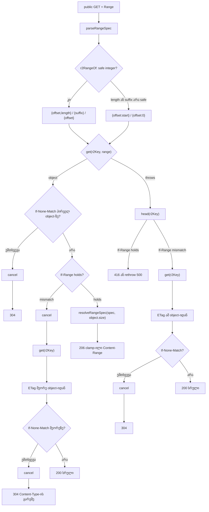

# R2 worker-ის public route-ები: safe-integer guard Range-ზე და If-None-Match If-Range-ის re-read-ის შემდეგ (PERF-4e)

**თარიღი:** 2026-11-03
**სტატუსი:** Completed (C round 311 PASS)
**შეცვლილი პროექტი:** Store (`workers/r2-proxy.js`, `cloudflare/r2-worker.js`, `workers/r2-proxy.test.mjs`)

## კონტექსტი

PERF-4d-მ (doc 226) public route-ებზე `head` + `get` ერთი `get`-ით შეცვალა. Gate 310-ის review-მ და C-ის round 310-მა სამი finding აღრიცხა იმავე helper block-ში (`servePublicObject` და მისი helper-ები, ორივე worker ასლში):

| Id | Severity | რა |
|---|---|---|
| **GATE310-M1** (+ A-R310-REVIEW-L1, INFO-C310-OVERSIZED-RANGE) | Medium | round 310-იდან `r2RangeOf` კლიენტის რიცხვებს R2-ს ისე აწვდის, როგორც დაწერილია. თუ R2 მნიშვნელობას უარყოფს, catch path range-ს servable-ად თვლის და rethrow-ს აკეთებს — კლიენტი **500**-ს იღებს. `b65febe`-ზე იგივე request `head`-ით clamp-დებოდა და 206-ს იღებდა |
| **GATE310-L3** (= B-R309-REFETCH-INM-WINDOW) | Low | If-Range mismatch-ის შემდეგ re-read If-None-Match-ს **პირველ** object-თან ადარებს. თუ object შუაში შეიცვალა, კლიენტი, რომელსაც ახალი ვერსია უკვე აქვს, 304-ის ნაცვლად სრულ 200-ს იღებს |
| **C-R310-01** (= A-R310-REVIEW-L2) | Low | throw-path If-Range re-read-ის ETag-ს არცერთი row არ ამოწმებდა; C-ის mutant, რომელიც `head`-ის ETag-ს ტოვებდა, 69/69-ზე გადარჩა |

2026-10-23-ის bug gate-ით Medium ახლა სწორდება; ორი Low იმავე კოდშია, ამიტომ ერთ რაუნდშია. A-R310-REVIEW-L3-ის ტესტ-ხარვეზების ნაწილი იმავე row-ებში დაემატა.

### R2-ის ფაქტები: დოკუმენტირებული vs inference (D-29z829)

- **Documented** (R2 Workers API reference, fetched 2026-11-03, loop folder-ში `b-round-310/r2-workers-api-reference-2026-11-03.md.txt`, l.231 და l.233):
  - **`length`:** "If more bytes are requested than exist in the object, fewer bytes than this number may be returned."
  - **`suffix`:** იგივე წინადადება.

  ანუ `bytes=-500` 100-byte object-ზე, ან `bytes=95-500`, რეალურ R2-ზე უსაფრთხოა. Reviewer-ის premise, რომ „docs მხოლოდ `length`-ს გვპირდება“, ეწინააღმდეგება წყაროს, და ამ ქვე-შემთხვევას ცვლილება არ სჭირდება.
- **Not documented:**
  - რას აკეთებს R2 მნიშვნელობაზე, რომელიც **safe integer არ არის** (`Infinity`, `1e20`) — ასეთს `Number()` აწარმოებს ვალიდური header-იდან, მაგ. `bytes=0-<400 ცხრა>`;
  - რას აკეთებს R2 offset ≥ size-ზე. Round 310-ის კონტრაქტი ორივე შესაძლო ქცევას უკვე ამუშავებს.
- **Inference (probe-სა და unit fake-ში გამოყენებული):** R2 non-safe-integer range მნიშვნელობას `TypeError`-ით უარყოფს. ეს R2-ზე დაკვირვება **არ არის**. დოკუმენტი არ ამბობს „R2 500-ს აბრუნებს“; ის ამბობს „strict fake-ით“.

### Premise, გაზომილი HEAD `8946431`-ზე (რეალური Chromium 143.0.7499.4, 1440×900)

B-ის probe (`b-round-310/probe/`) round 309-ის server-ის ასლია ორი switch-ით: `R2_STRICT=1` უარყოფს non-safe range მნიშვნელობებს, `R2_SWAP=1` ერთი request-ის მეორე `get`-ზე ახალ object-ის ვერსიას აძლევს. ფორმატი `status hHEADS gGETS cCANCELS`:

| ნაბიჯი | HEAD `8946431` | ახალი კოდი, throw | ახალი კოდი, short |
|---|---|---|---|
| `bytes=0-<400 ცხრა>` | **500** h1g1 | **206** h0g1, `bytes 0-5760043/5760044`, bytes = CL | იგივე |
| `bytes=-<400 ცხრა>` | **500** h1g1 | **206** h0g1 | იგივე |
| `bytes=<400 ცხრა>-` | 416 h1g1 | 416 h1g1 | 416 h1g1 |
| Re-read: `bytes=0-9`, `If-Range: "old"`, If-None-Match = ახალი ETag | **200** სრული, h0g2c1 | **304** h0g2c2 | იგივე |
| Re-read throw path-ზე: `bytes=999999999-` + იგივე header-ები | **200** სრული, h1g2c0 | **304** h1g2c1 | 304 h0g2c2 |
| ჩვეულებრივი seek `bytes=4784128-` | 206 h0g1 | 206 h0g1 | 206 h0g1 |

`cloudflare/` ასლის row-ები proxy-ს row-ებს უდრის (`summary.txt`). Round 310-ის regression probe ახალ კოდზე: revalidate 304 h0g1c1; seek 206 h0g1 ×3, advanced true; 416 `no-store`; cover 304.

**მეთოდის შენიშვნა:** If-Range და If-None-Match CORS-safelisted არ არის. Cross-origin page `fetch` preflight-ზე ვარდება (გაზომილი: `TypeError: Failed to fetch` OPTIONS 200-ის შემდეგ). ამიტომ re-read row-ები Playwright-ის `APIRequestContext`-ით (`via: 'request'`) გაიზომა. `<audio>` element-ს (no-cors) და same-origin caller-ებს ამ header-ების გაგზავნა შეუძლიათ.

### Consult (tech-lead, read-only) და rulings (D-29z830)

- **შედეგი:** blocking defect არ არის. RFC 9110-ის რიგი სწორია (If-None-Match Range-სა და If-Range-მდე, §13.2.2); 304-ის header-ები სწორია (§15.4.5); safe-integer request-ები უცვლელია; `{offset:0}` unsafe suffix-ზე სწორია (R2 object-ები < 2^53 byte-ია, Content-Range `object.size`-იდან მოდის); შორეული `start` 416-ს იძლევა R2-ის ქცევის მიუხედავად; reviewer-ის retry საჭირო არ არის.
- **Medium, „HEAD + Range უნდა იგნორდებოდეს“ (RFC 9110 §14.2):** ქცევა ამ რაუნდამდე არსებობდა და PR6 უკვე ამოწმებს HEAD + Range → 206-ს; RFC 9110 §9.3.2 HEAD-ის პასუხს GET-ის header-ებს სთხოვს — ორი clause სხვადასხვა მხარეს ექაჩება. **Ruling:** scope-ის გარეთ; PR18-ის „HEAD + `bytes=500-` → 416“ ნახევარი ამოღებულია. Deferred Low **B-R310-HEAD-RANGE-RFC**.
- **Low, PR16-ის სათაური და შორეული read:** გასწორდა — სათაური ამბობს, რა იგზავნება; შორეული შემთხვევა ამოწმებს `reads` = `[{ offset: Infinity }]` და `heads` 1.
- **Low, fake-ის სიმკაცრე inference-ია:** ასეც წერია ზემოთ.
- **Low, `Number()`-ის სიზუსტე 2^53-ზე ზემოთ `parseRangeSpec`-ში:** ძველია. Deferred Low **B-R310-RANGE-PRECISION**.
- performance-optimizer ამ რაუნდისთვის არ გამოკითხულა: ეს bug fix-up-ია, რომელიც არცერთი safe request-ის R2 call-ების რაოდენობას ან byte path-ს არ ცვლის.

## მიდგომა

**1. Safe-integer guard (`r2RangeOf`).** Guard მხოლოდ `length`-სა და `suffix`-ს ფარავს: ისინი R2-ს მხოლოდ safe integer-ად მიეწოდება. `offset` (start) უცვლელად გადის — unsafe start (მაგ. `{offset:Infinity}`, ან ორივე bound 2^53-ზე ზემოთ მცირე length-ით) unconditional request-ზე 416-ით მთავრდება (If-None-Match/If-Range-ის წესები უცვლელია), რადგან `resolveRangeSpec`-ში `start >= size`. ერთადერთი safe start/end-ის მქონე request, რომლის R2 call იცვლება, არის `bytes=0-9007199254740991` (length = 2^53): ახლა `{offset:0}` იგზავნება; პასუხი იგივეა, რადგან Content-Range `object.size`-იდან ითვლება.

| Spec | R2-ს მიეწოდება |
|---|---|
| suffix 0 | `null` (უცვლელი: სრული `get`, შემდეგ 416) |
| suffix, safe integer | `{ suffix }` (უცვლელი) |
| suffix, **არა** safe integer | `{ offset: 0 }` |
| start, ღია end | `{ offset: start }` (უცვლელი, მაშინაც, როცა `start` არ არის safe: არსებული throw ან short path 416-ს იძლევა) |
| start–end, `end - start + 1` safe integer | `{ offset: start, length }` (უცვლელი) |
| start–end, length **არა** safe integer | `{ offset: start }` |

Content-Range და Content-Length ისევ `resolveRangeSpec(spec, object.size)`-იდან მოდის, ამიტომ `bytes=0-<huge>` → `bytes 0-(size-1)/size`. ეს **დამატებით R2 call-ს არ ამატებს**.

**2. If-None-Match If-Range-ის re-read-ის შემდეგ (ორივე path).**
- **Normal path:** `releaseBody(first)` და სრული `get`-ის შემდეგ ETag მეორე object-იდან ჯდება (ან იშლება, თუ არ აქვს); თუ If-None-Match მეორე object-ის `httpEtag`-ს ემთხვევა — `releaseBody(second)` და **304**. Content-Type და Accept-Ranges ამ block-ის **შემდეგ** ჯდება, ამიტომ 304-ს არცერთი არ აქვს. დანარჩენ პასუხებს იგივე header-ები აქვს, რაც ადრე.
- **Throw path (catch):** სრული `get`-ის შემდეგ ETag იმ object-იდან ჯდება (არა `head`-იდან — C-R310-01); If-None-Match-ის დამთხვევაზე `releaseBody` და **304**; თორემ Content-Type, Accept-Ranges, Content-Length და 200, როგორც ადრე.

304 ინარჩუნებს ETag-ს, Cache-Control-ს და CORS header-ებს.

**უარყოფილი ალტერნატივა (gate reviewer-ის #1 fix):** catch-ში ერთხელ retry, `head`-იდან clamp-ილი range-ით. დოკუმენტირებულ overflow-ს retry არ სჭირდება; retry იშვიათ path-ზე მესამე R2 call-სა და head/get race-ს ამატებს. Safe-integer guard ერთადერთ დაუდოკუმენტებელ input-ს ნულოვანი დამატებითი call-ით აშორებს.

**Frozen (უცვლელი):** HEAD (ერთი `head`; PR6 ისევ ამოწმებს HEAD + Range → 206-ს); „If-None-Match პირველ object-ზე → 304“ Range-მდე; 416 (`unsatisfiableResponse`); `releaseBody`; rethrow → 500 satisfiable range-ზე, რომლის `get` ვარდება (PR13); `onlyIf` არ არის; ორივე worker-ში ყველაფერი `const PUBLIC_EXPOSE_HEADERS` ხაზამდე (router, `handleImage`, `handlePreview`, `handleProtected`, `validateToken`, `isSafeFileName`) HEAD-თან byte-identical-ია.

## არქიტექტურა

## შეცვლილი ფაილები

- `workers/r2-proxy.js` — მხოლოდ helper block (`const PUBLIC_EXPOSE_HEADERS`-დან ბოლომდე): `r2RangeOf`-ის safe-integer guard და `servePublicObject`-ში If-None-Match-ის შემოწმება ორივე re-read-ის შემდეგ.
- `cloudflare/r2-worker.js` — იგივე block, byte-identical (A-PARITY diff ცარიელია).
- `workers/r2-proxy.test.mjs` — `publicRequest` fake (`get` `TypeError`-ს აგდებს, როცა `range.offset`, `length` ან `suffix` განსაზღვრულია და safe integer არ არის — inference) და PR row-ები: PR13 (+1 assert), PR15 (+2 assert), ახალი PR16, PR17, PR18. 40 protected row, `request` და `tokenFor` უცვლელია.
- `docs/implementation/2026/quarter-IV/227-perf-r2-worker-range-guard.md` — ეს დოკუმენტი. Doc 225 და 226 არ შეცვლილა.

## პრობლემები და გადაწყვეტები

**Problem:** ვალიდური header `bytes=0-<400 ცხრა>` `Number()`-ით `Infinity`-ს იძლევა, რომელიც R2-მდე უცვლელად მიდიოდა; strict fake-ით `get` ვარდება, catch range-ს satisfiable-ად თვლის და 500-ს აბრუნებს.
**Solution:** `r2RangeOf` non-safe length-ზე `{ offset: start }`-ს და non-safe suffix-ზე `{ offset: 0 }`-ს აგზავნის; Content-Range object-ის size-იდან ითვლება. Boundary `bytes=10-9007199254741000` ისევ `{offset:10,length:9007199254740991}`-ს აგზავნის (PR16).

**Problem:** If-Range mismatch-ის re-read-ზე If-None-Match პირველ object-თან მოწმდებოდა (GATE310-L3).
**Solution:** re-read-ის შემდეგ If-None-Match მეორე object-თან მოწმდება ორივე path-ზე; 304-ზე მეორე body cancel-დება და Content-Type/Accept-Ranges არ ჯდება (PR17).

**Problem:** throw-path re-read-ის ETag `head`-იდან რჩებოდა და ამას row არ ამოწმებდა (C-R310-01).
**Solution:** ETag re-read-ის object-იდან ჯდება; PR17 ამოწმებს `"etag-2"`-ს ორივე რეჟიმში; MU-THROW-REREAD-KEEPS-HEAD-ETAG წითელია.

**Problem:** PR13-ის ერთი assert ხაზი (`failGet` → 500) diff-ში `-` ხაზად ჩანს.
**Solution:** ის წაშლილი არ არის: იგივე assert ცვლადზე გადავიდა (`whole.response.status`, 500) და დაემატა `whole.heads.length` 0. PR15-ის destructuring ხაზს `opened` დაემატა. სუსტდება არცერთი assert.

## ტესტირება

- **`node --test workers/r2-proxy.test.mjs`:** 75 tests, 75 pass, 0 fail (≈0.27 s), ორივე ასლზე (`proxy:` და `alternate:`).
- **vitest:** `app/lib/__tests__/r2-tokens.server.test.ts` და `app/lib/__tests__/download-routes.test.ts` — 32/32, უცვლელი.
- **Red on HEAD:** იგივე ტესტ-ფაილი HEAD worker-ებზე (scratch-ზე) — 4 წითელი row: PR16 და PR17, ორივე ასლში; B-ის `sketch-tests-on-head.txt`-ის იდენტური. PR13/PR15/PR18-ის დამატებები არსებულ ქცევას ამოწმებს; მათ mutant-ები აწითლებს.
- **Row-ები:** PR1–PR12 და PR14 HEAD-თან byte-identical-ია; PR13 (+1: un-ranged failed `get` → 500, `heads` 0); PR15 (+2: ცარიელი object-ის 416 ETag-ს ინარჩუნებს, ყოველი გახსნილი body cancel-ილია — არსებითია მხოლოდ `short` რეჟიმში, რადგან `throw` რეჟიმში body არ იხსნება); PR16 (huge length/suffix → `[{offset:0}]` / `[{offset:10}]`, 206 clamp-ილი Content-Range, CL = body, `heads` 0; boundary; შორეული start → 416 `no-store`, `[{offset:Infinity}]`, `heads` 1); PR17 (ორივე რეჟიმი × `bytes=0-9`, `bytes=500-`, `changedOnSecondRead`: If-Range `"old"` → 200 `"etag-2"`; + If-None-Match `"etag-2"` → 304 Content-Type/Length/Range/Accept-Ranges-ის გარეშე, public Cache-Control, 2 read, ყოველი body cancel-ილი); PR18 (HEAD + If-None-Match (+ Range) → 304, 1 head, 0 read).
- **Mutants (25, scratch-ზე):** round 310-იდან 12 (MU-HEAD-FIRST, MU-416-PUBLIC, MU-304-NO-RELEASE, MU-NO-CLAMP, MU-IFRANGE-NO-REFETCH, MU-THROW-UNHANDLED, MU-CL-FROM-REQUEST, MU-THROW-NO-INM, MU-THROW-NO-IFRANGE, MU-REFETCH-STALE-ETAG, MU-INM-STRONG, MU-RELEASE-THROWS) და 13 ახალი (MU-UNSAFE-LENGTH, MU-UNSAFE-SUFFIX, MU-UNSAFE-SUFFIX-NULL, MU-REREAD-NO-INM, MU-REREAD-304-NO-RELEASE, MU-THROW-REREAD-NO-INM, MU-THROW-REREAD-KEEPS-HEAD-ETAG, MU-REREAD-304-CONTENT-TYPE, MU-HEAD-INM-SKIPPED, MU-UNRANGED-THROW-HEAD, MU-416-NO-ETAG, MU-416-NO-RELEASE, MU-ONE-COPY). 25/25 წითელი, row-ები B-ის `sketch-mutants.txt`-ის იდენტურია; აღდგენის შემდეგ 75/75.
- **Browser:** B-ის probe (`b-round-310/probe/`: `worker-server.mjs`, `browser-probe-311.cjs`, `summarize.py`) sketch-ზე გაეშვა; კოდი sketch-თან byte-identical-ია. C-ის WK-GUARD/WK-OPS/WK-HEAD-CONTROL row-ები იმავე probe-ს A-ის tree-ზე უშვებს.
- `npm run typecheck` rc 0; `npm run lint` rc 0 (205 warnings + 1 info, უცვლელი); Biome `workers/`-ს და `cloudflare/`-ს არ ამოწმებს, ამიტომ `node --check` ორივე worker-ზე და ტესტ-ფაილზე.

## TODO / შემდეგი ნაბიჯები

**Post-deploy სიის დამატებები (doc 226-ის სიას ემატება; რეალურ R2-ზე, deploy loop-ის გარეთაა):**
- `Range: bytes=0-<20+ ციფრი>` და `bytes=-<20+ ციფრი>` → 206 მთლიანი object-ით, bytes = Content-Length;
- If-Range mismatch + დამთხვეული If-None-Match → 304;
- უარყოფს თუ არა R2 non-safe-integer range მნიშვნელობას საერთოდ (length-ისა და suffix-ისთვის ის R2-მდე აღარ მიდის).

**სხვა:**
- B-R310-HEAD-RANGE-RFC (deferred Low) — HEAD + Range-ის RFC 9110 §14.2 vs §9.3.2.
- B-R310-RANGE-PRECISION (deferred Low) — `Number()`-ის სიზუსტე 2^53-ზე ზემოთ `parseRangeSpec`-ში.
- GATE310-S4 (304 body-ს ხსნის და მერე cancel-ავს) და GATE310-S5 (`bytes=-0` 416-ისთვის მთლიან object-ს კითხულობს) — `onlyIf` follow-up post-deploy სიაშია.
- ROOT-REQ-VERIFY-WORKER-TESTS — worker-ის ტესტები `npm run verify`-ში ჯერ არ შედის.
- R2-WORKER-TWO-COPIES — helper block ორ ასლშია; SABA-Q-WORKER-DEPLOYED-ის პასუხს ელოდება.
