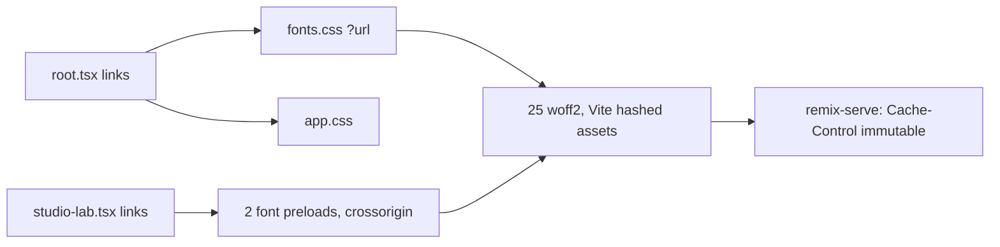

# Self-hosted fonts: Google Fonts-ის მოთხოვნის გარეშე, byte-identical ფაილებით (PERF-7)

**თარიღი:** 2026-11-03
**სტატუსი:** Completed (C round 317 PASS)
**შეცვლილი პროექტი:** Store (`app/root.tsx`, `app/styles/app.css`, `app/routes/studio-lab.tsx`, `app/assets/fonts/**`, `app/lib/third-party-licenses.ts`, `THIRD_PARTY_NOTICES.md`, ტესტები)

## კონტექსტი

STUDIO-PERFORMANCE-ის PERF-7 ეტაპის მიზანია, რომ არცერთ route-ზე ფონტი third-party host-იდან არ ჩაიტვირთოს და არცერთი third-party რესურსი render-blocking არ იყოს. HEAD `c136dfd`-ზე ფონტები სამი ადგილიდან მოდიოდა: `root.tsx` (2 preconnect + Playfair Display stylesheet), `app.css`-ის პირველი ხაზი (Inter-ის `@import`) და `studio-lab.tsx` (Instrument Sans, IBM Plex Mono, Noto Sans Georgian).

B-ის გაზომვა (round 315 → 316, production build, Chromium 1440×900, თითო route-ზე 3 ჩატვირთვა):

| Route | HEAD: render-blocking 3rd-party / Google requests | Self-hosted | HEAD FCP − DCL (ms) | Self-hosted FCP − DCL (ms) |
|---|---|---|---|---|
| `/studio-lab` | 3 / 6 | 0 / 0 | 131, 135, 216 | 228, 240, 301 |
| `/` | 2 / 4 | 0 / 0 | 2, 11, −1 | −1, 6, 1 |
| `/store` | 2 / 4 | 0 / 0 | 6, 5, 13 | 8, 56, 3 |
| `/studio/middle-east` | 2 / 3 | 0 / 0 | 104, 79, 78 | 129, 116, 105 |

**სამიზნის გაყოფა (D-29z851).** `/studio-lab`-ზე DCL შემცირდა, მაგრამ FCP ორივე build-ში დაახლოებით 300–380 ms დარჩა. მიზეზი ფონტები არ არის: SSR HTML გვერდს ახვევს `page-transition-wrapper`-ში `opacity:0`-ით, ხოლო `/studio-lab`-ს ამ wrapper-ის გარეთ header არ აქვს, ამიტომ პირველი paint hydration-ს და transition-ს ელოდება. ამიტომ PERF-7 ფარავს "0 Google / 0 render-blocking 3rd-party" ყველა route-ზე და "FCP − DCL < 150 ms" `/`-სა და `/store`-ზე; `/studio-lab`-ის FCP − DCL გადადის PERF-11-ში, რომელიც `/studio*`-ზე framer-motion page transition-ს ფლობს.

## მიდგომა

Google-ის CSS API 83 `@font-face` წესს აბრუნებს 25 უნიკალურ woff2 ფაილზე (variable fonts, თითო unicode subset-ზე ერთი ფაილი). ეს 25 ფაილი უცვლელად (byte-identical) დაკოპირდა `app/assets/fonts/`-ში, ხოლო `fonts.css` იგივე 83 წესს შეიცავს — მხოლოდ URL-ები გახდა ლოკალური (`url('./<file>.woff2')`) და Google-ის subset კომენტარები მოიხსნა.

განხილული ალტერნატივები:

- **`@fontsource/*` პაკეტები** — ახალი dependency და `root-deps-request.json` დასჭირდებოდა, ხოლო ფაილები Google-ის მიერ მიწოდებულისგან შეიძლება განსხვავდებოდეს. უარყოფილია: ლოკალური ასლი იგივე bytes-ს იძლევა dependency-ის გარეშე.
- **Subset-ების შემცირება (trimming)** — cyrillic, greek, vietnamese და სხვა subset-ები unicode-range-ით არის შეზღუდული: browser მხოლოდ საჭირო ფაილს ტვირთავს, ამიტომ მომხმარებლის bytes არ იზრდება. ამოკლება fallback glyph-ებს შეცვლიდა და OFL-ის "unmodified" პირობას დაარღვევდა. უარყოფილია.
- **ასლი `public/`-ში** — hash-ის გარეშე immutable caching ვერ იმუშავებდა. `app/assets/` + `?url` import-ით Vite ფაილებს hash-ავს და `remix-serve` მათ `immutable` header-ით აწვდის.

`/studio-lab` წინასწარ ტვირთავს (preload) ორ ფაილს, რომლებიც პირველ paint-ზე გამოიყენება: `instrument-sans-latin` და `ibm-plex-mono-latin`, `crossOrigin: 'anonymous'`-ით. სხვა route-ზე preload არ არის; store-ის ფონტებს STORE-2c ფლობს.

## არქიტექტურა

`fonts.css` იტვირთება `app.css`-მდე. ორ ფაილს საერთო selector ან დუბლირებული family არ აქვს, ამიტომ cascade-ის რიგი შედეგს არ ცვლის.

## შეცვლილი ფაილები

- `app/root.tsx` — `fontStyles` import; 2 preconnect და Playfair-ის link ჩანაცვლდა `fontStyles` stylesheet-ით `appStyles`-მდე
- `app/styles/app.css` — წაიშალა მხოლოდ l.1 (Inter-ის Google `@import`)
- `app/routes/studio-lab.tsx` — `STUDIO_FONTS_HREF` მოიხსნა; 2 font preload `?url` import-ით
- `app/assets/fonts/fonts.css` (ახალი) — 83 `@font-face`, `font-display: swap`
- `app/assets/fonts/*.woff2` (25 ახალი) — Google Fonts-ის ფაილების byte-identical ასლები
- `app/assets/fonts/licenses/OFL-*.txt` (5 ახალი) — ოჯახების SIL OFL 1.1 ტექსტები
- `app/lib/third-party-licenses.ts` — `## Fonts (SIL Open Font License 1.1)` სექცია LAME-ის შემდეგ
- `THIRD_PARTY_NOTICES.md` — დაგენერირდა ხელახლა (მხოლოდ fonts სექცია დაემატა)
- `app/lib/__tests__/self-hosted-fonts.test.ts` (ახალი) — FN1–FN5
- `app/lib/arrangement/__tests__/studio-theme-obsidian.test.tsx` — TH7 გადაიწერა preload-ებზე
- `app/lib/__tests__/third-party-licenses.test.ts` — TL10

## პრობლემები და გადაწყვეტები

**Problem:** font preload CORS-ის გარეშე. ფონტი ყოველთვის CORS რეჟიმში მოითხოვება; `crossorigin`-ის გარეშე preload არ ემთხვევა მოთხოვნას და ფაილი ორჯერ ჩამოიტვირთება.
**Solution:** ორივე preload-ს აქვს `crossOrigin: 'anonymous'`; TH7 ამას ამოწმებს, ხოლო C-ის FONT-NET/FONT-PRELOAD row-ები ითვლიან, რომ თითო ფაილი ერთხელ მოდის.

**Problem:** Noto Sans Georgian-ის ორი 1,760 B stub (cyrillic-ext, greek-ext) Vite-ის default limit-ით `data:` URI-ად ჩაიწერება.
**Solution:** ეს მისაღებია: ისინი unicode-range-ით შეზღუდულია, არ ხდება preload და ქსელურ მოთხოვნას არ ქმნის. `vite.config.ts` უცვლელია. Preload-ის ორივე ფაილი inline limit-ზე დიდია, ამიტომ preload-ის href და CSS-ის `url()` ერთსა და იმავე hashed ფაილზე მიდის.

**Problem:** OFL-ის Reserved Font Names ("Playfair Display", "Plex"): შეცვლილი ფონტი იგივე სახელით ვერ გავრცელდება.
**Solution:** ფაილები არ არის re-subset, re-encoded ან renamed; FN3 თითო ფაილის sha256-ს ამოწმებს, ხოლო notices სექცია ამბობს "unmodified" და ორივე RFN-ს ასახელებს (TL10).

**Problem:** პირველმა mirror-მა Playfair Display-ის 4 ფაილი Google-ის `/l/font?kit=` URL-ებიდან აიღო. B-ის fetch-მა სწორედ ეს URL-ები დააბრუნა, მაგრამ Chrome UA-ით Google `/s/playfairdisplay/v40/…` ფაილებს აწვდის. kit ფაილები სხვა variant-ი იყო (400–700 instance, outline-ების განსხვავებული rasterization-ით): ზომები ჩვენი/Google-ის — latin 39,172/38,404 B, latin-ext 50,272/21,140 B, cyrillic 55,840/21,152 B, vietnamese 42,892/9,112 B. ამიტომ `/store`-ის Playfair სათაური HEAD-თან შედარებით 2,015 px-ით განსხვავდებოდა (C-R316-01).
**Solution:** 4 ფაილი თავიდან ჩამოიტვირთა `/s/` URL-ებიდან pinned Chrome UA-ით და FN3-ში მათი sha256 pin-ები განახლდა. Chrome-UA CSS-ის მიმართ 25-ვე ფაილის sweep: 25/25 identical, 0 kit URL. `fonts.css` უცვლელია, რადგან თითო subset იმავე unicode-range-ზე რჩება.

## ტესტირება

- **FN1** — `app/**`-ის არცერთი non-test `.ts`/`.tsx`/`.css` ფაილი Google Fonts host-ს არ ასახელებს; `fonts.css` მხოლოდ `?url`-ით იმპორტდება.
- **FN2** — 83 face, 5 family, ყველგან `font-display: swap` და `unicode-range`; ყველა `url()` არსებული ლოკალური woff2-ია და ყველა woff2 გამოიყენება; `@import` არ არის.
- **FN3** — თითო woff2 pinned sha256-ს ემთხვევა; ფაილების სია = pin-ების სია.
- **FN4** — `--font-sans`/`--font-serif`/`--font-mono` token-ების ოჯახებს face და OFL 1.1 ლიცენზია აქვს.
- **FN5** — `root.tsx` ლინკავს ზუსტად `fontStyles`-ს, შემდეგ `appStyles`-ს, `http(s)` href-ის გარეშე.
- **TH7** — `/studio-lab`-ს ზუსტად 2 preload აქვს `as`/`type`/`crossOrigin`-ით, სწორ weight-400 ფაილებზე.
- **TL10** — notices-ში fonts სექცია ერთხელ, LAME-ის შემდეგ; 5 ოჯახი, ლიცენზიის path-ები (არსებული ფაილები), "unmodified", "Google Fonts", "sha256" და ორივე RFN.
- A-ს გაშვება: typecheck და lint rc 0; 16 covering ფაილი 236/236; B-ის 12 mutant-ი წითელია (შედეგი precheck-ის იდენტურია), A-ს MU-NOTICES-DROP-FAMILY წითელია TL10-ზე.
- C-ის browser row-ები (round 316): FONT-NET, FONT-PRELOAD, FONT-CACHE, FONT-PIXEL, FONT-GLYPHS, FCP, PERF-LOAD, G316-AUTH.
- C-ის round 317 row-ები: **BYTE-IDENTITY** (Chrome UA-ით მიღებული 3 CSS → 83 face → 25 ფაილი, 25/25 identical, 0 `/l/font?kit=` URL) და **FONT-BYTES** (თითო route-ზე ბრაუზერის მიერ მიღებული woff2-ების sha256 HEAD-სა და A-ს build-ს შორის ტოლია).

## TODO / შემდეგი ნაბიჯები

- [ ] STORE-2c: როცა store Studio-ს ტიპოგრაფიაზე (Instrument Sans, IBM Plex Mono) გადავა, Inter-ისა და Playfair Display-ის ფაილები, face-ები და ლიცენზიები წაიშალოს
- [ ] PERF-11: `/studio-lab`-ის პირველი paint (`opacity:0` page transition `/studio*`-ზე) და FCP − DCL < 150 ms
