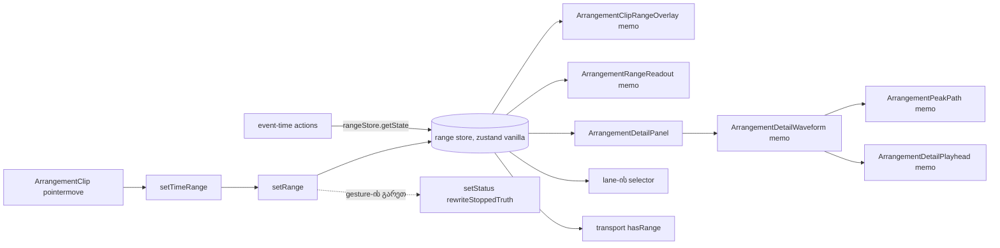

# დროის მონიშვნა საკუთარ range store-ში: drag-ის move-ზე მხოლოდ subscriber-ები render-დება (PERF-8a)

**თარიღი:** 2026-11-03
**სტატუსი:** Completed (C round 324 PASS)
**შეცვლილი პროექტი:** Store (`app/lib/arrangement/range-store.ts`, `app/contexts/ArrangementContext.tsx`, `app/components/arrangement/*`, `perf/budgets.interactions.json`)

## კონტექსტი

`/studio-lab`-ში დროის მონიშვნის (time selection) body drag-ის თითო pointermove-ზე React ზედმეტ სამუშაოს აკეთებდა. PERF-1b-i-ის harness-მა (`interact.drag.range.*`) HEAD-ზე, production build-ში, **108.167 rendered კომპონენტი თითო move-ზე** აჩვენა.

მიზეზი (round 318-ის დაგეგმვისას დადასტურებული მექანიზმი):

- `ArrangementClip`-ის `handlePointerMove` ყოველ move-ზე იძახებს `setTimeRange({...})`-ს: `setTimeRange` → `setRange` → `setRangeState`.
- `range` იყო context-ის ერთი value `useMemo`-ს ველი და მისი dependency. ამიტომ ყოველი move value-ს თავიდან აგებდა და **ყველა** `useArrangement()` consumer თავიდან render-დებოდა.
- Lane ყოველ move-ზე ყოველ გადამფარავ clip-ს ახალ `clipRange` ობიექტს გადასცემდა, ამიტომ clip-ების memo არ მუშაობდა.

მომხმარებლისთვის ხილული ცვლილება არ არის: იცვლება მხოლოდ render-ის სამუშაო drag-ის დროს.

## მიდგომა

1. **Range store.** `range` გავიდა context value-დან და გადავიდა provider-ის საკუთარ zustand vanilla store-ში (`createArrangementRangeStore`). Provider-ი store-ს ერთხელ ქმნის; `useArrangementRange(selector)` ირჩევს საჭირო ნაწილს (`useStore`).
2. **Selector-ის წესი.** Selector ახალ ობიექტს არასდროს აგებს. `selectArrangementClipRange` და `selectArrangementLaneRange` აბრუნებს იმავე `range` reference-ს ან `null`-ს, ამიტომ subscriber მხოლოდ მაშინ render-დება, როცა მისი შედეგი რეალურად შეიცვალა. Store-ის `setRange` იმავე reference-ზე state-ს არ ცვლის (`Object.is`).
3. **Event-time წაკითხვა.** Callback-ები range-ს event-ის დროს კითხულობენ `rangeStore.getState().range`-ით და არა render-ის snapshot-იდან. ერთადერთი დოკუმენტირებული გამონაკლისია `applyDetailRange` (Clip Detail panel), რომელიც render-ის დროის `range`-ს ადარებს input-ების ტექსტს.
4. **Status-ის branch.** `setRange` pointer gesture-ის გარეთ კვლავ გადაწერს stopped Insert Marker status-ს, gesture-ის შიგნით კი არა (როგორც HEAD-ზე).
5. **Memo boundary-ები.** Range-ის subscriber-ები და მათი მეზობლები `memo()`-ში არიან, რომ move-ზე render-დებოდეს მხოლოდ ის, რაც range-ს აჩვენებს:
   - `ArrangementClipRangeOverlay`: clip-ის შიგნით range-ის box და label. Primitive props (`trackId`, `start`, `duration`, `pxPerSecond`), clip-ის დონის selector-ით;
   - `ArrangementRangeReadout`: workspace-ის range readout, props-ის გარეშე;
   - `ArrangementPeakPath`: clip-ისა და detail panel-ის waveform path;
   - `ArrangementDetailPlayhead`: detail panel-ის playhead. პოზიციას წერს `useArrangementPositionWriter`-ით, props-ით არა;
   - `ArrangementDetailWaveform`: detail panel-ის waveform და range overlay.
6. **`XInner` სახელის წესი (D-29z873).** ყოველი memo კომპონენტი იწერება ასე: `function XInner(…) { … }` და შემდეგ `const X = memo(XInner);` (`ArrangementPeakPath`-ზე `export const`). მიზეზი: `const X = memo(function X(…))` ფორმაში esbuild შიდა function expression-ს, რომელიც module const-ს ჩრდილავს, `X2`-ად არქმევს. Render-budget ტესტები კომპონენტს runtime სახელით ითვლიან (`type.name`), ამიტომ `X2` გუშაგებს ჩუმად ცარიელს ხდის. Module-level `function XInner` არ ჩრდილავს არაფერს და სახელი ინახება. ეს პროექტის არსებული convention-ია (`ArrangementClipViewInner`, `ArrangementOverviewInner`, `ArrangementDetailContentInner` და სხვ.).
7. **Detail panel-ის `range` prop.** `ArrangementRangeDetailPanel` wrapper წაიშალა. `ArrangementDetailPanel` თავად subscribe-დება store-ზე, `range` prop კი optional-ია: გადაცემული მნიშვნელობა (`null`-ის ჩათვლით) იმარჯვებს, გამოტოვებისას panel store-ს მიჰყვება.

### განხილული ალტერნატივები

- **O2** (`XMemo = memo(X)`): უარყოფილია. Export-ირებული `ArrangementPeakPath` არა-memo ფუნქციაზე დარჩებოდა და მომავალი caller boundary-ს ჩუმად დაკარგავდა.
- **O3** (`keepNames` build config-ში): უარყოფილია, ყველა module-ზე მოქმედებს.
- **O4** (memo-ების გარეშე): უარყოფილია. Round 319-ის 14.15 per move ≤ 15-ის ბიუჯეტთან მხოლოდ 0.85-ის მარაგს ტოვებდა.

### გადაწყვეტილებები (rulings)

- **D-29z864:** per-move ბიუჯეტი რჩება ≤ 15, max ≤ 35. Move ფანჯრის ყველაზე დიდი commit არის პირველი move-ის null→range გადასვლა: მასში `ArrangementTransport` და მისი lucide icon-ები render-დება (~20 fiber), რადგან `hasRange` transport-ის title-ებსა და enabled state-ს ცვლის. ეს ერთ gesture-ზე ერთხელ ხდება. Transport-ის გაყოფა PERF-10-ის სიგნალია (`SIG-R319-TRANSPORT-FLIP`).
- **D-29z866:** `THIRD_PARTY_NOTICES.md`-ში generator-ის output მიღებულია როგორც არის: 4 ახალი row (`zustand`, `@types/react`, `@types/prop-types`, `csstype`), runtime-ის რაოდენობა 560 → 564. ბოლო სამი zustand-ის optional peer-ის გამო `devOptional` გახდა.
- **D-29z873:** memo-ს სახელი `XInner` ფორმით ხუთივე კომპონენტზე (ზემოთ, პუნქტი 6).
- **D-29z860:** `range` გავიდა `useArrangement()`-დან; მას `useArrangementRange` კითხულობს (round 318-ის grant). PERF-8b-ის შემდეგ (doc 231) range და selection ორივე გარე store-ია და discrete event-ში ერთად commit-დება. `await`-ის შემდეგ ისინი React history-სგან ცალკე commit-დება.

## არქიტექტურა

Context value-ში `range` აღარ არის, ამიტომ `useArrangement()`-ის consumer-ები range-ის ცვლილებაზე აღარ render-დებიან.

## შეცვლილი ფაილები

- `app/lib/arrangement/range-store.ts` (ახალი): store და clip/lane selector-ები.
- `app/contexts/ArrangementContext.tsx`: `range` value-დან გავიდა; `setRange` store-ში წერს; event-time წაკითხვები `rangeStore.getState()`-ით; `useArrangementRange`, `useArrangementRangeStore`.
- `app/components/arrangement/ArrangementClip.tsx`: `ArrangementClipRangeOverlay` (memo child) და `ArrangementPeakPath` (memo).
- `app/components/arrangement/ArrangementLane.tsx`, `ArrangementMarkerRow.tsx`, `ArrangementExportDialog.tsx`, `ArrangementTransport.tsx`: range store-იდან კითხულობენ.
- `app/components/arrangement/StudioWorkspace.tsx`: `ArrangementRangeReadout` (memo), detail wrapper-ის წაშლა.
- `app/components/arrangement/ArrangementDetailPanel.tsx`: optional `range` prop, store-ის subscription, `ArrangementDetailPlayhead` და `ArrangementDetailWaveform` (memo), header chevron-ები module-ის კონსტანტებად.
- `perf/budgets.interactions.json`: 5 range row assert mode-ში (owner PERF-8a).
- `THIRD_PARTY_NOTICES.md`: 4 ახალი row, (564).
- `docs/implementation/2026/quarter-IV/168-perf-interactions-baseline.md`: `## მეტრიკები`-ში asserted row-ების აბზაცი.
- ტესტები: `app/lib/arrangement/__tests__/range-store.test.tsx` (ახალი) და არსებული UI ტესტები, რომლებიც `range`-ს context-იდან კითხულობდნენ.

## პრობლემები და გადაწყვეტები

- **Problem:** round 318-ში A-მ ≤ 15 ვერ მიაღწია (21.033 per move), რადგან detail panel-ის wrapper და clip-ის prop-ები ყოველ move-ზე render-დებოდა. **Solution:** D-29z864-ით detail panel-ის შიდა ნაწილი grant-ში შევიდა; wrapper წაიშალა, clip-ის overlay memo child გახდა.
- **Problem:** round 319-ში `const X = memo(function X(…))` ფორმამ esbuild-ის `X2` სახელი გამოიწვია და ორი render-budget ტესტი გაწითლდა (R11-P1e, CP1); `PARENT_NAMES`-ის Waveform გუშაგი ჩუმად ცარიელი ხდებოდა. **Solution:** D-29z873, `XInner` ფორმა და ხუთი test literal-ის გადარქმევა `…Inner`-ზე.
- **Problem:** `range` prop-ის explicit მნიშვნელობა ტესტით არ იყო დაცული (C-R319-03). **Solution:** RS8 `detail-panel.test.tsx`-ში და ორი mutant.
- **Problem:** notices-ის TL5 წითელი იყო zustand-ის დამატების შემდეგ. **Solution:** regeneration, D-29z866.

## ტესტირება

- **Unit (vitest):**
  - `range-store.test.tsx`: RS1 (ცარიელი start, ზუსტი reference), RS2 (ერთი notification ახალ მნიშვნელობაზე), RS3 (ორი provider დამოუკიდებელია), RS4 (gesture-ის დროს `useArrangement()` consumer არ render-დება), RS5 (clip subscriber მხოლოდ გადაფარვისას), RS6 (stopped status-ის გადაწერა მხოლოდ gesture-ის გარეთ), RS7 (event-time action იმავე batch-ში ჩაწერილ range-ს კითხულობს).
  - `detail-panel.test.tsx`: RS8(a) `range={null}` იმარჯვებს store-ის range-ზე, RS8(b) `range={r}` იმარჯვებს store-ის `null`-ზე, RS8(c) prop-ის გარეშე panel store-ს მიჰყვება remount-ის გარეშე.
  - `render-budget.test.tsx` R11-P1e და `clip-gain-pointer-preview.test.tsx` CP1 ითვლიან `ArrangementDetailPlayheadInner`, `ArrangementDetailWaveformInner` და `ArrangementPeakPathInner` render-ებს.
- **Mutants** (scratch copy-ზე, A round 320): MU-RANGE-IN-VALUE → RS4, MU-LANE-NEW-OBJECT → RS5, MU-NO-STATUS-REWRITE → RS6, MU-STALE-LATESTREF → RS7, C-MU-DETAIL-IGNORE-PROP → RS8(a)/(b), MU-DETAIL-IGNORE-STORE → RS8(c). შედეგები: `a-round-320.md`.
- **Perf (production build):** `interact.drag.range.{stopped,playing}.move-components-per-move` 108.167 (HEAD) → 21.033 (round 318) → 14.15 (round 319, C) → 9.233 (round 320, A). Max: 30 (round 320, A; ბიუჯეტი ≤ 35). Dev profiler-ით steady move: main commit 7 და layout commit 2 კომპონენტი; PeakPath და Playhead bail-დებიან. `interact.drag.range.playing.move-restarts` 0, `interact.harness.drag-range-live` 1.
- **C-ის browser row-ები (round 320):** R-WAVEFORM, R-DRAG, R-DETAIL, R-ALLTRACKS / R-CLEAR / R-SPACE, R-SPLIT / R-DELETE / R-CUT-TIME, R-LOOP / R-ZOOM / R-EXPORT, R-BG / R-MARQUEE / R-TRANSPORT, PERF-RANGE, PERF-NAMED, PERF-LOAD, G320-AUTH; ორივე viewport, baseline-თან შედარებით.

## TODO / შემდეგი ნაბიჯები

- **Stage 2 (PERF-10):** `SIG-R319-TRANSPORT-FLIP` (transport-ის `hasRange` flip-ი პირველ move-ზე), `SIG-R319-CLIPGAIN-PROPS`, `A-R319-ARCH-DETAIL-SUBSCRIPTION` (panel-ის subscription `ArrangementDetailContent`-ში) და `SIG-R320-WAVEFORM-VIDEO-NONBAIL` (video selection-ზე `videoClipGainReason` ახალი node-ია, ამიტომ Waveform-ის memo იქ არ bail-დება).
- **Root / OSS-LIC:** `SIG-R319-DEVOPTIONAL-NOTICES`, ანუ რა ითვლება runtime package-ად.
